# SOXX 基本面深度分析報告
> **報告日期**：2026-11-13 ｜ **語言**：繁體中文 ｜ **數據來源**：Yahoo Finance、Finviz ｜ **分析師**：CFA 級機構研究

> **分析框架說明**：SOXX 是 iShares Semiconductor ETF，不是營運公司。基金本身沒有可供使用的營收、營業利益、資產負債表、公司自由現金流、ROIC 或公司 WACC；因此本報告改以 ETF 的持倉、費用、追蹤品質、集中度、分配與市場估值框架分析。資料包未附持倉明細、費用率、追蹤誤差、AUM、基準指數估值歷史及同類 ETF 倍數。這些缺口不能以猜測補齊，故 DCF、加權合理價值與 MOS 均為 N/A。

---

## 目錄

| # | 章節 | 核心結論 |
|---|------|----------|
| 1 | 執行摘要 | 2026-11-12 收盤價 $154.99；ETF 現金流估值及 MOS 為 N/A，採中性持有觀察 |
| 2 | 公司概覽與商業模式 | 被動半導體產業 ETF；基金持倉與費用率未提供，無法量化集中度及成本優勢 |
| 3 | 損益表深度分析 | ETF 無公司損益表；收入、利潤率、季度 EPS surprise 均為 N/A |
| 4 | 資產負債表分析 | 基金資產與負債明細未提供；不能把「淨現金／負債 $0.00」解讀為基金持倉現金 |
| 5 | 現金流量深度分析 | 基金營業現金流、Capex、FCF 不適用；分配率資料需核實 |
| 6 | 獲利能力與資本效率 | ROIC 與 WACC 不適用於 ETF；應分析成分股而非基金本身 |
| 7 | 相對估值分析 | 本基金 trailing P/E 為 32.801624；同業倍數及歷史估值分位未提供 |
| 8 | DCF 內在價值評估 | DCF 不適用；缺少成分股現金流、基金持倉權重及可驗證估值輸入 |
| 9 | 成長催化劑 | 半導體需求、AI 與晶片週期可能影響持倉，但基金權重與曝險尚未提供 |
| 10 | 風險矩陣 | 半導體週期、估值回撤、成分股集中是主要風險 |
| 11 | 投資建議 | 中性持有觀察；不提供虛構目標價，依價格、估值與持倉資料改善情形調整 |

---

## 1. 執行摘要

### 1.0 一頁式投資儀表板

| 項目 | 內容 |
|------|------|
| **投資論點（3 句）** | ① SOXX 提供半導體產業單一主題曝險，投資人可藉一檔基金參與晶片產業週期。② 2026-11-12 收盤價為 **$154.99**，低於資料包 52 週高點 $218.51 約 29.1%，顯示近期回撤與波動風險不可忽略。③ trailing P/E 為 **32.801624**，但缺少成分股權重、Forward P/E、同業倍數及歷史估值區間，無法判定估值折價或溢價是否合理。 |
| **護城河評分** | **N/A**：ETF 本身不營運半導體業務；基金的產品競爭力須以費用率、追蹤誤差、規模比較，資料未提供 |
| **管理層／資本配置評分** | **N/A**：指數基金不以公司管理層資本配置為主要分析項目 |
| **財務健康** | **N/A**：基金資產負債表、現金及借貸明細未提供 |
| **ROIC vs WACC** | **N/A vs N/A**：不適用於 ETF；需對成分股逐一計算 |
| **FCF 趨勢** | 不適用；基金沒有公司式營業現金流減資本支出的 FCF。FCF Yield 為 N/A |
| **估值** | Trailing P/E **32.801624** ｜ Forward P/E **N/A** ｜ EV/EBITDA **N/A** ｜ FCF Yield **N/A** |
| **DCF 內在價值（基準）** | **N/A**；沒有可稽核的基金現金流預測與持倉權重，不能建立可驗算 DCF |
| **安全邊際（MOS）** | **N/A**；加權合理價值未能計算，故不能計算 MOS。不得以單一 P/E 或價格歷史替代合理價值 |
| **預期報酬（基準情境 12M）** | **N/A**；缺少可驗證的目標價與基金分配資料 |
| **關鍵風險（前二）** | 半導體景氣循環反轉；高估值成分股或產業集中造成較大回撤 |
| **評級 + 信心度** | **🟡 持有／中性觀察；信心：低**。此為資料不足下的觀察性分類，並非依 MOS 門檻推導；MOS 無法計算 |

### 1.1 核心評分儀表板

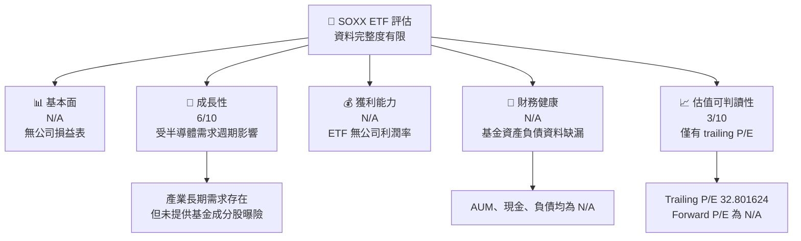

### 1.2 評分進度條視覺化

分數只對可評估維度給出；N/A 不代表 0 分。

```text
╔══════════════════════════════════════════════════════════════╗
║                SOXX 多維度評估儀表板                        ║
╠══════════════════════════════════════════════════════════════╣
║ 成長曝險    6.0 ▓▓▓▓▓▓▓▓▓▓▓▓░░░░░░░░  ★★★☆☆              ║
║ 估值可判讀  3.0 ▓▓▓▓▓▓░░░░░░░░░░░░░░  ★★☆☆☆              ║
║ 基金護城河  N/A  費用率與追蹤誤差未提供                       ║
║ 財務健康    N/A  基金資產負債表未提供                         ║
║ 獲利品質    N/A  ETF 無公司式淨利與 FCF                      ║
╠══════════════════════════════════════════════════════════════╣
║ 綜合結論    中性觀察；ETF 核心營運指標資料不足                 ║
╚══════════════════════════════════════════════════════════════╝
```

### 1.3 五大投資論點 + 三大核心風險

| 類型 | 項目 | 具體依據 | 信心度 |
|------|------|----------|--------|
| 🟢 **投資論點①** | 單一主題曝險 | 基金策略至少 80% 投資於指數成分證券或具相似經濟特性的投資 | 🟢 高 |
| 🟢 **投資論點②** | 半導體產業成長參與 | 新聞摘要涉及 Nvidia、TSMC、Micron、AMD 等產業公司，但未提供 SOXX 個別持倉權重 | 🟡 中 |
| 🟢 **投資論點③** | 近期價格較高點回撤 | 2026-11-12 收盤 $154.99，資料包 52 週高點 $218.51；現價較高點低約 29.1% | 🟢 高 |
| 🟡 **投資論點④** | 定期再平衡可能調整持倉 | 新聞摘要提及 SOXX 增持 AMD 並納入 ASML、Analog Devices；交易規模與權重影響仍需持倉檔案核實 | 🟡 中 |
| 🟡 **投資論點⑤** | 可分散單一公司風險 | ETF 提供多檔證券曝險，但成分股數量、前十大權重及集中度未提供，分散程度無法量化 | 🟡 中 |
| 🟡 **風險①** | 產業循環與估值收縮 | 半導體需求、庫存與資本支出具有週期性；目前 trailing P/E 32.801624，若盈餘下修，價格波動可能放大 | 🟡 中 |
| 🔴 **風險②** | 持倉集中風險 | 基金明列為 non-diversified；具體個股權重未提供，不能量化最大持倉風險 | 🔴 高衝擊 |
| 🟡 **風險③** | 資料品質風險 | 資料包列示 Dividend Yield 27.0%，但沒有分配金額、日期或分配率定義；不宜視為可持續收益率 | 🔴 高 |

### 1.4 快速統計卡片

| 指標 | SOXX 實際值 | 行業均值 | S&P 500 均值 | 狀態 |
|------|-------------|----------|--------------|------|
| TTM 營收成長 | N/A | N/A | N/A | ⚪ 不適用 |
| 毛利率 | N/A | N/A | N/A | ⚪ 不適用 |
| 淨利率 | N/A | N/A | N/A | ⚪ 不適用 |
| ROE | N/A | N/A | N/A | ⚪ 不適用 |
| Trailing P/E | **32.801624** | N/A | N/A | 🟡 僅能作為基金持倉估值參考 |
| Forward P/E | N/A | N/A | N/A | ⚪ 缺資料 |
| P/B | **0.36546317** | N/A | N/A | 🟡 基金聚合指標，來源與可比口徑需查證 |
| Dividend Yield | **27.0%** | N/A | N/A | 🔴 數值需核實，不應直接視為可持續殖利率 |

### 1.5 投資結論

```text
╔══════════════════════════════════════════════════════════════════╗
║                    📊 投資結論摘要                              ║
╠══════════════════════════════════════════════════════════════════╣
║  評級：🟡 持有／中性觀察                                         ║
║  價格（2026-11-12 收盤）：$154.99                                ║
║  DCF 內在價值（基準）：N/A（基金現金流模型不適用）              ║
║  安全邊際 MOS：N/A（加權合理價值不可計算）                      ║
║  目標價區間：悲觀 N/A ｜ 基準 N/A ｜ 樂觀 N/A                   ║
║  投資評分：資料不足，不能以公司制評分直接套用                    ║
║  適合投資人：能承受產業循環與高波動、尋求半導體主題曝險者        ║
╚══════════════════════════════════════════════════════════════════╝
```

**評級依據**：依評級規則，須以 8.8 加權合理價值計算 MOS；但基金持倉估值與可用估值方法資料不足，合理價值與 MOS 均為 N/A。因此不能宣稱符合買入、賣出或強烈買入門檻。此處採「持有／中性觀察」作為資料不足下的審慎分類，而不是 MOS 推導結果。

---

## 2. 公司概覽與商業模式

### 2.1 業務結構與收入來源

SOXX 是交易所交易基金，不是半導體製造商或營運公司。資料包說明基金通常至少 80% 資產投資於指數成分證券及經濟特性實質相同的投資，並可將最多 20% 投資於特定期貨、選擇權、交換合約、現金及現金等價物。基金屬 non-diversified。

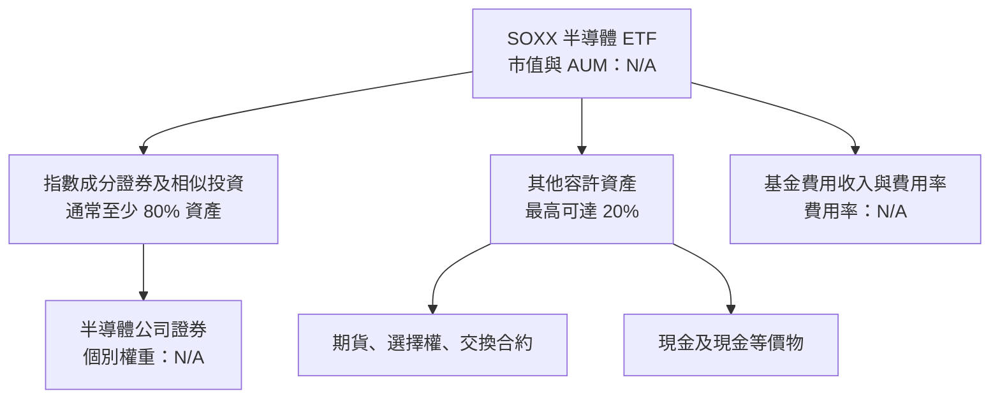

基金並無公司營業收入、軟體服務收入或分部營收；基金管理費、總費用率與其他費用資料未提供。故無法按照公司損益表方式估算「收入來源佔比」。

### 2.2 市場份額

SOXX 的市場份額、AUM，以及在半導體 ETF 市場中的相對規模均未提供。為避免把未查證的基金資產規模或市場份額寫成事實，本報告不繪製虛構的市場份額 pie chart。

| 比較維度 | SOXX | 可得結論 |
|----------|------|----------|
| 基金 AUM | N/A | 不能比較基金規模 |
| 半導體 ETF 市占 | N/A | 缺少同類基金資產與市場資料 |
| 成分股數量 | N/A | 持倉檔未提供 |
| 前十大持倉比重 | N/A | 無法量化集中度 |

### 2.3 競爭護城河分析

SOXX 的產品競爭力，應由費用率、追蹤品質、流動性、基金規模與指數規則評估，而不是使用個股「技術領先」或「客戶鎖定」框架。

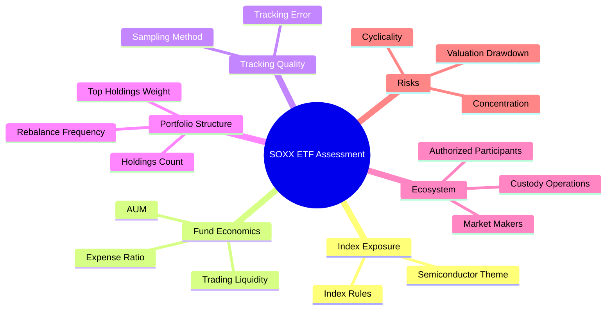

以上各項中，費用率、追蹤誤差、AUM、成分股數量與前十大權重都為 N/A，因此無法判定 SOXX 相對其他半導體 ETF 的結構性優勢。

### 2.4 護城河強度評分

```text
╔══════════════════════════════════════════════════════════════╗
║                 SOXX ETF 產品競爭力評估                     ║
╠══════════════════════════════════════════════════════════════╣
║ 指數代表性      N/A  缺基準指數與規則細節                     ║
║ 費用競爭力      N/A  Expense Ratio 未提供                     ║
║ 追蹤品質        N/A  Tracking Error 未提供                    ║
║ 規模與流動性    N/A  AUM、成交量及買賣價差未提供              ║
║ 持倉透明度      N/A  持倉明細與集中度未提供                    ║
╠══════════════════════════════════════════════════════════════╣
║ 綜合評估        暫不評分；需補齊基金營運與持倉資料              ║
╚══════════════════════════════════════════════════════════════╝
```

---

## 3. 損益表深度分析

### 3.1 年度收入成長趨勢（近 4 年）

ETF 沒有公司營收，資料包年度損益表亦明列無資料，因此收入與 CAGR 均為 N/A。

```text
╔══════════════════════════════════════════════════════════════════╗
║                 SOXX 年度營收分析                                ║
╠══════════════════════════════════════════════════════════════════╣
║  FY-3  營收 N/A  YoY N/A                                         ║
║  FY-2  營收 N/A  YoY N/A                                         ║
║  FY-1  營收 N/A  YoY N/A                                         ║
║  FY0   營收 N/A  YoY N/A                                         ║
║                                                                  ║
║  ETF 不具公司營收；不得將基金資產淨值或成分股營收混作 SOXX 營收  ║
╚══════════════════════════════════════════════════════════════════╝
```

### 3.2 季度收入趨勢分析

| 季度 | 基金營收 | QoQ | YoY | 備註 |
|------|----------|-----|-----|------|
| 最近一季 | N/A | N/A | N/A | ETF 不具公司營收，季度財務表未提供 |
| 前一季 | N/A | N/A | N/A | 同上 |
| 前二季 | N/A | N/A | N/A | 同上 |
| 前三季 | N/A | N/A | N/A | 同上 |

因此，不能計算基金公司式收入成長率，也不能把半導體產業營收增速直接稱為 SOXX 的收入成長。

### 3.3 利潤率演變分析

| 利潤率指標 | FY-3 | FY-2 | FY-1 | FY0 | 趨勢 | 評估 |
|------------|------|------|------|-----|------|------|
| 毛利率 | N/A | N/A | N/A | N/A | 不適用 | ETF 無公司毛利 |
| 營業利益率 | N/A | N/A | N/A | N/A | 不適用 | ETF 無公司營業利益 |
| EBITDA 利潤率 | N/A | N/A | N/A | N/A | 不適用 | 不適用 |
| 淨利率 | N/A | N/A | N/A | N/A | 不適用 | 不適用 |

基金費用率若有資料可用於衡量持有成本，但它不是公司營業利益率。Expense Ratio 未提供，無法分析費用趨勢或相對同類基金的成本優勢。

### 3.4 費用結構分析

基金費用資料未提供，不能以猜測比例繪製費用 pie chart。

```text
╔══════════════════════════════════════════════════════════════╗
║                 SOXX 費用結構資料狀態                        ║
╠══════════════════════════════════════════════════════════════╣
║ 管理費              N/A                                       ║
║ 總費用率            N/A                                       ║
║ 交易與再平衡成本    N/A                                       ║
║ 追蹤差異            N/A                                       ║
║ 資料結論            無法量化成本來源與成本競爭力               ║
╚══════════════════════════════════════════════════════════════╝
```

### 3.5 季度 EPS 趨勢與盈餘品質（Quality of Earnings）

SOXX 沒有公司 EPS 或淨利，資料包 EPS TTM、季度 EPS 歷史與盈餘 surprise 均為 N/A。四季「超預期／不及預期」分析不適用；對 ETF 應改看持倉公司盈餘、指數成分變化與基金追蹤品質。

| 盈餘品質項目 | 數值／佔比 | 評估 |
|--------------|------------|------|
| SBC／營收 | N/A | 基金本身沒有員工薪酬與營收口徑 |
| SBC／營業現金流 | N/A | 不適用 |
| FCF／淨利 | N/A | 不適用 |
| 一次性／非經常性損益 | N/A | 基金財務報表未提供 |
| 有效稅率 | N/A | 基金層級與成分股稅務需分開分析 |
| 資本化支出 vs 費用化 | N/A | 基金沒有公司式 Capex 分析 |
| 最近四季 EPS beat/miss | N/A | 未提供基金或持倉公司完整資料 |

**盈餘品質結論**：不能以 SOXX 本身的 GAAP 淨利或 FCF 評估獲利含金量。對投資人更重要的是成分股盈餘品質、基金費用、分配來源及追蹤差異，目前均缺少必要資料。資料包所列 **Dividend Yield 27.0%** 需特別核實；沒有分配金額、計算期間與分配組成，不能據此認定基金提供 27.0% 可持續現金收益。

---

## 4. 資產負債表分析

### 4.1 資產結構分解

基金資產配置明細與持倉市值未提供；不得將策略上「通常至少 80%」直接當作某期實際持倉比例。

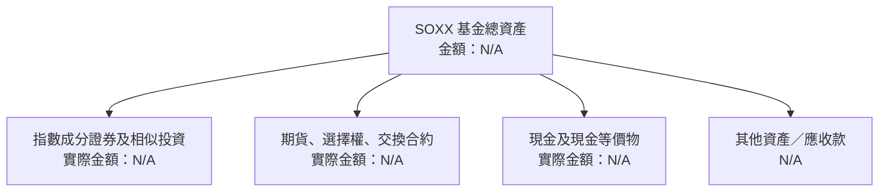

策略描述指出至少 80% 資產通常投入指數成分證券及相似投資，並可將最多 20% 投入特定衍生品、現金及現金等價物；這是投資政策範圍，不是最新持倉快照。

### 4.2 流動性指標分析

| 指標 | SOXX | 半導體 ETF 均值 | 評估 |
|------|------|-----------------|------|
| 基金 AUM | N/A | N/A | 無法評估規模 |
| 現金比例 | N/A | N/A | 無法評估流動性緩衝 |
| 現金／負債 | N/A | N/A | 資料包「Net Cash / Debt $0.00」不是足以重建基金資產負債的明細 |
| 日均成交量 | N/A | N/A | 無法評估二級市場流動性 |
| 買賣價差 | N/A | N/A | 無法量化交易成本 |

### 4.3 債務結構分析

ETF 的基金負債、衍生品抵押品及短期應付款未提供。不得把公司分析中的 Debt/EBITDA 或利息保障倍數套用在基金上。

```text
╔══════════════════════════════════════════════════════════════════╗
║                    SOXX 基金資產負債診斷                        ║
╠══════════════════════════════════════════════════════════════════╣
║ 基金總資產：       N/A  未提供                                   ║
║ 基金總負債：       N/A  未提供                                   ║
║ 現金及短期投資：   N/A  未提供                                   ║
║ 淨現金／淨負債：   不可由公司欄位推定                             ║
║ Debt/EBITDA：      N/A  ETF 不適用                                ║
║ 利息保障倍數：     N/A  ETF 不適用                                ║
╠══════════════════════════════════════════════════════════════════╣
║ 結論：需基金財務報表、持倉與衍生品曝險明細後才能評估             ║
╚══════════════════════════════════════════════════════════════════╝
```

### 4.4 股東權益趨勢

基金沒有公司股東權益與留存盈餘的同一分析口徑。ETF 可分析資產淨值（NAV）、基金單位數及資金流，但相關時間序列未提供，因此不繪製未經驗證的年度趨勢。

---

## 5. 現金流量深度分析

### 5.1 現金流量瀑布圖

下圖為 ETF 分配與資產變動的概念流程，不代表資料包提供了相應實際數值。

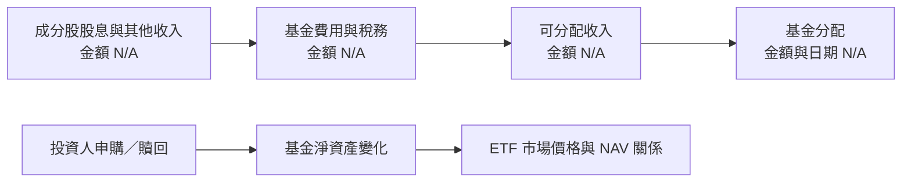

### 5.2 FCF 轉換率趨勢

| 年度 | OCF | Capex | FCF = OCF − Capex | FCF／淨利 |
|------|-----|-------|------------------|-----------|
| FY-3 | N/A | N/A | N/A | N/A |
| FY-2 | N/A | N/A | N/A | N/A |
| FY-1 | N/A | N/A | N/A | N/A |
| FY0 | N/A | N/A | N/A | N/A |

這些是公司現金流分析項目，不適用於 ETF 基金本身。資料包明列 OCF、Capex、FCF 皆 N/A。

### 5.3 自由現金流趨勢

```text
╔══════════════════════════════════════════════════════════════╗
║              SOXX 基金現金流資料狀態                         ║
╠══════════════════════════════════════════════════════════════╣
║ TTM OCF      N/A                                              ║
║ TTM Capex    N/A                                              ║
║ TTM FCF      N/A                                              ║
║ FCF Yield    N/A                                              ║
║ 說明         公司式 OCF − Capex 不適用於 ETF                  ║
╚══════════════════════════════════════════════════════════════╝
```

### 5.4 資本配置評估

基金資產用途由指數規則、申購贖回、再平衡及衍生品政策決定，不等同公司回購、研發、Capex 或股息政策。實際配置比例未提供。

| 資產配置項目 | 實際比重 | 評估 |
|--------------|----------|------|
| 指數成分證券及相似投資 | N/A；策略通常至少 80% | 需最新持倉 |
| 期貨、選擇權、交換合約 | N/A；策略容許範圍內 | 實際使用與曝險未提供 |
| 現金及現金等價物 | N/A | 無法判定現金拖累或流動性緩衝 |
| 基金分配 | Yield 欄列示 27.0%，但未核實 | 不宜當成可持續收益率 |
| 申購／贖回資金流 | N/A | 無法評估資金流向 |

---

## 6. 獲利能力與資本效率

### 6.1 ROE／ROA／ROIC 趨勢

| 指標 | FY-3 | FY-2 | FY-1 | FY0 | 解讀 |
|------|------|------|------|-----|------|
| ROE | N/A | N/A | N/A | N/A | ETF 無公司股東權益報酬率口徑 |
| ROA | N/A | N/A | N/A | N/A | 基金持倉資產報酬不能與公司 ROA 混用 |
| ROIC | N/A | N/A | N/A | N/A | 應對成分股逐一計算 |
| 行業均值 | N/A | N/A | N/A | N/A | 沒有統一成分股權重及比較期 |

### 6.2 ROIC vs WACC 分析（核心價值創造判斷）

```text
╔══════════════════════════════════════════════════════════════════╗
║                ROIC vs WACC 深度分析                             ║
╠══════════════════════════════════════════════════════════════════╣
║ SOXX 基金自身 ROIC：N/A；ETF 不經營半導體生產業務                 ║
║ SOXX 基金自身 WACC：N/A；基金資本成本不是公司 WACC                ║
║ 成分股 ROIC：N/A；持倉權重及公司財務資料未提供                    ║
║ 成分股 WACC：N/A；Rf、ERP、Beta、債務成本與權重未提供             ║
╠══════════════════════════════════════════════════════════════════╣
║ 結論：無法判定 SOXX 持倉整體 ROIC 是否高於 WACC                   ║
║ 投資分析替代方案：取得持倉後按市值權重計算成分股 ROIC−WACC         ║
╚══════════════════════════════════════════════════════════════════╝
```

將基金本身的 beta、負債、現金或營業利益填入 WACC 模型會造成類別錯置；資料包亦未提供 SOXX Beta，故不估造 WACC。

### 6.3 杜邦三因素分解

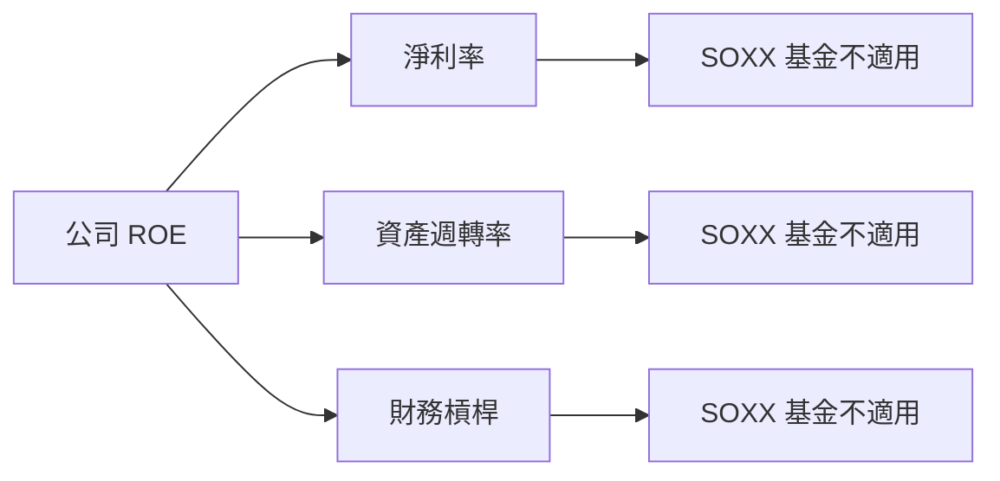

### 6.4 獲利能力儀表板

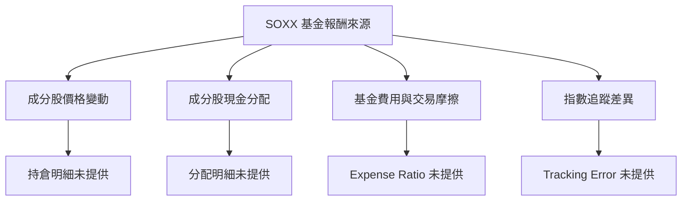

---

## 7. 相對估值分析

### 7.1 同業估值比較表格

資料包未提供 Peer multiples。SOXX 是 ETF，與半導體公司個股相比不是同類估值標的；較合理的同類比較對象是半導體 ETF，例如 SMH、PSI，但其估值數據未提供。因此同業數字不以未驗證估計值填補。

| 估值指標 | **SOXX** | **SMH** | **PSI** | **本公司評估** |
|----------|----------|---------|---------|----------------|
| **Trailing P/E** | **32.801624** | N/A | N/A | 🟡 單一數字不足以比較 |
| **Forward P/E** | N/A | N/A | N/A | ⚪ 無法評估 |
| **P/S** | N/A | N/A | N/A | ⚪ 無法評估 |
| **P/B** | **0.36546317** | N/A | N/A | 🟡 聚合口徑與資料來源待核實 |
| **EV/EBITDA** | N/A | N/A | N/A | ⚪ ETF 不宜直接採企業 EV 口徑 |
| **Expense Ratio** | N/A | N/A | N/A | ⚪ 核心比較項目缺資料 |
| **Tracking Error** | N/A | N/A | N/A | ⚪ 核心比較項目缺資料 |

### 7.2 歷史估值區間分析

VERIFIED FIGURES 未提供「Valuation vs own history」資料，因此歷史 P/E 分位與估值區間為 N/A。

| 指標 | 現值 | 歷史區間／百分位 | 評估 |
|------|------|------------------|------|
| Trailing P/E | 32.801624 | N/A | 無法判定相對自身歷史是否昂貴 |
| Forward P/E | N/A | N/A | 無法評估 |
| P/B | 0.36546317 | N/A | 口徑與歷史序列缺漏 |

### 7.3 情境目標價（假設驅動，Bear / Base / Bull）

SOXX 的基金單位價值由底層持倉市值、現金、負債及基金單位數決定。資料包只提供部分市場價格資料，未提供完整持倉與 NAV，因此不以個股營收 CAGR、營業利潤率或退出倍數為 SOXX 設定目標價。

| 情境 | 營收 CAGR | 營業利潤率 | 退出倍數 | 隱含目標價 | 相對現價 |
|------|-----------|------------|----------|------------|----------|
| 🔴 悲觀 | N/A | N/A | N/A | N/A | N/A |
| 🟡 基準 | N/A | N/A | N/A | N/A | N/A |
| 🟢 樂觀 | N/A | N/A | N/A | N/A | N/A |

**說明**：需取得成分股權重與各成分股預測，才可做自下而上的情境估值。直接把 SOXX trailing P/E 32.801624 套用未來 EPS，因 EPS 與 Forward P/E 均為 N/A，無法形成可稽核價格。

### 7.4 相對估值隱含價格區間

```text
╔══════════════════════════════════════════════════════════════╗
║            相對估值與現價定位                                ║
╠══════════════════════════════════════════════════════════════╣
║ SOXX 最新收盤價（2026-11-12）：$154.99                       ║
║ Forward P/E 隱含價格：N/A                                     ║
║ EV/EBITDA 隱含價格：N/A                                       ║
║ EV/Sales 隱含價格：N/A                                        ║
║ FCF Yield 回推價格：N/A                                       ║
║ 結論：缺少對應分母、同業倍數與持倉數據，不能回推價格區間     ║
╚══════════════════════════════════════════════════════════════╝
```

---

## 8. DCF 內在價值評估（Discounted Cash Flow）

> **適用性結論**：DCF 是以企業或股權現金流估值的方法。SOXX 是基金，沒有自身營業現金流、Capex、稅率、EBIT、債務成本或可直接套用的稀釋股數。成分股現金流與權重資料亦未提供。若硬填 DCF 輸入，將違反資料不完整時不得編造財務數字的原則。本章保留稽核框架，並把不可計算項目明確列為 N/A。

### 8.0 估值推理鏈（Thinking Logic）

**Step 1 — 價值來源**  
SOXX 的價值可理解為基金持有證券的市值，加上現金及其他資產，扣除負債與費用後，再除以流通基金單位。基金策略通常至少 80% 投向指數成分證券及相似投資；最新實際持倉比例、現金比例、成分股權重均未提供。最主導估值的變數是底層成分股市場價格與權重，而非基金本身的營收 CAGR 或營業利潤率。

**Step 2 — 模型選擇**

| 決策點 | 本報告採用 | 理由 | 曾考慮但否決 | 否決理由 |
|--------|-----------|------|--------------|----------|
| 現金流定義 | 不適用 | ETF 無基金層級企業 FCFF 資料 | FCFF／FCFE | 需要持倉公司財務與權重 |
| 預測期 N | 不適用 | 無持倉預測輸入 | 5 年 DCF | 年度現金流基礎資料缺漏 |
| 終值方法 | 不適用 | 無可驗證終值現金流 | Gordon Growth | 無 FCFF、WACC、g |
| EBIT 基礎 | 不適用 | SOXX 無公司 EBIT | GAAP／非 GAAP | 對 ETF 不適用 |
| 合理估值方法 | NAV／持倉穿透估值 | 需持倉、現金、負債與基金單位數 | 直接用 ETF 歷史價格 | 歷史價格不是內在價值 |

**Step 3 — 假設推導鏈**  
營收 CAGR、期末營業利潤率、稅率、Capex、D&A、ΔWC、SBC、稀釋率、WACC、永續成長率與預測期均為 N/A。這不是模型假設，而是缺少適用性與資料基礎，不應使用虛構輸入替代。

**Step 4 — 最脆弱環節**  
任何由半導體產業成長直接推演 SOXX 價值的做法，都會忽略指數權重、估值起點與基金費用；若持倉權重或估值倍數錯估，合理價值可有重大偏差。

**Step 5 — 計算路徑圖**

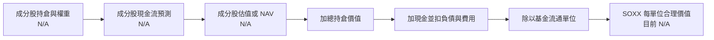

### 8.1 模型假設總表（Model Inputs）

| 假設項目 | 採用值 | 依據／來源 | 敏感度 |
|----------|--------|-------------|--------|
| 預測期長度 N | N/A | SOXX 無公司 FCFF 預測基礎 | 🔴 高 |
| 營收 CAGR | N/A | 基金無公司營收 | 🔴 高 |
| 營業利潤率 | N/A | 基金無公司營業利益 | 🔴 高 |
| 有效稅率 | N/A | 基金與成分股稅務需分層 | 🟢 低 |
| Capex／營收 | N/A | 基金沒有公司 Capex 口徑 | 🟡 中 |
| D&A／營收 | N/A | 基金沒有公司營收與折舊口徑 | 🟢 低 |
| ΔWC／營收增額 | N/A | 基金沒有公司營運資金口徑 | 🟢 低 |
| EBIT 基礎 | 不適用 | ETF 無 EBIT | 🟡 中 |
| SBC 處理 | 不適用 | ETF 無基金層級 SBC 數據 | 🟡 中 |
| 年稀釋率 | N/A | ETF 單位數變動受申購贖回影響，不等於公司 SBC 稀釋 | 🟡 中 |
| 永續成長率 g | N/A | 不適用於缺少基金現金流的模型 | 🔴 高 |
| 終值方法 | N/A | 無預測期現金流 | 🔴 高 |
| WACC | N/A | 基金沒有公司資本結構與公司 WACC | 🔴 高 |

**FCFF 定義**：公司估值通常使用 `FCFF = NOPAT + D&A − Capex − ΔWC`，再以 WACC 折現；SOXX 缺少各成分股合併預測與權重，故不能計算。  
**SBC 防呆說明**：本報告不採用 (A)、(B) 或 (C) 任何公司 DCF 組合，因 SOXX 不是營運公司且成分股 SBC 資料未提供；不將基金單位申贖誤當員工股權稀釋。

### 8.2 折現率推導（WACC）

資料包未提供 Cost of capital inputs：Rf、ERP、Beta、Kd、稅率及資本權重。SOXX Beta 本身亦為 N/A。基金不具公司式資本結構，因此不應編造 WACC。

```text
╔══════════════════════════════════════════════════════════════════╗
║                    WACC 推導（折現率）                           ║
╠══════════════════════════════════════════════════════════════════╣
║ 無風險利率 Rf：N/A                                               ║
║ 市場風險溢酬 ERP：N/A                                            ║
║ SOXX Beta：N/A                                                   ║
║ 股權成本 Ke：N/A                                                 ║
║ 債務成本 Kd：N/A                                                 ║
║ 股權／債務權重：N/A                                              ║
║ WACC：N/A（ETF 不適用公司 WACC；輸入亦缺漏）                     ║
╚══════════════════════════════════════════════════════════════════╝
```

1. **Ke（CAPM）**：N/A，Rf、Beta、ERP 未提供。  
2. **稅前 Kd**：N/A，基金利息費用與計息負債未提供。  
3. **稅後 Kd**：N/A，稅率與 Kd 未提供。  
4. **權重**：N/A，基金市場價值與計息負債口徑不適用。  
5. **WACC**：N/A；第 6.2 節亦為 N/A，兩處一致。

### 8.3 逐年自由現金流預測（基準情境）

SOXX 不具公司年度 FCFF 預測基礎，故不設定預測期 N，不製造逐年預測數字。

| 項目 | FY+1 | FY+2 | FY+3 | FY+4 | FY+5 |
|------|------|------|------|------|------|
| 營收 | N/A | N/A | N/A | N/A | N/A |
| 營收 YoY | N/A | N/A | N/A | N/A | N/A |
| 營業利潤率 | N/A | N/A | N/A | N/A | N/A |
| EBIT | N/A | N/A | N/A | N/A | N/A |
| NOPAT | N/A | N/A | N/A | N/A | N/A |
| D&A | N/A | N/A | N/A | N/A | N/A |
| Capex | N/A | N/A | N/A | N/A | N/A |
| ΔWC | N/A | N/A | N/A | N/A | N/A |
| FCFF | N/A | N/A | N/A | N/A | N/A |
| 折現因子 | N/A | N/A | N/A | N/A | N/A |
| FCFF 現值 | N/A | N/A | N/A | N/A | N/A |

預測期 FCF 現值合計：**N/A**；沒有可相加的年度現金流。  
代表年度演算九步：均為 N/A，因上年營收、利潤率、稅率、D&A、Capex、ΔWC 及 WACC 未提供。  
合理性自檢：歷史 FCF CAGR、預測 FCF CAGR、FCF 利潤率及同業最佳值均為 N/A。

```text
╔══════════════════════════════════════════════════════════════════╗
║            SOXX 自由現金流：實際與模型預測                      ║
╠══════════════════════════════════════════════════════════════════╣
║ 歷史實際 FCF：N/A                                                ║
║ FY+1 至 FY+N 預測：N/A                                           ║
║ 原因：ETF 沒有公司式營業現金流減資本支出的 FCFF 口徑             ║
╚══════════════════════════════════════════════════════════════════╝
```

### 8.4 終值計算（Terminal Value）

適用性檢查：`WACC N/A vs g N/A → WACC > g？無法判定；DCF 不適用。`

| 方法 | 計算式 | 終值 TV | TV 現值 | 佔總 EV 比重 |
|------|--------|---------|---------|--------------|
| Gordon Growth | N/A | N/A | N/A | N/A |
| 退出倍數法 | N/A | N/A | N/A | N/A |

逐步演算：FY+N FCFF、g、WACC、折現因子及 EBITDA 均 N/A，無法產生終值。不是採取 WACC ≤ g 的情況，而是模型輸入整體不適用。

### 8.5 企業價值 → 每股內在價值（Bridge）

```text
╔══════════════════════════════════════════════════════════════════╗
║              企業價值 → 每單位內在價值橋接表                    ║
╠══════════════════════════════════════════════════════════════════╣
║ 預測期 FCF 現值合計            N/A                               ║
║ 終值現值 PV(TV)                N/A                               ║
║ 企業價值 EV                    N/A                               ║
║ + 現金及短期投資               N/A                               ║
║ − 基金負債                     N/A                               ║
║ = 基金淨資產價值               N/A                               ║
║ ÷ 流通基金單位數               資料包列示 shares 7.65M，口徑待核實║
║ 每單位內在價值                  N/A                               ║
║ 市場價格（2026-11-12 收盤）     $154.99                           ║
║ 折溢價（相對 DCF 內在價值）     N/A                               ║
╚══════════════════════════════════════════════════════════════════╝
```

計算五步：EV、基金淨資產、每單位價值及折溢價皆因持倉市值、現金、負債與基金單位口徑不足而 N/A。**本節不計算 MOS**；MOS 的唯一基準應是 8.8 加權合理價值，但該值亦 N/A。

### 8.6 敏感性分析（WACC × 永續成長率）

DCF 缺少基準 WACC、g、FCFF、基金單位數與成分股現金流，敏感性矩陣不能形成可複算數字。以下列出欄位狀態而非虛構價格。

| g／WACC | WACC − 2pp | WACC − 1pp | 基準 WACC | WACC + 1pp | WACC + 2pp |
|---------|------------|------------|-----------|------------|------------|
| g − 1pp | N/A | N/A | N/A | N/A | N/A |
| g − 0.5pp | N/A | N/A | N/A | N/A | N/A |
| 基準 g | N/A | N/A | N/A | N/A | N/A |
| g + 0.5pp | N/A | N/A | N/A | N/A | N/A |
| g + 1pp | N/A | N/A | N/A | N/A | N/A |

三情境 DCF：

| 情境 | 營收 CAGR | 期末營業利潤率 | g | WACC | 每單位內在價值 | 相對現價 | 機率 |
|------|-----------|----------------|---|------|----------------|----------|------|
| 🔴 悲觀 | N/A | N/A | N/A | N/A | N/A | N/A | N/A |
| 🟡 基準 | N/A | N/A | N/A | N/A | N/A | N/A | N/A |
| 🟢 樂觀 | N/A | N/A | N/A | N/A | N/A | N/A | N/A |
| **機率加權** | — | — | — | — | **N/A** | **N/A** | N/A |

敏感度結論：g 每 +1pp、WACC 每 +1pp、營業利潤率每 +1pp 對 SOXX DCF 的影響皆 N/A。實際主導變數為成分股價格、權重、持倉估值與基金費用。

### 8.7 反推 DCF（Reverse DCF：市場在預期什麼）

資料包現價為 $154.99，但只有價格一個觀測值，且成分股現金流模型不存在。因此無法反解單一營收 CAGR、利潤率、g 或 N。

| 求解變數 | 固定輸入 | 市場隱含值 | 公司歷史實際 | 判斷 |
|----------|----------|------------|--------------|------|
| 成分股／基金 CAGR | 其餘 DCF 輸入固定 | N/A | N/A | 無法反解 |
| 期末營業利潤率 | 其餘 DCF 輸入固定 | N/A | N/A | ETF 不適用 |
| 永續成長率 g | 其餘 DCF 輸入固定 | N/A | N/A | 無現金流模型 |
| 預測期 N | 其餘 DCF 輸入固定 | N/A | N/A | 無模型可求解 |

收斂軌跡：N/A；缺少可計算的模型輸入，不能透過試算誠實地聲稱收斂。

### 8.8 估值三角驗證與安全邊際

| 估值方法 | 隱含每單位價值 | 上行空間（÷現價） | 權重 | 說明 |
|----------|-----------------|-------------------|------|------|
| DCF | N/A | N/A | 0% | ETF 不適用公司 DCF |
| 同類 ETF 估值 | N/A | N/A | 0% | SMH、PSI 等倍數未提供 |
| NAV／持倉穿透估值 | N/A | N/A | 0% | 持倉、現金、負債與基金單位資料不足 |
| 分析師共識目標價 | N/A | N/A | 0% | 共識目標價未提供 |
| **加權合理價值** | **N/A** | **N/A** | 無法建立 | 缺少可賦權重的估值輸入 |

加權合理價值算式：**N/A**；資料不足，不能建立「價值 × 權重」總和，也不得以任意權重拼成估值。

```text
╔══════════════════════════════════════════════════════════════════╗
║                  估值區間與安全邊際                              ║
╠══════════════════════════════════════════════════════════════════╣
║ 悲觀估值 N/A ─ 現價 $154.99 ─ 加權合理價值 N/A ─ 基準 DCF N/A   ║
║                                                                  ║
║ MOS = (加權合理價值 − 現價) ÷ 加權合理價值 = N/A                ║
║ 上行空間 = (合理價值 − 現價) ÷ 現價 = N/A                       ║
║ 建議買入區間：N/A（合理價值與 MOS 未能計算）                     ║
║ 合理持有區間：不以本報告虛構估值設定                             ║
║ 減碼考慮區間：以投資人風險預算與持倉曝險管理                     ║
╚══════════════════════════════════════════════════════════════════╝
```

### 8.9 DCF 模型的局限與失效條件

- **終值依賴度**：N/A；沒有終值或企業價值可計算。
- **最脆弱假設**：若將半導體產業總成長直接套用至基金而不考慮指數權重及持倉估值，會系統性扭曲估值。
- **不適用情境**：SOXX 為基金，建議以 NAV 折溢價、持倉穿透估值、費用率、追蹤誤差、資金流及同類 ETF 比較為主。
- **與第 10 章風險矩陣連結**：半導體下行週期會壓低成分股盈利及估值；持倉集中會增加單一公司事件對基金淨值的影響；費用與追蹤差異會造成長期報酬偏離基準。

### 8.10 複算檢核表（Audit Trail）

| # | 檢核項目 | 檢查方式 | 結果 |
|---|----------|----------|------|
| 1 | 所有高／中敏感度輸入均有推導 | 輸入不適用，已明確列 N/A | ✅ 不適用已揭露 |
| 2 | 每個假設都有來歷 | 缺資料者均標示 N/A 與原因 | ✅ |
| 3 | WACC 五步算式與權重 | WACC 不適用，未虛構輸入 | ✅ 不適用 |
| 4 | Kd 與 D 範圍一致 | 基金計息負債資料未提供 | ✅ 不適用 |
| 5 | WACC 與第 6.2 節一致 | 兩處均 N/A | ✅ |
| 6 | 逐年預測欄位符合 N | DCF 預測期不適用，無數值預測 | ✅ 不適用 |
| 7 | FY+1 九步算式可複算 | 缺少現金流輸入 | ✅ 不適用 |
| 8 | 預測期 PV 加總 | 無年度 PV 可加總 | ✅ 不適用 |
| 9 | WACC > g | WACC、g 均 N/A | ✅ 不適用 |
| 10 | 終值基於 FY+N 並折現 N 期 | 無預測期與終值 | ✅ 不適用 |
| 11 | 橋接至每單位價值 | NAV 與持倉資料缺漏 | ✅ 不適用 |
| 12 | SBC 三要素組合相容 | 不建立公司 DCF SBC 假設 | ✅ 不適用 |
| 13 | 敏感性矩陣基準格一致 | 所有估值格均 N/A | ✅ 不適用 |
| 14 | 矩陣 WACC > g 有效性 | WACC、g 未提供 | ✅ 不適用 |
| 15 | 三情境機率合計 | 未設定虛構機率 | ✅ 不適用 |
| 16 | 反推 DCF 單變數求解 | 模型不存在，未假稱收斂 | ✅ 不適用 |
| 17 | MOS 與 1.0 儀表板一致 | 兩處均 N/A；折溢價亦 N/A | ✅ |
| 18 | 完整輸出至第 11 章 | 章節完整 | ✅ |
| 19 | 加權價值等於加權總和 | 無可用價值與權重，不計算 | ✅ 不適用 |
| 20 | 評級符合 MOS 門檻 | MOS N/A，評級明確為中性觀察而非 MOS 結論 | ✅ 已說明限制 |

---

## 9. 成長催化劑

### 9.1 催化劑時間軸

以下為半導體產業可能的觀察主題，不代表 SOXX 或成分股的已確認財測。

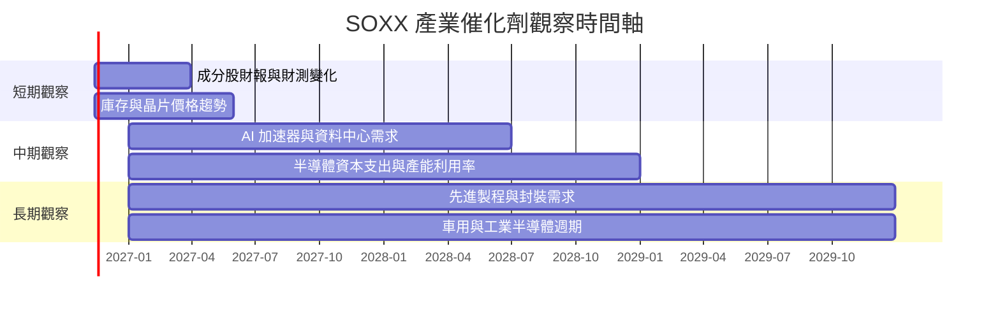

### 9.2 TAM 市場規模分析

未提供可引用的半導體 TAM、各子市場滲透率或 SOXX 持倉營收，因此不以未驗證數字填充市場規模圖。

```text
╔══════════════════════════════════════════════════════════════╗
║                  半導體市場 TAM 資料狀態                     ║
╠══════════════════════════════════════════════════════════════╣
║ AI／資料中心晶片 TAM：N/A   滲透率：N/A   SOXX 曝險：N/A       ║
║ 記憶體 TAM：N/A             滲透率：N/A   SOXX 曝險：N/A       ║
║ 晶圓代工與設備 TAM：N/A     滲透率：N/A   SOXX 曝險：N/A       ║
║ 車用／工業晶片 TAM：N/A     滲透率：N/A   SOXX 曝險：N/A       ║
╠══════════════════════════════════════════════════════════════╣
║ 投資含義：需以指數成分與權重交叉核對，不能將產業 TAM 直接等同 ║
║ SOXX 可捕捉的基金收入或報酬                                  ║
╚══════════════════════════════════════════════════════════════╝
```

### 9.3 成長驅動力結構圖

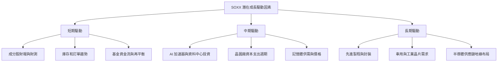

**資料解讀**：新聞摘要提及基金資金流、AMD 增持及新增成分股等事件，但沒有基金完整持倉與每日資金流序列，故這些訊息只能作為後續查證線索，不能直接推導 SOXX 持倉集中度或未來報酬。

---

## 10. 風險矩陣

### 10.1 風險評分矩陣

以下機率與衝擊位置是定性風險排序，不是歷史統計預測。

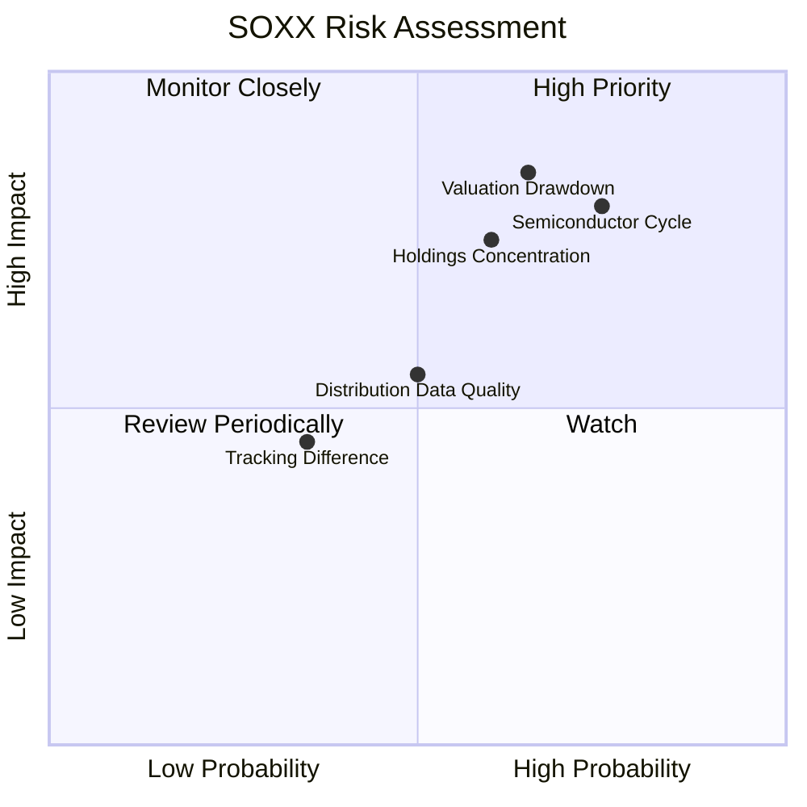

### 10.2 風險清單詳細分析

| # | 風險項目 | 發生機率 | 財務衝擊 | 風險評分 | 緩解措施 |
|---|----------|----------|----------|----------|----------|
| 1 | 🔴 **半導體景氣循環反轉** | 中高；無法可靠量化 | 成分股營收、毛利與估值可能同時承壓；基金價格可能大幅回撤 | 🔴 8/10 | 以分批建倉與部位上限管理；追蹤庫存、訂單、資本支出及成分股財測 |
| 2 | 🔴 **估值收縮與高波動** | 中高；P/E 變動不可預測 | trailing P/E 為 32.801624；若盈餘預期下修或風險偏好下降，估值與盈利可能雙重負向 | 🔴 8/10 | 避免單一估值倍數判斷；以持倉穿透估值、歷史分位與盈利修正交叉監控 |
| 3 | 🔴 **基金持倉集中** | 中；non-diversified 已明示 | 前十大權重與個股比重 N/A；重要成分股事件可能造成不對稱影響 | 🔴 7/10 | 定期查核持倉檔、前十大權重及產業子類曝險 |
| 4 | 🟡 **追蹤誤差與基金成本** | N/A | Expense Ratio、Tracking Error 均 N/A；長期可能侵蝕基準報酬 | 🟡 5/10 | 比較同類 ETF 費用率、NAV 回報與指數回報 |
| 5 | 🟡 **資料包分配率品質** | 中；需核實 | Dividend Yield 27.0% 缺少分配金額與定義，錯用可能導致收益預期失真 | 🟡 6/10 | 查核官方分配公告、分配來源、除息日與 12 個月實際分配 |
| 6 | 🟡 **衍生品及現金配置不透明** | 低至中；實際比重 N/A | 策略容許相關工具，實際曝險與抵押安排未提供 | 🟡 4/10 | 查核基金月報、持倉與衍生品揭露 |

---

## 11. 投資建議

### 11.1 最終綜合評級雷達圖

```text
╔══════════════════════════════════════════════════════════════╗
║                  SOXX 最終評估雷達                           ║
╠══════════════════════════════════════════════════════════════╣
║ 產業成長曝險    6.0 ▓▓▓▓▓▓▓▓▓▓▓▓░░░░░░░░  ★★★☆☆            ║
║ 價格資料完整度  7.0 ▓▓▓▓▓▓▓▓▓▓▓▓▓▓░░░░░░  ★★★★☆            ║
║ 基金成本透明度  N/A  Expense Ratio 未提供                     ║
║ 追蹤品質        N/A  Tracking Error 未提供                    ║
║ 估值可判讀性    3.0 ▓▓▓▓▓▓░░░░░░░░░░░░░░  ★★☆☆☆            ║
║ 持倉透明度      N/A  持倉明細未提供                            ║
╠══════════════════════════════════════════════════════════════╣
║ 最終分類：🟡 中性持有觀察；主要限制是基金核心資料不足          ║
╚══════════════════════════════════════════════════════════════╝
```

### 11.2 目標價與隱含報酬率

| 情境 | 目標價 | 相對 2026-11-12 收盤 $154.99 | 機率權重 | 推導依據 |
|------|--------|-------------------------------|----------|----------|
| 🔴 悲觀 | N/A | N/A | N/A | 未提供持倉與情境估值輸入 |
| 🟡 基準 | N/A | N/A | N/A | DCF、同類 ETF 倍數及 NAV 資料不足 |
| 🟢 樂觀 | N/A | N/A | N/A | 不以主觀數字充作目標價 |
| **機率加權** | **N/A** | **N/A** | N/A | 無可稽核目標價 |

**買賣區間**：目前不設定虛構的價格區間。若投資人已有 SOXX 持倉，建議依其投資組合風險預算、半導體曝險上限及持倉集中度管理；待取得基金官方持倉、費用率與同類 ETF 估值後，再建立可檢驗的買入區間。

### 11.3 買入時機與觸發因素

```text
╔══════════════════════════════════════════════════════════════════╗
║                  ✅ SOXX 交易決策 Checklist                      ║
╠══════════════════════════════════════════════════════════════════╣
║ 進一步評估／分批投入條件：                                       ║
║ ☐ 官方持倉與前十大權重可取得，且集中風險符合投資人上限            ║
║ ☐ 費用率與追蹤誤差可與 SMH、PSI 等同類 ETF 做一致口徑比較         ║
║ ☐ 成分股盈利預期及訂單未出現連續惡化                              ║
║ ☐ 以持倉穿透估值確認價格相對合理價值具足夠折價                    ║
║                                                                  ║
║ 加碼觸發條件：                                                   ║
║ ☐ 市場回撤後，成分股盈利預期仍維持，且估值折價擴大                ║
║ ☐ 基金資金流、流動性與追蹤品質未見惡化                            ║
║                                                                  ║
║ 減碼／風險控制條件：                                             ║
║ ☐ 半導體成分股盈利預期連續下修，且庫存或訂單趨勢轉弱              ║
║ ☐ 基金持倉集中度超出投資組合容忍範圍                              ║
║ ☐ 官方分配資料與資料包所列 27.0% 殖利率差距顯著，收益假設需重估   ║
║ ☐ 基金追蹤差異或交易成本相對同類 ETF 明顯惡化                     ║
╚══════════════════════════════════════════════════════════════════╝
```

### 11.4 投資人適配度分析

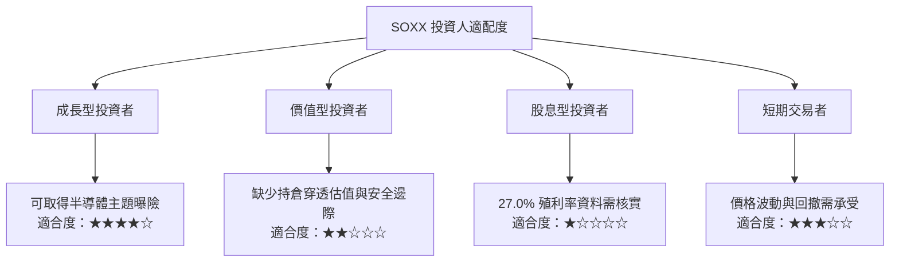

### 11.5 每季監控清單（Quarterly Watch List）

| 監控項目 | 目前資料 | 加碼觀察條件 | 減碼／重新評估條件 |
|----------|----------|--------------|--------------------|
| 前十大持倉權重 | N/A | 成分股與集中度符合既定風險上限 | 集中度升高且投資組合曝險過重 |
| 成分股營收與 EPS 修正 | N/A | 盈利預期穩定或上修 | 連續兩季下修，或需求指標普遍轉弱 |
| 基金 Expense Ratio | N/A | 與同類 ETF 相比具成本競爭力 | 費用或交易成本顯著偏高 |
| Tracking Error | N/A | 長期追蹤品質穩定 | 追蹤差異持續擴大 |
| 基金 AUM 與成交流動性 | N/A | 規模與流動性足以支援投資需求 | AUM 或流動性明顯惡化 |
| NAV 折溢價 | N/A | 折溢價在可接受範圍 | 市價相對 NAV 出現異常溢價或折價 |
| 基金分配與殖利率 | 資料包列 27.0%，待核實 | 官方分配記錄支持該數值及來源 | 實際分配遠低於報價欄位或來源不可持續 |
| 半導體庫存、訂單與資本支出 | N/A | 訂單與庫存趨勢改善 | 庫存累積、取消訂單或資本支出快速下修 |
| 市場估值 | Trailing P/E 32.801624 | 盈利成長足以支撐估值 | 盈利下修且估值未同步調整 |

### 11.6 反面論證：什麼會證明論點錯誤（What Would Change My Mind）

```text
╔══════════════════════════════════════════════════════════════════╗
║              ⚠️ 論點失效條件（Disconfirming Evidence）           ║
╠══════════════════════════════════════════════════════════════════╣
║ 本報告對 SOXX 的中性觀察，若出現下列可查核情況，應重新評估：      ║
║ ☐ 半導體成分股盈利預期連續兩季普遍下修，且訂單／庫存同步轉弱       ║
║ ☐ 基金前十大持倉集中度高於投資人預設上限                          ║
║ ☐ 官方追蹤誤差或總費用相對同類 ETF 顯著惡化                       ║
║ ☐ NAV 與市場價格長期出現不合理折溢價                               ║
║ ☐ 官方分配資料無法支持資料包顯示的 27.0% 殖利率                    ║
║ ☐ 取得穿透估值後，成分股盈利下修且合理價值低於現價                 ║
╠══════════════════════════════════════════════════════════════════╣
║ 關鍵說明：由於基金持倉與費用數據缺漏，目前無法設定可靠的收入成長、 ║
║ 營業利潤率、FCF 或 ROIC 閾值；不以虛構公司指標取代 ETF 監控條件。  ║
╚══════════════════════════════════════════════════════════════════╝
```

> **免責聲明**：本報告為 AI 自動生成，僅供研究參考，不構成投資建議。基金價格可能波動，投資人應查核基金官方持倉、費用、追蹤誤差及分配資料，並依自身風險承受能力作出決策。