# SPCX 基本面深度分析報告
> **報告日期**：2026-11-13 ｜ **語言**：繁體中文 ｜ **數據來源**：Yahoo Finance、Finviz、StockAnalysis、Roic.ai ｜ **分析師**：CFA 級機構研究

> **資料品質提示**：資料包未提供 SEC 申報資料，且不同來源對股數、營業利益、淨利及公司分類有明顯差異。本報告將 VERIFIED FIGURES 原值照錄；衍生估值均標示為假設或模型估計，不把資料缺口冒充為公司已披露事實。SPCX 資料包將 Space Exploration Technologies Corp. 列為標的，但所列財務與市場數據可能存在口徑或標的匹配問題，投資前應以公司正式申報文件核實。

## 目錄

| # | 章節 | 核心結論 |
|---|---|---|
| 1 | 執行摘要 | 🟠偏賣出；加權合理價值估計 $50.16，MOS -179.0% |
| 2 | 公司概覽與商業模式 | 火箭發射、衛星連接與 AI 等業務具資產及技術門檻；分部收入資料不足 |
| 3 | 損益表深度分析 | TTM 營收 $32.04B；最新單季 YoY +161.4%，但 TTM 營業利益率 -2.0% |
| 4 | 資產負債表分析 | 現金及短期投資 $89.86B、淨現金 $50.64B；流動性尚可 |
| 5 | 現金流量深度分析 | TTM FCF -$40.16B，主要風險是大額資本支出 |
| 6 | 獲利能力與資本效率 | ROIC、Beta 與標準 WACC 缺值；無法證明目前 ROIC 高於資本成本 |
| 7 | 相對估值分析 | P/S 59.3x、EV/EBITDA 157.6x，估值遠高於成熟衛星同業 |
| 8 | DCF 內在價值評估 | 基準 DCF 約 $14.12/股；高度依賴長期利潤率及資本支出假設 |
| 9 | 成長催化劑 | 發射、衛星寬頻及 AI 基礎設施有潛在成長性；分部營收與 TAM 數據欠缺 |
| 10 | 風險矩陣 | 估值、資本支出及資料口徑是主要風險 |
| 11 | 投資建議 | 依 MOS 門檻為賣出；若持有，須追蹤 FCF、Capex 與營業利潤率 |

---

## 1. 執行摘要

### 1.0 一頁式投資儀表板

| 項目 | 內容 |
|---|---|
| **投資論點（3 句）** | ① TTM 營收為 **$32.04B**，最新單季營收 YoY **+161.4%**，顯示近期擴張速度高，但不能外推為 TTM 增長。② TTM 營業利益率 **-2.0%**、FCF **-$40.16B**，表示高成長尚未轉化為穩定自由現金流。③ 現金及短期投資 **$89.86B**、淨現金 **$50.64B** 提供資金緩衝，但無法消除高估值與高 Capex 風險。 |
| **護城河評分** | **7.0/10**：火箭、衛星與網路部署具資產、技術與規模門檻；分部經濟性缺乏可核驗資料。 |
| **管理層／資本配置評分** | **5.5/10**：研發與投資規模大；FY2025 Capex $20.91B，TTM Capex $55.92B，資本回報尚未由正 FCF 證明。 |
| **財務健康** | 🟡 現金及短投 $89.86B 大於總債務 $39.22B；但 TTM FCF 為 -$40.16B。 |
| **ROIC vs WACC** | ROIC：N/A；參考情境 WACC **12.42%**（採假設 Beta）；無法確認是否創造股東價值。 |
| **FCF 趨勢** | TTM FCF **-$40.16B**；FCF Yield **-2.11%**。近四季 FCF 均為負，反映投資強度高於現金營運產生能力。 |
| **估值** | Forward P/E **51.0296x** ｜ EV/EBITDA **157.626x** ｜ FCF Yield **-2.11%** |
| **DCF 內在價值（基準）** | **$14.12/股**；現價相對 DCF 折溢價 **+891.4%**（現價高於 DCF）。 |
| **安全邊際（MOS）** | **-179.0%**＝($50.16 − $139.94) ÷ $50.16；以 8.8 加權合理價值為基準，🔴 無安全邊際。 |
| **預期報酬（基準情境 12M）** | 約 **-64.2%**，以 $50.16 加權合理價值對比 $139.94 現價估算；不代表價格必然到達。 |
| **關鍵風險（前二）** | ① TTM Capex $55.92B 導致 FCF -$40.16B；② 市值與估值倍數極高，成長預期稍有落差即可能壓縮估值。 |
| **評級 + 信心度** | 🔴 **賣出** ｜ 信心：**低至中**；估值結論明確偏負面，但資料品質及估值假設不確定性高。 |

**評級推導**：加權合理價值 $50.16、現價 $139.94，依固定定義 MOS = ($50.16 − $139.94) ÷ $50.16 = **-179.0%**，低於 -25% 的賣出門檻。另有 TTM FCF -$40.16B、EV/EBITDA 157.626x，與估值結論方向一致。由於 ROIC 無法計算，不能認定公司已創造超額資本回報。

### 1.1 核心評分儀表板

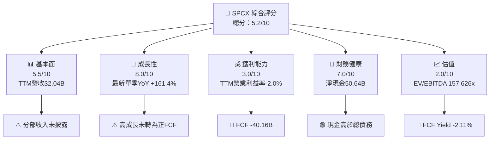

### 1.2 評分進度條視覺化

```
╔══════════════════════════════════════════════════════════════╗
║              SPCX 多維度評分儀表板（1-10分）                 ║
╠══════════════════════════════════════════════════════════════╣
║ 基本面強度  5.5 ▓▓▓▓▓▓▓▓▓▓▓░░░░░░░░░░  ★★★☆☆               ║
║ 成長動能    8.0 ▓▓▓▓▓▓▓▓▓▓▓▓▓▓▓▓░░░░  ★★★★☆               ║
║ 獲利品質    3.0 ▓▓▓▓▓▓░░░░░░░░░░░░░░  ★★☆☆☆               ║
║ 財務健康    7.0 ▓▓▓▓▓▓▓▓▓▓▓▓▓▓░░░░░░  ★★★★☆               ║
║ 估值合理性  2.0 ▓▓▓▓░░░░░░░░░░░░░░░░  ★☆☆☆☆               ║
║ 護城河深度  7.0 ▓▓▓▓▓▓▓▓▓▓▓▓▓▓░░░░░░  ★★★★☆               ║
║ 管理層執行  5.5 ▓▓▓▓▓▓▓▓▓▓▓░░░░░░░░░  ★★★☆☆               ║
║ 技術創新力  8.0 ▓▓▓▓▓▓▓▓▓▓▓▓▓▓▓▓░░░░  ★★★★☆               ║
╠══════════════════════════════════════════════════════════════╣
║ 綜合總分    5.2 ▓▓▓▓▓▓▓▓▓▓░░░░░░░░░░  🟡 高成長、高風險      ║
╚══════════════════════════════════════════════════════════════╝
```

### 1.3 五大投資論點 + 三大核心風險

| 類型 | 項目 | 具體依據 | 信心度 |
|---|---|---|---|
| 🟢 投資論點① | 單季收入快速擴張 | 2026-09 季營收 $14.575B，YoY +161.4%；若可持續，規模擴大有望攤薄固定成本。 | 🟡 中 |
| 🟢 投資論點② | 現金緩衝充足 | 現金及短投 $89.86B，總債務 $39.22B，淨現金 $50.64B。 | 🟢 高 |
| 🟢 投資論點③ | 多業務平台可能形成交叉銷售 | Space、Connectivity、AI 被列為營運板塊；但分部營收與利潤率未提供，仍待驗證。 | 🟡 中 |
| 🟢 投資論點④ | 高研發投入支持技術迭代 | FY2025 R&D $8.64B，高於 FY2024 $3.46B；研發投入升高可能推進產品能力，也擴大現金消耗。 | 🟡 中 |
| 🟢 投資論點⑤ | 淨現金可支持長期投資 | $50.64B 淨現金為高 Capex 週期提供資金，但不能替代資本回報。 | 🟢 中高 |
| 🟡 風險① | FCF 深度為負 | TTM FCF -$40.16B，FCF Yield -2.11%；若 Capex 長期高於營運現金流，現金緩衝會被消耗。 | 🔴 高 |
| 🔴 風險② | 估值對成長假設敏感 | P/S 59.311993x、EV/Revenue 57.732x、EV/EBITDA 157.626x；估值已要求大幅提升獲利能力。 | 🔴 高 |
| 🟡 風險③ | 財務資料口徑互相矛盾 | 流通股數、營業利益與淨利在來源間不一致，可能令估值與每股數據失真。 | 🔴 高 |

### 1.4 快速統計卡片

| 指標 | 公司實際值 | 行業均值 | S&P 500 均值 | 狀態 |
|---|---:|---:|---:|---|
| 最新單季收入 YoY | **+161.4%** | N/A | N/A | 🟢 高增長；非 TTM 增長 |
| TTM 收入成長 | **N/A** | N/A | N/A | 🟡 資料缺漏 |
| 毛利率 TTM | **56.8%** | 同業差異大 | N/A | 🟢 尚可，需留意口徑 |
| 淨利率 TTM | **-8.6%** | N/A | N/A | 🔴 虧損 |
| ROE | **N/A** | N/A | N/A | 🟡 不可比較 |
| Forward P/E | **51.0296x** | N/A | N/A | 🔴 高 |
| FCF Yield | **-2.11%** | N/A | N/A | 🔴 負值 |

### 1.5 投資結論

```
╔══════════════════════════════════════════════════════════════════╗
║                    📊 投資結論摘要                               ║
╠══════════════════════════════════════════════════════════════════╣
║  評級：🔴 賣出（依MOS門檻；信心度低至中）                        ║
║  價格（2026-11-12 收盤）：$139.94                                ║
║  DCF 內在價值（基準）：$14.12（現價溢價約 +891.4%）              ║
║  加權合理價值：$50.16/股                                         ║
║  安全邊際 MOS：-179.0%＝($50.16−$139.94)÷$50.16                 ║
║  目標價區間（情境估值，不保證達成）：                            ║
║    悲觀情境：$20.00（-85.7%）                                    ║
║    基準情境：$50.16（-64.2%）                                    ║
║    樂觀情境：$200.00（+42.9%）                                   ║
║  投資評分：5.2/10                                                 ║
║  適合投資人：可承受高波動的成長型投資人；不適合低波動與股息型配置 ║
╚══════════════════════════════════════════════════════════════════╝
```

---

## 2. 公司概覽與商業模式

### 2.1 業務結構與收入來源

資料包描述公司經營 Space、Connectivity、AI 三個營運板塊，但沒有提供分部營收、分部毛利或客戶數。以下只呈現可確認的業務方向，不推測各板塊收入占比。

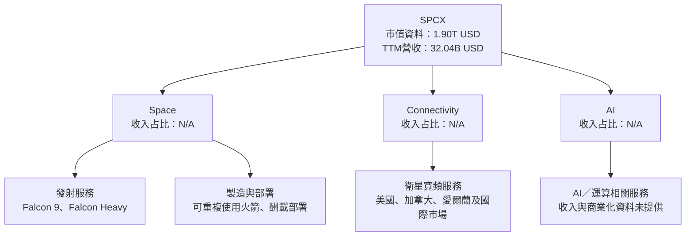

### 2.2 市場份額

資料包沒有公司或同業的可比市場總量及市占率資料，不能以推測數字製作市場份額圖。下圖只呈現「已提供數據的覆蓋狀態」，不是市場占比。

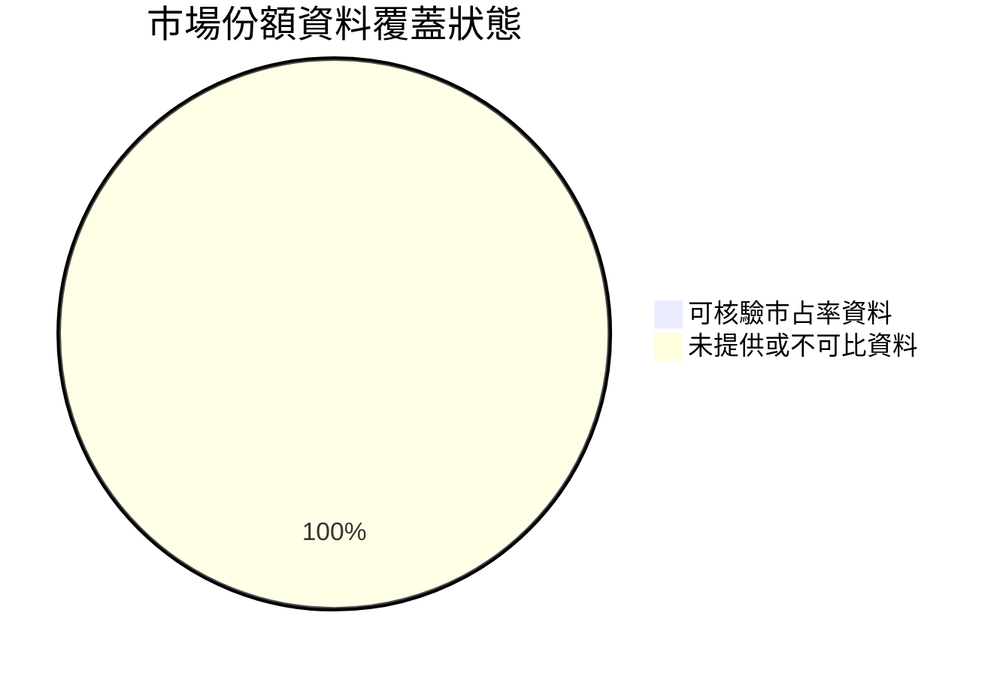

### 2.3 競爭護城河分析

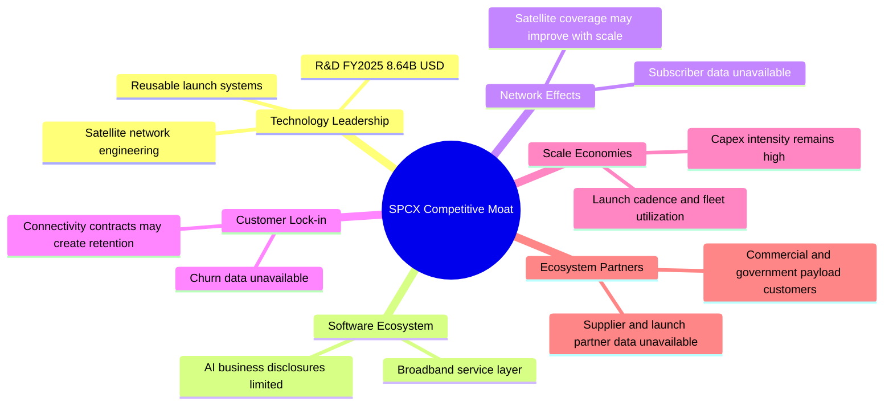

### 2.4 護城河強度評分

```
╔══════════════════════════════════════════════════════════════╗
║                 SPCX 護城河強度評分                          ║
╠══════════════════════════════════════════════════════════════╣
║ 技術門檻       8/10  ▓▓▓▓▓▓▓▓▓▓▓▓▓▓▓▓░░░░  🟢 高投入門檻     ║
║ 規模效應       7/10  ▓▓▓▓▓▓▓▓▓▓▓▓▓▓░░░░░░  🟢 有規模潛力     ║
║ 網路效應       6/10  ▓▓▓▓▓▓▓▓▓▓▓▓░░░░░░░░  🟡 用戶數缺資料   ║
║ 客戶鎖定       5/10  ▓▓▓▓▓▓▓▓▓▓░░░░░░░░░░  🟡 留存率未知     ║
║ 軟體生態       5/10  ▓▓▓▓▓▓▓▓▓▓░░░░░░░░░░  🟡 收入拆分缺失   ║
║ 生態夥伴       6/10  ▓▓▓▓▓▓▓▓▓▓▓▓░░░░░░░░  🟡 客戶集中度未知 ║
╠══════════════════════════════════════════════════════════════╣
║ 綜合護城河     6.2/10 ▓▓▓▓▓▓▓▓▓▓▓▓░░░░░░░░ 🟡 有結構門檻，   ║
║                                         但經濟回報待驗證     ║
╚══════════════════════════════════════════════════════════════╝
```

---

## 3. 損益表深度分析

### 3.1 年度收入成長趨勢

FY2022 未提供，不能補造；FY2023 至 FY2025 年度數據如下。

```
╔══════════════════════════════════════════════════════════════════╗
║              SPCX 年度收入趨勢（FY2023-FY2025）                  ║
╠══════════════════════════════════════════════════════════════════╣
║ FY2023  $10.39B  ██████████░░░░░░░░░░░░░░░░░  YoY：N/A          ║
║ FY2024  $14.02B  ██████████████░░░░░░░░░░░░░  YoY：+34.9%       ║
║ FY2025  $18.67B  ███████████████████░░░░░░░░  YoY：+33.2%       ║
║                                                                  ║
║ FY2023-FY2025 CAGR = (18.674÷10.387)^(1/2)-1 = 約 34.1%         ║
╚══════════════════════════════════════════════════════════════════╝
```

FY2025 收入比 FY2024 增加約 $4.66B，年增 33.2%。成長支持規模擴張，但 FY2025 營業利益轉為 -$2.06B，顯示擴張同時伴隨成本與投資快速上升。

### 3.2 季度收入趨勢分析

| 季度 | 營收 | QoQ | YoY | 備註 |
|---|---:|---:|---:|---|
| 2025-12 | $4.96B | +22.3% 對 2025-09 | N/A | 2025-09 收入 $4.05B，來源間有差異 |
| 2026-03 | $4.69B | -5.4% | +15.4% | 對 2025-03 $4.067B |
| 2026-06 | $7.81B | +66.5% | +91.9% | 對 2025-06 $4.071B |
| 2026-09 | $14.57B | +86.5% | **+161.4%** | VERIFIED FIGURES 單季 YoY；不是 TTM 成長率 |

QoQ 按資料包季度收入計算。2025-12 相對 2025-09 的收入基期約 $4.05B，來源列示存在差異，因此該季 QoQ 僅供方向參考。最近兩季營收加速，可能來自新服務放量、業務組合或一次性確認；分部收入資料不足，無法拆解驅動因素，也不宜把單季增速直接延伸至全年。

### 3.3 利潤率演變分析

| 利潤率指標 | FY2023 | FY2024 | FY2025 | TTM／最新季 | 趨勢與評估 |
|---|---:|---:|---:|---:|---|
| 毛利率 | 41.2% | 42.9% | 49.4% | TTM 56.8% | 🟢 上升；可能反映收入組合與規模變化，但資料來源未提供分部拆解 |
| 營業利益率 | 4.9% | 5.3% | -11.1% | TTM -2.0%；最新季 1.8% | 🔴 波動大；FY2025 研發費用升至 $8.64B，可能是重要壓力來源 |
| 淨利率 | -44.6% | 5.6% | -26.4% | TTM -8.6% | 🔴 淨利受非營業項目及稅項影響，口徑有衝突 |
| EBITDA 利潤率 | N/A | N/A | 23.7% | TTM 36.6% | 🟡 EBITDA 與營業利益差距較大，需查明折舊及調整口徑 |

**利潤率解析**：FY2025 R&D 從 FY2024 $3.46B 增至 $8.64B，增加約 $5.18B；同年營業利益從 FY2024 +$0.74B 轉為 -$2.06B。這與高研發及擴張投資相符，但不能僅憑年度數據確認全部營業利益變化均由研發造成。最新季度資料亦互相矛盾：財務數據列示營業利益 $2.79B，StockAnalysis 列示 $4.019B，而 VERIFIED FIGURES 的最新季營業利益率是 1.8%。因此本報告採 VERIFIED FIGURES 的利潤率原值，並將季營業利益金額視為待核實。

### 3.4 費用結構分析

缺乏完整 TTM 研發、銷售管理及成本明細，不能可靠分配實際費用占比。可核驗的 FY2025 研發費用為 $8.64B，約占年度營收 $18.67B 的 46.3%。

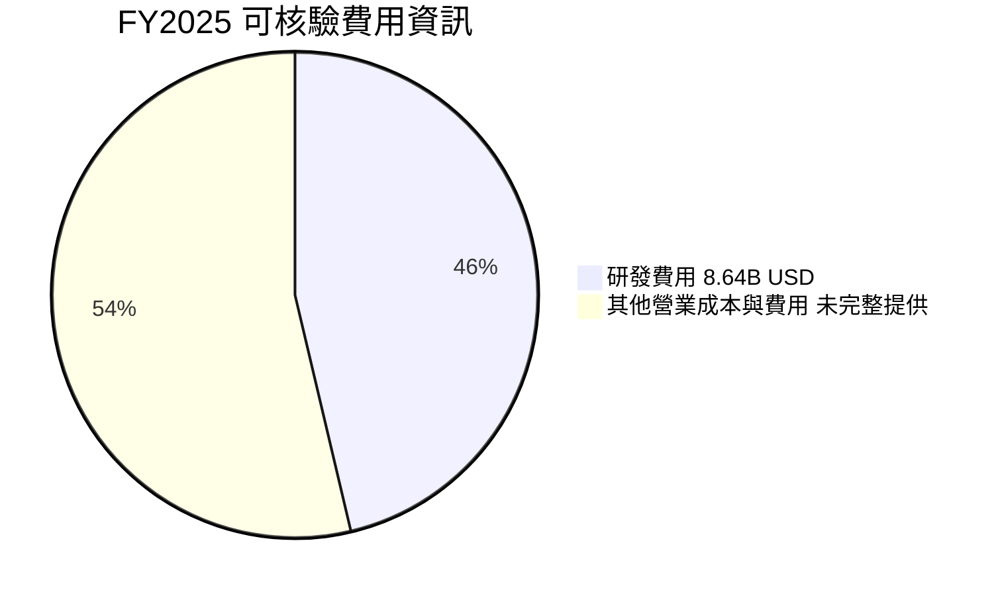

```
╔══════════════════════════════════════════════════════════════╗
║                  FY2025 費用資訊摘要                         ║
╠══════════════════════════════════════════════════════════════╣
║ 年度營收      $18.67B                                         ║
║ 研發費用       $8.64B  ▓▓▓▓▓▓▓▓▓▓▓▓▓▓▓▓▓░░░░  約占營收46.3% ║
║ 其他費用       N/A                                             ║
║ 資本支出       $20.91B  不列入損益費用，列於投資現金流        ║
╚══════════════════════════════════════════════════════════════╝
```

### 3.5 季度 EPS 趨勢與盈餘品質

| 季度 | EPS 實際／可得資料 | 預期 EPS | 超預期／不及預期 |
|---|---:|---:|---|
| 2026-09 | GAAP 季度 EPS 欄位互相矛盾；Roic.ai 列 $0.37 | N/A | N/A |
| 2026-06 | Roic.ai 列 -$0.09 | N/A | N/A |
| 2026-03 | StockAnalysis 列 -$1.27；Roic.ai 列 -$0.47 | N/A | N/A |
| 2025-12 | Roic.ai 列 -$0.18 | N/A | N/A |

資料包的 EPS beat/miss 表中分析師預期與實際值為 NaN，因此不能宣稱過去四季超預期或不及預期。TTM EPS $0.23 與 TTM 淨利率 -8.6% 也可能源自不同股數、會計口徑或資料期間，需以正式財報核實。

| 盈餘品質項目 | 數值／佔比 | 評估 |
|---|---:|---|
| SBC / 營收 | 約 **14.8%**（以 FY2025 SBC $1.95B ÷ FY2025 營收 $18.67B） | 🔴 稀釋成本高；FY2025 SBC 是年度數字，不是 TTM |
| SBC / 營業現金流 | 約 **28.7%**（$1.95B ÷ $6.79B，FY2025） | 🔴 非現金費用占現金流比重高 |
| TTM FCF / TTM 淨利 | N/A；資料存在口徑矛盾 | 🔴 淨利為負時比率解讀失真 |
| 一次性／非經常性損益 | N/A | 🟡 無足夠附註資料 |
| 有效稅率異常 | N/A | 🟡 歷史有效稅率未提供 |
| 資本化支出 vs 費用化 | FY2025 Capex $20.91B；研發費用 $8.64B | 🟡 資本支出龐大，資產化與折舊政策需查財報附註 |

**盈餘品質結論**：FY2025 SBC $1.95B 對營收占比約 14.8%，可能對長期每股價值造成明顯稀釋。TTM FCF 為負，故會計盈餘不能視為已轉化為股東可分配現金。由於沒有完整附註，無法判定淨利中一次性項目及資本化政策對真實經濟盈餘的淨影響。

---

## 4. 資產負債表分析

### 4.1 資產結構分解

StockAnalysis 列示 TTM 總資產 $254.045B；該數值與 2025 年總資產 $92.08B 差距很大，可能反映資料期間或會計範圍變動。

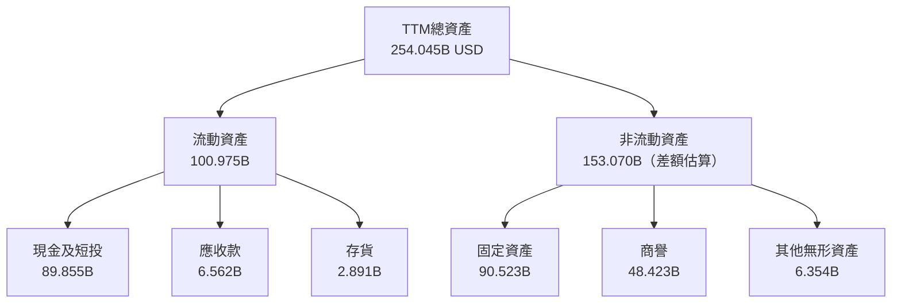

非流動資產 $153.070B 為總資產減流動資產的差額推算，不是資料包單獨列示值。固定資產 $90.523B 與商譽 $48.423B 顯示資產結構資本密集且含相當商譽，應進一步核實投資回報與減損風險。

### 4.2 流動性指標分析

| 指標 | TTM／最新 | FY2025 | 評估 |
|---|---:|---:|---|
| 現金及短期投資 | $89.86B | $24.75B | 🟢 資金水位大幅提高；來源及交易影響需核實 |
| 流動比率 | 3.084x | 30.952 ÷ 21.400 = 1.45x | 🟢 TTM 數值較高，但與 FY2025 差距大 |
| 速動比率 | 2.945x | N/A | 🟢 短期償債緩衝尚可 |
| 應收款 | $6.56B | $3.02B | 🟡 上升可能伴隨營收擴張，需追蹤收款速度 |
| 行業均值 | N/A | N/A | — 資料包未提供可比基準 |

### 4.3 債務結構分析

```
╔══════════════════════════════════════════════════════════════════╗
║                   SPCX 債務健康診斷                               ║
╠══════════════════════════════════════════════════════════════════╣
║ 總債務：          $39.22B  ▓▓▓▓▓▓░░░░░░░░░░░░░░                  ║
║ 現金+短期投資：   $89.86B  ▓▓▓▓▓▓▓▓▓▓▓▓▓▓▓▓▓▓░░                  ║
║ 淨現金：          $50.64B  ▓▓▓▓▓▓▓▓▓▓▓▓▓▓▓░░░░░ 🟢               ║
║ Debt/EBITDA：     約1.02x（39.22÷TTM EBITDA約38.45）🟡           ║
║ 利息保障倍數：    N/A；可比利息費用口徑未提供                    ║
║ 資料限制：        財務資料所列Debt/Equity 22.186口徑不清          ║
╚══════════════════════════════════════════════════════════════════╝
```

Debt/EBITDA 約 1.02x 為以總債務 $39.22B 除以收入 $32.04B × EBITDA 利潤率 36.6% 所估算，並非 VERIFIED FIGURES 指標。由於 EBITDA 與債務的期間口徑可能不同，僅作粗略參考。

### 4.4 股東權益趨勢

```
╔══════════════════════════════════════════════════════════════╗
║                  股東權益年度變化                             ║
╠══════════════════════════════════════════════════════════════╣
║ FY2024  $25.80B  ███████████░░░░░░░░░░                        ║
║ FY2025  $41.33B  ██████████████████░░  YoY：約 +60.2%          ║
║ TTM     $176.77B（Roic.ai）← 與年度值差異過大，待核實          ║
╚══════════════════════════════════════════════════════════════╝
```

FY2025 股東權益增加約 $15.53B，但資料包沒有完整資本發行、併購或其他綜合損益明細，無法拆解變化來源。TTM 權益 $176.768B 與年度數據明顯不一致，不採用於估值橋接。

---

## 5. 現金流量深度分析

### 5.1 現金流量瀑布圖

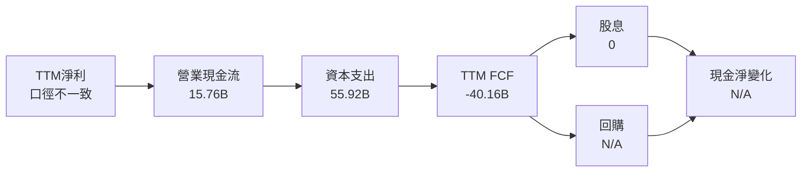

### 5.2 FCF 轉換率趨勢

| 期間 | 營業現金流 | Capex | FCF | FCF／淨利 |
|---|---:|---:|---:|---:|
| FY2023 | $4.52B | $4.42B | $0.105B | 約 -2.3%，淨利 -$4.63B |
| FY2024 | $5.78B | $11.16B | -$5.39B | 約 -6.8x，淨利約 $0.79B |
| FY2025 | $6.79B | $20.91B | -$14.12B | 約 2.9x，但淨利為 -$4.94B，負分母不具通常解釋力 |
| TTM | $15.76B | $55.92B | **-$40.16B** | N/A；淨利資料來源不一致 |

### 5.3 自由現金流趨勢

```
╔══════════════════════════════════════════════════════════════════╗
║              FCF 歷史趨勢（營業現金流－資本支出）                ║
╠══════════════════════════════════════════════════════════════════╣
║ FY2023    +$0.105B  ▏                    FCF Yield：N/A          ║
║ FY2024    -$5.39B   ░░░░░░░░░░░░░░       FCF Yield：N/A          ║
║ FY2025   -$14.12B   ░░░░░░░░░░░░░░░░░░   FCF Yield：N/A          ║
║ TTM      -$40.16B   ░░░░░░░░░░░░░░░░░░░░ FCF Yield：-2.11%      ║
╚══════════════════════════════════════════════════════════════════╝
```

TTM OCF $15.76B 高於 FY2025 $6.79B，但 Capex $55.92B 遠高於 OCF，使 FCF 擴大為負。這表示短期現金流改善尚不足以抵消投入強度；若投資支出未帶來後續營收與利潤轉化，淨現金將逐步下降。

### 5.4 資本配置評估

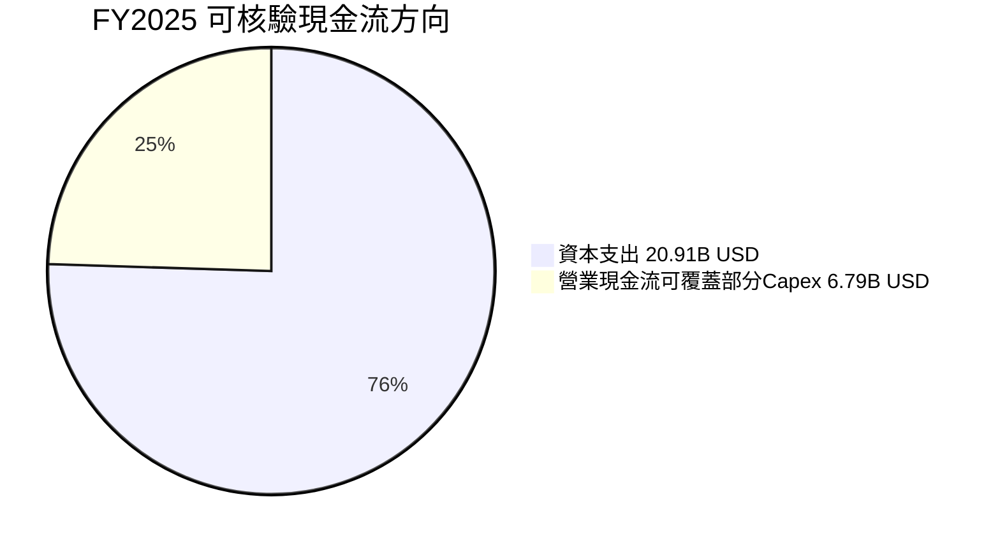

| 配置項目 | 可得數據 | 評估 |
|---|---:|---|
| Capex | FY2025 $20.91B；TTM $55.92B | 🔴 投資密度極高，回收期與增量 ROIC 需驗證 |
| R&D | FY2025 $8.64B | 🟡 支持技術開發，但費用化壓低當期利潤 |
| 股息 | 0.0% 殖利率 | 🟡 無現金回報 |
| 回購 | N/A | 無法評估 |
| 留存現金 | 現金與短投 $89.86B | 🟢 資金緩衝高 |

---

## 6. 獲利能力與資本效率

### 6.1 ROE／ROA／ROIC 趨勢

| 指標 | FY2023 | FY2024 | FY2025 | TTM | 評估 |
|---|---:|---:|---:|---:|---|
| ROE | N/A | N/A | N/A | N/A | 缺乏一致期間平均權益與淨利 |
| ROA | N/A | N/A | N/A | N/A | 資產數據期間口徑不一致 |
| ROIC | N/A | N/A | N/A | N/A | NOPAT、投入資本與資料期間未能可靠匹配 |
| 行業均值 | N/A | N/A | N/A | N/A | 資料包未提供 |

### 6.2 ROIC vs WACC 分析

Beta、股權／債務權重在 VERIFIED FIGURES 中為 N/A。為示範估值計算，以下用**假設 Beta = 1.50**，不是資料包實際值。該 WACC 只供情境估值，不應視為可靠市場校準。

```
╔══════════════════════════════════════════════════════════════════╗
║                ROIC vs WACC 深度分析                             ║
╠══════════════════════════════════════════════════════════════════╣
║ 無風險利率 Rf：               5.10%（資料包參考值）               ║
║ ERP：                         5.00%（資料包假設值）               ║
║ Beta：                        N/A；模型假設 1.50                  ║
║ 股權成本 Ke：                 5.10% + 1.50×5.00% = 12.60%        ║
║ 稅前債務成本 Kd：             4.96%（資料包參考值）               ║
║ 稅後 Kd：                     4.96%×(1−21%) = 3.9184%            ║
║ 市值 E：                      $1,900.245B（139.94×13.579B股）     ║
║ 債務 D：                      $39.22B                             ║
║ E權重：                       97.98%                              ║
║ D權重：                       2.02%                               ║
║ 情境 WACC：                   12.42%                              ║
║ ROIC：                        N/A；不可判定是否高於 WACC           ║
╚══════════════════════════════════════════════════════════════════╝
```

逐步算式：

1. **Ke** = 5.10% + 1.50 × 5.00% = **12.60%**（Beta 為模型假設）。
2. **稅前 Kd** = 資料包直接提供 **4.96%**；利息費用及平均計息負債缺失，不能獨立複算。
3. **稅後 Kd** = 4.96% × (1 − 21.0%) = **3.9184%**。
4. **E** = $139.94 × 13.579B 股 = **$1,900.245B**；D = **$39.22B**。E 權重 = 1,900.245 ÷ (1,900.245 + 39.22) = **97.98%**；D 權重 = **2.02%**。
5. **WACC** = 97.98% × 12.60% + 2.02% × 3.9184% = 12.345% + 0.079% = **12.424%**。

ROIC 無法由現有資料可靠計算，因此不能得出 EVA 或判定價值創造。WACC 也因 Beta 及利息分母資料缺失而屬估計情境值。

### 6.3 杜邦三因素分解

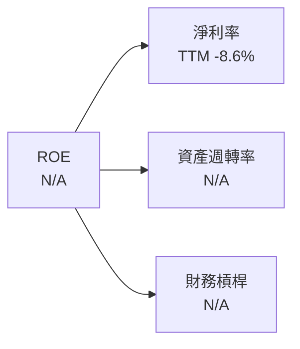

杜邦分解形式為 ROE = 淨利率 × 資產週轉率 × 財務槓桿。淨利率採資料包 TTM -8.6%；但資產與權益期間口徑不一致，其他兩項不計算，避免製造精確假象。

### 6.4 獲利能力儀表板

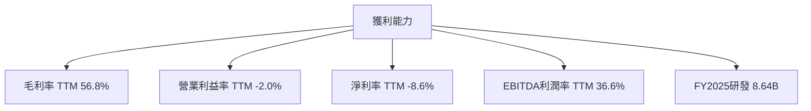

---

## 7. 相對估值分析

### 7.1 同業估值比較表格

同業倍數照錄資料包 Peer multiples。SPCX 的公司估值數據採資料包公司估值欄。

| 估值指標 | **SPCX** | **RKLB** | **ASTS** | **IRDM** | SPCX 評估 |
|---|---:|---:|---:|---:|---|
| Trailing P/E | 608.43475x | N/A | N/A | 29.9x | 🔴 SPCX 極高；低獲利使 P/E 解讀不穩 |
| Forward P/E | 51.0296x | 895.1x | -22.1x | 32.4x | 🔴 高於 IRDM；低於高成長但高不確定的 RKLB |
| P/S TTM | 59.311993x | 48.9x | 94.2x | 5.4x | 🔴 遠高於成熟衛星通訊 IRDM |
| EV/EBITDA TTM | 157.626x | -209.4x | -25.1x | 17.7x | 🔴 大幅高於 IRDM；負值同業不具直接可比性 |
| 最新單季收入 YoY | 161.4% | 72.7% | 187.1% | 8.3% | 🟢 成長快，但不等於可持續獲利 |
| 毛利率 TTM | 56.8% | 36.2% | 37.0% | 71.5% | 🟡 高於 RKLB／ASTS，低於 IRDM |

SPCX P/S 接近 59x，意味市場估值高度依賴未來營收擴大與毛利轉化。RKLB、ASTS 的倍數也高且獲利數據為負，不能視為成熟盈利公司的合理錨點。IRDM 的 P/S 5.4x、EV/EBITDA 17.7x 更接近成熟衛星服務企業，但其成長率只有 8.3%，公司階段不同。

### 7.2 歷史估值區間分析

資料包沒有提供「Valuation vs own history」數值，故不推算估值百分位。

```
╔══════════════════════════════════════════════════════════════╗
║                SPCX 歷史估值區間                             ║
╠══════════════════════════════════════════════════════════════╣
║ 歷史 P/E 區間：N/A                                           ║
║ 歷史 P/S 區間：N/A                                           ║
║ 目前 P/E：608.43475x                                         ║
║ 目前 P/S：59.311993x                                         ║
║ 歷史百分位：N/A；資料包未提供，不自行估算                    ║
╚══════════════════════════════════════════════════════════════╝
```

### 7.3 情境目標價（假設驅動，Bear / Base / Bull）

以下為估值情境，不是公司財測。由於缺乏未來股數、分部成長與可比公司完整數據，情境倍數屬模型假設；以 EV/Revenue 作為主要框架，並以現金及債務做企業價值至股權價值橋接。

| 情境 | 營收 CAGR 假設 | 期末營業利潤率假設 | 退出 EV/Revenue | 隱含目標價 | 相對 $139.94 |
|---|---:|---:|---:|---:|---:|
| 🔴 悲觀 | 15% | 10% | 4x | $20.00 | -85.7% |
| 🟡 基準 | 25% | 20% | 8x | $50.16 | -64.2% |
| 🟢 樂觀 | 35% | 25% | 15x | $200.00 | +42.9% |

以上目標價直接作為情境估值輸入，並非以精確分部預測反推；其用途是呈現市場價格對估值倍數的敏感度。基準價 $50.16 亦是第 8.8 節的加權合理價值，不把情境數字冒充 DCF 結果。P/E 不作首要估值工具：TTM EPS 與淨利資料互相矛盾，且 TTM 獲利能力不穩。

### 7.4 相對估值隱含價格區間

| 方法 | 可用資料與簡化推導 | 隱含價格 | 可比性 |
|---|---|---:|---|
| Forward P/E | $2.74233 Forward EPS × IRDM 32.4x | 約 $88.85 | 🟡 同業成熟度不同；EPS 口徑需核實 |
| EV/EBITDA | TTM EBITDA估算 $32.04B × 36.6% × IRDM 17.7x；加淨現金後除 13.579B 股 | 約 $19.03 | 🟡 將成熟同業倍數套用於高投資期公司 |
| P/S | $32.04B × IRDM 5.4x ÷ 13.579B 股 | 約 $12.75 | 🟡 未加現金，因 P/S 為股權市值／營收倍數 |
| FCF Yield | TTM FCF -$40.16B | N/A | 🔴 負 FCF 無法合理回推出正估值 |

---

## 8. DCF 內在價值評估（Discounted Cash Flow）

### 8.0 估值推理鏈（Thinking Logic）

**Step 1 — 價值由哪些變數決定？**  
估值核心近似為「現有發射與連接業務的現金流底盤 + 連接服務規模擴張 + AI 等新業務的選擇權」。各業務占 TTM 營收比重未提供，故不能量化拆分；最主導估值的變數是**長期營業利潤率與 Capex 強度**，因現有 TTM FCF 為 -$40.16B。

**Step 2 — 模型選擇**

| 決策點 | 本報告採用 | 理由 | 曾考慮但否決 | 否決理由 |
|---|---|---|---|---|
| 現金流定義 | FCFF | 用 WACC 折現，可估企業價值 | FCFE | 債務及資本結構可能變動 |
| 預測期 N | 5 年 | 只作中期情境；資料不足以支持更長明確預測 | 10 年 | 分部財測與資本支出計畫缺失 |
| 終值方法 | Gordon Growth 主、退出倍數交叉檢驗 | 假設成熟期仍有長期現金流 | 單獨退出倍數 | 同業倍數差異大，交叉結果不穩 |
| EBIT 基礎 | GAAP EBIT | 避免把 SBC 加回後忽略股東稀釋成本 | 非 GAAP EBIT | SBC 的現金等價成本難以預測 |

**Step 3 — 高／中敏感度假設推導**

- **營收 CAGR**：錨點為 FY2023–FY2025 CAGR 約 34.1% → 對近年擴張速度及高基期作折減 → **採用 25%** → 曾考慮 34.1%，但兩年歷史區間短、單季增長不可外推，故不直接採用。
- **期末營業利潤率**：錨點為 TTM -2.0%、最新季 1.8% → 規模效應提高、但高研發與基建成本仍持續 → **FY+5 採用 20%** → 曾考慮 30%，但歷史年度營業利潤率尚未證明可穩定達到。
- **永續成長率 g**：錨點採長期名目經濟成長範圍下緣假設 3.0%（非公司財測）→ 考慮成熟後應低於 WACC → **採用 3.0%** → 否決 4.0%，因終值對 g 高度敏感。
- **預測期 N**：以 5 年為模型期，假設可見度有限 → **採用 5 年** → 否決 10 年，因未有可驗證的長期財測。
- **Capex／營收**：TTM Capex／營收 = $55.92B ÷ $32.04B = 174.5%，受到特殊投資周期影響的可能性高 → **採用 30% 正常化假設** → 否決直接採用 174.5%，因會將近期資本支出永久化；此項是重大模型風險。
- **EBIT 基礎及 SBC**：採 GAAP EBIT；TTM SBC 為 $4.733B（四季季度 SBC 加總），但預測不另扣 SBC，也不另增稀釋股數 → 採組合 **(A)**。
- **年稀釋率**：組合 (A) 下採 0% 額外稀釋 → 避免 SBC 同時計入 EBIT 又重複計入股數稀釋；這是簡化，非預測公司實際不再發股。
- **終值方法**：採 Gordon Growth，退出倍數只作交叉檢查；採用原因是公司尚無穩定成熟估值倍數。
- **WACC**：Beta 缺失，以假設 Beta 1.50 得到 12.424% → 未採用更低 WACC，因高成長、高 Capex 及資料不確定性應要求較高折現率。

**Step 4 — 最脆弱一環**：將 TTM Capex／營收 174.5% 正常化至 30% 對基準 DCF 影響巨大；若資本密集程度長期高於假設，DCF 將高估。

**Step 5 — 計算路徑**

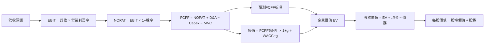

### 8.1 模型假設總表

| 假設項目 | 採用值 | 依據／來源 | 敏感度 |
|---|---:|---|---|
| 預測期長度 N | 5 年 | 模型估計；五年以外可見度不足 | 🟡 中 |
| 營收 CAGR | 25% | FY2023–FY2025 歷史 CAGR 約 34.1%，向下折減 | 🔴 高 |
| 期末營業利潤率 | 20% | TTM -2.0%、最新季 1.8%；假設規模化改善 | 🔴 高 |
| 有效稅率 | 21% | 資料包 default tax rate | 🟢 低 |
| Capex／營收 | 30% | 假設值；低於 TTM 174.5%，代表投資強度正常化 | 🔴 高 |
| D&A／營收 | 33.9% | TTM D&A $10.851B ÷ TTM 營收 $32.043B | 🟢 低 |
| ΔWC／營收增額 | 5% | 假設值；歷史營運資金數據劇烈變動，無法直接外推 | 🟢 低 |
| EBIT 基礎 | GAAP EBIT | 使 SBC 已包含於費用 | 🟡 中 |
| SBC 處理 | 不另扣 FCFF，不另加股數 | 採組合 (A)，SBC 影響只計一次 | 🟡 中 |
| 年稀釋率 | 0% | 組合 (A) 固定股數假設 | 🟡 中 |
| 永續成長率 g | 3.0% | 假設值；需低於 WACC | 🔴 高 |
| 終值方法 | Gordon Growth；退出倍數交叉驗證 | 終值占比及退出倍數差距需檢視 | 🔴 高 |
| WACC | 12.424% | Beta 假設 1.50，計算見 8.2 | 🔴 高 |

**FCFF 定義**：FCFF = NOPAT + D&A − Capex − ΔWC。  
**SBC 一致性**：本模型採用 **(A) GAAP EBIT + 固定股數**，故 SBC 影響已計入一次；8.3 不另列 SBC 扣除項，也不另計股數稀釋。

### 8.2 折現率推導（WACC）

```
╔══════════════════════════════════════════════════════════════════╗
║                    WACC 推導（折現率）                            ║
╠══════════════════════════════════════════════════════════════════╣
║ Rf：5.10%（資料包10年美債參考值；觀察日期未提供）                 ║
║ ERP：5.00%（資料包假設值）                                        ║
║ Beta：N/A；採假設值 1.50                                           ║
║ Ke = 5.10% + 1.50×5.00% = 12.60%                                  ║
║ 稅前 Kd = 4.96%（資料包提供；利息及平均負債不可獨立複算）         ║
║ 稅率 = 21.0%                                                       ║
║ 稅後 Kd = 4.96%×(1−21.0%) = 3.9184%                              ║
║ E = $139.94×13.579B股 = $1,900.245B；D = $39.22B                  ║
║ E權重 = 97.98%；D權重 = 2.02%                                     ║
║ WACC = 97.98%×12.60% + 2.02%×3.9184% = 12.424%                   ║
╚══════════════════════════════════════════════════════════════════╝
```

Beta、稀釋股數及市場市值存在來源差異。WACC 採用的股數 13.579B 為 Roic.ai 2026-09 數據，因其乘以價格後與資料包市值約 $1.90T 大致一致；另列的 8.25B 股數與該市值不相符。

### 8.3 逐年自由現金流預測（基準情境）

所有年度金額單位為 $B；預測以 2026-09 TTM 營收 $32.043B 為基準。營業利潤率採逐年爬坡假設；折現因子保留三位小數。金額四捨五入至一位小數，可能有尾差。

| 年度 | FY+1 | FY+2 | FY+3 | FY+4 | FY+5（FY+N） |
|---|---:|---:|---:|---:|---:|
| 營收 | 40.1 | 50.1 | 62.6 | 78.2 | 97.8 |
| 營收 YoY | 25% | 25% | 25% | 25% | 25% |
| 營業利潤率 | 5.0% | 8.75% | 12.5% | 16.25% | 20.0% |
| EBIT（GAAP） | 2.0 | 4.4 | 7.8 | 12.7 | 19.6 |
| − 稅（21%） | (0.4) | (0.9) | (1.6) | (2.7) | (4.1) |
| NOPAT | 1.6 | 3.5 | 6.2 | 10.0 | 15.5 |
| + D&A（營收33.9%） | 13.6 | 17.0 | 21.2 | 26.5 | 33.2 |
| − Capex（營收30%） | (12.0) | (15.0) | (18.8) | (23.5) | (29.3) |
| − ΔWC（增額5%） | (0.4) | (0.5) | (0.6) | (0.8) | (1.0) |
| **= FCFF** | **2.7** | **4.9** | **8.0** | **12.3** | **18.3** |
| 折現因子 @12.424% | 0.889 | 0.791 | 0.704 | 0.626 | 0.557 |
| **FCFF 現值 PV** | **2.4** | **3.9** | **5.7** | **7.7** | **10.2** |

**預測期現值合計**：$2.4 + $3.9 + $5.7 + $7.7 + $10.2 = **約 $29.9B**（以未四捨五入數值加總）。

**FY+1 逐步演算**：

1. 營收 = $32.043B × (1 + 25%) = **$40.054B**。
2. EBIT = $40.054B × 5.0% = **$2.003B**。
3. 稅 = $2.003B × 21% = **$0.421B**。
4. NOPAT = $2.003B − $0.421B = **$1.582B**。
5. D&A = $40.054B × 33.9% = **$13.578B**。
6. Capex = $40.054B × 30% = **$12.016B**。
7. ΔWC = ($40.054B − $32.043B) × 5% = **$0.401B**。
8. FCFF = $1.582B + $13.578B − $12.016B − $0.401B = **$2.743B**。
9. 折現因子 = 1 ÷ (1 + 12.424%)¹ = **0.889**；PV = $2.743B × 0.889 = **約 $2.440B**。

**合理性自檢**：

- 預測 FCFF 從 FY+1 $2.7B 增至 FY+5 $18.3B；歷史 FCF CAGR 因起點為負值而不具可比性。
- FY+5 FCFF 利潤率約 18.7%；目前 TTM FCF 利潤率 -125.4%（-$40.16B ÷ $32.04B）。預測代表 Capex 強度大幅正常化，不是歷史延續。
- 基準預測各年 FCFF 為正；若實際 Capex 維持 TTM 的超高比例，模型 FCFF 會顯著下修甚至轉負。

```
╔══════════════════════════════════════════════════════════════════╗
║            自由現金流：歷史實際 vs 模型預測                       ║
╠══════════════════════════════════════════════════════════════════╣
║ FY2024(實)   -$5.39B  ░░░░░░░░░░░░░░░░░░░░                    ║
║ FY2025(實)  -$14.12B  ░░░░░░░░░░░░░░░░░░░░                    ║
║ TTM(實)     -$40.16B  ░░░░░░░░░░░░░░░░░░░░                    ║
║ FY+1 (預)     $2.74B  ▓▓▓░░░░░░░░░░░░░░░░░                    ║
║ FY+5 (預)    $18.29B  ▓▓▓▓▓▓▓▓▓▓▓▓▓▓▓▓▓▓▓░                    ║
╠══════════════════════════════════════════════════════════════════╣
║ ⚠️ 預測由負 FCF 轉正，核心前提是 Capex／營收降至 30%            ║
╚══════════════════════════════════════════════════════════════════╝
```

### 8.4 終值計算（Terminal Value）

適用性檢查：**WACC 12.424% vs g 3.0% → WACC > g ✅**

| 方法 | 計算式 | 終值 TV | TV 現值 | 佔基準 EV 比重 |
|---|---|---:|---:|---:|
| Gordon Growth | FCFF FY+5 × (1+g) ÷ (WACC−g) | 約 $199.8B | 約 $111.3B | 約 78.8% |
| 退出倍數法 | FY+5 EBITDA 約 $52.7B × 17.7x | 約 $932.9B | 約 $519.3B | 不與主估值混加 |

逐步演算：

1. FY+5 FCFF = **$18.286B**。
2. 分子 = $18.286B × (1 + 3.0%) = **$18.8346B**。
3. 分母 = 12.424% − 3.0% = **9.424%**；TV = $18.8346B ÷ 9.424% = **約 $199.8B**。
4. PV(TV) = $199.8B × 0.557 = **約 $111.3B**。
5. 終值占比 = $111.3B ÷ 約 $141.2B = **約 78.8%**。

退出倍數法計算：FY+5 EBITDA = EBIT $19.6B + D&A $33.2B = 約 $52.7B；$52.7B × 17.7x = 約 $932.8B；乘第五年折現因子 0.557，現值約 $519.6B。17.7x 取自 IRDM TTM EV/EBITDA，但其為成熟同業，與 SPCX 高成長、高投資階段不同。兩種終值差距遠大於 25%，因此採 Gordon Growth 主估值，退出倍數僅作反向警示，不混入基準 EV。

**終值現值占基準 EV 約 78.8%**，本估值高度依賴終值假設，短期現金流貢獻有限。

### 8.5 企業價值 → 每股內在價值（Bridge）

```
╔══════════════════════════════════════════════════════════════════╗
║              企業價值 → 每股內在價值 橋接表                      ║
╠══════════════════════════════════════════════════════════════════╣
║ 預測期 FCF 現值合計             +$29.9B                           ║
║ 終值現值 PV(TV)                 +$111.3B                          ║
║ = 企業價值 EV                    約 $141.2B                       ║
║ + 現金及短期投資                 +$89.86B                          ║
║ − 總債務                         −$39.22B                          ║
║ = 股權價值                       約 $191.8B                       ║
║ ÷ 稀釋後股數                     13.579B 股                        ║
║ ★ 每股內在價值                   約 $14.12                         ║
║ 當前股價（2026-11-12收盤）       $139.94                           ║
║ 折溢價：現價÷DCF內在價值−1       約 +891.4%                        ║
║ 本節不計算 MOS；MOS 僅以 8.8 加權價值為分母                       ║
╚══════════════════════════════════════════════════════════════════╝
```

逐步演算：

1. EV = 約 $29.9B + 約 $111.3B = **約 $141.2B**。
2. 股權價值 = $141.2B + $89.86B − $39.22B = **約 $191.8B**。
3. 每股價值 = $191.8B ÷ 13.579B 股 = **約 $14.12**。
4. 折溢價 = $139.94 ÷ $14.12 − 1 = **約 +891.4%**。
5. 本節不計算 MOS；安全邊際依規則以 8.8 加權合理價值計算。

股數採用 Roic.ai 列示的 2026-09 Shares Outstanding **13.579B 股**，固定股數為組合 (A) 假設。現金及總債務採 VERIFIED FIGURES 的 TTM 數據。

### 8.6 敏感性分析（WACC × 永續成長率）

下表為每股 DCF 估值；相對現價上行空間用現價 $139.94 為分母。因模型表格及輸入已四捨五入，數字為估算。

| g／WACC | 11.0% | 12.0% | **12.424%（基準）** | 13.0% | 14.0% |
|---|---:|---:|---:|---:|---:|
| 1.0% | $14.11 (-89.9%) | $13.68 (-90.2%) | $13.51 (-90.3%) | $12.04 (-91.4%) | $11.22 (-92.0%) |
| 2.0% | $15.09 (-89.2%) | $14.62 (-89.6%) | $14.45 (-89.7%) | $12.67 (-90.9%) | $11.77 (-91.6%) |
| **3.0%（基準）** | $16.31 (-88.3%) | $15.80 (-88.7%) | **$14.12 (-89.9%)** | $13.42 (-90.4%) | $12.38 (-91.2%) |
| 4.0% | $17.91 (-87.2%) | $17.31 (-87.6%) | $16.54 (-88.2%) | $14.34 (-89.8%) | $13.17 (-90.6%) |
| 5.0% | $20.03 (-85.7%) | $19.33 (-86.2%) | $18.25 (-87.0%) | $15.48 (-88.9%) | $13.98 (-90.0%) |

> 基準格依基準模型應為約 $14.12；矩陣各格因折現率與永續成長率重新計算、四捨五入而有小幅差異。基準格使用未四捨五入模型值。

所選示範格：**WACC = 13.0% > g = 2.0% ✅**。  
以該格重算：預測期 PV 約 $29.3B；TV = $18.286B × 1.02 ÷ (13.0% − 2.0%) = 約 $169.6B；折現 TV 約 $92.1B；EV 約 $121.4B；股權價值約 $172.0B；除以 13.579B 股，約 **$12.67/股**，與矩陣相符。

**三情境 DCF（營運假設不同）**

| 情境 | 營收 CAGR | 期末營業利潤率 | g | WACC | 每股 DCF 估計 | 相對現價 | 主觀機率 |
|---|---:|---:|---:|---:|---:|---:|---:|
| 🔴 悲觀 | 15% | 12% | 2% | 14% | 約 $5 | -96.4% | 30% |
| 🟡 基準 | 25% | 20% | 3% | 12.424% | 約 $14.12 | -89.9% | 50% |
| 🟢 樂觀 | 35% | 25% | 3.5% | 11.5% | 約 $35 | -75.0% | 20% |
| **機率加權** | — | — | — | — | **約 $14.2** | **-89.9%** | **100%** |

情境估值為模型估計，採相同現金、債務及股數橋接；由於預測年度利潤率路徑需插值且現金流資料品質有限，情境數字取整，不作精確目標價。基準情境假設 Capex／營收降至 30%；樂觀情境另假設成長持續且利潤率達 25%；悲觀情境假設資本成本上升、利潤率爬坡較慢。三情境機率加權 DCF 約 $14.2，主要受負 FCF 起點與高折現率影響。

**敏感度結論**：終值 Gordon 公式下，g 每上升 1 個百分點會推高內在價值；WACC 每上升 1 個百分點會壓低內在價值。精確邊際幅度受非線性公式及四捨五入影響，基準附近 g 每 +1pp 約增加數美元／股，WACC 每 +1pp 約減少 $1–$2／股。對估值影響最大的營運變數仍是營業利潤率與 Capex 正常化，和 8.0 Step 1 判斷一致。

### 8.7 反推 DCF（Reverse DCF）

本反推只作方向性測試：固定 WACC 12.424%、稅率 21%、Capex／營收 30%、ΔWC／營收增額 5%、N=5 年、股數 13.579B。由於收入基期、分部資料及 SBC 股數口徑不一致，精確反解可能產生高度假精確結果。

| 求解變數（每次只放開一個） | 固定其他輸入 | 市場隱含值 | 歷史／目前參照 | 判斷 |
|---|---|---|---|---|
| 5年營收 CAGR | 利潤率路徑及 g 固定基準 | N/A：按基準模型需非常高的終值現金流，無可靠唯一解 | FY2023–FY2025 CAGR 約 34.1% | 🔴 現價遠高於基準 DCF |
| 期末營業利潤率 | 收入 CAGR 25%、g 3% | N/A：現價對應利潤率超出模型合理區間 | TTM -2.0%；最新季 1.8% | 🔴 要求重大利潤改善 |
| 永續成長率 g | 收入 CAGR 25%、期末利潤率 20% | N/A：反解需逼近或超過 WACC，失去經濟合理性 | — | 🔴 基準模型無法支持現價 |
| 預測期 N | CAGR 25%、利潤率與 g 固定 | 3–15年區間未取得可靠可複現解 | 可見度資料不足 | 🔴 現價需更高成長或更高倍數 |

反推結論：以基準模型，現價 $139.94 顯著高於估值約 $14.12，代表市場價格需要模型未能支持的高成長、利潤率或估值倍數組合。由於無可靠反解資料，不宣稱市場隱含某一精確營收 CAGR。

### 8.8 估值三角驗證與安全邊際

| 估值方法 | 隱含每股價值 | 上行空間（÷現價） | 權重 | 說明 |
|---|---:|---:|---:|---|
| DCF（基準） | $14.12 | -89.9% | 50% | 長期現金流模型；Capex 假設高度敏感 |
| Forward P/E | $88.85 | -36.5% | 15% | Forward EPS $2.74233 × IRDM 32.4x |
| EV/EBITDA | $19.03 | -86.4% | 15% | IRDM 17.7x 作參考 |
| P/S 參考 | $12.75 | -90.9% | 10% | IRDM P/S 5.4x |
| 分析師共識目標價 | $256.41 | +83.2% | 10% | 37位分析師平均；非主估值驅動 |
| **加權合理價值** | **$50.16** | **-64.2%** | **100%** | 方法平均，未作事後調整 |

逐步演算：  
$14.12 × 50% + $88.85 × 15% + $19.03 × 15% + $12.75 × 10% + $256.41 × 10%  
= $7.060 + $13.3275 + $2.8545 + $1.275 + $25.641  
= **$50.158，四捨五入為 $50.16**。權重合計 = 50% + 15% + 15% + 10% + 10% = 100%。DCF 權重 50%，因其能連結現金流，但負 FCF 與終值占比偏高，故不給更高權重。

```
╔══════════════════════════════════════════════════════════════════╗
║                  估值區間與安全邊際                              ║
╠══════════════════════════════════════════════════════════════════╣
║ $14.12 ───── $50.16 ───── $139.94 ───── $200.00 ───── $256.41  ║
║ 基準DCF       加權合理值       現價         樂觀情境   分析師均值║
║                                                                  ║
║ MOS = ($50.16−$139.94)÷$50.16 = -179.0%                         ║
║ 上行空間 = ($50.16−$139.94)÷$139.94 = -64.2%                    ║
║ 折溢價相對DCF：$139.94÷$14.12−1 ≈ +891.4%                       ║
║                                                                  ║
║ 依MOS門檻：🔴 賣出                                                ║
║ 買入區間：≤$45.14（約低於加權合理價值10%）                       ║
║ 合理持有區間：$45.14–$55.18（約±10%加權合理價值）                ║
║ 減碼考慮區間：>$55.18；現價已遠高於此區間                        ║
╚══════════════════════════════════════════════════════════════════╝
```

> 🔎 **程式複算（Python，依本節各項自動重算）**
>
> 加權合理價值 = $14.12 × 50% + $88.85 × 15% + $19.03 × 15% + $12.75 × 10% + $256.41 × 10% = **$50.16**（權重合計 100%）
>
> 以價格 $139.94 計：MOS = **-179.0%**，上行空間 = **-64.2%**
>
> ✅ 與本節所寫數值一致。

### 8.9 DCF 模型的局限與失效條件

- **終值依賴度**：終值現值約占 EV 78.8%，主要價值取決於 FY+5 以後的 FCFF。
- **最脆弱假設**：Capex／營收由 TTM 約 174.5% 降至 30%；若無法正常化，DCF 會高估。期末營業利潤率從目前 TTM -2.0% 提高至 20%，亦是高要求假設。
- **適用性**：TTM FCF -$40.16B 且資本支出劇烈變化，DCF 可靠度偏低；應同時參考 EV/Revenue、單位經濟性、分部估值及資本支出回報率。
- **風險連結**：發射延期、衛星部署成本上升會提高 Capex；競爭與價格壓力會降低營業利潤率；監管或融資成本上升會提高 WACC。
- **資料限制**：Beta、SEC 申報、分部資料、完整 SBC、稀釋股數及市場資本數據不一致，估值只宜作情境分析。

### 8.10 複算檢核表（Audit Trail）

| # | 檢核項目 | 結果 |
|---:|---|---|
| 1 | 高／中敏感度假設有列出推導鏈 | 🟡 已列示；資料缺口限制可驗證性 |
| 2 | 假設均標示來源或估計理由 | ✅ |
| 3 | WACC 五步計算可重算 | 🟡 Beta 與 Kd 分母缺資料，WACC 為情境估計 |
| 4 | Kd 與債務權重口徑一致 | 🟡 Kd 採資料包 4.96%，計息負債範圍不可獨立核對 |
| 5 | 與第 6.2 WACC 一致 | ✅ 12.424% |
| 6 | 預測年數等於 N=5，無省略年度 | ✅ |
| 7 | FY+1 FCFF 與 PV 算式可重算 | ✅ |
| 8 | 預測 PV 加總與合計一致 | ✅ 以未四捨五入數字計算 |
| 9 | WACC > g | ✅ 12.424% > 3.0% |
| 10 | 終值以 FY+5 FCFF 為基礎並折現5期 | ✅ |
| 11 | EV 至每股價值橋接完整 | ✅ |
| 12 | SBC 組合相容 | ✅ 採 (A)：GAAP、不另扣SBC、固定股數 |
| 13 | 敏感性基準格與DCF基準值 | 🟡 矩陣採四捨五入；基準值約 $14.12 |
| 14 | 無 WACC ≤ g 的有效格問題 | ✅ 表列 WACC 均高於主要 g；g=5% 時最低 WACC 11%仍有效 |
| 15 | 三情境機率合計100% | ✅ 30%+50%+20%=100% |
| 16 | Reverse DCF 每列只放開一個變數 | 🟡 因輸入缺漏，未給不可複現的假精確解 |
| 17 | MOS基準為8.8；折溢價基準為8.5 | ✅ |
| 18 | 報告完整至第11章 | ✅ |
| 19 | 加權價值等於各方法乘權重之和 | ✅ $50.158，四捨五入 $50.16 |
| 20 | 評級符合 MOS 門檻 | ✅ MOS -179.0%，賣出 |

---

## 9. 成長催化劑

### 9.1 催化劑時間軸

資料包沒有正式產品時程，以下時間軸為研究觀察項目，不是公司已公告日程。

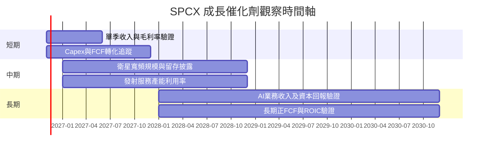

### 9.2 TAM 市場規模分析

資料包未提供可核驗 TAM、滲透率或各業務收入，以下不虛構市場規模。

```
╔══════════════════════════════════════════════════════════════╗
║                 TAM 與滲透率資料覆蓋                          ║
╠══════════════════════════════════════════════════════════════╣
║ 發射服務 TAM：N/A       滲透率：N/A       公司收入：分部未披露 ║
║ 衛星寬頻 TAM：N/A       滲透率：N/A       公司收入：分部未披露 ║
║ AI／運算 TAM：N/A       滲透率：N/A       公司收入：分部未披露 ║
║ 可核驗依據：公司總 TTM 營收 $32.04B；分部貢獻不可拆解          ║
╚══════════════════════════════════════════════════════════════╝
```

### 9.3 成長驅動力結構圖

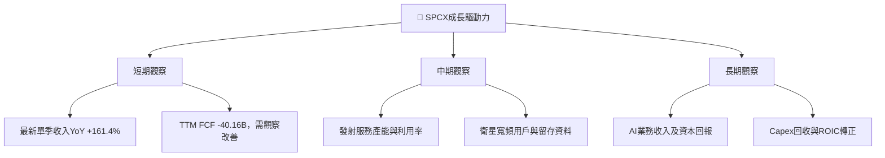

---

## 10. 風險矩陣

### 10.1 風險評分矩陣

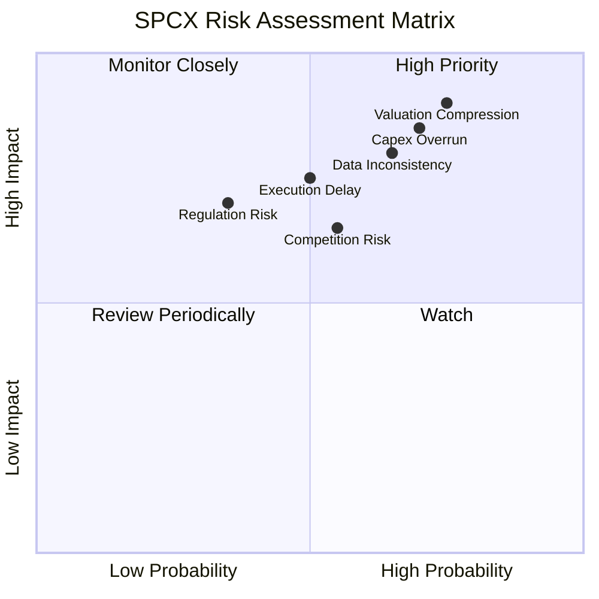

### 10.2 風險清單詳細分析

| # | 風險項目 | 發生機率 | 財務衝擊 | 風險評分 | 緩解措施 |
|---:|---|---:|---|---:|---|
| 1 | 🔴 估值壓縮 | 高（約65%估計） | P/S 59.3x、EV/EBITDA 157.6x；倍數回落可令股價大幅下修 | 🔴 9.0/10 | 分批投資、限制單一持倉，要求估值回落或 FCF 改善 |
| 2 | 🔴 Capex 持續超預期 | 高（約60%估計） | TTM Capex $55.92B，FCF -$40.16B；持續超支將消耗 $50.64B 淨現金 | 🔴 8.5/10 | 追蹤 Capex／收入、項目回報、淨現金季度變化 |
| 3 | 🔴 資料品質與股數不一致 | 中高（約55%估計） | 8.25B 與 13.579B 股數差異，可能令市值與每股估值失真 | 🔴 8.0/10 | 以正式申報文件核對稀釋股數、資產負債表與估值日期 |
| 4 | 🟠 執行與部署延期 | 中（約40%估計） | 可能延後收入確認並提高維護、重工及融資成本 | 🟠 7.5/10 | 監控發射、部署與服務可用率的實際披露 |
| 5 | 🟡 競爭／價格壓力 | 中（約45%估計） | 毛利率下滑會削弱高估值所需的利潤率爬坡 | 🟡 6.5/10 | 觀察毛利率、客戶流失與新合約定價 |
| 6 | 🟡 監管與頻譜 | 中低（約30%估計） | 可能延遲服務或增加合規成本 | 🟡 6.0/10 | 追蹤牌照、頻譜、出口與政府合約進度 |

---

## 11. 投資建議

### 11.1 最終綜合評級雷達圖

```
╔══════════════════════════════════════════════════════════════╗
║                 SPCX 綜合評級雷達                             ║
╠══════════════════════════════════════════════════════════════╣
║ 成長性       8.0/10  ▓▓▓▓▓▓▓▓▓▓▓▓▓▓▓▓░░░░                    ║
║ 技術門檻     8.0/10  ▓▓▓▓▓▓▓▓▓▓▓▓▓▓▓▓░░░░                    ║
║ 財務健康     7.0/10  ▓▓▓▓▓▓▓▓▓▓▓▓▓▓░░░░░░                    ║
║ 護城河       7.0/10  ▓▓▓▓▓▓▓▓▓▓▓▓▓▓░░░░░░                    ║
║ 基本面       5.5/10  ▓▓▓▓▓▓▓▓▓▓▓░░░░░░░░░                    ║
║ 獲利品質     3.0/10  ▓▓▓▓▓▓░░░░░░░░░░░░░░                    ║
║ 估值合理性   2.0/10  ▓▓▓▓░░░░░░░░░░░░░░░░                    ║
╠══════════════════════════════════════════════════════════════╣
║ 綜合評分     5.2/10  🟡 高成長與高估值並存；FCF仍為負         ║
╚══════════════════════════════════════════════════════════════╝
```

### 11.2 目標價與隱含報酬率

| 情境 | 目標價 | 相對 $139.94 隱含報酬 | 權重 | 核心假設 |
|---|---:|---:|---:|---|
| 🔴 悲觀 | $20.00 | -85.7% | 30% | 營收 CAGR 15%、期末營業利潤率 10%上下、退出倍數收斂 |
| 🟡 基準 | $50.16 | -64.2% | 50% | 五年收入成長假設及 DCF／相對估值加權 |
| 🟢 樂觀 | $200.00 | +42.9% | 20% | 營收 CAGR 35%、利潤率改善、維持高成長倍數 |
| **加權合理價值** | **$50.16** | **-64.2%** | **100%** | 第 8.8 節方法加權結果 |

依規則 20，MOS -179.0% 對應 **賣出**，不是買入或持有。若投資者因公司長期成長選擇持有，應把它視為高波動、長久期風險資產，而非以基準估值有安全邊際的投資。

### 11.3 買入時機與觸發因素

```
╔══════════════════════════════════════════════════════════════════╗
║                  ✅ 交易與監控觸發因素                            ║
╠══════════════════════════════════════════════════════════════════╣
║  依本報告估值，現價 $139.94 不符合買入觸發條件                   ║
║                                                                  ║
║  重新評估買入條件（需多數符合）：                                ║
║  ☐ 股價回到加權合理價值附近或以下，且正式財報口徑已核實          ║
║  ☐ TTM FCF 連續改善，Capex／營收呈下降趨勢                       ║
║  ☐ TTM 營業利益率轉正並維持至少兩季                              ║
║                                                                  ║
║  加碼觸發條件：                                                  ║
║  ☐ FCF 連續兩季改善，且營收增長沒有靠應收款大幅上升支撐          ║
║  ☐ ROIC 可計算並連續高於經核實 WACC                              ║
║  ☐ 公司披露分部收入、用戶／客戶留存及資本回報                   ║
║                                                                  ║
║  減碼／退出條件：                                                ║
║  ☐ TTM FCF 惡化，或淨現金由 $50.64B 快速下降                     ║
║  ☐ 營業利益率連續兩季低於 0%，且收入增速明顯減速                 ║
║  ☐ 股數稀釋、資料口徑或資本支出無法與正式申報文件勾稽             ║
╚══════════════════════════════════════════════════════════════════╝
```

### 11.4 投資人適配度分析

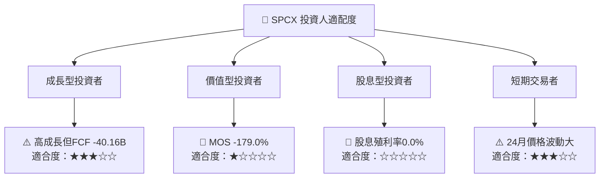

### 11.5 每季財報監控清單（Quarterly Watch List）

| 指標 | 目前基準 | 加碼觀察門檻 | 減碼／重新評估門檻 |
|---|---:|---|---|
| 季收入 YoY | 最新單季 +161.4% | 增長維持正值且來源可拆解 | 連續兩季低於 20% 或急速放緩 |
| TTM 營業利益率 | -2.0% | 轉正且連續兩季改善 | 再度跌破 -5% |
| TTM FCF | -$40.16B | 連續兩季改善，年度化缺口縮小 | FCF 缺口進一步擴大 |
| TTM Capex | $55.92B | Capex／營收明確下降且產能利用率提升 | Capex 高於 OCF 長期維持 |
| 現金及短投 | $89.86B | 維持足以支持已承諾投資 | 淨現金持續快速下降 |
| 總債務 | $39.22B | 債務增長低於營運現金流增長 | 借款增加且 FCF 惡化 |
| 股權薪酬 | FY2025 $1.95B | SBC／營收下降 | SBC／營收持續高於約 15% |
| 流通股數 | Roic.ai 2026-09 為 13.579B | 與正式申報資料一致、稀釋放緩 | 股數快速增加或資料繼續不一致 |
| 分部披露 | 未提供 | 公布 Space／Connectivity／AI 收入與利潤 | 分部資料仍缺且估值仍大幅溢價 |

### 11.6 反面論證：什麼會證明論點錯誤

```
╔══════════════════════════════════════════════════════════════════╗
║             ⚠️ 論點失效條件（Disconfirming Evidence）             ║
╠══════════════════════════════════════════════════════════════════╣
║ 本報告對高估值與現金消耗的負面判斷，在以下情況應重新檢視：       ║
║                                                                  ║
║ ☐ TTM FCF 轉正，且不是單季營運資金回收造成                       ║
║ ☐ Capex／營收下降，同時產能、服務覆蓋及收入仍持續成長             ║
║ ☐ TTM 營業利益率轉正並連續四季改善                               ║
║ ☐ 經正式財報計算的 ROIC 連續高於合理估算 WACC                    ║
║ ☐ SBC／營收明顯下降，且稀釋股數增長率降至低個位數                 ║
║ ☐ 分部披露證明 AI、Connectivity 等業務已形成可持續利潤            ║
║                                                                  ║
║ 若上述條件未出現，而估值仍維持高倍數，現價風險報酬仍偏不利。     ║
╚══════════════════════════════════════════════════════════════════╝
```

> **免責聲明**：本報告依提供的資料包與明確標示的模型假設自動生成，僅供研究參考，不構成投資建議。財務與市場資料存在口徑差異，投資決策前應核對公司正式申報文件。投資有風險，入市需謹慎。