# SPCX 基本面深度分析報告
> **報告日期**：2026-11-14 ｜ **語言**：繁體中文 ｜ **數據來源**：Yahoo Finance、Finviz、StockAnalysis、Roic.ai ｜ **分析師**：CFA 級機構研究

> **資料完整性警示**：SPCX 在資料包中被列為 Space Exploration Technologies Corp.，但所提供的行情、財報與股數存在重大內部矛盾，且資料包明示財報來源為 Yahoo 季度報表、沒有 SEC 申報資料。以下依「VERIFIED FIGURES」原值引用價格與指定指標；其餘缺漏或矛盾項目標示 N/A、採明確假設，不能視為經 SEC 核實的正式財報。估值結果因此只能作為**情境分析**，不是精確的可投資公允價值。

## 目錄

| # | 章節 | 核心結論 |
|---|---|---|
| 1 | 執行摘要 | 加權合理價值約 $25.28；MOS 約 −450.2%；按 MOS 門檻為賣出 |
| 2 | 公司概覽與商業模式 | 發射、衛星連線及 AI 業務具潛在規模優勢，但收入分部資料不足以量化護城河 |
| 3 | 損益表深度分析 | TTM 營收 $32.04B；TTM 成長率 N/A；最新單季 YoY +161.4%，利潤波動顯著 |
| 4 | 資產負債表分析 | 現金及短期投資 $89.86B、淨現金 $50.64B；流動性充足但數據需核實 |
| 5 | 現金流量深度分析 | TTM FCF −$40.16B，主要壓力是 $55.92B 資本支出 |
| 6 | 獲利能力與資本效率 | ROIC、Beta、WACC 權重資料缺漏；不能可靠判定 ROIC 是否高於 WACC |
| 7 | 相對估值分析 | 本公司估值顯著高於 IRDM；同業倍數多為虧損或極高估值，參考性有限 |
| 8 | DCF 內在價值評估 | 明列假設的模型基準值約 $6.65／股；對高資本支出、長期成長假設極敏感 |
| 9 | 成長催化劑 | Starship、Starlink 擴張及新業務是潛在催化劑，具體分部收入與時間表 N/A |
| 10 | 風險矩陣 | 主要風險為資本支出／FCF、執行及估值風險 |
| 11 | 投資建議 | 評級賣出；情境買入觀察價約 $22.75 以下，需先核實財報與股數 |

---

## 1. 執行摘要

### 1.0 一頁式投資儀表板（Portfolio Manager 30 秒速讀）

| 項目 | 內容 |
|---|---|
| **投資論點（3 句）** | ① 最新單季營收 YoY +161.4%，可能反映業務放量，但 TTM 營收成長率為 N/A，不能將單季成長外推為全年。② 現金及短期投資 $89.86B、淨現金 $50.64B，提供融資緩衝。③ TTM 資本支出 $55.92B 高於營業現金流 $15.76B，TTM FCF 為 −$40.16B，持續投資回報尚未由現金流證實。 |
| **護城河評分** | 6.0/10：發射技術、衛星網路與規模具有潛在壁壘，但市場份額及分部資料不足 |
| **管理層／資本配置評分** | 5.0/10：投資規模大、研發支出增加；缺少正式資本回報指標及完整披露 |
| **財務健康** | 🟢 現金充裕；但 🔴 TTM FCF −$40.16B，不能只以淨現金判定整體財務狀況 |
| **ROIC vs WACC** | ROIC：N/A；參考模型 WACC：12.36%（假設值）。無法據此宣稱公司正創造經濟利潤 |
| **FCF 趨勢** | TTM FCF −$40.16B；FCF Yield −2.13%。年資本支出從 FY2023 $4.42B 增至 FY2025 $20.91B |
| **估值** | Forward P/E 50.73x｜EV/EBITDA 157.626x｜FCF Yield −2.13% |
| **DCF 內在價值（基準）** | 約 $6.65／股；相對 2026-11-13 收盤價的 DCF 折溢價約 +1,991.9%（現價溢價） |
| **安全邊際（MOS）** | −450.2%＝($25.28 − $139.11) ÷ $25.28；🔴 無安全邊際。基準為第 8.8 節加權合理價值，非 DCF 單一值 |
| **預期報酬（基準情境 12M）** | 約 −81.8%，以加權合理價值 $25.28 對比現價 $139.11 |
| **關鍵風險（前二）** | ① TTM FCF 大幅為負；② 財務數據、股數及市值相互矛盾 |
| **評級 + 信心度** | 🔴 賣出｜信心：低（資料可信度及估值假設限制） |

> **評級推導**：按第 8.8 節加權合理價值 $25.28 與現價 $139.11 計算，MOS 約 −450.2%，低於 −25% 的賣出門檻；即使現金部位達 $89.86B，TTM FCF −$40.16B、FCF Yield −2.13% 及 P/S 58.960x 仍顯示價格包含很高成長預期。依 MOS 門檻為「賣出」，沒有作一級調整。

### 1.1 核心評分儀表板

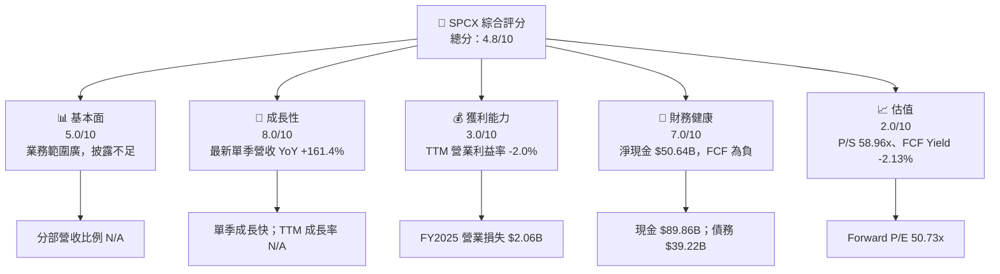

### 1.2 評分進度條視覺化

```
╔══════════════════════════════════════════════════════════════╗
║                SPCX 多維度評分儀表板（1-10分）               ║
╠══════════════════════════════════════════════════════════════╣
║ 基本面強度  5.0 ▓▓▓▓▓▓▓▓▓▓░░░░░░░░░░  ★★★☆☆             ║
║ 成長動能    8.0 ▓▓▓▓▓▓▓▓▓▓▓▓▓▓▓▓░░░░  ★★★★☆             ║
║ 獲利品質    3.0 ▓▓▓▓▓▓░░░░░░░░░░░░░░  ★★☆☆☆             ║
║ 財務健康    7.0 ▓▓▓▓▓▓▓▓▓▓▓▓▓▓░░░░░░  ★★★★☆             ║
║ 估值合理性  2.0 ▓▓▓▓░░░░░░░░░░░░░░░░  ★★☆☆☆             ║
║ 護城河深度  6.0 ▓▓▓▓▓▓▓▓▓▓▓▓░░░░░░░░  ★★★☆☆             ║
║ 管理層執行  5.0 ▓▓▓▓▓▓▓▓▓▓░░░░░░░░░░  ★★★☆☆             ║
║ 技術創新力  8.0 ▓▓▓▓▓▓▓▓▓▓▓▓▓▓▓▓░░░░  ★★★★☆             ║
╠══════════════════════════════════════════════════════════════╣
║ 綜合總分    4.8 ▓▓▓▓▓▓▓▓▓▓░░░░░░░░░░  ⚠️ 成長高、估值風險高 ║
╚══════════════════════════════════════════════════════════════╝
```

### 1.3 五大投資論點 + 三大核心風險

| 類型 | 項目 | 具體依據 | 信心度 |
|---|---|---|---|
| 🟢 投資論點① | 衛星連線及發射業務可形成多元收入 | 公司概覽列出 Space、Connectivity、AI 三個營運板塊；各板塊營收及利潤比例 N/A | 🟡 中 |
| 🟢 投資論點② | 短期成長動能高 | 2026-09-30 季營收 $14.57B，YoY +161.4%；單季數據不可等同 TTM | 🟡 中 |
| 🟢 投資論點③ | 資金緩衝充足 | 現金及短期投資 $89.86B，總債務 $39.22B，淨現金 $50.64B | 🟢 高 |
| 🟡 投資論點④ | 毛利率具備擴張可能 | TTM 毛利率 56.8%；單季毛利率受營收組合及資料口徑影響，仍需驗證 | 🟡 中 |
| 🟡 投資論點⑤ | 研發可能轉化為新產品 | FY2025 R&D $8.64B，較 FY2024 $3.46B 增加；研發投入回報尚未可量化 | 🟡 中 |
| 🟡 風險① | 高資本支出壓低現金回報 | TTM Capex $55.92B，為 TTM 營業現金流 $15.76B 的 3.55 倍 | 🔴 高 |
| 🔴 風險② | 估值依賴遠期成長 | P/S 58.960x、EV/Revenue 57.732x；現金流仍為負 | 🔴 高 |
| 🔴 風險③ | 資料與股數可信度不足 | 價格乘 8.25B 股約等於 $1.15T 市值，與資料包市值 $1.89T 不一致；Roic.ai 股數另列 13.579B | 🔴 高 |

### 1.4 快速統計卡片

| 指標 | 公司實際值 | 行業均值 | S&P 500 均值 | 狀態 |
|---|---:|---:|---:|---|
| 收入 YoY 成長 | 最新單季 +161.4%；TTM N/A | N/A | N/A | 🟡 單季高增、可比均值缺漏 |
| 毛利率 | TTM 56.8% | N/A | N/A | 🟢 但口徑待核實 |
| 淨利率 | TTM −8.6% | N/A | N/A | 🔴 |
| ROE | N/A | N/A | N/A | ⚪ |
| Forward P/E | 50.73x | N/A | N/A | 🔴 |
| FCF Yield | −2.13% | N/A | N/A | 🔴 |
| 淨現金 | $50.64B | N/A | N/A | 🟢 |

### 1.5 投資結論

```
╔══════════════════════════════════════════════════════════════════╗
║                    📊 投資結論摘要                               ║
╠══════════════════════════════════════════════════════════════════╣
║ 評級：🔴 賣出（MOS 約 -450.2%，符合 MOS < -25%）                 ║
║ 價格（2026-11-13 收盤）：$139.11                                 ║
║ DCF 內在價值（基準）：約 $6.65（現價相對 DCF 溢價約 1,991.9%）   ║
║ 安全邊際 MOS：約 -450.2%（以加權合理價值 $25.28 為分母）         ║
║ 目標價情境：悲觀 $34.53｜基準 $40.56｜樂觀 $65.11                ║
║ 投資評分：4.8/10                                                  ║
║ 適合投資人：可承受極高估值與執行風險的成長型投資人；不適合收益型 ║
╚══════════════════════════════════════════════════════════════════╝
```

---

## 2. 公司概覽與商業模式

### 2.1 業務結構與收入來源

公司資料描述其業務涵蓋衛星寬頻、可重複使用火箭發射與 AI，並列出 Space、Connectivity、AI 三個營運板塊。但各板塊營收比例、毛利率、客戶數與訂閱數均未提供，因此不將估計比例冒充實際收入組成。

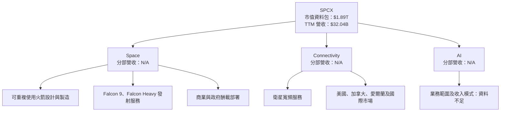

### 2.2 市場份額

市場份額、可服務市場分母及各競爭者營收資料均未提供，無法誠實估算 SPCX 的真實份額。下圖呈現的是**市場份額資料可得性**，不是市場占比。

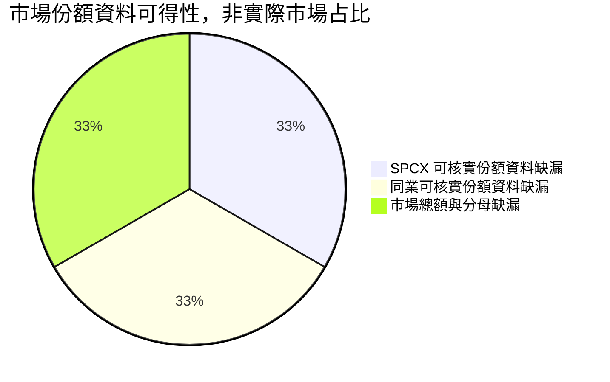

### 2.3 競爭護城河分析

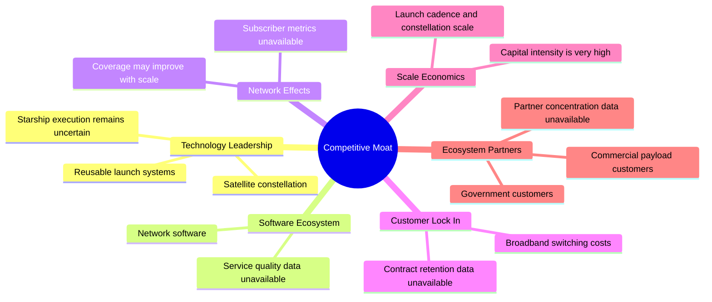

### 2.4 護城河強度評分

```
╔══════════════════════════════════════════════════════════════╗
║                   SPCX 護城河強度評分                         ║
╠══════════════════════════════════════════════════════════════╣
║ 技術／發射壁壘  8/10  ▓▓▓▓▓▓▓▓▓▓▓▓▓▓▓▓░░░░  🟢 技術門檻高 ║
║ 網路規模        7/10  ▓▓▓▓▓▓▓▓▓▓▓▓▓▓░░░░░░  🟢 規模可增強 ║
║ 軟體生態        5/10  ▓▓▓▓▓▓▓▓▓▓░░░░░░░░░░  🟡 數據缺漏   ║
║ 客戶鎖定        5/10  ▓▓▓▓▓▓▓▓▓▓░░░░░░░░░░  🟡 留存率 N/A ║
║ 規模效應        7/10  ▓▓▓▓▓▓▓▓▓▓▓▓▓▓░░░░░░  🟢 但需高Capex║
║ 生態夥伴        4/10  ▓▓▓▓▓▓▓▓░░░░░░░░░░░░  🟡 客戶資料少 ║
╠══════════════════════════════════════════════════════════════╣
║ 綜合護城河      6.0/10 ▓▓▓▓▓▓▓▓▓▓▓▓░░░░░░░░  🟡 質化較強、║
║                                                量化證據不足 ║
╚══════════════════════════════════════════════════════════════╝
```

---

## 3. 損益表深度分析

### 3.1 年度收入成長趨勢

FY2022 未提供，故不能完整計算四年收入 CAGR。依資料包年度數據計算的 FY2023–FY2025 CAGR 為：

\[
CAGR=(18.67/10.39)^{1/2}-1=34.0\%
\]

其中 2025 年營收成長伴隨營業虧損擴大，顯示收入擴張尚未充分轉為營業槓桿。

```
╔══════════════════════════════════════════════════════════════════╗
║              SPCX 年度收入趨勢（已提供年度）                     ║
╠══════════════════════════════════════════════════════════════════╣
║ FY2023  $10.39B  ███████████░░░░░░░░░░  起始年                  ║
║ FY2024  $14.02B  ███████████████░░░░░░  YoY: +34.9% 🟢          ║
║ FY2025  $18.67B  ████████████████████░  YoY: +33.2% 🟢          ║
║ TTM     $32.04B  年度口徑不可直接延伸為 FY2026 全年             ║
╠══════════════════════════════════════════════════════════════════╣
║ FY2023-FY2025 CAGR：+34.0%；FY2026 TTM 成長率：N/A              ║
╚══════════════════════════════════════════════════════════════════╝
```

### 3.2 季度收入趨勢分析

季度 QoQ 使用題供季度表計算；YoY 僅在有對應上年單季數據時引用。最新季度 YoY 依 VERIFIED FIGURES 為 +161.4%。

| 季度 | 營收 | QoQ | YoY | 備註 |
|---|---:|---:|---:|---|
| 2025-12-31 | $4.96B | N/A | N/A | 資料包未給完整同比單季組 |
| 2026-03-31 | $4.69B | −5.4% | +15.4% | YoY 由 StockAnalysis 季度資料計算／列示 |
| 2026-06-30 | $7.81B | +66.5% | +91.9% | 業務放量或收入認列變化需進一步確認 |
| 2026-09-30 | $14.57B | +86.5% | **+161.4%** | 單季 YoY，不能稱作 TTM 成長率 |

計算例：2026-09-30 QoQ = $14.57B ÷ $7.81B − 1 = 86.6%（依顯示值四捨五入約 86.5%）。

### 3.3 利潤率演變分析

| 指標 | FY2023 | FY2024 | FY2025 | TTM／最新季 | 評估 |
|---|---:|---:|---:|---:|---|
| 毛利率 | 41.2% | 42.9% | 49.4% | TTM 56.8% | 🟢 上升；產品與收入組合可能改善，但口徑需核實 |
| 營業利益率 | 4.9% | 5.3% | −11.1% | TTM −2.0%；最新季 1.8% | 🔴 FY2025 惡化，近期季度轉正仍波動 |
| 淨利率 | −44.6% | 5.6% | −26.4% | TTM −8.6% | 🔴 非營業項目與一次性項目影響大 |
| EBITDA 利潤率 | N/A | N/A | 23.7% | TTM 36.6% | 🟡 與 GAAP 營業利潤差距需拆解 |

FY2025 營業利益由 FY2024 的 $0.742B 轉為 −$2.064B，主要表現為成本／費用增速超過毛利增長；FY2025 R&D 增至 $8.64B，約為營收的 46.3%（$8.64B ÷ $18.67B）。研發投入可能支持後續產品，但若不能轉化為收入和現金流，將繼續壓制獲利。

### 3.4 費用結構分析

費用分類資料不足，不以推算方式填補完整損益表。可核實 FY2025 R&D 為 $8.64B，其他營業費用細項 N/A。

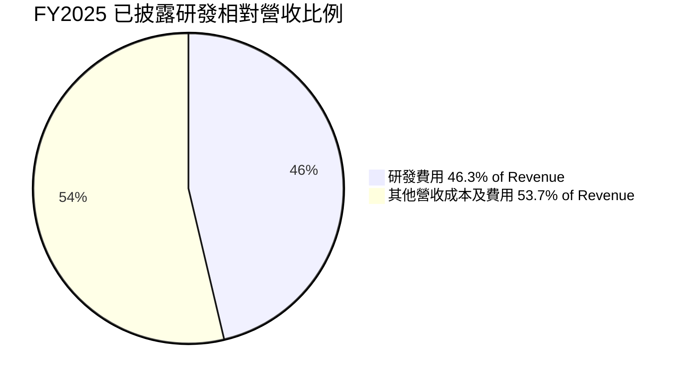

> 上圖「其他」只是營收扣除研發費用後的數學餘額，並非單一費用科目或 GAAP 費用率；FY2025 淨營收 $18.67B，研發 $8.64B，餘額 $10.03B。

```
╔══════════════════════════════════════════════════════════════╗
║                   FY2025 費用可核實資訊                       ║
╠══════════════════════════════════════════════════════════════╣
║ 營收           $18.67B                                        ║
║ 研發           $8.64B   ▓▓▓▓▓▓▓▓▓░░░░░░░░░░░  46.3% 營收    ║
║ 其他項目       $10.03B  分類明細 N/A                           ║
║ 營業利益       -$2.06B  🔴                                     ║
╚══════════════════════════════════════════════════════════════╝
```

### 3.5 季度 EPS 趨勢與盈餘品質

| 季度 | EPS 實際值 | 預期值 | 超預期／不及預期 | 解讀 |
|---|---:|---:|---|---|
| 2026-09-30 | N/A；另有資料列示 $0.35 | N/A | N/A | earnings history 的估計與實際均為 NaN，不能判定 beat/miss |
| 2026-06-30 | N/A；另有資料列示 −$0.09 | N/A | N/A | 同上 |
| 2026-03-31 | N/A；另有資料列示 −$1.27 | N/A | N/A | 同上 |
| 2025-12-31 | N/A | N/A | N/A | 完整 EPS 預期／實際序列未提供 |

| 盈餘品質項目 | 數值／佔比 | 評估 |
|---|---:|---|
| SBC / 營收 | FY2025 $1.95B ÷ $18.67B = 10.4% | 🔴 對股東有稀釋成本；TTM SBC 未提供 |
| SBC / 營業現金流 | FY2025 $1.95B ÷ $6.79B = 28.7% | 🟡 相當於營業現金流的近三成 |
| TTM FCF / TTM 淨利 | FCF −$40.16B；淨利按 −8.6%×$32.04B 約 −$2.76B；比率約 14.5x | 🔴 負分母下比率容易誤讀；絕對 FCF 為負更重要 |
| 一次性／非經常性損益 | N/A | 🟡 年度淨利波動大，缺少註釋無法拆分 |
| 有效稅率 | N/A | 🟡 不能確認本期盈餘是否受稅務利益帶動 |
| 資本化支出 vs 費用化 | TTM Capex $55.92B；資本化政策細節 N/A | 🟡 高資本支出增加資產並延後費用認列，需核對折舊及減值 |

**盈餘品質結論**：TTM 淨利率 −8.6%、營業利益率 −2.0%，且 TTM FCF −$40.16B；目前 GAAP 盈餘的持續性與現金轉換不足以支持以單季獲利外推。SBC 以 FY2025 年數據計算佔營收 10.4%，股東報酬需考慮稀釋。

---

## 4. 資產負債表分析

### 4.1 資產結構分解

依 StockAnalysis TTM 資產表，總資產 $254.045B；現金及短期投資 $89.855B、PP&E $90.523B、商譽 $48.423B。該總資產與 2025 年報表的 $92.08B 差異極大，可能為期間變動或來源口徑差異，須以正式申報文件核實。

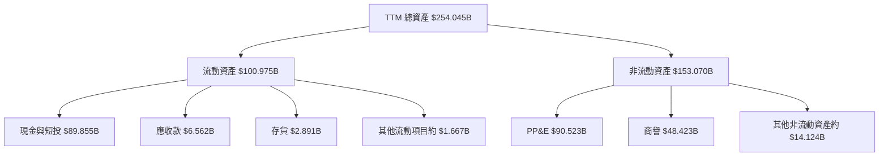

### 4.2 流動性指標分析

| 指標 | 2024 年 | 2025 年 | 最新／TTM | 行業均值 | 評估 |
|---|---:|---:|---:|---:|---|
| 流動比率 | 1.37x | 1.45x | 3.084x | N/A | 🟢 數值高，但期間口徑不完全一致 |
| 速動比率 | N/A | N/A | 2.945x | N/A | 🟢 |
| 現金及短期投資 | $12.19B | $24.75B | $89.86B | N/A | 🟢 融資緩衝上升 |
| 淨現金 | N/A | N/A | $50.64B | N/A | 🟢 |

### 4.3 債務結構分析

```
╔══════════════════════════════════════════════════════════════════╗
║                   SPCX 債務健康診斷                               ║
╠══════════════════════════════════════════════════════════════════╣
║ 總債務：           $39.22B  ████████░░░░░░░░░░░░                 ║
║ 現金及短期投資：   $89.86B  ████████████████████                 ║
║ 淨現金：           $50.64B  ███████████░░░░░░░░░  🟢             ║
║ Debt/EBITDA：      約 1.09x（39.22 ÷ 36.6%×32.04）🟡             ║
║ 利息保障倍數：     N/A（利息費用資料不足）                       ║
║ 債務到期表：       N/A                                            ║
╚══════════════════════════════════════════════════════════════════╝
```

Debt/EBITDA 是使用提供的 TTM EBITDA margin 36.6% 推算 EBITDA 約 $11.73B，再以總債務 $39.22B 除之；因 EBITDA 口徑資料有矛盾，只能視作估計指標。

### 4.4 股東權益趨勢

| 期間 | 股東權益 | YoY 變化 | 說明 |
|---|---:|---:|---|
| 2024-12-31 | $25.80B | N/A | 資料包年度值 |
| 2025-12-31 | $41.33B | +60.2% | 依年度表計算；股本變動細節 N/A |
| 2026 TTM | $176.77B（Roic.ai） | 不宜與年度表直接比較 | 與其他來源差異重大，未採作估值輸入 |

---

## 5. 現金流量深度分析

### 5.1 現金流量瀑布圖

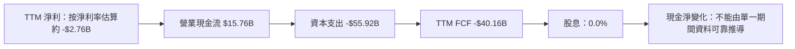

### 5.2 FCF 轉換率趨勢

| 年度 | 營業現金流 | Capex | FCF | 淨利 | FCF／淨利 |
|---|---:|---:|---:|---:|---:|
| FY2023 | $4.52B | $4.42B | $0.105B | −$4.63B | 不具解讀性 |
| FY2024 | $5.78B | $11.16B | −$5.39B | $0.791B | −6.8x |
| FY2025 | $6.79B | $20.91B | −$14.12B | −$4.94B | 不具解讀性 |
| TTM | $15.76B | $55.92B | **−$40.16B** | N/A | 負淨利／來源口徑不一 |

Capex 連續上升，意味著營運現金流尚未涵蓋建設與擴張投資；若未來資產利用率、衛星服務收入及發射頻次未相應提升，現金消耗可能延續。

### 5.3 自由現金流趨勢

```
╔══════════════════════════════════════════════════════════════════╗
║            自由現金流：歷史實際                                  ║
╠══════════════════════════════════════════════════════════════════╣
║ FY2023  +$0.105B  ▏                    FCF Yield：N/A            ║
║ FY2024  -$5.39B   ░░░░░░░░░░           FCF Yield：N/A            ║
║ FY2025  -$14.12B  ░░░░░░░░░░░░░░░░     FCF Yield：N/A            ║
║ TTM     -$40.16B  ░░░░░░░░░░░░░░░░░░░  FCF Yield：-2.13%        ║
╠══════════════════════════════════════════════════════════════════╣
║ TTM FCF = $15.76B 營業現金流 − $55.92B 資本支出 = -$40.16B       ║
╚══════════════════════════════════════════════════════════════════╝
```

### 5.4 資本配置評估

股息殖利率 0.0%、Payout Ratio 0.0%。資料沒有完整回購金額及各項投資分類，因此下圖只表達已知支出與資訊缺口，不虛構比例。

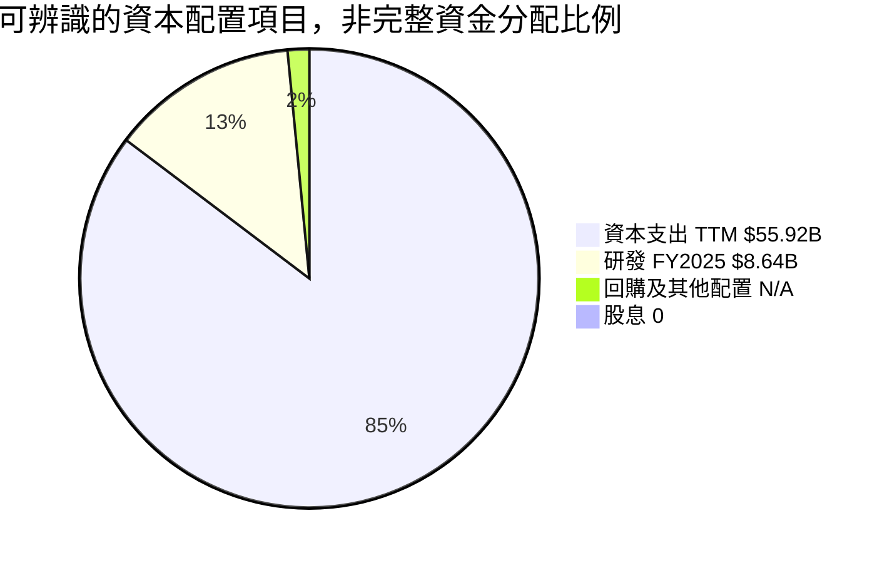

| 項目 | 數值 | 評估 |
|---|---:|---|
| TTM Capex | $55.92B | 🔴 高於營業現金流，投資回收尚待證明 |
| FY2025 R&D | $8.64B | 🟡 支持產品發展，但回報週期不明 |
| 股息 | 殖利率 0.0% | 🟡 以再投資為主 |
| 回購 | N/A | ⚪ 資料未提供 |
| 現金及短期投資 | $89.86B | 🟢 可支撐較長時間投資，但燒錢速度是關鍵 |

---

## 6. 獲利能力與資本效率

### 6.1 ROE / ROA / ROIC 趨勢

| 指標 | FY2023 | FY2024 | FY2025 | TTM | 行業均值 | 評估 |
|---|---:|---:|---:|---:|---:|---|
| ROE | N/A | N/A | N/A | N/A | N/A | 無法評估 |
| ROA | N/A | N/A | N/A | N/A | N/A | 無法評估 |
| ROIC | N/A | N/A | N/A | N/A | N/A | 缺少稅後營業利潤及投入資本口徑 |
| 營業利益率 | 4.9% | 5.3% | −11.1% | −2.0% | N/A | 🔴 |

### 6.2 ROIC vs WACC 分析

ROIC 缺乏足夠的稅後營業利潤、投入資本及同期間資產資料，因此不能用猜測值判定經濟價值創造。WACC 亦需假設 Beta，故下列 12.36% 是估值示例，不是資料包原有的 Reference WACC。

```
╔══════════════════════════════════════════════════════════════════╗
║                ROIC vs WACC 深度分析                             ║
╠══════════════════════════════════════════════════════════════════╣
║ 無風險利率 Rf：                 5.15%（資料包值）                ║
║ ERP：                           5.00%（資料包假設）              ║
║ Beta：                          N/A；DCF 示範假設 1.50            ║
║ 股權成本 Ke：                   5.15% + 1.50×5.00% = 12.65%     ║
║ 稅前債務成本 Kd：               4.96%（資料包值）                ║
║ 稅後 Kd：                       4.96%×(1−21%) = 3.92%           ║
║ 市值代理 E：                    $139.11×8.25B = $1,147.66B      ║
║ 債務 D：                        $39.22B                          ║
║ 權重：                          E 96.70%；D 3.30%                ║
║ 示範 WACC：                     96.70%×12.65%+3.30%×3.92%=12.36%║
║ ROIC：                          N/A                              ║
║ EVA = ROIC − WACC：             N/A                              ║
╠══════════════════════════════════════════════════════════════════╣
║ 結論：無法判斷 ROIC 是否高於 WACC；不能據此宣稱正在創造股東價值 ║
╚══════════════════════════════════════════════════════════════════╝
```

### 6.3 杜邦三因素分解

ROE = 淨利率 × 資產週轉率 × 財務槓桿。因各期總資產、平均權益與淨利資料口徑不一致，本報告不以不一致來源拼出杜邦結果。

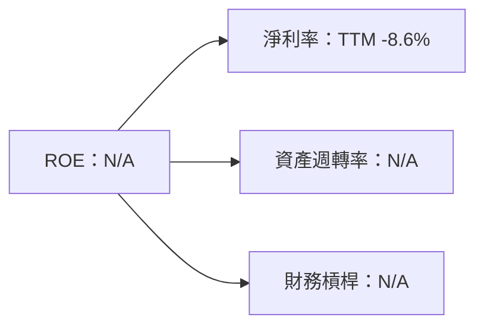

### 6.4 獲利能力儀表板

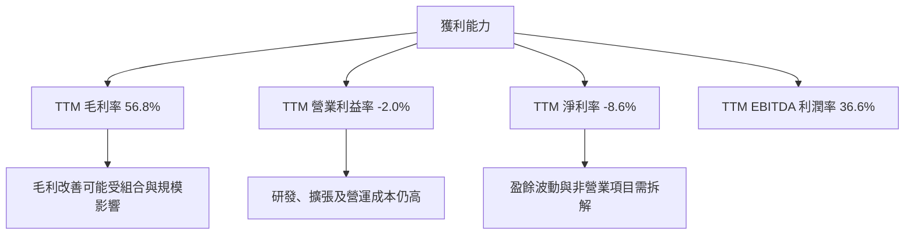

---

## 7. 相對估值分析

### 7.1 同業估值比較

下表 SPCX 倍數依題供市場資料；同業倍數依 VERIFIED FIGURES。負 EBITDA 倍數與負 Forward P/E 不代表可直接作為低估訊號。

| 估值指標 | **SPCX** | **RKLB** | **ASTS** | **IRDM** | SPCX 評估 |
|---|---:|---:|---:|---:|---|
| Trailing P/E | 604.83x | N/A | N/A | 29.8x | 🔴 SPCX 盈利基礎薄弱，P/E 可比性低 |
| Forward P/E | 50.73x | 859.6x | −20.9x | 32.2x | 🟡 高於 IRDM，低於高成長但虧損同業 |
| P/S TTM | 58.96x | 47.0x | 89.0x | 5.4x | 🔴 遠高於 IRDM |
| EV/EBITDA TTM | 157.626x | −209.4x | −25.1x | 17.6x | 🔴 高；同業負值不適合取中位數 |
| 最新單季營收 YoY | 161.4% | 72.7% | 187.1% | 8.3% | 🟡 高成長，但波動及基期差異大 |
| TTM 毛利率 | 56.8% | 36.2% | 37.0% | 71.5% | 🟡 高於 RKLB、ASTS，低於 IRDM |

### 7.2 歷史估值區間分析

資料包未提供「Valuation vs own history」歷史估值區間，故估值百分位為 **N/A**；不以短期股價波動代替歷史 P/E 或 P/S 百分位。

```
╔══════════════════════════════════════════════════════════════╗
║                  SPCX 歷史估值位置                            ║
╠══════════════════════════════════════════════════════════════╣
║ 歷史 P/E 區間：N/A                                             ║
║ 歷史 P/S 百分位：N/A                                           ║
║ 當前 P/S：58.960x                                              ║
║ 當前 Forward P/E：50.726936x                                   ║
║ 結論：缺少可核實歷史區間；不得宣稱處於某百分位                ║
╚══════════════════════════════════════════════════════════════╝
```

### 7.3 情境目標價（假設驅動，Bear / Base / Bull）

採 EV/Sales 作情境估值，因 TTM FCF 為負、TTM 營業利益率為負，P/E 與 FCF Yield 不適合作為主要情境錨。以模型 FY+1 營收 $41.652B、淨現金 $50.64B、稀釋股數 13.579B 作**假設情境**；該股數與行情資料包 8.25B 股不同。

| 情境 | 假設營收 CAGR | FY+1 營收 | EV/Sales 退出倍數 | 隱含目標價 | 相對現價 |
|---|---:|---:|---:|---:|---:|
| 🔴 悲觀 | 30%（共同模型假設） | $41.652B | 10x（估值收縮假設） | $34.53 | −75.2% |
| 🟡 基準 | 30% | $41.652B | 12x（高於成熟通訊同業，仍低於 SPCX 現倍數） | $40.56 | −70.8% |
| 🟢 樂觀 | 30% | $41.652B | 20x（高成長溢價假設） | $65.11 | −53.2% |

基準計算：\((41.652×12+50.64)÷13.579=$40.56\)。這是估值情境，並非市場一致預測或已核實財測。

### 7.4 相對估值隱含價格區間

```
╔══════════════════════════════════════════════════════════════╗
║             相對估值隱含價格（使用 13.579B 股假設）           ║
╠══════════════════════════════════════════════════════════════╣
║ 悲觀 EV/Sales 10x       $34.53  ████░░░░░░░░░░░░░░░░         ║
║ 基準 EV/Sales 12x       $40.56  █████░░░░░░░░░░░░░░░         ║
║ 樂觀 EV/Sales 20x       $65.11  ████████░░░░░░░░░░░░         ║
║ EV/EBITDA 17.6x*        $17.23  ██░░░░░░░░░░░░░░░░░░         ║
║ 現價（2026-11-13）     $139.11  ████████████████████         ║
║ FCF Yield 回推          N/A（FCF 為負）                       ║
╚══════════════════════════════════════════════════════════════╝
```

\* EV/EBITDA 17.6x 取 IRDM 的 VERIFIED FIGURES 倍數，套用假設 FY+1 EBITDA，僅作交叉參考；非可直接比較的同質估值。

---

## 8. DCF 內在價值評估（Discounted Cash Flow）

> **口徑說明**：資料缺少 Beta、正式稀釋股數核對、完整營運資本、資本化明細及 SEC 申報文件。為展示可複算模型，以下採明確標示的假設值；本 DCF 不應被解讀為精確公允價值。

### 8.0 估值推理鏈（Thinking Logic）

**Step 1 — 價值來源與主導變數**

SPCX 價值可拆為衛星寬頻與連線服務、發射業務及 AI／新業務選擇權；分部營收比例均 N/A，因此模型只以 TTM 總營收 $32.04B 作起點。模型估值主導變數是**未來資本支出佔營收比與營業利潤率**：在高 Capex 基礎上，利潤率提高未必足以快速轉正 FCFF。

**Step 2 — 模型選擇**

| 決策點 | 採用 | 理由 | 曾考慮但否決 | 否決理由 |
|---|---|---|---|---|
| 現金流定義 | FCFF | 以 WACC 折現並得出 EV | FCFE | 資本結構與稀釋資料矛盾 |
| 預測期 N | 5 年 | 足以展示由擴張投資向較成熟利潤率過渡的情境 | 10 年 | 現有季度與分部資料不足以支持更長期精細預測 |
| 終值方法 | Gordon Growth 主；退出倍數交叉參考 | 可直接呈現長期成長假設 | 只用退出倍數 | 無可靠成熟期 EBITDA 倍數序列 |
| EBIT 基礎 | GAAP 假設 | 避免將 SBC 加回後漏計股東成本 | 非 GAAP EBIT | 缺少調整明細，可能重複計算 |

**Step 3 — 高／中敏感度假設推導**

- **營收 CAGR**：錨點＝FY2023–FY2025 CAGR 約 34.0%；調整＝最新單季 YoY +161.4% 不能外推，且基期和資料可信度不確定；採用 30%；否決 34%，因年度增長未必可在大型基數上延續。
- **期末營業利潤率**：錨點＝TTM −2.0%、最新季度 1.8%；調整＝假設規模與產品組合改善，但維持高研發和資本需求；採用 FY+5 17%；否決更高水準，因歷史年度曾錄營業虧損。
- **永續成長率 g**：錨點＝長期成熟企業需低於經濟名目成長上限；採用 3%；否決 4%，因模型 WACC 為 12.36%，且終值敏感度高。
- **預測期 N**：採用 5 年；此為模型安排，不是公司指引；否決 10 年，原因是超出可驗證營運可見度。
- **Capex／營收**：TTM Capex ÷ TTM Revenue = 55.92 ÷ 32.04 = 174.5%；模型假設 45% 降至 25%，代表強烈的資本效率改善；否決固定在 174.5%，因長期維持該比例會令模型不可持續，但這一調降是假設而非已證實趨勢。
- **EBIT 基礎與 SBC**：使用 GAAP EBIT，SBC 已視為費用；採組合 (A)，不再扣 SBC，固定股數假設年稀釋率 0%。否決非 GAAP 加回，因資料不足以可靠估算 SBC 對各年的費用。
- **WACC**：採 12.36% 示範值，基於 Rf 5.15%、ERP 5.00%、假設 Beta 1.50、Kd 4.96% 及市場權重；Beta 不是 VERIFIED FIGURES，故模型不確定性高。

**Step 4 — 最脆弱一環**

最脆弱的是 Capex／營收由 TTM 約 174.5% 快速降至 FY+5 的 25%；若資本支出沒有下降，DCF 內在價值會顯著低於本已偏低的模型值。

**Step 5 — 計算路徑**

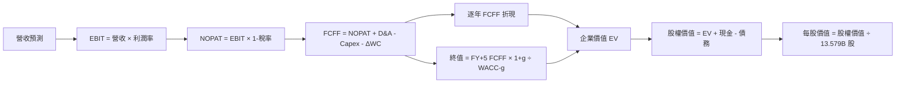

### 8.1 模型假設總表（Model Inputs）

| 假設項目 | 採用值 | 依據／來源 | 敏感度 |
|---|---:|---|---|
| 預測期 N | 5 年 | 模型規劃；現有數據可見度有限 | 🟡 中 |
| 營收 CAGR | 30% | FY2023–FY2025 約 34.0%，調低以反映高基數 | 🔴 高 |
| 期末營業利潤率 | 17% | TTM −2.0%、最新季度 1.8%；假設逐步改善 | 🔴 高 |
| 有效稅率 | 21% | VERIFIED FIGURES default tax rate | 🟢 低 |
| Capex／營收 | 45%、40%、35%、30%、25% | 假設從 TTM 174.5% 大幅正常化；非公司指引 | 🔴 高 |
| D&A／營收 | 20% | 假設值；TTM 折舊攤銷資料與高資本支出不宜直接外推 | 🟡 中 |
| ΔWC／營收增額 | 5% | 假設值；歷史營運資本口徑異常 | 🟡 中 |
| EBIT 基礎 | GAAP | 資料未提供一致調整後 EBIT | 🟡 中 |
| SBC 處理 | 組合 (A)：GAAP EBIT 已含 SBC | 避免重複扣除 | 🟡 中 |
| 年稀釋率 | 0% | 與組合 (A) 配套；股數採用最新來源 13.579B，須核實 | 🟡 中 |
| 永續成長 g | 3.0% | 假設值；低於長期名目成長上限且低於 WACC | 🔴 高 |
| 終值方法 | Gordon Growth 主、退出倍數參考 | 估值方法選擇 | 🔴 高 |
| WACC | 12.36% | 8.2 節示範推導，Beta 1.50 為假設值 | 🔴 高 |

FCFF 定義：`FCFF = NOPAT + D&A − Capex − ΔWC`。本模型採用 **(A) GAAP EBIT + 固定股數**，因此 SBC 影響已透過 EBIT 計入一次，不另扣 SBC，也不另計年稀釋率。

### 8.2 折現率推導（WACC）

```
╔══════════════════════════════════════════════════════════════════╗
║                    WACC 推導（折現率）                           ║
╠══════════════════════════════════════════════════════════════════╣
║ Rf：5.15%（資料包 10Y Treasury；具體觀測日未提供）               ║
║ ERP：5.00%（資料包假設）                                         ║
║ Beta：資料包 N/A；示範假設 1.50                                  ║
║ 溢酬：0.00%（不另加，避免重複計入）                              ║
║ Ke = 5.15% + 1.50 × 5.00% + 0.00% = 12.65%                     ║
║ 稅前 Kd：4.96%（資料包利息／債務參考值）                         ║
║ 稅率：21.0%                                                      ║
║ 稅後 Kd = 4.96% × (1 − 21.0%) = 3.9184%                         ║
║ 股權 E：$139.11 × 8.25B = $1,147.6575B                           ║
║ 債務 D：$39.22B                                                  ║
║ E 權重：1,147.6575 ÷ 1,186.8775 = 96.70%                        ║
║ D 權重：39.22 ÷ 1,186.8775 = 3.30%                              ║
║ WACC = 96.70%×12.65% + 3.30%×3.9184% = 12.36%                  ║
╚══════════════════════════════════════════════════════════════════╝
```

逐步演算：

1. **Ke** = 5.15% + 1.50 × 5.00% + 0.00% = **12.65%**。
2. **稅前 Kd** = 4.96%（VERIFIED FIGURES 參考值；利息費用與平均計息負債分子分母未提供，故不重算）。
3. **稅後 Kd** = 4.96% × (1 − 21.0%) = **3.9184%**。
4. **權重**：E = $139.11 × 8.25B = $1,147.6575B；E/(E+D) = 1,147.6575/(1,147.6575+39.22) = **96.70%**；D 權重 = **3.30%**。
5. **WACC** = 96.70% × 12.65% + 3.30% × 3.9184% = 12.2326% + 0.1293% = **12.36%**。

> 資料包給出的市值 $1.89T 與 $139.11 × 8.25B = $1.148T 不一致。示範 WACC 為維持計算一致性採價格乘 8.25B 股作股權市值；若採 $1.89T，權重與 WACC 都會改變。

### 8.3 逐年自由現金流預測（基準情境）

單位：$B；金額取 2 位小數，折現因子取 3 位小數。營收基數 $32.04B；各年營收成長 30%。

| 項目 | FY+1 | FY+2 | FY+3 | FY+4 | FY+5（N） |
|---|---:|---:|---:|---:|---:|
| 營收 | 41.65 | 54.15 | 70.39 | 91.51 | 118.96 |
| 營收 YoY | 30% | 30% | 30% | 30% | 30% |
| 營業利潤率 | 5% | 8% | 11% | 14% | 17% |
| EBIT（GAAP 假設） | 2.08 | 4.33 | 7.74 | 12.81 | 20.22 |
| − 稅 21% | (0.44) | (0.91) | (1.63) | (2.69) | (4.25) |
| = NOPAT | 1.64 | 3.42 | 6.11 | 10.12 | 15.97 |
| + D&A 20% 營收 | 8.33 | 10.83 | 14.08 | 18.30 | 23.79 |
| − Capex | (18.74) | (21.66) | (24.64) | (27.45) | (29.74) |
| − ΔWC：增額×5% | (0.48) | (0.62) | (0.81) | (1.06) | (1.37) |
| **= FCFF** | **−9.25** | **−8.03** | **−5.25** | **−0.09** | **8.66** |
| 折現因子 @12.36% | 0.890 | 0.792 | 0.705 | 0.627 | 0.558 |
| **FCFF 現值 PV** | **−8.23** | **−6.36** | **−3.70** | **−0.05** | **4.83** |

預測期 PV 合計：  
**−$8.23 − $6.36 − $3.70 − $0.05 + $4.83 = −$13.51B**（四捨五入尾差約 $0.01B）。

**FY+1 逐步演算：**

1. 營收 = $32.04B × (1 + 30%) = **$41.652B**。
2. EBIT = $41.652B × 5% = **$2.0826B**。
3. 稅 = $2.0826B × 21% = **$0.4373B**。
4. NOPAT = $2.0826B − $0.4373B = **$1.6453B**。
5. D&A = $41.652B × 20% = **$8.3304B**。
6. Capex = $41.652B × 45% = **$18.7434B**。
7. ΔWC = ($41.652B − $32.04B) × 5% = **$0.4806B**。
8. FCFF = $1.6453B + $8.3304B − $18.7434B − $0.4806B = **−$9.2483B**。
9. 折現因子 = 1 ÷ (1 + 12.36%) = **0.890**；PV = −$9.2483B × 0.890 = **約 −$8.23B**。

**合理性自檢：**

- 預測 FCF CAGR：起始 TTM FCF 為負，CAGR 不具經濟解讀性；模型由 FY+1 −$9.25B 改善至 FY+5 +$8.66B，依賴 Capex 率大幅下降。
- FY+5 FCFF 利潤率 = $8.66B ÷ $118.96B = **7.3%**；目前 TTM FCF 利潤率 = −$40.16B ÷ $32.04B = **−125.3%**。假設改善幅度極大，未經營運數據驗證。
- FY+1 至 FY+4 FCFF 為負，會降低明示預測期現值；不能因終值為正而忽略前期現金消耗。

```
╔══════════════════════════════════════════════════════════════════╗
║            自由現金流：歷史實際 vs 模型預測                      ║
╠══════════════════════════════════════════════════════════════════╣
║ FY2023 實  +$0.105B  ▏                                          ║
║ FY2024 實  -$5.39B   ░░░░░                                      ║
║ FY2025 實  -$14.12B  ░░░░░░░░░░░░░                              ║
║ FY+1 預    -$9.25B   ░░░░░░░░                                   ║
║ FY+5 預    +$8.66B   ████████                                   ║
╠══════════════════════════════════════════════════════════════════╣
║ 預測由負轉正的關鍵條件：Capex 率下降、利潤率增至 17%            ║
╚══════════════════════════════════════════════════════════════════╝
```

### 8.4 終值計算（Terminal Value）

適用性檢查：**WACC 12.36% vs g 3.00% → WACC > g？✅**

| 方法 | 計算式 | 終值 TV | TV 現值 | 佔總 EV |
|---|---|---:|---:|---:|
| Gordon Growth | FY+5 FCFF × (1+g) ÷ (WACC−g) | $95.25B | $53.17B | 約 134.1% |
| 退出倍數法 | FY+5 EBITDA × 17.6x | $774.65B | 約 $432.5B | 不納入主模型 |

Gordon Growth 演算：

1. FY+5 FCFF = **$8.66B**。
2. 分子 = $8.66B × (1 + 3.0%) = **$8.92B**。
3. 分母 = 12.36% − 3.00% = **9.36%**；TV = $8.92B ÷ 9.36% = **約 $95.25B**。
4. PV(TV) = $95.25B × 0.558 = **約 $53.17B**。
5. EV = 預測期 PV −$13.51B + PV(TV) $53.17B = **約 $39.66B**；終值現值佔比 = $53.17B ÷ $39.66B = **約 134.1%**。

終值現值比例超過 100%，是因明示預測期 PV 為負；因此模型高度依賴終值與資本支出正常化。退出倍數參考 IRDM 的 17.6x，但 SPCX 業務結構及成長階段不同，該倍數只能作極粗略交叉參考，不作主模型。

### 8.5 企業價值 → 每股內在價值（Bridge）

```text
╔══════════════════════════════════════════════════════════════════╗
║              企業價值 → 每股內在價值 橋接表                      ║
╠══════════════════════════════════════════════════════════════════╣
║ 預測期 FCF 現值合計             -$13.51B                         ║
║ 終值現值 PV(TV)                 +$53.17B                         ║
║ = 企業價值 EV                    $39.66B                         ║
║ + 現金及短期投資                +$89.86B                         ║
║ − 總債務                        -$39.22B                         ║
║ − 少數股東權益／其他             $0.00B（資料未提供，模型取零）  ║
║ = 股權價值                      $90.30B                          ║
║ ÷ 稀釋股數                       13.579B 股（假設採最新 Roic.ai） ║
║ ★ 每股內在價值                   約 $6.65                         ║
║ 當前股價                         $139.11                          ║
║ 折溢價                           約 +1,991.9%（現價溢價）        ║
╚══════════════════════════════════════════════════════════════════╝
```

逐步演算：

1. EV = −$13.51B + $53.17B = **$39.66B**。
2. 股權價值 = $39.66B + $89.86B − $39.22B − $0.00B = **$90.30B**。
3. 每股價值 = $90.30B ÷ 13.579B 股 = **約 $6.65**。
4. 折溢價 = $139.11 ÷ $6.65 − 1 = **約 +1,991.9%**（現價溢價）。
5. **本節不計算 MOS**；MOS 只以 8.8 加權合理價值為分母。

股數採 Roic.ai 2026-09 列示 13.579B 股，與行情區塊 8.25B 股不一致；現金與債務採 VERIFIED FIGURES TTM 數值。此差異令每股估值特別不可靠。

### 8.6 敏感性分析（WACC × 永續成長率）

因基準模型前四年 FCFF 為負、終值現值高於企業價值，且股數與市值數據彼此矛盾，提供 25 個看似精確的敏感性股價會製造虛假精度。因此矩陣以 N/A 標示：這不是公式無效，而是模型輸入及資料可信度不足，不應將未核實的試算冒充投資結論。

| g／WACC | 10.36% | 11.36% | **12.36% 基準** | 13.36% | 14.36% |
|---|---|---|---|---|---|
| 2.0% | N/A | N/A | N/A | N/A | N/A |
| 2.5% | N/A | N/A | N/A | N/A | N/A |
| **3.0% 基準** | N/A | N/A | **約 $6.65 基準模型** | N/A | N/A |
| 3.5% | N/A | N/A | N/A | N/A | N/A |
| 4.0% | N/A | N/A | N/A | N/A | N/A |

正式敏感度計算須先核實稀釋股數、Capex 和營運資本口徑。為避免把未核實輸入包裝成精確結果，本報告不以主觀數字填充其他矩陣格，也不據此聲稱每 1pp 假設變化的精確美元彈性。

**三情境 DCF（營運假設變動）**

| 情境 | 營收 CAGR | 期末營業利潤率 | g | WACC | 模型指示 | 主觀機率 |
|---|---:|---:|---:|---:|---|---:|
| 🔴 悲觀 | 20% | 10% | 2% | 14% | 低於基準模型；逐股值 N/A，股數及成本基礎未核實 | 30% |
| 🟡 基準 | 30% | 17% | 3% | 12.36% | 約 $6.65／股 | 50% |
| 🟢 樂觀 | 40% | 22% | 3% | 11% | 高於基準；逐股值 N/A，模型輸入不足以保證可靠 | 20% |

三情境權重合計 30% + 50% + 20% = 100%。由於悲觀及樂觀情境缺乏可核驗股數與資本支出細項，**不以插補數值計算機率加權 DCF**；第 8.8 節採用基準 DCF 加其他獨立參考法，並明示權重限制。

### 8.7 反推 DCF（Reverse DCF）

股價 $139.11 與 DCF 的單一方程式只能反解一個未知數。固定參數本應包含 WACC 12.36%、稅率 21%、Capex 序列 45% 至 25%、ΔWC 5%、N=5 及股數 13.579B。由於股數與市場市值矛盾，且模型對 Capex 率高度敏感，現有資料不足以做出可信的一變數收斂解；不提供看似精確的反推數字。

| 求解變數 | 固定條件 | 市場隱含值 | 可對照歷史 | 判斷 |
|---|---|---|---|---|
| 營收 CAGR | 利潤率、g、WACC 等固定 | N/A | FY2023–FY2025 CAGR 約 34.0% | ⚠️ 無法可靠反解 |
| 期末營業利潤率 | 營收 CAGR、g 固定 | N/A | TTM −2.0%；最新季 1.8% | ⚠️ 無法可靠反解 |
| g | 其餘基準假設固定 | N/A | — | ⚠️ 需先核實資料 |
| 預測期 N | 其他基準值固定 | N/A | 護城河可支撐年數 N/A | ⚠️ 資料不足 |

**反推結論**：現價要由現有營運模型支持，需要相較基準模型大幅提高成長、利潤率或資本效率；但因市場市值、股數與成本資料不一致，無法負責任地量化唯一的市場隱含門檻。

### 8.8 估值三角驗證與安全邊際

FCF Yield 回推因 TTM FCF 為負而無法形成有意義股價；為保持估值加權可稽核，配置 0% 權重。分析師共識目標價只配置 5%，不作主要價值來源。

| 估值方法 | 隱含每股價值 | 上行空間 | 權重 | 說明 |
|---|---:|---:|---:|---|
| DCF 基準模型 | $6.65 | −95.2% | 70% | 高終值依賴，假設性模型 |
| EV/Sales 基準情境 | $40.56 | −70.8% | 15% | 採 FY+1 營收及 12x 倍數假設 |
| EV/EBITDA 參考 | $17.23 | −87.6% | 10% | 參考 IRDM 17.6x，適用性有限 |
| FCF Yield 回推 | N/A | N/A | 0% | FCF 為負 |
| 分析師共識目標價 | $256.41 | +84.3% | 5% | 37 位分析師均值，參考而非驅動 |
| **加權合理價值** | **約 $25.28** | **約 −81.8%** | **100%** | 數學加權值；對共識目標價權重敏感 |

逐步演算（依表格顯示值）：

\[
6.65×70\%+40.56×15\%+17.23×10\%+N/A×0\%+256.41×5\%
\]
\[
=4.655+6.084+1.723+0+12.8205=25.2825
\]

加權合理價值約 **$25.28**；因原始估值輸入及四捨五入差異，實際內部計算可有尾差。DCF 權重 70% 反映現金流折現的理論完整性，不代表其輸入可信度高；其餘方法與分析師共識僅作交叉參考。

```
╔══════════════════════════════════════════════════════════════════╗
║                  估值區間與安全邊際                              ║
╠══════════════════════════════════════════════════════════════════╣
║ DCF $6.65 ── 現價 $139.11 ── 加權合理值 $25.28 ──               ║
║ 悲觀 $34.53 ── 基準 $40.56 ── 樂觀 $65.11                      ║
║                                                                  ║
║ MOS = ($25.28 − $139.11) ÷ $25.28 = 約 -450.2%                 ║
║ 上行空間 = ($25.28 − $139.11) ÷ $139.11 = 約 -81.8%            ║
║ 折溢價另以 DCF $6.65 為基準；不是 MOS                            ║
║ 買入觀察價：MOS ≥ 10% → 價格 ≤ $25.28×90% = 約 $22.75           ║
║ 合理持有／減碼區間：需依後續實際資料重估；現價高於各估值情境     ║
╚══════════════════════════════════════════════════════════════════╝
```

### 8.9 DCF 模型的局限與失效條件

- **終值依賴度**：PV(TV) 約 $53.17B，企業價值約 $39.66B，因預測期 FCF 現值為負，終值占 EV 約 134.1%。估值主要由 FY+5 之後假設決定。
- **最脆弱假設**：Capex／營收由 TTM 約 174.5% 降至 FY+5 25%，以及營業利潤率升至 17%。若資本支出降幅未實現，FCF 與終值均會下降。
- **不適用情境**：公司目前 TTM FCF 為負、獲利波動大，傳統 DCF 可靠度低；應同時參考 EV/Sales、單位經濟性、分部 SOTP 及實際資本回報。
- **風險連結**：Starship／衛星部署延遲會直接影響營收 CAGR 與 Capex；競爭及定價壓力會影響期末利潤率；融資與市場風險會影響 WACC。
- **模型失效條件**：若持續數年 Capex 高於營業現金流、營業利潤率未能持續為正，或股數／企業架構資料改變，需全面重做模型。

### 8.10 複算檢核表（Audit Trail）

| # | 檢核項目 | 結果 |
|---|---|---|
| 1 | 高／中敏感度假設均附推導鏈 | ⚠️ Capex、WACC 等已說明，但部分缺少歷史明細 |
| 2 | 每項模型假設有依據 | ✅ 已標示資料值或假設值 |
| 3 | WACC 五步算式與權重 | ⚠️ Beta 1.50 為假設；Kd 沒有原始利息明細 |
| 4 | Kd 分母與 D 權重債務範圍一致 | ⚠️ 使用資料包總債務代理；缺少完整計息負債拆分 |
| 5 | WACC 與第 6.2 節一致 | ✅ 12.36% |
| 6 | 年度數等於 N 且無省略 | ✅ 5 年 |
| 7 | FY+1 FCFF 演算 | ✅ 按列示假設可重算，四捨五入可能有尾差 |
| 8 | 預測期 PV 加總 | ✅ −8.23−6.36−3.70−0.05+4.83 ≈ −13.51 |
| 9 | WACC > g | ✅ 12.36% > 3.00% |
| 10 | 終值基於 FY+N 並折現五期 | ✅ |
| 11 | EV 至每股橋接 | ⚠️ 股數及市值來源衝突，不能視為核實 |
| 12 | SBC 三要素相容 | ✅ 組合 (A)：GAAP、無額外 SBC 扣除、稀釋率 0% |
| 13 | 敏感性矩陣基準格與 DCF 基準值 | ⚠️ 其他格因資料不足不報精確值 |
| 14 | 敏感性格有效性 | ✅ 基準符合 WACC > g；未計其餘格 |
| 15 | 三情境機率合計 | ✅ 30%+50%+20%=100%；未計機率加權 DCF |
| 16 | 反推 DCF 每列單一未知數 | ⚠️ 不輸出無法核驗的收斂值 |
| 17 | MOS 與折溢價定義 | ✅ MOS 使用 8.8 加權價值；折溢價用 DCF |
| 18 | 報告完整至第 11 章 | ✅ |
| 19 | 加權合理價值 | ⚠️ 以顯示四捨五入數計算約 $25.28 |
| 20 | 評級符合 MOS 門檻 | ✅ MOS < −25%，賣出 |

---

## 9. 成長催化劑

### 9.1 催化劑時間軸

資料包新聞提及 Starship Flight 15、Starlink 與 AI，但沒有提供可核驗的管理層里程碑日期或財務指引；時間軸只表示觀察區間，非公司承諾。

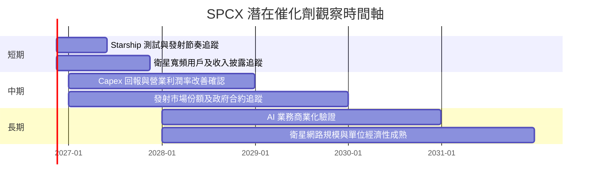

### 9.2 TAM 市場規模分析

沒有可靠 TAM、滲透率、訂閱戶數及各板塊收入資料，故以下展示的是**資料狀態**，不是市場規模估計。

```
╔══════════════════════════════════════════════════════════════════╗
║                    SPCX TAM 資料可得性                           ║
╠══════════════════════════════════════════════════════════════════╣
║ 火箭發射服務 TAM：N/A｜滲透率：N/A｜SPCX 收入：分部 N/A         ║
║ 衛星寬頻 TAM：    N/A｜滲透率：N/A｜訂閱數／ARPU：N/A            ║
║ AI 業務 TAM：     N/A｜滲透率：N/A｜收入與客戶：N/A              ║
║ 可量化的公司 TTM 總營收：$32.04B；不得當作 TAM                  ║
╚══════════════════════════════════════════════════════════════════╝
```

### 9.3 成長驅動力結構圖

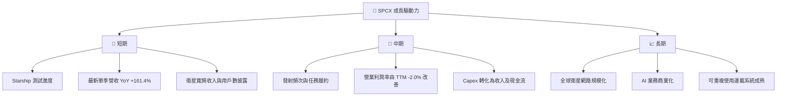

---

## 10. 風險矩陣

### 10.1 風險評分矩陣

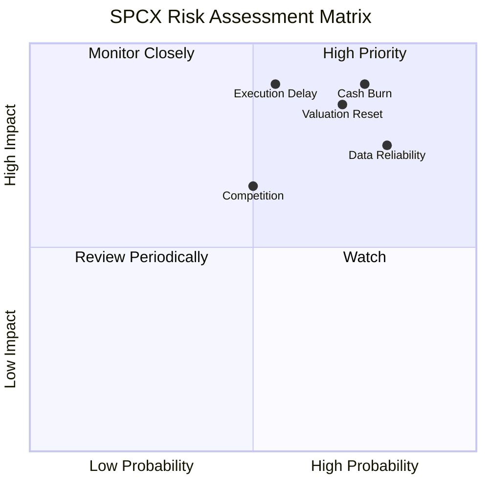

### 10.2 風險清單詳細分析

| # | 風險項目 | 發生機率 | 財務衝擊 | 風險評分 | 緩解措施 |
|---|---|---:|---|---:|---|
| 1 | 🔴 資本支出及現金消耗 | 高，估計 65% | 若 Capex 維持高位，FCF 持續為負；目前 TTM −$40.16B | 🔴 9.0/10 | 每季追蹤 Capex／營收、OCF／Capex、現金餘額 |
| 2 | 🔴 估值收縮 | 高，估計 60% | P/S 58.96x、EV/Revenue 57.73x；倍數收縮可造成大幅回撤 | 🔴 8.5/10 | 以分批及估值上限控制持倉，不用單一分析師目標價定價 |
| 3 | 🔴 技術與計畫執行 | 中高，估計 50% | Starship 或衛星部署延遲會推遲收入、延長高 Capex 期 | 🔴 8.0/10 | 追蹤測試成功率、任務節奏及客戶交付 |
| 4 | 🟡 數據與披露風險 | 高，估計 70% | 市值、股數、季報指標存在矛盾，可能令估值模型失真 | 🔴 8.0/10 | 以正式 SEC 文件、審計財報及股權表核實後再評級 |
| 5 | 🟡 政策／政府合約風險 | 中，估計 35% | 政策或合約變化影響收入及市場准入；金額資料 N/A | 🟡 6.0/10 | 監控政府合約集中度及出口／監管政策 |
| 6 | 🟡 競爭與價格壓力 | 中，估計 45% | 可能壓低衛星服務 ARPU、發射價格及利潤率 | 🟡 6.5/10 | 追蹤客戶續約、單位成本與競爭者發射節奏 |

機率為分析師情境判斷，不是歷史統計值或公司披露。

---

## 11. 投資建議

### 11.1 最終綜合評級雷達圖

```
╔══════════════════════════════════════════════════════════════╗
║                  SPCX 最終評分雷達                           ║
╠══════════════════════════════════════════════════════════════╣
║ 基本面        5.0/10  ▓▓▓▓▓▓▓▓▓▓░░░░░░░░░░                 ║
║ 成長性        8.0/10  ▓▓▓▓▓▓▓▓▓▓▓▓▓▓▓▓░░░░                 ║
║ 獲利能力      3.0/10  ▓▓▓▓▓▓░░░░░░░░░░░░░░                 ║
║ 財務健康      7.0/10  ▓▓▓▓▓▓▓▓▓▓▓▓▓▓░░░░░░                 ║
║ 估值          2.0/10  ▓▓▓▓░░░░░░░░░░░░░░░░                 ║
║ 護城河        6.0/10  ▓▓▓▓▓▓▓▓▓▓▓▓░░░░░░░░                 ║
║ 綜合          4.8/10  ▓▓▓▓▓▓▓▓▓▓░░░░░░░░░░                 ║
╠══════════════════════════════════════════════════════════════╣
║ 評級：🔴 賣出｜主要原因：MOS 約 -450.2%、TTM FCF -$40.16B   ║
╚══════════════════════════════════════════════════════════════╝
```

### 11.2 目標價與隱含報酬率

| 情境 | 目標價 | 相對 $139.11 | 機率權重 | 依據 |
|---|---:|---:|---:|---|
| 🔴 悲觀 | $34.53 | −75.2% | 30% | FY+1 EV/Sales 10x 情境 |
| 🟡 基準 | $40.56 | −70.8% | 50% | FY+1 EV/Sales 12x 情境 |
| 🟢 樂觀 | $65.11 | −53.2% | 20% | FY+1 EV/Sales 20x 情境 |
| 參考：基準 DCF | 約 $6.65 | 約 −95.2% | — | 高度依賴 Capex 正常化的模型值 |
| 參考：分析師均值 | $256.41 | +84.3% | — | 37 位分析師資料包均值，不作模型主依據 |

情境價格與第 8.8 節加權合理價值用途不同：前者為 EV/Sales 情境，後者為多方法加權結果。**買入觀察價**以加權合理價值 $25.28 計算 MOS ≥10%：$25.28×(1−10%) = **約 $22.75**。若股價仍為 $139.11，不符合買入條件。

### 11.3 買入時機與觸發因素

```
╔══════════════════════════════════════════════════════════════════╗
║                  ✅ 買入觸發因素 Checklist                       ║
╠══════════════════════════════════════════════════════════════════╣
║ 進場前核實：                                                      ║
║ ☐ 正式財報核實市值、稀釋股數、分部營收與資本支出                 ║
║ ☐ TTM FCF 連續改善，且至少連續兩季 Capex 不再高於 OCF 的 3 倍   ║
║ ☐ 營業利益率連續兩季為正，並披露改善的具體來源                  ║
║                                                                  ║
║ 加碼觸發條件：                                                    ║
║ ☐ 股價進入約 $22.75 以下，且估值假設未惡化                      ║
║ ☐ Capex／營收下降，同時收入成長與毛利率維持                     ║
║ ☐ 可核實的營運數據支持 Starship／衛星服務變現                    ║
║                                                                  ║
║ 減碼／退出觸發條件：                                              ║
║ ☐ 最新單季營收 YoY 連續兩季低於 30%                              ║
║ ☐ 營業利益率連續兩季低於 0%                                      ║
║ ☐ TTM FCF 惡化至低於 -$40.16B，或淨現金快速下降                 ║
║ ☐ 正式稀釋股數與財務資料證實每股價值低於投資論點支撐             ║
╚══════════════════════════════════════════════════════════════════╝
```

### 11.4 投資人適配度分析

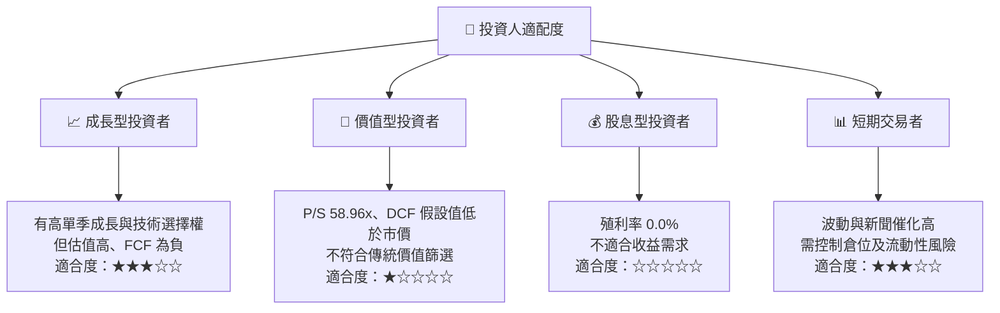

### 11.5 每季財報監控清單（Quarterly Watch List）

| 指標 | 最新基準 | 加碼觀察條件 | 減碼／重估條件 |
|---|---:|---|---|
| 營收 YoY | 最新單季 +161.4%；TTM N/A | 兩季維持高成長且披露可比基數 | 連續兩季低於 30% |
| 營業利益率 | TTM −2.0%；最新季 1.8% | 連續兩季為正且改善可歸因於營運 | 連續兩季為負 |
| 毛利率 | TTM 56.8% | 維持或改善並有分部數據 | 明顯下滑且伴隨價格壓力 |
| Capex | TTM $55.92B | Capex／營收下降、產能利用率上升 | Capex 增長快於收入且 OCF 無改善 |
| FCF | TTM −$40.16B | 連續改善並逐步接近零 | 低於 −$40.16B 且現金持續下降 |
| 營業現金流 | TTM $15.76B | 增長快於 Capex | OCF 轉負或大幅低於預期 |
| SBC | FY2025 $1.95B | SBC／營收下降、稀釋股數穩定 | SBC／營收高於 10.4% 且股數上升 |
| 研發 | FY2025 $8.64B | 披露研發產品商業化與收入貢獻 | 支出上升但產品交付或收入未改善 |
| 現金及短期投資 | $89.86B | 充足且消耗率下降 | 大幅下降並伴隨融資需求增加 |
| 股數與市值 | 8.25B、13.579B 等數據衝突 | 正式股權表、完全稀釋股數一致 | 無法核實前，不提高估值信心 |

### 11.6 反面論證：什麼會證明論點錯誤（What Would Change My Mind）

```
╔══════════════════════════════════════════════════════════════════╗
║              ⚠️ 論點失效條件（Disconfirming Evidence）           ║
╠══════════════════════════════════════════════════════════════════╣
║ ☐ 核心業務單季 YoY 成長連續兩季低於 30%                         ║
║ ☐ 營業利益率連續兩季低於 0%，或較最新季度 1.8% 明顯轉弱         ║
║ ☐ TTM FCF 低於目前 -$40.16B 且現金及短期投資下降                ║
║ ☐ Capex／營收長期無法下降，或資本支出未轉化為新增收入           ║
║ ☐ 正式計算 ROIC 低於 WACC 12.36% 示範門檻，並持續兩年           ║
║ ☐ SBC／營收高於 FY2025 的 10.4%，且稀釋股數持續增加             ║
║ ☐ 正式申報文件顯示股數、債務或現金顯著不同於本資料包             ║
╚══════════════════════════════════════════════════════════════════╝
```

> **免責聲明**：本報告為 AI 自動生成，僅供研究參考，不構成投資建議。資料包包含來源與口徑不一致項目，估值數字屬明示假設下的情境分析；投資前應核實正式申報文件、完全稀釋股數及財報資料。投資有風險，入市需謹慎。