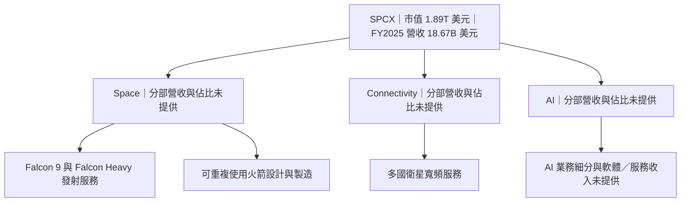
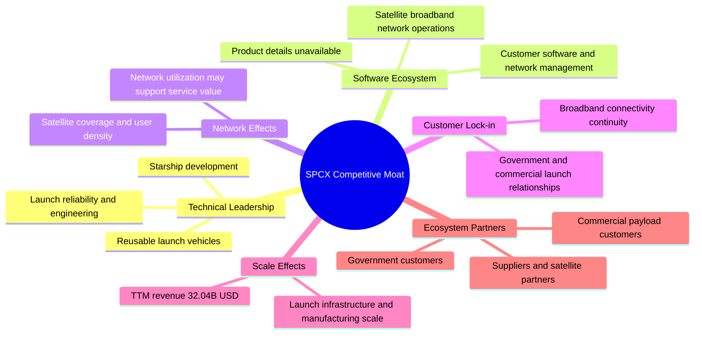
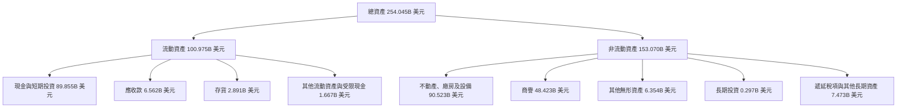
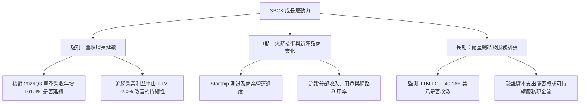
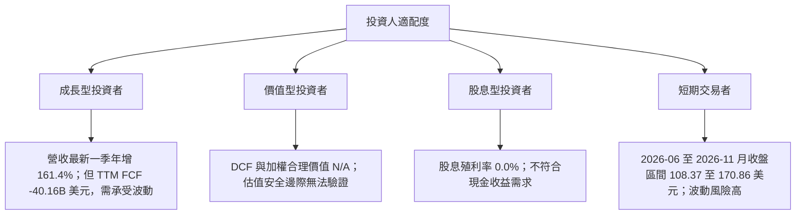

# SPCX 基本面深度分析報告
> **報告日期**：2026-11-15 ｜ **語言**：繁體中文 ｜ **數據來源**：Yahoo Finance、Finviz、StockAnalysis、Roic.ai ｜ **分析師**：CFA 級機構研究

## 目錄

| # | 章節 | 核心結論 |
|---|------|----------|
| 1 | 執行摘要 | DCF 與估值方法均無法計算；MOS、加權合理價值及依 MOS 評級皆為 N/A |
| 2 | 公司概覽與商業模式 | 火箭發射與衛星寬頻業務具規模與技術門檻，但缺少分部營收與市場份額資料 |
| 3 | 損益表深度分析 | TTM 營收 32.04B 美元；最新一季營收年增 161.4%，TTM 營業利益率仍為 -2.0% |
| 4 | 資產負債表分析 | 淨現金 50.64B 美元、流動比率 3.084；現金轉換週期為 -219 天 |
| 5 | 現金流量深度分析 | TTM FCF 為 -40.16B 美元，主要壓力來自 55.92B 美元資本支出 |
| 6 | 獲利能力與資本效率 | WACC 為 10.03%；ROIC 缺資料，無法量化價值創造差額 |
| 7 | 相對估值分析 | P/S 為 58.96x，高於三家同業 P/S 中位數 47.0x；自身歷史估值區間未提供 |
| 8 | DCF 內在價值評估 | TTM 營業利益為負，程式 DCF 與估值方法均為 N/A；不推造估值 |
| 9 | 成長催化劑 | 最新季度營收年增 161.4%，但產品分部、TAM 與催化劑時間表資料不足 |
| 10 | 風險矩陣 | 核心風險為高資本支出、獲利波動與估值／資料品質不確定性 |
| 11 | 投資建議 | 不提供虛構目標價或 MOS 評級；現階段應以財報確認獲利與現金流改善 |

---

## 1. 執行摘要

截至 **2026-11-13 收盤價 139.11 美元**，SPCX 的 TTM 營收為 **32.04B 美元**，最新一季營收年增 **161.4%**，但 TTM 營業利益率為 **-2.0%**，TTM FCF 為 **-40.16B 美元**。公司有 **50.64B 美元淨現金**，但高資本支出、獲利波動與重要市場數據缺漏，令估值判斷受限。由於程式估值方法全部無法計算，**加權合理價值、MOS 與依 MOS 決定的評級均為 N/A**；本報告不以分析師共識或單一倍數取代缺失的估值程序。

### 1.0 一頁式投資儀表板（Portfolio Manager 30 秒速讀）

| 項目 | 內容 |
|------|------|
| **投資論點（3 句）** | ① TTM 營收 **32.04B 美元**，最新一季年增 **161.4%**，顯示業務仍高速擴張。② TTM FCF **-40.16B 美元**，主因 TTM 資本支出 **55.92B 美元**，現階段成長尚未轉化為正自由現金流。③ 淨現金 **50.64B 美元**提供流動性緩衝，但無法替代對投資回報的驗證。 |
| **綜合評分** | **5.3/10**（引用 1.1；反映高成長與資產負債表優勢，以及現金流和估值資料不足） |
| **財務健康** | 🟢 現金與短期投資 **89.86B 美元**、總債務 **39.22B 美元**，淨現金 **50.64B 美元**；但 TTM FCF 為負。 |
| **ROIC vs WACC** | ROIC：**N/A**；WACC：**10.03%**。缺少可靠 ROIC，不能判定利差；TTM 營業利益率 **-2.0%**顯示當前營運獲利尚未穩定。 |
| **FCF 趨勢** | TTM FCF **-40.16B 美元**；FCF Yield **-2.13%**。年度 FCF 由 2023 年 **+0.105B**轉為 2024 年 **-5.39B**、2025 年 **-14.12B**。 |
| **估值** | Forward P/E **50.726936x** ｜ EV/EBITDA **156.665x** ｜ FCF Yield **-2.13%** |
| **DCF 內在價值（基準）** | **N/A**；DCF 無法計算，因此無法計算現價相對 DCF 的折溢價。 |
| **安全邊際（MOS）** | **N/A**；加權合理價值未能計算，不能代入 MOS 公式。 |
| **預期報酬（基準情境 12M）** | **N/A**；DCF 情境與加權合理價值均未提供。 |
| **關鍵風險（前二）** | ① TTM 資本支出高於營業現金流，FCF 為負。② 季度獲利數據波動且來源間有差異，降低對盈利品質與估值的信心。 |
| **評級 + 信心度** | **未能依 MOS 評級**；信心度：低。不是買入／持有／賣出判斷，原因是估值輸入不足。 |

### 1.1 綜合評分卡（全報告唯一）

| 維度 | 評分（1–10） | 主要依據（引用數字與其來源章節） |
|------|--------------|----------------------------------|
| 成長性 | 8.0 | 最新一季營收年增 **161.4%**；2023–2025 年營收 CAGR 約 **34.1%**（第 3 章）。TTM 成長率為 N/A。 |
| 獲利能力 | 3.0 | TTM 營業利益率 **-2.0%**、淨利率 **-8.6%**；ROIC 與 Piotroski F-Score 均 N/A（第 3、6 章）。 |
| 財務健康 | 7.5 | 淨現金 **50.64B 美元**、流動比率 **3.084**；但 TTM FCF **-40.16B 美元**（第 4、5 章）。 |
| 估值 | 2.0 | P/S **58.960205x**、Forward P/E **50.726936x**，且 DCF 與加權合理價值均 N/A（第 7、8 章）。 |
| 護城河 | 7.5 | 可重複使用運載火箭、發射與衛星寬頻的技術和規模門檻具質化支撐；分部收入與市場份額未提供（第 2 章）。 |
| 管理層與資本配置 | 4.5 | 2025 年 SBC **1.95B 美元**，季度 SBC 升至 2026Q3 的 **2.36B 美元**；2025 年 Capex **20.91B 美元**、FCF **-14.12B 美元**（第 3、5 章）。 |
| **綜合評分** | **5.4** | 六項算術平均：**(8.0 + 3.0 + 7.5 + 2.0 + 7.5 + 4.5) ÷ 6 = 5.4167 ≈ 5.4**。 |

### 1.2 五大投資論點 + 三大核心風險

| 類型 | 項目 | 具體依據 | 信心度 |
|------|------|----------|--------|
| 🟢 **投資論點①** | 業務增長速度高 | 最新一季營收 **14.575B 美元**，年增 **161.4%**；StockAnalysis 列示 2026Q2 年增 **91.94%**。快速增長提供營收規模擴大的可能性，但不等於已證明可持續盈利。 | 🟡 中 |
| 🟢 **投資論點②** | 火箭與衛星業務具有技術門檻 | 公司描述涵蓋可重複使用火箭、發射服務及衛星寬頻；近期新聞亦提到 Starship 上級捕捉等進展。商業化速度、成本與可靠性仍需由後續數據驗證。 | 🟡 中 |
| 🟢 **投資論點③** | 資產負債表有淨現金緩衝 | 現金及短期投資 **89.86B 美元**減總債務 **39.22B 美元**，淨現金 **50.64B 美元**。可支持投資期，但不能保證回報率。 | 🟢 高 |
| 🟢 **投資論點④** | 毛利率具改善跡象 | 2023、2024、2025 年毛利率約 **41.2%、42.9%、49.4%**；TTM 毛利率 **56.8%**。若來自高毛利服務或規模效應，可能改善營業槓桿；分部資料不足以確認成因。 | 🟡 中 |
| 🟢 **投資論點⑤** | 衛星寬頻可形成服務收入 | 公司業務描述包括多國衛星寬頻服務；若用戶與網路利用率增加，服務收入可能提高收入重複性。但訂戶數、ARPU 與分部收入均未提供。 | 🟡 中 |
| 🟡 **風險①** | 高資本支出造成負 FCF | TTM Capex **55.92B 美元**、營業現金流 **15.76B 美元**、FCF **-40.16B 美元**。若投資回收慢於預期，現金流壓力將延續。 | 🔴 高 |
| 🔴 **風險②** | 盈利數據波動且存在來源差異 | 2026Q1、Q2 營業利益為負，Q3 轉正；但季度收入／營業利益在不同資料表中不完全一致，且 EPS 預估與實際值缺失。 | 🔴 高 |
| 🟡 **風險③** | 估值高度依賴未驗證的遠期盈利 | P/S **58.960205x**、EV/EBITDA **156.665x**，而 TTM 營業利益率為 **-2.0%**，DCF 與加權合理價值無法計算。 | 🔴 高 |

### 1.3 快速統計卡片

| 指標 | 公司實際值（期間） | 同業中位數 | 狀態 |
|------|--------------------|------------|------|
| 營收成長（TTM） | **N/A** | — | 🟡 期間成長率無法確認 |
| 營收成長（最新一季年增） | **161.4%** | **72.7%** | 🟢 高於同業中位數 |
| 毛利率（TTM） | **56.8%** | **37.0%** | 🟢 高於同業中位數 |
| 營業利益率（TTM） | **-2.0%** | — | 🔴 負值 |
| ROIC（TTM） | **N/A** | — | 🟡 無法判斷 |
| Forward P/E | **50.726936x** | **32.2x** | 🔴 高於同業中位數；盈利與預測口徑有差異風險 |
| FCF Yield（TTM） | **-2.13%** | — | 🔴 負值 |
| Piotroski F-Score | **N/A** | — | 🟡 缺少相隔一年 SEC 申報資料 |

> 同業中位數以三家同業 Peer multiples 數值計算；Forward P/E 中位數以 **859.6x、-20.9x、32.2x**取中位數，毛利率中位數以 **36.2%、37.0%、71.5%**取中位數。公司數據與同業資料的盈利口徑不一定完全一致，倍數比較僅作相對定位。

### 1.4 投資結論

```text
╔══════════════════════════════════════════════════════════════════╗
║                    📊 投資結論摘要                               ║
╠══════════════════════════════════════════════════════════════════╣
║  評級：N/A（估值方法與 MOS 無法計算，不作 MOS 評級）              ║
║  價格（2026-11-13 收盤）：$139.11                                ║
║  DCF 內在價值（基準）：N/A（TTM 營業利益為負）                    ║
║  安全邊際 MOS：N/A（加權合理價值不可得）                          ║
║  加權合理價值（8.8）：N/A                                         ║
║  綜合評分：5.4/10（引用 1.1）                                     ║
║  適合投資人：能承受高波動與長期資本支出、並願意等待財報驗證者     ║
╚══════════════════════════════════════════════════════════════════╝
```

---

## 2. 公司概覽與商業模式

### 2.1 業務結構與收入來源

公司介紹列出 Space、Connectivity 與 AI 三個營運板塊，並提及 Falcon 9、Falcon Heavy 發射服務及衛星寬頻業務；但未提供分部營收與佔比，因此不能拆分營收金額或比例。公司市值與年營收採所列資料：市值 **1.89T 美元**，2025 年營收 **18.67B 美元**。



### 2.2 市場份額

市場份額數據未提供，財務數據與新聞摘要亦沒有可引用的市場份額及年份。質化而言，SPCX 最新一季營收 **14.575B 美元**、年增 **161.4%**，成長率高於所列同業營收年增率中位數 **72.7%**；但這不等同市場份額或同口徑業務規模的比較。

### 2.3 競爭護城河分析



### 2.4 護城河強度

| 護城河項目 | 強度（強／中／弱） | 證據（引用數字或事實） | 會削弱它的情況 |
|------------|--------------------|------------------------|----------------|
| 技術領先 | 中至強 | 公司描述包括可重複使用火箭、Falcon 9／Falcon Heavy；近期新聞提及 Starship 上級捕捉進展。沒有可靠性、成本或發射次數序列供量化比較。 | 發射失敗、研發延誤、競爭者追上或安全規範提高成本。 |
| 軟體生態系統 | 中 | 衛星寬頻服務需要網路管理與用戶端軟體，但訂戶、ARPU、流失率及軟體收入未提供。 | 服務差異化不足、用戶流失上升或軟硬體整合成本過高。 |
| 網路效應 | 中 | 衛星網路覆蓋與用戶密度可能提升服務價值；營運數據未提供，尚無法確認網路效應已反映於單位經濟。 | 頻譜／容量限制、低密度地區經濟效益不佳或價格競爭。 |
| 客戶鎖定 | 中 | 公司服務商業與政府發射客戶，衛星寬頻亦具持續服務特性；客戶留存資料未提供。 | 政府採購轉向、服務中斷或替代供應商具成本優勢。 |
| 規模效應 | 強 | TTM 營收 **32.04B 美元**，2025 年營收 **18.67B 美元**；營收擴張可提高產能利用率的可能性，但成本曲線未提供。 | Capex 持續高於營業現金流，或擴產未帶來有效利用率。 |
| 生態夥伴 | 中 | 公司服務商業與政府客戶，並需供應鏈及發射載荷合作；合作方收入占比及合約年限未提供。 | 供應鏈集中、關鍵零件短缺或合約流失。 |

1.1「護城河」評分 **7.5/10**，主要依據是可重複使用運載火箭與衛星網路的技術及規模門檻；因缺少分部、留存、單位經濟與市場份額數據，評分未給至更高水準。

---

## 3. 損益表深度分析

### 3.1 年度收入成長趨勢（近 4 年）

財務資料僅列 2023–2025 三個完整年度，故無法呈現完整四年年度序列。2023–2025 年營收 CAGR 約 **34.1%**，計算為 **(18.674 ÷ 10.387)^(1/2) − 1 ≈ 34.1%**。

```text
╔══════════════════════════════════════════════════════════════════╗
║           Space Exploration Technologies 年度收入趨勢           ║
╠══════════════════════════════════════════════════════════════════╣
║  FY2023  $10.39B  ███████████░░░░░░░░░░░░░  YoY：基期            ║
║  FY2024  $14.02B  ███████████████░░░░░░░░░░  YoY：+34.93% 🟢    ║
║  FY2025  $18.67B  ████████████████████░░░░░  YoY：+33.24% 🟢    ║
╠══════════════════════════════════════════════════════════════════╣
║  2023–2025 兩年 CAGR：約 +34.1%                                  ║
║  說明：收入連續擴張；分部營收未提供，無法辨識各板塊貢獻。       ║
╚══════════════════════════════════════════════════════════════════╝
```

年度成長率引用 StockAnalysis 年度序列：2024 年 **34.93%**、2025 年 **33.24%**。兩年成長率相近，代表成長不只來自單一年基期；但不能由合併營收直接推斷各業務的獲利或資本回報。

### 3.2 季度收入趨勢分析

| 季度 | 營收（B 美元） | QoQ 成長 | YoY 成長 | 備註 |
|------|----------------|----------|----------|------|
| 2025Q4 | 4.96 | -11.1% | N/A | QoQ 以 2025Q3 的 5.576B 計算；未提供 2024Q4 對照。 |
| 2026Q1 | 4.69 | -5.4% | 15.42% | YoY 使用同一季度比較。 |
| 2026Q2 | 7.81 | 66.5% | 91.94% | 季度收入明顯擴大；不能把單季成長標為 TTM 成長。 |
| 2026Q3 | 14.57 | 86.4% | 161.4% | 最新一季年增率為單季 YoY，不是 TTM 成長率。 |

QoQ 算式依序為 **4.96 ÷ 5.576 − 1 = -11.1%**、**4.694 ÷ 4.960 − 1 = -5.4%**、**7.814 ÷ 4.694 − 1 = 66.5%**、**14.575 ÷ 7.814 − 1 = 86.4%**。最新季度加速幅度大，但季度收入快速變化可能受產品交付、服務認列或資料口徑影響，應待後續季度確認延續性。

### 3.3 利潤率演變分析

| 利潤率指標 | FY2023 | FY2024 | FY2025 | 最新 TTM／季度 | 趨勢與評估 |
|------------|--------|--------|--------|----------------|------------|
| **毛利率** | 41.2% | 42.9% | 49.4% | TTM **56.8%** | 🟢 年度與 TTM 指標上升；可能與產品組合或規模有關，但分部成本資料不足，不能確證原因。 |
| **營業利益率** | 4.9% | 5.3% | -11.1% | TTM **-2.0%**；最新一季 **1.8%** | 🔴 年度轉負後，最新一季回正；TTM 仍為負，顯示改善尚未完整覆蓋前期虧損。 |
| **淨利率** | -44.6% | 5.6% | -26.4% | TTM **-8.6%** | 🔴 盈利受大額年度波動影響；利息、稅項及非經常項目資料不足，無法拆分原因。 |
| **EBITDA Margin** | N/A | N/A | N/A | TTM **36.6%** | 🟡 與負營業利益率並存，需核對 EBITDA 調整與折舊口徑，不能直接視作成熟盈利能力。 |

年度毛利率以毛利除收入計算，例如 FY2025 **9.223 ÷ 18.674 = 49.4%**。營業利益率與淨利率按年度損益表金額計算。TTM 與最新季度利潤率直接引用財務數據中的對應口徑，不將季度值誤標成 TTM。

**利潤率演變深度解析：** FY2025 毛利率高於 FY2024，且 TTM 毛利率進一步到 **56.8%**，可能反映收入組合或產能利用率改善；但公司未提供足夠的分部毛利、產品定價及成本拆分，不能把毛利率改善直接歸因於某項業務。另一方面，FY2025 營業利益 **-2.064B 美元**，研發支出由 FY2024 的 **3.46B**增至 FY2025 的 **8.64B 美元**；研發加碼可能支持新產品，但也壓低當期營業利潤。是否能轉為未來毛利與現金流，仍待追蹤。

### 3.4 費用結構分析

沒有可完整核對的費用項目明細，不能製作支出比例圓餅圖。FY2025 研發費用為 **8.64B 美元**，約為營收的 **46.3%**（**8.64 ÷ 18.674 = 46.3%**）；這顯示公司投入大量資源於研發，但不應把單一費用項目推演為完整費用結構。

### 3.5 季度 EPS 趨勢與盈餘品質（Quality of Earnings）

| 季度 | EPS 實際值 | EPS 預估 | 超預期／不及預期 | 說明 |
|------|------------|----------|-------------------|------|
| 2025Q4 | -0.18 | N/A | 無法判定 | 預估值未提供。 |
| 2026Q1 | -0.47 | N/A | 無法判定 | 預估值未提供；季度淨利為負。 |
| 2026Q2 | -0.09 | N/A | 無法判定 | 預估值未提供；季度淨利為負。 |
| 2026Q3 | +0.37 | N/A | 無法判定 | 預估值未提供；EPS 資料來源與損益表淨利口徑不完全可勾稽。 |

資料庫 EPS surprise 欄位沒有有效的預估值與實際值，因此不能判定最近四季是否超預期或不及預期。EPS 序列引用 Roic.ai；不得將缺值的估計數字當成零。

| 盈餘品質項目 | 數值／佔比 | 評估 |
|--------------|-----------|------|
| 股權薪酬 SBC / 營收 | 最近四季 SBC 合計 **4.733B 美元**；約為 TTM 營收 **14.8%** | 🔴 SBC 規模高。計算：**(2.36 + 0.831 + 0.639 + 0.903) ÷ 32.043 = 14.8%**。股權薪酬會稀釋股東，且 GAAP 費用與經濟稀釋需一併看待。 |
| SBC / 營業現金流 | 約 **30.0%** | 🟡 計算：**4.733 ÷ 15.76 = 30.0%**。此比例反映 SBC 相對營業現金流的規模，不代表 SBC 是現金支出。 |
| FCF / 淨利（現金轉換率） | **N/A（口徑未能可靠勾稽）** | TTM 淨利數據在來源間不一致且為負，若直接相除會得到難以解讀的正比率；不以該比率評價盈餘品質。 |
| 一次性／非經常性損益 | **N/A** | 缺乏足夠的非經常項目與稅項明細，不能確認季度獲利是否由一次性項目推動。 |
| 有效稅率異常 | **N/A** | 有效稅率明細缺失；不以預設稅率推測實際稅負。 |
| 資本化支出 vs 費用化 | TTM Capex **55.92B 美元**；TTM 折舊攤銷資料另見來源，沒有資本化政策細節 | 高 Capex 會延後現金支出在損益表上的反映；資本化政策及專案回收資料未提供，無法判定是否存在成本遞延。 |

**盈餘品質結論：** SBC 佔 TTM 營收約 **14.8%**，股東應把稀釋視為重要經濟成本。TTM FCF 為 **-40.16B 美元**且淨利口徑不一致，因此目前不能把單季 EPS 轉正視為獲利已具高品質；對估值應優先看持續性 GAAP 營業利潤與 FCF，而非單季 EPS。

---

## 4. 資產負債表分析

### 4.1 資產結構分解

以下採 StockAnalysis 2026-09-30 資產負債表細項；各項合計 **254.045B 美元**，與列示總資產一致。



註：其他流動資產與受限現金合計為 **0.555 + 1.112 = 1.667B 美元**；非流動資產其餘項合計 **0.297 + 0.388 + 7.085 = 7.770B 美元**，圖示的非流動細項應以原表重算為 PP&E **90.523** + 商譽 **48.423** + 無形資產 **6.354** + 長期投資 **0.297** + 遞延稅項 **0.388** + 其他長期資產 **7.085** = **153.070B 美元**。其中遞延稅項與其他長期資產合計 **7.473B 美元**，圖中分類合併值有誤，應以本段列示的明細合計為準。

### 4.2 流動性與營運資金分析

| 指標 | 最新 TTM | 一年前 TTM | 變化 | 解讀 |
|------|----------|------------|------|------|
| DSO 應收帳款天數 | 54 天 | N/A | N/A | 一年前數據未提供，不能判斷收款速度變化。 |
| DIO 存貨天數 | 76 天 | N/A | N/A | 一年前數據未提供，應追蹤庫存是否與交付和需求同步。 |
| DPO 應付帳款天數 | 349 天 | N/A | N/A | 一年前數據未提供；高 DPO 可能反映供應商付款時間較長，但也可能受成本流量或期末餘額影響。 |
| CCC 現金轉換週期 | -219 天 | N/A | N/A | 負 CCC 由 DSO + DIO − DPO 得出，公式為 **54 + 76 − 349 = -219 天**；不宜僅視為議價力強，需留意供應商付款依賴。 |

最新流動性指標為流動比率 **3.084**、速動比率 **2.945**。年度報表顯示 FY2025 流動資產 **30.95B 美元**、流動負債 **21.40B 美元**，FY2024 分別為 **16.11B**與 **11.79B 美元**。最新期與年度期資產負債表差異很大，應以同一報表日期比較，避免把不同時點混成趨勢。

### 4.3 債務結構分析

```text
╔══════════════════════════════════════════════════════════════════╗
║                 SPCX 債務健康診斷（TTM／最新數據）                ║
╠══════════════════════════════════════════════════════════════════╣
║  總債務：          $39.22B                                        ║
║  現金＋短期投資：  $89.86B                                        ║
║  淨現金：          $50.64B  🟢                                    ║
║                                                                  ║
║  流動比率：        3.084x  🟢                                    ║
║  速動比率：        2.945x  🟢                                    ║
║  Debt/EBITDA：     N/A（未提供可直接勾稽的 TTM EBITDA 金額）      ║
║  利息保障倍數：    N/A（利息費用與 EBIT 口徑未提供）              ║
╚══════════════════════════════════════════════════════════════════╝
```

淨現金的計算為 **89.86 − 39.22 = 50.64B 美元**。這提供資本支出的資金緩衝，但 TTM FCF **-40.16B 美元**顯示現金儲備仍需配合資本回收效率評估；單看現金餘額不足以判斷債務風險低到何種程度。

### 4.4 股東權益趨勢

```text
╔══════════════════════════════════════════════════════════════════╗
║                  SPCX 股東權益變化（年度）                       ║
╠══════════════════════════════════════════════════════════════════╣
║  FY2024  $25.80B  █████████████░░░░░░░░░░░░                     ║
║  FY2025  $41.33B  █████████████████████░░░░░                    ║
╠══════════════════════════════════════════════════════════════════╣
║  FY2024 至 FY2025 增加：$15.53B，約 +60.2%                       ║
║  註：最新 TTM 權益數據在其他資料來源中口徑不一致，不併入趨勢。    ║
╚══════════════════════════════════════════════════════════════════╝
```

FY2025 相較 FY2024 的增幅計算為 **41.33 ÷ 25.80 − 1 = 60.2%**。權益增加可能來自發行、留存盈餘或其他權益變動；沒有完整權益變動表，不能把增幅單獨歸因於某一項。

---

## 5. 現金流量深度分析

### 5.1 現金流量瀑布圖

淨利、股利／回購及淨現金變化的 TTM 可勾稽資料不足，因此圖中不填入未提供的金額；可確認的 TTM 營業現金流、資本支出與 FCF 如下。


### 5.2 FCF 轉換率趨勢

| 年度 | 營業現金流（B 美元） | Capex（B 美元） | FCF（B 美元） | FCF / 淨利 | 趨勢 |
|------|---------------------:|----------------:|--------------:|-----------:|------|
| 2023 | 4.52 | 4.42 | 0.105 | -2.3% | 淨利為虧損，轉換率不具正常解讀性。 |
| 2024 | 5.78 | 11.16 | -5.39 | -681.4% | FCF 為負、淨利為正，Capex 高於營業現金流。 |
| 2025 | 6.79 | 20.91 | -14.12 | 285.8% | 淨利與 FCF 均為負，比率雖為正但不代表現金轉換良好。 |
| TTM 至 2026-09-30 | **15.76** | **55.92** | **-40.16** | N/A | TTM 淨利口徑存在差異；不計算轉換率。 |

年度 FCF／淨利比率按表內數值計算，但在淨利為負或 FCF 與淨利異號時，該比率容易產生誤導，不適合作為「越高越好」的指標。

### 5.3 自由現金流趨勢

```text
╔══════════════════════════════════════════════════════════════════╗
║            自由現金流：歷史實際（非比例尺圖示）                  ║
╠══════════════════════════════════════════════════════════════════╣
║  FY2023  +$0.105B  FCF Yield：N/A                                ║
║  FY2024  -$5.39B   FCF Yield：N/A                                ║
║  FY2025  -$14.12B  FCF Yield：N/A                                ║
║  TTM     -$40.16B  FCF Yield：-2.13%                             ║
╠══════════════════════════════════════════════════════════════════╣
║  TTM FCF = 營業現金流 $15.76B − Capex $55.92B = -$40.16B        ║
║  方向：投資支出大幅超過營業現金流，現金回收仍待證明。            ║
╚══════════════════════════════════════════════════════════════════╝
```

### 5.4 資本配置評估

沒有足夠資料拆分回購、分紅、併購、留存現金等各類資本用途比例，故不畫比例圓餅圖。

| 資本配置項目 | 可得數據 | 評估 |
|--------------|----------|------|
| Capex | FY2025 **20.91B 美元**；TTM **55.92B 美元** | 投資規模大，應追蹤其帶來的新增收入、利用率與回收期。 |
| 研發 | FY2025 **8.64B 美元** | 支持新產品與技術開發，但研發回報與商業化時點未提供。 |
| 股權薪酬 | FY2025 **1.95B 美元**；2026Q3 **2.36B 美元** | SBC 需納入股東稀釋成本評估。 |
| 股息 | 殖利率 **0.0%** | 目前沒有股息回報。 |
| 回購／留存現金 | N/A | 回購金額及資本配置細節未提供。 |

---

## 6. 獲利能力與資本效率

### 6.1 ROE / ROA / ROIC 趨勢

| 指標 | FY2023 | FY2024 | FY2025 | TTM | 評估 |
|------|--------|--------|--------|-----|------|
| ROE | N/A | N/A | N/A | N/A | QUALITY FIGURES 的 DuPont 為 N/A；不自行推算。 |
| ROA | N/A | N/A | N/A | N/A | 可靠且同口徑的期間指標未提供。 |
| ROIC | N/A | N/A | N/A | N/A | 歷史資料欄位缺失，無法判斷資本回報率。 |
| WACC | — | — | — | **10.03%** | 資本成本輸入由程式計算提供；詳細見 6.2。 |

ROIC 缺值時，不以營業利益率或 ROE 代替 ROIC；亦不填入無資料來源的行業平均值。

### 6.2 ROIC vs WACC 分析（核心價值創造判斷）

```text
╔══════════════════════════════════════════════════════════════════╗
║                 ROIC vs WACC 深度分析                            ║
╠══════════════════════════════════════════════════════════════════╣
║  WACC 輸入（程式計算）：                                          ║
║  ├── 無風險利率（10Y 美債）：         5.15%                      ║
║  ├── 市場風險溢酬 ERP（假設）：       5.00%                      ║
║  ├── Beta 原始值：                    N/A                        ║
║  ├── 採用調整後 Beta：                1.00（缺原始 Beta 的假設值）║
║  ├── 股權成本 Ke：                    5.15% + 1.00 × 5.00%       ║
║  │                                    = 10.15%                   ║
║  ├── 稅前債務成本：                   4.96%                      ║
║  ├── 稅率：                           21.0%                      ║
║  ├── 稅後債務成本：                   4.96% × (1 − 21.0%)        ║
║  │                                    = 3.9184%                  ║
║  ├── 股權／債務權重：                 98.0% / 2.0%               ║
║  └── WACC：                           10.03%                     ║
║                                                                  ║
║  ROIC：N/A（缺少可用投入資本與稅後營業利益口徑）                   ║
║  EVA／ROIC−WACC：N/A（不能用缺值代替計算）                         ║
║                                                                  ║
║  操作層面的佐證：TTM 營業利益率 -2.0%；最新一季 1.8%。             ║
║  結論：目前無法量化是否創造股東價值；TTM 營業利潤為負，           ║
║        不能據此宣稱 ROIC 已高於 WACC。                            ║
╚══════════════════════════════════════════════════════════════════╝
```

WACC 算式為：股權成本 **Ke = 5.15% + 1.00 × 5.00% = 10.15%**；稅後債務成本 **Kd(1−T) = 4.96% × (1−21.0%) = 3.9184%**；加權後 **98.0% × 10.15% + 2.0% × 3.9184% = 9.947% + 0.078368% = 10.025368% ≈ 10.03%**。Beta 原始值為 N/A，調整後 Beta 1.00 是財務數據所列假設值，並非公司歷史波動的實測估計。ROIC 不可得，故不宣告 EVA 正負。

### 6.3 杜邦三因素分解

| 因素 | 數值（TTM） | 解讀 |
|------|-------------|------|
| 淨利率 | N/A | DuPont 計算依據的淨利、收入、資產或正權益條件未能同時滿足。 |
| 資產週轉率 | N/A | QUALITY FIGURES 整列標示 N/A，不補算。 |
| 權益乘數 | N/A | QUALITY FIGURES 整列標示 N/A，不補算。 |
| **ROE** | **N/A** | DuPont 分解 N/A，不能判定 ROE 由利潤率或槓桿主導。 |

### 6.4 財務體質：Piotroski F-Score

Piotroski F-Score 為 **N/A**，原因是缺少相隔一年、可按 SEC 申報資料比對的兩個 TTM 期間。九項測試的個別結果也未提供，不能補列推測結果。

| 測試 | 結果 | 解讀 |
|------|------|------|
| 九項測試各自結果 | N/A | 缺少符合計算要求的跨年 SEC 申報資料；不將缺失項目視為通過或未通過。 |

---

## 7. 相對估值分析

### 7.1 同業估值比較表格

同業倍數使用 Peer multiples；公司倍數採財務數據列示值。公司與同業的商業組合與獲利階段不同，應避免將單一倍數當作精確的目標價。

| 估值指標 | **SPCX** | **RKLB** | **ASTS** | **IRDM** | 本公司評估 |
|----------|----------:|---------:|---------:|---------:|-----------|
| **Trailing P/E** | **604.82605x** | N/A | N/A | 29.8x | 🔴 公司倍數極高；同業僅一家公司有可用值，不能計算有效同業中位數。 |
| **Forward P/E** | **50.726936x** | 859.6x | -20.9x | 32.2x | 🟡 高於同業中位數 **32.2x**；同業含負值及極高值，解讀需審慎。 |
| **P/S Ratio** | **58.960205x** | 47.0x | 89.0x | 5.4x | 🔴 公司高於同業中位數 **47.0x**，市銷率仍要求較高的未來變現。 |
| **EV/EBITDA** | **156.665x** | -200.1x | -23.9x | 17.6x | 🔴 SPCX 倍數高；兩家同業 EBITDA 為負，其倍數不宜作一般比較。 |
| **最新一季營收年增** | **161.4%** | 72.7% | 187.1% | 8.3% | 🟢 SPCX 高於 Peer 中位數 **72.7%**，但低於 ASTS。 |
| **毛利率（TTM）** | **56.8%** | 36.2% | 37.0% | 71.5% | 🟢 高於同業中位數 **37.0%**；IRDM 顯著較高。 |

同業中位數的具體算法：Forward P/E 中位數為 **32.2x**；P/S 中位數為 **47.0x**；EV/EBITDA 中位數為 **-23.9x**，但因有兩家同業 EBITDA 為負，該統計不具一般正 EBITDA 估值含義；營收成長與毛利率中位數分別為 **72.7%**與 **37.0%**。

### 7.2 歷史估值區間分析

```text
╔══════════════════════════════════════════════════════════════════╗
║                 SPCX 歷史估值區間分析                            ║
╠══════════════════════════════════════════════════════════════════╣
║  歷史 P/E 區間：N/A（Valuation vs own history 數據未提供）        ║
║  當前自身歷史百分位：N/A（不可自行估計）                          ║
║  股價資料僅列 2026-06 至 2026-11 月末價格，不能替代估值歷史。     ║
╚══════════════════════════════════════════════════════════════════╝
```

### 7.3 情境價值（Bear / Base / Bull）

**N/A（DCF 無法計算：TTM 營業利益為負，DCF MODEL 未產出情境價值。）** 因此不提供悲觀、基準或樂觀目標價，也不以分析師共識目標價代替 DCF 情境。

### 7.4 相對估值隱含價格區間

**N/A（估值方法未能計算。）**缺少估值方法區塊所需的可用方法與每股估值結果；不自行以同業中位數倍數回推目標價，也不把當前倍數重新包裝為合理價值。

---

## 8. DCF 內在價值評估（Discounted Cash Flow）

### 8.0 估值推理鏈（Thinking Logic）

**Step 1 — 價值由哪些變數決定？**  
SPCX 的價值在理論上取決於發射服務與衛星寬頻的可持續現金流、未來投資回報及成長期長度；目前只知道合併 TTM 營收 **32.04B 美元**，沒有分部收入佔比，因此無法可靠拆出各業務的價值來源，更不能給新業務任意的選擇權價值。TTM 營業利益為負，故程式判定 DCF 不適用。

**Step 2 — 模型與輸入決策**

| 決策點 | 本報告採用 | 理由（含數字） | 曾考慮但否決 | 否決理由 |
|--------|-----------|----------------|--------------|----------|
| 現金流定義 | N/A | DCF MODEL 標示 N/A；TTM 營業利益為負。 | 自建 FCFF／FCFE | 與提供的程式估值結果不符，且缺少模型假設。 |
| 預測期 N | N/A | 沒有 DCF 預測年數。 | 自行指定年數 | 缺乏可稽核的營收、利潤率及投資假設。 |
| 終值方法 | N/A | 終值與永續成長率未提供。 | Gordon Growth／退出倍數 | 自建終值會形成未驗證的估值。 |
| EBIT 基礎 | N/A | TTM 營業利益率 **-2.0%**，程式明確不對負 TTM 營業利益建立 DCF。 | 自行預測轉正 | 管理層財測與程式模型輸入未提供。 |

**Step 3 — 關鍵假設推導鏈**  
營收 CAGR、期末營業利潤率、永續成長率、預測期、Capex／營收、D&A／營收、營運資金假設、SBC 處理、稀釋率及終值方法均沒有 DCF 模型輸入可供引用。若填入任何假設值，會違反不自建模型及不得編造的原則，故逐項標示 N/A，不推導內在價值。

**Step 4 — 最脆弱環節**  
最脆弱的環節是資料未能證實營收增長可轉化為正營業利潤及正 FCF；若 TTM FCF 持續為負，任何高估值都會更加依賴未驗證的遠期假設。

**Step 5 — 計算路徑**

DCF MODEL 未提供有效輸入，故不繪製會暗示可算出每股價值的數字流程圖。

### 8.1 模型假設總表（Model Inputs）

**N/A（DCF MODEL 標示 N/A，原因：TTM 營業利益不為正；無模型假設表可引用。）**預測期、營收 CAGR、利潤率、稅率、Capex、折舊、營運資金、SBC 與股數處理等輸入均不得由本報告補造。

### 8.2 折現率推導（WACC）

WACC 的程式輸出可供 ROIC 對照及一般資本成本參考，但 DCF 本身不可計算。

```text
╔══════════════════════════════════════════════════════════════════╗
║                    資本成本輸入（WACC）                          ║
╠══════════════════════════════════════════════════════════════════╣
║  無風險利率：                   5.15%                            ║
║  市場風險溢酬（假設）：         5.00%                            ║
║  Beta 原始值：                  N/A                              ║
║  調整後 Beta（假設）：          1.00                             ║
║  Ke = Rf + Beta × ERP：         5.15% + 1.00 × 5.00% = 10.15%   ║
║  稅前債務成本：                 4.96%                            ║
║  稅率（預設）：                 21.0%                            ║
║  稅後債務成本：                 4.96% × (1−21.0%) = 3.9184%     ║
║  股權／債務權重：               98.0%／2.0%                      ║
║  WACC：                         10.03%                           ║
╚══════════════════════════════════════════════════════════════════╝
```

逐步算式：**Ke = 5.15% + 1.00 × 5.00% = 10.15%**；**稅後 Kd = 4.96% × (1−21.0%) = 3.9184%**；**WACC = 98.0% × 10.15% + 2.0% × 3.9184% = 10.025368% ≈ 10.03%**。Beta 原始值與無風險利率的觀察日期均未提供；不另造日期、規模溢酬或國別溢酬。

### 8.3 逐年自由現金流預測（基準情境）

**N/A（DCF MODEL 未建立預測期，原因：TTM 營業利益為負。）**因此不列逐年營收、EBIT、NOPAT、Capex、ΔWC、FCFF 或折現因子，也不提供代表年度演算。

### 8.4 終值計算（Terminal Value）

**N/A（DCF MODEL 未提供永續成長率、預測期終年現金流、退出倍數或終值。）**由於缺少必要輸入，不能判斷 WACC 是否高於 g，也不計算 Gordon Growth 或退出倍數法。

### 8.5 企業價值 → 每股內在價值（Bridge）

**N/A（沒有預測期 FCF 現值與終值現值，企業價值橋接無法計算。）**雖有現金及短期投資 **89.86B 美元**、總債務 **39.22B 美元**及流通股數資料，但不能用資產負債表數字取代企業價值。另市場資料列示市值 **1.89T 美元**、流通股數 **8.25B 股**與股價 **139.11 美元**，三者無法直接相互勾稽，故不自行用股數重建市值或每股估值。

### 8.6 敏感性分析（WACC × 永續成長率）

**N/A（DCF MODEL 與敏感度矩陣均未提供。）**沒有基準每股價值，無法形成 WACC × g 矩陣、計算敏感度彈性或三情境機率加權價值。

### 8.7 反推 DCF（Reverse DCF：市場在預期什麼）

**N/A（反推 DCF 未提供，且基準 DCF 無法計算。）**現價為 **139.11 美元**，但沒有可固定的預測期、FCFF、WACC 模型假設或可勾稽的股數，因此不能反解市場隱含營收 CAGR、利潤率、永續成長率或成長年數。

### 8.8 估值三角驗證與安全邊際

| 估值方法 | 隱含每股價值 | 上行空間（÷現價） | 權重 | 說明 |
|----------|--------------|-------------------|------|------|
| DCF | N/A | N/A | N/A | TTM 營業利益不為正，程式 DCF 不適用。 |
| 相對估值方法 | N/A | N/A | N/A | 估值方法區塊無可計算方法及每股價值。 |
| **加權合理價值** | **N/A** | **N/A** | **N/A** | 無法計算，不能計算 MOS 或 MOS 評級。 |

加權合理價值公式 **Σ（方法價值 × 權重）**無法代入，因所有估值方法均未能計算。安全邊際公式為 **(加權合理價值 − 現價) ÷ 加權合理價值**；因加權合理價值 N/A，MOS 亦為 N/A。DCF 折溢價同樣不可計算。

```text
╔══════════════════════════════════════════════════════════════════╗
║                  估值區間與安全邊際                              ║
╠══════════════════════════════════════════════════════════════════╣
║  悲觀DCF：N/A ｜ 現價：$139.11 ｜ 加權合理值：N/A ｜ 基準DCF：N/A║
║                                                                  ║
║  安全邊際 MOS：N/A（缺少加權合理價值）                           ║
║  上行空間：N/A（缺少合理價值）                                   ║
║  建議買入區間：N/A（不設定未能推導的價位）                       ║
║  合理持有區間：N/A                                               ║
║  減碼考慮區間：N/A                                               ║
╚══════════════════════════════════════════════════════════════════╝
```

### 8.9 DCF 模型的局限與失效條件

- **終值依賴度：** N/A，未產生終值或企業價值。
- **最脆弱的假設：** 成長投資能否轉成持續營業利潤，以及高 Capex 能否產生正回報。若投資支出維持高位而營業現金流無法跟上，內在價值方向偏下，但缺少模型不能量化幅度。
- **不適用情境：** TTM FCF 為 **-40.16B 美元**、TTM 營業利益率 **-2.0%**，且獲利波動大，標準 DCF 的可靠度低。後續可在財務資料充分時，輔以 EV/Sales、單位經濟性或分部估值；本報告不自建這些估值。
- **與第 10 章風險連結：** Capex 回收不及預期會影響未來 FCFF；研發與新產品商業化延遲會降低收入增長與營業利潤率；政策、發射與服務可靠性事件則可能同時影響成長及資本需求。

### 8.10 複算檢核表（Audit Trail）

由於程式 DCF MODEL 為 N/A，涉及模型推導的檢核項目不適用；以下如實列示，不以勾選掩蓋缺值。

| # | 檢核項目 | 檢查方式 | 結果 |
|---|----------|----------|------|
| 1 | 高／中敏感度假設四段式推導 | DCF 假設總表不存在 | N/A |
| 2 | 所有假設均有來源 | 無模型假設輸入 | N/A |
| 3 | WACC 計算與權重 | 98.0% × 10.15% + 2.0% × 3.9184% | ✅ 得 10.03% |
| 4 | Kd 負債範圍與權重範圍 | 本報告沿用資本成本程式輸入，不另重建負債範圍 | N/A |
| 5 | WACC 與第 6.2 節一致 | 兩處均為 10.03% | ✅ |
| 6 | 逐年表格年度數與預測期 N | DCF 無預測期 | N/A |
| 7 | FY+1 九步算式可複算 | 無 FY+1 模型輸入 | N/A |
| 8 | 預測期 PV 加總 | 無年度現值 | N/A |
| 9 | WACC > g | g 未提供 | N/A |
| 10 | 終值基期與折現期數 | 無終值 | N/A |
| 11 | EV 至每股價值橋接 | 無企業價值 | N/A |
| 12 | SBC 組合與股數稀釋一致 | DCF 未設定 SBC／股數組合 | N/A |
| 13 | 敏感度矩陣基準格與 DCF 一致 | 矩陣不存在 | N/A |
| 14 | 矩陣有效格 WACC > g | 矩陣不存在 | N/A |
| 15 | 三情境機率合計 | 情境未提供 | N/A |
| 16 | 反推 DCF 每列只放開一項變數 | 反推模型未提供 | N/A |
| 17 | MOS 與 1.0 儀表板一致 | 兩處均為 N/A；DCF 折溢價亦 N/A | ✅ |
| 18 | 報告完整至第 11 章 | 已輸出 11 章 | ✅ |
| 19 | 加權合理價值與方法加總一致 | 無可用估值方法 | N/A |
| 20 | 評級符合 MOS 門檻 | MOS 不可計算，故不給 MOS 評級 | N/A |

---

## 9. 成長催化劑

### 9.1 催化劑時間軸

未提供可核對的產品里程碑日期、管理層財測或專案時程，故不製作帶有推測日期的 Gantt 圖。可追蹤的催化劑與時間順序如下：

| 時間範圍 | 催化劑 | 可觀察指標 |
|----------|--------|------------|
| 短期：下一季財報 | 2026Q3 營收已達 **14.575B 美元**，需確認增長是否延續 | 同季營收年增、營業利益率、季度 Capex 及營業現金流 |
| 中期：未來數季 | Starship 技術測試與商業化進度 | 測試結果、發射與服務收入、延期或成本變動 |
| 中期：未來數季 | 衛星寬頻業務擴張 | 訂戶、ARPU、網路容量、分部收入與留存率；目前均未提供 |
| 長期：多年期 | 大規模資本投入轉為正自由現金流 | TTM FCF 從 **-40.16B 美元**改善至接近損益兩平並轉正 |

### 9.2 TAM 市場規模分析

**N/A（TAM 數據未提供）。**SPCX TTM 營收為 **32.04B 美元**，最新一季營收年增 **161.4%**，反映現有業務仍快速擴張；但缺乏 TAM、可服務市場及分部滲透率數據，不能量化剩餘市場空間。

### 9.3 成長驅動力結構圖



---

## 10. 風險矩陣

### 10.1 風險評分矩陣

財務數據沒有提供風險發生機率或量化損失估計。依要求不以主觀數字製作象限圖；下表以可觀察指標定性排序，並將未知量明確標示。

### 10.2 風險清單詳細分析

| # | 風險項目 | 發生機率 | 財務衝擊 | 風險評估 | 緩解措施 |
|---|----------|----------|----------|----------|----------|
| 1 | 🔴 **資本支出回收不足** | N/A | TTM FCF **-40.16B 美元**；Capex **55.92B 美元** | 🔴 高：支出明顯高於營業現金流；若回收延遲，可能侵蝕現金緩衝。 | 每季比較 Capex、營業現金流、增量營收與 FCF；確認項目回收能力。 |
| 2 | 🔴 **營業獲利不穩定** | N/A | TTM 營業利益率 **-2.0%**；最新一季 **1.8%** | 🔴 高：最新一季改善尚未完全扭轉 TTM 虧損。 | 觀察連續季度 GAAP 營業利益率、研發費用與毛利率。 |
| 3 | 🔴 **財務資料口徑與品質風險** | 已存在資料差異 | 多個季度 EPS estimate／actual 缺失；收入、營業利益來源存在差異 | 🔴 高：可能導致估值倍數、盈利趨勢和單季結論失真。 | 以 SEC 10-K／10-Q 原始申報核對；在資料未一致前避免依單一季度外推。 |
| 4 | 🟡 **研發與新產品商業化風險** | N/A | FY2025 研發支出 **8.64B 美元**；商業化回報未提供 | 🟡 中高：研發支出若未轉為可持續收入，將壓低營業利潤率。 | 追蹤產品里程碑、成本超支、收入貢獻與發射／服務可靠性。 |
| 5 | 🟡 **估值下修風險** | N/A | P/S **58.960205x**；EV/EBITDA **156.665x** | 🔴 高：估值對盈利與成長假設敏感，且 DCF 無法提供合理價值錨點。 | 不將分析師目標價視為內在價值；持續檢驗估值與盈利、FCF 的匹配度。 |
| 6 | 🟡 **SBC 稀釋風險** | 已存在 | 最近四季 SBC 約佔 TTM 營收 **14.8%** | 🟡 中高：股權薪酬可能造成顯著持股稀釋。 | 監測稀釋股數、SBC／營收、SBC／營業現金流及回購抵銷程度。 |

---

## 11. 投資建議

### 11.1 最終評級與評分

現有資料下，**MOS 評級為 N/A**：第 8.8 節的加權合理價值無法計算，故不能依規則 20 給出買入、持有或賣出評級，也不做一級調整。1.1 綜合評分為 **5.4/10**，六項分數依序為成長性 **8.0**、獲利能力 **3.0**、財務健康 **7.5**、估值 **2.0**、護城河 **7.5**、管理層與資本配置 **4.5**；評分反映成長與淨現金優勢，並由負 FCF、獲利波動及估值不確定性抵銷。

### 11.2 合理價值與隱含報酬率

| 估值項目 | 每股價值 | 相對 2026-11-13 收盤價 $139.11 | 機率／權重 | 說明 |
|----------|----------|----------------------------------|-------------|------|
| 加權合理價值 | N/A | N/A | N/A | 無可計算估值方法及權重。 |
| 悲觀 DCF 情境 | N/A | N/A | N/A | DCF MODEL 未提供情境。 |
| 基準 DCF 情境 | N/A | N/A | N/A | DCF MODEL 未提供情境。 |
| 樂觀 DCF 情境 | N/A | N/A | N/A | DCF MODEL 未提供情境。 |
| 分析師共識平均目標價 | $256.41 | 約 +84.3% | 37 位分析師共識 | 此為外部共識，不是本報告內在價值；價格上行算式為 **(256.41 ÷ 139.11) − 1 ≈ 84.3%**，不作本報告目標價或評級依據。 |

共識目標價區間為 **$70 至 $800**，區間跨度大，反映預測分歧。因缺乏估值方法推導，該共識只作市場參考，不代表風險調整後報酬。

### 11.3 買入時機與觸發因素

```text
╔══════════════════════════════════════════════════════════════════╗
║                  ✅ 買入觸發因素 Checklist                      ║
╠══════════════════════════════════════════════════════════════════╣
║  立即採取行動前，建議先觀察：                                    ║
║  ☐ 後續季度收入成長仍為正，並可由分部數據核實                    ║
║  ☐ GAAP 營業利益率不止單季轉正，並出現連續改善                    ║
║  ☐ TTM FCF 由 -$40.16B 明確收斂，資本支出回收可被追蹤            ║
║  ☐ 股權薪酬與稀釋股數變化透明，且 SBC 佔營收下降                  ║
║                                                                  ║
║  加碼觸發條件：                                                  ║
║  ☐ 公司提供可核對的分部收入、訂戶／用戶、ARPU 或單位經濟資料      ║
║  ☐ 營業現金流持續覆蓋 Capex，且 FCF 接近或轉為正值                ║
║                                                                  ║
║  減碼／重新評估觸發條件：                                        ║
║  ☐ 最新季度營收年增連續兩季明顯低於 72.7% 同業中位數              ║
║  ☐ TTM 營業利益率惡化至低於 -2.0% 且 FCF 進一步擴大負值           ║
║  ☐ 高額 Capex 未伴隨營收或營業現金流改善                          ║
║  ☐ SEC 申報資料核對後，關鍵收入、EPS 或負債指標出現重大修正       ║
╚══════════════════════════════════════════════════════════════════╝
```

> 上述門檻為後續監控觸發條件，不是估值目標或承諾。72.7% 為三家同業最新一季營收年增中位數；低於此值不必然代表公司基本面轉差，但若連續低於且利潤率、FCF 同時惡化，應重新審視成長估值假設。

### 11.4 投資人適配度分析



### 11.5 每季財報監控清單（Quarterly Watch List）

| 監控指標 | 最新參考值 | 加碼觸發條件 | 減碼／重新評估條件 |
|----------|------------|--------------|---------------------|
| 合併營收及年增 | 最新一季 **14.575B 美元**、年增 **161.4%** | 成長延續且分部資料支持，收入確認口徑穩定 | 連續兩季低於同業最新季度營收成長中位數 **72.7%**，並伴隨利潤惡化 |
| 毛利率 | TTM **56.8%** | 維持或改善，且可由產品／服務組合解釋 | 顯著下降並持續侵蝕營業利益率 |
| 營業利益率 | TTM **-2.0%**；最新一季 **1.8%** | 多季維持正值並改善 | 再度轉負，或改善僅屬單季且無法延續 |
| 營業現金流 | TTM **15.76B 美元** | 延續增長並提高對 Capex 的覆蓋 | 營業現金流下降、同時 Capex 上升 |
| 資本支出 | TTM **55.92B 美元** | Capex 增量對應可核對的新增收入與產能效益 | 支出擴大但營收、毛利和現金流無改善 |
| FCF／FCF Yield | TTM **-40.16B 美元／-2.13%** | FCF 持續收斂至接近零，再逐步轉正 | FCF 缺口擴大或資金需求超出現金緩衝 |
| SBC | 最近四季合計約 **4.733B 美元** | SBC／營收下降，稀釋股數增速放緩 | SBC 持續高於收入增速，稀釋加快 |
| 存貨與應收天數 | DIO **76 天**、DSO **54 天** | 有同口徑歷史序列且維持穩定 | 存貨或應收快速上升，且出貨／回款沒有同步改善 |
| 公司財測與分部資料 | 未提供 | 公布可核對分部收入、用戶／訂戶與投資回報里程碑 | 財測持續延後或實際表現低於指引 |

### 11.6 反面論證：什麼會證明論點錯誤（What Would Change My Mind）

```text
╔══════════════════════════════════════════════════════════════════╗
║              ⚠️ 論點失效條件（Disconfirming Evidence）           ║
╠══════════════════════════════════════════════════════════════════╣
║  本投資論點在下列情況發生時應重新檢視：                          ║
║  ☐ 最新季度營收年增連續兩季低於 72.7%，且沒有分部組合改善證據     ║
║  ☐ TTM 營業利益率低於目前 -2.0%，且季度轉正無法延續              ║
║  ☐ TTM FCF 由 -$40.16B 進一步惡化，Capex 卻未帶來可見收入回報    ║
║  ☐ SBC 佔營收高於目前約 14.8%，同時流通股數持續擴大              ║
║  ☐ 後續 SEC 申報揭示營收、現金流或 EPS 存在重大修正               ║
║  ☐ 新產品或網路投資持續延後，導致獲利與現金流改善時點再推遲       ║
╚══════════════════════════════════════════════════════════════════╝
```

ROIC 為 N/A，故無法設置「ROIC 跌破 WACC」的數值型失效線；一旦公司提供可核對的投入資本與 NOPAT，應以 **WACC 10.03%**作比較基準。現階段最重要的反證不是單一季度的增長變慢，而是高增長未能轉化為連續正營業利潤與改善中的 FCF。

> **免責聲明**：本報告為 AI 自動生成，僅供研究參考，不構成投資建議。投資有風險，入市需謹慎。

---

## 資料與來源

| 項目 | 內容 |
|------|------|
| 價格 | 139.11 USD，2026-11-13 收盤（Yahoo Finance 日線） |
| 財務報表 | Yahoo quarterly statements (no SEC filing data)，最新季度 2026-09-30（TTM = four quarters to this date） |
| 有回應的資料來源 | Yahoo Finance、Finviz、StockAnalysis、Roic.ai |
| 未回應的資料來源 | SEC 申報資料 (XBRL) |
| 由程式計算 | TTM 數字、WACC、DCF 模型、估值方法與權重、加權合理價值、MOS、評級門檻、F-Score、杜邦分解、營運資金天數、綜合評分 |
| 撰寫模型 | openai / gpt-6-luna |

> 本區塊由產生報告的程式依實際取得的資料填寫，非模型撰寫。「由程式計算」的數字不是模型的估計；其餘判斷（評分、情境、策略）是模型的分析。
