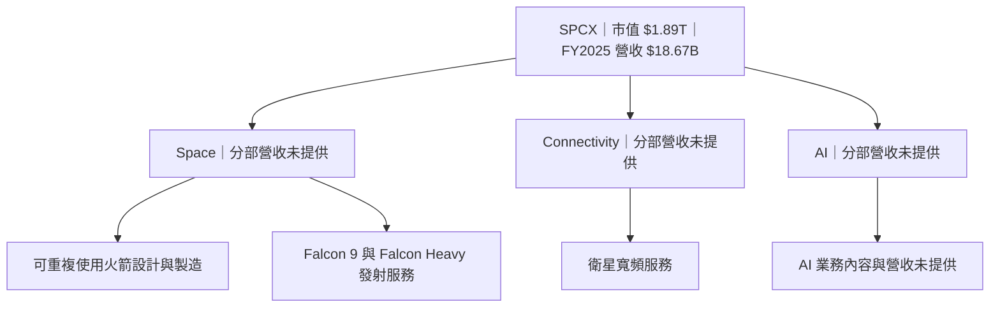
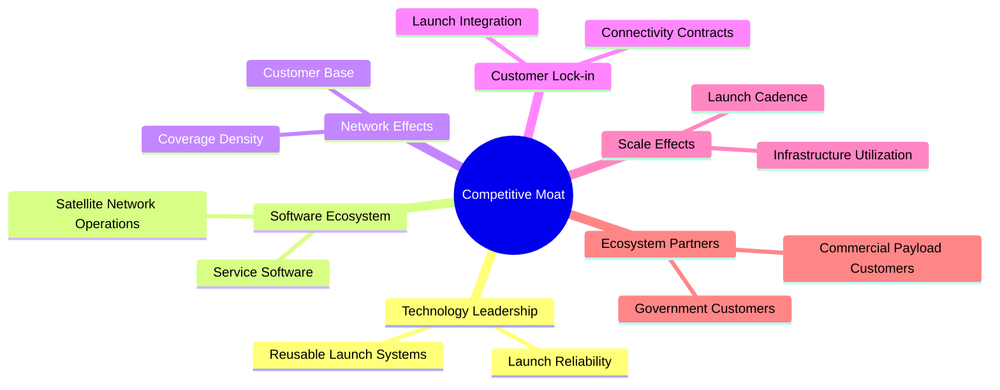
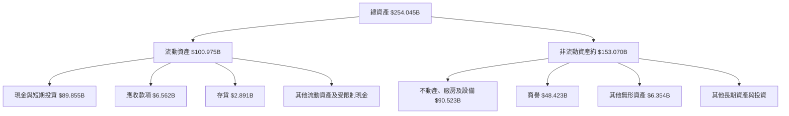
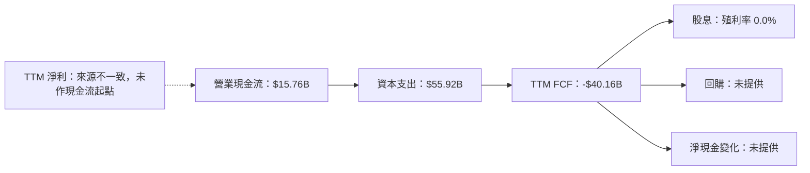
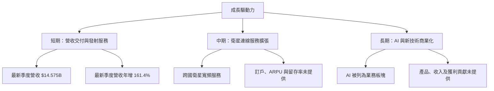
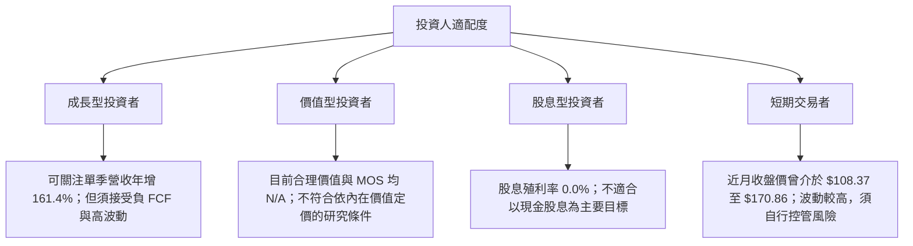

# SPCX 基本面深度分析報告
> **報告日期**：2026-11-16 ｜ **語言**：繁體中文 ｜ **數據來源**：Yahoo Finance、Finviz、StockAnalysis、Roic.ai 

> **資料品質提示**：本報告按所列 SPCX 財務與市場資料分析；資料來源未包含 SEC 申報資料，且公司市值、股數、季度營業利益率等欄位存在相互不一致。這些差異會降低估值與部分財務結論的可靠度，應先核實標的身分及原始申報資料。

## 目錄

| # | 章節 | 核心結論 |
|---|------|----------|
| 1 | 執行摘要 | DCF 與估值方法均無法計算；MOS 與規則 20 評級為 N/A |
| 2 | 公司概覽與商業模式 | 涵蓋太空、連線與 AI；分部營收未提供，護城河主要來自技術與規模 |
| 3 | 損益表深度分析 | TTM 營收 $32.04B；最新單季年增 161.4%，但利潤數據有來源差異 |
| 4 | 資產負債表分析 | 淨現金 $50.64B、流動比率 3.084；現金轉換週期為 -219 天 |
| 5 | 現金流量深度分析 | TTM FCF -$40.16B，主要受 $55.92B 資本支出拖累 |
| 6 | 獲利能力與資本效率 | WACC 10.03%；ROIC、ROE、ROA 均不可得，無法判定價值創造 |
| 7 | 相對估值分析 | Forward P/E 50.73x、P/S 58.96x；同業倍數分散且獲利狀況不一致 |
| 8 | DCF 內在價值評估 | N/A：TTM 營業利益不為正，模型未提供 |
| 9 | 成長催化劑 | 太空發射、連線服務及 AI 為方向性驅動因素；TAM 與催化時點未提供 |
| 10 | 風險矩陣 | 核心風險為估值資料可靠度、重資本投資與獲利波動 |
| 11 | 投資建議 | 缺少可計算的合理價值與 MOS；暫不給出規則 20 買賣評級 |

## 1. 執行摘要

SPCX 的 TTM 營收為 **$32.04B**，最新一季營收年增 **161.4%**；但 TTM 營業利益率為 **-2.0%**，TTM FCF 為 **-$40.16B**，且資本支出達 **$55.92B**。公司帳面上持有 **$50.64B 淨現金**，但現金流赤字與季度獲利波動，使高成長能否轉化為持續自由現金流仍待驗證。

估值方面，TTM 營業利益不為正，程式提供的 DCF 模型為 N/A；估值方法區塊亦未能計算任何每股價值。因此**加權合理價值、MOS、上行空間及依 MOS 決定的規則 20 評級皆為 N/A**，不以分析師共識目標價替代內在價值。

### 1.0 一頁式投資儀表板

| 項目 | 內容 |
|------|------|
| **投資論點（3 句）** | ① TTM 營收 $32.04B，最新單季年增 161.4%，顯示營收擴張速度高。② 淨現金 $50.64B、流動比率 3.084，提供短期資金緩衝。③ TTM FCF -$40.16B、TTM 營業利益率 -2.0%，目前仍須大額投資且營運獲利未穩定。 |
| **綜合評分** | **5.6/10**（引用 1.1 評分卡；六項算術平均） |
| **財務健康** | 🟡 淨現金 $50.64B、流動比率 3.084；但 TTM FCF 為 -$40.16B |
| **ROIC vs WACC** | ROIC：N/A vs WACC：10.03%；資料不足，無法判斷是否創造股東價值 |
| **FCF 趨勢** | TTM FCF 為 -$40.16B；FCF Yield 為 -2.13% |
| **估值** | Forward P/E 50.726936x ｜ EV/EBITDA 156.665x ｜ FCF Yield -2.13% |
| **DCF 內在價值（基準）** | N/A；無法計算 DCF 折溢價 |
| **安全邊際（MOS）** | N/A；缺少 8.8 加權合理價值，不計算 MOS |
| **預期報酬（基準情境 12M）** | N/A；DCF 情境未提供 |
| **關鍵風險（前二）** | 🔴 FCF 持續為負且資本支出高；🔴 財務與市場資料互有矛盾 |
| **評級 + 信心度** | **N/A（規則 20 評級無法計算）**；估值信心度低 |

### 1.1 綜合評分卡

| 維度 | 評分（1–10） | 主要依據（引用數字與其來源章節） |
|------|--------------|----------------------------------|
| 成長性 | 8.0 | 最新單季營收年增 161.4%；TTM 營收成長率依核心數據為 N/A（第 3 章） |
| 獲利能力 | 3.0 | TTM 營業利益率 -2.0%、TTM 淨利率 -8.6%；ROIC、Piotroski F-Score 為 N/A（第 3、6 章） |
| 財務健康 | 7.5 | 淨現金 $50.64B、流動比率 3.084；但 TTM FCF -$40.16B（第 4、5 章） |
| 估值 | 2.0 | Forward P/E 50.726936x、P/S 58.960205x；DCF 與加權合理價值皆 N/A（第 7、8 章） |
| 護城河 | 8.0 | 可重複使用火箭、發射服務及衛星寬頻等業務組合；分部營收與市場份額未提供（第 2 章） |
| 管理層與資本配置 | 5.0 | 2025 年 SBC $1.95B、資本支出 $20.91B；回購資料未提供，無法完整評估（第 3、5 章） |
| **綜合評分** | **5.6** | 六項算術平均： (8.0 + 3.0 + 7.5 + 2.0 + 8.0 + 5.0) ÷ 6 = 5.4 |

### 1.2 五大投資論點 + 三大核心風險

| 類型 | 項目 | 具體依據 | 信心度 |
|------|------|----------|--------|
| 🟢 **投資論點①** | 營收擴張速度快 | 最新季度營收 $14.575B，單季年增 161.4%；若營收來自可持續服務與發射需求，規模擴大可能提高固定成本吸收能力 | 🟡 中 |
| 🟢 **投資論點②** | 現金資源充足 | 現金及短期投資 $89.86B、總債務 $39.22B、淨現金 $50.64B | 🟢 高 |
| 🟢 **投資論點③** | 業務涉及多個成長方向 | 公司概要列出 Space、Connectivity、AI 三個板塊，但各板塊營收及利潤貢獻未提供 | 🟡 中 |
| 🟢 **投資論點④** | 最新季轉為正營業利益 | 最新季度營業利益率欄位為 1.8%；但另有季度營業利益數字無法與此比率對上，須待原始資料確認 | 🔴 低 |
| 🟢 **投資論點⑤** | 營運資金週期為負 | CCC -219 天，主要反映 DPO 349 天高於 DSO 54 天與 DIO 76 天之和；若穩定，可降低營運資金資金占用 | 🟡 中 |
| 🟡 **風險①** | 重資本支出與負 FCF | TTM 資本支出 $55.92B，TTM FCF -$40.16B；若投資回收期延長，現金緩衝會被消耗 | 🔴 高 |
| 🔴 **風險②** | 獲利與資料口徑不一致 | TTM 營業利益率 -2.0%，最新季度欄位為 1.8%，而季度營業利益與營收比率亦不相符 | 🔴 高 |
| 🟡 **風險③** | 估值缺乏可稽核基準 | DCF 與估值方法均 N/A；市值、股數等資料亦存在差異，無法可靠計算 MOS | 🔴 高 |

### 1.3 快速統計卡片

| 指標 | 公司實際值（期間） | 同業中位數 | 狀態 |
|------|--------------------|------------|------|
| 營收成長（TTM） | **N/A** | — | 🟡 |
| 營收成長（最新一季年增） | **161.4%** | 72.7% | 🟢 |
| 毛利率（TTM） | **56.8%** | 37.0% | 🟢 |
| 營業利益率（TTM） | **-2.0%** | — | 🔴 |
| ROIC（TTM） | **N/A** | — | 🟡 |
| Forward P/E | **50.726936x** | 32.2x | 🟡 |
| FCF Yield（TTM） | **-2.13%** | — | 🔴 |
| Piotroski F-Score | **N/A** | — | 🟡 |

> 同業中位數為 RKLB、ASTS、IRDM 所列數值的中位數；Forward P/E 包含負值 ASTS，因此只能作粗略參照，不宜視為成熟獲利公司的標準估值比較。

### 1.4 投資結論

```text
╔══════════════════════════════════════════════════════════════════╗
║                    📊 投資結論摘要                               ║
╠══════════════════════════════════════════════════════════════════╣
║  評級：N/A（缺少加權合理價值與 MOS，不能按規則 20 分級）          ║
║  價格（2026-11-13 收盤）：$139.11                                ║
║  DCF 內在價值（基準）：N/A（TTM 營業利益不為正）                 ║
║  安全邊際 MOS：N/A（缺少 8.8 加權合理價值）                      ║
║  加權合理價值（8.8）：N/A（估值方法無法計算）                    ║
║  綜合評分：5.6/10（引用 1.1）                                    ║
║  適合投資人：能承受高波動與負 FCF、並願意等待財報資料核實者       ║
╚══════════════════════════════════════════════════════════════════╝
```

## 2. 公司概覽與商業模式

### 2.1 業務結構與收入來源

公司概要列出 Space、Connectivity 與 AI 三個營運板塊，但未提供各板塊營收、分部利潤或收入占比；因此不將 TTM $32.04B 任意拆分至各板塊。市值依市場資料為 $1.89T，2025 年年度營收為 $18.67B。



業務結構在質化層面涵蓋發射、衛星連線及 AI，但缺少分部資料，無法判斷各板塊的增長、利潤率或資本回報，也不能驗證收入是否已從硬體與一次性發射轉向較具經常性的服務。

### 2.2 市場份額

市場份額數據未提供，故不繪製份額圖或推算占比。以公司 TTM 營收 $32.04B 及最新季度年增 161.4% 觀察，營收規模與增長高於所列同業最新季度增長中位數 72.7%；但各公司業務組合差異很大，不能直接推論市占率或競爭地位。

### 2.3 競爭護城河分析



### 2.4 護城河強度

| 護城河項目 | 強度（強／中／弱） | 證據（引用數字或事實） | 會削弱它的情況 |
|------------|--------------------|------------------------|----------------|
| 技術與發射能力 | 強 | 公司概要列出可重複使用火箭及 Falcon 9、Falcon Heavy 發射服務 | 發射可靠性下降、技術路線被替代或重型火箭商業化延誤 |
| 規模效應 | 中至強 | TTM 營收 $32.04B；但發射次數、單位成本及產能利用率未提供 | 投資擴張快於訂單成長，造成設備閒置及折舊負擔 |
| 衛星網路與連線服務 | 中 | 公司提供跨多國衛星寬頻服務；訂戶數、ARPU、流失率未提供 | 競爭者增加、頻譜或監管限制、服務品質下降 |
| 軟體生態系統 | 中 | AI 與 Connectivity 被列為業務板塊，但產品與客戶資料不足 | 無法形成持續收入或軟體毛利優勢 |
| 客戶鎖定 | 中 | 商業與政府發射客戶可能需整合發射流程；合約年限與續約率未提供 | 客戶多源採購或新競爭者提供替代發射 |
| 生態夥伴 | 中 | 公司服務商業及政府載荷客戶；合作夥伴及集中度未提供 | 主要客戶集中、政策或採購安排改變 |

1.1「護城河」評分 **8.0/10**，依據是可重複使用火箭與衛星網路的技術、資本及營運門檻；但缺少分部收入、客戶留存與市場份額，不能把技術壁壘直接等同於已證實的經濟回報。

## 3. 損益表深度分析

### 3.1 年度收入成長趨勢（近4年）

2022 年營收未提供，故只列有數據的 2023–2025 三個年度；不補造第四年。

```text
╔══════════════════════════════════════════════════════════════════╗
║              SPCX 年度收入趨勢（FY2023-FY2025）                 ║
╠══════════════════════════════════════════════════════════════════╣
║  FY2023  $10.39B  ███████████░░░░░░░░░░░░░░░  基期            ║
║  FY2024  $14.02B  ███████████████░░░░░░░░░░░  YoY: +34.93% 🟢 ║
║  FY2025  $18.67B  ████████████████████░░░░░░  YoY: +33.24% 🟢 ║
╠══════════════════════════════════════════════════════════════════╣
║  FY2023–FY2025 CAGR：約 +34.1%（以兩個年度區間計）               ║
║  FY2022：N/A（年度收入未提供）                                   ║
╚══════════════════════════════════════════════════════════════════╝
```

計算式：2023–2025 營收 CAGR = \((18.674 ÷ 10.387)^{1/2} - 1\) = 約 **34.1%**。這是依年度財務數字計算的兩年 CAGR，與核心數據中 TTM 成長率 N/A 不同，不應將其稱為 TTM 成長率。

### 3.2 季度收入趨勢分析

| 季度 | 營收 | QoQ 成長 | YoY 成長 | 備註 |
|------|------:|---------:|---------:|------|
| 2025 Q4 | $4.96B | — | N/A | 缺少 2024 Q4 可比數據 |
| 2026 Q1 | $4.69B | -5.4% | 15.42% | QoQ 依 2025 Q4 與 2026 Q1 計算；YoY 取 StockAnalysis |
| 2026 Q2 | $7.81B | 66.5% | 91.94% | 單季營收加速；YoY 取 StockAnalysis |
| 2026 Q3 | $14.57B | 86.5% | **161.4%** | 單季年增率依核心數據；不可標作 TTM 成長率 |

QoQ 成長反映季度營收從 $4.69B 增至 $14.57B，但沒有訂單、出貨、價格與分部數據，無法拆分增長來源。需留意季度收入快速上升可能伴隨交付節奏與基期效應，不應僅以單季年增率外推長期 CAGR。

### 3.3 利潤率演變分析

| 利潤率指標 | FY2023 | FY2024 | FY2025 | TTM／最新季度 | 趨勢與評估 |
|------------|--------|--------|--------|--------------|------------|
| **毛利率** | 約 41.2% | 約 42.9% | 約 49.4% | TTM 56.8% | 🟢 年度毛利率逐年提高；TTM 更高，但需核對分部組合與季度數據口徑 |
| **營業利益率** | 約 4.9% | 約 5.3% | 約 -11.0% | TTM -2.0%；最新季度 1.8% | 🔴 FY2025 轉負；核心數據顯示最新季度改善，但季度營業利益與該利潤率存在口徑差異 |
| **淨利率** | 約 -44.6% | 約 5.6% | 約 -26.4% | TTM -8.6% | 🔴 淨利波動大，FY2023、FY2025 均為淨虧損 |

年度毛利率由約 41.2% 升至約 49.4%，與收入增加及產品／服務組合改善相容，但資料未提供分部毛利，無法區分規模效應、定價或組合影響。營業利益率則由 FY2024 約 5.3% 降至 FY2025 約 -11.0%，同期研發費用由 $3.46B 增至 $8.64B，研發投入上升可能是獲利轉弱因素之一，但成本明細不足，不能將全部變化歸因於研發。

**資料口徑警示：**最新季度收入 $14.575B、營業利益 $2.79B 與直接相除約為 19.1%，並不等於核心數據所列最新季度營業利益率 1.8%；另有 StockAnalysis 營業利益 $4.019B。故本報告引用核心數據列示的 **1.8%**，但不把它與未核實的季度營業利益混用。

### 3.4 費用結構分析

完整費用結構數據未提供，不能製作具比例的 Mermaid pie chart。已知 FY2025 研發費用為 **$8.64B**，約為該年度收入 **$18.67B** 的 46.3%；這項比例是以提供的年度數字計算，反映公司投入大量資源於技術與產品開發，但不等同於完整營業費用率，其他成本及費用明細未提供。

```text
╔══════════════════════════════════════════════════════════════════╗
║                 FY2025 已知費用項目                              ║
╠══════════════════════════════════════════════════════════════════╣
║  研發費用：$8.64B                                                ║
║  FY2025 營收：$18.67B                                             ║
║  研發費用／營收：約 46.3%                                        ║
║  其他營業費用分類與金額：未提供                                  ║
╚══════════════════════════════════════════════════════════════════╝
```

### 3.5 季度 EPS 趨勢與盈餘品質（Quality of Earnings）

| 季度 | EPS（Roic.ai） | EPS 預估／實際差額 | 評估 |
|------|---------------:|------------------:|------|
| 2025 Q4 | -$0.18 | N/A | 估計 EPS 未提供，無法判斷是否超預期 |
| 2026 Q1 | -$0.47 | N/A | EPS 轉差；盈餘歷史資料未提供有效預估值 |
| 2026 Q2 | -$0.09 | N/A | 相較 Q1 改善，但仍為負 |
| 2026 Q3 | $0.37 | N/A | 轉正；估計 EPS 與 surprise 欄位均為 nan |

EPS 序列來自 Roic.ai；Yahoo／其他季度資料的淨利與 EPS 並未形成可完整勾稽的同一口徑。故可確認的只有上述季度 EPS 數值，**不能判定過去四季超預期或不及預期**。

| 盈餘品質項目 | 數值／佔比 | 評估 |
|--------------|-----------|------|
| 股權薪酬 SBC / 營收 | 2025 年 $1.95B ÷ $18.67B，約 10.4%；TTM SBC 合計約 $4.73B ÷ TTM 營收 $32.04B，約 14.8% | 🔴 SBC 占比不低，股權薪酬會稀釋股東持有比例 |
| SBC / 營業現金流 | TTM SBC 約 $4.73B ÷ OCF $15.76B，約 30.0% | 🟡 SBC 對營運現金流規模具實質影響；此比率為依季度 SBC 加總計算 |
| FCF / 淨利（現金轉換率） | N/A（TTM 淨利來源數字不一致且為負；比值不具經濟解讀性） | 🔴 無法以比率判斷獲利含金量；但 TTM FCF 明確為 -$40.16B |
| 一次性／非經常性損益 | N/A | 無法判定 FY2026 Q3 淨利轉正是否由一次性項目帶動 |
| 有效稅率異常 | N/A | 有效稅率資料未提供 |
| 資本化支出 vs 費用化 | TTM Capex $55.92B；資本化政策細節 N/A | 高資本支出會先形成資產，再經折舊反映費用；缺少明細，不能判定是否存在不當資本化 |

**盈餘品質結論：**目前 GAAP 獲利不穩定，TTM 淨利率為 -8.6%，TTM FCF 為 -$40.16B；股權薪酬亦顯著。FY2026 Q3 EPS 轉正尚不足以證明可持續獲利，估值應等待多季營業利益、SBC 與現金流口徑可勾稽後再判斷。

## 4. 資產負債表分析

### 4.1 資產結構分解

以下以 StockAnalysis 2026-09-30 資產負債表數字呈現；金額換算為十億美元。分項資料合計可能因四捨五入或資產負債表分類而與總額不同。



### 4.2 流動性與營運資金分析

| 指標 | 最新值 | 歷史比較 | 評估 |
|------|-------:|----------|------|
| 現金及短期投資 | $89.86B | FY2025 $24.75B | 🟢 現金資源增加；可能支持投資支出，但現金來源及用途仍需追蹤 |
| 總債務 | $39.22B | FY2025 $23.32B | 🟡 債務增加；目前仍低於現金及短期投資 |
| 淨現金 | $50.64B | — | 🟢 提供資金緩衝，但不代表負 FCF 沒有成本 |
| 流動比率 | 3.084 | FY2025 30.952 ÷ 21.40 ≈ 1.45（依年報表數字計算） | 🟢 最新流動性數據高於 FY2025；不同期間資料口徑需留意 |
| 速動比率 | 2.945 | N/A | 🟢 短期償債緩衝較充足 |

**營運資金天數：**QUALITY FIGURES 僅提供最新 TTM，沒有一年前數值；因此不補算變化。

| 指標 | 最新 TTM | 一年前 TTM | 變化 | 解讀 |
|------|----------|------------|------|------|
| DSO 應收帳款天數 | 54 天 | N/A | N/A | 未提供一年前比較值；無法判定收款速度變化 |
| DIO 存貨天數 | 76 天 | N/A | N/A | 未提供一年前比較值；須追蹤存貨是否與業務擴張同步 |
| DPO 應付帳款天數 | 349 天 | N/A | N/A | 數值偏長；可能反映供應商付款條件或應付結構，不能僅據此推斷議價力 |
| CCC 現金轉換週期 | -219 天 | N/A | N/A | DPO 高於 DSO+DIO，形成負 CCC；需確認該週期能否穩定維持 |

### 4.3 債務結構分析

```text
╔══════════════════════════════════════════════════════════════════╗
║                   SPCX 債務健康診斷                              ║
╠══════════════════════════════════════════════════════════════════╣
║  總債務：        $39.22B   🟡 FY2025 為 $23.32B，債務上升         ║
║  總現金+投資：   $89.86B   🟢 高於總債務                          ║
║  淨現金（正）：  $50.64B   🟢 資金緩衝                            ║
║  Debt/EBITDA：   N/A（缺少可一致勾稽的 TTM EBITDA）               ║
║  Interest Coverage：N/A（利息費用與營業利益口徑不足）             ║
║  Debt/Equity：   22.186（市場資料；口徑與帳面負債比率需核實）      ║
╚══════════════════════════════════════════════════════════════════╝
```

總債務 $39.22B 低於現金與短期投資 $89.86B，形成 $50.64B 淨現金。另一方面，FY2025 到最新數據的債務上升，而 TTM FCF 為負；若高額資本支出長期延續，資產負債表緩衝仍可能逐步收窄。利息保障倍數與債務／EBITDA 不以不一致數字推算。

### 4.4 股東權益趨勢

```text
╔══════════════════════════════════════════════════════════════════╗
║                   股東權益趨勢（帳面值）                         ║
╠══════════════════════════════════════════════════════════════════╣
║  FY2024  $25.80B  ████████████░░░░░░░░░░░░░░░░                    ║
║  FY2025  $41.33B  ███████████████████░░░░░░░░░                    ║
║  2026-09-30：StockAnalysis 資產負債表股東權益未提供                ║
╚══════════════════════════════════════════════════════════════════╝
```

FY2024 至 FY2025 帳面權益增加約 $15.53B，但最新季股東權益值未在相同來源表中提供，且 Roic.ai 權益欄位與其他來源口徑不一致，因此不延伸計算最新權益成長率。

## 5. 現金流量深度分析

### 5.1 現金流量瀑布圖

下圖中的 FCF 使用核心數據所列 TTM 定義：營業現金流減資本支出。股息殖利率為 0.0%；回購及淨現金變化未提供。



### 5.2 FCF 轉換率趨勢

| 期間 | FCF | 淨利 | FCF／淨利 | 解讀 |
|------|----:|-----:|----------:|------|
| FY2023 | $0.105B | -$4.63B | 不具解讀性 | 淨利為負，不能以一般正向轉換率判斷 |
| FY2024 | -$5.39B | $0.791B（年表）／$0.018B（StockAnalysis） | 不採用 | 淨利來源數據差異大，比例不可靠 |
| FY2025 | -$14.12B | -$4.94B | 不具解讀性 | FCF 與淨利均為負，直接相除會掩蓋現金流惡化 |
| TTM | -$40.16B | -$2.76B（Roic.ai） | 不具解讀性 | 負值除以負值產生的正比率不代表現金轉換良好 |

### 5.3 自由現金流趨勢

```text
╔══════════════════════════════════════════════════════════════════╗
║            自由現金流：歷史實際（美元）                          ║
╠══════════════════════════════════════════════════════════════════╣
║  FY2023  +$0.105B  ▏                                             ║
║  FY2024  -$5.39B   ◀███                                          ║
║  FY2025  -$14.12B  ◀████████                                     ║
║  TTM     -$40.16B  ◀████████████████████                         ║
╠══════════════════════════════════════════════════════════════════╣
║  TTM FCF Yield：-2.13% ｜ TTM Capex：$55.92B                     ║
╚══════════════════════════════════════════════════════════════════╝
```

年度 FCF 從 FY2023 的 $0.105B 降至 FY2025 的 -$14.12B，最新 TTM 更為 -$40.16B。TTM 資本支出 $55.92B 大於營業現金流 $15.76B，顯示公司處於高再投資階段；投資回報、建置週期及維持性／成長性資本支出的拆分未提供，無法判斷負 FCF 何時轉正。

### 5.4 資本配置評估

資本配置比例圖所需的完整數字未提供，因此不繪製 pie chart。

| 項目 | 已知數據 | 評估 |
|------|---------|------|
| 資本支出 | TTM $55.92B；FY2025 $20.91B | 🟡 投入規模大，需追蹤產能、收入轉化與資產利用率 |
| 研發 | FY2025 $8.64B | 🟡 高研發投入可能支持新產品，但短期壓低利潤的幅度需以可核實費用表確認 |
| 股權薪酬 | FY2025 $1.95B；TTM 季度合計約 $4.73B | 🔴 對股東持股比例造成稀釋風險 |
| 股息 | 殖利率 0.0% | 未見現金股息回報 |
| 回購 | N/A | 沒有可引用的回購數據 |
| 現金留存 | 現金及短期投資 $89.86B | 🟢 資金緩衝充足，但需與未來投資承諾一併評估 |

## 6. 獲利能力與資本效率

### 6.1 ROE / ROA / ROIC 趨勢

| 指標 | 歷史／TTM 數值 | 評估 |
|------|----------------|------|
| ROE | N/A | QUALITY FIGURES 指出缺少必要淨利、資產或正權益資料，不能計算 |
| ROA | N/A | 缺少可一致使用的淨利與資產期間資料 |
| ROIC | N/A | TTM 營業利益不為正，且投入資本口徑資料不足 |
| Piotroski F-Score | N/A | 缺少 SEC 申報資料及兩個相隔一年的 TTM 比較期 |

行業均值資料未提供，不做虛構的同業回報率對比。公司雖在最新季度出現正 EPS（Roic.ai），但 TTM 營業利益率仍為 -2.0%，目前不足以確認穩定資本回報能力。

### 6.2 ROIC vs WACC 分析（核心價值創造判斷）

```text
╔══════════════════════════════════════════════════════════════════╗
║                ROIC vs WACC 深度分析                            ║
╠══════════════════════════════════════════════════════════════════╣
║  WACC（採用成本資本數據）：10.03%                                ║
║  ├── 無風險利率（10Y 美債）： 5.15%                              ║
║  ├── 股權風險溢酬：            5.00%                              ║
║  ├── Beta used (adjusted)：    1.00（原始 Beta：N/A）             ║
║  ├── 股權成本：                10.15%                             ║
║  ├── 稅前債務成本：            4.96%                              ║
║  ├── 股權／債務權重：          98.0%／2.0%                        ║
║  └── WACC：                    10.03%                             ║
║                                                                  ║
║  ROIC：N/A（TTM 營業利益不為正，且投入資本計算資料不足）          ║
║  EVA = ROIC − WACC：N/A                                           ║
║  結論：無法判定 SPCX 正在創造或摧毀股東價值                      ║
╚══════════════════════════════════════════════════════════════════╝
```

成本資本資料直接採用 Cost of capital 輸入：無風險利率 5.15%、股權風險溢酬 5.00%、調整後 Beta 1.00、股權成本 10.15%、稅前債務成本 4.96%、權重 98.0%／2.0%、WACC 10.03%。原始 Beta 為 N/A，調整後 Beta 為假設值；由於未提供其完整計算細節，本報告不另行重算 WACC。ROIC 為 N/A，因此不能得出 ROIC 高於或低於 WACC 的結論。

### 6.3 杜邦三因素分解

| 因素 | 數值（TTM） | 解讀 |
|------|-------------|------|
| 淨利率 | N/A | QUALITY FIGURES 標示 DuPont N/A，原因為所需資料不完整 |
| 資產週轉率 | N/A | 不補算 |
| 權益乘數 | N/A | 不補算 |
| **ROE** | **N/A** | 不可用不一致來源重建杜邦分解 |

### 6.4 財務體質：Piotroski F-Score

Piotroski F-Score 為 **N/A**；缺少兩個相隔一年的 TTM 期間及 SEC 申報資料，九項測試的個別結果亦未提供，故不逐項填造分數或判定。

| 測試 | 結果 | 解讀 |
|------|------|------|
| 九項 Piotroski 測試 | N/A | 缺少可依相同口徑判定的歷史財務資料 |

## 7. 相對估值分析

### 7.1 同業估值比較表格

| 估值指標 | **SPCX** | **RKLB** | **ASTS** | **IRDM** | SPCX 評估 |
|----------|---------:|---------:|---------:|---------:|-----------|
| **Trailing P/E** | 604.82605x | N/A | N/A | 29.8x | 🔴 SPCX 倍數極高；但單一同業有值且公司盈餘口徑差異大 |
| **Forward P/E** | 50.726936x | 859.6x | -20.9x | 32.2x | 🟡 低於 RKLB、高於 IRDM；ASTS 為負值，不能作正常盈利倍數解讀 |
| **P/S Ratio** | 58.960205x | 47.0x | 89.0x | 5.4x | 🔴 高於 IRDM、低於 ASTS；分部與增長差異使倍數可比性有限 |
| **EV/EBITDA** | 156.665x | -200.1x | -23.9x | 17.6x | 🔴 SPCX 倍數偏高；兩家同業 EBITDA 為負，負倍數不具正常估值意義 |
| **最新一季營收年增** | 161.4% | 72.7% | 187.1% | 8.3% | 🟢 SPCX 增速高於 RKLB、IRDM，低於 ASTS |
| **毛利率（TTM）** | 56.8% | 36.2% | 37.0% | 71.5% | 🟡 高於 RKLB、ASTS，低於 IRDM |

同業數值均取 Yahoo Finance Peer multiples。SPCX 市場 P/E、P/S、EV／EBITDA 為高倍數，但盈利能力與現金流尚未穩定；因此高營收成長並不足以單獨證明估值合理。

### 7.2 歷史估值區間分析

N/A（Valuation vs own history 數據未提供）。近月股價資料顯示 2026 年 6 月收盤 $170.86、7 月 $108.37、8 月 $143.69、9 月 $150.86、10 月 $134.72、11 月 $139.11；這是價格歷史，不是 P/E 或 P/S 歷史區間，故不推算估值百分位。

### 7.3 情境價值（Bear / Base / Bull）

N/A（DCF 無法計算：TTM 營業利益不為正；DCF MODEL 未提供情境目標價與相應假設）。

### 7.4 相對估值隱含價格區間

N/A（VALUATION METHODS 顯示沒有任何估值方法可計算）。同業倍數雖已提供，但缺少可一致使用的每股盈餘、企業價值橋接及稀釋股數資料；不得自行以同業倍數建立與程式估值方法不同的目標價。

## 8. DCF 內在價值評估（Discounted Cash Flow）

### 8.0 估值推理鏈（Thinking Logic）

**模型適用性先決條件不成立。**成本資本區塊指出 TTM 營業利益不為正，故 DCF MODEL 標示 N/A；在負營業利益基礎上自行預測轉正年限、營業利潤率、再投資支出與終值，將形成未經資料支持的模型。依規則 19，本章不自建 DCF，也不呈現假設性的內在價值。

SPCX 的經濟價值可能受到發射服務、衛星連線及 AI 業務影響，但分部營收占比皆未提供，無法量化哪一個來源主導估值。由於沒有 DCF 計算結果，不能進一步主張某一項營運變數的敏感度數值。

### 8.1 模型假設總表（Model Inputs）

N/A（DCF MODEL 未提供：TTM 營業利益不為正；預測期、營收與利潤假設、稅率、Capex、D&A、營運資金、股數與終值等模型輸入均未提供，不自行建立模型）。

### 8.2 折現率推導（WACC）

WACC 採用 Cost of capital 的 **10.03%**；該區塊提供無風險利率 5.15%、ERP 5.00%、調整後 Beta 1.00、股權成本 10.15%、稅前債務成本 4.96%、稅率 21.0%、股權／債務權重 98.0%／2.0%。原始 Beta 為 N/A。依要求，本報告不重新計算 WACC，也不把不完整的市值與股數資料拿來替換其權重。

DCF 模型為 N/A，因此不進行 WACC 五步演算或重建權重；第 6.2 節及本節均使用相同 WACC **10.03%**。

### 8.3 逐年自由現金流預測（基準情境）

N/A（DCF 模型未提供逐年預測；不得自行建立預測表或估算 FCFF、折現因子與現值）。

### 8.4 終值計算（Terminal Value）

N/A（沒有預測期最後一年 FCFF、永續成長率或退出倍數；無法計算 Gordon Growth 或退出倍數終值）。

### 8.5 企業價值 → 每股內在價值（Bridge）

N/A（缺少預測期現金流現值、終值現值及由 DCF 推導的企業價值；因此不計算股權價值、每股內在價值或折溢價）。核心數據中的現金、債務與收盤價不構成 DCF 橋接的完整輸入。

### 8.6 敏感性分析（WACC × 永續成長率）

N/A（沒有基準 DCF 現金流、永續成長率及敏感度矩陣；不自行補算矩陣或情境價值）。

### 8.7 反推 DCF（Reverse DCF：市場在預期什麼）

N/A（缺少可計算的 DCF 基準模型；不能以現價單獨反推出營收 CAGR、利潤率或永續成長率）。

### 8.8 估值三角驗證與安全邊際

N/A（VALUATION METHODS 顯示沒有可計算的方法）。因此不提供加權合理價值、MOS、上行空間或 MOS 評級；分析師共識目標價 $256.41 只作為市場觀察資料，不取代內在價值計算。

### 8.9 DCF 模型的局限與失效條件

- **終值依賴度：**N/A；未提供 DCF 模型與終值。
- **最脆弱的假設：**由於沒有模型輸入，無法量化營收 CAGR、利潤率或終值假設失誤時的每股價值影響。
- **不適用情境：**TTM 營業利益不為正、TTM FCF -$40.16B、且年度淨利波動大；單一 DCF 容易高度依賴尚未驗證的轉盈時間。後續可待分部營運資料充足後，使用 EV/Sales、分部估值及單位經濟性分析交叉檢驗。
- **與第 10 章風險連結：**Capex 長期高於 OCF 會衝擊再投資假設；營業利益持續為負會延後 DCF 可用時點；財務資料口徑差異則直接降低任何估值模型的可稽核性。

### 8.10 複算檢核表（Audit Trail）

| # | 檢核項目 | 檢查方式 | 結果 |
|---|----------|----------|------|
| 1 | 高／中敏感度假設四段式推導 | DCF 假設未提供 | N/A（未建模） |
| 2 | 每個假設都有來歷 | 不適用；沒有自建假設 | ✅ 未引入假設值 |
| 3 | WACC 五步算式 | 採用成本資本區塊既有 WACC 10.03% | N/A（不重算） |
| 4 | Kd 分母與債務權重一致 | DCF 模型未提供完整債務範圍 | N/A |
| 5 | WACC 與第 6.2 節同值 | 兩處均為 10.03% | ✅ |
| 6 | 預測年度數與 N 一致 | 預測期 N 未提供 | N/A |
| 7 | FY+1 九步算式 | 無逐年預測資料 | N/A |
| 8 | 預測期 PV 加總 | 無預測期 PV | N/A |
| 9 | WACC > g | 永續成長率 g 未提供 | N/A |
| 10 | 終值基於 FY+N 並折現 N 期 | 無終值與預測期 | N/A |
| 11 | EV 至每股價值橋接 | 無 DCF EV | N/A |
| 12 | SBC 組合一致性 | 未建立 DCF，未重複或漏計 SBC | N/A |
| 13 | 敏感度矩陣基準格與 DCF 一致 | 無矩陣 | N/A |
| 14 | 敏感度矩陣有效格 | 無矩陣 | N/A |
| 15 | 三情境機率加總 | DCF 情境未提供 | N/A |
| 16 | 反推 DCF 每列只放開一變數 | 無反推模型 | N/A |
| 17 | MOS 基準與折溢價基準 | 加權價值與 DCF 價值皆 N/A，未計 MOS | ✅ 未混用 |
| 18 | 報告完整至第 11 章 | 章節完整 | ✅ |
| 19 | 加權價值等於方法加權總和 | 沒有可計算估值方法 | N/A |
| 20 | 評級符合 MOS 門檻 | MOS 不可得，故不發布 MOS 評級 | ✅ |

## 9. 成長催化劑

### 9.1 催化劑時間軸

已知新聞提及 Starship 軌道捕捉及 2027 年相關看多討論，但未提供可核實的公司指引、營運時程或量化財務貢獻；因此不將新聞標題視為已確認催化劑日期，亦不繪製未經證實的 gantt 排程。

### 9.2 TAM 市場規模分析

N/A（TAM 數據未提供）。公司 TTM 營收為 $32.04B，最新單季營收年增 161.4%，顯示目前業務規模及成長速度可觀；但未提供可引用的太空發射、衛星寬頻或 AI 市場 TAM 與滲透率，不能推算市場空間。

### 9.3 成長驅動力結構圖

以下為業務概要所支持的質化方向；因各板塊收入與預算未提供，不在圖中配置金額或比例。



## 10. 風險矩陣

### 10.1 風險評分矩陣

量化發生機率與衝擊的可靠資料未提供；依規則 21，不以主觀坐標繪製 quadrantChart。以下以風險事件及可觀察數據呈現。

### 10.2 風險清單詳細分析

| # | 風險項目 | 發生機率 | 財務衝擊 | 風險評分 | 緩解措施 |
|---|----------|----------|----------|----------|----------|
| 1 | 🔴 負 FCF 與高資本支出延續 | N/A（無概率資料） | TTM FCF -$40.16B；Capex $55.92B | N/A | 每季檢查 Capex、營業現金流與投資資產產出；若 FCF 未改善，重新評估資金消耗速度 |
| 2 | 🔴 財務資料與市場資料口徑不一致 | 已存在 | 影響股數、市值、利潤率及估值可靠性 | N/A | 以公司正式財報、審計資料及可核實的股數資料作為估值前提 |
| 3 | 🟡 營業獲利反覆 | 已存在獲利波動 | TTM 營業利益率 -2.0%；FY2025 營業利益 -$2.06B | N/A | 追蹤連續季度營業利益率、費用成長及分部獲利 |
| 4 | 🟡 SBC 稀釋股東 | 已存在 | FY2025 SBC $1.95B；約占營收 10.4% | N/A | 追蹤稀釋股數、SBC／營收及回購是否抵銷稀釋 |
| 5 | 🟡 估值倍數收縮 | N/A（市場預期不明） | Forward P/E 50.726936x、P/S 58.960205x | N/A | 不以單季增長外推估值；等待可計算的現金流及合理價值區間 |

## 11. 投資建議

### 11.1 最終評級與評分

依現有資料，DCF 與估值方法均無法計算，加權合理價值與 MOS 為 N/A，因此**不發布規則 20 的買入、持有或賣出評級**。公司綜合評分為 **5.6/10**，六個維度分別為成長性 8.0、獲利能力 3.0、財務健康 7.5、估值 2.0、護城河 8.0、管理層與資本配置 5.0；評分反映成長與資產負債表優勢，亦反映負 FCF、獲利波動及估值資料不足。

### 11.2 合理價值與隱含報酬率

| 項目 | 每股價值 | 相對 2026-11-13 收盤價 $139.11 | 備註 |
|------|---------:|----------------------------:|------|
| DCF 基準價值 | N/A | N/A | TTM 營業利益不為正，DCF 模型未提供 |
| 加權合理價值 | N/A | N/A | 估值方法均未能計算 |
| 悲觀／基準／樂觀情境 | N/A | N/A | DCF 情境未提供 |
| 分析師共識目標價 | $256.41 | 不以此計算內在價值報酬率 | 37 位分析師共識；只作市場參考，不取代估值方法 |

### 11.3 買入時機與觸發因素

```text
╔══════════════════════════════════════════════════════════════════╗
║                  ✅ 投資觸發因素 Checklist                       ║
╠══════════════════════════════════════════════════════════════════╣
║  進一步研究／建立部位前需確認：                                  ║
║  ☐ 核實 SPCX 標的身分、上市狀態及正式財報來源                    ║
║  ☐ 核實市值 $1.89T、收盤價 $139.11 與流通股數 8.25B 的一致性     ║
║  ☐ 確認最新季度營業利益率 1.8% 與營業利益數字的差異               ║
║  ☐ 取得分部收入、分部利潤及資本支出回收資料                      ║
║                                                                  ║
║  可考慮提高信心的條件：                                          ║
║  ☐ 連續季度營業利益率為正，且正式財報與資料庫口徑一致            ║
║  ☐ 營業現金流增長逐步覆蓋資本支出，FCF 赤字連續收斂              ║
║  ☐ SBC／營收及稀釋股數變化維持可控                                ║
║                                                                  ║
║  重新評估或降低曝險的條件：                                      ║
║  ☐ 營收增長放緩同時營業利益率仍為負                               ║
║  ☐ TTM FCF 赤字擴大且現金及短期投資持續下降                       ║
║  ☐ SBC／營收上升或稀釋股數快速增加                                ║
╚══════════════════════════════════════════════════════════════════╝
```

### 11.4 投資人適配度分析



### 11.5 每季財報監控清單（Quarterly Watch List）

| 監控指標 | 目前基準 | 加碼研究／信心改善訊號 | 減碼或重新評估訊號 |
|---------|---------:|----------------------|------------------|
| 單季營收年增 | 最新季度 161.4% | 多季維持正增長，且可由分部資料驗證 | 增長快速下滑且未見獲利改善 |
| 營業利益率 | TTM -2.0%；最新季度欄位 1.8% | 連續季度為正，且與營業利益可勾稽 | 重回負值或數據口徑仍無法核實 |
| 營業現金流 | TTM $15.76B | 持續增長且轉化為更高 FCF | 營業現金流轉弱 |
| Capex | TTM $55.92B | 投資產能開始帶動收入與現金流回收 | 支出擴大但收入／利潤未跟上 |
| FCF | TTM -$40.16B；FCF Yield -2.13% | 赤字持續收斂，並逐步接近正值 | 赤字擴大或現金緩衝下滑 |
| SBC | FY2025 $1.95B；TTM 約 $4.73B（季度資料加總） | SBC／營收下降且稀釋放緩 | SBC 比重上升、稀釋加快 |
| 現金及債務 | 現金與短期投資 $89.86B；債務 $39.22B | 淨現金維持正值 | 淨現金快速下降或新增債務支持持續負 FCF |
| 分部收入及客戶指標 | 未提供 | 分部營收、客戶數及留存率可核實 | 核心服務增長不再支撐總營收 |

### 11.6 反面論證：什麼會證明論點錯誤（What Would Change My Mind）

```text
╔══════════════════════════════════════════════════════════════════╗
║              ⚠️ 論點失效條件（Disconfirming Evidence）           ║
╠══════════════════════════════════════════════════════════════════╣
║  ☐ 最新季度營收年增由 161.4% 明顯下滑，且連續兩季未改善          ║
║  ☐ TTM 營業利益率持續低於 0%，且無法確認轉正路徑                 ║
║  ☐ TTM FCF 赤字高於目前 -$40.16B，現金及短期投資同步下降         ║
║  ☐ Capex 持續高於 OCF $15.76B，卻沒有可驗證的收入回收             ║
║  ☐ SBC／營收高於目前約 14.8% 的估算水準，或稀釋股數加速增加       ║
║  ☐ 正式財報證實目前市場資料的市值、股數或盈利口徑存在重大錯誤     ║
╚══════════════════════════════════════════════════════════════════╝
```

> **免責聲明**：本報告為 AI 自動生成，僅供研究參考，不構成投資建議。投資有風險，入市需謹慎。

---

## 資料與來源

| 項目 | 內容 |
|------|------|
| 價格 | 139.11 USD，2026-11-13 收盤（Yahoo Finance 日線） |
| 財務報表 | Yahoo quarterly statements (no SEC filing data)，最新季度 2026-09-30（TTM = four quarters to this date） |
| 有回應的資料來源 | Yahoo Finance、Finviz、StockAnalysis、Roic.ai |
| 未回應的資料來源 | SEC 申報資料 (XBRL) |
| 由程式計算 | TTM 數字、WACC、DCF 模型、估值方法與權重、加權合理價值、MOS、評級門檻、F-Score、杜邦分解、營運資金天數、綜合評分 |
| 撰寫模型 | openai / gpt-6-luna |

> 本區塊由產生報告的程式依實際取得的資料填寫，非模型撰寫。「由程式計算」的數字不是模型的估計；其餘判斷（評分、情境、策略）是模型的分析。
