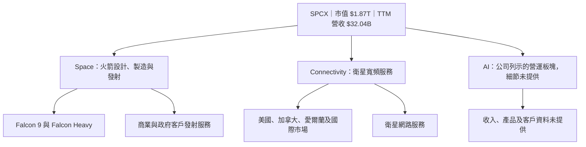
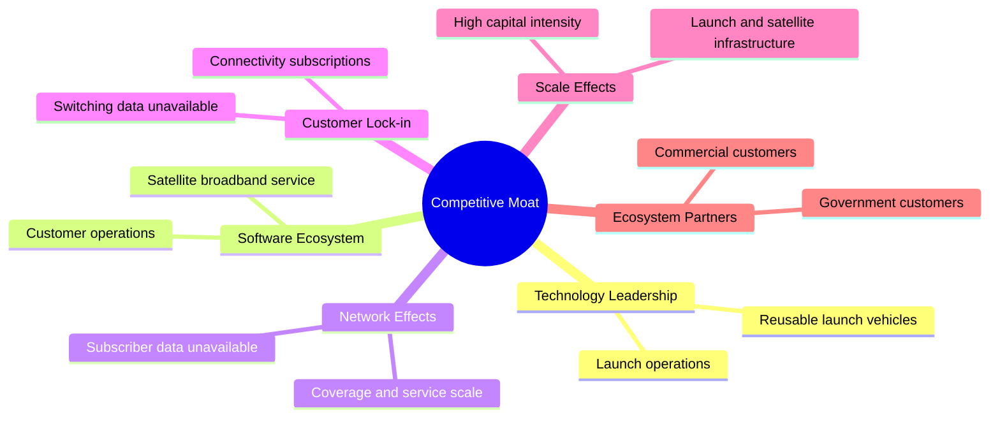
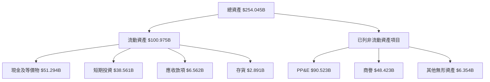
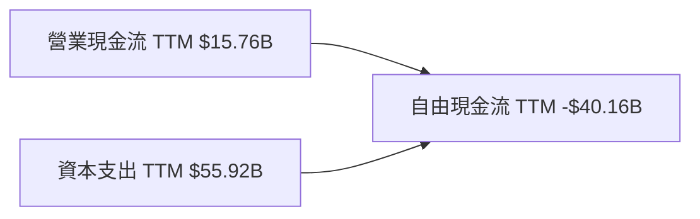
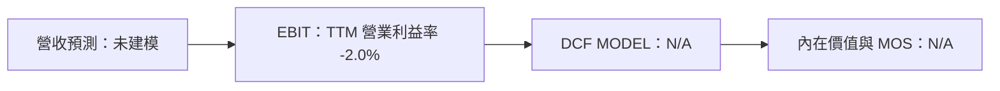
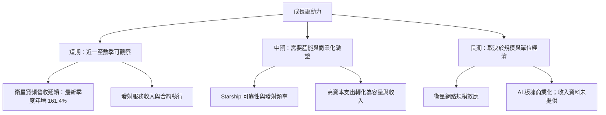
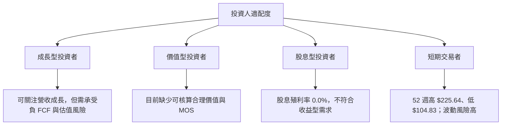

# SPCX 基本面深度分析報告

> **報告日期**：2026-11-17 ｜ **語言**：繁體中文 ｜ **數據來源**：Yahoo Finance、Finviz、StockAnalysis、Roic.ai ｜ **分析師**：CFA 級機構研究

## 目錄

| # | 章節 | 核心結論 |
|---|------|----------|
| 1 | 執行摘要 | DCF 與估值方法均無法計算；無法依 MOS 制定評級或合理價值 |
| 2 | 公司概覽與商業模式 | 火箭發射、衛星寬頻與 AI 業務具潛在規模效應，但分部營收與市場份額未提供 |
| 3 | 損益表深度分析 | 最新一季營收年增 161.4%；TTM 營業利益率 -2.0%，季度獲利數據有來源差異 |
| 4 | 資產負債表分析 | 淨現金 $50.64B、流動比率 3.084；CCC -219 天，需留意應付帳款週期 |
| 5 | 現金流量深度分析 | TTM FCF -$40.16B，主因 TTM 資本支出 $55.92B 高於營運現金流 |
| 6 | 獲利能力與資本效率 | WACC 9.99%；ROIC 不可得，無法判定是否創造股東價值 |
| 7 | 相對估值分析 | SPCX 的高估值倍數與同業差異顯著；估值方法未能產生可用的每股價值 |
| 8 | DCF 內在價值評估 | TTM 營業利益為負，DCF 模型為 N/A；不提供 DCF 目標價或 MOS |
| 9 | 成長催化劑 | Starship、Starlink 與 AI 是質化催化因素；時間表與 TAM 數據未提供 |
| 10 | 風險矩陣 | 主要風險為估值、資本支出／負 FCF、財務數據一致性與執行風險 |
| 11 | 投資建議 | 因 MOS 無法計算，無法按規則 20 給出買入、持有或賣出評級 |

---

## 1. 執行摘要

截至 2026-11-16 收盤，SPCX 股價為 **$137.36**。公司 TTM 營收為 **$32.04B**，最新一季營收年增 **161.4%**，但 TTM 營業利益率為 **-2.0%**、TTM FCF 為 **-$40.16B**，且 FCF Yield 為 **-2.15%**。雖然資產負債表列示淨現金 **$50.64B**，但 TTM 營業利益為負，程式計算的 DCF 模型為 N/A；估值方法也沒有可計算結果。因此缺少加權合理價值，不能計算 MOS，也不能依 MOS 門檻給出規則 20 評級。這不是以「持有」替代無法估值，而是目前估值資料不足以形成可稽核的目標價。

### 1.0 一頁式投資儀表板（Portfolio Manager 30 秒速讀）

| 項目 | 內容 |
|------|------|
| **投資論點（3 句）** | ① 最新一季營收年增 **161.4%**，顯示營收規模快速擴張。② TTM 營業利益率 **-2.0%**、FCF **-$40.16B**，擴張尚未轉化為自由現金流。③ 淨現金 **$50.64B** 提供資金緩衝，但不足以單獨證明當前估值合理。 |
| **綜合評分** | **5.7/10**（引用 1.1 評分卡） |
| **財務健康** | 🟡 淨現金 $50.64B、流動比率 3.084；但負 FCF 與高額資本支出削弱安全墊 |
| **ROIC vs WACC** | ROIC：N/A；WACC：**9.99%**。缺少 ROIC，無法判定價值創造或摧毀 |
| **FCF 趨勢** | 惡化；TTM FCF **-$40.16B**，FCF Yield **-2.15%** |
| **估值** | Forward P/E **50.08879x** ｜ EV/EBITDA **154.617x** ｜ FCF Yield **-2.15%** |
| **DCF 內在價值（基準）** | N/A（TTM 營業利益為負，DCF 模型不可用）；折溢價 N/A |
| **安全邊際（MOS）** | N/A（8.8 估值方法未能產生加權合理價值，無法計算 MOS） |
| **預期報酬（基準情境 12M）** | N/A（DCF 情境價值未提供） |
| **關鍵風險（前二）** | 大額資本支出持續高於營運現金流；極高估值倍數對成長與獲利轉正要求高 |
| **評級 + 信心度** | **N/A（無法依規則 20 判定）** ｜ 信心：低（估值與部分季度數據存在缺漏或來源差異） |

### 1.1 綜合評分卡（全報告唯一）

| 維度 | 評分（1–10） | 主要依據（引用數字與其來源章節） |
|------|--------------|----------------------------------|
| 成長性 | 8.5 | 最新一季營收年增 161.4%；FY2023–FY2025 營收 CAGR 約 34.1%（第 3 章）。TTM 成長率 N/A |
| 獲利能力 | 3.0 | TTM 營業利益率 -2.0%、FCF -$40.16B；ROIC 與 Piotroski F-Score N/A（第 3、5、6 章） |
| 財務健康 | 7.5 | 淨現金 $50.64B、流動比率 3.084、CCC -219 天（第 4 章）；CCC 受高 DPO 影響 |
| 估值 | 2.0 | Forward P/E 50.08879x、P/S 58.218487x、EV/EBITDA 154.617x；合理價值及 MOS N/A（第 7、8 章） |
| 護城河 | 8.0 | 有可重複使用火箭、衛星寬頻與 Starlink 等業務描述；但分部營收、留存率及市場份額未提供（第 2 章） |
| 管理層與資本配置 | 5.0 | FY2025 SBC $1.95B、資本支出 $20.91B、FCF -$14.12B；回購與股息支出資料不足（第 3、5 章） |
| **綜合評分** | **5.7** | 六項算術平均：(8.5 + 3.0 + 7.5 + 2.0 + 8.0 + 5.0) ÷ 6 = **5.7** |

### 1.2 五大投資論點 + 三大核心風險

| 類型 | 項目 | 具體依據 | 信心度 |
|------|------|----------|--------|
| 🟢 **投資論點①** | 營收擴張速度快 | 最新一季營收 $14.57B，年增 161.4%；但單季數據不等於可持續的 TTM 成長率 | 🟢 中 |
| 🟢 **投資論點②** | 資產負債表有現金緩衝 | 現金及短期投資 $89.86B、總債務 $39.22B、淨現金 $50.64B | 🟢 中 |
| 🟢 **投資論點③** | 多項業務可能共享技術與發射能力 | 公司描述涵蓋可重複使用火箭、發射服務與衛星寬頻；各分部營收尚未揭露 | 🟡 中 |
| 🟢 **投資論點④** | 毛利率高於部分同業 | TTM 毛利率 56.8%；RKLB 為 36.2%、ASTS 為 37.0%、IRDM 為 71.5% | 🟡 中 |
| 🟢 **投資論點⑤** | 市場對未來獲利有高度預期 | Forward P/E 50.08879x、Forward EPS $2.74233；預測落差與達成機率未提供 | 🟡 低 |
| 🟡 **風險①** | 資本密集使現金消耗擴大 | TTM Capex $55.92B，高於 OCF $15.76B，導致 FCF -$40.16B | 🔴 高 |
| 🔴 **風險②** | 高倍數估值易受成長不及預期衝擊 | P/S 58.218487x、EV/Revenue 56.63x、Trailing P/E 597.2174x | 🔴 高 |
| 🔴 **風險③** | 財務資料存在內部及來源差異 | 最新季營業利益率標示 1.8%，同一期間損益表列示營業利益 $2.79B；其他資料源列 $4.019B | 🔴 高 |

### 1.3 快速統計卡片

| 指標 | 公司實際值（期間） | 同業中位數 | 狀態 |
|------|--------------------|------------|------|
| 營收成長（TTM） | **N/A** | — | 🟡 |
| 營收成長（最新一季年增） | **161.4%** | 72.7% | 🟢 |
| 毛利率（TTM） | **56.8%** | 37.0% | 🟢 |
| 營業利益率（TTM） | **-2.0%** | — | 🔴 |
| ROIC（TTM） | **N/A** | — | 🟡 |
| Forward P/E | **50.08879x** | N/A | 🟡 |
| FCF Yield（TTM） | **-2.15%** | — | 🔴 |
| Piotroski F-Score | **N/A** | — | 🟡 |

同業中位數僅就已提供的 Peer multiples 計算：最新一季營收年增率中位數為 72.7%；毛利率中位數為 37.0%。同業 Forward P/E 不以簡單中位數比較，因 RKLB、ASTS 的倍數分別為 801.5x 與 -18.3x，數值不具一般盈利型企業的可比性。

### 1.4 投資結論

```text
╔══════════════════════════════════════════════════════════════════╗
║                       📊 投資結論摘要                           ║
╠══════════════════════════════════════════════════════════════════╣
║  評級：N/A（無法依 MOS 規則判定；未以其他評級替代）             ║
║  價格（2026-11-16 收盤）：$137.36                               ║
║  DCF 內在價值（基準）：N/A（TTM 營業利益為負）                   ║
║  安全邊際 MOS：N/A（8.8 無加權合理價值）                        ║
║  加權合理價值（8.8）：N/A                                       ║
║  DCF 情境價值：N/A（DCF MODEL 未提供情境值）                    ║
║  綜合評分：5.7/10（引用 1.1）                                   ║
║  適合投資人：能承受高波動與估值不確定性的成長型投資人；          ║
║              不適合作為以現金流或價值折價為核心的部位          ║
╚══════════════════════════════════════════════════════════════════╝
```

---

## 2. 公司概覽與商業模式

### 2.1 業務結構與收入來源

公司概覽將 SPCX 描述為 Space Exploration Technologies Corp.，業務涵蓋衛星寬頻、可重複使用火箭設計製造與發射服務，並列出 Space、Connectivity、AI 三個營運板塊。財務資料沒有分部營收或各板塊佔比，因此不推算各業務收入。



> 市值 $1.87T 為市場資料所列值；價格與流通股數的交叉檢查不一致，詳見第 4 章資料品質說明。

### 2.2 市場份額

市場份額數據未提供，亦無法由公司營收或新聞摘要可靠推算。以同業提供的最新季度成長率比較，SPCX 為 **161.4%**，高於 RKLB 的 **72.7%**、ASTS 的 **187.1%** 則低於其增速，並高於 IRDM 的 **8.3%**；業務組合差異使這些成長率僅可作方向性參考。

### 2.3 競爭護城河分析



### 2.4 護城河強度

| 護城河項目 | 強度（強／中／弱） | 證據（引用數字或事實） | 會削弱它的情況 |
|------------|--------------------|------------------------|----------------|
| 技術與發射能力 | 強 | 公司業務描述包括 Falcon 9、Falcon Heavy 與可重複使用火箭 | 發射可靠性下降、競爭者降低成本或提高發射頻率 |
| 衛星寬頻服務 | 中 | 已在美國、加拿大、愛爾蘭及國際市場提供服務；訂戶數與 ARPU 未提供 | 網路容量、頻譜、法規或服務品質無法跟上擴張 |
| 規模效應 | 中 | TTM 營收 $32.04B，且有大規模資本投資；但 TTM FCF -$40.16B | 資本支出無法轉化為新增收入與現金流 |
| 客戶與夥伴生態 | 中 | 客戶包括商業與政府機構；客戶集中度、合約期限與留存資料未提供 | 客戶集中、政府合約延後或替代供應商增加 |
| 軟體與網路效應 | 弱至中 | 有連網服務業務，但用戶數、流失率與網路效應指標未提供 | 用戶留存與單位經濟性不佳 |

**護城河評分理由**：第 1.1 節護城河評分 **8.0/10**，主要基於火箭與衛星網路業務的技術及規模門檻；但缺少分部收入、訂戶數、留存率與市場份額，降低證據完整度。

---

## 3. 損益表深度分析

### 3.1 年度收入成長趨勢（近 3 個已列年度）

年收入由 FY2023 的 **$10.39B** 增至 FY2024 的 **$14.02B**，再增至 FY2025 的 **$18.67B**。FY2023–FY2025 CAGR 約 34.1%，但 FY2026 TTM 營收已達 $32.04B，TTM 成長率欄位仍為 N/A，不能把最新一季年增率代替 TTM 成長率。

```text
╔══════════════════════════════════════════════════════════════════╗
║       SPCX 年度收入趨勢（FY2023-FY2025；金額為美元）             ║
╠══════════════════════════════════════════════════════════════════╣
║  FY2023  $10.39B  ███████████░░░░░░░░░  YoY：—                  ║
║  FY2024  $14.02B  ███████████████░░░░░  YoY：+34.9%             ║
║  FY2025  $18.67B  ████████████████████  YoY：+33.2%             ║
╠══════════════════════════════════════════════════════════════════╣
║  FY2023-FY2025 CAGR：約 +34.1%                                   ║
╚══════════════════════════════════════════════════════════════════╝
```

計算口徑：FY2024 成長率 = 14.015 ÷ 10.387 − 1；FY2025 成長率 = 18.674 ÷ 14.015 − 1。FY2023 至 FY2025 CAGR = (18.674 ÷ 10.387)^(1/2) − 1，約 **34.1%**。

### 3.2 季度收入趨勢分析

| 季度 | 營收 | QoQ 成長 | YoY 成長 | 備註 |
|------|------:|---------:|---------:|------|
| 2025-12-31 | $4.96B | N/A | N/A | 損益表列值 |
| 2026-03-31 | $4.69B | -5.4% | 15.42% | YoY 使用 StockAnalysis 單季數值 |
| 2026-06-30 | $7.81B | 66.6% | 91.94% | YoY 使用 StockAnalysis 單季數值 |
| 2026-09-30 | $14.57B | 86.6% | 161.4% | YoY 使用 VERIFIED FIGURES 最新一季年增率 |

QoQ 計算使用四捨五入後的報表金額：2026 年 3 月相對 2025 年 12 月為 4.69 ÷ 4.96 − 1；2026 年 6 月相對 3 月為 7.81 ÷ 4.69 − 1；2026 年 9 月相對 6 月為 14.57 ÷ 7.81 − 1。連續兩季快速加速值得關注，但 2026 年 9 月單季營收較 2026 年 6 月大幅跳升，應追查其業務組合、合約確認與一次性因素，不能直接外推成長率。

### 3.3 利潤率演變分析

| 利潤率指標 | FY2023 | FY2024 | FY2025 | TTM／最新季度 | 趨勢 | 評估 |
|------------|-------:|-------:|-------:|---------------:|------|------|
| **毛利率** | 41.2% | 42.9% | 49.4% | TTM 56.8% | ↗️ 上升 | 🟢 毛利改善，但需確認是否來自組合或一次性因素 |
| **營業利益率** | 4.88% | 5.29% | -11.05% | TTM -2.0%；最新季度 1.8% | 大幅波動 | 🔴 正常化獲利尚未確立 |
| **淨利率** | -44.6% | 約 0.1%* | -26.4% | TTM -8.6% | 波動大 | 🔴 有不同資料源淨利數字差異 |

\* FY2024 年度報表列淨利 $791M，但 StockAnalysis 年度表列 $18M；上述 FY2024 淨利率依 $791M ÷ $14.015B 計算，資料來源不一致，故僅作提示、不作估值依據。

FY2025 毛利率約 49.4%，高於 FY2024 的 42.9%；同時營業利益由 FY2024 的 **+$742M** 轉為 FY2025 的 **-$2.06B**，與 R&D 從 **$3.46B** 增至 **$8.64B** 的擴張相符，顯示研發與規模投資使毛利改善未能轉化為年度營業獲利。TTM 營業利益率為 -2.0%，但最新季度營業利益率 1.8%；單季轉正尚不足以確認持續性。

### 3.4 費用結構分析

完整營業費用表未提供，且年度與季度資料有跨來源差異，無法建立能加總至營收或毛利的費用結構圓餅圖。可確認 FY2025 研發費用為 **$8.64B**，約為當年收入 $18.67B 的 **46.3%**；這是高投入強度的指標，但不等於全部營業費用。

### 3.5 季度 EPS 趨勢與盈餘品質（Quality of Earnings）

| 季度 | EPS 實際值（Roic.ai） | 預期值／超預期狀況 | 備註 |
|------|----------------------:|--------------------|------|
| 2025-12-31 | -$0.18 | N/A | EPS 預期值未提供 |
| 2026-03-31 | -$0.47 | N/A | EPS 預期值未提供 |
| 2026-06-30 | -$0.09 | N/A | EPS 預期值未提供 |
| 2026-09-30 | $0.37 | N/A | EPS 預期值未提供 |

**過去四季超預期／不及預期分析**：無法判斷。Earnings History 中 2026-03、2026-06、2026-09 的 EPS Est 與 EPS Act 均為 nan；因此不應把來源缺漏判定為超預期或不及預期。EPS 變化顯示由負轉正，但季度淨利受大幅波動影響。

| 盈餘品質項目 | 數值／佔比 | 評估 |
|--------------|-----------|------|
| 股權薪酬 SBC / 營收 | 估計 14.8%（TTM SBC 約 $4.733B ÷ TTM 營收 $32.04B） | 🔴 SBC 金額大；以列示四季 SBC 加總計算，可能造成顯著經濟稀釋 |
| SBC / 營業現金流 | 估計 30.0%（$4.733B ÷ $15.76B） | 🟡 營業現金流中相當部分相當於非現金薪酬成本 |
| FCF / 淨利（現金轉換率） | 約 14.5 倍（-$40.16B ÷ TTM 淨利 -$2.76B） | 🔴 分子、分母皆為負，傳統轉換率失去解讀意義；不是「高轉換」 |
| 一次性／非經常性損益 | N/A | 無足夠明細，無法區分一次性與經常性損益 |
| 有效稅率異常 | N/A | 有效稅率資料缺漏，無法判斷稅務利益是否影響淨利 |
| 資本化支出 vs 費用化 | TTM Capex $55.92B；資本化細項 N/A | 🔴 資本支出高；缺少費用化與資本化政策明細，無法量化遞延成本影響 |

**盈餘品質結論**：TTM 營業利益率為 -2.0%，淨利率為 -8.6%，TTM FCF 為 -$40.16B。最新季度轉正不應被視為已建立穩定盈餘能力。SBC 佔營收的估計比例偏高，且 FCF/淨利率因兩者為負而沒有通常的現金轉換解讀；目前 GAAP 盈餘與股東經濟回報均須以後續季度驗證。

---

## 4. 資產負債表分析

### 4.1 資產結構分解

下列金額來自 2026-09-30 的 StockAnalysis 資產負債表，單位為十億美元；資產項目未完整列出，圖示只包含有數值的項目，不代表所有項目已加總為總資產。



### 4.2 流動性與營運資金分析

| 指標 | 最新值 | 歷史比較 | 評估 |
|------|-------:|----------|------|
| 現金及短期投資 | $89.86B | FY2025 為 $24.75B | 🟢 資金儲備增加；資金來源與用途仍需追蹤 |
| 總債務 | $39.22B | FY2025 為 $23.32B | 🟡 債務絕對額上升，但低於現金及短期投資 |
| 淨現金 | $50.64B | — | 🟢 提供短期融資緩衝 |
| 流動比率 | 3.084 | FY2025：30.95B ÷ 21.40B = 1.45 | 🟢 流動資產較短期負債充裕；口徑與來源需留意 |
| 速動比率 | 2.945 | — | 🟢 顯示短期流動性尚可 |
| DSO 應收帳款天數 | 54 天 | 一年前 N/A | N/A 一年前值未提供，不能計算變化 |
| DIO 存貨天數 | 76 天 | 一年前 N/A | N/A 一年前值未提供，不能計算變化 |
| DPO 應付帳款天數 | 349 天 | 一年前 N/A | N/A 一年前值未提供；高 DPO 可能反映付款週期較長 |
| CCC 現金轉換週期 | -219 天 | 一年前 N/A | 數值由較高 DPO 拉低；不能單獨視為議價力或營運效率改善 |

營運資金天數依品質指標列值照抄。由於一年前同期數據沒有提供，變化欄不推算。**CCC = -219 天**表示按所列公式，收款與存貨週期合計低於應付帳款天數；可能降低日常資金需求，但也需監控供應商付款安排是否可持續。

**資料一致性提醒**：市場資料列示市值 $1.87T、股數 8.25B 與收盤價 $137.36，三者互相推算不一致；依規則使用收盤價作為唯一股價，不以此重新推算或替換其他官方指標。

### 4.3 債務結構分析

```text
╔══════════════════════════════════════════════════════════════════╗
║                    SPCX 債務健康診斷                            ║
╠══════════════════════════════════════════════════════════════════╣
║  總債務：          $39.22B   總現金及短期投資： $89.86B         ║
║  淨現金：          $50.64B   🟢 現金高於總債務                   ║
║  流動比率：         3.084    🟢 流動資產覆蓋能力較高             ║
║  速動比率：         2.945    🟢 速動資產覆蓋能力較高             ║
║  Debt/EBITDA：      N/A      TTM EBITDA／債務口徑不足以核驗       ║
║  Interest Coverage：N/A      利息費用明細未提供                   ║
╚══════════════════════════════════════════════════════════════════╝
```

### 4.4 股東權益趨勢

| 期間 | 股東權益 | YoY 變化 | 解讀 |
|------|---------:|---------:|------|
| 2024-12-31 | $25.80B | — | 基期 |
| 2025-12-31 | $41.33B | +60.2% | 資產負債表擴大；股權增加不等於每股價值同步增加 |

```text
╔══════════════════════════════════════════════════════════════════╗
║                SPCX 股東權益（年度；美元）                       ║
╠══════════════════════════════════════════════════════════════════╣
║  2024-12-31  $25.80B  ████████████░░░░░░░░                      ║
║  2025-12-31  $41.33B  ████████████████████                      ║
╚══════════════════════════════════════════════════════════════════╝
```

---

## 5. 現金流量深度分析

### 5.1 現金流量瀑布圖

TTM 淨利、股息、回購與淨現金變動的完整現金流資料未提供，故不製作可能誤導的完整瀑布數字。可核對的 TTM 現金流關係如下：



### 5.2 FCF 轉換率趨勢

| 年度／期間 | FCF | 淨利 | FCF／淨利 | 解讀 |
|------------|----:|----:|----------:|------|
| FY2023 | $0.105B | -$4.63B | 不具一般意義 | FCF 微正、淨利為負 |
| FY2024 | -$5.39B | $0.791B（年度報表） | 約 -6.8 倍 | 營業現金與投資支出結構需進一步核對 |
| FY2025 | -$14.12B | -$4.94B | 約 2.9 倍 | 兩者皆負，不能當作正常現金轉換率 |
| TTM 至 2026-09-30 | -$40.16B | -$2.76B（Roic.ai） | 約 14.5 倍 | 兩者皆負，經濟意義有限 |

### 5.3 自由現金流趨勢

```text
╔══════════════════════════════════════════════════════════════════╗
║               SPCX 自由現金流：歷史實際                         ║
╠══════════════════════════════════════════════════════════════════╣
║  FY2023       +$0.105B   ▏                                      ║
║  FY2024       -$5.39B    ◀██                                    ║
║  FY2025      -$14.12B    ◀██████                                ║
║  TTM 2026-09 -$40.16B    ◀████████████████                      ║
╠══════════════════════════════════════════════════════════════════╣
║  TTM FCF Yield：-2.15%                                           ║
║  TTM OCF $15.76B − Capex $55.92B = FCF -$40.16B                  ║
╚══════════════════════════════════════════════════════════════════╝
```

TTM Capex 約為 TTM OCF 的 3.55 倍（$55.92B ÷ $15.76B）。這反映公司正進行大量投資，但只有在新增產能可持續帶來收入、毛利與後續現金流時，負 FCF 才可能是合理的成長投資。

### 5.4 資本配置評估

資本配置的金額與佔比資料不足，無法建立有實際財務數字的資本配置圓餅圖。

| 項目 | 已知資料 | 評估 |
|------|----------|------|
| 資本支出 | FY2025 $20.91B；TTM $55.92B | 🔴 高額再投資，後續需驗證投入回報 |
| 股權薪酬 | FY2025 $1.95B；TTM 四季加總約 $4.733B | 🔴 可能造成顯著股東稀釋 |
| 股息 | 股息殖利率 0.0% | 未提供現金股息支付額 |
| 股票回購 | N/A | 回購金額與股數變化無完整可比資料 |
| 留存現金 | 現金及短期投資 $89.86B | 🟢 可支援投資，但需關注現金消耗速度 |

---

## 6. 獲利能力與資本效率

### 6.1 ROE / ROA / ROIC 趨勢

| 指標 | FY2023 | FY2024 | FY2025 | TTM | 評估 |
|------|-------:|-------:|-------:|----:|------|
| ROE | N/A | N/A | N/A | N/A | QUALITY FIGURES 未能計算 |
| ROA | N/A | N/A | N/A | N/A | 財務數據缺少一致的計算輸入 |
| ROIC | N/A | N/A | N/A | N/A | Roic.ai 返回空值；不可補算 |
| WACC | — | — | — | 9.99% | 由資本成本資料直接採用 |

### 6.2 ROIC vs WACC 分析（核心價值創造判斷）

ROIC 為 N/A，無法比較 ROIC 與 WACC；故不能判斷公司目前創造或摧毀股東價值。WACC 直接採用資本成本資料所列 **9.99%**，不另行更換。

```text
╔══════════════════════════════════════════════════════════════════╗
║                  ROIC vs WACC 深度分析                          ║
╠══════════════════════════════════════════════════════════════════╣
║  WACC 輸入：                                                     ║
║  ├── 無風險利率 Rf（10Y 美債）：          5.12%                 ║
║  ├── 股權風險溢酬 ERP：                   5.00%                 ║
║  ├── 原始 Beta：                          N/A                   ║
║  ├── 採用調整後 Beta：                    1.00（假設值）        ║
║  ├── 股權成本 Ke：                        10.12%                ║
║  ├── 稅前債務成本 Kd：                    4.96%                 ║
║  ├── 稅率：                               21.0%                 ║
║  ├── 股權／債務權重：                     97.9%／2.1%           ║
║  └── WACC：                               9.99%                 ║
║                                                                  ║
║  ROIC：N/A（品質指標未能計算）                                    ║
║  EVA = ROIC − WACC：N/A                                          ║
║  結論：缺少 ROIC，無法確認價值創造或摧毀                         ║
╚══════════════════════════════════════════════════════════════════╝
```

資本成本公式核對：Ke = 5.12% + 1.00 × 5.00% = **10.12%**；稅後 Kd = 4.96% × (1 − 21.0%) = **3.9184%**。使用所列權重核對，WACC = 97.9% × 10.12% + 2.1% × 3.9184% = **9.9898%**，四捨五入為 **9.99%**。Beta 原始值缺漏，採用 1.00 為假設值，故 WACC 對市場風險敏感度不確定。

### 6.3 杜邦三因素分解

| 因素 | 數值（TTM） | 解讀 |
|------|-------------|------|
| 淨利率 | N/A | DuPont 品質指標整體為 N/A；報表另列 TTM 淨利率 -8.6%，但不可用缺失分解值替代 |
| 資產週轉率 | N/A | QUALITY FIGURES 缺少有效組合 |
| 權益乘數 | N/A | QUALITY FIGURES 缺少有效組合 |
| **ROE** | **N/A** | 淨利、收入、總資產或正權益等必要輸入不完整 |

### 6.4 財務體質：Piotroski F-Score

Piotroski F-Score 為 **N/A**，因缺少相隔一年的兩個 TTM SEC 申報期間。九項測試結果均未能判定，故不製作以 N/A 填滿的測試表，也不推論未通過項目的意義。

---

## 7. 相對估值分析

### 7.1 同業估值比較表格

| 估值指標 | **SPCX** | **RKLB** | **ASTS** | **IRDM** | SPCX 評估 |
|----------|---------:|--------:|--------:|--------:|-----------|
| **Trailing P/E** | 597.2174x | N/A | N/A | 29.6x | 🔴 SPCX 倍數高；公司獲利基礎波動 |
| **Forward P/E** | 50.08879x | 801.5x | -18.3x | 31.6x | 🟡 同業盈利狀態差異大，負值及極高倍數不宜直接中位數解讀 |
| **P/S Ratio** | 58.218487x | 43.8x | 78.0x | 5.3x | 🔴 明顯高於 IRDM，介於所列同業範圍 |
| **EV/EBITDA** | 154.617x | -184.8x | -21.4x | 17.4x | 🔴 高倍數；部分同業 EBITDA 為負，跨公司比較有限 |
| **最新季度營收年增** | 161.4% | 72.7% | 187.1% | 8.3% | 🟢 高於 RKLB、IRDM，低於 ASTS |
| **TTM 毛利率** | 56.8% | 36.2% | 37.0% | 71.5% | 🟢 高於 RKLB、ASTS，低於 IRDM |

同業倍數依 Peer multiples 區塊照列。公司估值欄使用市場估值資料；其市值、價格與股數存在不一致，故本表只作倍數並列，不據此反推同業隱含目標價。

### 7.2 歷史估值區間分析

N/A（歷史估值區間／自身估值百分位數據未提供，不能以現有 P/E 倍數自行推算歷史位置）。

### 7.3 情境價值（Bear / Base / Bull）

N/A（DCF 無法計算：TTM 營業利益為負，DCF MODEL 未提供情境值。依規則不自行建立情境價值或目標價。）

### 7.4 相對估值隱含價格區間

N/A（VALUATION METHODS 未能計算任何方法的每股價值及權重。欠缺可用的估值方法輸出，不能自行以同業倍數建立新的目標價。）

---

## 8. DCF 內在價值評估（Discounted Cash Flow）

### 8.0 估值推理鏈（Thinking Logic）

DCF MODEL 的明確原因為：**TTM 營業利益不為正，將虧損折現至未來不能形成有意義的估值**。因此本章不建構另一套現金流模型，也不將假設值偽裝為程式計算結果。

**Step 1 — 價值由哪些變數決定？**  
按業務描述，SPCX 的價值可能來自發射服務、衛星寬頻及 AI 業務，但分部營收佔比均未提供；目前只有公司 TTM 營收 **$32.04B**。哪項業務主導估值無法以現有資料確認。

**Step 2 — 模型選擇**

| 決策點 | 本報告採用 | 理由（含數字） | 曾考慮但否決 | 否決理由 |
|--------|-----------|----------------|--------------|----------|
| 現金流定義 | 不建模 | TTM 營業利益為負，程式判定 DCF 不適用 | FCFF／FCFE | 不自行建立替代模型 |
| 預測期 N | N/A | DCF MODEL 未提供預測期 | 5 年或其他年數 | 任選年數會引入未驗證假設 |
| 終值方法 | N/A | 無可用逐年 FCFF 與模型終值 | Gordon Growth／退出倍數 | 無現金流基礎，不可計算 |
| EBIT 基礎 | N/A | 不建構 DCF 預測 | GAAP／非 GAAP | 避免假設利潤率與 SBC 處理 |

**Step 3 — 關鍵假設推導鏈**  
營收 CAGR、期末營業利潤率、永續成長率、Capex 比率、稀釋率及終值假設均未採用：沒有程式計算模型或管理層財測可作錨點，不能填入自創數字。

**Step 4 — 最脆弱的一環**  
最脆弱的是最新季度的營業獲利能否持續：TTM 營業利益率 **-2.0%**，而資料另列最新季度營業利益率 **1.8%**；若季度轉正只是波動或來源口徑差異，估值與獲利預期將下修。

**Step 5 — 計算路徑圖**



### 8.1 模型假設總表（Model Inputs）

N/A（DCF MODEL 未提供假設及逐年預測；原因為 TTM 營業利益不為正，不自建模型。）

FCF 定義若可作歷史觀察，嚴格採用「營業現金流 − 資本支出」：TTM $15.76B − $55.92B = **-$40.16B**。但此歷史值不構成 DCF 預測，也不推導未來現金流。

### 8.2 折現率推導（WACC）

WACC 依 VERIFIED FIGURES 原值採用 **9.99%**，與第 6.2 節相同。原始 Beta 為 N/A，Beta used (adjusted) 為 **1.00**，屬假設值；無風險利率 5.12%、ERP 5.00%、稅前債務成本 4.96%、稅率 21.0%、E/D 權重 97.9%／2.1%。

WACC 核對式：5.12% + 1.00 × 5.00% = 10.12%（股權成本）；稅後債務成本 = 4.96% × (1 − 21.0%) = 3.9184%；加權 WACC = 97.9% × 10.12% + 2.1% × 3.9184% = 9.9898%，採用值 **9.99%**。無風險利率觀察日期及 ERP 的外部估計依據未提供，不另行補造。

### 8.3 逐年自由現金流預測（基準情境）

N/A（DCF MODEL 未提供預測期長度及逐年數字；不能用負 FCF 歷史直接外推，也不能自行補上預測年表。）

### 8.4 終值計算（Terminal Value）

N/A（缺少可用的第 N 年 FCFF、永續成長率及終值假設；Gordon Growth 與退出倍數均不計算。）

### 8.5 企業價值 → 每股內在價值（Bridge）

N/A（DCF 基準每股內在價值未計算；現金、債務與股數雖有列示，但沒有可橋接的 EV。依規則，不計算 DCF 折溢價；本節亦不計算 MOS。）

### 8.6 敏感性分析（WACC × 永續成長率）

N/A（沒有 DCF 基準現金流、終值或模型敏感度矩陣；不自行試算。）

### 8.7 反推 DCF（Reverse DCF：市場在預期什麼）

N/A（DCF MODEL 未提供反推結果。沒有可重現的基準模型，不能以現價 $137.36 反解營收成長率、利潤率、永續成長率或預測期。）

### 8.8 估值三角驗證與安全邊際

N/A（VALUATION METHODS 顯示沒有任何方法可計算，未提供方法價值與權重。因此不給加權合理價值、MOS 或 MOS 評級；也不以分析師共識目標價替代加權估值。）

分析師共識資料列示平均目標價 **$255.63**、低值 **$70.00**、高值 **$800.00**，共 37 位分析師。此區間極寬，且沒有各分析師模型假設與目標價日期明細；僅作市場觀點參考，不納入本報告估值。

### 8.9 DCF 模型的局限與失效條件

- **終值依賴度**：N/A，沒有終值模型。
- **最脆弱的假設**：本報告未建立 DCF，故不指定假設性價值跌幅。可量化的主要經營觀察值是 TTM FCF **-$40.16B**、TTM 營業利益率 **-2.0%**。
- **不適用情境**：TTM 營業利益不為正，且 FCF 為負、Capex 高於 OCF；DCF 可靠度不足。較適合先追蹤營收分部、單位經濟性、資本支出回收與現金流轉正，再考慮 DCF 或 SOTP。
- **與第 10 章連結**：發射／衛星業務執行延誤可能提高 Capex 或降低收入；資本市場融資條件惡化可能提高資金成本；數據口徑差異則直接削弱模型輸入可信度。

### 8.10 複算檢核表（Audit Trail）

| # | 檢核項目 | 檢查方式 | 結果 |
|---|----------|----------|------|
| 1 | DCF 敏感度假設的完整四段式推導 | DCF MODEL 為 N/A，未採用假設 | N/A |
| 2 | 每個 DCF 假設都有來歷 | 未建立假設表 | N/A |
| 3 | WACC 計算與權重核對 | 97.9% + 2.1% = 100%；核算為 9.9898%，採用 9.99% | ✅ |
| 4 | Kd 分母與債務權重口徑一致 | WACC 直接採用程式提供的成本資本組成；未自行重建 Kd 分母 | N/A |
| 5 | WACC 與第 6.2 節相同 | 兩節均為 9.99% | ✅ |
| 6 | 逐年預測年度數與 N 相符 | 預測期 N 未提供 | N/A |
| 7 | FY+1 FCFF 與 PV 算式可複算 | 沒有 FY+1 預測 | N/A |
| 8 | 預測期 PV 加總 | 沒有預測期 PV | N/A |
| 9 | WACC > g 檢查 | g 未提供 | N/A |
| 10 | 終值基期與折現年數 | 未計算終值 | N/A |
| 11 | EV 至每股內在價值橋接 | DCF 未計算 | N/A |
| 12 | SBC、EBIT 與股數處理相容 | DCF 未建立，不適用組合 A/B/C | N/A |
| 13 | 敏感性矩陣基準格與 DCF 一致 | 矩陣未提供 | N/A |
| 14 | 敏感性矩陣有效格檢查 | 矩陣未提供 | N/A |
| 15 | 三情境機率與加權算式 | DCF 情境未提供 | N/A |
| 16 | 反推 DCF 每列只放開一個變數 | 反推 DCF 未提供 | N/A |
| 17 | MOS 基準、儀表板與評級一致 | 加權合理價值與 MOS 均 N/A；全報告一致 | ✅ |
| 18 | 報告完整至第 11 章 | 已完整輸出 | ✅ |
| 19 | 加權合理價值為價值乘權重之和 | 無估值方法與權重，未計算 | N/A |
| 20 | 評級符合 MOS 門檻 | MOS N/A，明確不給 MOS 評級 | N/A |

---

## 9. 成長催化劑

### 9.1 催化劑時間軸

具體產品里程碑日期、管理層指引與預期營收貢獻未提供，因此不以未經證實的季度或年度日期繪製 gantt 圖。可觀察的催化因素如下：

| 催化因素 | 已知資訊 | 後續驗證指標 |
|----------|----------|--------------|
| Starship 運營進展 | 新聞摘要提及 Starship 返回軌道並被捕獲；沒有日期、頻率及收入影響數據 | 發射頻率、成功率、每次發射成本與商業化時程 |
| Starlink 擴張 | 公司提供衛星寬頻服務，覆蓋美國、加拿大、愛爾蘭及國際市場 | 訂戶數、ARPU、留存率、每顆衛星／每單位容量收入 |
| 發射服務 | Falcon 9 與 Falcon Heavy 為已列示產品 | 商業與政府合約收入、發射次數、毛利與準時率 |
| AI 業務 | 公司概覽列有 AI 板塊 | 業務內容、客戶、資本投入與收入均待披露 |

### 9.2 TAM 市場規模分析

N/A（TAM 數據未提供）。公司 TTM 營收為 **$32.04B**，最新一季營收年增 **161.4%**，顯示現有業務規模與增長速度較高；但在缺少可引用市場規模、分部收入與滲透率資料時，不能量化可服務市場或推算市場份額。

### 9.3 成長驅動力結構圖



---

## 10. 風險矩陣

### 10.1 風險評分矩陣

風險機率與損失幅度沒有可引用的量化資料，因此不以主觀座標繪製 quadrantChart，避免把主觀機率或財務損失誤呈為已知數字。下表按資料可確認程度排序，不代表經統計估算的發生機率。

### 10.2 風險清單詳細分析

| # | 風險項目 | 發生機率 | 財務衝擊 | 依據／可量化觀察 | 緩解措施 |
|---|----------|----------|----------|------------------|----------|
| 1 | 🔴 **資本支出高於營運現金流** | N/A | 若延續，可能持續消耗現金；幅度 N/A | TTM Capex $55.92B、OCF $15.76B、FCF -$40.16B | 每季監控 Capex/營收、FCF 及現金餘額；要求新增產能有可驗證的收入與毛利 |
| 2 | 🔴 **估值對成長預期敏感** | N/A | 估值壓縮幅度 N/A | P/S 58.218487x、EV/Revenue 56.63x、Trailing P/E 597.2174x | 以營收、毛利、FCF 里程碑分批評估，不以分析師目標價單獨作決策 |
| 3 | 🔴 **獲利波動及財務數據來源不一致** | N/A | 可能造成估值與盈利預期錯誤 | TTM 營業利益率 -2.0%；最新季度 margin 標示 1.8%，但季度營業利益列值及其他來源不一致 | 對照 10-Q／10-K 原文與公司公告；估值前先完成口徑調節 |
| 4 | 🟡 **衛星網路與發射業務執行風險** | N/A | 延期、失敗或服務中斷的損失 N/A | 相關收入與發射可靠性明細未提供 | 追蹤發射成功率、衛星部署、服務可用率及監管狀況 |
| 5 | 🟡 **股權薪酬造成稀釋** | N/A | 每股價值影響 N/A | FY2025 SBC $1.95B；依列示四季加總，TTM SBC 約 $4.733B | 追蹤稀釋股數、SBC/營收與回購是否抵銷稀釋 |

---

## 11. 投資建議

### 11.1 最終評級與評分

現有資料不足以產生 8.8 加權合理價值，故 MOS 為 N/A，不能依規則 20 判定強烈買入、買入、持有、減碼或賣出；本報告不以其他評級替代。公司綜合評分為 **5.7/10**，引用 1.1 的六項分數：成長性 8.5、獲利能力 3.0、財務健康 7.5、估值 2.0、護城河 8.0、管理層與資本配置 5.0。

### 11.2 合理價值與隱含報酬率

| 估值項目 | 每股價值 | 相對 2026-11-16 收盤價 $137.36 | 說明 |
|----------|---------:|--------------------------------:|------|
| 加權合理價值 | N/A | N/A | VALUATION METHODS 未能計算 |
| 悲觀 DCF 情境 | N/A | N/A | DCF MODEL 未提供情境值 |
| 基準 DCF 情境 | N/A | N/A | DCF MODEL 未提供情境值 |
| 樂觀 DCF 情境 | N/A | N/A | DCF MODEL 未提供情境值 |

### 11.3 買入時機與觸發因素

```text
╔══════════════════════════════════════════════════════════════════╗
║                   ✅ 投資觸發因素 Checklist                      ║
╠══════════════════════════════════════════════════════════════════╣
║  評估是否建立部位前，建議先觀察：                                ║
║  ☐ 公司正式申報資料可核對收入、營業利益、股數與現金流            ║
║  ☐ TTM 營業利益率轉正且連續數季維持                              ║
║  ☐ FCF 缺口隨營收擴張收斂；目前 TTM FCF 為 -$40.16B              ║
║                                                                  ║
║  加碼前的驗證條件：                                              ║
║  ☐ TTM Capex 不再持續大幅高於 OCF；目前分別為 $55.92B／$15.76B   ║
║  ☐ SBC/營收由估計 14.8% 的水準下降，或股數稀釋有可核對說明       ║
║  ☐ 取得可複算的估值資料，確認價值與現價間有足夠安全邊際          ║
║                                                                  ║
║  減碼／重新檢視觸發條件：                                        ║
║  ☐ 營收增長放慢且毛利率同步下滑                                  ║
║  ☐ Capex 維持高位而營業現金流惡化、現金餘額下降                  ║
║  ☐ 發射或衛星服務重大延誤、故障，或政府／商業合約流失            ║
╚══════════════════════════════════════════════════════════════════╝
```

### 11.4 投資人適配度分析



### 11.5 每季財報監控清單（Quarterly Watch List）

| 監控指標 | 當前基準 | 加碼／正向訊號 | 減碼／負向訊號 |
|----------|---------:|----------------|----------------|
| 營收成長 | 最新一季 YoY 161.4%；TTM 成長 N/A | 單季與 TTM 成長均有明確、可重複的分部來源 | 單季成長放緩且缺少合約或產品組合解釋 |
| 營業利益率 | TTM -2.0%；最新季度標示 1.8% | 多季轉正，且與季報營業利益可核對 | 再度明顯轉負或來源差異持續存在 |
| 毛利率 | TTM 56.8% | 在收入擴張時維持或改善 | 連續下降且無產品組合解釋 |
| 營業現金流 | TTM $15.76B | 現金流增長並逐漸覆蓋資本支出 | OCF 下降而 Capex 維持高位 |
| 資本支出 | TTM $55.92B | 投資後產能、收入與毛利可核對 | Capex 延續高位而投入產出不改善 |
| 自由現金流 | TTM -$40.16B | FCF 缺口逐季收窄，最終轉正 | FCF 缺口擴大或現金儲備快速下降 |
| SBC | FY2025 $1.95B；TTM 列示四季加總約 $4.733B | SBC/營收下降，稀釋股數穩定 | SBC 持續快於收入增長 |
| 存貨與應付帳款 | DIO 76 天；DPO 349 天；CCC -219 天 | DPO 與供應商付款條件可持續，庫存週轉改善 | 存貨上升且付款週期縮短，導致現金需求增加 |
| AI／研發支出 | FY2025 R&D $8.64B；AI 分部數字 N/A | 披露具體產品、客戶、收入與投資回報 | 投入增加但未披露可驗證商業成果 |
| 財測與分部資訊 | N/A | 提供分部收入、利潤與資本支出指引 | 指引缺失或口徑反覆變動 |

### 11.6 反面論證：什麼會證明論點錯誤（What Would Change My Mind）

| 可量化條件 | 推翻的論點 | 應採取的檢視 |
|------------|-----------|--------------|
| 最新一季營收年增率連續兩季低於 **50%**，且無可核對的新產品或合約因素 | 高成長持續性 | 下修中期成長預期；50% 為研究監控門檻，非公司指引 |
| TTM 營業利益率連續兩季低於 **-2.0%** | 規模擴大帶動營業槓桿 | 重新檢視成本結構及獲利轉正時間 |
| TTM FCF 進一步低於目前 **-$40.16B**，或現金及短期投資較目前 **$89.86B** 持續下降 | 高 Capex 能以資產負債表支持 | 重新評估資金消耗、融資與稀釋風險 |
| SBC/營收高於目前估算 **14.8%** 並持續上升 | 高成長可轉化為每股價值 | 以稀釋股數與每股經濟利益重新評估 |
| ROIC 後續可計算且低於 WACC **9.99%** | 公司能創造經濟價值 | 視為資本投資回報不足，重新評估長期成長價值 |
| 分部收入、最新季利潤率與申報資料持續無法調節 | 財務資料可作估值基礎 | 降低財務預測可信度，暫緩使用內在價值估值 |

> **免責聲明**：本報告為 AI 自動生成，僅供研究參考，不構成投資建議。投資有風險，入市需謹慎。

---

## 資料與來源

| 項目 | 內容 |
|------|------|
| 價格 | 137.36 USD，2026-11-16 收盤（Yahoo Finance 日線） |
| 財務報表 | Yahoo quarterly statements (no SEC filing data)，最新季度 2026-09-30（TTM = four quarters to this date） |
| 有回應的資料來源 | Yahoo Finance、Finviz、StockAnalysis、Roic.ai |
| 未回應的資料來源 | SEC 申報資料 (XBRL) |
| 由程式計算 | TTM 數字、WACC、DCF 模型、估值方法與權重、加權合理價值、MOS、評級門檻、F-Score、杜邦分解、營運資金天數、綜合評分 |
| 撰寫模型 | openai / gpt-6-luna |

> 本區塊由產生報告的程式依實際取得的資料填寫，非模型撰寫。「由程式計算」的數字不是模型的估計；其餘判斷（評分、情境、策略）是模型的分析。
