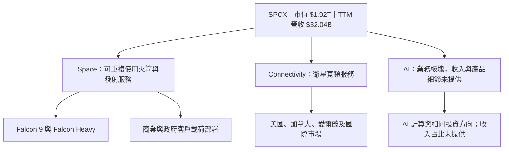
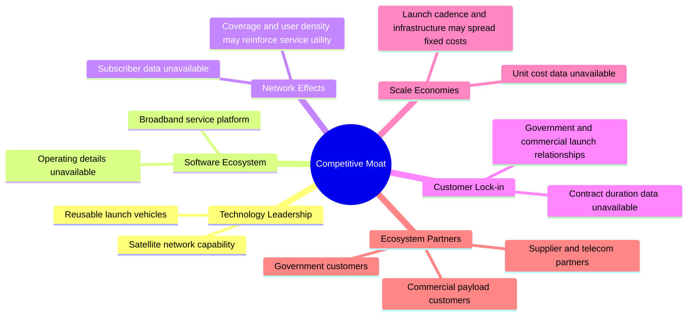
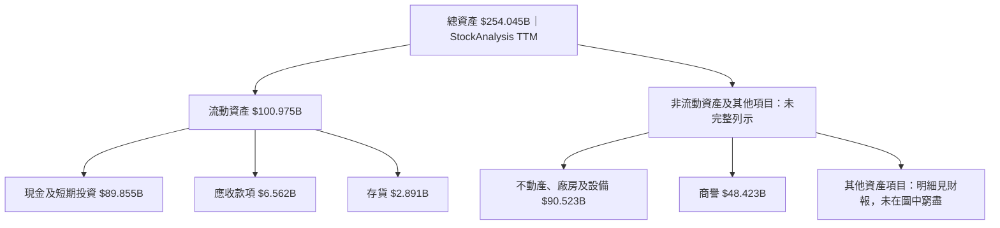
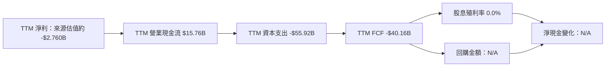
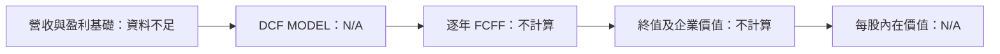
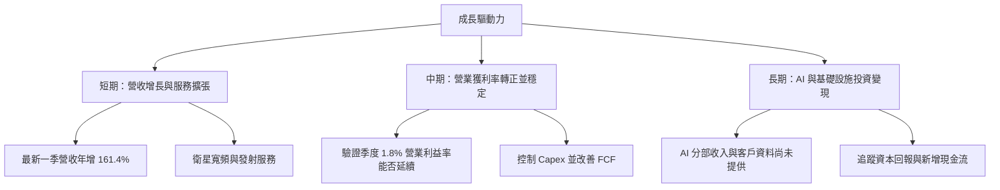
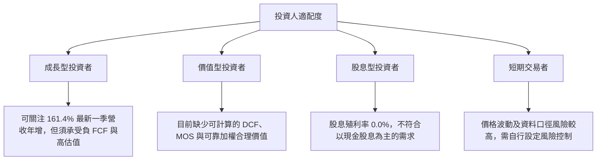

# SPCX 基本面深度分析報告
> **報告日期**：2026-11-18 ｜ **語言**：繁體中文 ｜ **數據來源**：Yahoo Finance、Finviz、StockAnalysis、Roic.ai ｜ **分析師**：CFA 級機構研究

> **資料完整性提醒**：Yahoo Finance、StockAnalysis 與 Roic.ai 的部分損益數據不一致；例如 2026-09-30 季度營業利益分別列為 **$2.79B** 與 **$4.019B**。以下優先引用已標記核實的指標；對來源不一致或缺少必要輸入的項目標示 **N/A**，不自行補值。另有資料稱 SPCX 為 Space Exploration Technologies Corp.，但這些資料本身不足以核驗其上市與股本資訊；股價與市值等市場數據僅按所列資料引用。

## 目錄

| # | 章節 | 核心結論 |
|---|------|----------|
| 1 | 執行摘要 | 2026-11-17 收盤價 $141.70；DCF 與估值方法未能計算，因此 MOS 與規則 20 評級均為 N/A |
| 2 | 公司概覽與商業模式 | 火箭發射、衛星寬頻與 AI 等業務方向具規模與技術門檻；各板塊收入占比未提供 |
| 3 | 損益表深度分析 | TTM 營收 $32.04B；最新一季年增 161.4%，但 TTM 營業利益率為 -2.0% |
| 4 | 資產負債表分析 | 淨現金 $50.64B、流動比率 3.084；營運資金天數顯示負 CCC |
| 5 | 現金流量深度分析 | TTM FCF -$40.16B，主要受 $55.92B 資本支出影響 |
| 6 | 獲利能力與資本效率 | WACC 9.98%；ROIC 缺資料，不能判斷是否創造股東價值 |
| 7 | 相對估值分析 | Forward P/E 51.67x、P/S 60.06x；高於可比公司部分倍數，但盈利與同業結構差異大 |
| 8 | DCF 內在價值評估 | N/A：TTM 營業利益為負，估值模型與加權合理價值均無法計算 |
| 9 | 成長催化劑 | 衛星寬頻、發射服務與 AI／運算投資是潛在成長方向；TAM 與確切時程未提供 |
| 10 | 風險矩陣 | 資本支出、獲利波動、估值與資料可靠性為主要風險 |
| 11 | 投資建議 | 不提供 MOS 門檻式買賣評級或目標價；應先驗證財報、股本與投資回報 |

---

## 1. 執行摘要

2026-11-17 收盤價為 **$141.70**。核實數據顯示 SPCX TTM 營收 **$32.04B**、最新一季營收年增 **161.4%**，但 TTM 營業利益率為 **-2.0%**，TTM 自由現金流（營業現金流減資本支出）為 **-$40.16B**。公司持有 **$50.64B 淨現金**，有能力支應投資，但高成長與高資本支出並存，且 ROIC、DCF 與估值方法所需輸入未能完整取得。因此，**加權合理價值、MOS 與依 MOS 決定的評級均為 N/A**；這不是「持有」或「買入」的等同判斷，而是目前無法按指定規則計算評級。

### 1.0 一頁式投資儀表板

| 項目 | 內容 |
|------|------|
| **投資論點（3 句）** | ① 最新一季營收年增 **161.4%**，顯示營收快速擴張。② TTM 毛利率 **56.8%**，但 TTM 營業利益率 **-2.0%**，毛利尚未轉化為穩定營業獲利。③ TTM 資本支出 **$55.92B** 高於營業現金流 **$15.76B**，使 TTM FCF 為 **-$40.16B**。 |
| **綜合評分** | **5.8/10**（引用 1.1 評分卡；描述公司品質與估值概況，不取代評級） |
| **財務健康** | 🟡 淨現金 **$50.64B**、流動比率 **3.084**，但 TTM FCF 為 **-$40.16B** |
| **ROIC vs WACC** | **N/A vs 9.98%**；ROIC 缺資料，無法判斷創造或摧毀價值 |
| **FCF 趨勢** | TTM FCF **-$40.16B**；FCF Yield **-2.09%** |
| **估值** | Forward P/E **51.671387x** ｜ EV/EBITDA **159.663x** ｜ FCF Yield **-2.09%** |
| **DCF 內在價值（基準）** | **N/A**；DCF 模型不適用，故無法計算現價相對 DCF 的折溢價 |
| **安全邊際（MOS）** | **N/A**；加權合理價值未能計算，故不能以其為分母計算 MOS |
| **預期報酬（基準情境 12M）** | **N/A**；沒有可引用的 DCF 情境價值 |
| **關鍵風險（前二）** | TTM FCF 深度為負；營業利益及季度數據來源存在差異 |
| **評級 + 信心度** | **N/A（無法依 MOS 規則定級）**；估值結論信心度低 |

### 1.1 綜合評分卡

| 維度 | 評分（1–10） | 主要依據（引用數字與其來源章節） |
|------|--------------|----------------------------------|
| 成長性 | 8.0 | 最新一季營收年增 **161.4%**；但 TTM 營收成長率為 N/A（第 3.2 節） |
| 獲利能力 | 4.0 | TTM 營業利益率 **-2.0%**、淨利率 **-8.6%**；ROIC、F-Score 為 N/A（第 3、6 章） |
| 財務健康 | 8.0 | 淨現金 **$50.64B**、流動比率 **3.084**；惟 TTM FCF **-$40.16B**（第 4、5 章） |
| 估值 | 2.0 | Forward P/E **51.671387x**、P/S **60.057945x**，而加權合理價值與 MOS 均無法計算（第 7、8 章） |
| 護城河 | 8.0 | 具可重複使用火箭、發射服務及衛星寬頻業務；量化市占與板塊收入占比未提供（第 2 章） |
| 管理層與資本配置 | 5.0 | FY2025 資本支出 **$20.91B**、SBC **$1.95B**；回購與具體投資回報資料不足（第 3、5 章） |
| **綜合評分** | **5.8** | 六項算術平均：(**8.0 + 4.0 + 8.0 + 2.0 + 8.0 + 5.0**) ÷ 6 = **5.8** |

### 1.2 五大投資論點 + 三大核心風險

| 類型 | 項目 | 具體依據 | 信心度 |
|------|------|----------|--------|
| 🟢 **投資論點①** | 營收擴張速度高 | 最新一季營收 **$14.57B**，年增 **161.4%**；若增長能轉化為利潤，規模可改善固定成本吸收 | 🟢 中 |
| 🟢 **投資論點②** | TTM 毛利率高於直接可比公司的部分數據 | SPCX TTM 毛利率 **56.8%**；Peer 數據中 RKLB **36.2%**、ASTS **37.0%**、IRDM **71.5%** | 🟡 中 |
| 🟢 **投資論點③** | 資產負債表有淨現金緩衝 | 現金及短期投資 **$89.86B**、總債務 **$39.22B**，核實淨現金 **$50.64B** | 🟢 中 |
| 🟢 **投資論點④** | 現金轉換週期為負 | 最新 TTM CCC **-219 天**，主要來自 DPO **349 天**；需持續確認付款條件與供應商融資是否可持續 | 🟡 中 |
| 🟢 **投資論點⑤** | 目前已有正向季度營業利益數據 | 核實口徑的最新一季營業利益率 **1.8%**，但 TTM 仍為 **-2.0%**，尚未證明可持續 | 🟡 低 |
| 🟡 **風險①** | 資本支出超出營業現金流 | TTM Capex **$55.92B** 對 OCF **$15.76B**，帶來 **-$40.16B** FCF；若投資回報延遲，現金消耗將延長 | 🔴 高衝擊 |
| 🔴 **風險②** | 獲利與估值輸入不穩定 | TTM 淨利率 **-8.6%**，EV/EBITDA **159.663x**；多個季度盈利數據在來源間不一致 | 🔴 高衝擊 |
| 🟡 **風險③** | 高估值對增長預期敏感 | P/S **60.057945x**、Forward P/E **51.671387x**；增長放緩或利潤率未改善可能導致倍數收縮 | 🔴 高衝擊 |

### 1.3 快速統計卡片

| 指標 | 公司實際值（期間） | 同業中位數 | 狀態 |
|------|--------------------|------------|------|
| 營收成長（TTM） | **N/A** | — | 🟡 缺資料 |
| 營收成長（最新一季年增） | **161.4%** | **72.7%** | 🟢 高於同業中位數 |
| 毛利率（TTM） | **56.8%** | **37.0%** | 🟢 高於同業中位數；但低於 IRDM 的 71.5% |
| 營業利益率（TTM） | **-2.0%** | — | 🔴 虧損 |
| ROIC（TTM） | **N/A** | — | 🟡 缺資料 |
| Forward P/E | **51.671387x** | **31.3x** | 🔴 高於同業中位數；同業含負值且業務結構不同 |
| FCF Yield（TTM） | **-2.09%** | — | 🔴 負值 |
| Piotroski F-Score | **N/A** | — | 🟡 缺少兩個相隔一年的 SEC TTM 期間資料 |

> 同業中位數依 RKLB、ASTS、IRDM 的 Peer multiples 計算；未提供同業完整財務或估值方法時，不作進一步推論。

### 1.4 投資結論

```text
╔══════════════════════════════════════════════════════════════════╗
║                    📊 投資結論摘要                               ║
╠══════════════════════════════════════════════════════════════════╣
║  評級：N/A（估值方法未能計算，無法依 MOS 規則定級）             ║
║  價格（2026-11-17 收盤）：$141.70                                ║
║  DCF 內在價值（基準）：N/A（TTM 營業利益為負）                  ║
║  安全邊際 MOS：N/A（加權合理價值未能計算）                       ║
║  加權合理價值（8.8）：N/A                                        ║
║  綜合評分：5.8/10（引用 1.1）                                    ║
║  適合投資人：能承受高估值、負 FCF 與財報不確定性的成長型投資人  ║
╚══════════════════════════════════════════════════════════════════╝
```

---

## 2. 公司概覽與商業模式

### 2.1 業務結構與收入來源

公司概覽描述 SPCX 涉及火箭設計、製造與發射、衛星寬頻連線及 AI；但沒有各板塊營收或占比資料，因此不以假設比例拆分。市值與營收採用所列市場資料與 Yahoo TTM 數據。



市值、股價、流通股數等資料彼此存在核對疑點：按提供數據計算，**$141.70 × 8.25B 股 = 約 $1.169T**，與所列市值 **$1.92T** 不一致。因此市場市值及股數不宜直接用於自建每股估值。

### 2.2 市場份額

市場份額數據未提供。最新一季 SPCX 營收年增 **161.4%**，高於 Peer multiples 中 RKLB 的 **72.7%**、ASTS 的 **187.1%**、IRDM 的 **8.3%**；但各公司的業務範圍、成熟度及營收基數不同，不能據此推算市占或市場排名。

### 2.3 競爭護城河分析



### 2.4 護城河強度

| 護城河項目 | 強度（強／中／弱） | 證據（引用數字或事實） | 會削弱它的情況 |
|------------|--------------------|------------------------|----------------|
| 技術與工程能力 | 強 | 公司描述包含可重複使用火箭、Falcon 9 與 Falcon Heavy 發射服務 | 發射可靠度下降、技術替代或監管限制 |
| 衛星寬頻網路 | 中至強 | 業務涵蓋美國、加拿大、愛爾蘭與國際市場；用戶數與網路規模未提供 | 競爭網路擴張、頻譜限制、服務品質或資本回收不佳 |
| 客戶與合約關係 | 中 | 客戶涵蓋商業與政府；合約續約率、客戶集中度未提供 | 政府採購轉向、合約集中或價格競爭 |
| 規模效應 | 中 | TTM 營收 **$32.04B**，最新一季營收 **$14.57B** | 高資本支出使規模擴張未能轉化為正 FCF |
| 軟體生態與網路效應 | N/A | 缺用戶、留存、ARPU、網路效應等量化資料 | 服務差異化不足或用戶成長停滯 |
| 生態夥伴 | 中 | 資料提到商業與政府客戶；合作網絡規模未提供 | 關鍵供應鏈受限或合作條款惡化 |

1.1「護城河」評分為 **8.0/10**，主要依據是可重複使用火箭、發射服務與衛星網路業務的技術及規模門檻，而非已量化的市占或客戶留存數據。

---

## 3. 損益表深度分析

### 3.1 年度收入成長趨勢（可用年度）

可得年度資料為 2023–2025，共三年而非四年。FY2025 營收較 FY2024 增長 **33.24%**；FY2024 較 FY2023 增長 **34.93%**。兩年營收 CAGR 以 StockAnalysis 年度營收計算約為 **34.1%**，是歷史趨勢描述，不能替代核實的 TTM 成長率（N/A）。

```text
╔══════════════════════════════════════════════════════════════════╗
║       Space Exploration Technologies Corp. 年度收入趨勢         ║
╠══════════════════════════════════════════════════════════════════╣
║  FY2023  $10.387B  ██████████░░░░░░░░░░░░░░░░  基準年           ║
║  FY2024  $14.015B  ██████████████░░░░░░░░░░░░  YoY: +34.93%    ║
║  FY2025  $18.674B  ███████████████████░░░░░░░  YoY: +33.24%    ║
║                                                                  ║
║  FY2023–FY2025 營收 CAGR：約 +34.1%                              ║
║  FY2026 TTM：$32.04B；TTM 成長率：N/A                            ║
╚══════════════════════════════════════════════════════════════════╝
```

### 3.2 季度收入趨勢分析

| 季度 | 營收 | QoQ 成長 | YoY 成長 | 備註 |
|------|------:|---------:|---------:|------|
| 2025-12-31 | $4.96B | — | — | 財務數據未提供可比前季及前一年同期數字 |
| 2026-03-31 | $4.69B | -5.4% | 15.42% | YoY 依 StockAnalysis 季度數據 |
| 2026-06-30 | $7.81B | +66.5% | 91.94% | YoY 依 StockAnalysis 季度數據 |
| 2026-09-30 | $14.57B | +86.5% | 161.4% | 核實的最新單季年增率；QoQ 依季度營收計算 |

季度營收連續增加，尤其 2026 年第二、第三季的 QoQ 成長顯著。不過資料未提供收入構成，無法區分成長來自衛星服務、發射、產品交付、併購或其他因素；單季大幅成長不宜直接年化。

### 3.3 利潤率演變分析

| 利潤率指標 | FY2023 | FY2024 | FY2025 | 最新 TTM／季度 | 趨勢與評估 |
|------------|-------:|-------:|-------:|---------------:|------------|
| **毛利率** | 41.2% | 42.9% | 49.4% | TTM **56.8%** | 🟢 逐步擴張；可能反映規模或產品組合改善，但單一來源不足以確認原因 |
| **營業利益率** | 4.88% | 5.29% | -11.05% | TTM **-2.0%**；最新季度 **1.8%** | 🔴 FY2025 惡化，之後季度波動大；需確認研發、折舊與投資成本 |
| **淨利率** | -44.56% | 5.64% | -26.44% | TTM **-8.6%** | 🔴 盈利波動明顯；一次性項目、稅務與非營業損益未完整拆解 |

FY2025 營收增至 **$18.674B**，但營業利益為 **-$2.064B**，而研發費用升至 **$8.64B**（FY2024 為 **$3.46B**）。這與營業利益率大幅轉負同時發生，顯示投入成本可能抵銷收入擴張。2026 最新季度營業利益率 **1.8%**，但 TTM 仍為 **-2.0%**，尚不足以證明獲利趨勢已持續反轉。另有來源把 2026-09-30 季營業利益列為 **$2.79B** 與 **$4.019B**；本報告不將兩者混合。

### 3.4 費用結構分析

完整費用結構未提供，不以不完整的費用分類製作圓餅圖。可辨識的 FY2025 研發費用為 **$8.64B**，約為 FY2025 營收 **$18.674B** 的 **46.3%**；這表明研發投入占比高，但不代表總營業費用中只包含研發。

```text
╔══════════════════════════════════════════════════════════════════╗
║                    FY2025 可辨識費用資訊                         ║
╠══════════════════════════════════════════════════════════════════╣
║  營收：        $18.674B                                           ║
║  研發費用：     $8.64B                                            ║
║  研發／營收：   $8.64B ÷ $18.674B = 46.3%                        ║
║  其他營業費用：資料未提供，無法完整拆分                           ║
╚══════════════════════════════════════════════════════════════════╝
```

### 3.5 季度 EPS 趨勢與盈餘品質（Quality of Earnings）

| 季度 | EPS 實際值 | 預估值／超預期狀況 | 備註 |
|------|-----------:|--------------------|------|
| 2025-12-31 | N/A | N/A | 未提供一致的 EPS 預估與實際對照 |
| 2026-03-31 | -$1.27（Roic.ai） | N/A | Earnings History 的估值與實際均為 nan |
| 2026-06-30 | -$0.09（Roic.ai） | N/A | 無法判定超預期或不及預期 |
| 2026-09-30 | $0.37（Roic.ai） | N/A | 不能以缺失預估值推斷 beat／miss |

目前只能取得三個季度的 EPS 實際值，且缺少有效一致的分析師預估；因此無法完成過去四季盈餘超預期／不及預期分析。

| 盈餘品質項目 | 數值／佔比 | 評估 |
|--------------|-----------|------|
| 股權薪酬 SBC／營收 | TTM SBC **$4.733B ÷ $32.04B = 14.8%** | 🔴 SBC 占比高，經濟上代表股東稀釋成本；資料未提供流通股數的可比時間序列以量化稀釋 |
| SBC／營業現金流 | **$4.733B ÷ $15.76B = 30.0%** | 🟡 OCF 包含非現金 SBC 調整的影響；比例高，應與稀釋同步觀察 |
| FCF／淨利（現金轉換率） | TTM FCF **-$40.16B**；TTM 淨利依 StockAnalysis 約 **-$2.760B**，比率約 **14.55x** | 🔴 分子、分母皆為負，正比率不代表現金轉換好，反映 FCF 流出遠大於會計虧損 |
| 一次性／非經常性損益 | N/A | 未提供完整附註，無法判斷 |
| 有效稅率異常 | N/A | 實際有效稅率與稅務調節表未提供 |
| 資本化支出 vs 費用化 | TTM Capex **$55.92B**；資本化項目明細 N/A | 高資本支出會形成折舊負擔；無法判斷是否存在過度資本化或費用遞延 |

**盈餘品質結論**：TTM FCF 深度為負，且 SBC 約占營收 **14.8%**，因此近期會計盈餘不宜單獨視為股東可獲得的經濟盈餘。最新季度出現正 EPS 不足以證明可持續獲利；在現金流轉正、SBC 占比下降及附註資料釐清前，獲利含金量評估偏弱。

---

## 4. 資產負債表分析

### 4.1 資產結構分解

下圖列示可取得的 2026-09-30 資產數據；各項科目可能因來源及分類方式有差異，沒有列出的細項不推算補足。



### 4.2 流動性與營運資金分析

| 流動性指標 | 2025-12-31 | 最新資料 | 評估 |
|------------|-----------:|---------:|------|
| 現金及短期投資 | $24.747B | $89.86B（2026-09-30） | 🟢 資金緩衝增加；可能由融資、營運現金流或其他交易造成，來源未拆解 |
| 流動比率 | N/A | 3.084 | 🟢 短期流動資產覆蓋流動負債的倍數較高 |
| 速動比率 | N/A | 2.945 | 🟢 即使不計存貨，流動性指標仍高於 1 |
| 淨現金 | N/A | $50.64B | 🟢 現金及短期投資高於總債務 |

**營運資金天數**：一年前數據未提供，故變化欄不可計算。

| 指標 | 最新 TTM | 一年前 TTM | 變化 | 解讀 |
|------|----------|------------|------|------|
| DSO 應收帳款天數 | 54 天 | N/A | N/A | 一年比較缺資料，不能判斷收款速度變化 |
| DIO 存貨天數 | 76 天 | N/A | N/A | 一年比較缺資料，不能判斷存貨是否累積 |
| DPO 應付帳款天數 | 349 天 | N/A | N/A | 數值偏高；可能表示較長付款週期，但需檢視供應商條款與應付帳款明細 |
| CCC 現金轉換週期 | -219 天 | N/A | N/A | 由 54 + 76 − 349 = -219 天；代表營運資金週期為負，不等同於永久免費融資 |

### 4.3 債務結構分析

```text
╔══════════════════════════════════════════════════════════════════╗
║                   SPCX 債務健康診斷                              ║
╠══════════════════════════════════════════════════════════════════╣
║  總債務：             $39.22B                                    ║
║  現金及短期投資：     $89.86B                                    ║
║  淨現金：             $50.64B   🟢                               ║
║                                                                  ║
║  Debt/EBITDA：       N/A（核實 EBITDA 絕對值未提供）              ║
║  Interest Coverage： N/A（利息費用與覆蓋倍數未提供）             ║
║  Debt/Equity：       22.186（資料來源口徑；比率異常高，需核對）  ║
║                                                                  ║
║  風險提示：現金充足不代表高額資本支出必然產生正回報。             ║
╚══════════════════════════════════════════════════════════════════╝
```

市場資料中 Debt/Equity 為 **22.186**，但其口徑與資產負債表其他數字不易相互核對，故僅照錄，不據此推斷槓桿風險程度。

### 4.4 股東權益趨勢

| 期末 | 股東權益 | 年增 |
|------|---------:|-----:|
| 2024-12-31 | $25.80B | — |
| 2025-12-31 | $41.33B | +60.15% |

```text
╔══════════════════════════════════════════════════════════════════╗
║                    股東權益變化（年度）                          ║
╠══════════════════════════════════════════════════════════════════╣
║  2024-12-31  $25.80B  ████████████░░░░░░░░                       ║
║  2025-12-31  $41.33B  ████████████████████  YoY: +60.15%        ║
║                                                                  ║
║  2026-09-30：不同來源股東權益數值口徑不一致，不作趨勢外推。      ║
╚══════════════════════════════════════════════════════════════════╝
```

---

## 5. 現金流量深度分析

### 5.1 現金流量瀑布圖



淨利到 OCF 的調節表未提供，圖中僅展示各項已提供數字，不代表可以用淨利直接推算 OCF。

### 5.2 FCF 轉換率趨勢

| 期間 | FCF | 淨利 | FCF／淨利 | 解讀 |
|------|----:|-----:|----------:|------|
| FY2023 | $0.105B | -$4.628B | 不具經濟意義 | 正 FCF 與淨虧損並存，可能涉及非現金費用與營運資金變動 |
| FY2024 | -$5.39B | $0.791B | -6.81x | 資本支出造成現金流與會計淨利背離 |
| FY2025 | -$14.12B | -$4.937B | 2.86x | 兩者皆為負，正比率不代表現金轉換品質好 |
| TTM 至 2026-09-30 | -$40.16B | 約 -$2.760B（StockAnalysis） | 約 14.55x | FCF 流出相較淨虧損更大，屬高再投資／高資本消耗狀態 |

### 5.3 自由現金流趨勢

| 期間 | FCF | FCF Yield |
|------|----:|----------:|
| FY2023 | $0.105B | N/A |
| FY2024 | -$5.39B | N/A |
| FY2025 | -$14.12B | N/A |
| TTM 至 2026-09-30 | **-$40.16B** | **-2.09%** |

```text
╔══════════════════════════════════════════════════════════════════╗
║                 自由現金流趨勢（已提供期間）                     ║
╠══════════════════════════════════════════════════════════════════╣
║  FY2023  +$0.105B  ▏                                            ║
║  FY2024  -$5.39B   ◀██░░░░░░░░░░░░░░░░░░                       ║
║  FY2025  -$14.12B  ◀██████░░░░░░░░░░░░                         ║
║  TTM     -$40.16B  ◀████████████████████  Yield: -2.09%         ║
║                                                                  ║
║  TTM OCF $15.76B；Capex $55.92B；兩者差額 FCF -$40.16B。       ║
╚══════════════════════════════════════════════════════════════════╝
```

FY2023 到 FY2025 FCF 由 **$0.105B** 轉為 **-$14.12B**，TTM 進一步降至 **-$40.16B**。主要可量化因素是 TTM Capex **$55.92B** 大於 OCF **$15.76B**；資本支出占營收約 **174.5%**（$55.92B ÷ $32.04B），反映公司仍處於極高再投資階段。持續性與項目回報率未提供，無法判斷支出何時轉化為自由現金流。

### 5.4 資本配置評估

| 配置項目 | 可得數據 | 評估 |
|----------|----------|------|
| 資本支出 | TTM **$55.92B**；FY2025 **$20.91B** | 🟡 投資規模大，需以資產利用率與新增營收驗證回報 |
| 股權薪酬 | TTM 約 **$4.733B**；FY2025 **$1.95B** | 🔴 稀釋成本重要，須與股數變化同步追蹤 |
| 股息 | 股息殖利率 **0.0%** | 未見現金股息回報 |
| 股票回購 | N/A | 回購數據未提供 |
| 併購與其他投資 | N/A | 未提供足以拆分資本配置的現金流明細 |

未製作資本配置圓餅圖：各配置項目的現金流分類並未完整提供，且無法用 FCF 反推其他項目。

---

## 6. 獲利能力與資本效率

### 6.1 ROE／ROA／ROIC 趨勢

| 指標 | FY2023 | FY2024 | FY2025／TTM | 評估 |
|------|-------:|-------:|------------:|------|
| ROE | N/A | N/A | N/A | QUALITY FIGURES 無法計算 DuPont，且市場資料 ROE 為 N/A |
| ROA | N/A | N/A | N/A | 可比期間淨利、資產口徑不足以支持核實趨勢 |
| ROIC | N/A | N/A | N/A | Roic.ai 的歷史 Return on Invested Capital 未提供有效數值 |
| WACC | — | — | **9.98%** | 採用成本資本資料中的核實值 |

由於 ROIC 為 N/A，不能以 WACC **9.98%** 作為單獨對照，判斷公司已創造或摧毀價值；亦不填入未提供的行業均值。

### 6.2 ROIC vs WACC 分析（核心價值創造判斷）

```text
╔══════════════════════════════════════════════════════════════════╗
║                  ROIC vs WACC 深度分析                           ║
╠══════════════════════════════════════════════════════════════════╣
║  WACC（採用核實值）：9.98%                                       ║
║  ├── 無風險利率（10Y 美債）：5.10%                               ║
║  ├── 股權風險溢酬 ERP：5.00%                                     ║
║  ├── 原始 Beta：N/A；採用調整後 Beta：1.00（資料假設值）          ║
║  ├── 股權成本：5.10% + 1.00 × 5.00% = 10.10%                    ║
║  ├── 稅前債務成本：4.96%；稅後約 3.92%                           ║
║  ├── 股權／債務權重：98.0%／2.0%                                 ║
║  └── WACC：9.98%                                                 ║
║                                                                  ║
║  ROIC：N/A（缺少可核實投入資本及 NOPAT 資料）                    ║
║  EVA（ROIC − WACC）：N/A                                         ║
║  結論：尚不能判定 SPCX 是創造或摧毀股東價值。                   ║
╚══════════════════════════════════════════════════════════════════╝
```

**成本資本算式核對**：

1. 股權成本：**5.10% + 1.00 × 5.00% = 10.10%**。
2. 稅後債務成本：**4.96% × (1 − 21.0%) = 3.9184% ≈ 3.92%**。
3. 加權成本：**98.0% × 10.10% + 2.0% × 3.9184% = 9.898% + 0.078368% = 9.976368% ≈ 9.98%**。

此處採用的是成本資本資料列示的 WACC 與組成；Beta 原值為 N/A，調整後 Beta **1.00** 為資料採用值，不能視為可觀察的 SPCX 歷史 Beta。

### 6.3 杜邦三因素分解

| 因素 | 數值（TTM） | 解讀 |
|------|-------------|------|
| 淨利率 | N/A | QUALITY FIGURES 的 DuPont 為 N/A |
| 資產週轉率 | N/A | 來源未提供核實的 DuPont 因子 |
| 權益乘數 | N/A | 來源未提供核實的 DuPont 因子 |
| **ROE** | **N/A** | DuPont 分解不完整，不能用其他資料自行補算 |

### 6.4 財務體質：Piotroski F-Score

**N/A**：Piotroski F-Score 需要相隔一年的兩個 TTM SEC 申報期間資料，目前沒有該組資料；九項測試結果均未提供，故不逐項杜撰或補分。

---

## 7. 相對估值分析

### 7.1 同業估值比較表格

Peer 倍數照錄 Yahoo Finance 的 RKLB、ASTS、IRDM 數據。SPCX 自身估值採提供的公司估值資料。

| 估值指標 | **SPCX** | **RKLB** | **ASTS** | **IRDM** | 本公司評估 |
|----------|---------:|---------:|---------:|---------:|-----------|
| **Trailing P/E** | 616.0869x | N/A | N/A | 29.0x | 🔴 SPCX 倍數極高；不同盈利狀態使比較失真 |
| **Forward P/E** | 51.671387x | 769.1x | -17.7x | 31.3x | 🟡 SPCX 高於 IRDM、低於 RKLB；ASTS 為負值，不能直接排序 |
| **P/S Ratio（TTM）** | 60.057945x | 42.0x | 75.3x | 5.2x | 🔴 高於 IRDM、RKLB，低於 ASTS；仍屬高倍數 |
| **EV/EBITDA（TTM）** | 159.663x | -176.3x | -20.8x | 17.3x | 🔴 SPCX 高；負 EBITDA 同業倍數不具一般正向比較意義 |
| **最新一季營收年增** | 161.4% | 72.7% | 187.1% | 8.3% | 🟢 高於 RKLB、IRDM，低於 ASTS |
| **毛利率（TTM）** | 56.8% | 36.2% | 37.0% | 71.5% | 🟢 高於 RKLB、ASTS，低於 IRDM |

三家同業的 Forward P/E 中位數為 **31.3x**（排序 -17.7x、31.3x、769.1x），但因包含負值與極端高值，對 SPCX 的估值參考有限。三家 P/S 中位數為 **42.0x**。不以同業倍數反推股價，因提供資料未列「VALUATION METHODS」計算結果及所需完整分子、分母與股本口徑。

### 7.2 歷史估值區間分析

**N/A（數據未提供：缺少自身歷史估值區間及百分位資料）**。不得由目前 P/E 或 P/S 倍數推估歷史區間。

```text
╔══════════════════════════════════════════════════════════════════╗
║                    歷史估值位置                                  ║
╠══════════════════════════════════════════════════════════════════╣
║  歷史 P/E 區間／百分位：N/A                                      ║
║  目前 P/E：616.0869x（照錄市場估值數據）                          ║
║  限制：盈利波動、不同資料來源口徑與歷史區間缺失，無法定位百分位。║
╚══════════════════════════════════════════════════════════════════╝
```

### 7.3 情境價值（Bear / Base / Bull，照抄 DCF MODEL 的 Scenarios）

**N/A（DCF 無法計算：TTM 營業利益為負，核實資料不提供可用的 DCF 模型與 Scenarios）。** 不提供悲觀、基準或樂觀情境目標價。

### 7.4 相對估值隱含價格區間

**N/A（VALUATION METHODS 未能計算任何估值方法）**。缺少可供照錄的每股方法價值及權重，因此不以目前 Forward P/E、P/S 或同業倍數另行建立目標價。

---

## 8. DCF 內在價值評估（Discounted Cash Flow）

### 8.0 估值推理鏈（Thinking Logic）

**N/A（DCF MODEL：TTM 營業利益不為正，提供資料明確指定不以虧損折現建立 DCF）。** 因此不自建預測期、不設定營收 CAGR、期末利潤率、終值成長率、逐年 FCFF 或目標價，也不以缺漏數據填補模型。

| 決策點 | 本報告採用 | 理由 | 曾考慮但否決 | 否決理由 |
|--------|-----------|------|--------------|----------|
| 現金流模型 | N/A | DCF 模型標示 N/A | 自建 FCFF 預測 | 缺少可用營業利益基礎及完整模型輸入 |
| 預測期 N | N/A | 無 DCF 模型 | 自行選 5–10 年 | 缺少可支持預測期的可驗證模型 |
| 終值方法 | N/A | 無可用預測期 FCFF | Gordon Growth／退出倍數 | 不能在缺少 FCFF 基礎時推算終值 |
| EBIT 基礎與 SBC 處理 | N/A | 程式模型未建立 | 自行選 GAAP／非 GAAP 組合 | 不能另建模型或靜默加入假設 |

最脆弱的一環不是某一項假設，而是目前缺乏可支持盈利預測的基礎：TTM 營業利益率 **-2.0%**、TTM FCF **-$40.16B**。若直接假設未來利潤率快速轉正，估值會高度依賴未驗證的經營改善。



### 8.1 模型假設總表（Model Inputs）

**N/A（DCF MODEL 不適用；下列輸入沒有可照錄的模型假設值）**。為遵守不自建 DCF 的規則，不填入假設值或自行指定敏感度。

| 假設項目 | 採用值 | 依據／來源 | 敏感度 |
|----------|--------|-------------|--------|
| 預測期長度 N | N/A | DCF MODEL 為 N/A | N/A |
| 營收 CAGR | N/A | DCF MODEL 未提供 | N/A |
| 期末營業利潤率 | N/A | TTM 營業利益率 -2.0%，但模型未提供預測值 | N/A |
| 有效稅率 | N/A | 僅提供成本資本預設稅率 21.0%，非 DCF 模型稅率 | N/A |
| Capex／營收 | N/A | DCF MODEL 未提供；TTM Capex $55.92B 不可自行外推 | N/A |
| D&A／營收 | N/A | DCF MODEL 未提供 | N/A |
| 營運資金變動 | N/A | DCF MODEL 未提供 | N/A |
| EBIT 基礎／SBC 處理 | N/A | DCF MODEL 未提供 | N/A |
| 年稀釋率 | N/A | DCF MODEL 未提供 | N/A |
| 永續成長率 g | N/A | DCF MODEL 未提供 | N/A |
| 終值方法 | N/A | DCF MODEL 未提供 | N/A |
| WACC | 9.98%（僅為成本資本核實值） | Cost of capital 資料；不可據此另建 DCF | 不適用於缺失的 DCF |

### 8.2 折現率推導（WACC）

以下僅核對成本資本資料列出的 WACC，不代表已用它建立 DCF。

```text
╔══════════════════════════════════════════════════════════════════╗
║                    WACC 核實（非自建 DCF）                        ║
╠══════════════════════════════════════════════════════════════════╣
║  股權成本 Ke（CAPM）：                                           ║
║  ├── 無風險利率 Rf：5.10%                                        ║
║  ├── 市場風險溢酬 ERP：5.00%                                     ║
║  ├── 原始 Beta：N/A；調整後 Beta：1.00（資料採用值）              ║
║  └── Ke = 5.10% + 1.00 × 5.00% = 10.10%                         ║
║                                                                  ║
║  債務成本：稅前 4.96%；稅率 21.0%；稅後 3.9184% ≈ 3.92%          ║
║  資本權重：股權 98.0%；債務 2.0%                                ║
║  WACC = 98.0% × 10.10% + 2.0% × 3.9184% = 9.976368% ≈ 9.98%    ║
╚══════════════════════════════════════════════════════════════════╝
```

1. **Ke** = 5.10% + 1.00 × 5.00% = **10.10%**。  
2. **稅前 Kd** = **4.96%**（直接引用成本資本資料；利息費用及平均計息負債的底層金額未提供，不能重建此比率）。  
3. **稅後 Kd** = 4.96% × (1 − 21.0%) = **3.9184%**。  
4. **權重** = 股權 **98.0%**、債務 **2.0%**，合計 **100.0%**；底層市值、同口徑計息負債權重計算明細未提供。  
5. **WACC** = 98.0% × 10.10% + 2.0% × 3.9184% = 9.898% + 0.078368% = **9.976368% ≈ 9.98%**。

### 8.3 逐年自由現金流預測（基準情境）

**N/A（DCF 無法計算：TTM 營業利益不為正，且資料指定 DCF MODEL 為 N/A）。** 不輸出逐年預測、逐步演算或預測 FCF 成長軌跡，以免另建模型。

### 8.4 終值計算（Terminal Value）

**N/A（沒有 DCF 預測期 FCFF、永續成長率 g 或終值倍數；無法檢驗 WACC 是否大於 g，也無法計算終值）。**

### 8.5 企業價值 → 每股內在價值（Bridge）

**N/A（缺少 DCF 企業價值、終值現值及模型所用稀釋股數）。** 核實的現金及短期投資為 **$89.86B**、總債務 **$39.22B**、淨現金 **$50.64B**，但不能用淨現金單獨推算每股內在價值。  
**折溢價：N/A**；DCF 基準內在價值不存在。  
**本節不計算 MOS**：MOS 應以 8.8 加權合理價值為分母，而 8.8 亦無法計算。

### 8.6 敏感性分析（WACC × 永續成長率）

**N/A（沒有 DCF 基準 FCFF、g、終值與每股基準價值，不能建立敏感性矩陣或三情境 DCF）。** 因此不存在可供計算的基準格，也不提供機率加權價值或敏感度彈性。

### 8.7 反推 DCF（Reverse DCF）

**N/A（沒有可用的 DCF 基準模型，不能由現價唯一反推出營收 CAGR、利潤率、g 或預測期）。** 現價 **$141.70** 不足以在缺乏現金流模型的條件下推算市場隱含營運假設。

### 8.8 估值三角驗證與安全邊際

**N/A（估值方法資料列示 None could be computed）。** DCF、相對估值方法的每股價值及權重均未能計算；分析師共識平均目標價 **$257.50** 是外部共識資料，不等於可核驗的內在價值，也不能替代固定權重的估值方法。

| 項目 | 數值 | 說明 |
|------|------|------|
| DCF（基準） | N/A | DCF MODEL 不適用 |
| 相對估值方法 | N/A | VALUATION METHODS 無可計算方法 |
| 加權合理價值 | N/A | 無方法價值及權重可加權 |
| MOS | N/A | 公式為（加權合理價值 − 現價）÷ 加權合理價值；分子基準缺失 |
| 上行空間 | N/A | 合理價值未能計算 |
| 建議買入區間 | N/A | 無 MOS 門檻可供反推 |
| 合理持有區間 | N/A | 無法估計合理價值 |
| 減碼考慮區間 | N/A | 無可用的樂觀情境價值 |

### 8.9 DCF 模型的局限與失效條件

- **終值依賴度**：N/A；模型沒有終值與企業價值，不能計算比重。
- **最脆弱的假設**：N/A；本報告沒有自建營收、利潤率或 g 假設。公司已有的核心不確定性是 TTM 營業利益率 **-2.0%**、TTM FCF **-$40.16B**。
- **不適用情境**：公司仍有負 TTM FCF，且獲利波動大；若要估值，可先採用經核實的分部營收、用戶／單位經濟性、資本支出回報，以及可比公司 EV/Sales 等資料，並清楚揭示估值不確定性。
- **與第 10 章風險連結**：資本支出回報不佳會壓低未來 FCFF；收入增長放緩或營業利潤率未能持續轉正，會使任何基於高成長的估值假設失效。
- **資料風險**：營業利益、股數與市值數據存在來源差異，若未先對帳，衍生出的每股估值可能失真。

### 8.10 複算檢核表（Audit Trail）

| # | 檢核項目 | 檢查方式 | 結果 |
|---|----------|----------|------|
| 1 | 高／中敏感度輸入均有完整推導 | DCF MODEL 為 N/A，沒有模型輸入 | N/A |
| 2 | 每個 DCF 假設均有來歷 | 未設定 DCF 假設 | N/A |
| 3 | WACC 算式與權重核對 | 權重 98.0% + 2.0% = 100.0%；WACC 重算為 9.976368% ≈ 9.98% | ✅ |
| 4 | Kd 分母與債務權重 D 同一範圍 | 底層平均計息負債及權重所用債務明細未提供，無法獨立核驗 | N/A |
| 5 | WACC 與第 6.2 節一致 | 第 6.2、8.2 均引用 9.98% | ✅ |
| 6 | 逐年預測欄位數與 N 相符 | DCF 不適用，未建立逐年表 | N/A |
| 7 | FY+1 現金流演算可複算 | 無模型預測 | N/A |
| 8 | 預測期 PV 合計可重算 | 無模型預測 | N/A |
| 9 | WACC > g | g 未提供 | N/A |
| 10 | 終值基期與折現期核對 | 無終值 | N/A |
| 11 | EV 至每股價值橋接 | 無 DCF EV 及模型股數 | N/A |
| 12 | SBC 組合與股數處理一致 | 未建立 DCF SBC／股數假設 | N/A |
| 13 | 敏感性矩陣基準格與 DCF 價值一致 | 無矩陣 | N/A |
| 14 | 矩陣有效格與 WACC > g | 無矩陣 | N/A |
| 15 | 三情境機率加總 | 無 DCF 情境 | N/A |
| 16 | 反推 DCF 每列只放開一個變數 | 未建立 Reverse DCF | N/A |
| 17 | MOS 分母、折溢價基準正確 | 加權合理價值及 DCF 基準價值均 N/A，未計算 MOS／折溢價 | N/A |
| 18 | 報告完整至第 11 章 | 已完整列出第 1 至第 11 章 | ✅ |
| 19 | 加權合理價值等於價值乘權重之和 | 無估值方法及權重 | N/A |
| 20 | 評級符合 MOS 門檻 | MOS 未能計算，因此不給 MOS 規則評級 | N/A |

---

## 9. 成長催化劑

### 9.1 催化劑時間軸

具體專案時程、發射排程、服務推出日期及營收貢獻未提供，因此不虛構日期或製作甘特圖。

| 時間範圍 | 潛在催化劑 | 可追蹤指標 |
|----------|------------|------------|
| 短期 | 發射服務與衛星寬頻收入持續擴張 | 季度營收、最新一季年增率（目前 **161.4%**） |
| 中期 | 營收增長轉化為營業獲利 | TTM 營業利益率（目前 **-2.0%**）、季度營業利益率（最新 **1.8%**） |
| 長期 | AI／運算及相關基礎設施投資取得商業回報 | AI 分部收入、資本回報率與資本支出回收期；目前未提供 |

### 9.2 TAM 市場規模分析

**N/A（TAM 數據未提供）**。公司 TTM 營收為 **$32.04B**，最新一季營收年增 **161.4%**，顯示營收擴張快速，但缺少市場規模、公司滲透率與分部收入，不能估算 TAM 或市場滲透率。

### 9.3 成長驅動力結構圖



---

## 10. 風險矩陣

### 10.1 風險評分矩陣

數據沒有提供各風險的統計發生機率或量化損失，因此不以任意數值繪製機率—衝擊座標圖。以下以定性高／中分級，並在風險清單中說明依據。

### 10.2 風險清單詳細分析

| # | 風險項目 | 發生機率 | 財務衝擊 | 風險評級 | 緩解措施 |
|---|----------|----------|----------|----------|----------|
| 1 | 🔴 **高資本支出與負 FCF** | 中至高；TTM Capex **$55.92B**、FCF **-$40.16B** | 高；若投資回報不及預期，持續消耗現金 | 🔴 高 | 逐季追蹤 Capex、OCF、FCF、已投資專案回報及融資需求 |
| 2 | 🔴 **估值倍數壓縮** | 中至高；P/S **60.057945x**、Forward P/E **51.671387x** | 高；增長不及預期會放大估值調整 | 🔴 高 | 不以單季高增長外推；採分批部署並以營收及利潤率驗證 |
| 3 | 🟠 **營業獲利反覆** | 中至高；TTM 營業利益率 **-2.0%**，最新季度 **1.8%** | 高；若無法持續轉正，難以降低現金流風險 | 🔴 高 | 追蹤連續季度營業利益、研發費用與毛利率 |
| 4 | 🟠 **財報與市場數據口徑差異** | 已觀察到；季度營業利益存在 **$2.79B** 與 **$4.019B** 差異 | 高；估值分子、分母及股數可能不一致 | 🔴 高 | 對照 SEC 申報、公司正式財報及股數調節表後再估值 |
| 5 | 🟡 **SBC 與股東稀釋** | 中；TTM SBC 約 **$4.733B**、占營收約 **14.8%** | 中至高；稀釋降低每股經濟價值 | 🟠 中高 | 追蹤 SBC／營收及稀釋股數年度變化，要求補償增長高於稀釋 |

上述風險評級為質化研究判斷，不是統計模型的精確發生率或預期損失估計。

---

## 11. 投資建議

### 11.1 最終評級與評分

依目前資料，**MOS 無法計算，因此不能依規則 20 給出買入、持有、減碼或賣出評級**；沒有依 MOS 調整一級的情況。1.1 評分卡的綜合評分為 **5.8/10**，反映高營收增長、淨現金與技術業務優勢，同時也反映負 FCF、獲利不穩及估值偏高。

### 11.2 合理價值與隱含報酬率

| 項目 | 每股價值 | 相對 2026-11-17 收盤價 $141.70 | 說明 |
|------|----------:|------------------------------:|------|
| 加權合理價值 | N/A | N/A | VALUATION METHODS 無可計算方法及權重 |
| 悲觀 DCF 情境 | N/A | N/A | DCF MODEL 為 N/A |
| 基準 DCF 情境 | N/A | N/A | DCF MODEL 為 N/A |
| 樂觀 DCF 情境 | N/A | N/A | DCF MODEL 為 N/A |
| 分析師共識平均目標價 | $257.50 | 約 +81.7% | Yahoo Finance 共識資料；不等同內在價值，未納入本報告加權估值 |

分析師共識高低區間為 **$70–$800**，範圍寬，反映市場對公司成長與估值存在較大分歧；此目標價區間不能取代本報告缺失的估值模型。

### 11.3 買入時機與觸發因素

```text
╔══════════════════════════════════════════════════════════════════╗
║                  ✅ 觀察與決策觸發因素 Checklist                 ║
╠══════════════════════════════════════════════════════════════════╣
║  進一步評估前優先確認：                                          ║
║  ☐ 核對正式財報中的季度營業利益及淨利，解決來源差異             ║
║  ☐ 核對市值、股數、股權類別及股價口徑                            ║
║  ☐ 連續季度營業利益率維持正值，並逐步改善                        ║
║  ☐ TTM FCF 由 -$40.16B 改善，並能解釋 Capex 回報                ║
║                                                                  ║
║  可考慮加碼前：                                                  ║
║  ☐ 營收成長仍高於最新一季年增 161.4% 以外的可持續基準需另行評估 ║
║  ☐ SBC／營收下降，且股數變化與員工薪酬資料可核對                 ║
║  ☐ 取得可驗證的 ROIC、債務成本及分部現金流資料                   ║
║                                                                  ║
║  重新檢視／降低曝險：                                            ║
║  ☐ 營業利益率重新轉負且連續惡化                                  ║
║  ☐ FCF 持續低於 -$40.16B 且資本支出回報未獲證明                  ║
║  ☐ 股數、市值或財報資料無法與正式申報資料調節                    ║
╚══════════════════════════════════════════════════════════════════╝
```

以上是追蹤條件，不構成以未核實目標價推導的買入區間。

### 11.4 投資人適配度分析



### 11.5 每季財報監控清單（Quarterly Watch List）

| 監控指標 | 目前基準 | 加碼／正向觸發 | 減碼／負向觸發 |
|----------|----------|----------------|----------------|
| 營收及年增率 | TTM **$32.04B**；最新單季年增 **161.4%** | 持續披露可比的分部營收與客戶／訂閱指標，且成長來源可驗證 | 營收增長明顯放緩且公司未能解釋組合變化 |
| 營業利益率 | TTM **-2.0%**；最新季度 **1.8%** | 多季維持正值且改善可由營收、毛利與費用拆解支持 | 再度轉負或改善只由一次性項目造成 |
| 毛利率 | TTM **56.8%** | 維持或提高，且沒有犧牲服務品質或客戶獲取成本 | 毛利率下降且無法由產品組合解釋 |
| 營業現金流 | TTM **$15.76B** | OCF 增長足以逐步覆蓋 Capex | OCF 明顯惡化或營運資金依賴持續增加 |
| 資本支出與 FCF | Capex **$55.92B**；FCF **-$40.16B** | Capex 投資項目出現可核實的營收與現金回報，FCF 改善 | Capex 維持高位但收入、產能利用率或現金流無改善 |
| 股權薪酬 | TTM 約 **$4.733B**，約占營收 **14.8%** | SBC／營收下降，且人才留任與營收增長仍可兼顧 | SBC 占比上升或稀釋股數加速 |
| 現金與債務 | 現金及短期投資 **$89.86B**；總債務 **$39.22B** | 保持充足淨現金且投資回報改善 | 淨現金快速消耗或新增融資成本上升 |
| 財報與股數披露 | 市值與股數、季度營業利益存在來源差異 | 公司正式申報數據可與市場資料一致調節 | 持續無法核對估值所需的股本及盈利數字 |

### 11.6 反面論證：什麼會證明論點錯誤（What Would Change My Mind）

```text
╔══════════════════════════════════════════════════════════════════╗
║              ⚠️ 論點失效條件（Disconfirming Evidence）           ║
╠══════════════════════════════════════════════════════════════════╣
║  ☐ 最新一季營收年增 161.4% 之後，增長連續放緩且無法由分部資料解釋║
║  ☐ 最新季度營業利益率 1.8% 未能延續，TTM 利潤率持續低於 -2.0%  ║
║  ☐ TTM FCF 低於 -$40.16B 且資本支出未能帶來可核實現金回報      ║
║  ☐ SBC／營收高於目前約 14.8%，同時股數稀釋加快                  ║
║  ☐ ROIC 持續低於 WACC 9.98%（須先取得可核實 ROIC）             ║
║  ☐ 正式財報仍無法調節季度盈利、股數與市場市值差異                ║
╚══════════════════════════════════════════════════════════════════╝
```

> **免責聲明**：本報告為 AI 自動生成，僅供研究參考，不構成投資建議。投資有風險，入市需謹慎。

---

## 資料與來源

| 項目 | 內容 |
|------|------|
| 價格 | 141.70 USD，2026-11-17 收盤（Yahoo Finance 日線） |
| 財務報表 | Yahoo quarterly statements (no SEC filing data)，最新季度 2026-09-30（TTM = four quarters to this date） |
| 有回應的資料來源 | Yahoo Finance、Finviz、StockAnalysis、Roic.ai |
| 未回應的資料來源 | SEC 申報資料 (XBRL) |
| 由程式計算 | TTM 數字、WACC、DCF 模型、估值方法與權重、加權合理價值、MOS、評級門檻、F-Score、杜邦分解、營運資金天數、綜合評分 |
| 撰寫模型 | openai / gpt-6-luna |

> 本區塊由產生報告的程式依實際取得的資料填寫，非模型撰寫。「由程式計算」的數字不是模型的估計；其餘判斷（評分、情境、策略）是模型的分析。
