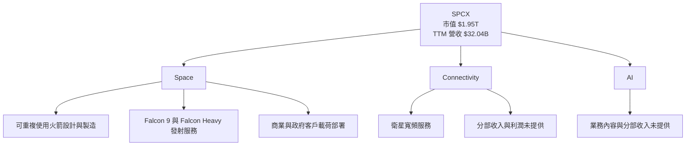
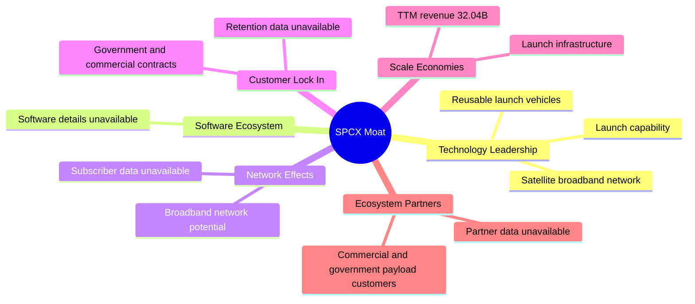
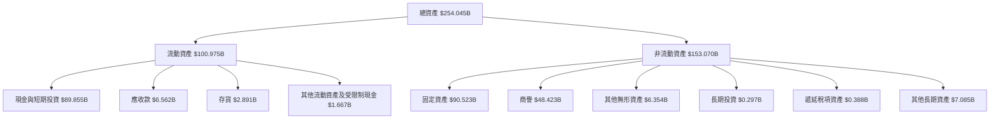
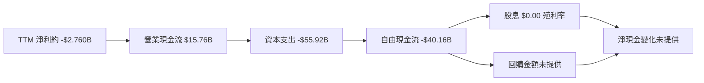
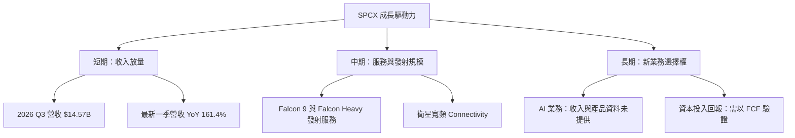
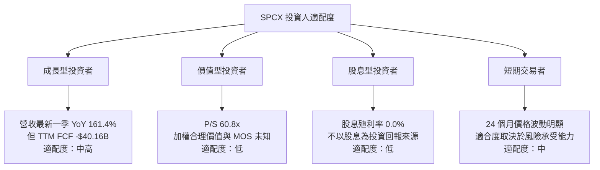

# SPCX 基本面深度分析報告
> **報告日期**：2026-11-19 ｜ **語言**：繁體中文 ｜ **數據來源**：Yahoo Finance、Finviz、StockAnalysis、Roic.ai ｜ **分析師**：CFA 級機構研究

## 目錄

| # | 章節 | 核心結論 |
|---|------|----------|
| 1 | 執行摘要 | 估值方法無法計算，故加權合理價值、MOS 與 MOS 評級均為 N/A；營收增長與投資強度同步放大 |
| 2 | 公司概覽與商業模式 | Space、Connectivity、AI 三項業務具戰略價值，但分部營收與市場份額未提供 |
| 3 | 損益表深度分析 | TTM 營收 $32.04B；最新一季年增 161.4%，TTM 營業利益率仍為 -2.0% |
| 4 | 資產負債表分析 | 淨現金 $50.64B、流動比率 3.084；資本投入與資產規模快速增加 |
| 5 | 現金流量深度分析 | TTM FCF -$40.16B、FCF Yield -2.06%；資本支出遠超營業現金流 |
| 6 | 獲利能力與資本效率 | ROIC N/A，無法判定是否創造價值；WACC 採用 9.94% |
| 7 | 相對估值分析 | SPCX Forward P/E 52.3x、P/S 60.8x；同業估值分散且多數倍數不具可比性 |
| 8 | DCF 內在價值評估 | DCF N/A：TTM 營業利益率為 -2.0%，且估值方法未能計算 |
| 9 | 成長催化劑 | 最新一季收入快速增長，但 TAM、分部貢獻及可驗證催化劑時間表未提供 |
| 10 | 風險矩陣 | 主要風險為高資本支出、盈餘波動與高估值；風險機率缺乏可量化資料 |
| 11 | 投資建議 | 不能由 MOS 門檻得出正式評級或價位區間；應以現金流與營業利潤率改善作為追蹤條件 |

---

## 1. 執行摘要

### 1.0 一頁式投資儀表板（Portfolio Manager 30 秒速讀）

| 項目 | 內容 |
|------|------|
| **投資論點（3 句）** | ① 最新一季營收年增 **161.4%**，顯示規模擴張速度高，但單季成長不能等同 TTM 成長。② TTM 營業利益率 **-2.0%**，但最新一季營業利益率 **1.8%**，顯示近期營運可能轉正，仍需後續季度驗證。③ TTM 資本支出 **$55.92B** 高於營業現金流 **$15.76B**，因此 TTM FCF 為 **-$40.16B**，成長伴隨顯著資金需求。 |
| **綜合評分** | **5.7/10**（引用 1.1 六項評分的算術平均；不等同投資評級） |
| **財務健康** | 🟢 現金與短期投資 **$89.86B**、總債務 **$39.22B**，淨現金 **$50.64B**；但 TTM FCF **-$40.16B**，現金緩衝與資本消耗須一併觀察。 |
| **ROIC vs WACC** | **ROIC：N/A vs WACC：9.94%**；ROIC 缺失，無法判定創造或摧毀價值。 |
| **FCF 趨勢** | TTM FCF **-$40.16B**；FCF Yield **-2.06%**。年度 FCF 從 2023 年 **+$0.105B** 轉為 2024 年 **-$5.39B**、2025 年 **-$14.12B**。 |
| **估值** | Forward P/E **52.3x** ｜ EV/EBITDA **161.7x** ｜ FCF Yield **-2.06%**。高倍數與負 FCF 令估值對執行風險高度敏感。 |
| **DCF 內在價值（基準）** | **N/A**；DCF 模型未計算，故無法計算相對現價的折溢價。 |
| **安全邊際（MOS）** | **N/A**；估值方法未能計算加權合理價值，不能以現價 **$143.50** 推算 MOS。 |
| **預期報酬（基準情境 12M）** | **N/A**；DCF 情境未提供，不設定目標價或預期報酬。 |
| **關鍵風險（前二）** | ① TTM 資本支出 **$55.92B** 對 FCF 造成 **-$40.16B** 缺口。② 最新一季強勁增長與全年虧損、季度盈利波動並存。 |
| **評級 + 信心度** | **MOS 評級：N/A**；因第 8.8 節無加權合理價值，不能套用規則 20。基本面判斷信心：**中低**，主要受財務口徑不一致與估值輸入缺失影響。 |

### 1.1 綜合評分卡（全報告唯一）

| 維度 | 評分（1–10） | 主要依據（引用數字與其來源章節） |
|------|--------------|----------------------------------|
| 成長性 | 8.5 | 最新一季營收年增 **161.4%**；2023–2025 年營收由 **$10.39B** 增至 **$18.67B**，兩年 CAGR 約 **34.1%**（第 3 章）。TTM 成長率按來源資料為 N/A。 |
| 獲利能力 | 3.0 | TTM 營業利益率 **-2.0%**、淨利率 **-8.6%**；最新一季營業利益率 **1.8%**。ROIC、F-Score 均 N/A（第 3、6 章）。 |
| 財務健康 | 8.0 | 淨現金 **$50.64B**、流動比率 **3.084**、速動比率 **2.945**；但 TTM FCF **-$40.16B**（第 4、5 章）。 |
| 估值 | 2.0 | P/S **60.8x**、Forward P/E **52.3x**、EV/EBITDA **161.7x**，且 FCF Yield **-2.06%**；合理價值與 MOS 無法計算（第 7、8 章）。 |
| 護城河 | 8.0 | 可重複使用火箭、發射服務及衛星寬頻網絡構成差異化資產；但缺少分部營收、客戶留存及市場份額數據（第 2 章）。 |
| 管理層與資本配置 | 4.5 | 年度 Capex 由 2023 年 **$4.42B** 增至 2025 年 **$20.91B**；2025 年 SBC **$1.95B**，未提供回購資料，資本回報成效尚未由 FCF 證明（第 3、5 章）。 |
| **綜合評分** | **5.7** | 六項算術平均：\((8.5+3.0+8.0+2.0+8.0+4.5)÷6=5.6667\)，四捨五入至一位小數為 **5.7**。 |

### 1.2 五大投資論點 + 三大核心風險

| 類型 | 項目 | 具體依據 | 信心度 |
|------|------|----------|--------|
| 🟢 **投資論點①** | 最新一季增長加速 | 最新一季營收 **$14.57B**，年增 **161.4%**；但該單季數字不能直接外推為長期增長率。 | 🟢 中 |
| 🟢 **投資論點②** | 最新季度營運轉正訊號 | 最新一季營業利益率 **1.8%**，高於 TTM **-2.0%**；若連續數季維持轉正，營業槓桿可能改善。 | 🟡 中 |
| 🟢 **投資論點③** | 淨現金提供投資緩衝 | 現金與短期投資 **$89.86B**、總債務 **$39.22B**、淨現金 **$50.64B**。 | 🟢 高 |
| 🟢 **投資論點④** | 毛利率較年度基期提高 | 毛利率由 2023 年約 **41.2%**、2024 年 **43.0%** 升至 2025 年 **49.4%**；產品組合或規模效應可能改善，但分部資料不足以驗證來源。 | 🟡 中 |
| 🟢 **投資論點⑤** | 業務具有多層次發展空間 | 公司概覽列出 Space、Connectivity、AI 三個業務板塊；但各板塊營收與盈利貢獻未提供，選擇權價值難以量化。 | 🟡 低 |
| 🟡 **風險①** | 高資本支出造成負 FCF | TTM Capex **$55.92B**、OCF **$15.76B**，FCF **-$40.16B**；若投資不能轉化為收入和現金回報，淨現金會被消耗。 | 🔴 高 |
| 🔴 **風險②** | 獲利與估值落差大 | TTM 營業利益率 **-2.0%**，但 P/S **60.8x**、EV/Revenue **59.2x**；估值依賴未來增長和利潤率提升。 | 🔴 高 |
| 🟡 **風險③** | 數據口徑和盈利波動 | 2026 年第三季營收在不同資料來源中一致約 **$14.575B**，但營業利益列報存在差異；EPS 預期值未提供，無法判定是否超預期。 | 🟡 中 |

### 1.3 快速統計卡片

| 指標 | 公司實際值（期間） | 同業中位數 | 狀態 |
|------|--------------------|------------|------|
| 營收成長（TTM） | **N/A** | — | 🟡 TTM 成長率未提供 |
| 營收成長（最新一季年增） | **161.4%** | **161.4%** | 🟢 與同業中位數相同 |
| 毛利率（TTM） | **56.8%** | **37.0%** | 🟢 高於提供的三家同業中位數 |
| 營業利益率（TTM） | **-2.0%** | — | 🔴 仍為負值 |
| ROIC（TTM） | **N/A** | — | 🟡 缺少可計算資料 |
| Forward P/E | **52.3x** | **31.1x** | 🔴 高於同業中位數；同業中含負值與極高值 |
| FCF Yield（TTM） | **-2.06%** | — | 🔴 負值 |
| Piotroski F-Score | **N/A / 9** | — | 🟡 缺少兩個相隔一年的 SEC 期間資料 |

> 同業中位數僅依第 7.1 節列出的 RKLB、ASTS、IRDM 數據計算；Forward P/E 中位數包含負數及極端倍數，因此可比性有限。

### 1.4 投資結論

```
╔══════════════════════════════════════════════════════════════════╗
║                    📊 投資結論摘要                               ║
╠══════════════════════════════════════════════════════════════════╣
║  評級：N/A（加權合理價值與 MOS 無法計算，不能套用規則 20）       ║
║  價格（2026-11-18 收盤）：$143.50                                ║
║  DCF 內在價值（基準）：N/A（DCF 模型未計算）                     ║
║  安全邊際 MOS：N/A（第 8.8 節沒有加權合理價值）                  ║
║  加權合理價值（8.8）：N/A（估值方法未能計算）                    ║
║  DCF 情境價值：N/A（未提供 DCF 情境）                            ║
║  綜合評分：5.7/10（引用 1.1）                                    ║
║  適合投資人：能承受高波動、理解高資本支出風險的長線成長型投資人  ║
╚══════════════════════════════════════════════════════════════════╝
```

---

## 2. 公司概覽與商業模式

### 2.1 業務結構與收入來源

公司概覽稱 SPCX 經營 **Space、Connectivity、AI** 三個板塊，並指出 Space 涵蓋可重複使用火箭設計、製造、發射及 Falcon 9、Falcon Heavy 發射服務。未提供各分部營收、分部盈利或百分比，故不推算占比。



市值及股數等市場數據存在口徑差異：市場資料列市值 **$1.95T**、股數 **8.25B**，而以收盤價 **$143.50 × 8.25B** 得到的市值並不等於所列市值。因此本報告不以股數反推市值，也不以不一致的市場數據建立估值。

### 2.2 市場份額

市場份額數據未提供，亦無可引用 TAM 或市場規模資料。可確認的公司規模指標為 TTM 營收 **$32.04B**、最新一季營收年增 **161.4%**；同業中 RKLB、ASTS 的最新一季營收年增分別為 **72.7%**、**187.1%**。但營收成長率不能直接代表市場份額變化。

### 2.3 競爭護城河分析



### 2.4 護城河強度

| 護城河項目 | 強度（強／中／弱） | 證據（引用數字或事實） | 會削弱它的情況 |
|------------|--------------------|------------------------|----------------|
| 技術與發射能力 | 強 | 公司提供可重複使用火箭、Falcon 9 與 Falcon Heavy 發射服務；但發射成本、成功率及競爭報價未提供。 | 技術替代、發射可靠性下降或競爭者降低發射成本。 |
| 衛星寬頻網絡 | 中 | 公司在美國、加拿大、愛爾蘭及國際市場提供衛星寬頻服務；用戶數、每戶收入及流失率未提供。 | 地面網絡替代、頻譜限制、容量不足或用戶流失增加。 |
| 軟體生態系統 | 弱／資料不足 | 公司概覽列出 AI 板塊，但產品、收入和客戶資料不足。 | 新業務長期未產生可驗證收入或現金流。 |
| 客戶鎖定 | 中 | 商業及政府客戶發射服務可能涉及長期規劃，但合約年期、續約率及集中度未提供。 | 客戶轉向替代供應商，或合約價格下降。 |
| 規模效應 | 強 | TTM 營收 **$32.04B**，最新一季年增 **161.4%**；但高 Capex 令規模經濟是否轉化為正 FCF 尚未證明。 | 資本投入持續快於營收及現金回報增長。 |
| 生態夥伴 | 中 | 公司服務商業與政府載荷客戶；夥伴數量與合作收入未提供。 | 合作集中度提高或主要客戶減少訂單。 |

第 1.1 節護城河評分 **8.0/10**，依據是發射與衛星寬頻資產具差異化，而非已有充分的市場份額、客戶留存或回報率證明。

---

## 3. 損益表深度分析

### 3.1 年度收入成長趨勢（近4年）

可取得的年度收入為 2023–2025 年三個年度，沒有第四年年度數據。年度增長率分別為：2024 年 \(14.015÷10.387-1=34.9\%\)；2025 年 \(18.674÷14.015-1=33.2\%\)。2023 至 2025 年 CAGR 約為 \((18.674÷10.387)^{1/2}-1=34.1\%\)。

```
╔══════════════════════════════════════════════════════════════════╗
║                 SPCX 年度收入趨勢（FY2023–FY2025）               ║
╠══════════════════════════════════════════════════════════════════╣
║  FY2023  $10.39B  ███████████░░░░░░░░░  YoY：基期             ║
║  FY2024  $14.02B  ███████████████░░░░░  YoY：+34.9% 🟢       ║
║  FY2025  $18.67B  ████████████████████  YoY：+33.2% 🟢       ║
║                                                                  ║
║  2023–2025 營收 CAGR：約 +34.1%                                  ║
╚══════════════════════════════════════════════════════════════════╝
```

兩年收入增長速度相近，顯示年度營收基礎擴大；但最新年度營業利益由 2024 年 **+$0.742B** 轉為 2025 年 **-$2.064B**，表示收入擴張沒有同步轉化為年度營業獲利。年度 R&D 由 2024 年 **$3.46B** 增至 2025 年 **$8.64B**，可能是成本上升因素之一，但資料不足以將全部營業虧損歸因於研發支出。

### 3.2 季度收入趨勢分析

QoQ 以同一資料列的季度營收計算；YoY 採用來源提供的單季成長率。未提供的 YoY 不以其他期間數字補推。

| 季度 | 營收 | QoQ 成長 | YoY 成長 | 備註 |
|------|------:|---------:|---------:|------|
| 2025 Q4 | $4.96B | N/A | N/A | 缺少前一季與同季完整可比資料。 |
| 2026 Q1 | $4.69B | -5.4% | 15.4% | QoQ：\(4.694÷4.960-1=-5.4\%\)；YoY 為單季率。 |
| 2026 Q2 | $7.81B | +66.5% | 91.9% | QoQ：\(7.814÷4.694-1=66.5\%\)。 |
| 2026 Q3 | $14.57B | +86.5% | 161.4% | QoQ：\(14.575÷7.814-1=86.5\%\)；161.4% 是最新一季年增，不是 TTM 成長率。 |

季度營收連續放大，但季度間的躍升幅度很大。若有業務組合、合約驗收或確認時點差異，單季年增率可能不能代表可持續的訂閱或經常性收入趨勢；目前資料未提供分部與收入確認細節。

### 3.3 利潤率演變分析

| 利潤率指標 | FY2023 | FY2024 | FY2025 | TTM／最新一季 | 趨勢與評估 |
|------------|-------:|-------:|-------:|---------------:|------------|
| **毛利率** | 41.2% | 42.9% | 49.4% | TTM 56.8% | ↗️ 年度毛利率上升，TTM 進一步提高；但分部組合與成本細項未提供。 🟢 |
| **營業利益率** | 4.9% | 5.3% | -11.1% | TTM -2.0%；最新一季 1.8% | 2025 年明顯轉弱，TTM 仍虧損；最新季度轉正是改善訊號，但須確認持續性。 🔴 |
| **淨利率** | -44.6% | 5.6% | -26.4% | TTM -8.6% | 盈利高度波動，淨利受營業損益與可能的非營業項目影響；缺少調節明細。 🔴 |
| **EBITDA 利潤率** | -6.4% | 40.3% | 23.7% | TTM 36.6% | TTM 高於 2025 年年度值，但 EBITDA 與營業利益差異大；折舊攤銷 TTM 為 $10.851B。 🟡 |

毛利率改善與營收增長相伴，可能反映產品組合或規模效應；但營業利益率由 FY2024 **5.3%** 降至 FY2025 **-11.1%**，說明毛利改善未抵銷營業費用增長。2025 年 R&D 為 **$8.64B**，高於 2024 年 **$3.46B**；此項支出增加與營業轉虧同時發生，但沒有足夠明細把利潤率變化完全歸因於單一費用類別。

> 來源口徑差異：2026 Q3 的季度損益資料在不同來源中對營業利益列報不同；本報告使用已核定的最新季度營業利益率 **1.8%**，不以另一來源的季度營業利益金額覆蓋該比率。

### 3.4 費用結構分析

完整 TTM 期間的銷售、管理、研發、折舊及其他營業費用明細未提供，因此不製作費用組成圓餅圖，也不將單一年度 R&D 數字當作 TTM 費用結構。可核對的數字是 FY2025 R&D **$8.64B**，約占 FY2025 營收 **46.3%**（\(8.64÷18.674\)）；該比率僅代表年度研發費用相對年度營收，不代表所有費用占比。

### 3.5 季度 EPS 趨勢與盈餘品質（Quality of Earnings）

EPS 實際值採用 Roic.ai 季度序列，四季 EPS 預期值及 surprise 數據未提供。來源中的 earnings history 三季預估與實際值均為 NaN，不能據此判斷超預期或不及預期。

| 季度 | EPS 實際 | 預期／Surprise | 盈餘表現說明 |
|------|---------:|----------------|--------------|
| 2025 Q4 | -$0.18 | N/A | 虧損；無 EPS 預期值。 |
| 2026 Q1 | -$0.47 | N/A | 虧損；無 EPS 預期值。 |
| 2026 Q2 | -$0.09 | N/A | 虧損收窄；無 EPS 預期值。 |
| 2026 Q3 | +$0.37 | N/A | 轉為正值；無 EPS 預期值，不能判定是否超預期。 |

盈餘品質項目以年度與最近四季數據分開呈現；不同來源的 TTM 淨利口徑不完全一致，故現金轉換率只作方向性解讀。

| 盈餘品質項目 | 數值／佔比 | 評估 |
|--------------|-----------|------|
| 股權薪酬 SBC / 營收 | 最近四季 SBC 合計 **$4.733B ÷ TTM 營收 $32.04B = 14.8%** | 🔴 比例高，SBC 雖非當期現金流出，仍會稀釋股東持有比例；需追蹤股數變化。 |
| SBC / 營業現金流 | **$4.733B ÷ $15.76B = 30.0%** | 🟡 SBC 相當於 OCF 的近三成，若忽略會高估股東可取得的經濟回報。 |
| FCF / 淨利（現金轉換率） | FCF **-$40.16B**；TTM 淨利約 **-$2.76B**（Roic.ai）；算術比率約 **14.6x** | 🔴 分子與分母均為負，正的算術比率沒有通常的現金轉換含義；應直接看負 FCF。 |
| 一次性／非經常性損益 | N/A | 未提供足以分辨一次性損益的調節資料，不能判定季度轉盈是否含一次性因素。 |
| 有效稅率異常 | N/A | TTM 有效稅率資料未提供；DCF 採用的 21% 只是資本成本輸入中的預設稅率，不代表 SPCX 實際稅率。 |
| 資本化支出 vs 費用化 | TTM Capex **$55.92B**；TTM D&A **$10.851B** | Capex 遠高於折舊攤銷，代表資產投入快速增加；無法判定資本化政策是否造成盈餘遞延。 |

**盈餘品質結論**：季度 EPS 從負轉正，但 TTM 淨利仍為負，TTM FCF **-$40.16B**，且 SBC 約為 TTM 營收 **14.8%**。因此單季正 EPS 尚未證明整體經濟盈餘已穩定；目前更應以營業利益率、資本支出回報與稀釋股數趨勢驗證盈利質量。

---

## 4. 資產負債表分析

### 4.1 資產結構分解

最新 TTM 資產負債表總資產為 **$254.045B**。以下金額按資料列示，細項相加與總資產一致。



### 4.2 流動性與營運資金分析

| 指標 | 最新值 | 歷史比較 | 評估 |
|------|-------:|----------|------|
| 流動比率 | **3.084** | FY2025 流動資產 $30.95B、流動負債 $21.40B；與 TTM 口徑不同，不直接重算趨勢 | 🟢 流動資產對短期負債有緩衝。 |
| 速動比率 | **2.945** | 同上，未提供完全同口徑歷史比率 | 🟢 高於 1，顯示短期流動性較充足。 |
| 現金與短期投資 | **$89.86B** | FY2025 現金 $24.75B；TTM 含短期投資，口徑不同 | 🟢 流動性資源增長，但應連同高 Capex 評估。 |
| 淨現金 | **$50.64B** | 依現金與短期投資減總債務 | 🟢 為再投資提供緩衝。 |

營運資金天數照錄品質指標；一年前數值未提供，變化欄不自行反推。

| 指標 | 最新 TTM | 一年前 TTM | 變化 | 解讀 |
|------|----------:|-----------:|------|------|
| DSO 應收帳款天數 | 54 天 | N/A | N/A | 收款天數可供後續比較，但目前無法判斷是否惡化。 |
| DIO 存貨天數 | 76 天 | N/A | N/A | 存貨天數與生產及需求節奏有關，缺少歷史值不能判斷堆積趨勢。 |
| DPO 應付帳款天數 | 349 天 | N/A | N/A | 數值偏長，可能反映付款週期與供應商信用安排；沒有合約及歷史資料，不能直接推斷議價力。 |
| CCC 現金轉換週期 | -219 天 | N/A | N/A | 負 CCC 表示按所用計算口徑，公司營運資金現金循環較有利；缺少比較期，趨勢未知。 |

### 4.3 債務結構分析

```
╔══════════════════════════════════════════════════════════════════╗
║                   SPCX 債務健康診斷                              ║
╠══════════════════════════════════════════════════════════════════╣
║  總債務：              $39.22B    已提供數據                     ║
║  現金＋短期投資：      $89.86B    高於總債務                     ║
║  淨現金：              $50.64B    🟢                              ║
║                                                                  ║
║  流動比率：            3.084     🟢                              ║
║  速動比率：            2.945     🟢                              ║
║  Debt/EBITDA：         N/A       EBITDA 口徑與債務資料不宜硬配對 ║
║  利息保障倍數：        N/A       利息費用明細未提供              ║
╚══════════════════════════════════════════════════════════════════╝
```

淨現金為正是資產負債表優勢，但不等於自由現金流為正。TTM Capex **$55.92B**、FCF **-$40.16B**，若投入持續，淨現金仍會承受現金流消耗。

### 4.4 股東權益趨勢

只列有完整年度資料的股東權益；TTM 權益來源列示為 **$176.768B**，與 FY2025 年報列示 **$41.33B** 差距甚大，可能涉及資料口徑或股本項目變化，故不將兩者連成可比趨勢。

```
╔══════════════════════════════════════════════════════════════════╗
║                   SPCX 股東權益趨勢                              ║
╠══════════════════════════════════════════════════════════════════╣
║  FY2024  $25.80B  █████████████░░░░░░░░░░                         ║
║  FY2025  $41.33B  █████████████████████░░░                        ║
║  TTM     $176.77B 資料口徑與年度值差異大，不作同尺度比較         ║
║                                                                  ║
║  FY2024 → FY2025 增加約 $15.53B；原因不能由現有資料完整拆解。  ║
╚══════════════════════════════════════════════════════════════════╝
```

---

## 5. 現金流量深度分析

### 5.1 現金流量瀑布圖

TTM 淨利按 Roic.ai 約 **-$2.760B**，營業現金流 **$15.76B**，資本支出 **$55.92B**，FCF **-$40.16B**。股息殖利率為 **0.0%**；回購金額及淨現金變化未提供。



### 5.2 FCF 轉換率趨勢

| 年度 | 營業現金流 | Capex | FCF | 淨利 | FCF／淨利 |
|------|-----------:|------:|----:|-----:|----------:|
| 2023 | $4.52B | $4.42B | $0.105B | -$4.63B | 約 -2.3%* |
| 2024 | $5.78B | $11.16B | -$5.39B | $0.791B | 約 -681.4% |
| 2025 | $6.79B | $20.91B | -$14.12B | -$4.94B | 約 286.0%* |
| TTM | $15.76B | $55.92B | -$40.16B | 約 -$2.76B | 約 14.6x* |

\* 淨利為負時 FCF/淨利比率不具一般轉換率解讀；2025 年與 TTM 比率同樣受負分母或來源口徑影響。核心趨勢是 Capex 快速增加，FCF 缺口擴大。

### 5.3 自由現金流趨勢

年度 FCF 按現金流量表列示；TTM FCF 使用 OCF 減 Capex 的核定口徑。

```
╔══════════════════════════════════════════════════════════════════╗
║                 SPCX 自由現金流趨勢                              ║
╠══════════════════════════════════════════════════════════════════╣
║  FY2023  +$0.105B  ▏                                             ║
║  FY2024  -$5.39B   █████                                         ║
║  FY2025  -$14.12B  ██████████████                                ║
║  TTM     -$40.16B  ████████████████████████████████████████      ║
║                                                                  ║
║  TTM FCF Yield：-2.06%                                           ║
║  FCF 惡化主要與 Capex 由 FY2023 $4.42B 增至 FY2025 $20.91B 有關 ║
╚══════════════════════════════════════════════════════════════════╝
```

### 5.4 資本配置評估

資本配置的圓餅比例資料未提供，故不製作比例圖。

| 資本配置項目 | 可核對數據 | 評估 |
|--------------|-----------|------|
| Capex | FY2023 **$4.42B**、FY2024 **$11.16B**、FY2025 **$20.91B**；TTM **$55.92B** | 🔴 投資額快速增長，未來應以新增產能、收入與現金回報追蹤成效。 |
| 研發 | FY2025 **$8.64B**，FY2024 **$3.46B** | 🟡 投資力度上升，但可貨幣化成果與專案拆分未提供。 |
| 股息 | 殖利率 **0.0%** | 不以股息回饋股東。 |
| 回購 | N/A | 回購金額未提供，不推斷是否有回購。 |
| 留存／現金 | 現金與短期投資 **$89.86B** | 🟢 保有充足帳面流動性，但負 FCF 會消耗資金。 |

---

## 6. 獲利能力與資本效率

### 6.1 ROE / ROA / ROIC 趨勢

| 指標 | FY2023 | FY2024 | FY2025 | TTM | 評估 |
|------|-------:|-------:|-------:|----:|------|
| ROE | N/A | N/A | N/A | N/A | 權益與淨利資料口徑不足以提供一致比率。 |
| ROA | N/A | N/A | N/A | N/A | QUALITY FIGURES 判定缺少完整一致的淨利及資產輸入。 |
| ROIC | N/A | N/A | N/A | N/A | Roic.ai 歷史欄位未提供可用 ROIC。 |
| ROIC 參考門檻 WACC | — | — | — | **9.94%** | ROIC 缺失，不可判定是否超過資本成本。 |

### 6.2 ROIC vs WACC 分析（核心價值創造判斷）

資本成本輸入採用已核定數值。Beta 原始值為 N/A，調整後 Beta 使用 **1.00**；成本資料區塊將其標示為假設值。由於 ROIC 為 N/A，EVA 與 ROIC/WACC 倍數亦不能計算。

```
╔══════════════════════════════════════════════════════════════════╗
║                ROIC vs WACC 深度分析                            ║
╠══════════════════════════════════════════════════════════════════╣
║  WACC 輸入：                                                     ║
║  ├── 無風險利率（10Y 美債）：       5.07%                        ║
║  ├── 市場風險溢酬 ERP：             5.00%（假設值）              ║
║  ├── Beta（Yahoo 原始）：           N/A                          ║
║  ├── 調整後 Beta：                  1.00（假設值）               ║
║  ├── 股權成本 Ke：                  10.07%                       ║
║  ├── 稅前債務成本：                 4.96%                        ║
║  ├── 預設稅率：                     21.0%                        ║
║  ├── 股權／債務權重：               98.0%／2.0%                 ║
║  └── 採用 WACC：                    9.94%                        ║
║                                                                  ║
║  ROIC：N/A；NOPAT 與投入資本的同口徑資料不足。                  ║
║  EVA = ROIC − WACC：N/A                                          ║
║                                                                  ║
║  結論：無法判定 SPCX 正在創造或摧毀股東價值。                   ║
║  需補充可比期間的 ROIC，並與 9.94% WACC 比較。                   ║
╚══════════════════════════════════════════════════════════════════╝
```

提供的 WACC 各組成存在四捨五入尾差：按顯示權重計算 \(98.0\%×10.07\%+2.0\%×[4.96\%×(1-21.0\%)]=9.947\%\)，四捨五入為 9.95%，與核定值 **9.94%** 相差約 0.01 個百分點。本報告依規則直接採用核定 WACC **9.94%**，不另建折現率。

### 6.3 杜邦三因素分解

| 因素 | 數值（TTM） | 解讀 |
|------|-------------|------|
| 淨利率 | N/A | QUALITY FIGURES 的 DuPont 判定為 N/A；其他來源淨利率列示 -8.6%，但不能組成核定三因素分解。 |
| 資產週轉率 | N/A | 缺少一致的總資產及營收期間輸入。 |
| 權益乘數 | N/A | 股東權益來源口徑差異大，未填補或自行計算。 |
| **ROE** | **N/A** | QUALITY FIGURES 指出缺少可用淨利、營收、總資產或正權益資料，不能完成杜邦乘積。 |

### 6.4 財務體質：Piotroski F-Score

Piotroski F-Score 為 **N/A**：缺少相隔一年的兩個 TTM SEC 申報期間。九項測試的單項結果也未提供，因此不虛構測試結果。

| 測試 | 結果 | 解讀 |
|------|------|------|
| 盈利能力與現金流測試（各項） | N/A | 缺少可用的 SEC 兩期數據，不能判斷各項是否通過。 |
| 槓桿、流動性與融資測試（各項） | N/A | 無法依核定 F-Score 工作表逐項確認。 |
| 營運效率測試（各項） | N/A | 無法依核定 F-Score 工作表逐項確認。 |
| **F-Score** | **N/A / 9** | 不能據此評估財務品質變化。 |

---

## 7. 相對估值分析

### 7.1 同業估值比較表格

競爭對手倍數只採 Yahoo Finance 列示資料。不同公司盈利狀態差異大，負 P/E 或負 EV/EBITDA 不適合視為可直接套用的估值錨。

| 估值指標 | **SPCX** | **RKLB** | **ASTS** | **IRDM** | SPCX 評估 |
|----------|--------:|---------:|---------:|--------:|-----------|
| **Trailing P/E** | **623.9x** | N/A | N/A | 28.8x | 🔴 SPCX 絕對倍數高；同業僅 IRDM 有有效正 P/E。 |
| **Forward P/E** | **52.3x** | 741.4x | -16.3x | 31.1x | 🟡 SPCX 低於 RKLB，但高於 IRDM；ASTS 為負值，三者盈利可比性有限。 |
| **P/S Ratio** | **60.8x** | 40.5x | 69.6x | 5.2x | 🔴 SPCX 高於同業中位數 **40.5x**。 |
| **EV/EBITDA** | **161.7x** | -169.0x | -19.5x | 17.2x | 🔴 SPCX 倍數偏高；兩家同業為負值，中位數亦不具經濟意義。 |
| **最新一季營收 YoY** | **161.4%** | 72.7% | 187.1% | 8.3% | 🟢 SPCX 高於 RKLB、IRDM，低於 ASTS。 |
| **毛利率（TTM）** | **56.8%** | 36.2% | 37.0% | 71.5% | 🟢 高於 RKLB、ASTS，低於 IRDM。 |

### 7.2 歷史估值區間分析

N/A（未提供可引用的「Valuation vs own history」估值區間或百分位數據）。不以目前 P/E 或價格走勢反推歷史估值百分位。

### 7.3 情境價值（Bear / Base / Bull）

N/A（DCF 無法計算：TTM 營業利益率為 **-2.0%**，核定 DCF 模型未提供情境價值）。不自行設定悲觀、基準或樂觀目標價。

### 7.4 相對估值隱含價格區間

N/A（VALUATION METHODS 未能計算任何每股價值）。雖然提供了同業倍數，但缺少可依公司類型固定權重處理的完整相對估值結果；本報告不自行選取倍數或反推每股價格。

---

## 8. DCF 內在價值評估（Discounted Cash Flow）

> **核定結論：DCF MODEL 為 N/A。** 核定原因為 TTM 營業利益率不為正（**-2.0%**），以虧損營業基礎直接向前折現不具可靠估值意義。因此以下模型輸入、逐年現金流、終值、橋接、敏感度與反推 DCF 均不自行建模。

### 8.0 估值推理鏈（Thinking Logic：在算之前先想清楚）

**Step 1 — 價值由哪些變數決定？**

SPCX 的潛在價值可能來自發射與 Space 業務、衛星寬頻 Connectivity，以及 AI 新業務；但分部營收及占比未提供，不能量化各自的價值或把某一業務假定為主要估值驅動。現有可核對的基礎只有 TTM 營收 **$32.04B**、TTM 營業利益率 **-2.0%**、TTM FCF **-$40.16B**。

**Step 2 — 模型選擇**

| 決策點 | 本報告採用 | 理由（含數字） | 曾考慮但否決 | 否決理由 |
|--------|-----------|----------------|--------------|----------|
| 現金流定義 | N/A | 核定 DCF 未計算；TTM 營業利益率 **-2.0%**。 | FCFF／FCFE 模型 | 不另建模型。 |
| 預測期 N | N/A | 核定模型未提供預測年數。 | 任意設定年數 | 缺少可核對的營運預測。 |
| 終值方法 | N/A | 核定模型未提供終值假設。 | Gordon Growth、退出倍數 | 不可自行建立 DCF 終值。 |
| EBIT 基礎 | N/A | 不執行 DCF 預測。 | GAAP／非 GAAP EBIT | 不自行指定未來盈利基礎。 |

**Step 3 — 關鍵假設推導鏈**

營收 CAGR、期末營業利潤率、永續成長率、預測期、Capex 比率、D&A 比率、營運資金變動、SBC 處理、股數稀釋、終值與 WACC 情境均為 **N/A**，因核定 DCF MODEL 未提供可照錄的假設與逐年數據。此處不以歷史增長率替代模型輸入。

**Step 4 — 最脆弱的一環**

最脆弱之處是缺少可以驗證的持續盈利及現金流預測；在 TTM FCF **-$40.16B** 且 TTM 營業利益率 **-2.0%** 的背景下，無法可靠量化盈利轉正時間與資本開支回報，故不給 DCF 價值。

**Step 5 — 計算路徑圖**

不繪製數值路徑圖，因營收預測、利潤率、逐年 FCFF、終值及股數橋接均未由核定模型提供。若繪出數字將構成自建模型。

### 8.1 模型假設總表（Model Inputs）

| 假設項目 | 採用值 | 依據／來源 | 敏感度 |
|----------|--------|-------------|--------|
| 預測期長度 N | N/A | 核定 DCF MODEL 為 N/A，未提供預測年數。 | N/A |
| 營收 CAGR | N/A | TTM 營收成長率為 N/A；最新一季年增 161.4% 不是 TTM 成長率，亦不能代替長期預測。 | N/A |
| 營業利潤率 | N/A | TTM 營業利益率 -2.0%，核定模型拒絕以虧損基礎折現。 | N/A |
| 有效稅率 | N/A | 21.0% 是資本成本輸入中的預設稅率，不是 SPCX 實際有效稅率；不移作 DCF 假設。 | N/A |
| Capex／營收 | N/A | 有 TTM Capex $55.92B 與營收 $32.04B，但核定模型未提供預測比率；不自行外推。 | N/A |
| D&A／營收 | N/A | TTM D&A $10.851B，但未提供模型假設。 | N/A |
| 營運資金變動／收入增額 | N/A | 缺少模型假設與可比歷史變化序列。 | N/A |
| EBIT 基礎 | N/A | 未執行 DCF。 | N/A |
| SBC 處理 | N/A | 不建構 DCF，故不宣稱採用 A、B 或 C。 | N/A |
| 年稀釋率 | N/A | 不以來源股數差異反推未來稀釋率。 | N/A |
| 永續成長率 g | N/A | 核定模型未提供；不自行設定。 | N/A |
| 終值方法 | N/A | 核定模型未提供。 | N/A |
| WACC | **9.94%** | 直接採用核定 Cost of capital 數值；第 6.2 節同值。 | 不適用於未執行的 DCF |

### 8.2 折現率推導（WACC）

核定資本成本資料如下。Beta 原始值缺失，調整後 Beta **1.00** 為假設輸入；WACC 採用數值 **9.94%**。由於 DCF 為 N/A，本節只核對資本成本輸入，不將其套入自建估值。

```
╔══════════════════════════════════════════════════════════════════╗
║                    WACC 輸入（核定值）                           ║
╠══════════════════════════════════════════════════════════════════╣
║  無風險利率（10Y 美債）：       5.07%                            ║
║  市場風險溢酬 ERP：             5.00%（假設值）                  ║
║  原始 Beta（Yahoo）：           N/A                              ║
║  調整後 Beta：                  1.00（假設值）                   ║
║  股權成本 Ke：                  10.07%                           ║
║  稅前債務成本：                 4.96%                            ║
║  預設稅率：                     21.0%                            ║
║  股權／債務權重：               98.0%／2.0%                     ║
║  採用 WACC：                    9.94%                            ║
╚══════════════════════════════════════════════════════════════════╝
```

核定輸入給出的 CAPM 算式為 \(5.07\%+1.00×5.00\%=10.07\%\)。債務稅後成本可由核定輸入寫為 \(4.96\%×(1-21.0\%)\)，但 WACC 本身直接採用核定 **9.94%**，不以四捨五入後的顯示分項重新替換。第 6.2 節也採用 **9.94%**，兩處一致。

### 8.3 逐年自由現金流預測（基準情境）

N/A（核定 DCF MODEL 未提供預測期、逐年營收、利潤率、FCFF、折現因子或 PV）。不建立逐年預測表或推算示範年度。

### 8.4 終值計算（Terminal Value）

N/A（核定 DCF MODEL 未提供永續成長率、期末 FCFF 或退出倍數；不能檢驗 WACC 與 g 的大小，也不能計算終值及折現值）。

### 8.5 企業價值 → 每股內在價值（Bridge）

N/A（缺少預測期 FCFF PV 合計及終值現值。雖然有現金與短期投資 **$89.86B**、總債務 **$39.22B**，但沒有可橋接的企業價值，亦沒有核定稀釋股數基準供 DCF 每股計算）。

- DCF 基準內在價值：**N/A**
- 2026-11-18 收盤價：**$143.50**
- DCF 折溢價：**N/A**
- **本節不計算 MOS**；MOS 的分母須為第 8.8 節加權合理價值，而該數值亦為 N/A。

### 8.6 敏感性分析（WACC × 永續成長率）

N/A（核定模型沒有敏感性矩陣；不得自行補建格子、情境價值或機率加權結果）。

### 8.7 反推 DCF（Reverse DCF：市場在預期什麼）

N/A（缺少基準 DCF、逐年現金流及固定模型輸入，故不能以現價 **$143.50** 反解單一變數或列出收斂軌跡）。不能據此判斷市場隱含營收 CAGR、期末利潤率或持續增長年數。

### 8.8 估值三角驗證與安全邊際

核定估值方法列明 **None could be computed**。分析師共識目標價為平均 **$257.50**、低 **$70.00**、高 **$800.00**，共 **37** 位分析師；這是市場共識資料，不是核定估值方法輸出，不能納入加權合理價值或取代 MOS。

| 估值方法 | 隱含每股價值 | 上行空間（÷現價） | 權重 | 說明 |
|----------|--------------|-------------------|------|------|
| 可計算估值方法 | N/A | N/A | N/A | 核定估值方法未能計算；缺少可用方法值與固定權重輸出。 |
| **加權合理價值** | **N/A** | **N/A** | **N/A** | 不計算加權合理價值、MOS 或 MOS 評級。 |

- **加權合理價值算式**：N/A；沒有可計算的方法值與權重，不以分析師共識目標價代填。
- **安全邊際 MOS**：N/A，因為加權合理價值不存在。
- **上行空間**：N/A，不能以分析師平均目標價冒充本報告的加權合理價值。
- **買入區間、合理持有區間、減碼區間**：N/A；不以未驗證的目標價設定交易價位。

### 8.9 DCF 模型的局限與失效條件

- **終值依賴度**：N/A，沒有可計算的企業價值與終值。
- **最脆弱假設**：若未來營業利益率無法持續轉正，或 Capex 長期高於營業現金流，價值會低於樂觀增長敘事所隱含的水平；量化跌幅 N/A。
- **不適用情境說明**：公司 TTM FCF **-$40.16B**、TTM 營業利益率 **-2.0%**，且盈利波動大，標準 DCF 的可靠度低。更合適的補充方式包括 EV/Sales、分部估值、單位經濟性，以及新投資項目的資本回報分析，但現有資料不足以完成這些估值。
- **與第 10 章風險矩陣的連結**：Capex 高於現金生成能力會影響自由現金流；營收增長回落會削弱收入基礎；營業利益率未能改善會推遲盈虧平衡。

### 8.10 複算檢核表（Audit Trail：輸出前自我驗算）

| # | 檢核項目 | 檢查方式 | 結果 |
|---|----------|----------|------|
| 1 | 高／中敏感度輸入是否有四段式推導 | DCF MODEL 為 N/A，沒有可用假設值 | ✅ 已標示 N/A，未虛構推導 |
| 2 | 每個假設是否有來歷 | 8.1 逐項列出未提供原因 | ✅ |
| 3 | WACC 算式及權重 | 採用核定 WACC 9.94%；顯示分項重算有約 0.01pp 尾差 | ✅ 已揭露並未替換核定值 |
| 4 | Kd 分母與債務權重範圍 | 不以總債務之外的數據重建利息或權重 | ✅ 未自行重算 |
| 5 | WACC 與第 6.2 節相同 | 兩處均為 9.94% | ✅ |
| 6 | 逐年預測年度數 | 預測期未提供，DCF N/A | ✅ 不建立虛構年度表 |
| 7 | FY+1 演算 | 核定模型無 FY+1 數字 | ✅ 標示 N/A |
| 8 | 預測期 PV 加總 | 沒有逐年 PV | ✅ 標示 N/A |
| 9 | WACC > g | g 未提供 | ✅ 標示 N/A |
| 10 | 終值基期及折現期 | 沒有終值輸入 | ✅ 標示 N/A |
| 11 | EV 至每股價值橋接 | 缺少 EV 與 DCF 稀釋股數輸入 | ✅ 標示 N/A |
| 12 | SBC 組合相容性 | 未執行 DCF，不指定 A／B／C | ✅ 不宣稱模型已處理 SBC |
| 13 | 敏感性矩陣基準格 | 核定模型沒有矩陣 | ✅ 標示 N/A |
| 14 | 矩陣有效格檢查 | 沒有矩陣 | ✅ 標示 N/A |
| 15 | 三情境機率加總 | 沒有 DCF 情境 | ✅ 標示 N/A |
| 16 | 反推 DCF 單變數收斂 | 缺少基準模型 | ✅ 標示 N/A |
| 17 | MOS 分母與折溢價基準 | 無加權合理價值與 DCF 價值 | ✅ MOS、折溢價均不計 |
| 18 | 報告完整至第 11 章 | 章節 1–11 均輸出 | ✅ |
| 19 | 加權合理價值加總 | 無方法價值及權重 | ✅ 不計算 |
| 20 | 評級符合 MOS 門檻 | MOS 不可計算，無法使用門檻 | ✅ 評級標示 N/A |

---

## 9. 成長催化劑

### 9.1 催化劑時間軸

N/A（近期新聞與可引用的產品推出日期、合約里程碑或管理層財測未提供，故不製作帶有推測日期的時間軸）。可觀察的近期指標是 2026 Q3 營收 **$14.57B**、年增 **161.4%**；未來須確認此增長是否延續並轉化為正營業現金流。

### 9.2 TAM 市場規模分析

N/A（TAM 數據未提供）。SPCX TTM 營收為 **$32.04B**，最新一季營收年增 **161.4%**，說明收入規模及近期增長均有擴張；但在缺少市場總額、分部營收與滲透率資料時，不能量化可服務市場或市場滲透程度。

### 9.3 成長驅動力結構圖

以下區分已披露業務與尚待驗證因素，不對未提供的收入貢獻作比例估計。



---

## 10. 風險矩陣

### 10.1 風險評分矩陣

財務資料未提供各項風險的發生機率或量化衝擊估算。為避免將主觀概率包裝成數據，本報告不使用帶數值座標的 quadrantChart；以下按可觀察的財務曝險分類。

| 優先級 | 風險 | 主要證據 |
|--------|------|----------|
| 🔴 高 | 資本支出與自由現金流 | TTM Capex **$55.92B**，OCF **$15.76B**，FCF **-$40.16B**。 |
| 🔴 高 | 盈利與估值落差 | TTM 營業利益率 **-2.0%**，P/S **60.8x**、EV/Revenue **59.2x**。 |
| 🟡 中高 | 季度盈利波動與數據口徑 | 四季 EPS 由負轉正但波動大；EPS surprise 資料未提供。 |
| 🟡 中 | SBC 稀釋 | 最近四季 SBC 約 **$4.733B**，約為 TTM 營收的 **14.8%**。 |
| 🟡 中 | 業務組合與資訊不足 | Space、Connectivity、AI 的分部營收、利潤及 TAM 均未提供。 |

### 10.2 風險清單詳細分析

| # | 風險項目 | 發生機率 | 財務衝擊 | 風險評分 | 緩解措施 |
|---|----------|----------|----------|----------|----------|
| 1 | 🔴 **資本支出高於現金生成能力** | N/A（無概率數據） | 已觀察到 TTM FCF **-$40.16B**；未來衝擊幅度 N/A | 高優先級，非數值評分 | 每季追蹤 Capex、OCF、FCF、現金餘額及新增資產產生的收入。 |
| 2 | 🔴 **估值依賴未來增長與盈利改善** | N/A | 目前 P/S **60.8x**、EV/Revenue **59.2x**；估值回落幅度無法預測 | 高優先級，非數值評分 | 以連續季度營業利益率、收入成長及 FCF 改善驗證估值。 |
| 3 | 🟡 **盈餘波動及一次性項目不透明** | N/A | FY2025 淨虧損 **$4.94B**，最新一季淨利 **$4.40B**；原因尚不能完整拆解 | 中高優先級 | 要求追蹤 GAAP 淨利、營業利益、一次性項目與稅率調節。 |
| 4 | 🟡 **SBC 造成股東稀釋** | N/A | 最近四季 SBC 約 **$4.733B**；股數資料來源間有差異 | 中優先級 | 監控稀釋股數、SBC／營收及股份回購是否抵銷稀釋。 |
| 5 | 🟡 **分部與市場資料不足** | N/A | 無法按 Space、Connectivity、AI 分析增長與毛利貢獻 | 中優先級 | 追蹤分部收入、營業利潤、用戶數、客戶集中度及合約 backlog。 |

---

## 11. 投資建議

### 11.1 最終評級與評分

**MOS 評級為 N/A**：第 8.8 節沒有可計算的加權合理價值，因此無法依規則 20 得出強烈買入、買入、持有、減碼或賣出，也沒有進行一級調整。公司品質綜合評分為 **5.7/10**，六項分數依序為成長性 **8.5**、獲利能力 **3.0**、財務健康 **8.0**、估值 **2.0**、護城河 **8.0**、管理層與資本配置 **4.5**；此分數不取代評級。

### 11.2 合理價值與隱含報酬率

| 估值項目 | 每股價值 | 相對 2026-11-18 收盤價 $143.50 | 機率／說明 |
|----------|---------:|------------------------------:|------------|
| 加權合理價值 | N/A | N/A | 估值方法未能計算。 |
| DCF 悲觀情境 | N/A | N/A | DCF 情境未提供。 |
| DCF 基準情境 | N/A | N/A | DCF 情境未提供。 |
| DCF 樂觀情境 | N/A | N/A | DCF 情境未提供。 |

### 11.3 買入時機與觸發因素

因合理價值與 MOS 均不可計算，以下是基本面監控條件，不代表已設定的買入價位。

```
╔══════════════════════════════════════════════════════════════════╗
║                  ✅ 基本面觸發因素 Checklist                     ║
╠══════════════════════════════════════════════════════════════════╣
║  增加研究信心的條件：                                             ║
║  ☐ 後續季度營業利益率持續高於零，且數據口徑保持一致              ║
║  ☐ 營業現金流增長逐步追上資本支出，負 FCF 缺口收窄              ║
║  ☐ 公布 Space、Connectivity、AI 分部收入與盈利資料              ║
║                                                                  ║
║  加碼前需確認：                                                   ║
║  ☐ SBC／營收下降，且稀釋股數增幅受到控制                         ║
║  ☐ 收入增長擴大同時，毛利率與營業利益率未惡化                    ║
║                                                                  ║
║  重新評估或減碼條件：                                             ║
║  ☐ TTM 營業利益率持續為負，且最新季度轉正未能延續                ║
║  ☐ FCF 缺口擴大，或現金與短期投資下降但投資回報未改善            ║
║  ☐ SBC 維持高佔比、流通股數持續大幅增加                          ║
║  ☐ 核心業務增長放緩而估值倍數仍維持高位                          ║
╚══════════════════════════════════════════════════════════════════╝
```

### 11.4 投資人適配度分析

以下星等為投資人類型適配描述，不是公司評分或估值評級。



### 11.5 每季財報監控清單（Quarterly Watch List）

| 監控指標 | 目前基準 | 觸發加碼／提高信心的方向 | 觸發減碼／降低信心的方向 |
|----------|----------|--------------------------|--------------------------|
| 營收年增率 | 最新一季 **161.4%**；TTM 成長 N/A | 增長延續且收入來源逐步可拆分 | 多季明顯放緩，且業務細分資料仍缺失 |
| 營業利益率 | TTM **-2.0%**；最新一季 **1.8%** | 多季維持正值並改善 | 轉正後再度持續為負 |
| 毛利率 | TTM **56.8%** | 增長伴隨毛利率穩定 | 毛利率回落而營收仍高速擴張 |
| 營業現金流 | TTM **$15.76B** | OCF 持續增長並提高對 Capex 覆蓋 | OCF 下滑或低於營運資金需求 |
| 資本支出 | TTM **$55.92B** | Capex 增長能轉化為收入和產能回報 | Capex 上升而收入與 OCF 未同步改善 |
| 自由現金流 | TTM **-$40.16B**；FCF Yield **-2.06%** | FCF 缺口逐季收窄 | FCF 缺口擴大、淨現金快速下降 |
| SBC | 最近四季約 **$4.733B** | SBC／營收下降、股數增幅受控 | SBC 佔比提高或稀釋加速 |
| 現金與總債務 | 現金及短期投資 **$89.86B**；債務 **$39.22B** | 淨現金保持充足，資本回報可驗證 | 淨現金快速下降或債務上升而 FCF 未改善 |
| EPS 與非經常性項目 | 最近四季 EPS 由負轉正；預期值 N/A | GAAP 獲利持續且可由營業成果解釋 | 盈利轉正由未說明的一次性項目主導 |
| 分部披露 | 分部收入與利潤 N/A | 提供 Space、Connectivity、AI 分部經營數據 | 長期無法識別增長來源與回報 |

### 11.6 反面論證：什麼會證明論點錯誤（What Would Change My Mind）

```
╔══════════════════════════════════════════════════════════════════╗
║              ⚠️ 論點失效條件（Disconfirming Evidence）           ║
╠══════════════════════════════════════════════════════════════════╣
║  下列情況成立時，應重新檢視投資假設：                            ║
║  ☐ 最新一季 161.4% 的高增長未能延續，且後續收入增長持續放緩     ║
║  ☐ 最新一季營業利益率 1.8% 無法延續，TTM 營業利益率仍為負       ║
║  ☐ TTM FCF 缺口由 -$40.16B 繼續擴大，且 Capex 回報未改善        ║
║  ☐ 現金與短期投資從 $89.86B 明顯下降，而債務由 $39.22B 上升     ║
║  ☐ SBC 約占 TTM 營收 14.8% 的比例進一步提高，稀釋持續加快      ║
║  ☐ 後續可計算 ROIC 低於核定 WACC 9.94%，代表投資回報不足        ║
║  ☐ 分部資料顯示主要業務增長與公司總體營收增長不匹配             ║
╚══════════════════════════════════════════════════════════════════╝
```

> **免責聲明**：本報告為 AI 自動生成，僅供研究參考，不構成投資建議。投資有風險，入市需謹慎。

---

## 資料與來源

| 項目 | 內容 |
|------|------|
| 價格 | 143.50 USD，2026-11-18 收盤（Yahoo Finance 即時報價（該交易日已收盤）） |
| 財務報表 | Yahoo quarterly statements (no SEC filing data)，最新季度 2026-09-30（TTM = four quarters to this date） |
| 有回應的資料來源 | Yahoo Finance、Finviz、StockAnalysis、Roic.ai |
| 未回應的資料來源 | SEC 申報資料 (XBRL) |
| 由程式計算 | TTM 數字、WACC、DCF 模型、估值方法與權重、加權合理價值、MOS、評級門檻、F-Score、杜邦分解、營運資金天數、綜合評分 |
| 撰寫模型 | openai / gpt-6-luna |

> 本區塊由產生報告的程式依實際取得的資料填寫，非模型撰寫。「由程式計算」的數字不是模型的估計；其餘判斷（評分、情境、策略）是模型的分析。
