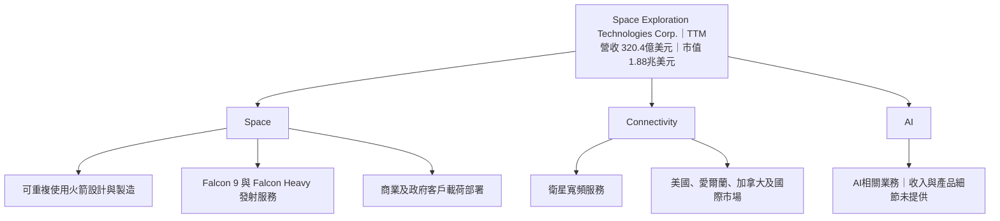
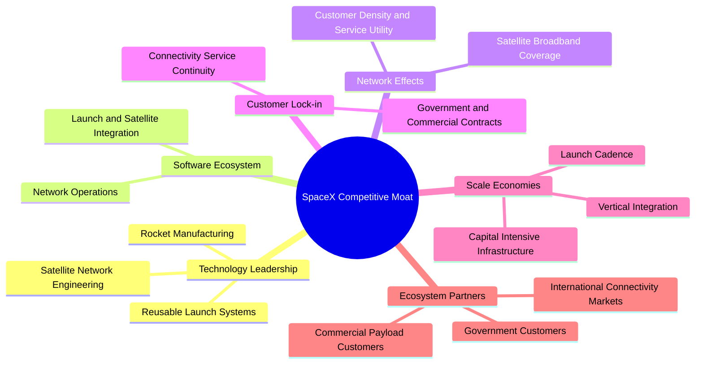
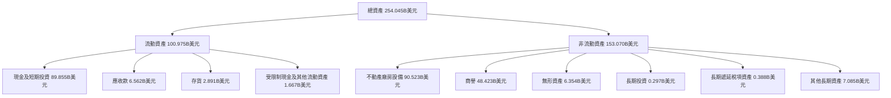
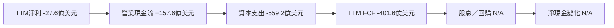
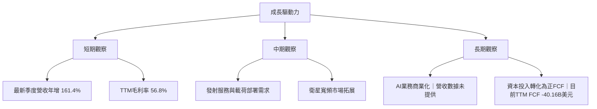
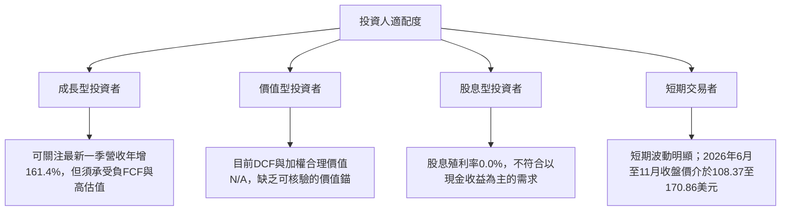

# SPCX 基本面深度分析報告
> **報告日期**：2026-11-20 ｜ **語言**：繁體中文 ｜ **數據來源**：Yahoo Finance、Finviz、StockAnalysis、Roic.ai ｜ **分析師**：CFA 級機構研究

> **資料品質提示**：SPCX 的財務資訊來自 Yahoo Finance 等第三方資料源，未提供 SEC 申報資料；且部分季度營業利益、總市值與股數等數據彼此不一致。本報告將「VERIFIED FIGURES」中的價格、TTM 營業利益率、現金流、WACC 與品質指標作為指定引用口徑，對衝突項目明確揭露，不自行拼接成單一估值。

## 目錄

| # | 章節 | 核心結論 |
|---|------|----------|
| 1 | 執行摘要 | DCF 與估值方法均不可計算，因此加權合理價值、MOS 及 MOS 評級為 N/A |
| 2 | 公司概覽與商業模式 | 火箭發射、衛星連網與 AI 業務具技術與規模壁壘；各板塊營收占比未提供 |
| 3 | 損益表深度分析 | TTM 營收 320.4 億美元；最新一季年增 161.4%，但 TTM 營業利益率為 -2.0% |
| 4 | 資產負債表分析 | 淨現金 506.4 億美元、流動比率 3.084；資產與股權資料有跨來源落差 |
| 5 | 現金流量深度分析 | TTM FCF 為 -401.6 億美元，主因資本支出高於營業現金流 |
| 6 | 獲利能力與資本效率 | WACC 9.93%；ROIC 缺值，無法判定是否創造股東價值 |
| 7 | 相對估值分析 | SPCX 的 P/S、Forward P/E 與 EV/EBITDA 均高；同業倍數分化極大 |
| 8 | DCF 內在價值評估 | 模型標示 N/A：TTM 營業利益率為負，且缺少可用 DCF 模型輸出 |
| 9 | 成長催化劑 | 最新一季營收年增 161.4%；可量化 TAM、分部營收與催化時程未提供 |
| 10 | 風險矩陣 | 資本支出、估值與資料可靠性為主要風險 |
| 11 | 投資建議 | 暫不給 MOS 估值評級或目標價；應待獲利與資本支出資料可核驗後再評估 |

---

## 1. 執行摘要

### 1.0 一頁式投資儀表板（Portfolio Manager 30 秒速讀）

| 項目 | 內容 |
|------|------|
| **投資論點（3 句）** | ① TTM 營收為 **320.4 億美元**，最新一季年增 **161.4%**，顯示營收規模快速擴大。② 公司有 **506.4 億美元淨現金**，流動比率 **3.084**，短期償債緩衝充足。③ TTM 資本支出 **559.2 億美元**高於營業現金流 **157.6 億美元**，使 TTM FCF 達 **-401.6 億美元**，成長投資尚未轉化成自由現金流。 |
| **綜合評分** | **5.4/10**（引用 1.1 評分卡；六項算術平均） |
| **財務健康** | 🟡 現金與流動比率提供緩衝，但 TTM FCF 為負，且跨來源資產負債表數字不一致。 |
| **ROIC vs WACC** | ROIC **N/A** vs WACC **9.93%**；因 ROIC 缺值，無法判斷價值創造或摧毀。 |
| **FCF 趨勢** | TTM FCF **-401.6 億美元**；FCF Yield **-2.14%**。年度 FCF 從 2023 年 +1.05 億美元轉為 2025 年 -141.2 億美元，近期投資支出加速。 |
| **估值** | Forward P/E **50.47897x** ｜ EV/EBITDA **155.878x** ｜ FCF Yield **-2.14%** |
| **DCF 內在價值（基準）** | **N/A**；DCF 模型不可用，無法計算相對現價折溢價。 |
| **安全邊際（MOS）** | **N/A**；估值方法未能計算出加權合理價值，故無法依規定計算 MOS。 |
| **預期報酬（基準情境 12M）** | **N/A**；DCF 情境與加權合理價值未提供，分析師共識不能替代本報告估值模型。 |
| **關鍵風險（前二）** | ① TTM FCF **-401.6 億美元**，資本支出遠高於營業現金流。② 市值、股數及季度獲利資料存在來源矛盾，降低估值可靠度。 |
| **評級 + 信心度** | **正式 MOS 評級：N/A**；無法依 MOS 門檻給出買入／持有／賣出評級。分析信心：**低**。 |

### 1.1 綜合評分卡（全報告唯一）

| 維度 | 評分（1–10） | 主要依據（引用數字與其來源章節） |
|------|--------------|----------------------------------|
| 成長性 | 8.0 | 最新一季營收年增 **161.4%**；2023–2025 年營收 CAGR 約 **34.1%**（第 3 章）。但 TTM 對上一個 TTM 的成長率為 N/A。 |
| 獲利能力 | 4.0 | TTM 營業利益率 **-2.0%**、淨利率 **-8.6%**，TTM FCF **-401.6 億美元**；ROIC 與 Piotroski F-Score 均 N/A（第 3、5、6 章）。 |
| 財務健康 | 7.5 | 淨現金 **506.4 億美元**、流動比率 **3.084**、速動比率 **2.945**；但 TTM CCC **-219 天**且營運資金天數缺少一年前比較值（第 4 章）。 |
| 估值 | 2.0 | Forward P/E **50.47897x**、P/S **58.671993x**、EV/EBITDA **155.878x**，而 FCF Yield 為 **-2.14%**；合理價值與 MOS 無法計算（第 7、8 章）。 |
| 護城河 | 8.0 | 公司涉及可重複使用火箭、衛星寬頻與 AI；截至資料顯示員工 **21,000 人**，具技術、資本與系統整合門檻，但分部收入與市場份額未提供（第 2 章）。 |
| 管理層與資本配置 | 3.0 | FY2025 SBC **19.5 億美元**；TTM 資本支出 **559.2 億美元**，為營業現金流 **157.6 億美元**的約 **3.55 倍**。回購與投資回報資料未提供（第 5 章）。 |
| **綜合評分** | **5.4** | 六項算術平均：`(8.0 + 4.0 + 7.5 + 2.0 + 8.0 + 3.0) ÷ 6 = 5.4167 ≈ 5.4` |

### 1.2 五大投資論點 + 三大核心風險

| 類型 | 項目 | 具體依據 | 信心度 |
|------|------|----------|--------|
| 🟢 **投資論點①** | 營收增長迅速 | 2026 年 9 月季度營收 **145.75 億美元**，年增 **161.4%**；若反映持續的發射與連網需求，可能帶動固定成本吸收改善。 | 🟡 中 |
| 🟢 **投資論點②** | 現金儲備充足 | 現金及短期投資 **898.6 億美元**、總債務 **392.2 億美元**、淨現金 **506.4 億美元**，可支持高資本支出週期。 | 🟢 高 |
| 🟢 **投資論點③** | 產品組合具跨業務延展性 | 公司概述列出 Space、Connectivity、AI 三個營運板塊；火箭發射與衛星連網可形成垂直整合的業務鏈，但板塊營收未提供。 | 🟡 中 |
| 🟢 **投資論點④** | 毛利率高於部分直接同業 | SPCX TTM 毛利率 **56.8%**，高於 RKLB **36.2%**、ASTS **37.0%**；但 IRDM 為 **71.5%**，且產品組合不同。 | 🟡 中 |
| 🟢 **投資論點⑤** | 流動性提供投資迴旋空間 | 流動比率 **3.084**、速動比率 **2.945**；負 CCC **-219 天**可能反映供應商付款條件或預收款結構，但不能單獨視為永久優勢。 | 🟡 中 |
| 🟡 **風險①** | 資本支出導致大額負 FCF | TTM Capex **559.2 億美元**，高於 OCF **157.6 億美元**；TTM FCF **-401.6 億美元**，若投資回報延遲，現金消耗與再融資需求可能上升。 | 🔴 高 |
| 🔴 **風險②** | 估值與獲利能力不匹配 | P/S **58.671993x**、Forward P/E **50.47897x**、TTM FCF Yield **-2.14%**；估值需要持續高成長及獲利改善支撐。 | 🔴 高 |
| 🔴 **風險③** | 財務數據一致性不足 | 138.43 美元乘以列示流通股 **82.5 億股**約為 **1.141 兆美元**，與列示市值 **1.88 兆美元**不相符；季度營業利益也出現不同來源數值。 | 🔴 高 |

### 1.3 快速統計卡片

| 指標 | 公司實際值（期間） | 同業中位數 | 狀態 |
|------|--------------------|------------|------|
| 營收成長（TTM） | **N/A**（TTM 對上一 TTM） | — | 🟡 |
| 營收成長（最新一季年增） | **161.4%** | **72.7%** | 🟢 |
| 毛利率（TTM） | **56.8%** | **37.0%** | 🟢 |
| 營業利益率（TTM） | **-2.0%** | — | 🔴 |
| ROIC（TTM） | **N/A** | — | 🟡 |
| Forward P/E | **50.47897x** | **30.6x** | 🔴 |
| FCF Yield（TTM） | **-2.14%** | — | 🔴 |
| Piotroski F-Score | **N/A** | — | 🟡 |

> 同業中位數使用 RKLB、ASTS、IRDM 已提供且可比較的數據計算；Forward P/E 中位數為三者的中位值 **30.6x**。TTM 營收成長與 Piotroski F-Score 未提供，不以其他來源數字替代。

### 1.4 投資結論

```text
╔══════════════════════════════════════════════════════════════════╗
║                    📊 投資結論摘要                               ║
╠══════════════════════════════════════════════════════════════════╣
║  評級：N/A（估值方法未能計算，不能依 MOS 規則給出正式評級）      ║
║  價格（2026-11-19 收盤）：$138.43                                ║
║  DCF 內在價值（基準）：N/A（TTM 營業利益率 -2.0%）               ║
║  安全邊際 MOS：N/A（加權合理價值未能計算）                       ║
║  加權合理價值（8.8）：N/A                                        ║
║  DCF 情境價值：N/A（DCF 模型未提供）                             ║
║  綜合評分：5.4/10（引用 1.1）                                    ║
║  適合投資人：能承受高波動、長期資本投入與估值不確定性的成長型投資人║
╚══════════════════════════════════════════════════════════════════╝
```

---

## 2. 公司概覽與商業模式

### 2.1 業務結構與收入來源

公司概述列出 Space、Connectivity、AI 三個營運板塊，但沒有提供各板塊收入或收入占比，因此不將總營收拆分成未經披露的數字。公司 TTM 營收為 **320.4 億美元**；最新一季營收為 **145.75 億美元**。



### 2.2 市場份額

市場份額數據未提供，無法引用具體份額或繪製市場份額圓餅圖。質化而言，SPCX TTM 營收 **320.4 億美元**高於同業資料中的 RKLB、ASTS、IRDM 所列營收規模（同業分部口徑未充分提供，故不做嚴格規模排名）；最新一季年增 **161.4%**也高於這三家同業最新一季營收年增率中位數 **72.7%**。

### 2.3 競爭護城河分析



### 2.4 護城河強度

| 護城河項目 | 強度（強／中／弱） | 證據（引用數字或事實） | 會削弱它的情況 |
|------------|--------------------|------------------------|----------------|
| 技術與製造 | 強 | 公司設計、製造可重複使用火箭，並提供 Falcon 9、Falcon Heavy 發射服務。 | 新型發射系統替代、可靠性事故或技術路線落後。 |
| 軟體與營運整合 | 中 | 發射、衛星與寬頻業務涉及軟硬體及網路營運整合；未提供軟體收入或客戶留存數字。 | 網路品質未達標、服務中斷、競爭者提供更低成本替代方案。 |
| 網路效應 | 中 | 衛星寬頻具有覆蓋範圍與用戶密度互相影響的可能性；用戶數及網路利用率未提供。 | 用戶增長停滯或網路容量不足。 |
| 客戶鎖定 | 中 | 商業與政府發射、衛星連網服務可能形成轉換成本；合約年期及續約率未提供。 | 政府採購調整、客戶轉向其他發射或通訊供應商。 |
| 規模效應 | 強 | 公司有 **21,000 名員工**，且具火箭製造、發射與衛星服務能力；但規模帶來的單位成本改善未披露。 | 資本支出持續超過營收成長與成本效益。 |
| 生態夥伴 | 中 | 服務商業及政府客戶，提供載荷發射服務；合作夥伴集中度與合約分布未提供。 | 重要客戶集中、監管限制或供應鏈中斷。 |

> 1.1「護城河」評分為 **8.0/10**，依據是公司具火箭、發射與衛星連網的垂直整合能力；但客戶留存、網路用戶、分部收入與單位經濟性缺值，限制了證據強度。

---

## 3. 損益表深度分析

### 3.1 年度收入成長趨勢（近年可得資料）

以下只列有完整年度收入資料的 2023–2025 年；2026 年 TTM 不是完整財年，另行列示。2023–2025 年營收 CAGR 約 **34.1%**。

```text
╔══════════════════════════════════════════════════════════════════╗
║        Space Exploration Technologies Corp. 年度收入趨勢        ║
╠══════════════════════════════════════════════════════════════════╣
║  FY2023  $10.39B  ███████████░░░░░░░░░░  YoY：基期             ║
║  FY2024  $14.02B  ███████████████░░░░░  YoY：+34.93% 🟢         ║
║  FY2025  $18.67B  ████████████████████  YoY：+33.24% 🟢         ║
║                                                                  ║
║  2023–2025 營收 CAGR：約 +34.1%                                   ║
║  2026 TTM（截至 2026-09-30）：$32.04B；TTM 對上一 TTM 成長率 N/A ║
╚══════════════════════════════════════════════════════════════════╝
```

計算：`(18.674 ÷ 10.387)^(1 ÷ 2) − 1 ≈ 34.1%`。近兩年年增皆約三成，反映年度收入基礎擴大；但 TTM 與最新季度數據增速更高，未來能否維持取決於產能、發射節奏及新業務變現，不能直接外推單季高增速。

### 3.2 季度收入趨勢分析

| 季度 | 營收（十億美元） | QoQ 成長 | YoY 成長 | 備註 |
|------|------------------:|---------:|---------:|------|
| 2025 Q4 | 4.96 | **-11.1%** | 同比基準未提供 | 對比 2025 Q3 的 5.576B 計算。 |
| 2026 Q1 | 4.69 | **-5.4%** | **15.42%** | QoQ 對比 2025 Q4；YoY 採 StockAnalysis 單季成長率。 |
| 2026 Q2 | 7.81 | **66.5%** | **91.94%** | QoQ 對比 2026 Q1；增長速度加快。 |
| 2026 Q3 | 14.57 | **86.5%** | **161.4%** | 最新一季；按提供的單季資料計算，QoQ 與 YoY 均快速上升。 |

QoQ 計算示例：`(14.575 ÷ 7.814) − 1 = 86.5%`。季節性、一次性大型合約或收入認列時點可能造成季度波動；缺少分部收入與合約交付資料，尚不能確認 2026 年 Q3 的高增長能否延續。

### 3.3 利潤率演變分析

| 利潤率指標 | FY2023 | FY2024 | FY2025 | 最新 TTM | 趨勢 | 評估 |
|------------|-------:|-------:|-------:|---------:|------|------|
| **毛利率** | 約 41.2% | 約 42.9% | 約 49.4% | **56.8%** | 年度改善，TTM 進一步提高 | 🟢 |
| **營業利益率** | 約 4.9% | 約 5.3% | 約 -11.1% | **-2.0%** | 2025 年轉負，TTM 仍為負 | 🔴 |
| **淨利率** | 約 -44.6% | 約 5.6% | 約 -26.4% | **-8.6%** | 年度波動大，尚未形成穩定獲利 | 🔴 |

FY2023–FY2025 毛利率由營收與毛利計算；TTM 毛利率及營業利益率採指定財務數值。毛利率提升表示收入結構或直接成本率可能改善，但營業利益率仍為負，說明研發、營運或其他營業費用仍抵銷毛利改善。FY2025 研發費用 **86.4 億美元**，較 FY2024 的 **34.6 億美元**上升，可能是利潤率承壓因素之一；不過現有資料不足以把全部營業虧損歸因於研發。

**季度數據差異說明：**2026 Q3 的營業利益在不同來源分別顯示 **27.9 億美元**及 **40.19 億美元**；而指定 TTM 營業利益率為 **-2.0%**，與單季數字按表面計算的結果不一致。本報告在整體利潤率判斷中採用指定 TTM 營業利益率，不將互相矛盾的季度資料混算。

### 3.4 費用結構分析

完整營業費用分項未提供，不能以研發費用單項推算整體費用占比，也不繪製比例圓餅圖。已知 FY2025 研發費用為 **86.4 億美元**，相當於當年營收 **186.7 億美元**的約 **46.3%**；高研發投入可能支持產品與技術擴張，但也提高短期盈餘與現金流壓力。

### 3.5 季度 EPS 趨勢與盈餘品質（Quality of Earnings）

| 盈餘品質項目 | 數值／佔比 | 評估 |
|--------------|------------|------|
| 股權薪酬 SBC / 營收 | TTM SBC **47.33 億美元** ÷ TTM 營收 **320.43 億美元** = **14.8%** | 🔴 SBC 佔比高，代表相當部分薪酬以股權支付，可能稀釋既有股東。 |
| SBC / 營業現金流 | **47.33 ÷ 157.6 = 30.0%** | 🟡 SBC 規模相當於 TTM OCF 約三成；其非現金性不代表沒有股東經濟成本。 |
| FCF / 淨利（現金轉換率） | TTM FCF **-401.6 億美元**；TTM 淨利採 StockAnalysis **-27.60 億美元**，比率約 **14.5x** | 🔴 淨利與 FCF 同為負值，正比率沒有一般現金轉換率的經濟意義；現金流顯著弱於盈餘表面趨勢。 |
| 一次性／非經常性損益 | N/A（未提供可核驗明細） | 無法判定 2026 Q3 淨利為 44 億美元是否含一次性項目，不能直接視為可持續獲利。 |
| 有效稅率異常 | N/A（有效稅率資料未提供） | 無法判定稅務利益或稅務費用對季度淨利的影響。 |
| 資本化支出 vs 費用化 | TTM Capex **559.2 億美元**；資本化與費用化細項未提供 | 高資本支出形成沉重現金流負擔；缺少資產分類與折舊明細，不能評估是否有成本遞延。 |

**季度 EPS 表現：**可得的 ROIC.ai 單季 EPS 為 2026 Q1 **-0.47 美元**、Q2 **-0.09 美元**、Q3 **0.37 美元**；Q4 與 EPS 預期值缺失。Earnings History 中各季 EPS Est 與 EPS Act 為 nan，因此**過去四季「超預期／不及預期」無法判定**。不能把實際 EPS 轉正直接當作超預期，因為缺少市場預期數據。

**盈餘品質結論：**TTM 淨利率 **-8.6%**、TTM FCF **-401.6 億美元**，且 TTM SBC 約為營收 **14.8%**；目前 GAAP 盈餘與自由現金流均不足以證明已形成可持續獲利。估值不宜只依賴單季正 EPS 或高毛利率，還需要觀察多季營業利益、現金流及 SBC 佔比。

---

## 4. 資產負債表分析

### 4.1 資產結構分解

StockAnalysis 截至 2026-09-30 列示總資產 **254.045B 美元**，下列分項可加總至該數字。



非流動資產為總資產減流動資產：`254.045 − 100.975 = 153.070B 美元`。資產組成中 PPE 與商譽占比不低；若長期投資回報不及預期，需留意固定資產折舊、減值及資本配置效率。

### 4.2 流動性與營運資金分析

| 指標 | 最新值 | 歷史比較 | 解讀 |
|------|--------:|----------|------|
| 現金及短期投資 | **898.6 億美元** | FY2025 現金與短期投資 **247.47 億美元** | 流動資產儲備明顯增長；資料未說明增幅中營運現金、融資或其他資金來源的占比。 |
| 流動比率 | **3.084** | FY2025 由年度資產負債表計算約 **1.45** | 短期資產覆蓋流動負債能力上升；TTM 與年度資料口徑可能不同，僅作方向參考。 |
| 速動比率 | **2.945** | N/A | 顯示流動性主要並非依賴存貨，但歷史序列未提供。 |
| 淨現金 | **506.4 億美元** | N/A | 現金加短期投資 **898.6 億美元**減總債務 **392.2 億美元**。 |

**營運資金天數（依 QUALITY FIGURES 數值照錄）：**

| 指標 | 最新 TTM | 一年前 TTM | 變化 | 解讀 |
|------|----------:|------------:|------|------|
| DSO 應收帳款天數 | **54 天** | N/A | N/A | 應收帳款週轉狀況缺少可比年度，無法判定收款是否變慢。 |
| DIO 存貨天數 | **76 天** | N/A | N/A | 需追蹤存貨是否隨產能擴張累積；一年前數據未提供。 |
| DPO 應付帳款天數 | **349 天** | N/A | N/A | 數值偏長，可能反映付款條件或營運資金結構；不能僅據此判定供應商議價力。 |
| CCC 現金轉換週期 | **-219 天** | N/A | N/A | 負 CCC 可能由較長 DPO 驅動；若供應商條款收緊，現金需求可能增加。 |

### 4.3 債務結構分析

```text
╔══════════════════════════════════════════════════════════════════╗
║                  SPCX 債務健康診斷                               ║
╠══════════════════════════════════════════════════════════════════╣
║  總債務：         $39.22B  ████████░░░░░░░░░░░░  可由現金覆蓋    ║
║  現金及短期投資： $89.86B  ████████████████████  流動性緩衝      ║
║  淨現金：         $50.64B  ███████████░░░░░░░░░  🟢              ║
║                                                                  ║
║  Debt/EBITDA：N/A（EBITDA 與債務期間、口徑不適合直接配對）       ║
║  利息保障倍數：N/A（利息費用未提供）                             ║
║  流動比率：3.084                                                   ║
║  速動比率：2.945                                                   ║
╚══════════════════════════════════════════════════════════════════╝
```

指定 TTM 總債務 **392.2 億美元**、現金及短期投資 **898.6 億美元**，淨現金 **506.4 億美元**，資產負債表的絕對流動性較充足。但不能因淨現金為正而忽視資本支出：TTM Capex **559.2 億美元**，高於現金流入，未來若投資持續擴張，現金緩衝會受到消耗。

### 4.4 股東權益趨勢

```text
╔══════════════════════════════════════════════════════════════════╗
║                 股東權益變化（年度可得資料）                    ║
╠══════════════════════════════════════════════════════════════════╣
║  FY2024  $25.80B  ████████████░░░░░░░░  基期                     ║
║  FY2025  $41.33B  ████████████████████  +60.2% 🟢                ║
║                                                                  ║
║  2026 TTM 另有來源列示總權益 $176.768B，與年度資料落差顯著，     ║
║  不將其串接成同一條趨勢；需以正式申報資料核驗。                ║
╚══════════════════════════════════════════════════════════════════╝
```

FY2025 股東權益較 FY2024 增加約 **60.2%**，但資料未提供權益變動表，不能拆解為新股發行、留存盈餘或其他項目。TTM 權益數與年度表差距大，削弱了基於帳面權益估算 ROE 或資本回報的可信度。

---

## 5. 現金流量深度分析

### 5.1 現金流量瀑布圖

下圖使用 TTM 現金流與可得淨利數據；股息與回購支出未提供，不填入估計金額。



### 5.2 FCF 轉換率趨勢

| 期間 | FCF | 淨利 | FCF / 淨利 | 解讀 |
|------|----:|-----:|-----------:|------|
| FY2023 | **+0.105B** | **-4.628B** | 約 **-2.3%** | 分子為正、分母為負，比率不具一般現金轉換率含義。 |
| FY2024 | **-5.39B** | **+0.791B** | 約 **-681.4%** | 投資支出使 FCF 大幅低於當年淨利。 |
| FY2025 | **-14.12B** | **-4.937B** | 約 **2.9x** | 兩者皆負，正比率不代表現金轉換良好。 |
| TTM | **-40.16B** | 約 **-2.76B**（StockAnalysis） | 約 **14.5x** | 負數相除雖得正值，但不能解讀為高現金轉換率。 |

### 5.3 自由現金流趨勢

```text
╔══════════════════════════════════════════════════════════════════╗
║                 自由現金流趨勢（美元）                           ║
╠══════════════════════════════════════════════════════════════════╣
║  FY2023  +$0.105B  ▏                  FCF Yield：N/A             ║
║  FY2024  -$5.39B   ███                FCF Yield：N/A             ║
║  FY2025  -$14.12B  ███████            FCF Yield：N/A             ║
║  TTM     -$40.16B  ████████████████████ FCF Yield：-2.14%        ║
╠══════════════════════════════════════════════════════════════════╣
║  TTM OCF $15.76B − Capex $55.92B = FCF -$40.16B                 ║
╚══════════════════════════════════════════════════════════════════╝
```

FCF 惡化與資本支出快速上升同步：FY2023 Capex **44.2 億美元**、FY2024 **111.6 億美元**、FY2025 **209.1 億美元**，TTM 升至 **559.2 億美元**。若支出形成可產生收入的發射與衛星資產，短期 FCF 可能低估成長投資價值；但缺少產能利用率、投資回報率與項目級現金流，現階段無法量化回收期。

### 5.4 資本配置評估

| 資本配置項目 | 可得資料 | 評估 |
|--------------|----------|------|
| 資本支出 | TTM **559.2 億美元**；FY2025 **209.1 億美元** | 是近期現金流的主要壓力來源；需以新增收入與未來現金流驗證回報。 |
| 股權薪酬 | TTM 約 **47.33 億美元**；FY2025 **19.5 億美元** | 股權支付可保留現金，但會稀釋股東權益。 |
| 股息 | 殖利率 **0.0%**；派息率 **0.0%** | 無現金股息回報。 |
| 回購 | N/A | 未提供回購金額與股數變化明細。 |
| 併購／其他投資 | N/A | 未提供可核驗的資本配置拆分。 |

缺乏完整資本配置支出明細，故不將 Capex、回購、股息與留存資金畫成比例圓餅圖。當前可確認的是，公司將大量資金投入資產建設，但回報時間與項目收益尚未披露。

---

## 6. 獲利能力與資本效率

### 6.1 ROE / ROA / ROIC 趨勢

| 指標 | FY2023 | FY2024 | FY2025 | TTM | 評估 |
|------|-------:|-------:|-------:|----:|------|
| ROE | N/A | N/A | N/A | N/A | 品質指標計算所需的同期淨利、資產及權益資料不完整且口徑有衝突。 |
| ROA | N/A | N/A | N/A | N/A | TTM 資產與淨利來源口徑不一致，未提供可直接引用值。 |
| ROIC | N/A | N/A | N/A | N/A | ROIC.ai 歷史欄位未提供可用 ROIC 數值。 |
| WACC | — | — | — | **9.93%** | 按指定資本成本資料採用。 |

公司資料中沒有可核驗的行業 ROE、ROA、ROIC 均值，因此不列行業比較。ROIC 未提供，不能根據營業利益率或 EBITDA margin 代算並冒充 ROIC。

### 6.2 ROIC vs WACC 分析（核心價值創造判斷）

```text
╔══════════════════════════════════════════════════════════════════╗
║                ROIC vs WACC 深度分析                            ║
╠══════════════════════════════════════════════════════════════════╣
║  WACC 來源：Cost of capital（採用值）                            ║
║  ├── 無風險利率（10Y 美債）：       5.05%                        ║
║  ├── 市場風險溢酬 ERP：             5.00%                        ║
║  ├── 原始 Beta（Yahoo）：            N/A                          ║
║  ├── 採用調整後 Beta：               1.00（假設值）              ║
║  ├── Ke = 5.05% + 1.00 × 5.00% = 10.05%                         ║
║  ├── 稅前債務成本：                  4.96%                        ║
║  ├── 稅率：                          21.0%                        ║
║  ├── 稅後債務成本：                  3.9184%                      ║
║  ├── 股權／債務權重：                98.0%／2.0%                  ║
║  └── ✅ 採用 WACC：                  9.93%                        ║
║                                                                  ║
║  ROIC：N/A（未提供可核驗的投入資本回報率）                       ║
║  EVA = ROIC − WACC：N/A                                           ║
║  結論：無法判斷 SPCX 的 ROIC 是否高於 9.93% WACC                 ║
╚══════════════════════════════════════════════════════════════════╝
```

計算檢核：`98.0% × 10.05% + 2.0% × [4.96% × (1 − 21.0%)] = 9.927368% ≈ 9.93%`。原始 Beta 缺失，調整後 Beta **1.00**是指定資料中的假設值；因此 WACC 本身也包含模型假設，不等同於公司已披露的融資成本。ROIC 未提供，無法判斷公司是否創造超過資本成本的經濟價值。

### 6.3 杜邦三因素分解

**N/A（品質指標資料指出：缺少可用的淨利、營收、總資產或正股東權益資料，無法可靠計算杜邦三因素。）**

### 6.4 財務體質：Piotroski F-Score

**N/A（Piotroski F-Score 需要兩個相隔一年的 SEC 申報資料期間；目前沒有可用 SEC 財報序列。）**

| 測試 | 結果 | 解讀 |
|------|------|------|
| F-Score 總分 | N/A | 缺少可計算的兩期 SEC 財報資料。 |
| 九項個別測試 | N/A | 品質指標資料沒有提供各項測試結果；不自行補算或猜測。 |

---

## 7. 相對估值分析

### 7.1 同業估值比較表格

同業數值採 Yahoo Finance 提供的 Peer multiples。負 EV/EBITDA 或負 Forward P/E 不代表公司便宜，通常是獲利為負或指標失去一般估值意義。

| 估值指標 | **SPCX** | **RKLB** | **ASTS** | **IRDM** | SPCX 評估 |
|----------|---------:|---------:|---------:|---------:|-----------|
| **Trailing P/E** | **601.8695x** | N/A | N/A | **28.4x** | 🔴 SPCX 倍數高；同業多數缺少可比正盈餘。 |
| **Forward P/E** | **50.47897x** | **712.3x** | **-16.4x** | **30.6x** | 🟡 SPCX 低於 RKLB、高於 IRDM；ASTS 為負倍數，分布極端。三家中位數 **30.6x**。 |
| **P/S（TTM）** | **58.671993x** | **38.9x** | **71.5x** | **5.1x** | 🔴 SPCX 高於 RKLB、IRDM，低於 ASTS；中位數 **38.9x**。 |
| **EV/EBITDA（TTM）** | **155.878x** | **-161.3x** | **-19.5x** | **17.1x** | 🔴 SPCX 顯著高於 IRDM；RKLB、ASTS 為負值，不宜按一般倍數作廉價比較。 |
| **最新一季營收年增** | **161.4%** | **72.7%** | **187.1%** | **8.3%** | 🟢 SPCX 高於 RKLB、IRDM，低於 ASTS；三家中位數 **72.7%**。 |
| **毛利率（TTM）** | **56.8%** | **36.2%** | **37.0%** | **71.5%** | 🟢 SPCX 高於 RKLB、ASTS，低於 IRDM；同業中位數 **37.0%**。 |

SPCX 的高成長與高毛利率是估值溢價的支持因素，但 **P/S 58.67x、EV/EBITDA 155.878x** 及負 FCF 顯示股價已對未來成長和獲利改善有較高要求。由於同業營運結構並不完全相同，這些倍數適合用來衡量市場定價差距，不宜直接視為可套用的合理價。

### 7.2 歷史估值區間分析

**N/A（沒有提供「Valuation vs own history」的歷史估值區間或百分位資料；不以近期股價高低代替估值歷史。）**

### 7.3 情境價值（Bear / Base / Bull）

**N/A（DCF 模型不可計算：TTM 營業利益率為 -2.0%，指定 DCF MODEL 因 TTM 營業利益為負而未提供情境表。因此不列情境每股價值、目標價、機率或報酬率。）**

### 7.4 相對估值隱含價格區間

**N/A（VALUATION METHODS 未能計算任何每股估值方法。）**缺少能夠可靠套用同業中位數倍數所需的估值方法輸出與相應可核驗基礎，故不反推出同業法每股價格，也不把同業目前倍數直接當作合理價。

---

## 8. DCF 內在價值評估（Discounted Cash Flow）

> 指定 DCF MODEL 為 **N/A**：TTM 營業利益不為正，模型未提供預測期假設、逐年 FCFF、終值、橋接、敏感度、情境與反推 DCF 數值。依要求，不另建 DCF、不自行填入假設目標價。

### 8.0 估值推理鏈（Thinking Logic）

SPCX 的長期價值理應由火箭發射、衛星寬頻與 AI 業務的現金流共同決定，但目前只提供公司層級 TTM 營收 **320.4 億美元**，沒有各板塊營收占比、產品單位經濟性或可持續營業利潤率；無法可靠拆出「現有現金流底盤」與「新業務選擇權價值」。

| 決策點 | 本報告採用 | 理由（含數字） | 曾考慮但否決 | 否決理由 |
|--------|-----------|----------------|--------------|----------|
| 現金流定義 | N/A | 未提供可用 DCF 現金流預測。 | 自建 FCFF | 不符合指定只採用程式 DCF 模型的規則。 |
| 預測期 N | N/A | DCF MODEL 未提供預測期。 | 自訂 5–10 年 | 缺少可核驗的管理層預測與模型假設。 |
| 終值方法 | N/A | DCF MODEL 未提供終值。 | Gordon Growth／退出倍數 | 不能在模型輸出缺失時自行補造。 |
| EBIT 基礎 | N/A | TTM 營業利益率為 **-2.0%**，指定模型因此不提供估值。 | 自行調整 EBIT | 缺少能支持調整後利潤的明細。 |

**最脆弱的一環**是未來投資能否從高資本支出轉化成正 FCF：TTM Capex **559.2 億美元**、TTM FCF **-401.6 億美元**；但由於模型沒有可用敏感度數字，不能量化此風險對每股價值的影響。

### 8.1 模型假設總表（Model Inputs）

**N/A（DCF MODEL 未提供假設值、預測期、營收成長、利潤率、稅率、Capex、D&A、營運資金、SBC 處理、股數或終值輸入。）**

### 8.2 折現率推導（WACC）

DCF 不可計算，但公司資本成本資料可用於第 6.2 節，採用 WACC **9.93%**。其輸入為無風險利率 **5.05%**、ERP **5.00%**、調整後 Beta **1.00**、稅前債務成本 **4.96%**、稅率 **21.0%**、股權／債務權重 **98.0%／2.0%**。原始 Beta 為 N/A，因此 Beta 1.00 是假設值；沒有提供無風險利率的觀測日期以外的更詳細來源資訊、規模溢酬或利息費用明細。

計算核對：`Ke = 5.05% + 1.00 × 5.00% = 10.05%`；`稅後 Kd = 4.96% × (1 − 21.0%) = 3.9184%`；`WACC = 98.0% × 10.05% + 2.0% × 3.9184% = 9.927368% ≈ 9.93%`。本報告沒有使用此 WACC 自行建立 DCF。

### 8.3 逐年自由現金流預測（基準情境）

**N/A（未提供 DCF MODEL 逐年預測表；不自行預測 FY+1 至 FY+N 的收入或 FCFF，也不以 TTM FCF 直接外推。）**

### 8.4 終值計算（Terminal Value）

**N/A（DCF MODEL 未提供永續成長率、預測期末 FCFF、終值或退出倍數。）**

### 8.5 企業價值 → 每股內在價值（Bridge）

**N/A（缺少預測期 FCF 現值、終值現值及模型橋接資料，無法計算企業價值、股權價值或 DCF 每股內在價值。）**

另有一項資料核對風險：以最新收盤價 **138.43 美元**及列示流通股數 **82.5 億股**相乘，約為 **1.141 兆美元**，與資料所列市值 **1.88 兆美元**不相符。由於股數、市值口徑未能核驗，不以兩者自行推導每股價值。

### 8.6 敏感性分析（WACC × 永續成長率）

**N/A（沒有程式 DCF 敏感度矩陣；不自行創建矩陣、情境價格或每股價值。）**

### 8.7 反推 DCF（Reverse DCF）

**N/A（沒有 DCF 基準現金流與模型輸出，無法以現價反解營收 CAGR、利潤率、永續成長率或預測期。）**

### 8.8 估值三角驗證與安全邊際

**N/A（VALUATION METHODS 顯示沒有可計算的方法。）**缺少 DCF 基準值、相對估值法的每股價值與權重，因此不計算加權合理價值，也不計算 MOS、上行空間或 MOS 評級。分析師共識平均目標價 **257.50 美元**、區間 **70–800 美元**，只作市場觀察，不替代本報告的估值輸出。

### 8.9 DCF 模型的局限與失效條件

- **終值依賴度**：N/A；模型沒有企業價值與終值分解。
- **最脆弱的假設**：資本支出的持續性與投資回報率。TTM Capex **559.2 億美元**，若無法轉化為營收或毛利，FCF 可能持續承壓。
- **不適用情境**：公司 TTM 營業利益率為 **-2.0%**，且 TTM FCF 為 **-401.6 億美元**；以穩定獲利為基礎的傳統 DCF 可靠度偏低。後續可觀察 EV/Sales、分部估值及單位經濟性，但目前缺少足夠資料計算。
- **與第 10 章風險矩陣的連結**：資本支出失控會直接影響 FCF；發射或連網需求放緩會影響營收增長；資料品質問題則可能令估值輸入本身失真。

### 8.10 複算檢核表（Audit Trail）

| # | 檢核項目 | 檢查方式 | 結果 |
|---|----------|----------|------|
| 1 | 高／中敏感度輸入有完整四段式推導 | DCF 假設未提供 | N/A（無模型） |
| 2 | 每個 DCF 假設都有來歷 | DCF 輸入未提供 | N/A（無模型） |
| 3 | WACC 五步 DCF 算式可核驗 | 採用指定 WACC，未自行建立 DCF | N/A（DCF 不適用） |
| 4 | Kd 分母與債務權重同範圍 | 未提供足夠利息與計息債務明細 | N/A（無 DCF） |
| 5 | WACC 與第 6.2 節同值 | 均採用 **9.93%** | ✅ |
| 6 | 逐年預測欄位符合 N | N 未提供 | N/A（無模型） |
| 7 | FY+1 現金流算式可複算 | FY+1 預測不存在 | N/A（無模型） |
| 8 | 預測期 PV 加總可核對 | PV 項目未提供 | N/A（無模型） |
| 9 | WACC > g | g 未提供 | N/A（無模型） |
| 10 | 終值基於 FY+N 並折現 N 期 | 終值與 N 未提供 | N/A（無模型） |
| 11 | EV 至每股價值橋接可複算 | EV、現金橋接與模型股數未提供 | N/A（無模型） |
| 12 | SBC 組合相容 | DCF SBC 處理與股數政策未提供 | N/A（無模型） |
| 13 | 敏感性矩陣基準格等於 DCF 每股價值 | 矩陣未提供 | N/A（無模型） |
| 14 | 矩陣僅在 WACC > g 時計算 | 矩陣與 g 未提供 | N/A（無模型） |
| 15 | 三情境機率與加權算式 | 情境未提供 | N/A（無模型） |
| 16 | 反推每列只放開一個變數且有軌跡 | Reverse DCF 未提供 | N/A（無模型） |
| 17 | MOS 使用 8.8 加權價值；折溢價使用 DCF 值 | 兩種估值均未能計算 | N/A（無加權價值） |
| 18 | 報告完整至第 11 章 | 已完成 11 章 | ✅ |
| 19 | 加權合理價值等於方法加權總和 | 沒有可計算的方法與權重 | N/A（無方法） |
| 20 | 評級符合 MOS 門檻 | MOS 未能計算，不給 MOS 評級 | N/A（無 MOS） |

---

## 9. 成長催化劑

### 9.1 催化劑時間軸

具體催化劑發生日期、產品交付時點及管理層財測未提供，因此不繪製以日期或時間長度為依據的 Gantt 圖，避免虛構時程。可追蹤的近端觀察項目包括：最新一季營收年增 **161.4%**能否延續、TTM 營業利益率能否由 **-2.0%**轉正，以及 Capex 是否由 TTM **559.2 億美元**的高位開始放緩或取得更高產出。

### 9.2 TAM 市場規模分析

**N/A（TAM 數據未提供）。**目前只可確認 TTM 營收 **320.4 億美元**與最新一季營收年增 **161.4%**；由於缺少市場規模、可服務市場口徑與分部營收，不能計算市場滲透率或自行填入 TAM 金額。

### 9.3 成長驅動力結構圖



---

## 10. 風險矩陣

### 10.1 風險評分矩陣

沒有可靠的事件發生機率數值或相應財務損失估算，因此不以任意機率／衝擊座標繪製 quadrantChart。下表依可觀察的財務數字與資料缺口列出主要風險。

### 10.2 風險清單詳細分析

| # | 風險項目 | 發生機率 | 財務衝擊 | 風險評估 | 緩解措施 |
|---|----------|----------|----------|----------|----------|
| 1 | 🔴 **資本支出超過現金流承載能力** | 高（已有實際負 FCF） | TTM FCF **-401.6 億美元**；若投資回報落後，現金儲備消耗加快 | 🔴 高 | 每季檢視 Capex、OCF、產能利用與項目回收；確認新增支出有對應訂單或可量化產出。 |
| 2 | 🔴 **高估值對成長失速敏感** | 中高（倍數高） | P/S **58.671993x**、Forward P/E **50.47897x**；成長降速可能造成估值倍數收縮 | 🔴 高 | 追蹤單季營收年增及 Forward EPS；避免把單季 **161.4%** 年增永久外推。 |
| 3 | 🔴 **財務數據來源矛盾** | 已觀察到 | 市值 **1.88 兆美元**與股價及股數不匹配；季度營業利益亦有不同來源數據 | 🔴 高 | 以 SEC 申報與公司正式文件核驗流通股、營收認列、資產負債表及季度營業利益。 |
| 4 | 🟡 **SBC 稀釋股東權益** | 高（已有支出） | TTM SBC **47.33 億美元**，占營收約 **14.8%** | 🟡 中高 | 追蹤稀釋股數、每股營收與 SBC/營收；分辨股權薪酬是否伴隨生產力改善。 |
| 5 | 🟡 **營業獲利波動與轉正持續性** | 中高 | TTM 營業利益率 **-2.0%**，最新季度 margin **1.8%**，但季度金額資料存在衝突 | 🟡 中高 | 要求連續數季營業利益率與 GAAP 營業利益可核驗改善，而非單季轉正。 |
| 6 | 🟡 **供應商付款與營運資金條件改變** | 中 | DPO **349 天**、CCC **-219 天**；若付款條款縮短，營運資金需求可能增加 | 🟡 中 | 按季監控 DPO、應付帳款、預收款及供應商交付狀況。 |

---

## 11. 投資建議

### 11.1 最終評級與評分

正式投資評級為 **N/A**：DCF 與估值方法均未能計算，沒有加權合理價值與 MOS，因此不能依 MOS 門檻指定買入、持有或賣出。公司品質綜合評分為 **5.4/10**，六項分數依序為成長性 **8.0**、獲利能力 **4.0**、財務健康 **7.5**、估值 **2.0**、護城河 **8.0**、管理層與資本配置 **3.0**。

### 11.2 合理價值與隱含報酬率

| 項目 | 每股價值 | 相對 2026-11-19 收盤價 | 備註 |
|------|---------:|-----------------------:|------|
| 加權合理價值 | N/A | N/A | 估值方法均未能計算。 |
| DCF 悲觀情境 | N/A | N/A | DCF MODEL 未提供情境值。 |
| DCF 基準情境 | N/A | N/A | DCF MODEL 未提供情境值。 |
| DCF 樂觀情境 | N/A | N/A | DCF MODEL 未提供情境值。 |
| 分析師共識平均目標價 | **$257.50** | 約 **+86.0%** | 37 位分析師共識，並非本報告模型推導的內在價值或目標價。 |

分析師目標價換算僅作市場預期參考：`(257.50 ÷ 138.43) − 1 ≈ 86.0%`。共識目標價低端 **$70**、高端 **$800**，區間極寬，代表分析師對公司價值的看法分散；不宜將平均值解讀為可驗證的預期報酬。

### 11.3 買入時機與觸發因素

```text
╔══════════════════════════════════════════════════════════════════╗
║                  ✅ 買入觸發因素 Checklist                      ║
╠══════════════════════════════════════════════════════════════════╣
║  進一步研究／考慮建倉的條件：                                    ║
║  ☐ 正式申報資料可核對市值、稀釋股數及季度營業利益               ║
║  ☐ 營業利益率連續改善，且改善能由正式季度財報驗證               ║
║  ☐ Capex 增幅下降，或新增產能帶動營業現金流持續增加             ║
║  ☐ SBC／營收與稀釋股數變化有下降趨勢                            ║
║                                                                  ║
║  加碼觸發條件（須同時確認估值可接受）：                          ║
║  ☐ TTM FCF 連續改善，並向零收斂                                 ║
║  ☐ TTM 營業利益率轉正且有多季延續性                             ║
║                                                                  ║
║  減碼／重新檢視觸發條件：                                        ║
║  ☐ 單季營收年增率連續兩季低於 50%（分析師監控門檻）             ║
║  ☐ 營業利益率連續兩季為負，或相對最新季度 1.8% 再度明顯惡化     ║
║  ☐ Capex 持續高於 OCF，且現金及短期投資明顯下降                 ║
║  ☐ 正式財報證實股數、收入或利潤數據與目前資料存在重大差異       ║
╚══════════════════════════════════════════════════════════════════╝
```

以上監控門檻是分析師提出的追蹤條件，不是公司指引或歷史保證值。由於目前沒有 MOS 或合理價值區間，不能提供與正式評級一致的數值化買入區間。

### 11.4 投資人適配度分析



| 投資人類型 | 適配度 | 原因 |
|------------|--------|------|
| 成長型、長期持有者 | 🟡 有條件適配 | 最新一季營收年增 **161.4%**，但 TTM FCF 為 **-401.6 億美元**，且估值尚無可靠內在價值基準。 |
| 價值型投資者 | 🔴 暫不適配 | DCF、相對估值方法與 MOS 均未能計算；P/S **58.67x**、EV/EBITDA **155.878x**亦提高估值風險。 |
| 股息型投資者 | 🔴 不適配 | 股息殖利率 **0.0%**、派息率 **0.0%**。 |
| 短期交易者 | 🟡 需控制風險 | 2026 年 7 月月收盤價 **108.37 美元**，至 9 月 **150.86 美元**，其後 11 月 **138.43 美元**；波動幅度不低。 |

### 11.5 每季財報監控清單（Quarterly Watch List）

| 指標 | 最新基準 | 觸發加碼／正向訊號 | 觸發減碼／負向訊號 |
|------|----------|--------------------|--------------------|
| 營收與年增 | 最新季營收 **145.75 億美元**；YoY **161.4%** | 年增維持正值，且收入來源可由分部披露核實 | 年增連續兩季低於分析師監控門檻 **50%** |
| 營業利益率 | TTM **-2.0%**；最新季度 **1.8%** | 多季改善且季度金額與 margin 相互一致 | 營業利益率重新轉負並持續惡化 |
| 營業現金流 | TTM **157.6 億美元** | OCF 隨營收增加，並能覆蓋更多資本支出 | OCF 下滑而 Capex 維持高位 |
| 資本支出 | TTM **559.2 億美元** | Capex 下降或產能、收入與現金流同步提升 | Capex 長期明顯高於 OCF，淨現金持續下降 |
| FCF／FCF Yield | **-401.6 億美元／-2.14%** | FCF 向零收斂，且現金轉換改善 | FCF 惡化、或現金消耗速度加快 |
| SBC | TTM 約 **47.33 億美元**，約占營收 **14.8%** | SBC 占營收下降且稀釋股數受控 | SBC 占比上升或流通股數快速增加 |
| 現金、債務與營運資金 | 淨現金 **506.4 億美元**；CCC **-219 天** | 維持充足流動性、DPO 與 CCC 未快速逆轉 | 淨現金明顯縮減或供應商付款條件惡化 |
| 數據品質 | 市值、股數、季度營業利益存在矛盾 | 正式申報資料與第三方數據一致 | 關鍵數據仍無法對帳或出現重大重編 |

### 11.6 反面論證：什麼會證明論點錯誤（What Would Change My Mind）

```text
╔══════════════════════════════════════════════════════════════════╗
║              ⚠️ 論點失效條件（Disconfirming Evidence）           ║
╠══════════════════════════════════════════════════════════════════╣
║  本報告的成長論點在下列情況成立時應重新檢視：                    ║
║  ☐ 營收年增連續兩季低於 50%（分析師設定的追蹤門檻）              ║
║  ☐ TTM 營業利益率長期低於 0%，且無連續改善趨勢                   ║
║  ☐ TTM FCF 維持在 -401.6 億美元或進一步惡化                      ║
║  ☐ Capex 長期維持高於 OCF，且現金及短期投資由 898.6 億美元下降   ║
║  ☐ SBC／營收高於目前約 14.8%，或稀釋股數加速增加                 ║
║  ☐ 正式財報顯示 ROIC 低於 WACC 9.93% 且無改善路徑                ║
║  ☐ 正式申報確認市值、股數或季度盈利資料差異無法合理解釋          ║
╚══════════════════════════════════════════════════════════════════╝
```

> **免責聲明**：本報告為 AI 自動生成，僅供研究參考，不構成投資建議。投資有風險，入市需謹慎。

---

## 資料與來源

| 項目 | 內容 |
|------|------|
| 價格 | 138.43 USD，2026-11-19 收盤（Yahoo Finance 即時報價（該交易日已收盤）） |
| 財務報表 | Yahoo quarterly statements (no SEC filing data)，最新季度 2026-09-30（TTM = four quarters to this date） |
| 有回應的資料來源 | Yahoo Finance、Finviz、StockAnalysis、Roic.ai |
| 未回應的資料來源 | SEC 申報資料 (XBRL) |
| 由程式計算 | TTM 數字、WACC、DCF 模型、估值方法與權重、加權合理價值、MOS、評級門檻、F-Score、杜邦分解、營運資金天數、綜合評分 |
| 撰寫模型 | openai / gpt-6-luna |

> 本區塊由產生報告的程式依實際取得的資料填寫，非模型撰寫。「由程式計算」的數字不是模型的估計；其餘判斷（評分、情境、策略）是模型的分析。
