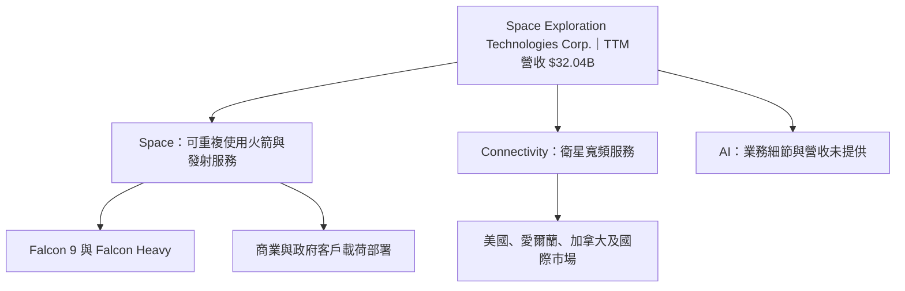
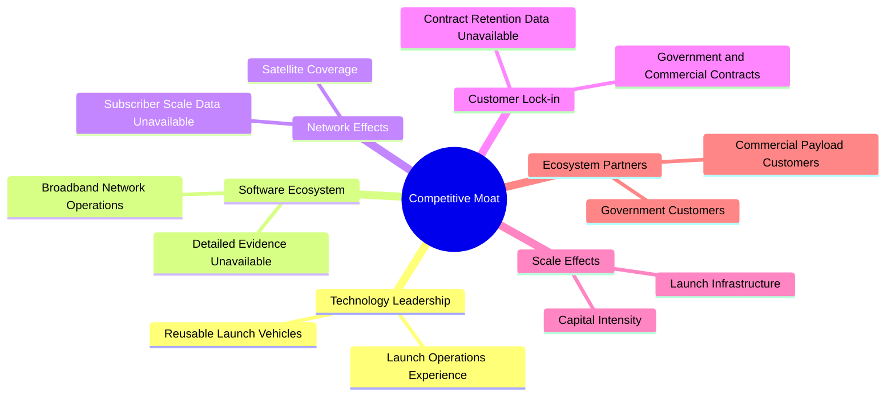
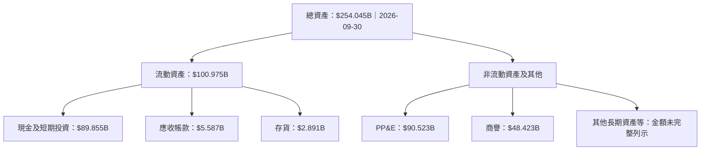
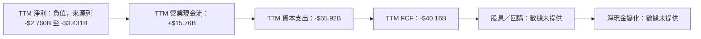
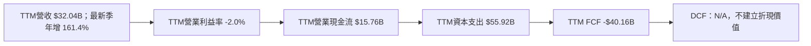
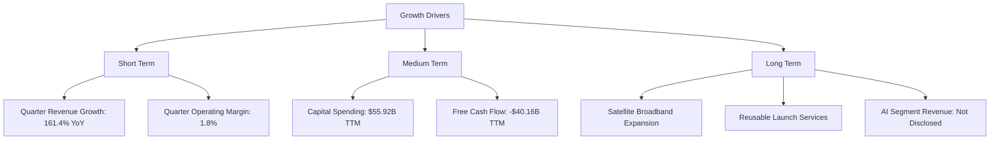
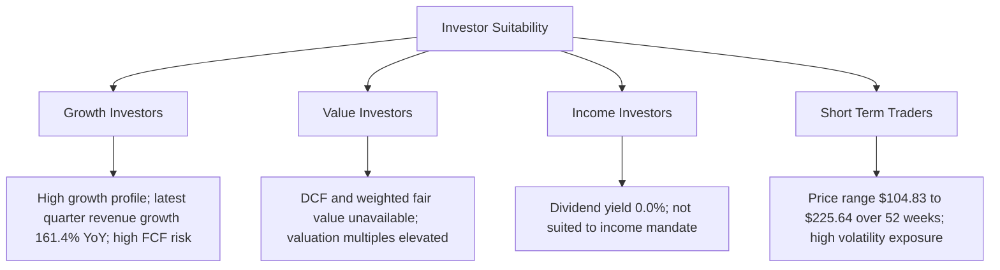

# SPCX 基本面深度分析報告
> **報告日期**：2026-11-21 ｜ **語言**：繁體中文 ｜ **數據來源**：Yahoo Finance、Finviz、StockAnalysis、Roic.ai ｜ **分析師**：CFA 級機構研究

> **重要資料品質提示**：財務與市場資料存在重大交叉來源差異。例如，2026-09-30 營業利益在季度損益表列為 $2.79B，StockAnalysis.com 列為 $4.019B；StockAnalysis.com 的 TTM 淨利為 -$3.431B，Roic.ai 列為 -$2.760B；市場資料列流通股數 8.25B，Roic.ai 列 2026-09-30 股數 13.579B。本文按各項明確標示的來源引用，不把衝突數字混用。這些差異降低任何依賴股數、利潤或估值的結論可信度。

## 目錄

| # | 章節 | 核心結論 |
|---|------|----------|
| 1 | 執行摘要 | 財務高速增長但 TTM FCF 為 -$40.16B；DCF 與加權合理價值無法計算，MOS 與規則 20 評級均無法判定 |
| 2 | 公司概覽與商業模式 | 涉及發射、衛星寬頻及 AI；分部營收與市場份額未提供，護城河有質化依據但缺乏分部數據驗證 |
| 3 | 損益表深度分析 | TTM 營收 $32.04B；最新一季年增 161.4%，但 TTM 營業利益率 -2.0% |
| 4 | 資產負債表分析 | 現金與短期投資 $89.86B，總債務 $39.22B，淨現金 $50.64B |
| 5 | 現金流量深度分析 | TTM FCF -$40.16B，主因資本支出 $55.92B 高於營業現金流 $15.76B |
| 6 | 獲利能力與資本效率 | ROIC N/A，無法判斷是否高於 WACC 9.78% |
| 7 | 相對估值分析 | SPCX 估值倍數高於可比公司中盈利較成熟的 IRDM；估值方法無法計算 |
| 8 | DCF 內在價值評估 | DCF MODEL 為 N/A；不建立替代模型、不提供 DCF 目標價或 MOS |
| 9 | 成長催化劑 | 最新一季營收快速增長，但 TAM 數據與催化劑具體時程未提供 |
| 10 | 風險矩陣 | 資本支出與負自由現金流、估值、資料一致性是主要風險 |
| 11 | 投資建議 | 缺乏可計算的合理價值與 MOS；不給 MOS 評級、目標價或買賣價位 |

---

## 1. 執行摘要

### 1.0 一頁式投資儀表板（Portfolio Manager 30 秒速讀）

| 項目 | 內容 |
|------|------|
| **投資論點（3 句）** | ① 最新一季營收 $14.57B，年增 161.4%，顯示業務擴張加速，但單季增長不能替代 TTM 成長率。② 現金及短期投資 $89.86B、淨現金 $50.64B，短期流動性提供投資緩衝。③ TTM 資本支出 $55.92B 對比營業現金流 $15.76B，令 TTM FCF 為 -$40.16B，投資回報尚未在現金流中體現。 |
| **綜合評分** | **5.3/10**（引用 1.1；六項算術平均） |
| **財務健康** | 🟡 現金與短期投資 $89.86B 高於總債務 $39.22B；但 TTM FCF 為 -$40.16B，資本開支壓力高 |
| **ROIC vs WACC** | **ROIC：N/A；WACC：9.78%**。無法確認正在創造或摧毀股東價值 |
| **FCF 趨勢** | 惡化：FY2023 +$0.105B、FY2024 -$5.39B、FY2025 -$14.12B、TTM -$40.16B；FCF Yield -2.31% |
| **估值** | Forward P/E 46.59906x ｜ EV/EBITDA 143.907x ｜ FCF Yield -2.31% |
| **DCF 內在價值（基準）** | **N/A**；DCF MODEL 不適用。現價相對 DCF 折溢價亦為 N/A |
| **安全邊際（MOS）** | **N/A**；8.8 無加權合理價值，無法依定義計算 |
| **預期報酬（基準情境 12M）** | N/A；DCF 情境與加權合理價值均未提供 |
| **關鍵風險（前二）** | TTM FCF -$40.16B、資本支出 $55.92B；來源資料對營業利益、淨利與流通股數存在差異 |
| **評級 + 信心度** | **規則 20 評級無法判定**（MOS 無法計算）；對財務方向判讀信心：低 |

### 1.1 綜合評分卡（全報告唯一）

| 維度 | 評分（1–10） | 主要依據（引用數字與其來源章節） |
|------|--------------|----------------------------------|
| 成長性 | 8.0 | 最新一季營收年增 161.4%；TTM 營收成長率 N/A（第 3 章） |
| 獲利能力 | 3.0 | TTM 營業利益率 -2.0%、淨利率 -8.6%；ROIC 與 F-Score N/A（第 3、6 章） |
| 財務健康 | 7.0 | 淨現金 $50.64B、流動比率 3.084；TTM FCF -$40.16B（第 4、5 章） |
| 估值 | 2.0 | Forward P/E 46.59906x、P/S 54.16235x、EV/EBITDA 143.907x；合理價值與 MOS N/A（第 7、8 章） |
| 護城河 | 8.0 | 可重複使用火箭、發射服務與衛星寬頻具有技術及規模特性；分部營收和市場份額未提供（第 2 章） |
| 管理層與資本配置 | 4.0 | FY2025 SBC $1.95B；TTM 資本支出 $55.92B、TTM FCF -$40.16B；回購資料 N/A（第 3、5 章） |
| **綜合評分** | **5.3** | 六項算術平均：(8.0 + 3.0 + 7.0 + 2.0 + 8.0 + 4.0) ÷ 6 = 5.333，四捨五入為 5.3 |

### 1.2 五大投資論點 + 三大核心風險

| 類型 | 項目 | 具體依據 | 信心度 |
|------|------|----------|--------|
| 🟢 **投資論點①** | 業務增速加快 | 2026-09-30 季度營收 $14.57B，年增 161.4%；但上一年同期營收 $5.576B，應注意增速不等於獲利品質 | 🟡 中 |
| 🟢 **投資論點②** | 現金緩衝可觀 | 現金與短期投資 $89.86B，總債務 $39.22B，淨現金 $50.64B | 🟢 高 |
| 🟢 **投資論點③** | 毛利率提供再投資空間 | TTM 毛利率 56.8%；但 TTM 營業利益率 -2.0%，顯示研發與營運支出仍侵蝕毛利 | 🟡 中 |
| 🟢 **投資論點④** | 多項業務可能互相支援 | 公司描述涵蓋發射服務、衛星寬頻及 AI；分部營收與各業務獨立獲利資料未提供，協同效應仍待驗證 | 🟡 中 |
| 🟢 **投資論點⑤** | 最新一季轉正 | 2026-09-30 單季營業利益 $2.79B、淨利 $4.40B；另一來源列營業利益 $4.019B，數據差異需查證 | 🟡 低 |
| 🟡 **風險①** | 高投資導致負 FCF | TTM 資本支出 $55.92B、營業現金流 $15.76B，FCF -$40.16B；若投資無法轉化成收入與現金回收，淨現金將被消耗 | 🔴 高 |
| 🔴 **風險②** | 高估值且缺少可驗證內在價值 | Forward P/E 46.59906x、P/S 54.16235x；DCF 與估值方法均無法計算，估值容錯空間難以量化 | 🔴 高 |
| 🔴 **風險③** | 財務資料不一致 | 2026-09-30 股數在市場資料與 Roic.ai 分別為 8.25B 與 13.579B；營業利益與淨利亦有來源差異 | 🔴 高 |

### 1.3 快速統計卡片

| 指標 | 公司實際值（期間） | 同業中位數 | 狀態 |
|------|--------------------|------------|------|
| 營收成長（TTM） | **N/A** | — | 🟡 |
| 營收成長（最新一季年增） | **161.4%** | 72.7%（RKLB）、187.1%（ASTS）、8.3%（IRDM）；三者中位數 72.7% | 🟢 |
| 毛利率（TTM） | **56.8%** | 37.0%（三者中位數） | 🟢 |
| 營業利益率（TTM） | **-2.0%** | — | 🔴 |
| ROIC（TTM） | **N/A** | — | 🟡 |
| Forward P/E | **46.59906x** | 29.5x、634.5x、-14.9x；中位數 29.5x | 🟡 |
| FCF Yield（TTM） | **-2.31%** | — | 🔴 |
| Piotroski F-Score | **N/A** | — | 🟡 |

*同業中位數僅為表列三家公司數值的中位數，未作產業全體代表性推論。*

### 1.4 投資結論

```text
╔══════════════════════════════════════════════════════════════════╗
║                    📊 投資結論摘要                               ║
╠══════════════════════════════════════════════════════════════════╣
║  評級：規則 20 無法判定；MOS 所需的加權合理價值為 N/A            ║
║  價格（2026-11-20 收盤）：$127.79                                ║
║  DCF 內在價值（基準）：N/A（TTM 營業利益率為 -2.0%）             ║
║  安全邊際 MOS：N/A（沒有 8.8 加權合理價值，不能計算）            ║
║  加權合理價值（8.8）：N/A                                        ║
║  綜合評分：5.3/10（引用 1.1）                                    ║
║  適合投資人：能承受高波動、熟悉高資本支出成長型公司的投資人       ║
╚══════════════════════════════════════════════════════════════════╝
```

---

## 2. 公司概覽與商業模式

### 2.1 業務結構與收入來源

公司概覽描述提及 Space、Connectivity 與 AI 三個營運板塊；Space 涵蓋可重複使用火箭及發射服務，Connectivity 涵蓋衛星寬頻。分部營收、各板塊占比與 AI 的具體產品收入未提供，因此不繪製收入占比圖，也不推算各板塊金額。



### 2.2 市場份額

市場份額的公司或產業數字未提供，近期新聞也沒有可用於量化市占率的資料。可以確認的是公司 TTM 營收 $32.04B、最新一季營收年增 161.4%；但由於同業營收規模與市場定義不完整，不能據此推導市場份額或市場排名。

### 2.3 競爭護城河分析



### 2.4 護城河強度

| 護城河項目 | 強度（強／中／弱） | 證據（引用數字或事實） | 會削弱它的情況 |
|------------|--------------------|------------------------|----------------|
| 技術與營運能力 | 強 | 公司提供 Falcon 9、Falcon Heavy 發射服務並使用可重複使用火箭；發射成功率、成本與競品比較數據未提供 | 發射事故、可靠度下降或競品降低發射成本 |
| 規模效應 | 中至強 | TTM 營收 $32.04B；TTM 資本支出 $55.92B，反映業務資本密集、規模與投資能力可能重要 | 資產利用率低、Capex 長期高於現金回收 |
| 衛星網路效應 | 中 | 提供跨國衛星寬頻服務；用戶數、ARPU、續約率及覆蓋能力數據未提供 | 網路擴張速度不足、容量或服務品質落後 |
| 客戶鎖定 | 中 | 商業與政府客戶使用發射服務；合約期限、續約率及客戶集中度未提供 | 客戶轉向競爭者或政府採購轉變 |
| 軟體生態系統 | 弱至中 | Connectivity 與 AI 均有業務描述，但軟體收入、產品指標與外部客戶資料未提供 | 服務差異化有限、軟體收入未能形成經常性收入 |
| 生態夥伴 | 中 | 業務涉及商業與政府載荷客戶；合作夥伴營收貢獻未提供 | 夥伴合作終止或依賴少數大客戶 |

1.1「護城河」評分為 **8.0/10**，反映火箭、發射與衛星網路的技術及資本規模特性；但缺少市占率、單位成本、客戶留存等可量化證據，評分不代表估值已獲證實。

---

## 3. 損益表深度分析

### 3.1 年度收入成長趨勢（可取得年度）

| 年度 | 營收 | 年增率 | 解讀 |
|------|------|--------|------|
| FY2023 | $10.387B | N/A | 提供的年度序列起點 |
| FY2024 | $14.015B | +34.93% | 較 FY2023 增長 |
| FY2025 | $18.674B | +33.24% | 增長維持，但年度數字不包含 2026 全年 |

FY2023–FY2025 兩年 CAGR = \((18.674 ÷ 10.387)^{1/2} - 1\) = **34.1%**。這是由年度營收計算的歷史 CAGR，不是 TTM 成長率。

```text
╔══════════════════════════════════════════════════════════════════╗
║          Space Exploration Technologies Corp. 年度營收          ║
╠══════════════════════════════════════════════════════════════════╣
║  FY2023  $10.387B  ███████████░░░░░░░░░  YoY：N/A             ║
║  FY2024  $14.015B  ███████████████░░░░░  YoY：+34.93%          ║
║  FY2025  $18.674B  ████████████████████  YoY：+33.24%          ║
║                                                                  ║
║  FY2023–FY2025 年度營收 CAGR：+34.1%                             ║
╚══════════════════════════════════════════════════════════════════╝
```

### 3.2 季度收入趨勢分析

| 季度 | 營收 | QoQ | YoY | 備註 |
|------|------|-----|-----|------|
| 2025-12-31 | $4.96B | N/A | N/A | 提供的四季序列起點 |
| 2026-03-31 | $4.69B | -5.4% | +15.42% | 營收較上一季下降，仍高於去年同期 |
| 2026-06-30 | $7.81B | +66.5% | +91.94% | 季度營收加速 |
| 2026-09-30 | $14.57B | +86.4% | +161.4% | 最新一季增長顯著；單季年增率，不是 TTM 成長率 |

QoQ 以相鄰季度營收計算，例如 2026-09-30：\((14.575 ÷ 7.814)-1=86.4\%\)。單季急速放大可能反映交付、發射服務或其他業務認列時點，分部資料未提供，無法區分有機成長與收入認列時點影響。

### 3.3 利潤率演變分析

| 利潤率指標 | FY2023 | FY2024 | FY2025 | TTM／最新季 | 趨勢與評估 |
|------------|--------|--------|--------|-------------|------------|
| 毛利率 | 41.2% | 42.9% | 49.4% | TTM 56.8% | 🟢 上升；產品組合、服務定價或成本效率可能改善，但分部數據不足以驗證主因 |
| 營業利益率 | 4.88% | 5.29% | -11.05% | TTM -2.0%；最新季 1.8% | 🔴 FY2025 明顯下滑，與高研發及投資支出一致；最新季度轉正但須觀察持續性 |
| 淨利率 | -44.56% | 5.64% | -26.44% | TTM -8.6% | 🔴 年度波動大；稅項、非營業損益及一次性項目明細不足 |

FY2025 研發支出為 $8.64B，較 FY2024 的 $3.46B 高，研發投入與營業利益轉負同時發生。此關聯不能證明全部利潤率惡化均由研發造成，但說明即使毛利率改善，研發及其他營運費用仍可能壓過毛利。2026-09-30 最新季營業利益率 1.8%，相較 TTM -2.0% 出現改善；然而其他來源列同一季度營業利益 $4.019B，而季度損益表列 $2.79B，需以正式申報資料核對。

### 3.4 費用結構分析

完整成本明細、各項營運費用與其佔營收比重沒有一致的 TTM 數據，因此不繪製費用圓餅圖。可用數字包括 FY2025 研發支出 $8.64B、TTM 資本支出 $55.92B；資本支出是現金流投資項目，不應與損益表費用直接相加或混為一談。

### 3.5 季度 EPS 趨勢與盈餘品質（Quality of Earnings）

最近四季 EPS 實際值及市場預估值未完整提供。歷史驚喜表的 EPS Est、EPS Act 均為 nan，因此不能判定超預期或不及預期，也不能把空值當作 miss。

| 盈餘品質項目 | 數值／佔比 | 評估 |
|--------------|-----------|------|
| 股權薪酬 SBC / 營收 | 2026 年四季 SBC 合計 $4.733B ÷ TTM 營收 $32.04B = **14.8%** | 🔴 高稀釋成本；SBC 是非現金費用，但會稀釋股東權益或代表員工薪酬成本 |
| SBC / 營業現金流 | $4.733B ÷ $15.76B = **30.0%** | 🔴 SBC 規模相當於營業現金流近三成，不宜把營業現金流全數視為可分配現金 |
| FCF / 淨利（現金轉換率） | FCF -$40.16B；TTM 淨利來源數據互異：StockAnalysis.com -$3.431B、Roic.ai -$2.760B | 🔴 淨利為負且來源不一致，比例不具正常「現金轉換率」解讀意義；FCF 明確為負 |
| 一次性／非經常性損益 | N/A（明細未提供） | 無法判斷最新單季 $4.40B 淨利是否受一次性項目影響 |
| 有效稅率異常 | N/A（TTM 有效稅率未提供） | 無法判斷稅務利益是否帶動單季獲利 |
| 資本化支出 vs 費用化 | FY2025 Capex $20.91B、研發費用 $8.64B；TTM Capex $55.92B | 高資本支出提高未來折舊與資產回收風險；資本化政策細節不足，不能判定是否不當遞延成本 |

**盈餘品質結論**：最新季度轉盈是正面訊號，但 TTM 淨利仍為負、TTM FCF 為 -$40.16B，SBC 約佔 TTM 營收 14.8%。在缺少一次性損益、稅項及分部現金流明細下，最新單季 GAAP 盈利是否可持續尚未獲證實；估值不宜單憑該季度獲利年化。

---

## 4. 資產負債表分析

### 4.1 資產結構分解

截至 2026-09-30，StockAnalysis.com 列總資產 $254.045B、流動資產 $100.975B、PP&E $90.523B、商譽 $48.423B。以下金額照列該來源；資產細項未必代表完整總額分解。



### 4.2 流動性與營運資金分析

| 指標 | 最新值 | 歷史值 | 解讀 |
|------|--------|--------|------|
| 流動比率 | 3.084 | FY2025 流動資產 $30.95B、流動負債 $21.40B | 🟢 最新比率顯示流動資產覆蓋流動負債能力高；期間與季度口徑需留意 |
| 速動比率 | 2.945 | N/A | 🟢 超過 1，短期流動性緩衝充分 |
| 現金及短期投資 | $89.86B | FY2025 $24.75B | 🟢 增長明顯，但資金用途及受限制部分需核實 |
| 淨現金 | $50.64B | N/A | 🟢 現金及短期投資高於總債務 |

| 指標 | 最新 TTM | 一年前 TTM | 變化 | 解讀 |
|------|----------|------------|------|------|
| DSO 應收帳款天數 | 54 天 | N/A | N/A | 目前收款天數為 54 天；一年前比較數據未提供 |
| DIO 存貨天數 | 76 天 | N/A | N/A | 庫存占用營運資金；是否堆積須比較歷史與產品交付 |
| DPO 應付帳款天數 | 349 天 | N/A | N/A | 偏長的支付天數可能降低短期現金需求，但亦需核對付款條款與分類 |
| CCC 現金轉換週期 | -219 天 | N/A | N/A | 依品質指標原值；反映應付帳款天數高於應收與庫存天數之和，不足以單獨證明議價力 |

### 4.3 債務結構分析

```text
╔══════════════════════════════════════════════════════════════════╗
║                 SPCX 債務健康診斷（2026-09-30）                  ║
╠══════════════════════════════════════════════════════════════════╣
║  總債務：        $39.22B    █████████░░░░░░░░░░░                 ║
║  現金+短期投資： $89.86B    ████████████████████                ║
║  淨現金：        $50.64B    ███████████                          ║
║                                                                  ║
║  Debt/EBITDA：N/A（EBITDA與債務口徑、期末口徑未能一致核對）      ║
║  利息保障倍數：N/A（利息費用明細未提供）                         ║
║  Debt/Equity：22.186（來源列示；與其他股權資料口徑有差異）       ║
║  結論：🟢 淨現金為正；🔴 持續負 FCF 是資金消耗的核心監控項目    ║
╚══════════════════════════════════════════════════════════════════╝
```

### 4.4 股東權益趨勢

| 財年 | 股東權益 | 年增額 | 解讀 |
|------|----------|--------|------|
| FY2024 | $25.80B | N/A | 可用年度序列起點 |
| FY2025 | $41.33B | +$15.53B（約 +60.2%） | 股東權益增加，但不能單憑此判斷為營運現金創造；需結合增資、SBC 與其他權益變動 |

Roic.ai TTM 股東權益列為 $176.768B，與 FY2025 $41.325B 相差甚大，本文不將此 TTM 值與年度序列混接；須先核對會計口徑與來源。

---

## 5. 現金流量深度分析

### 5.1 現金流量瀑布圖

TTM 淨利數據來源有差異，圖中標示來源口徑；股息、回購與淨現金變化的完整現金流量表明細未提供，故不延伸推算。



### 5.2 FCF 轉換率趨勢

| 期間 | FCF | 淨利 | FCF / 淨利 | 評估 |
|------|-----|------|-----------|------|
| FY2023 | +$0.105B | -$4.628B | 不適合解讀 | 淨利為負，且盈利與現金流方向不同 |
| FY2024 | -$5.39B | +$0.791B | 約 -681.4% | 投資支出高於營運現金流，現金轉換弱 |
| FY2025 | -$14.12B | -$4.94B | 約 285.8%（負數除負數） | 比率呈正值但 FCF、淨利均為負，不能視為高品質轉換 |
| TTM | -$40.16B | -$2.760B 至 -$3.431B（來源有差異） | 不具正常解讀性 | 負 FCF 遠超淨利虧損，核心原因為 Capex 高 |

### 5.3 自由現金流趨勢

| 期間 | FCF | FCF Yield |
|------|-----|-----------|
| FY2023 | +$0.105B | N/A |
| FY2024 | -$5.39B | N/A |
| FY2025 | -$14.12B | N/A |
| TTM | **-$40.16B** | **-2.31%** |

```text
╔══════════════════════════════════════════════════════════════════╗
║                 自由現金流歷史趨勢（USD）                        ║
╠══════════════════════════════════════════════════════════════════╣
║  FY2023  +$0.105B  ▏                    FCF Yield：N/A           ║
║  FY2024  -$5.39B   ███                  FCF Yield：N/A           ║
║  FY2025  -$14.12B  ███████              FCF Yield：N/A           ║
║  TTM     -$40.16B  ████████████████████ FCF Yield：-2.31%        ║
║                                                                  ║
║  解讀：投資支出擴大速度高於營業現金流，短期現金回收仍未跟上。   ║
╚══════════════════════════════════════════════════════════════════╝
```

### 5.4 資本配置評估

支出與資本配置數據顯示公司處於高再投資階段；回購、股息及留存現金的完整分配數據未提供，因此不畫資本配置圓餅圖。

| 項目 | 數值 | 分析 |
|------|------|------|
| 資本支出 | TTM $55.92B；FY2025 $20.91B | 重大投資承諾，但尚未轉化為正 FCF |
| 營業現金流 | TTM $15.76B | 為資本支出的部分資金來源 |
| 股權薪酬 | FY2025 $1.95B；最新四季合計 $4.733B | SBC 高，增加股東稀釋成本 |
| 股息 | 股息殖利率 0.0% | 無股息現金分配 |
| 回購 | N/A | 未提供資料，不能假設有或沒有實際回購 |

---

## 6. 獲利能力與資本效率

### 6.1 ROE / ROA / ROIC 趨勢

| 指標 | FY2023 | FY2024 | FY2025 | TTM | 評估 |
|------|--------|--------|--------|-----|------|
| ROE | N/A | N/A | N/A | N/A | 品質指標顯示缺少可一致計算的淨利、資產或正權益輸入 |
| ROA | N/A | N/A | N/A | N/A | N/A |
| ROIC | N/A | N/A | N/A | N/A | 歷史 ROIC 數據未提供 |
| WACC | — | — | — | 9.78% | 採用成本資本數據所列值 |

行業均值沒有可引用資料，因此不作行業比較。

### 6.2 ROIC vs WACC 分析（核心價值創造判斷）

```text
╔══════════════════════════════════════════════════════════════════╗
║                   ROIC vs WACC 深度分析                          ║
╠══════════════════════════════════════════════════════════════════╣
║  WACC 輸入（成本資本資料）：                                     ║
║  ├── 無風險利率（10Y美債）： 4.91%                               ║
║  ├── 市場風險溢酬 ERP：      5.00%                               ║
║  ├── 原始 Beta：             N/A                                 ║
║  ├── 採用調整後 Beta：       1.00（假設值：原始 Beta 缺失）       ║
║  ├── 股權成本：              9.91%                              ║
║  ├── 稅前債務成本：          4.96%                              ║
║  ├── 稅率：                  21.0%                              ║
║  ├── 股權／債務權重：        97.8%／2.2%                         ║
║  └── WACC：                  9.78%                              ║
║                                                                  ║
║  ROIC：N/A（未提供可核對的投入資本回報率）                       ║
║  EVA = ROIC − WACC：N/A                                          ║
║  結論：無法判定 SPCX 是否以高於 9.78% 的 ROIC 創造股東價值。    ║
╚══════════════════════════════════════════════════════════════════╝
```

成本資本資料直接列示 Ke 9.91%、稅前 Kd 4.96%、資本權重 97.8%／2.2%、WACC 9.78%。原始 Beta 缺失而採調整後 Beta 1.00；WACC 是來源提供的成本資本估計值，與其他章節一致使用。ROIC 不可用，故不能把正淨現金或最新單季獲利直接等同價值創造。

### 6.3 杜邦三因素分解

**N/A**（品質指標資料指出淨利、營收、總資產或正股東權益條件不足，無法提供可一致計算的杜邦三因素）。因此不推算淨利率、資產週轉率、權益乘數與 ROE，也不以其他來源拼接計算。

### 6.4 財務體質：Piotroski F-Score

**N/A**（需要兩個相隔一年的 SEC 申報資料 TTM 期間；目前數據沒有 SEC 申報資料支持的九項測試結果）。因此不臆測 F-Score 分數或逐項通過狀態。

---

## 7. 相對估值分析

### 7.1 同業估值比較表格

| 估值指標 | **SPCX** | **RKLB** | **ASTS** | **IRDM** | SPCX 評估 |
|----------|----------|---------|---------|---------|-----------|
| **Trailing P/E** | 555.6087x | N/A | N/A | 27.3x | 🔴 SPCX 高倍數且 TTM 盈利品質需核實；同業兩家無可比值 |
| **Forward P/E** | 46.59906x | 634.5x | -14.9x | 29.5x | 🟡 高於 IRDM，低於 RKLB；ASTS 負值不具一般倍數比較意義 |
| **P/S Ratio** | 54.16235x | 34.7x | 65.3x | 4.9x | 🔴 顯著高於 IRDM，亦高於 RKLB；僅低於 ASTS |
| **EV/EBITDA** | 143.907x | -140.9x | -18.1x | 16.6x | 🔴 明顯高於有正 EBITDA 的 IRDM；負倍數同業不宜直接比較 |
| **最新一季營收年增** | 161.4% | 72.7% | 187.1% | 8.3% | 🟢 SPCX 高於 RKLB、IRDM，低於 ASTS |
| **毛利率（TTM）** | 56.8% | 36.2% | 37.0% | 71.5% | 🟡 高於 RKLB、ASTS，低於 IRDM |

SPCX 的市場估值看似已反映較高成長預期，但同業所處發展階段、業務組合與盈餘狀態差異很大。尤其 P/S 54.16235x 與 EV/EBITDA 143.907x，在 TTM FCF -$40.16B 情況下，對未來轉化成盈利及現金流的要求很高。

### 7.2 歷史估值區間分析

**N/A**（未提供「Valuation vs own history」歷史估值區間數值）。價格歷史顯示 52 週高點 $225.64、低點 $104.83；2026-11-20 收盤 $127.79，但價格區間不能替代歷史 P/E 或估值百分位。

### 7.3 情境價值（Bear / Base / Bull）

**N/A（DCF 無法計算：TTM 營業利益率為 -2.0%，DCF MODEL 標示不以負營業利益建立折現模型）**。因此不提供悲觀、基準與樂觀 DCF 情境價值、機率或目標價。

### 7.4 相對估值隱含價格區間

**N/A**（估值方法資料標示沒有任何方法可計算）。雖有同業倍數，但缺乏估值程式所需的相對估值方法輸入與可核對的稀釋股數／財務基礎；不自行以單一倍數建立替代目標價。

---

## 8. DCF 內在價值評估（Discounted Cash Flow）

### 8.0 估值推理鏈（Thinking Logic）

TTM 營業利益率為 **-2.0%**，而 DCF MODEL 明確列示 N/A，理由是 TTM 營業利益不為正，對虧損折現不構成有意義的價值估算。因此本章不建造替代模型、不另行假設預測期或利潤率，也不輸出虛構的內在價值、情境目標價或 MOS。

價值主要取決於三個待驗證來源：發射服務、衛星寬頻與 AI；但分部營收占比未提供。最新一季營收 $14.57B、年增 161.4%，而 TTM 營業利益率 -2.0%、TTM FCF -$40.16B，說明營收增長尚未證明可持續轉成自由現金流。當前最脆弱的環節是高資本投入能否產生足以覆蓋投資成本的增量現金流。

**模型決策**：DCF 為 N/A，不採 FCFF 或 FCFE 預測、不選終值方法、不設定 WACC 情境，也不進行每股價值橋接。雖然成本資本資料列示 WACC 9.78%，但折現率本身不能解決營業利益為負、成長與投資回報路徑不可驗證的問題。



### 8.1 模型假設總表（Model Inputs）

| 假設項目 | 採用值 | 依據／來源 | 敏感度 |
|----------|--------|-------------|--------|
| 預測期長度 N | N/A | DCF MODEL 不適用，不建模 | N/A |
| 營收 CAGR（預測期） | N/A | 歷史 FY2023–FY2025 CAGR 34.1%，但不能直接當作未來預測 | N/A |
| 營業利潤率（期末） | N/A | TTM 營業利益率 -2.0%，模型不對虧損折現 | N/A |
| 有效稅率 | N/A | DCF 未建立；成本資本資料的 21.0% 是預設稅率，不等同公司實際有效稅率 | N/A |
| Capex／營收 | N/A | TTM Capex $55.92B 可見，但模型未建立 | N/A |
| D&A／營收 | N/A | 估值模型不適用 | N/A |
| 營運資金變動／營收增額 | N/A | 估值模型不適用 | N/A |
| EBIT 基礎 | N/A | 不建立 GAAP／非 GAAP 預測 | N/A |
| SBC 處理 | N/A | 不建模、不重複假設股數或現金扣除 | N/A |
| 年稀釋率 | N/A | 流通股數資料來源不一致，且 DCF 未建立 | N/A |
| 永續成長率 g | N/A | DCF MODEL N/A | N/A |
| 終值方法 | N/A | DCF MODEL N/A | N/A |
| WACC | 9.78%（成本資本資料列示） | 作為成本資本參考；DCF 未使用此數值計算企業價值 | N/A |

### 8.2 折現率推導（WACC）

```text
╔══════════════════════════════════════════════════════════════════╗
║                    WACC 推導（折現率）                           ║
╠══════════════════════════════════════════════════════════════════╣
║  成本資本資料列示：                                              ║
║  ├── 無風險利率 Rf（10Y 美債）：4.91%                            ║
║  ├── 市場風險溢酬 ERP：5.00%                                     ║
║  ├── 原始 Beta：N/A                                              ║
║  ├── 調整後 Beta：1.00（原始 Beta 缺失時的假設值）               ║
║  ├── 股權成本 Ke：9.91%                                          ║
║  ├── 稅前債務成本 Kd：4.96%                                      ║
║  ├── 稅率：21.0%                                                 ║
║  ├── 股權／債務權重：97.8%／2.2%                                 ║
║  └── WACC：9.78%                                                 ║
║                                                                  ║
║  輸入來源已列示的 CAPM 關係：4.91% + 1.00 × 5.00% = 9.91%       ║
║  DCF 結論：雖有 WACC 輸入，因模型本身 N/A，不做折現計算。        ║
╚══════════════════════════════════════════════════════════════════╝
```

成本資本資料未提供 10Y 美債觀察日期、ERP 估計依據、債務利息金額與平均計息負債明細，因此無法依報告模板重建完整五步 WACC 算式。本文遵守來源數字，直接引用 WACC 9.78%，不另行重算或替換。

### 8.3 逐年自由現金流預測（基準情境）

**N/A**（DCF MODEL 不適用：TTM 營業利益率為 -2.0%）。沒有程式提供的逐年假設及現金流預測；不自建逐年表、不用歷史增長率外推，也不估算終值。

### 8.4 終值計算（Terminal Value）

**N/A**（DCF 未建立預測期，因此沒有 FY+N 現金流、永續成長率或退出倍數可供計算）。不套用 Gordon Growth 或退出倍數。

### 8.5 企業價值 → 每股內在價值（Bridge）

**N/A**（沒有預測期 FCF 現值與終值，無法計算 EV 或股權價值）。另有流通股數資料差異：市場資料 8.25B 股，Roic.ai 2026-09-30 列 13.579B 股；在股數口徑未核實前，也不能可靠地計算每股內在價值。

2026-11-20 收盤價為 **$127.79**。折溢價定義需要 DCF 基準內在價值作分母，故此處為 N/A；本節不計算 MOS。

### 8.6 敏感性分析（WACC × 永續成長率）

**N/A**（沒有基準 DCF、預測期現金流、終值或每股價值；因此無法生成 5×5 矩陣、示範格或三情境價值）。

### 8.7 反推 DCF（Reverse DCF：市場在預期什麼）

**N/A**（沒有有效的基準 DCF 模型可固定其他變數並反解單一未知數）。不能從現價 $127.79 反推營收 CAGR、期末營業利潤率、永續成長率或預測期長度。

### 8.8 估值三角驗證與安全邊際

**N/A**（估值方法資料標示「None could be computed」）。未提供可引用的估值方法價值與固定權重，因此不提供加權合理價值，不計 MOS、上行空間或 MOS 評級。分析師共識目標價均值 $257.50、低值 $70.00、高值 $800.00，僅作市場預期參考，不等同本報告估值方法，也不能替代加權合理價值。

- 加權合理價值：N/A  
- MOS：N/A  
- 上行空間：N/A  
- 買入／持有／減碼價格區間：N/A  
- 規則 20 評級：無法判定，原因為 MOS 不可計算  

### 8.9 DCF 模型的局限與失效條件

本報告沒有 DCF 模型輸出，因此無法提供終值占比或量化敏感度。主要限制如下：

- TTM 營業利益率為 -2.0%，營業現金流 $15.76B 低於資本支出 $55.92B，TTM FCF 為 -$40.16B；現金流對投資週期與資本開支節奏高度敏感。
- 最新季度盈利轉正，但年內季度營業利益在提供的財務表格中波動很大；單一季度不適合作為穩態盈利基礎。
- 分部營收、各項資產投資的預期回報與現金流、未來股數稀釋率未提供。
- 市場資料與其他來源的股數及損益數值不一致，會影響每股估值。
- 較適合補充觀察營收、單位經濟性、分部現金流與投資回收情況；在分部利潤和資本回報仍不清楚時，以 P/S 或單一 EBITDA 倍數得出精確目標價亦容易產生誤導。

### 8.10 複算檢核表（Audit Trail）

| # | 檢核項目 | 結果 |
|---|----------|------|
| 1 | 高／中敏感度輸入的四段式推導 | N/A：DCF 模型未建立 |
| 2 | 模型假設均有來源依據 | N/A：未採用 DCF 假設 |
| 3 | WACC 五步算式與重算 | 未重算；按成本資本資料引用 WACC 9.78% |
| 4 | Kd 分母與債務權重口徑一致 | N/A：利息與平均計息負債明細未提供 |
| 5 | WACC 與第 6.2 節一致 | ✅ 均引用 9.78% |
| 6 | 逐年預測年度數與 N 一致 | N/A：無預測期 |
| 7 | FY+1 九步算式可複算 | N/A：無逐年模型 |
| 8 | 預測期 PV 逐項加總 | N/A：無預測期 PV |
| 9 | WACC > g | N/A：未設定 g |
| 10 | 終值使用 FY+N FCF 並折現 N 期 | N/A：無終值 |
| 11 | EV 至每股價值橋接 | N/A：無 EV 或每股內在價值 |
| 12 | SBC、EBIT 基礎與股數處理相容 | N/A：未建模；未假設稀釋率 |
| 13 | 敏感性矩陣基準格與 DCF 基準值一致 | N/A：無矩陣 |
| 14 | 矩陣有效格均符合 WACC > g | N/A：無矩陣 |
| 15 | 三情境機率合計 100% | N/A：無情境 |
| 16 | Reverse DCF 一次只解一個變數 | N/A：無反推模型 |
| 17 | MOS 與 8.8 加權價值一致 | N/A：MOS 未計算 |
| 18 | 報告完整至第 11 章 | ✅ |
| 19 | 加權合理價值等於估值方法加權和 | N/A：無方法可計算 |
| 20 | 評級符合 MOS 門檻 | N/A：MOS 未計算，不提供 MOS 評級 |

---

## 9. 成長催化劑

### 9.1 催化劑時間軸

公司近期新聞提及可能的 Starlink 合作、燃氣渦輪支出計畫及融資等事項，但沒有可驗證的公司營運里程碑完成日期。故不以自訂時間區間製作甘特圖。

| 時間範圍 | 催化劑／觀察事項 | 可追蹤數字 |
|----------|------------------|------------|
| 近期 | 核實最新季度營收快速增長是否延續 | 2026-09-30 季度營收 $14.57B、年增 161.4% |
| 中期 | 追蹤 Capex 是否帶來營收、毛利與營業現金流改善 | TTM Capex $55.92B、OCF $15.76B、FCF -$40.16B |
| 長期 | 衛星寬頻、發射服務與 AI 的分部經濟性 | 分部收入、利潤率與客戶指標未提供 |

### 9.2 TAM 市場規模分析

**N/A（TAM 數據未提供）**。公司 TTM 營收 $32.04B，最新一季營收年增 161.4%，顯示業務規模與成長速度可觀；但沒有可引用的市場規模、來源年份或各產品滲透率資料，不能自行估算 TAM。

### 9.3 成長驅動力結構圖



---

## 10. 風險矩陣

### 10.1 風險評分矩陣

發生機率與財務衝擊的可靠百分比資料未提供。為避免把主觀風險分數冒充為財務事實，不製作含數值座標的 quadrantChart；下表以風險性質、已知數字及監控方式呈現。

### 10.2 風險清單詳細分析

| # | 風險項目 | 發生機率 | 財務衝擊 | 風險評估 | 緩解措施 |
|---|----------|----------|----------|----------|----------|
| 1 | 🔴 資本開支持續高於現金創造 | 中高；依現有數字判斷，非統計機率 | TTM Capex $55.92B、OCF $15.76B，FCF -$40.16B | 🔴 高 | 每季追蹤 Capex、OCF、FCF；確認新增資產帶來的營收與現金流回收 |
| 2 | 🔴 估值對增長與獲利轉化要求高 | 高度依賴未來成長 | P/S 54.16235x、EV/EBITDA 143.907x、Forward P/E 46.59906x | 🔴 高 | 不以未驗證的市值目標價取代內在價值；監控營業利益率與 FCF 改善 |
| 3 | 🔴 財務資料品質及股數口徑不一致 | 已觀察到資料衝突 | 流通股數 8.25B 與 13.579B；最新季度營業利益 $2.79B 與 $4.019B | 🔴 高 | 以正式 SEC 申報資料及公司財報核對股數、分部業績與現金流 |
| 4 | 🟡 最新單季盈利能否持續 | 尚未有足夠季度資料驗證 | 最新季淨利 $4.40B；此前季度淨利為負 | 🟡 中高 | 觀察連續季度營業利益率、調整項及稅項 |
| 5 | 🟡 SBC 稀釋股東回報 | SBC 佔營收約 14.8% | 四季 SBC $4.733B；流通股數來源亦有差異 | 🟡 中高 | 追蹤季度 SBC／營收、稀釋股數及回購抵銷比例 |
| 6 | 🟡 長期付款條件及營運資金 | DPO 349 天，資料需進一步確認 | CCC -219 天 | 🟡 中 | 追蹤應付帳款、付款週期與供應商條款；不要單獨將負 CCC 視為競爭優勢 |

---

## 11. 投資建議

### 11.1 最終評級與評分

SPCX 的綜合評分為 **5.3/10**，六項分數依序為成長性 8.0、獲利能力 3.0、財務健康 7.0、估值 2.0、護城河 8.0、管理層與資本配置 4.0。依規則 20，評級必須以 8.8 MOS 判定；由於估值方法均無法計算，MOS 為 N/A，因此本報告不給買入、持有或賣出評級，也不作一級調整。

### 11.2 合理價值與隱含報酬率

| 指標 | 每股價值 | 相對 2026-11-20 收盤價 $127.79 | 說明 |
|------|----------|-------------------------------|------|
| 加權合理價值 | N/A | N/A | 8.8 無可計算估值方法及權重 |
| DCF 基準情境 | N/A | N/A | DCF MODEL 不適用 |
| 悲觀／樂觀 DCF 情境 | N/A | N/A | 無 DCF Scenarios 可引用 |
| 分析師共識目標價均值 | $257.50 | 約 +101.5% | 37 位分析師共識；非本報告合理價值，也不取代 MOS |
| 分析師共識低／高目標價 | $70.00／$800.00 | 不採作本報告目標價 | 區間極寬，反映估值分歧，不能直接作投資區間 |

### 11.3 買入時機與觸發因素

```text
╔══════════════════════════════════════════════════════════════════╗
║                  ✅ 投資觸發因素 Checklist                       ║
╠══════════════════════════════════════════════════════════════════╣
║  後續評估前優先確認：                                            ║
║  ☐ 取得正式申報資料，核對季度營業利益、淨利與稀釋股數            ║
║  ☐ 連續季度營業利益率維持正值，而非單季轉正                      ║
║  ☐ TTM FCF 由 -$40.16B 改善，且改善不只來自延遲資本支出          ║
║                                                                  ║
║  可考慮提高研究信心的條件：                                      ║
║  ☐ Capex／營收下降，同時營收與營業現金流沒有明顯放緩              ║
║  ☐ SBC／營收低於目前計算的約 14.8%，或稀釋股數成長放緩            ║
║  ☐ 可取得各分部營收、利潤率及投資回報資料                        ║
║                                                                  ║
║  重新檢視或降低曝險的條件：                                      ║
║  ☐ FCF 進一步惡化，或營業現金流無法支應必要 Capex                 ║
║  ☐ 最新季度正營業利益無法延續，TTM 營業利益率維持負值              ║
║  ☐ 核對後發現實際稀釋股數顯著高於市場估值所用股數                  ║
║                                                                  ║
║  價格買入區間：N/A（沒有可計算加權合理價值與 MOS）                 ║
╚══════════════════════════════════════════════════════════════════╝
```

### 11.4 投資人適配度分析



### 11.5 每季財報監控清單（Quarterly Watch List）

| 監控指標 | 最新基準 | 加碼／提高信心觀察條件 | 減碼／重新評估條件 |
|----------|----------|----------------------|--------------------|
| 營收年增 | 最新季 +161.4%；TTM 成長率 N/A | 連續季度增長且可由分部披露驗證 | 連續兩季營收年增低於 50%，並伴隨利潤率下滑 |
| 營業利益率 | TTM -2.0%；最新季 1.8% | 多季維持正值，且與正式財報一致 | 再次轉負並持續兩季以上 |
| 營業現金流 | TTM $15.76B | 營業現金流持續增長並逐步覆蓋 Capex | 營業現金流下降、Capex 仍維持高位 |
| 資本支出 | TTM $55.92B | Capex 佔營收下降且資產利用率提高 | Capex 增加但收入、毛利或營業現金流無改善 |
| 自由現金流 | TTM -$40.16B；Yield -2.31% | 連續改善、逐步接近損益兩平 | FCF 再惡化，或現金消耗加速 |
| SBC／營收 | 估算約 14.8% | 比率下降或股份數增長放緩 | SBC／營收上升且股數持續擴大 |
| 現金與總債務 | $89.86B／$39.22B | 淨現金維持充足 | 淨現金快速下降而 FCF 無改善 |
| 分部業績與財測 | 分部營收及財測 N/A | 公司披露可核對分部利潤與投資回報 | 關鍵業務未披露、或財測與實際差距擴大 |

上述門檻是供持續追蹤的風險觸發條件，不代表保證買賣訊號，也不能替代估值與投資人自身風險承受度。

### 11.6 反面論證：什麼會證明論點錯誤（What Would Change My Mind）

```text
╔══════════════════════════════════════════════════════════════════╗
║              ⚠️ 論點失效條件（Disconfirming Evidence）           ║
╠══════════════════════════════════════════════════════════════════╣
║  下列情況成立時，應重新檢視或降低投資論點信心：                  ║
║  ☐ 核心營收年增連續兩季低於 50%，且沒有分部轉型或基期因素解釋    ║
║  ☐ 最新季 1.8% 營業利益率無法延續，TTM 營業利益率仍低於 0%       ║
║  ☐ TTM FCF 低於目前 -$40.16B，或營業現金流進一步低於 Capex       ║
║  ☐ SBC／營收持續高於目前估算的 14.8%，稀釋股數亦持續增加          ║
║  ☐ 現金與短期投資相較 $89.86B 顯著下降，且投資回收未改善          ║
║  ☐ 正式申報資料確認股數、淨利或營業利益與現有估值輸入重大不符    ║
║  ☐ 未來取得 ROIC 後發現長期低於成本資本資料所列 WACC 9.78%        ║
╚══════════════════════════════════════════════════════════════════╝
```

> **免責聲明**：本報告為 AI 自動生成，僅供研究參考，不構成投資建議。投資有風險，入市需謹慎。

---

## 資料與來源

| 項目 | 內容 |
|------|------|
| 價格 | 127.79 USD，2026-11-20 收盤（Yahoo Finance 即時報價（該交易日已收盤）） |
| 財務報表 | Yahoo quarterly statements (no SEC filing data)，最新季度 2026-09-30（TTM = four quarters to this date） |
| 有回應的資料來源 | Yahoo Finance、Finviz、StockAnalysis、Roic.ai |
| 未回應的資料來源 | SEC 申報資料 (XBRL) |
| 由程式計算 | TTM 數字、WACC、DCF 模型、估值方法與權重、加權合理價值、MOS、評級門檻、F-Score、杜邦分解、營運資金天數、綜合評分 |
| 撰寫模型 | openai / gpt-6-luna |

> 本區塊由產生報告的程式依實際取得的資料填寫，非模型撰寫。「由程式計算」的數字不是模型的估計；其餘判斷（評分、情境、策略）是模型的分析。
