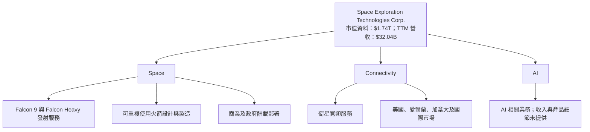
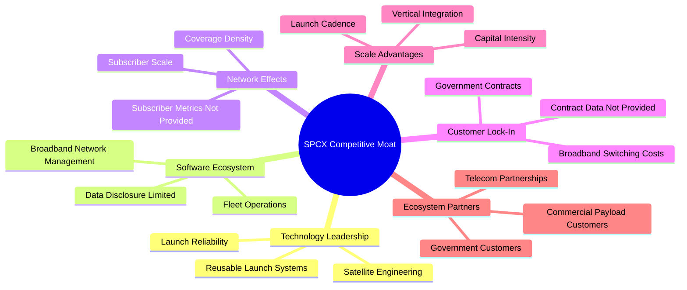
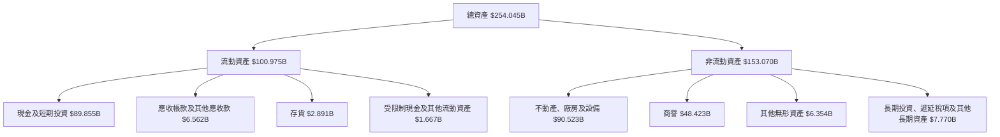
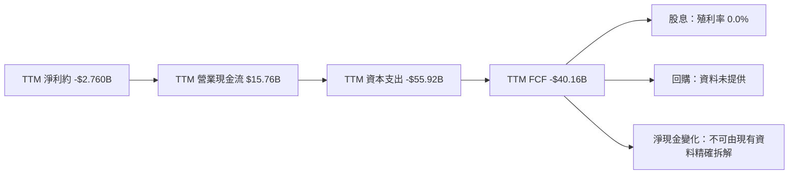
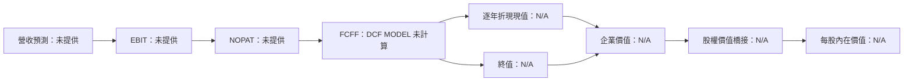
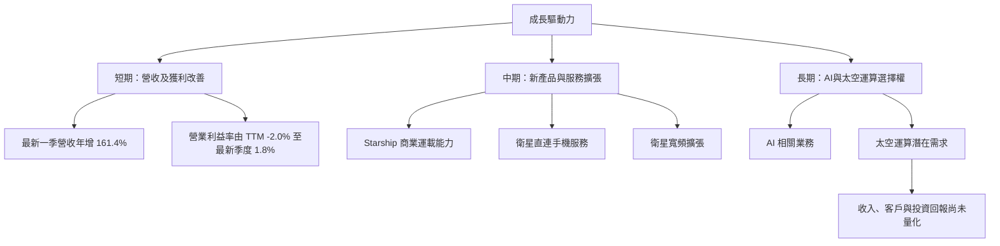
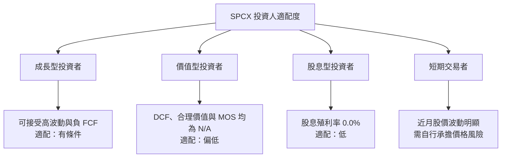

# SPCX 基本面深度分析報告
> **報告日期**：2026-11-22 ｜ **語言**：繁體中文 ｜ **數據來源**：Yahoo Finance、Finviz、StockAnalysis、Roic.ai ｜ **分析師**：CFA 級機構研究

## 目錄

| # | 章節 | 核心結論 |
|---|------|----------|
| 1 | 執行摘要 | TTM 營收 $32.04B、最新一季營收年增 161.4%；但 TTM FCF 為 -$40.16B，估值方法無法計算，MOS 與規則評級為 N/A |
| 2 | 公司概覽與商業模式 | 涵蓋太空運輸、衛星寬頻及 AI；具規模與技術門檻，但各業務收入占比未提供 |
| 3 | 損益表深度分析 | TTM 營收 $32.04B、TTM 營業利益率 -2.0%；最新季度營收快速增加，獲利仍不穩定 |
| 4 | 資產負債表分析 | 現金及短期投資 $89.86B、總債務 $39.22B、淨現金 $50.64B；營運資金天數資料僅有最新期 |
| 5 | 現金流量深度分析 | TTM 營業現金流 $15.76B、資本支出 $55.92B，依統一定義計算 FCF 為 -$40.16B |
| 6 | 獲利能力與資本效率 | WACC 為 9.78%；ROIC 缺資料，無法判定是否創造經濟價值 |
| 7 | 相對估值分析 | SPCX Forward P/E 46.6x、P/S 54.2x；同業倍數差異大，無自歷史估值區間資料 |
| 8 | DCF 內在價值評估 | DCF 及所有估值方法均無法計算，因此不提供內在價值、MOS 或目標價 |
| 9 | 成長催化劑 | 最新一季營收年增 161.4%；Starship、直連手機與太空運算屬潛在催化因素，量化收入及時程未提供 |
| 10 | 風險矩陣 | 主要風險為高資本支出、獲利波動及估值敏感度；市場份額與業務別財務資料不足 |
| 11 | 投資建議 | 因無加權合理價值與 MOS，不能依規則 20 定級；以觀望及嚴格追蹤現金流、利潤率為主 |

---

## 1. 執行摘要

SPCX 最新一季營收為 **$14.57B，年增 161.4%**，TTM 營收為 **$32.04B**；然而 TTM 營業利益率為 **-2.0%**，TTM 營業現金流 **$15.76B**仍不足以覆蓋 **$55.92B**資本支出，統一定義下的 TTM FCF 為 **-$40.16B**。此外，資料顯示公司 TTM 營業利益為負，DCF 模型標示 N/A，估值方法也均無法計算，故無法產生加權合理價值與 MOS；依規則 20，**MOS 評級為 N/A，不以分析師共識目標價替代評級**。

### 1.0 一頁式投資儀表板（Portfolio Manager 30 秒速讀）

| 項目 | 內容 |
|------|------|
| **投資論點（3 句）** | ① 最新一季營收年增 **161.4%**，反映業務規模仍快速擴張。② TTM 淨現金 **$50.64B**，提供資本投入緩衝。③ TTM FCF **-$40.16B**，資本支出遠高於營業現金流，成長轉化為股東現金回報仍待驗證。 |
| **綜合評分** | **6.1/10**（引用 1.1 六項算術平均） |
| **財務健康** | 🟡 現金及短期投資 $89.86B、淨現金 $50.64B，但 TTM FCF 為 -$40.16B |
| **ROIC vs WACC** | **N/A vs 9.78%**；ROIC 缺資料，無法判斷創造或摧毀價值 |
| **FCF 趨勢** | TTM FCF 為 **-$40.16B**；FCF Yield **-2.31%** |
| **估值** | Forward P/E **46.59906x** ｜ EV/EBITDA **143.566x** ｜ FCF Yield **-2.31%** |
| **DCF 內在價值（基準）** | **N/A**；DCF MODEL 因 TTM 營業利益為負而無法計算，折溢價 N/A |
| **安全邊際（MOS）** | **N/A**；估值方法未能計算，沒有加權合理價值可作分母 |
| **預期報酬（基準情境 12M）** | **N/A**；沒有可引用的 DCF 基準情境價值 |
| **關鍵風險（前二）** | 🔴 TTM FCF -$40.16B；🟡 利潤率波動，TTM 營業利益率 -2.0%、最新季度 1.8% |
| **評級 + 信心度** | **N/A（無法依 MOS 規則定級）** ｜ 對估值信心：低 |

> **資料一致性提醒：** Yahoo Finance／Finviz 合併資料列示最新收盤價 **$127.79（2026-11-20）**、流通股數 **8.25B**及市值 **$1.74T**；單以股價乘股數推算的市值與上述市值不一致。另有 StockAnalysis 顯示市值 **$2,048.528B**。本報告保留各來源原值，不以不一致資料反推或替換價格、市值、股數。

### 1.1 綜合評分卡（全報告唯一）

| 維度 | 評分（1–10） | 主要依據（引用數字與其來源章節） |
|------|--------------|----------------------------------|
| 成長性 | 8.5 | 最新一季營收年增 161.4%；TTM 營收成長率在核心財務數據中為 N/A（第 3 章） |
| 獲利能力 | 4.5 | TTM 營業利益率 -2.0%、淨利率 -8.6%；ROIC、F-Score 缺資料（第 3、6 章） |
| 財務健康 | 7.5 | 淨現金 $50.64B、流動比率 3.084；但 TTM FCF -$40.16B（第 4、5 章） |
| 估值 | 2.0 | Forward P/E 46.59906x、P/S 54.16235x；DCF 與加權估值均 N/A（第 7、8 章） |
| 護城河 | 8.5 | 可重複使用運載火箭與衛星寬頻網路具有高資本、技術門檻；但業務別收入及市場份額未提供（第 2 章） |
| 管理層與資本配置 | 5.5 | 2025 年資本支出 $20.91B、SBC $1.95B，TTM 資本支出 $55.92B；投資回報及回購資料不足（第 5 章） |
| **綜合評分** | **6.1** | 六項算術平均：`(8.5 + 4.5 + 7.5 + 2.0 + 8.5 + 5.5) ÷ 6 = 6.0833… ≈ 6.1` |

### 1.2 五大投資論點 + 三大核心風險

| 類型 | 項目 | 具體依據 | 信心度 |
|------|------|----------|--------|
| 🟢 **投資論點①** | 營收增長速度高 | 2026-09-30 季營收 $14.57B，年增 161.4%；仍須拆分有機成長、併購及認列時點 | 🟢 中 |
| 🟢 **投資論點②** | 現金緩衝充足 | 現金及短期投資 $89.86B，總債務 $39.22B，淨現金 $50.64B | 🟢 高 |
| 🟢 **投資論點③** | 火箭與衛星網路的技術及資本門檻 | Falcon 9、Falcon Heavy 及衛星寬頻屬業務概述所列；具體成本優勢、發射市占資料未提供 | 🟡 中 |
| 🟢 **投資論點④** | 毛利率具一定規模優勢 | TTM 毛利率 56.8%，高於三家同業毛利率中位數 37.0%；公司與同業業務組合不同 | 🟡 中 |
| 🟢 **投資論點⑤** | 現金流入營運端尚有正值 | TTM 營業現金流 $15.76B；但資本支出 $55.92B，尚未轉為正 FCF | 🟡 中 |
| 🟡 **風險①** | 高額資本支出造成負 FCF | TTM FCF -$40.16B、FCF Yield -2.31%；若投資回收期延長，現金緩衝會持續被消耗 | 🔴 高衝擊 |
| 🔴 **風險②** | 獲利波動與數據品質不一致 | 2026-03-31 季營業利益 -$1.95B，2026-09-30 季則為正；不同來源季度營業利益亦不一致 | 🔴 高衝擊 |
| 🟡 **風險③** | 高估值與估值不可驗證 | Forward P/E 46.59906x、P/S 54.16235x；因 TTM 營業利益為負，DCF 及指定估值方法無法計算 | 🔴 高衝擊 |

### 1.3 快速統計卡片

| 指標 | 公司實際值（期間） | 同業中位數 | 狀態 |
|------|--------------------|------------|------|
| 營收成長（TTM） | **N/A** | — | 🟡 |
| 營收成長（最新一季年增） | **161.4%** | **72.7%**（RKLB、ASTS、IRDM） | 🟢 |
| 毛利率（TTM） | **56.8%** | **37.0%** | 🟢 |
| 營業利益率（TTM） | **-2.0%** | — | 🔴 |
| ROIC（TTM） | **N/A** | — | 🟡 |
| Forward P/E | **46.59906x** | **29.5x**（同業中位數；含負倍數資料時取數值中位數） | 🟡 |
| FCF Yield（TTM） | **-2.31%** | — | 🔴 |
| Piotroski F-Score | **N/A / 9** | — | 🟡 |

### 1.4 投資結論

```text
╔══════════════════════════════════════════════════════════════════╗
║                    📊 投資結論摘要                               ║
╠══════════════════════════════════════════════════════════════════╣
║  評級：N/A（無法依 MOS 規則定級；不是買入／賣出評級）             ║
║  價格（2026-11-20 收盤）：$127.79                                ║
║  DCF 內在價值（基準）：N/A（TTM 營業利益為負，DCF 不適用）        ║
║  安全邊際 MOS：N/A（無加權合理價值可供計算）                      ║
║  加權合理價值（8.8）：N/A（指定估值方法均無法計算）               ║
║  綜合評分：6.1/10（引用 1.1）                                    ║
║  適合投資人：能承受高波動、以長期業務成長為主的投資人；            ║
║              不適合要求短期正 FCF 或可驗證價值折價者。             ║
╚══════════════════════════════════════════════════════════════════╝
```

---

## 2. 公司概覽與商業模式

### 2.1 業務結構與收入來源

公司概述列出 Space、Connectivity、AI 三個營運板塊，並說明其衛星寬頻服務涵蓋美國、愛爾蘭、加拿大及其他國際市場。各板塊營收及占比未提供，以下圖表只呈現業務關係，不以推估比例分配收入。



公司規模數據同時存在市值來源不一致：Yahoo Finance／Finviz 合併欄位列示市值 $1.74T，而 StockAnalysis 列示 $2,048.528B。市值不代表公司營收組成，也不能據此推算各板塊收入。

### 2.2 市場份額

市場份額數據未提供，因此不呈現市占率表或圓餅圖。以收入規模及增長觀察，SPCX TTM 營收為 $32.04B，最新一季營收年增 161.4%；同業資料中，RKLB、ASTS、IRDM 最新季度營收年增率分別為 72.7%、187.1%、8.3%。各公司業務範圍不同，不能將營收增速直接視為市占率變化。

### 2.3 競爭護城河分析



### 2.4 護城河強度

| 護城河項目 | 強度（強／中／弱） | 證據（引用數字或事實） | 會削弱它的情況 |
|------------|--------------------|------------------------|----------------|
| 技術與執行能力 | 強 | Falcon 9、Falcon Heavy 及可重複使用運載火箭均列於公司業務概述；年度研發費用 2025 年為 $8.64B | 發射可靠性下降、競爭者追平成本或新技術替代 |
| 軟體與營運系統 | 中 | 衛星寬頻與發射營運需要複雜網路管理；軟體收入及留存率未提供 | 網路品質、資安或服務可用率下降 |
| 網路效應 | 中 | 衛星寬頻服務具有網路規模特性；用戶數、ARPU、流失率未提供 | 用戶成長停滯、頻譜限制或單位經濟性轉差 |
| 客戶鎖定 | 中 | 政府及商業發射客戶存在認證與任務整合需求；合約年期與續約率未提供 | 客戶多元化不足、替代供應商增加 |
| 規模效應 | 強 | TTM 營收 $32.04B、員工 21,000 人；年度資本支出 2025 年 $20.91B，反映資本與營運規模 | 高固定成本無法由需求吸收，造成資本回報偏低 |
| 生態夥伴 | 中 | 公司服務商業及政府酬載客戶，並有國際寬頻營運 | 政策、合作方或頻譜規則變化 |

**1.1 護城河評分 8.5/10 的理由：**火箭、衛星與寬頻網路組合涉及技術、資本與營運門檻；但用戶、合約、發射市占與各板塊收入資料不足，因而未將護城河視為已由量化數據完全驗證。

---

## 3. 損益表深度分析

### 3.1 年度收入成長趨勢（近4年）

2022 年營收未提供；可核對的年度資料為 2023–2025 年。2023–2025 年營收 CAGR 算式為：`($18.674B ÷ $10.387B)^(1/2) − 1 = 34.1%`。

```text
╔══════════════════════════════════════════════════════════════════╗
║ SPCX 年度收入趨勢（可取得年度：FY2023–FY2025）                  ║
╠══════════════════════════════════════════════════════════════════╣
║ FY2023  $10.39B  ███████████░░░░░░░░░░░░░░░░  起始年度          ║
║ FY2024  $14.02B  ███████████████░░░░░░░░░░░  YoY: +34.9% 🟢     ║
║ FY2025  $18.67B  ████████████████████░░░░░░  YoY: +33.2% 🟢     ║
║ FY2022  N/A（年度營收未提供）                                    ║
╠══════════════════════════════════════════════════════════════════╣
║ FY2023–FY2025 兩年營收 CAGR：+34.1%                              ║
╚══════════════════════════════════════════════════════════════════╝
```

2024 年及 2025 年營收分別增長 34.9%與 33.2%，顯示年度收入持續擴張。最新季度的營收跳升更快，但季度增長不等同於可持續的長期增速；目前未提供業務拆分與訂單、訂閱戶數等資料，無法判斷增長來自哪一板塊或是否含一次性因素。

### 3.2 季度收入趨勢分析

| 季度 | 營收 | QoQ 成長 | YoY 成長 | 備註 |
|------|------:|---------:|---------:|------|
| 2025-12-31 | $4.96B | N/A | N/A | 前一季比較及同季度前年數未完整提供 |
| 2026-03-31 | $4.69B | -5.4% | 15.42% | QoQ 算式：`$4.694B ÷ $4.960B − 1` |
| 2026-06-30 | $7.81B | 66.5% | 91.94% | QoQ 算式：`$7.814B ÷ $4.694B − 1` |
| 2026-09-30 | $14.57B | 86.5% | 161.4% | QoQ 算式：`$14.575B ÷ $7.814B − 1`；YoY 為單季年增率 |

近三季營收連續上升，2026 年第三季環比增速達 86.5%。如此快速的單季擴張需進一步核實板塊組成、合約認列與季節性；季度收入快速增加本身不代表同幅度的毛利、營業利益或 FCF 增長。核心財務數據列示的 TTM 營收成長率為 N/A；StockAnalysis 顯示 TTM 營收成長 128.63%，但依統一口徑，本報告不以該來源值取代 TTM 成長率 N/A。

### 3.3 利潤率演變分析

| 利潤率指標 | FY2023 | FY2024 | FY2025 | TTM／最新季度 | 趨勢 | 評估 |
|------------|-------:|-------:|-------:|----------------|------|------|
| **毛利率** | 41.2% | 42.9% | 49.4% | TTM 56.8% | ↑ 上升；TTM 高於已列年度 | 🟢 |
| **營業利益率** | 4.9% | 5.3% | -11.1% | TTM -2.0%；最新季度 1.8% | FY2025 明顯轉負，最新季度回正 | 🔴 |
| **淨利率** | -44.6% | 5.6% | -26.4% | TTM -8.6% | 年度波動大，仍未穩定獲利 | 🔴 |

年度毛利率按年度毛利除以營收計算；TTM 毛利率依 Yahoo Finance 數據引用。營業利益率從 FY2024 的 5.3%降至 FY2025 的 -11.1%，同期間研發支出從 $3.46B 增至 $8.64B，且資本與業務擴張同步進行，顯示費用投入、產品組合及營運擴張可能是利潤波動因素；現有資料不足以將變動精確拆分至各項原因。最新季度營業利益率為 1.8%，代表該季轉正，但不足以單獨證明已形成持續性獲利。

> 季度來源存在差異：核心財務數據列示 2026-09-30 季營業利益 $2.79B；StockAnalysis 季度表列示 $4.019B。兩者均不應混為同一數值，本報告對最新季度營業利益率採用指定的 1.8%原值，並對來源差異保持保留。

### 3.4 費用結構分析

完整費用分類及所有費用項目未提供，故不畫費用結構圓餅圖，避免以部分科目假裝完整分布。可核對的 FY2025 研發支出為 **$8.64B**，約占當年營收 **46.3%**（`$8.64B ÷ $18.674B`）；這反映研發投入重大，但不能單憑支出推論研發回報。

```text
╔══════════════════════════════════════════════════════════════════╗
║                  可取得費用資料（非完整費用結構）                ║
╠══════════════════════════════════════════════════════════════════╣
║ FY2025 研發支出：$8.64B                                          ║
║ FY2025 營收：  $18.67B                                           ║
║ 研發支出／營收：46.3%                                            ║
║ 其他營業費用分類：資料未提供，不能據此繪製完整費用圓餅圖。       ║
╚══════════════════════════════════════════════════════════════════╝
```

### 3.5 季度 EPS 趨勢與盈餘品質（Quality of Earnings）

| 盈餘品質項目 | 數值／佔比 | 評估 |
|--------------|-----------|------|
| 股權薪酬 SBC／營收 | TTM 約 **14.8%**；計算採季度 SBC 加總 $4.733B ÷ TTM 營收 $32.04B | 🔴 占比高，形成股東稀釋成本；GAAP SBC 與股數變動應一併追蹤 |
| SBC／營業現金流 | TTM 約 **30.0%**；`$4.733B ÷ $15.76B` | 🟡 SBC 是非現金費用，但對股東具有經濟成本，不能忽略 |
| FCF／淨利（現金轉換率） | TTM FCF -$40.16B；TTM 淨利約 -$2.760B；機械比值約 **14.55x** | 🔴 兩者均為負數，比例不具一般現金轉換率解讀意義 |
| 一次性／非經常性損益 | N/A（明細未提供） | 無法判斷季度淨利是否包含重大一次性項目 |
| 有效稅率異常 | N/A（稅前利益與所得稅明細未提供） | 無法判斷稅務利益或稅率對淨利的影響 |
| 資本化支出 vs 費用化 | TTM Capex $55.92B；資本化細項及資產投產回報資料未提供 | 高額資本開支轉為資產，須檢視折舊、利用率及日後回報；不能僅視為費用化或一次性支出 |

季度 EPS 預期值資料為 NaN，且沒有可用的季度預期與實際值配對，因此無法可靠判定最近四季「超預期／不及預期」。可觀察的季度淨利依序為 2025-12-31 **-$2.35B**、2026-03-31 **-$4.28B**、2026-06-30 **-$0.541B**、2026-09-30 **+$4.40B**；季度盈餘由虧轉盈，但尚需確認是否可延續。不同來源的 EPS 數據亦不完全一致，不以缺失的分析師預期值推論盈餘 surprise。

**盈餘品質結論：**營業端 TTM 現金流為正，但在高額資本支出後，TTM FCF 為 -$40.16B；SBC 約占 TTM 營收 14.8%。因此，最新單季淨利轉正尚不足以證明經濟盈餘已穩定，估值應重視資本投入的回收能力與稀釋，不宜只看季度 GAAP 淨利。

---

## 4. 資產負債表分析

### 4.1 資產結構分解

以下依 StockAnalysis 2026-09-30 資產細項展示，金額合計為 $254.045B。該來源資產負債表較細，年度財報來源及資料日期不同，解讀時須注意口徑。



此資產組合反映大量設備及商譽資產，現金與短期投資亦占較大規模。商譽及固定資產需透過未來營運回報支持；若新產能使用率或投資回收低於預期，可能增加資產減損或未來折舊負擔。

### 4.2 流動性與營運資金分析

| 指標 | 最新 TTM | 一年前 TTM | 變化 | 解讀 |
|------|----------|------------|------|------|
| DSO 應收帳款天數 | 54 天 | N/A | N/A | 最新資料顯示應收回款週期；缺少一年前數值，不能判斷收款速度變化 |
| DIO 存貨天數 | 76 天 | N/A | N/A | 庫存持有期需結合產能及備貨週期解讀；缺少歷史比較 |
| DPO 應付帳款天數 | 349 天 | N/A | N/A | 數值偏長，可能與供應商付款條件、項目週期及應付款結構相關，不能直接等同議價力 |
| CCC 現金轉換週期 | -219 天 | N/A | N/A | 依 `DSO + DIO − DPO` 計算；負值反映應付帳款週期長於應收及存貨天數，但原因需更多明細驗證 |

| 流動性指標 | 最新值 | FY2025 | FY2024 | 評估 |
|------------|-------:|-------:|-------:|------|
| 流動比率 | 3.084 | 1.446 | 1.366 | 🟢 最新期高於年度期末資料；各來源及時點可能不同 |
| 速動比率 | 2.945 | N/A | N/A | 🟢 現金及速動資產提供短期流動性緩衝 |
| 現金及短期投資 | $89.86B | $24.75B | $12.19B | 🟢 最新期較前期大幅增加；現金來源與融資、發行或營運的拆分未提供 |

### 4.3 債務結構分析

```text
╔══════════════════════════════════════════════════════════════════╗
║                   SPCX 債務健康診斷                              ║
╠══════════════════════════════════════════════════════════════════╣
║  總債務：        $39.22B   ████████░░░░░░░░░░░░                   ║
║  現金+短期投資： $89.86B   ████████████████████                   ║
║  淨現金：        $50.64B   ███████████░░░░░░░░░ 🟢               ║
║                                                                  ║
║  Debt/EBITDA：N/A（來源 EBITDA 與估值倍數資料不一致，不強行推算） ║
║  Interest Coverage：N/A（利息支出明細及一致口徑 EBIT 未提供）     ║
║  Debt/Equity：22.186（Yahoo Finance 列值；單位口徑需核實）        ║
╚══════════════════════════════════════════════════════════════════╝
```

公司具有 **$50.64B 淨現金**，可支持近期資本投入，但負 FCF 代表現金緩衝不能被視作永久資金來源。Debt/Equity 值與其他資產負債表數據的口徑關係不清，不據此推導槓桿風險。

### 4.4 股東權益趨勢

```text
╔══════════════════════════════════════════════════════════════════╗
║                   SPCX 股東權益變化                              ║
╠══════════════════════════════════════════════════════════════════╣
║ FY2024  $25.80B  ████████████░░░░░░░░░░░░                        ║
║ FY2025  $41.33B  ████████████████████░░░░                        ║
║ TTM     $176.768B（Roic.ai 欄位；與年度資產負債表口徑差異顯著）  ║
╚══════════════════════════════════════════════════════════════════╝
```

FY2024 至 FY2025 股東權益增加 $15.53B，算式為 `$41.33B − $25.80B`。Roic.ai TTM 欄位列示權益 $176.768B，顯著高於年度財報序列，需先核對權益定義、資料期間與公司資本結構變化，不能直接串成同一條趨勢線。

---

## 5. 現金流量深度分析

### 5.1 現金流量瀑布圖

TTM 淨利採 Roic.ai 約 -$2.760B；營業現金流及資本支出則引用統一財務數據。股息殖利率為 0.0%，回購及淨現金變化沒有足夠一致資料，故不推算。



### 5.2 FCF 轉換率趨勢

| 期間 | FCF | 淨利 | FCF／淨利 | 解讀 |
|------|----:|-----:|----------:|------|
| FY2023 | $0.105B | -$4.63B | -2.3%（無一般轉換意義） | 淨利為負、FCF接近零 |
| FY2024 | -$5.39B | $0.791B | -681.4% | 正淨利未轉成 FCF，資本支出使自由現金流為負 |
| FY2025 | -$14.12B | -$4.94B | 286.0%（無一般轉換意義） | FCF與淨利均為負，不應將正比率視為轉換良好 |
| TTM | -$40.16B | 約 -$2.760B | 約 14.55x（無一般轉換意義） | 負 FCF規模遠大於淨損，主因高額投資支出 |

FCF 使用統一定義 **營業現金流 − 資本支出**。公司營業現金流為正，但資本支出持續高於營業現金流，2025 年 FCF 為 -$14.12B，TTM 更為 -$40.16B。此現象可能與建置期投資相符，但投資是否形成可產生現金回報的資產，仍須以後續營收、利用率與資本回報驗證。

### 5.3 自由現金流趨勢

```text
╔══════════════════════════════════════════════════════════════════╗
║             SPCX 自由現金流：歷史實際                            ║
╠══════════════════════════════════════════════════════════════════╣
║ FY2023  +$0.105B   ░░░░░░░░░░░░░░░░░░░░  FCF 接近零             ║
║ FY2024  -$5.39B    ███░░░░░░░░░░░░░░░░░░  FCF 轉負               ║
║ FY2025  -$14.12B   ███████░░░░░░░░░░░░░░  負值擴大               ║
║ TTM      -$40.16B  ████████████████████  FCF Yield: -2.31%       ║
╠══════════════════════════════════════════════════════════════════╣
║ FCF Yield 採用 TTM FCF ÷ 市值，引用值為 -2.31%。                 ║
║ FCF 對應資本支出高度敏感，須觀察投資回報及現金消耗速度。         ║
╚══════════════════════════════════════════════════════════════════╝
```

### 5.4 資本配置評估

完整的現金用途拆分、回購金額與留存資金用途未提供，因此不繪製資本配置圓餅圖，以免將支出科目重複計算為互斥用途。

| 資本配置項目 | 可取得資料 | 評估 |
|--------------|-----------|------|
| 資本支出 | FY2023 $4.42B、FY2024 $11.16B、FY2025 $20.91B；TTM $55.92B | 🔴 支出快速增加；需要未來營運現金流與資產使用效率驗證 |
| 研發支出 | FY2025 $8.64B | 🟡 支持技術與新業務投入，投資回報與細分項目未提供 |
| 股息 | 殖利率 0.0%、派息率 0.0% | 未見現金股息回饋 |
| 股票回購 | N/A | 未提供可核實數字 |
| SBC | FY2025 $1.95B；TTM 根據季度項目加總約 $4.733B | 🔴 對股東造成稀釋，應與投資回報一併衡量 |

---

## 6. 獲利能力與資本效率

### 6.1 ROE / ROA / ROIC 趨勢

| 指標 | FY2023 | FY2024 | FY2025 | TTM | 評估 |
|------|-------:|-------:|-------:|----:|------|
| ROE | N/A | N/A | N/A | N/A | 缺少可比淨利及權益期間資料 |
| ROA | N/A | N/A | N/A | N/A | 品質指標指出所需資料不足 |
| ROIC | N/A | N/A | N/A | N/A | Roic.ai 歷史資料未提供可採用的 ROIC 值 |
| WACC | — | — | — | 9.78% | 依成本資本資料引用 |

行業均值未提供，不作估計。由於 ROIC 缺值，不能把近期營收增長或毛利率上升直接等同於創造資本回報。

### 6.2 ROIC vs WACC 分析（核心價值創造判斷）

```text
╔══════════════════════════════════════════════════════════════════╗
║                ROIC vs WACC 深度分析                            ║
╠══════════════════════════════════════════════════════════════════╣
║  WACC（成本資本資料）：                                          ║
║  ├── 無風險利率（10Y 美債）：       4.91%                        ║
║  ├── 市場風險溢酬 ERP：              5.00%                        ║
║  ├── Beta 原始值：                   N/A                          ║
║  ├── Beta 採用值（調整後）：         1.00（假設值）                ║
║  ├── 股權成本 Ke：                   4.91% + 1.00 × 5.00% = 9.91% ║
║  ├── 稅前債務成本：                  4.96%                        ║
║  ├── 稅後債務成本：                  4.96% × (1−21.0%) = 3.92%    ║
║  ├── 資本權重：                      股權 97.8%，債務 2.2%         ║
║  └── WACC：                          97.8%×9.91% + 2.2%×3.92%    ║
║                                      = 9.78%                       ║
║                                                                  ║
║  ROIC：N/A（缺少可靠投入資本與 NOPAT 資料）                       ║
║  EVA：N/A（ROIC − WACC 無法計算）                                ║
║  價值創造判斷：暫不能判定，不以營收增長替代 ROIC 證據。            ║
╚══════════════════════════════════════════════════════════════════╝
```

成本資本資料中的 Beta 原始值為 N/A，採用調整後 Beta 1.00，屬於明確假設而非公司歷史估計。依資料提供的資本權重，WACC 為 9.78%。因 ROIC 缺失，無法判斷 SPCX 是否達到超過 9.78%的資本回報門檻，也不能計算 EVA。

### 6.3 杜邦三因素分解

品質指標中的 DuPont 為 N/A：缺少可用的淨利、營收、總資產或正權益組合，無法照抄形成完整分解。

| 因素 | 數值（TTM） | 解讀 |
|------|-------------|------|
| 淨利率 | N/A | 品質指標資料不足 |
| 資產週轉率 | N/A | 品質指標資料不足 |
| 權益乘數 | N/A | 品質指標資料不足 |
| **ROE** | **N/A** | 不以不完整數字重算杜邦等式 |

### 6.4 財務體質：Piotroski F-Score

Piotroski F-Score 為 **N/A**：需要兩個相隔一年的 SEC 申報資料 TTM 期間；目前資料來源為 Yahoo 季度報表且缺少相關申報數據，因此九項測試無法逐項判定。

| 測試 | 結果 | 解讀 |
|------|------|------|
| 獲利能力測試 1–4 | N/A | 缺少符合統一規則的兩期 SEC 申報資料 |
| 槓桿、流動性及融資測試 5–6 | N/A | 缺少符合統一規則的兩期比較資料 |
| 營運效率測試 7–9 | N/A | 缺少符合統一規則的兩期比較資料 |
| **Piotroski F-Score** | **N/A / 9** | 不將缺資料的測試補算或推定為通過 |

---

## 7. 相對估值分析

### 7.1 同業估值比較表格

以下倍數取自 Yahoo Finance 同業倍數。公司自身估值使用提供的 SPCX 倍數；同業市盈率或 EV/EBITDA 為負數或 N/A 時，不解讀為具經濟意義的正向估值。

| 估值指標 | **SPCX** | **RKLB** | **ASTS** | **IRDM** | SPCX 評估 |
|----------|---------:|---------:|---------:|--------:|-----------|
| **Trailing P/E** | 555.6087x | N/A | N/A | 27.3x | 🔴 SPCX 倍數極高；且同業可比樣本有限 |
| **Forward P/E** | 46.59906x | 634.5x | -17.1x | 29.5x | 🟡 低於 RKLB、高於 IRDM；ASTS 為負值，樣本異質 |
| **P/S Ratio（TTM）** | 54.16235x | 34.7x | 65.3x | 4.9x | 🔴 高於 IRDM，介於 RKLB 與 ASTS 之間 |
| **EV/EBITDA（TTM）** | 143.566x | -140.9x | -18.1x | 16.6x | 🔴 SPCX 倍數高；兩家同業負值不可作一般倍數比較 |
| **最新一季營收年增** | 161.4% | 72.7% | 187.1% | 8.3% | 🟢 成長快於 RKLB、IRDM；低於 ASTS |
| **毛利率（TTM）** | 56.8% | 36.2% | 37.0% | 71.5% | 🟢 高於 RKLB、ASTS，低於 IRDM |

三家同業 Forward P/E 中位數為 **29.5x**，P/S 中位數為 **34.7x**，但包含負倍數的 EV/EBITDA 中位數不適合作為直接價值錨。SPCX 自身 P/S 54.16235x，意味估值對收入持續成長及未來獲利轉化高度敏感；不能只因營收增速高，就忽略負 FCF 與營業利益波動。

### 7.2 歷史估值區間分析

```text
╔══════════════════════════════════════════════════════════════════╗
║                   SPCX 歷史估值區間                              ║
╠══════════════════════════════════════════════════════════════════╣
║ Valuation vs own history：N/A（歷史估值區間資料未提供）           ║
║ 不計算歷史百分位，也不推估當前倍數相對自身歷史的位置。           ║
╚══════════════════════════════════════════════════════════════════╝
```

### 7.3 情境價值（Bear / Base / Bull，照抄 DCF MODEL 的 Scenarios）

**N/A（DCF 無法計算：TTM 營業利益率為 -2.0%，DCF MODEL 明確標示 TTM 營業利益不為正；未提供悲觀、基準、樂觀情境數值。）** 因此不自行設定情境目標價、假設或機率。

### 7.4 相對估值隱含價格區間

```text
╔══════════════════════════════════════════════════════════════════╗
║                  相對估值隱含價格區間                            ║
╠══════════════════════════════════════════════════════════════════╣
║ VALUATION METHODS：None could be computed。                       ║
║ 每股價值、方法權重、價格區間：N/A。                               ║
║ 相對估值不能在缺少估值方法輸出時自行推算為目標價。               ║
╚══════════════════════════════════════════════════════════════════╝
```

同業 Forward P/E、P/S 及 EV/EBITDA 可作倍數參照，但指定的估值方法區塊未能計算相對估值隱含價格，因此不以分析師 EPS 或同業倍數自行建立估值結果。

---

## 8. DCF 內在價值評估（Discounted Cash Flow）

> **結論先行但受資料規則限制：DCF MODEL = N/A。** Yahoo Finance TTM 營業利益率為 -2.0%，程式模型明確指出 TTM 營業利益不為正，「虧損折現並非價值」。因此本章不另建現金流預測、不填入未經模型提供的假設、不推算內在價值、敏感度矩陣或反推 DCF。

### 8.0 估值推理鏈（Thinking Logic：在算之前先想清楚）

**Step 1 — 價值來源與主導變數：**SPCX 的潛在價值來源包括 Space 發射與製造、Connectivity 寬頻服務及 AI 相關業務；但各板塊營收占比未提供，不能將目前的 $32.04B TTM 營收拆分至三類。就已有財務數字，營收能否轉成穩定正營業利益及能否降低資本支出負擔，是判斷價值的關鍵；目前 TTM 營業利益率 -2.0%、TTM FCF -$40.16B。

**Step 2 — 模型決策：**

| 決策點 | 本報告採用 | 理由（含數字） | 曾考慮但否決 | 否決理由 |
|--------|-----------|----------------|--------------|----------|
| 現金流定義 | N/A | DCF 模型無法計算 | FCFF、FCFE | 沒有可採用的程式模型輸出，不能自行建模 |
| 預測期 N | N/A | 模型未提供預測期 | 5–10 年預測 | 自行選年數及營運假設違反指定模型來源規則 |
| 終值方法 | N/A | 模型未提供終值 | Gordon Growth、退出倍數 | 不能自行假設終值或倍數 |
| EBIT 基礎 | N/A | 模型未提供逐年 EBIT 假設 | GAAP EBIT | TTM 營業利益為負，指定 DCF 模型拒絕計算 |

**Step 3 — 關鍵假設推導鏈：**預測營收 CAGR、期末營業利潤率、永續成長率、Capex／營收、D&A／營收、ΔWC、SBC、股數稀釋率及終值倍數均未由 DCF MODEL 提供，故沒有可追溯的「錨點→調整→採用值→否決值」模型假設。不得自行填值或製作數字化 DCF。

**Step 4 — 最脆弱環節：**由負 TTM 營業利益推演未來獲利及現金流正規化所需的路徑未提供；若營業利益率改善延遲或資本支出持續高企，價值方向會下修，但幅度無法由現有模型量化。

**Step 5 — 計算路徑圖：**僅呈現模型理論關係，不包含自行估算數字。



### 8.1 模型假設總表（Model Inputs）

| 假設項目 | 採用值 | 依據／來源 | 敏感度 |
|----------|--------|-------------|--------|
| 預測期長度 N | N/A | DCF MODEL 未提供；禁止自行設定 | N/A |
| 營收 CAGR | N/A | DCF MODEL 未提供；TTM 成長率為 N/A | N/A |
| 營業利潤率（期末） | N/A | DCF MODEL 未提供；TTM 營業利益率 -2.0% | N/A |
| 有效稅率 | N/A | 稅前利益及所得稅明細不足 | N/A |
| Capex／營收 | N/A | DCF MODEL 未提供；TTM Capex $55.92B 不能代替預測假設 | N/A |
| D&A／營收 | N/A | DCF MODEL 未提供；歷史 D&A 口徑未足以建立模型 | N/A |
| 營運資金變動／營收增額 | N/A | DCF MODEL 未提供；歷史 ΔWC 資料不足 | N/A |
| EBIT 基礎 | N/A | 模型未建立，無法指定 GAAP 或非 GAAP 預測 | N/A |
| SBC 處理 | N/A | 模型未建立，無法選 A／B／C 組合 | N/A |
| 年稀釋率 | N/A | 股數來源互有差異，且模型未提供預測股數 | N/A |
| 永續成長率 g | N/A | DCF MODEL 未提供 | N/A |
| 終值方法 | N/A | DCF MODEL 未提供 | N/A |
| WACC | **9.78%** | 成本資本資料所列值；但模型本身仍為 N/A | 僅引用，不據此另建 DCF |

**FCF 定義與 SBC：**DCF 未建立，沒有可採用的 FCFF 預測；因此不套用 A、B 或 C 組合，也不另扣 SBC 或推算稀釋後股數。

### 8.2 折現率推導（WACC）

成本資本資料列示 WACC **9.78%**。由於資料未提供 10Y 美債利率日期、債務平均餘額、可核實的利息費用總額與市值基礎一致的股權／債務分項，本節只引用既定 WACC，不依範本要求另行推導一套可能與來源不一致的 WACC。

```text
╔══════════════════════════════════════════════════════════════════╗
║                    WACC 推導（來源值引用）                        ║
╠══════════════════════════════════════════════════════════════════╣
║ 無風險利率 Rf：             4.91%                                 ║
║ ERP：                       5.00%（假設值，來源成本資本資料）      ║
║ 原始 Beta：                 N/A                                   ║
║ 調整後 Beta：               1.00（假設值，原始 Beta 缺失）         ║
║ 股權成本 Ke：               4.91% + 1.00×5.00% = 9.91%           ║
║ 稅前債務成本：              4.96%                                 ║
║ 稅率：                      21.0%                                 ║
║ 稅後債務成本：              4.96%×(1−21.0%) = 3.92%              ║
║ 股權／債務權重：            97.8%／2.2%                           ║
║ 採用 WACC：                 9.78%（照成本資本資料引用）            ║
╚══════════════════════════════════════════════════════════════════╝
```

成本資本數據的權重與 WACC 為程式計算的既定輸入，本報告不以另一組股數、市值或負債餘額重算並取代。第 6.2 節與本節均採用 **9.78%**。

### 8.3 逐年自由現金流預測（基準情境）

**N/A（DCF MODEL 未提供逐年預測，原因：TTM 營業利益不為正。）**因此沒有 FY+1 至 FY+N 營收、EBIT、NOPAT、D&A、Capex、營運資金變動、FCFF、折現因子或現值可逐年引用。不能用歷史季度數字假裝模型預測，也不能自行補出逐年數值。

歷史 FCF 錨點為 FY2023 **$0.105B**、FY2024 **-$5.39B**、FY2025 **-$14.12B**、TTM **-$40.16B**。由於沒有正向預測現金流，預測 FCF CAGR、FY+N FCF 利潤率與同業最佳比較均為 N/A，不製作預測軌跡圖。

### 8.4 終值計算（Terminal Value）

**適用性檢查：**WACC 為 9.78%，永續成長率 g 為 N/A，故無法檢驗 `WACC > g`。

| 方法 | 計算式 | 終值 TV | TV 現值 | 佔總 EV 比重 |
|------|--------|---------|---------|--------------|
| Gordon Growth | N/A（DCF MODEL 未提供 FY+N FCFF、g 或終值） | N/A | N/A | N/A |
| 退出倍數法 | N/A（DCF MODEL 未提供 FY+N EBITDA 或退出倍數） | N/A | N/A | N/A |

### 8.5 企業價值 → 每股內在價值（Bridge）

```text
╔══════════════════════════════════════════════════════════════════╗
║              企業價值 → 每股內在價值 橋接表                      ║
╠══════════════════════════════════════════════════════════════════╣
║  預測期 FCF 現值合計            N/A                               ║
║  終值現值 PV(TV)                N/A                               ║
║  = 企業價值 EV                   N/A                               ║
║  + 現金及短期投資               N/A（DCF 橋接未建立）              ║
║  − 總債務                       N/A（DCF 橋接未建立）              ║
║  = 股權價值                      N/A                               ║
║  ÷ 稀釋後流通股數                N/A                               ║
║  ★ 每股內在價值                  N/A                               ║
║    當前股價                      $127.79（2026-11-20 收盤）         ║
║    折溢價                        N/A                               ║
║    本節不計算 MOS；MOS 僅能以 8.8 加權合理價值為分母。             ║
╚══════════════════════════════════════════════════════════════════╝
```

橋接所需現金及短期投資 $89.86B、總債務 $39.22B 雖有財報數據，但企業價值、股權價值及稀釋股數沒有模型輸出，因此不能只靠現金及債務兩項便宣稱每股內在價值。

### 8.6 敏感性分析（WACC × 永續成長率）

**N/A（DCF MODEL 未提供敏感度矩陣，基準 DCF 亦為 N/A）。**不建立 WACC × g 估值矩陣、不製作三情境 DCF，也不計算機率加權價值。沒有基準內在價值可作敏感度比較。

### 8.7 反推 DCF（Reverse DCF：市場在預期什麼）

**N/A（DCF MODEL 未提供反推 DCF 結果）。**市場價格本身不能在缺少現金流模型參數時反推出營收 CAGR、利潤率、永續成長率或預測期。現價 $127.79（2026-11-20 收盤）可作市場觀察值，但不能單獨解出多個未提供的模型變數。

### 8.8 估值三角驗證與安全邊際

VALUATION METHODS 列示 **None could be computed**。因此 DCF、同業 Forward P/E、同業 EV/EBITDA 等方法均沒有可採用的每股價值及權重；分析師共識目標價不屬於指定估值方法表中的輸出，不能自行加入加權計算。

| 估值方法 | 隱含每股價值 | 上行空間（÷現價） | 權重 | 說明 |
|----------|--------------|-------------------|------|------|
| **估值方法結果** | **N/A** | **N/A** | **N/A** | 指定估值方法均未能計算；缺少可加權的每股估值與固定權重輸出 |
| **加權合理價值** | **N/A** | **N/A** | **N/A** | 不可計算 |

```text
╔══════════════════════════════════════════════════════════════════╗
║                  估值區間與安全邊際                              ║
╠══════════════════════════════════════════════════════════════════╣
║  悲觀價值：N/A ｜ 現價：$127.79 ｜ 加權合理價值：N/A             ║
║  DCF 基準價值：N/A ｜ 樂觀價值：N/A                             ║
║                                                                  ║
║  安全邊際 MOS：N/A（沒有加權合理價值）                           ║
║  上行空間：N/A（沒有加權合理價值）                               ║
║  規則 20 評級：N/A（不能以未計算的 MOS 判定）                    ║
║  建議買入區間：N/A（沒有可核實內在價值及 MOS 門檻）              ║
║  合理持有區間：N/A                                               ║
║  減碼考慮區間：N/A                                               ║
╚══════════════════════════════════════════════════════════════════╝
```

因此，不存在可呈現的加權算式、MOS、上行空間或依 MOS 決定的買入區間。37 位分析師的平均目標價 $257.50、最低 $70.00、最高 $800.00，區間很寬，僅作市場預期參考，不等同本報告內在價值估計。

### 8.9 DCF 模型的局限與失效條件

- **終值依賴度：**N/A，DCF 沒有企業價值及終值現值。
- **最脆弱的假設：**模型不適用時，不存在可量化的預測假設；實務上需優先驗證營業利益轉正是否持續，以及 Capex 是否能轉化為未來營收與現金流。
- **不適用情境：**TTM 營業利益率 -2.0%、TTM FCF -$40.16B，且近期季度盈餘波動大，傳統 DCF 的可靠度低。若要進行後續估值，須先有可驗證的正向營業利益與現金流預測；期間可搭配 EV/Sales、單位經濟性及分部估值，但本報告沒有足夠分部數據產生目標價。
- **與第 10 章風險矩陣連結：**資本支出持續高於營業現金流會直接影響自由現金流；利潤率收縮會削弱 NOPAT；業務增速下降會降低估值所能支持的收入基礎。

### 8.10 複算檢核表（Audit Trail：輸出前自我驗算）

| # | 檢核項目 | 檢查方式 | 結果 |
|---|----------|----------|------|
| 1 | 所有高／中敏感度輸入都有完整推導 | DCF MODEL 為 N/A，沒有可檢查的模型輸入 | 不適用 |
| 2 | 每個假設都有來歷 | 未提供 DCF 假設；未自行補值 | ✅ |
| 3 | WACC 五步算式完整且相乘相加正確 | 引用程式 WACC 9.78%，未另建模型 | 不適用 |
| 4 | Kd 分母與權重 D 範圍一致 | 未自行重算 Kd 或 WACC | 不適用 |
| 5 | WACC 與第 6.2 節相同 | 兩處均為 9.78% | ✅ |
| 6 | 逐年表格年度數等於 N 且無省略 | DCF 預測期 N 未提供，未製作預測表 | 不適用 |
| 7 | FY+1 九步算式可複算 | 沒有 FY+1 預測數值 | 不適用 |
| 8 | 預測期 PV 逐項加總 | 沒有預測期 PV | 不適用 |
| 9 | WACC > g 或按例外處理 | g 未提供，無法比較 | 不適用 |
| 10 | 終值以 FY+N 現金流為基礎 | 沒有終值模型 | 不適用 |
| 11 | EV 至每股價值橋接可複算 | 估值橋接 N/A，未虛構股權價值 | 不適用 |
| 12 | SBC 組合在經濟上相容 | DCF 未建立，未選 A／B／C | 不適用 |
| 13 | 敏感性矩陣基準格等於 DCF 內在價值 | 沒有矩陣與 DCF 基準值 | 不適用 |
| 14 | 矩陣有效格遵守 WACC > g | 沒有敏感性矩陣 | 不適用 |
| 15 | 三情境機率加總為 100% | 沒有 DCF 情境 | 不適用 |
| 16 | 反推 DCF 每列只放開一個變數 | 反推 DCF N/A，未設定求解列 | 不適用 |
| 17 | MOS 分母採 8.8 加權合理價值；折溢價採 8.5 DCF | 兩項均 N/A，未錯用其他分母 | ✅ |
| 18 | 報告完整輸出至第 11 章 | 第 1–11 章均列出 | ✅ |
| 19 | 加權合理價值等於方法價值乘權重之和 | 無可計算方法與權重，未提供加權價值 | 不適用 |
| 20 | 評級符合 MOS 門檻 | MOS N/A，明確不定 MOS 評級 | ✅ |

---

## 9. 成長催化劑

### 9.1 催化劑時間軸

業務資料及新聞片段沒有可核實的催化劑完成日期、產品上市時程或管理層量化財測，因此不以未證實的日期製作 Gantt 時程圖。

| 時間範圍 | 潛在催化因素 | 可量化資料 | 觀察重點 |
|----------|--------------|------------|----------|
| 短期 | 營收成長與營業利益率轉正能否延續 | 最新一季營收年增 161.4%；最新季度營業利益率 1.8% | 下一季度營收、營業利益率及現金流是否保持正向 |
| 中期 | Starship 等新一代運載能力商業化 | 新聞提及 Starship 捕捉成功及其估值影響，但沒有可核實收入或日期 | 任務成功率、發射頻率、客戶合約與單次成本 |
| 中期 | 衛星直連手機及電信合作 | 新聞提及手機服務帶寬與電信業務影響，無訂戶或收入預測 | 頻譜、服務覆蓋、用戶數及 ARPU |
| 長期 | AI 與太空運算相關業務 | 業務概述列有 AI，新聞提及太空運算，財務貢獻未提供 | 資本支出、運算設備折舊、客戶訂單與投資回報 |

### 9.2 TAM 市場規模分析

**N/A（TAM 數據未提供）。**現有資料沒有可引用的市場規模、來源與年份，故不填寫 TAM 金額或市場滲透率。已知 TTM 營收為 $32.04B、最新一季營收年增 161.4%，但這些公司收入數字不能替代市場規模或份額。

### 9.3 成長驅動力結構圖

下圖呈現公司資料及新聞提及的質化驅動因素，不代表已確認的收入貢獻或確定時程。



---

## 10. 風險矩陣

### 10.1 風險評分矩陣

下方機率與衝擊座標為分析師質化判斷，不是歷史發生率或公司財務數據；為遵守圖表數字可追溯原則，不製作帶有自訂數值座標的 quadrantChart。主要風險按可能的財務影響整理如下：

| 優先程度 | 風險 | 可量化觀察點 |
|----------|------|--------------|
| 高 | 資本支出與現金消耗 | TTM Capex $55.92B、TTM FCF -$40.16B |
| 高 | 營業利潤率波動 | TTM 營業利益率 -2.0%；最新季度 1.8% |
| 中至高 | 估值與模型不確定性 | Forward P/E 46.59906x、P/S 54.16235x；DCF 及加權估值 N/A |
| 中 | 財務資料口徑不一致 | 市值、股數、季度營業利益等來源有差異 |
| 中 | SBC 與股東稀釋 | TTM SBC 約 $4.733B，約為 TTM 營收 14.8% |

### 10.2 風險清單詳細分析

| # | 風險項目 | 發生機率 | 財務衝擊 | 風險評估 | 緩解措施 |
|---|----------|----------|----------|----------|----------|
| 1 | 🔴 **高額資本支出延續，現金流改善慢於預期** | 中高；估計性質判斷，非歷史頻率 | TTM FCF -$40.16B；若支出持續高於營業現金流，淨現金將被消耗 | 🔴 高 | 季度追蹤營業現金流、Capex、FCF；檢查投產產能與收入是否同步提升 |
| 2 | 🔴 **獲利轉正不能延續** | 中高；營業利益率近期波動 | TTM 營業利益率 -2.0%，最新季度 1.8%；若回落，盈餘與估值支持將減弱 | 🔴 高 | 連續追蹤營業利益率、毛利率及研發與營運費用的增長 |
| 3 | 🔴 **估值偏高而基本面模型不可驗證** | 高；目前倍數及模型缺口可觀察 | Forward P/E 46.59906x、EV/EBITDA 143.566x；DCF N/A | 🔴 高 | 不以分析師共識替代基本面價值；待正向營業利益及可靠現金流預測後重新估值 |
| 4 | 🟡 **業務及市場資料披露不足** | 中 | 業務別收入、TAM、市占及用戶指標未提供，難以判斷增長來源 | 🟡 中 | 要求以板塊營收、毛利、訂戶、發射頻率與訂單積壓做季度追蹤 |
| 5 | 🟡 **股權薪酬稀釋** | 中 | TTM SBC 約 $4.733B，約占 TTM 營收 14.8% | 🟡 中至高 | 追蹤完全稀釋股數、SBC／營收及每股營收增長 |
| 6 | 🟡 **財務資料來源不一致** | 中 | 市值 $1.74T 與 $2,048.528B 不同；季度營業利益有不同來源數值 | 🟡 中 | 財報發布後以正式申報資料核對；避免用單一彙整商數據建立模型 |

---

## 11. 投資建議

### 11.1 最終評級與評分

SPCX 的 MOS 與加權合理價值均為 N/A，故**依規則 20 無法產生買入、持有或賣出評級**；不以分析師共識的 Buy 評等代替。1.1 的綜合評分為 **6.1/10**，六項分數依序為成長性 8.5、獲利能力 4.5、財務健康 7.5、估值 2.0、護城河 8.5、管理層與資本配置 5.5。

### 11.2 合理價值與隱含報酬率

| 項目 | 每股價值 | 相對現價（$127.79） | 機率／權重 | 說明 |
|------|---------:|---------------------:|------------|------|
| 加權合理價值 | N/A | N/A | N/A | 估值方法均未能計算 |
| 悲觀 DCF 情境 | N/A | N/A | N/A | DCF MODEL 未提供情境值 |
| 基準 DCF 情境 | N/A | N/A | N/A | DCF MODEL 未提供情境值 |
| 樂觀 DCF 情境 | N/A | N/A | N/A | DCF MODEL 未提供情境值 |
| 分析師平均目標價 | $257.50 | N/A（非本報告合理價值） | 37 位分析師共識 | 只作市場參考；不納入本報告加權價值 |

### 11.3 買入時機與觸發因素

```text
╔══════════════════════════════════════════════════════════════════╗
║                  ✅ 買入觸發因素 Checklist                      ║
╠══════════════════════════════════════════════════════════════════╣
║  重新評估買入條件：                                              ║
║  ☐ DCF 可用的正向 TTM 營業利益及可複核預測正式建立              ║
║  ☐ 營業利益率連續兩季為正，且收入與利潤增長具可追溯業務拆分      ║
║  ☐ TTM 營業現金流持續覆蓋資本支出，FCF 轉正或虧損明顯收窄        ║
║                                                                  ║
║  加碼觸發條件：                                                  ║
║  ☐ 公司披露分部營收、用戶／訂單指標及資本投資回報                ║
║  ☐ SBC／營收比率下降，且稀釋股數增速低於每股營收增速             ║
║  ☐ 以可驗證估值方法計算出 MOS 至少 10%，再依規則 20 評級          ║
║                                                                  ║
║  減碼／重新檢視條件：                                            ║
║  ☐ 營業利益率連續兩季轉負                                        ║
║  ☐ TTM FCF 虧損擴大且沒有相應產能利用或收入增長證據               ║
║  ☐ 現金及短期投資持續下降、淨現金顯著收窄                         ║
║  ☐ 股數稀釋加速，或重大資產投資回報低於資本成本                   ║
╚══════════════════════════════════════════════════════════════════╝
```

在估值方法尚未產出每股價值及 MOS 前，不提供具體買入價位區間；以價格單獨設定買入線無法解決價值基準缺失。

### 11.4 投資人適配度分析



### 11.5 每季財報監控清單（Quarterly Watch List）

| 監控指標 | 最新基準 | 觸發加碼／正向觀察 | 觸發減碼／負向觀察 |
|----------|----------|--------------------|--------------------|
| 最新一季營收年增 | 161.4% | 成長持續且能由分部資料確認、非單一時點認列 | 連續兩季年增低於 90%（分析師監控門檻，非公司財測） |
| 營業利益率 | TTM -2.0%；最新季度 1.8% | 連續兩季為正且逐步提高 | 連續兩季為負 |
| TTM 營業現金流 | $15.76B | 維持正值並增長 | 明顯下降或轉負 |
| TTM 資本支出 | $55.92B | 支出增長與收入、產能利用率改善相匹配 | Capex 持續高於營業現金流且回報未見改善 |
| TTM FCF | -$40.16B | 虧損收窄，並有明確轉正路徑 | 虧損進一步擴大且淨現金快速下降 |
| 現金及短期投資／淨現金 | $89.86B／$50.64B | 淨現金穩定且投資開始產生現金 | 淨現金持續收窄 |
| SBC／營收 | 約 14.8%（TTM 推算） | 比率下降、每股收入增長不低於公司收入增長 | SBC 比率增加或完全稀釋股數加速上升 |
| 研發支出 | FY2025 $8.64B | 產品、客戶或效率成果可核實 | 支出上升但缺少商業化與回報證據 |
| 應收、存貨及應付天數 | DSO 54、DIO 76、DPO 349、CCC -219 天 | 相對自身歷史穩定，且能由周轉明細解釋 | DSO、DIO 持續上升或應付週期下降造成現金需求增加 |
| 管理層財測及分部揭露 | N/A | 提供可量化收入、利潤率、Capex 及產品時程 | 財測下修、口徑頻繁改變或重要數據缺漏 |

### 11.6 反面論證：什麼會證明論點錯誤（What Would Change My Mind）

```text
╔══════════════════════════════════════════════════════════════════╗
║              ⚠️ 論點失效條件（Disconfirming Evidence）           ║
╠══════════════════════════════════════════════════════════════════╣
║  本報告的成長與資產負債表論點在下列情況出現時應重新檢視：        ║
║  ☐ 最新一季營收年增連續兩季低於 90%                              ║
║  ☐ 營業利益率連續兩季為負，未能延續最新季度 1.8%                 ║
║  ☐ TTM FCF 仍為負且虧損擴大，沒有對應營收或產能利用率改善         ║
║  ☐ 現金及短期投資下降、淨現金 $50.64B 持續收窄                    ║
║  ☐ SBC／營收高於目前推算約 14.8%，或稀釋速度快於每股營收增長       ║
║  ☐ ROIC 可得後低於 WACC 9.78%，且沒有明確改善路徑                 ║
║  ☐ Starship、直連手機或 AI 投資未形成可核實商業收入與現金回報       ║
╚══════════════════════════════════════════════════════════════════╝
```

> **免責聲明**：本報告為 AI 自動生成，僅供研究參考，不構成投資建議。投資有風險，入市需謹慎。

---

## 資料與來源

| 項目 | 內容 |
|------|------|
| 價格 | 127.79 USD，2026-11-20 收盤（Yahoo Finance 日線） |
| 財務報表 | Yahoo quarterly statements (no SEC filing data)，最新季度 2026-09-30（TTM = four quarters to this date） |
| 有回應的資料來源 | Yahoo Finance、Finviz、StockAnalysis、Roic.ai |
| 未回應的資料來源 | SEC 申報資料 (XBRL) |
| 由程式計算 | TTM 數字、WACC、DCF 模型、估值方法與權重、加權合理價值、MOS、評級門檻、F-Score、杜邦分解、營運資金天數、綜合評分 |
| 撰寫模型 | openai / gpt-6-luna |

> 本區塊由產生報告的程式依實際取得的資料填寫，非模型撰寫。「由程式計算」的數字不是模型的估計；其餘判斷（評分、情境、策略）是模型的分析。
