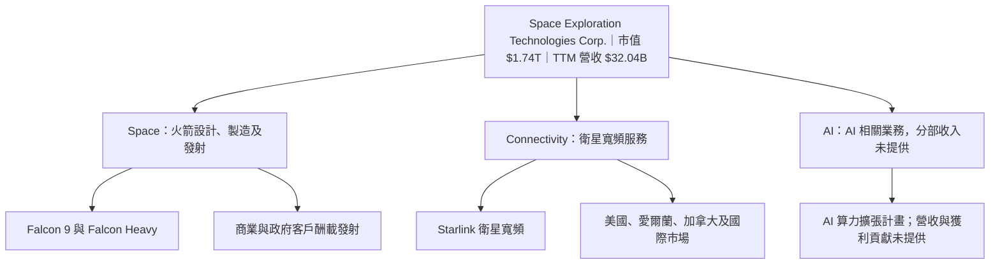
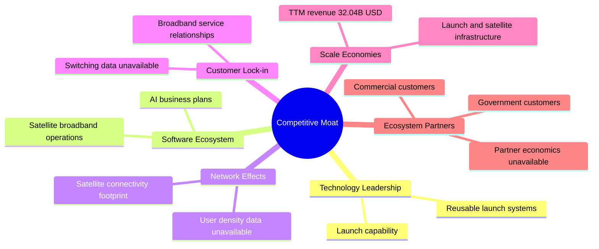
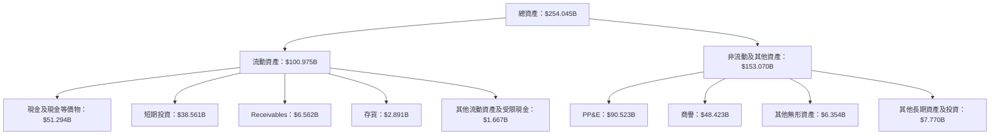
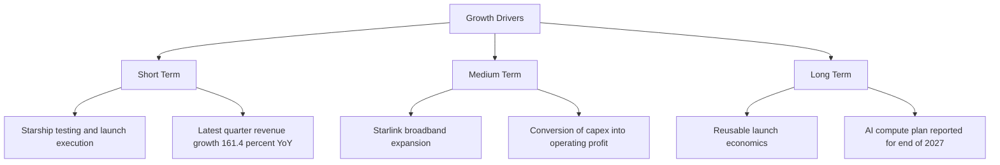
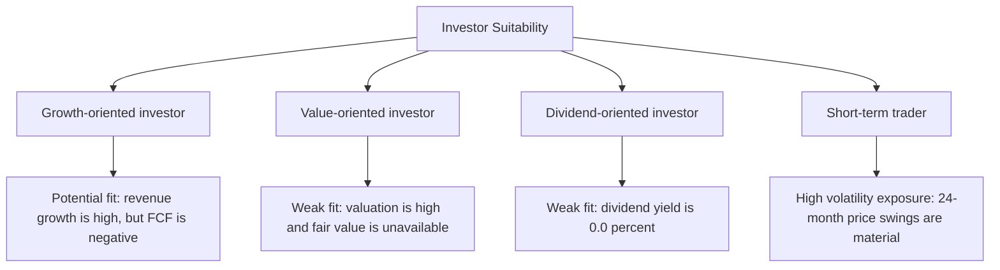

# SPCX 基本面深度分析報告
> **報告日期**：2026-11-23 ｜ **語言**：繁體中文 ｜ **數據來源**：Yahoo Finance、Finviz、StockAnalysis、Roic.ai ｜ **分析師**：CFA 級機構研究

## 目錄

| # | 章節 | 核心結論 |
|---|------|----------|
| 1 | 執行摘要 | 2026-11-20 收盤價 $127.79；DCF 與加權合理價值均無法計算，故無法依 MOS 給出規則 20 評級 |
| 2 | 公司概覽與商業模式 | 涵蓋太空發射、衛星連線與 AI；各業務收入拆分未提供 |
| 3 | 損益表深度分析 | TTM 營收 $32.04B；TTM 成長率 N/A，最新一季年增 161.4%；TTM 營業利益率 -2.0% |
| 4 | 資產負債表分析 | 淨現金 $50.64B、流動比率 3.084；但資料來源間存在股數與財報欄位差異 |
| 5 | 現金流量深度分析 | TTM FCF 為 -$40.16B，主要受 $55.92B 資本支出影響 |
| 6 | 獲利能力與資本效率 | WACC 為 9.78%；ROIC 未提供，無法判定是否創造經濟價值 |
| 7 | 相對估值分析 | SPCX 倍數偏高；未盈利同業倍數亦呈現極大差異，DCF 與估值方法結果缺漏 |
| 8 | DCF 內在價值評估 | DCF MODEL 為 N/A，原因是 TTM 營業利益為負；不建構替代 DCF |
| 9 | 成長催化劑 | 可觀察 Starship、Starlink 與 AI 算力相關進展；TAM 數據未提供 |
| 10 | 風險矩陣 | 前三大風險為資本支出／FCF、盈利持續性及估值與資料品質 |
| 11 | 投資建議 | 因無加權合理價值與 MOS，不給 MOS 評級或目標價；以財報驗證作為決策前提 |

## 1. 執行摘要

### 1.0 一頁式投資儀表板（Portfolio Manager 30 秒速讀）

| 項目 | 內容 |
|------|------|
| **投資論點（3 句）** | ① TTM 營收為 **$32.04B**，最新一季年增 **161.4%**，但 TTM 營收成長率為 N/A，單季高增速尚不能證明可持續。② 現金及短期投資 **$89.86B**、總債務 **$39.22B**，淨現金 **$50.64B**，提供擴張資金緩衝。③ TTM 資本支出 **$55.92B** 高於營業現金流 **$15.76B**，使 TTM FCF 為 **-$40.16B**，現階段價值取決於投資最終能否轉化為現金獲利。 |
| **綜合評分** | **5.8/10**（引用 1.1 六項評分算術平均） |
| **財務健康** | 🟡 現金淨額 $50.64B、流動比率 3.084；但 TTM FCF -$40.16B，投資消耗高 |
| **ROIC vs WACC** | ROIC：N/A；WACC：**9.78%**。缺少可比較 ROIC，無法判定創造或摧毀價值 |
| **FCF 趨勢** | TTM FCF **-$40.16B**；FCF Yield **-2.31%** |
| **估值** | Forward P/E **46.59906x** ｜ EV/EBITDA **143.566x** ｜ FCF Yield **-2.31%** |
| **DCF 內在價值（基準）** | **N/A**；DCF MODEL 未計算，折溢價 N/A |
| **安全邊際（MOS）** | **N/A**：無加權合理價值，不能依定義計算 MOS |
| **預期報酬（基準情境 12M）** | N/A：DCF 情境價值未提供 |
| **關鍵風險（前二）** | TTM FCF -$40.16B；TTM 營業利益率 -2.0% |
| **評級 + 信心度** | **無 MOS-based 評級**；信心度低。估值方法無法計算，且股數與部分財報欄位在來源間有差異 |

### 1.1 綜合評分卡（全報告唯一）

| 維度 | 評分（1–10） | 主要依據（引用數字與其來源章節） |
|------|--------------|----------------------------------|
| 成長性 | 8.0 | 最新一季營收年增 161.4%；TTM 營收成長率 N/A，且季度數據呈現加速但波動（第 3 章） |
| 獲利能力 | 3.0 | TTM 營業利益率 -2.0%、最新一季 1.8%；ROIC 與 F-Score N/A（第 3、6 章） |
| 財務健康 | 7.0 | 淨現金 $50.64B、流動比率 3.084、速動比率 2.945；TTM FCF -$40.16B（第 4、5 章） |
| 估值 | 3.0 | Forward P/E 46.59906x、P/S 54.16235x；DCF 與加權合理價值不可得（第 7、8 章） |
| 護城河 | 8.0 | 發射、衛星寬頻與 AI 具技術及網路規模特性；未提供市場份額及分部收入（第 2 章） |
| 管理層與資本配置 | 5.5 | FY2025 SBC $1.95B；TTM Capex $55.92B、TTM FCF -$40.16B；回購及股息數據有限（第 3、5 章） |
| **綜合評分** | **5.8** | 六項算術平均：\((8.0+3.0+7.0+3.0+8.0+5.5)÷6=5.75\)，四捨五入至一位小數 |

### 1.2 五大投資論點 + 三大核心風險

| 類型 | 項目 | 具體依據 | 信心度 |
|------|------|----------|--------|
| 🟢 **投資論點①** | 最新一季營收加速 | 2026-09-30 單季營收 $14.575B，年增 161.4%；但需留意單季數字不等於可持續 TTM 成長率 | 🟡 中 |
| 🟢 **投資論點②** | 流動性緩衝 | 現金及短期投資 $89.86B，總債務 $39.22B，淨現金 $50.64B | 🟢 高 |
| 🟢 **投資論點③** | 多業務方向 | 公司描述涵蓋可重複使用火箭、衛星寬頻與 AI；分部收入及獲利貢獻未披露 | 🟡 中 |
| 🟢 **投資論點④** | 最新單季營業轉正 | 最新一季營業利益率 1.8%，高於 TTM -2.0%；單季轉正仍待後續季度確認 | 🟡 中 |
| 🟢 **投資論點⑤** | 近年營收規模擴大 | FY2023 至 FY2025 營收由 $10.387B 增至 $18.674B；兩年 CAGR 約 34.1%（計算依年度收入） | 🟡 中 |
| 🟡 **風險①** | 高額資本支出及負 FCF | TTM Capex $55.92B、OCF $15.76B、FCF -$40.16B；若投資回報延遲，現金消耗可能持續 | 🔴 高衝擊 |
| 🔴 **風險②** | 盈利穩定性不足 | FY2025 營業利益 -$2.064B；TTM 營業利益率 -2.0%，雖最新一季轉正仍未建立穩定趨勢 | 🔴 高衝擊 |
| 🟡 **風險③** | 估值與資料完整性 | Forward P/E 46.59906x、P/S 54.16235x；股數在市場數據與 Roic.ai 歷史資料間不一致，增加每股估值不確定性 | 🟡 中至高 |

### 1.3 快速統計卡片

| 指標 | 公司實際值（期間） | 同業中位數 | 狀態 |
|------|--------------------|------------|------|
| 營收成長（TTM） | **N/A** | — | 🟡 |
| 營收成長（最新一季年增） | **161.4%** | 72.7%（RKLB、ASTS、IRDM 的中位數） | 🟢 |
| 毛利率（TTM） | **56.8%** | 37.0%（Peer 中位數） | 🟢 |
| 營業利益率（TTM） | **-2.0%** | — | 🔴 |
| ROIC（TTM） | **N/A** | — | 🟡 |
| Forward P/E | **46.59906x** | N/A（Peer Forward P/E 中位數受負值與極端值影響，不作為穩健比較） | 🟡 |
| FCF Yield（TTM） | **-2.31%** | — | 🔴 |
| Piotroski F-Score | **N/A** | — | 🟡 |

> Peer 中位數計算：最新一季營收年增率中位數為 72.7%；毛利率中位數為 37.0%。三家同業 Forward P/E 分別為 634.5x、-14.9x、29.5x，其中負值與極端值令中位數不適合作為可比盈利倍數，故不列。

### 1.4 投資結論

╔══════════════════════════════════════════════════════════════════╗  
║                    📊 投資結論摘要                               ║  
╠══════════════════════════════════════════════════════════════════╣  
║  評級：不給 MOS-based 評級；合理價值與 MOS 尚無法計算            ║  
║  價格（2026-11-20 收盤）：$127.79                                 ║  
║  DCF 內在價值（基準）：N/A（TTM 營業利益為負）                    ║  
║  安全邊際 MOS：N/A（加權合理價值不存在）                          ║  
║  加權合理價值（8.8）：N/A（估值方法均未能計算）                   ║  
║  DCF 情境價值：N/A（DCF MODEL 未提供）                            ║  
║  綜合評分：5.8/10（引用 1.1）                                     ║  
║  適合投資人：能承受高估值、負 FCF 與執行風險的長期成長型投資人；  ║  
║              不適合作為以股息或穩定現金流為核心的配置             ║  
╚══════════════════════════════════════════════════════════════════╝

## 2. 公司概覽與商業模式

### 2.1 業務結構與收入來源

財務資料未提供分部收入、分部利潤及營收占比；因此圖中不填入未披露的金額或比例。公司總營收採 TTM $32.04B，市值採市場資料所列 $1.74T。

「AI 算力每月一 gigawatt」是近期新聞標題所述的未來預期，不是已實現財務數據；本報告不將其視為已確認產能或營收。

### 2.2 市場份額

市場份額資料未提供，亦無可引用的市場份額年份與來源，故不繪製比例圖。已知 TTM 營收為 $32.04B，最新一季營收年增 161.4%；但與同業相比，需注意公司最新季成長較高不代表其市場份額或長期競爭位置已可量化確認。

### 2.3 競爭護城河分析

### 2.4 護城河強度

| 護城河項目 | 強度（強／中／弱） | 證據（引用數字或事實） | 會削弱它的情況 |
|------------|--------------------|------------------------|----------------|
| 技術與發射能力 | 強 | 公司經營可重複使用火箭，使用 Falcon 9 與 Falcon Heavy 提供發射服務；收入拆分與發射成功率未提供 | 發射可靠性下降、競爭者取得可比成本或可靠度 |
| 衛星網路規模 | 中至強 | 公司提供多國衛星寬頻服務；訂戶、衛星數與單位經濟資料未提供 | 網路容量不足、頻譜或監管限制、服務品質落後 |
| 軟體與服務生態 | 中 | Connectivity 為持續性服務業務，但 ARPU、留存率及服務毛利未提供 | 客戶流失或替代連線方案價格競爭 |
| 客戶鎖定 | 中 | 涵蓋商業及政府發射客戶與寬頻用戶；轉換成本數據未提供 | 客戶多來源採購，或合約到期後改用競品 |
| 規模效應 | 強 | TTM 營收 $32.04B、現金及短期投資 $89.86B，支持持續投入；成本曲線未提供 | 資本投入不能轉化為更低單位成本或正 FCF |
| 生態夥伴 | 中 | 公司服務商業及政府客戶；夥伴營收占比及合約期限未提供 | 政府採購、供應鏈或主要客戶需求轉弱 |

1.1「護城河」評分為 **8.0/10**，理由是發射、衛星服務與規模特徵具結構性優勢，但市場份額、留存率及各業務獲利資料不足以確認護城河的經濟回報。

## 3. 損益表深度分析

### 3.1 年度收入成長趨勢（可取得年度）

可取得的年度營收為 FY2023–FY2025；FY2022 未提供，因此不補造四年序列。

╔══════════════════════════════════════════════════════════════════╗  
║      Space Exploration Technologies Corp. 年度收入趨勢          ║  
╠══════════════════════════════════════════════════════════════════╣  
║ FY2023  $10.387B  ████████████░░░░░░░░░  YoY：N/A               ║  
║ FY2024  $14.015B  ████████████████░░░░░  YoY：+34.9% 🟢         ║  
║ FY2025  $18.674B  █████████████████████  YoY：+33.2% 🟢         ║  
║                                                                  ║  
║ FY2023–FY2025 兩年 CAGR：+34.1%                                  ║  
╚══════════════════════════════════════════════════════════════════╝

計算：FY2024 年增 = \((14.015÷10.387)-1=34.9\%\)；FY2025 年增 = \((18.674÷14.015)-1=33.2\%\)；兩年 CAGR = \((18.674÷10.387)^{1/2}-1=34.1\%\)。增長與太空發射及連線業務擴張相符，但沒有分部數據，不能判斷主要貢獻來自哪一項業務。

### 3.2 季度收入趨勢分析

| 季度 | 營收 | QoQ 成長 | YoY 成長 | 備註 |
|------|------:|---------:|---------:|------|
| 2025-12-31 | $4.960B | -11.0% | N/A | QoQ 與 2025-09-30 的 $5.576B 比較；2024 同季度營收未提供 |
| 2026-03-31 | $4.694B | -5.4% | 15.4% | 同季年增率取 StockAnalysis；單季成長仍為正，但 QoQ 回落 |
| 2026-06-30 | $7.814B | 66.5% | 91.9% | 季營收明顯上升；收入來源構成未披露 |
| 2026-09-30 | $14.575B | 86.5% | 161.4% | 最新一季年增率為單季數字，不代表 TTM 成長率 |

QoQ 計算分別為 \((4.960÷5.576)-1=-11.0\%\)、\((4.694÷4.960)-1=-5.4\%\)、\((7.814÷4.694)-1=66.5\%\)、\((14.575÷7.814)-1=86.5\%\)。兩個最新季度加速顯著，但財務資料沒有說明是否含大型合約、業務組合變化或會計認列時點，故需以後續季度驗證持續性。

### 3.3 利潤率演變分析

| 利潤率指標 | FY2023 | FY2024 | FY2025 | TTM／最新季度 | 趨勢 | 評估 |
|------------|--------|--------|--------|---------------|------|------|
| **毛利率** | 41.2% | 42.9% | 49.4% | TTM 56.8% | 近年上升 | 🟢 毛利提升，但無分部組合與成本拆分可驗證 |
| **營業利益率** | 4.88% | 5.29% | -11.05% | TTM -2.0%；最新季度 1.8% | FY2025 惡化，TTM 仍負，最新季度轉正 | 🔴/🟡 盈利反轉仍需連續季度確認 |
| **淨利率** | -44.56% | 5.64% | -26.44% | TTM -8.6% | 波動大 | 🔴 淨利受到重大項目或費用波動影響，細項不足 |

毛利率以年度 gross profit ÷ revenue 計算；營業利益率及淨利率歷史值採 Roic.ai 顯示。TTM 的營業利益率、毛利率及淨利率採所列財務指標。另有季度營業利益欄位在 Yahoo 與 StockAnalysis 數據間不一致，因此本報告不以爭議季度金額重算利潤率。

**利潤率演變深度解析：**FY2025 營業利益由 FY2024 的正 $742M 轉為 -$2.064B，與 R&D 由 $3.46B 增至 $8.64B 同期發生；但缺少費用分類及分部資料，不能將全部利潤變化歸因於研發。TTM 毛利率 56.8% 高於 FY2025 的 49.4%，而 TTM 營業利益率仍為 -2.0%，顯示毛利改善尚未完整轉化為營業獲利。最新季度營業利益率 1.8% 是改善訊號，但單季不足以證明結構性利潤率已提升。

### 3.4 費用結構分析

費用明細不完整，無法可靠繪製反映公司總費用結構的 Mermaid pie。已知 FY2025 R&D 為 $8.64B、FY2025 營收為 $18.674B，R&D 相當於營收約 46.3%；此計算僅代表該年度研發支出強度，不等於完整費用結構。

| 項目 | FY2025 金額 | 佔 FY2025 營收 | 解讀 |
|------|------------:|---------------:|------|
| R&D | $8.64B | 46.3% | 高投入可能支援新產品與技術，但短期壓低營業獲利 |
| 其他營業費用拆分 | N/A | N/A | 資料未提供 |
| FY2025 營業虧損 | -$2.064B | -11.05% | 研發、其他營業費用及業務組合的個別影響無法分拆 |

### 3.5 季度 EPS 趨勢與盈餘品質（Quality of Earnings）

| 季度 | EPS 實際值（Roic.ai） | EPS 預期 | 超預期／不及預期 | 備註 |
|------|----------------------:|---------:|------------------|------|
| 2025-12-31 | -$0.18 | N/A | 無法判定 | 預期值未提供 |
| 2026-03-31 | -$0.47 | N/A | 無法判定 | 預期值未提供 |
| 2026-06-30 | -$0.09 | N/A | 無法判定 | 預期值未提供 |
| 2026-09-30 | $0.37 | N/A | 無法判定 | 最新季度轉正；沒有一致的 EPS 預期資料 |

EPS 盈餘驚喜資料中估計值為 NaN，因此無法可靠標記超預期或不及預期。季度盈餘表亦存在淨利欄位來源差異；以 EPS 實際序列可以觀察到由負轉正，但不宜把該趨勢直接等同於持續獲利改善。

| 盈餘品質項目 | 數值／佔比 | 評估 |
|--------------|-----------|------|
| 股權薪酬 SBC / 營收 | FY2025：$1.95B ÷ $18.674B = **10.4%**；可取得最近四季 SBC 合計 $4.733B，相對 TTM 營收 **14.8%** | 🔴 高 SBC 會稀釋股東經濟權益；股數口徑在來源間有差異 |
| SBC / 營業現金流 | FY2025：$1.95B ÷ $6.79B = **28.7%**；最近四季 SBC 合計 ÷ TTM OCF = **30.0%** | 🟡/🔴 代表營業現金流中相當比例對應股權薪酬成本；SBC 本身不是現金流出，但有稀釋成本 |
| FCF / 淨利（現金轉換率） | N/A | 🔴 TTM 淨利在來源間不一致，且當期有虧損，無法提供可靠比率 |
| 一次性／非經常性損益 | N/A | 非經常項目未提供，無法判定是否美化或壓低盈餘 |
| 有效稅率異常 | N/A | TTM 有效稅率未提供，不推算 |
| 資本化支出 vs 費用化 | TTM Capex $55.92B；資本化與費用化會計明細 N/A | 🟡 高資本化投資會先以資產形式進入資產負債表，未來需透過折舊及資產回報驗證經濟效益 |

**盈餘品質結論：**最新季度 EPS 轉正是正面變化，但歷史盈餘波動、負 TTM 營業利益率、TTM FCF -$40.16B、SBC 占營收比重高，以及淨利與股數來源差異，令 GAAP 盈餘的持續性與每股含金量尚未確立。估值不宜只依賴單季 EPS 或 Forward P/E。

## 4. 資產負債表分析

### 4.1 資產結構分解

資產細項採截至 2026-09-30 的 StockAnalysis 資產負債表；使用已列金額，不將未列明項目補入分解。

總資產與分類金額採 StockAnalysis 顯示。現金與短期投資合計 $89.855B，與財務摘要 $89.86B 相符。Goodwill 與 PP&E 數額較大，資產減值、投資回報及資本效率應列為後續檢查項目。

### 4.2 流動性與營運資金分析

| 流動性指標 | 最新值 | 歷史值 | 評估 |
|------------|-------:|-------:|------|
| 流動比率 | 3.084 | N/A | 🟢 短期流動性指標偏充足；比較期間資料未提供 |
| 速動比率 | 2.945 | N/A | 🟢 排除存貨後仍有流動性緩衝 |
| 現金及短期投資 | $89.86B | FY2025：$24.747B（現金，不含相同口徑短期投資） | 🟢 最新資金規模高；歷史口徑不完全相同 |

營運資金天數依 QUALITY FIGURES 原值照列。一年前資料未提供，變化不重算。

| 指標 | 最新 TTM | 一年前 TTM | 變化 | 解讀 |
|------|----------|------------|------|------|
| DSO 應收帳款天數 | 54 天 | N/A | N/A | 單一期間不能判斷收款速度是否變慢 |
| DIO 存貨天數 | 76 天 | N/A | N/A | 存貨水準須與未交付訂單及生產計畫一併追蹤 |
| DPO 應付帳款天數 | 349 天 | N/A | N/A | 可能反映供應商付款條件或結算時點；不可僅憑天數推定議價能力 |
| CCC 現金轉換週期 | -219 天 | N/A | N/A | 由 DSO + DIO − DPO 得到的來源原值；無歷史比較不能判斷是否改善 |

### 4.3 債務結構分析

╔══════════════════════════════════════════════════════════════════╗  
║                   SPCX 債務健康診斷                              ║  
╠══════════════════════════════════════════════════════════════════╣  
║ 總債務：              $39.22B                                     ║  
║ 現金及短期投資：      $89.86B                                     ║  
║ 淨現金：              $50.64B  🟢                                 ║  
║ 流動比率：            3.084                                      ║  
║ 速動比率：            2.945                                      ║  
║ Debt/EBITDA：         未列示；不以不一致數據自行補算              ║  
║ 利息保障倍數：        N/A（利息費用及一致口徑 EBIT 未提供）       ║  
╚══════════════════════════════════════════════════════════════════╝

淨現金提供高額投資彈性，但不能單獨證明負 FCF 可無限期維持。市場資料的總債務 $39.22B 與截至 2025-12-31 年度報表的 $23.32B 不同，可能涉及期間差異；本報告採最新 TTM 資料中的總債務，不把年度數字混作同一時點。

### 4.4 股東權益趨勢

╔══════════════════════════════════════════════════════════════════╗  
║                    股東權益歷史變化                              ║  
╠══════════════════════════════════════════════════════════════════╣  
║ 2024-12-31：$25.80B  ███████████░░░░░░░░░                         ║  
║ 2025-12-31：$41.33B  ██████████████████░                         ║  
║ 2026-09-30：N/A（同一來源的最新季股東權益未提供）                 ║  
╚══════════════════════════════════════════════════════════════════╝

FY2024 至 FY2025 權益增加 $15.53B，計算為 $41.33B − $25.80B；但缺少完整權益變動表，不能拆分為發股、留存盈餘、SBC 或其他項目。Roic.ai TTM 的權益數字與年度報表口徑不同，未混用。

## 5. 現金流量深度分析

### 5.1 現金流量瀑布圖

資料提供營業現金流、Capex、FCF、股息殖利率，但沒有同口徑淨利、回購金額及期間現金淨變化。圖示只表達已知流程，缺數字處不補值。

### 5.2 FCF 轉換率趨勢

| 年度 | 營業現金流 | 資本支出 | FCF | FCF / 淨利 |
|------|-----------:|---------:|----:|-----------:|
| 2023 | $4.52B | $4.42B | $0.105B | N/A（年度淨利為虧損） |
| 2024 | $5.78B | $11.16B | -$5.39B | N/A（淨利與 FCF 的欄位口徑需核對） |
| 2025 | $6.79B | $20.91B | -$14.12B | N/A（年度淨利為虧損） |
| TTM 至 2026-09-30 | $15.76B | $55.92B | -$40.16B | N/A（TTM 淨利來源不一致且為負） |

歷年 Capex 逐步增加，將 OCF 轉為更大的負 FCF。FCF/淨利在淨利為負或來源口徑不一致時不宜用單一比例解讀；重點應放在新增資本能否帶動可持續營業現金流與正 FCF。

### 5.3 自由現金流趨勢

╔══════════════════════════════════════════════════════════════════╗  
║                    自由現金流趨勢                                ║  
╠══════════════════════════════════════════════════════════════════╣  
║ FY2023   +$0.105B  ░░░░░░░░░░░░░░░░░░░░  FCF Yield：N/A          ║  
║ FY2024   -$5.39B   ███░░░░░░░░░░░░░░░░░  FCF Yield：N/A          ║  
║ FY2025   -$14.12B  ███████░░░░░░░░░░░░░  FCF Yield：N/A          ║  
║ TTM      -$40.16B  ████████████████████  FCF Yield：-2.31%       ║  
╚══════════════════════════════════════════════════════════════════╝

年度 FCF Yield 沒有可直接引用的同期間數據，故不自行用不同市值口徑計算。TTM FCF Yield 原值為 -2.31%。

### 5.4 資本配置評估

Capex、SBC 與股息資料有數字，但投資、併購、回購、留存現金的完整資金流分配未提供，不能畫完整資本配置比例圓餅圖。

| 資本配置項目 | 已知數據 | 評估 |
|--------------|----------|------|
| 資本支出 | TTM $55.92B；FY2025 $20.91B | 🔴 投資強度高，需以未來現金流回報驗證 |
| 股權薪酬 | FY2025 $1.95B；最近四季合計 $4.733B | 🟡/🔴 支持人才與執行，但形成股東稀釋 |
| 股息 | 殖利率 0.0% | 無現金股息回報 |
| 回購 | N/A | 未提供回購金額與股數變化的完整對帳 |
| 併購及其他投資 | N/A | 未提供同口徑資金流拆分 |

## 6. 獲利能力與資本效率

### 6.1 ROE / ROA / ROIC 趨勢

| 指標 | FY2023 | FY2024 | FY2025 | TTM | 評估 |
|------|-------:|-------:|-------:|----:|------|
| ROE | N/A | N/A | N/A | N/A | QUALITY FIGURES 指出杜邦資料不足，不推算 |
| ROA | N/A | N/A | N/A | N/A | TTM 淨利與資產口徑來源不一致 |
| ROIC | N/A | N/A | N/A | N/A | Roic.ai 未提供可用 ROIC 數值 |
| WACC | — | — | — | 9.78% | 財務數據的資本成本輸入 |

### 6.2 ROIC vs WACC 分析（核心價值創造判斷）

╔══════════════════════════════════════════════════════════════════╗  
║                ROIC vs WACC 深度分析                              ║  
╠══════════════════════════════════════════════════════════════════╣  
║ WACC（直接採用資本成本資料）：9.78%                                ║  
║ ├── 無風險利率（10Y 美債）：4.91%                                  ║  
║ ├── 市場風險溢酬：5.00%                                            ║  
║ ├── 原始 Beta：N/A；採用調整後 Beta：1.00（假設值）               ║  
║ ├── 股權成本：4.91% + 1.00 × 5.00% = 9.91%                        ║  
║ ├── 稅前債務成本：4.96%；預設稅率：21.0%                          ║  
║ ├── 資本權重：股權 97.8%，債務 2.2%                               ║  
║ └── WACC：9.78%                                                   ║  
║                                                                  ║  
║ ROIC：N/A（無可靠 TTM ROIC）                                      ║  
║ EVA（ROIC − WACC）：N/A                                           ║  
║ 結論：缺少 ROIC，無法判斷公司是否高於 9.78% 的資本成本創造價值    ║  
╚══════════════════════════════════════════════════════════════════╝

Beta 原始值未提供，調整後 Beta 1.00 為資本成本資料所採用的假設值；本節不另行估計。WACC 的權重與各成本採財務數據列示值；不以有差異的股數或市值自行重建權重。ROIC 未提供，因此不能由最新季度轉正的營業利益率直接推定長期經濟回報。

### 6.3 杜邦三因素分解

QUALITY FIGURES：**N/A**。缺少一致的 TTM 淨利、營收、總資產或正股東權益等必要資料，故不列淨利率、資產週轉率與權益乘數，也不自行重算 ROE。

### 6.4 財務體質：Piotroski F-Score

QUALITY FIGURES：**Piotroski F-Score N/A**，原因為缺少兩個相隔一年的 SEC 申報資料 TTM 期間；九項測試逐項結果未提供，故不補造測試分數或判定。

## 7. 相對估值分析

### 7.1 同業估值比較表格

Peer multiples 採 Yahoo Finance 列示數值。SPCX 數字採市場估值資料。盈利為負或倍數失真的情形標示為不具可比性。

| 估值指標 | **SPCX** | **RKLB** | **ASTS** | **IRDM** | 本公司評估 |
|----------|---------:|---------:|---------:|--------:|-----------|
| **Trailing P/E** | 555.6087x | N/A | N/A | 27.3x | 🔴 SPCX 倍數極高；TTM 盈利口徑須謹慎 |
| **Forward P/E** | 46.59906x | 634.5x | -14.9x | 29.5x | 🟡 同業差距很大；ASTS 負值不可作正常盈利倍數比較 |
| **P/S Ratio** | 54.16235x | 34.7x | 65.3x | 4.9x | 🔴 SPCX 高於 IRDM、低於 ASTS；均反映業務階段差異 |
| **EV/EBITDA** | 143.566x | -140.9x | -18.1x | 16.6x | 🔴 SPCX 倍數高；兩家同業 EBITDA 為負，倍數不可直接比較 |
| **最新一季營收年增** | 161.4% | 72.7% | 187.1% | 8.3% | 🟢 SPCX 成長高於 RKLB、IRDM，低於 ASTS |
| **毛利率（TTM）** | 56.8% | 36.2% | 37.0% | 71.5% | 🟡 高於 RKLB、ASTS，低於 IRDM |

同業數據顯示 SPCX 的 P/S 仍處高位，成長速度高於部分同業但低於 ASTS。EV/EBITDA 對負 EBITDA 同業失去一般比較意義；不同公司所處的發射、衛星通訊及建設階段亦使單一倍數不能替代獲利品質分析。

### 7.2 歷史估值區間分析

**N/A（數據未提供：缺少 Valuation vs own history 的歷史 P/E 區間與百分位）**。現有 24 個月價格紀錄不能替代歷史估值倍數資料，因此不推算歷史估值位置。

### 7.3 情境價值（Bear / Base / Bull）

**N/A（DCF 無法計算：TTM 營業利益為負，DCF MODEL 未提供情境估值）**。不自行設定情境目標價、營收 CAGR 或退出倍數。

### 7.4 相對估值隱含價格區間

**N/A（估值方法均未能計算）**。相對倍數雖有資料，但估值方法區塊未提供可用的估值方法、方法權重及每股價值。另股數資料存在差異，若自行回推每股價值會引入未經驗證的輸入，故不建立價格區間。

## 8. DCF 內在價值評估（Discounted Cash Flow）

> **結論先行：DCF MODEL 為 N/A。** 原因是 TTM 營業利益不為正；對虧損營業利益直接折現無法形成具經濟意義的價值。因此以下不建立替代模型、不自行填入預測假設，亦不產出 DCF 每股價值、敏感度矩陣或情境目標價。

### 8.0 估值推理鏈（Thinking Logic）

**Step 1 — 價值由哪些變數決定？**  
公司業務包含 Space、Connectivity 與 AI，但三者的分部收入占比未提供，無法把 $32.04B TTM 營收拆分為可獨立估值的主業現金流、第二成長曲線或新業務選擇權。就已知資料而言，最重要的可驗證變數是資本支出能否轉化為營業利益與正 FCF：TTM Capex $55.92B、FCF -$40.16B。

**Step 2 — 模型選擇**

| 決策點 | 本報告採用 | 理由（含數字） | 曾考慮但否決 | 否決理由 |
|--------|-----------|----------------|--------------|----------|
| 現金流定義 | 不建構 DCF | TTM 營業利益率 -2.0%，且 TTM FCF -$40.16B | FCFF／FCFE DCF | 負 TTM 營業利益使程式 DCF 模型不適用 |
| 預測期 N | N/A | 模型未提供 | 5–10 年模型 | 自行設定會違反不得另建 DCF 的資料規則 |
| 終值方法 | N/A | 無預測 FCFF | Gordon Growth／退出倍數 | 缺少可用 DCF 基準與逐年現金流 |
| EBIT 基礎 | N/A | 未進入 DCF 預測 | GAAP／非 GAAP | 不建立預測假設 |

**Step 3 — 關鍵假設推導鏈**  
N/A。由於 DCF MODEL 明確標為 N/A，營收 CAGR、利潤率、g、N、Capex、D&A、ΔWC、SBC 處理及股數均不得自行填入模型。

**Step 4 — 最脆弱的一環**  
現階段核心不確定性是 $55.92B TTM Capex 能否帶來持續的營業獲利與正 FCF；若不能，負 FCF 及高估值風險會升高。缺少 DCF 敏感度與情境數字，無法量化每股價值下修幅度。

**Step 5 — 計算路徑圖**

因 DCF MODEL 不適用，不繪製會暗示存在預測假設的估值計算路徑。

### 8.1 模型假設總表（Model Inputs）

**N/A（DCF MODEL 未計算）**。未提供可採用的預測期、營收成長假設、期末營業利潤率、稅率、Capex/營收、D&A/營收、營運資金假設、EBIT 基礎、SBC 處理、稀釋股數與永續成長率。依規則不自行建立模型。

### 8.2 折現率推導（WACC）

WACC 採資本成本資料原值，並與第 6.2 節一致。調整後 Beta 1.00 是該資料所採假設；原始 Beta 為 N/A。

╔══════════════════════════════════════════════════════════════════╗  
║                    WACC 推導（折現率）                           ║  
╠══════════════════════════════════════════════════════════════════╣  
║ 無風險利率 Rf：4.91%                                              ║  
║ 市場風險溢酬 ERP：5.00%                                           ║  
║ 原始 Beta：N/A；採用調整後 Beta：1.00                             ║  
║ Ke = 4.91% + 1.00 × 5.00% = 9.91%                                 ║  
║ 稅前債務成本 Kd：4.96%（來源直接列示）                            ║  
║ 稅率：21.0%                                                       ║  
║ 稅後 Kd = 4.96% × (1 − 21.0%) = 3.9184%                           ║  
║ 股權權重：97.8%；債務權重：2.2%                                   ║  
║ WACC = 97.8% × 9.91% + 2.2% × 3.9184%                             ║  
║       = 9.6920% + 0.0862% = 9.7782% ≈ 9.78%                       ║  
╚══════════════════════════════════════════════════════════════════╝

上述 9.7782% 是用列示權重與成本作算術覆核，正式採用數字為資本成本資料提供的 **WACC 9.78%**。無風險利率日期、ERP 的外部來源細節及計息債務明細未提供；因此不推算利息費用或重建市值權重。Kd、D 權重的負債範圍亦無法獨立核實，為估值限制之一。

### 8.3 逐年自由現金流預測（基準情境）

**N/A（DCF MODEL 未計算）**。缺少模型所需的年度營收、營業利潤率、稅率、折舊、Capex、營運資金及逐年 FCFF，故不建立預測表或代表年度算式。

### 8.4 終值計算（Terminal Value）

**N/A（沒有 FY+N FCFF、永續成長率及預測期）**。因此不計算 Gordon Growth 或退出倍數終值，也不計算終值現值與 EV 占比。

### 8.5 企業價值 → 每股內在價值（Bridge）

**N/A（DCF 企業價值未計算）**。淨現金雖為 $50.64B，但不能在沒有 DCF EV、少數股東權益及一致稀釋股數的情況下推導每股內在價值。財務資料列有 8.25B shares，Roic.ai 2026-09-30 列有 13.579B shares，兩者不一致，故不選擇其中一個作為模型股數。

DCF 折溢價與 MOS 均不計算：折溢價需有 DCF 基準價；MOS 則需第 8.8 節加權合理價值。

### 8.6 敏感性分析（WACC × 永續成長率）

**N/A（DCF MODEL 未提供基準 FCFF、g 或敏感度矩陣）**。無法形成 5×5 每股價值矩陣、選格重算或量化 g、WACC 與利潤率的價值彈性；不以假設數字替代。

**三情境 DCF：N/A。** 悲觀、基準、樂觀的營收 CAGR、期末營業利潤率、WACC、每股價值、上行空間與機率均未提供，不另設情境或加權價格。

### 8.7 反推 DCF（Reverse DCF）

**N/A（DCF MODEL 未提供反推結果）**。未以單一現價方程式反解營收成長率、利潤率、永續成長或預測期，亦不提供迭代軌跡。現價 $127.79 不能單獨決定多個未知變數。

### 8.8 估值三角驗證與安全邊際

| 估值方法 | 隱含每股價值 | 上行空間 | 權重 | 說明 |
|----------|--------------|----------|------|------|
| DCF | N/A | N/A | N/A | TTM 營業利益為負，DCF 不可計算 |
| 其他估值方法 | N/A | N/A | N/A | VALUATION METHODS 顯示沒有方法可計算 |
| **加權合理價值** | **N/A** | **N/A** | N/A | 無法計算加權值，故不計 MOS、不給 MOS-based 評級 |

**逐步演算：N/A。** 加權合理價值的估值方法、每股價值及權重均未提供；不能構造價值×權重算式，也不能以分析師共識目標價替代估值方法。分析師平均目標價 $257.50 是市場調查數據，不是經驗證估值模型輸出。

MOS 定義為 \((加權合理價值-現價)÷加權合理價值\)。因加權合理價值 N/A，MOS、上行空間、買入區間及減碼區間均不能依規則計算。

### 8.9 DCF 模型的局限與失效條件

- **終值依賴度：** N/A；未計算 DCF 終值。
- **最脆弱的估值假設：** 由於模型未建立，無法給出假設或價值敏感度。營運上最需驗證的是 Capex 投入的回報及營業利潤率能否持續轉正。
- **不適用情境：** TTM 營業利益率 -2.0%、TTM FCF -$40.16B，傳統以正 FCFF 為基礎的 DCF 可靠度低。可追蹤 EV/Sales、分部價值與單位經濟性，但分部收入、客戶數及單位成本未提供，本報告不自行估值。
- **與第 10 章風險矩陣的連結：** Capex 無法轉化為營業利益會延長負 FCF；業務放量低於預期會壓低收入規模；估值倍數收縮則會加重高 P/S 對股價的影響。

### 8.10 複算檢核表（Audit Trail）

| # | 檢核項目 | 檢查方式 | 結果 |
|---|----------|----------|------|
| 1 | 高／中敏感度 DCF 假設均有推導 | DCF MODEL 為 N/A，未建立假設 | N/A |
| 2 | 每項 DCF 假設有來歷 | 未建立 DCF 假設 | N/A |
| 3 | WACC 算式及權重覆核 | 97.8% + 2.2% = 100%；算得 9.7782%，採用 9.78% | ✅ |
| 4 | Kd 與債務權重使用同一負債範圍 | 計息負債明細未提供，不能獨立核實 | N/A |
| 5 | WACC 與第 6.2 節一致 | 兩處均使用 9.78% | ✅ |
| 6 | 預測年度數等於 N | 無預測期 N | N/A |
| 7 | FY+1 FCFF 與 PV 可複算 | 沒有 FY+1 數據 | N/A |
| 8 | 預測期 PV 加總 | 無預測期 PV | N/A |
| 9 | WACC 與 g 比較 | 沒有 g | N/A |
| 10 | 終值基於 FY+N 並折現 N 期 | 無終值 | N/A |
| 11 | EV 至每股價值橋接 | 無 DCF EV 與模型股數 | N/A |
| 12 | SBC、EBIT 基礎及稀釋組合相容 | 未建立 DCF SBC 組合 | N/A |
| 13 | 敏感度矩陣基準格等於 DCF 基準價 | 無矩陣 | N/A |
| 14 | 敏感度矩陣有效格檢查 | 無矩陣 | N/A |
| 15 | 三情境機率加總 | 無情境機率 | N/A |
| 16 | 反推 DCF 每列只解一個變數 | 未建立反推模型 | N/A |
| 17 | MOS 口徑與 1.0 一致 | MOS 在兩處均為 N/A | ✅ |
| 18 | 報告完整輸出至第 11 章 | 章節完整 | ✅ |
| 19 | 加權合理價值等於價值乘權重之和 | 無估值方法與權重 | N/A |
| 20 | 評級符合 MOS 門檻 | MOS 無法計算，不給 MOS 評級 | N/A |

## 9. 成長催化劑

### 9.1 催化劑時間軸

催化劑的明確商業化時間表大多未提供；近期新聞提到 AI 算力計畫目標為 **2027 年底達每月一 gigawatt**，屬公司預期／新聞報導資訊，並非已實現產能。

| 時間範圍 | 催化劑 | 可驗證指標 | 數據限制 |
|----------|--------|------------|----------|
| 短期 | Starship 發射與測試進展 | 發射頻率、可靠度、合約交付及營收 | 未提供量化目標與分部收入 |
| 中期 | Starlink 寬頻擴張 | 用戶數、ARPU、留存率、分部毛利 | 未提供相關指標 |
| 2027 年底預期 | AI 算力擴張 | 新聞提及目標每月一 gigawatt | 屬未來目標，尚非已實現財務數據 |
| 長期 | 可重複使用火箭與太空服務規模化 | 發射成本、發射次數及服務收入 | 成本及長期合約資料未提供 |

### 9.2 TAM 市場規模分析

**N/A（TAM 數據未提供）**。TTM 營收為 $32.04B，最新一季營收年增 161.4%，顯示近期營收規模擴大；但沒有可引用的市場總額、滲透率或各業務營收拆分，不能估計 TAM 或市場滲透率。

### 9.3 成長驅動力結構圖

## 10. 風險矩陣

### 10.1 風險評分矩陣

發生機率與衝擊的量化概率資料未提供，因此不以自行設定的象限座標製作 quadrantChart。主要風險按可觀察財務證據排序如下：

| 優先序 | 風險 | 數據錨點 | 判斷 |
|--------|------|----------|------|
| 1 | 高 Capex 與負 FCF | TTM Capex $55.92B；TTM FCF -$40.16B | 高衝擊，須觀察投資回報與流動性消耗 |
| 2 | 營業獲利能否持續 | TTM 營業利益率 -2.0%；最新季度 1.8% | 高衝擊，單季轉正尚不足以確認盈利趨勢 |
| 3 | 高估值與資料口徑不一致 | P/S 54.16235x；股數在資料來源間有差異 | 高不確定性，可能放大估值誤差 |

### 10.2 風險清單詳細分析

| # | 風險項目 | 發生機率 | 財務衝擊 | 風險評估 | 緩解措施 |
|---|----------|----------|----------|----------|----------|
| 1 | 🔴 **Capex 回報不足或延遲** | 未有可量化概率；需按季檢查 | TTM FCF 已為 -$40.16B，Capex $55.92B | 高 | 追蹤新增資本支出對收入、毛利與 OCF 的轉化；若投入上升而營收／現金流未改善，重新評估 |
| 2 | 🔴 **營業獲利反轉未能延續** | 未有可量化概率 | TTM 營業利益率 -2.0%；最新季度 1.8% | 高 | 觀察後續季度營業利潤率、費用率及營業現金流是否同步改善 |
| 3 | 🟡 **估值倍數下修** | 未有可量化概率 | P/S 54.16235x、Forward P/E 46.59906x | 高 | 以營收、獲利與 FCF 實際交付檢驗估值；避免只依賴分析師共識 |
| 4 | 🟡 **股權薪酬造成稀釋** | 已觀察到 SBC 支出 | FY2025 SBC $1.95B，占營收 10.4%；最近四季估算占 TTM 營收 14.8% | 中至高 | 每季核對 SBC、流通股數變動及每股營收／FCF |
| 5 | 🟡 **數據完整性與口徑風險** | 已存在來源差異 | 股數 8.25B 與 Roic.ai 13.579B 不一致；部分淨利與營業利益欄位有差異 | 高不確定性 | 優先核對公司正式申報文件與股本資料；完成核對前不採用精確每股目標價 |

## 11. 投資建議

### 11.1 最終評級與評分

依規則 20，評級須以 8.8 的 MOS 為基礎；但估值方法均未能計算，故**沒有可適用的 MOS 評級**，也不作一級調整。公司綜合評分為 **5.8/10**，六項分數依序為成長性 8.0、獲利能力 3.0、財務健康 7.0、估值 3.0、護城河 8.0、管理層與資本配置 5.5；該分數不取代估值結論。

### 11.2 合理價值與隱含報酬率

| 估值項目 | 每股價值 | 相對 2026-11-20 收盤價 $127.79 | 機率 | 說明 |
|----------|---------:|-------------------------------:|------|------|
| 加權合理價值 | N/A | N/A | N/A | 估值方法均未能計算 |
| 悲觀 DCF 情境 | N/A | N/A | N/A | DCF MODEL 未提供 |
| 基準 DCF 情境 | N/A | N/A | N/A | DCF MODEL 未提供 |
| 樂觀 DCF 情境 | N/A | N/A | N/A | DCF MODEL 未提供 |

因此不提供依 MOS 推導的買入區間、合理持有區間或減碼價格。分析師共識平均目標價 $257.50、低端 $70.00、高端 $800.00，僅作市場預期參考，不視為本報告的合理價值或目標價。

### 11.3 買入時機與觸發因素

╔══════════════════════════════════════════════════════════════════╗  
║                  ✅ 買入觸發因素 Checklist                       ║  
╠══════════════════════════════════════════════════════════════════╣  
║ 決策前優先確認：                                                 ║  
║ ☐ 公司正式申報資料能對上流通股數及各季損益口徑                  ║  
║ ☐ 後續季度營業利益率延續最新季度 1.8% 的正值，而非單季反轉      ║  
║ ☐ TTM FCF 從 -$40.16B 改善，並可追溯至 OCF 提升或 Capex 回報      ║  
║ ☐ SBC／營收及流通股數增加速度沒有持續侵蝕每股經濟價值            ║  
║                                                                  ║  
║ 加碼觸發條件（需結合估值與執行驗證）：                            ║  
║ ☐ 新增 Capex 對收入、毛利及營業現金流的貢獻可被後續財報驗證      ║  
║ ☐ TTM FCF 改善且營業利益率連續數季維持正值                       ║  
║                                                                  ║  
║ 減碼／重新檢視條件：                                              ║  
║ ☐ TTM FCF 進一步惡化，且營收增長未伴隨現金流或利潤率改善         ║  
║ ☐ 最新季度 1.8% 營業利益率未能延續，重新轉為負值                  ║  
║ ☐ SBC 與流通股數持續快速增加，造成每股營收或每股現金流下滑       ║  
║ ☐ 正式財報揭露推翻目前對業務、股本或資產負債表的關鍵假設         ║  
╚══════════════════════════════════════════════════════════════════╝

以上觸發條件是財報監控框架，並非價格目標或保證性預測。由於沒有加權合理價值，本報告不指定價格型買入區間。

### 11.4 投資人適配度分析

成長型投資人需能承受執行及估值風險；價值型投資人目前缺少可驗證的內在價值；股息型投資人則面對 0.0% 殖利率。短線交易需另行制定風險控制，本報告不提供技術性進出場訊號。

### 11.5 每季財報監控清單（Quarterly Watch List）

| 監控項目 | 最新基準 | 加碼觀察訊號 | 減碼／重新檢視訊號 |
|----------|---------|--------------|---------------------|
| 營收 | TTM $32.04B；最新季度年增 161.4% | 後續季度收入增長可延續，且非單一合約或認列時點造成 | 單季收入下滑並伴隨成長率快速減速 |
| 營業利益率 | TTM -2.0%；最新季度 1.8% | 正營業利益率延續多季且費用率受控 | 重回負值或收入增長未帶來營業槓桿 |
| Capex | TTM $55.92B | 投資增幅與新增收入、產能利用及 OCF 改善相連 | Capex 維持高位但營收或現金流未改善 |
| FCF | TTM -$40.16B；FCF Yield -2.31% | FCF 絕對值持續改善，並有清楚的資金使用解釋 | FCF 進一步轉差或現金消耗速度加快 |
| OCF | TTM $15.76B | OCF 增長能逐步覆蓋較高投資需求 | OCF 下滑而 Capex 不減 |
| SBC 與股數 | FY2025 SBC $1.95B；最近四季 SBC 合計 $4.733B | SBC／營收下降且每股收入提升 | SBC 比重持續升高或股數稀釋加快 |
| Starlink／訂戶 | 數據未提供 | 以公司公布的訂戶、ARPU、留存與分部收入驗證 | 用戶或收入增長放緩、單位經濟性惡化 |
| AI／研發 | FY2025 R&D $8.64B；AI 收入未提供 | 新投入能帶來可確認收入或合約 | 投入持續增加而沒有商業化證據 |
| 財測與分部披露 | 管理層財測未提供 | 財測與實際季度結果一致，分部透明度提高 | 財測下修、關鍵業務貢獻持續無法核實 |

### 11.6 反面論證：什麼會證明論點錯誤（What Would Change My Mind）

╔══════════════════════════════════════════════════════════════════╗  
║              ⚠️ 論點失效條件（Disconfirming Evidence）            ║  
╠══════════════════════════════════════════════════════════════════╣  
║ 本報告的成長論點在以下情況出現時應重新檢視：                     ║  
║ ☐ 最新一季年增 161.4% 明顯回落，且連續兩季減速而無業務組合解釋   ║  
║ ☐ 營業利益率無法延續最新季度 1.8%，TTM 仍維持負值或進一步惡化     ║  
║ ☐ TTM FCF -$40.16B 繼續惡化，且 TTM OCF $15.76B 未隨營收提升      ║  
║ ☐ TTM Capex $55.92B 未能帶來可驗證的收入、獲利或現金流回報       ║  
║ ☐ SBC 持續占營收高比例，或股數增加使每股經濟價值被稀釋           ║  
║ ☐ 正式財報確認市場數據中的股數或損益差異，且修正後基本面顯著轉弱 ║  
╚══════════════════════════════════════════════════════════════════╝

> **免責聲明**：本報告為 AI 自動生成，僅供研究參考，不構成投資建議。投資有風險，入市需謹慎。

---

## 資料與來源

| 項目 | 內容 |
|------|------|
| 價格 | 127.79 USD，2026-11-20 收盤（Yahoo Finance 日線） |
| 財務報表 | Yahoo quarterly statements (no SEC filing data)，最新季度 2026-09-30（TTM = four quarters to this date） |
| 有回應的資料來源 | Yahoo Finance、Finviz、StockAnalysis、Roic.ai |
| 未回應的資料來源 | SEC 申報資料 (XBRL) |
| 由程式計算 | TTM 數字、WACC、DCF 模型、估值方法與權重、加權合理價值、MOS、評級門檻、F-Score、杜邦分解、營運資金天數、綜合評分 |
| 撰寫模型 | openai / gpt-6-luna |

> 本區塊由產生報告的程式依實際取得的資料填寫，非模型撰寫。「由程式計算」的數字不是模型的估計；其餘判斷（評分、情境、策略）是模型的分析。
