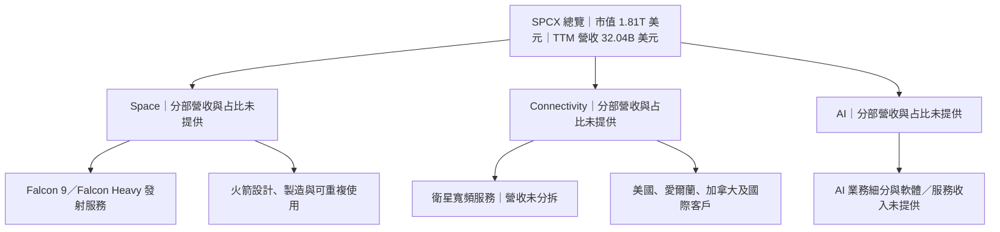
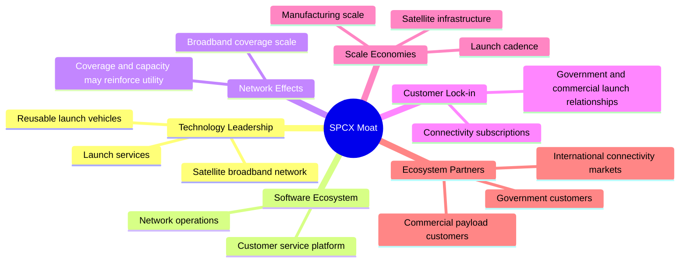
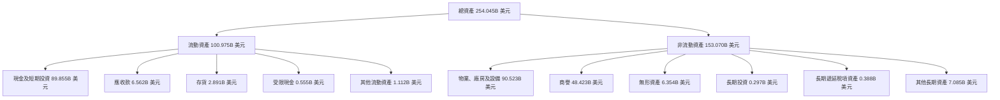
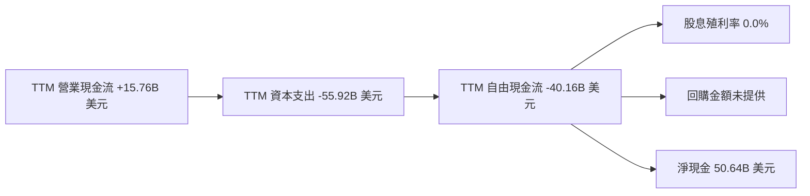
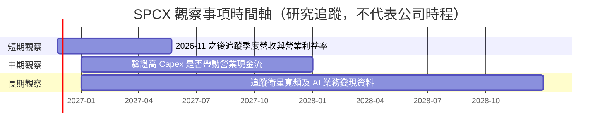
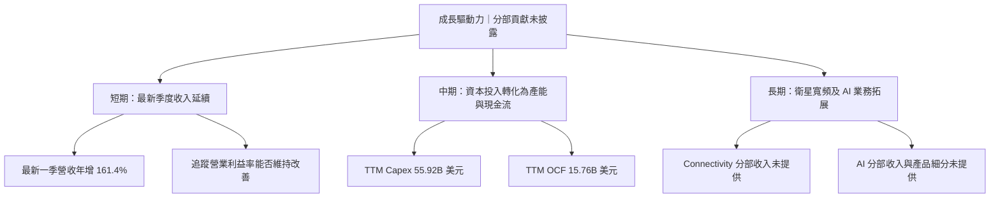
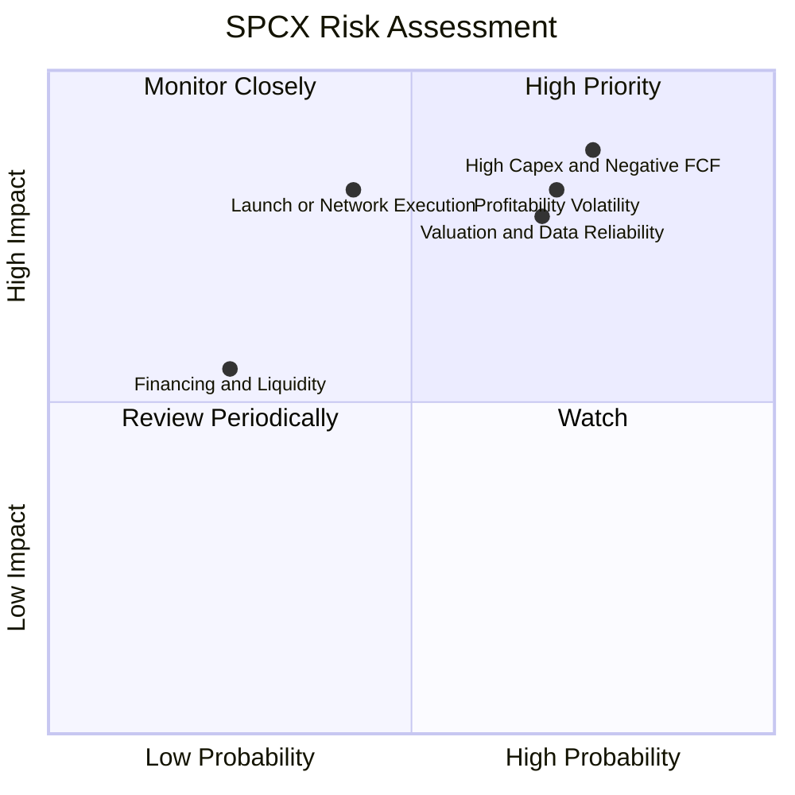
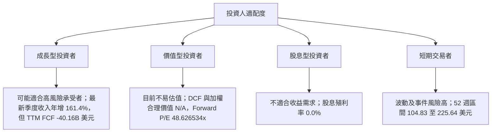

# SPCX 基本面深度分析報告
> **報告日期**：2026-11-24 ｜ **語言**：繁體中文 ｜ **數據來源**：Yahoo Finance、Finviz、StockAnalysis、Roic.ai ｜ **分析師**：CFA 級機構研究

> **資料品質提示**：本報告以 2026-11-23 收盤價及列示的已核對數值為價格、現金流、資本成本等核心指標依據。財報細項來自 Yahoo Finance 等彙整來源，未提供 SEC 申報資料；部分來源對同一期間的營業利益、淨利及股數存在差異。因此，來源不一致或缺漏處均明確標示，不以自行推算取代核對數值。

## 目錄

| # | 章節 | 核心結論 |
|---|------|----------|
| 1 | 執行摘要 | 估值方法無法計算；DCF、加權合理價值、MOS 與 MOS 評級均為 N/A |
| 2 | 公司概覽與商業模式 | 涵蓋航太、連網及 AI；分部收入與市占率未提供 |
| 3 | 損益表深度分析 | TTM 營收 320.4 億美元；最新一季營收年增 161.4%，但年度獲利波動 |
| 4 | 資產負債表分析 | 淨現金 506.4 億美元、流動比率 3.084；營運資金資料顯示負 CCC |
| 5 | 現金流量深度分析 | TTM FCF -401.6 億美元，主因資本支出 559.2 億美元高於營業現金流 |
| 6 | 獲利能力與資本效率 | TTM 營業利益率 -2.0%；ROIC N/A，無法判斷是否高於 WACC 9.79% |
| 7 | 相對估值分析 | SPCX 倍數高於部分同業；歷史估值區間與相對估值回推值未提供 |
| 8 | DCF 內在價值評估 | DCF 與估值方法均為 N/A：TTM 營業利益為負，估值輸入不足 |
| 9 | 成長催化劑 | 最新一季營收快速增長；具體 TAM 與催化劑時程未提供 |
| 10 | 風險矩陣 | 主要風險為巨額再投資、獲利波動及估值／資料可信度 |
| 11 | 投資建議 | 無法依 MOS 規則給予買入／持有等估值評級或目標價 |

---

## 1. 執行摘要

SPCX 的營運規模與近期成長數據支持持續追蹤：TTM 營收為 **320.4 億美元**，最新一季營收年增 **161.4%**。但 TTM 營業利益率為 **-2.0%**、TTM FCF 為 **-401.6 億美元**，且 TTM 資本支出 **559.2 億美元**遠高於營業現金流 **157.6 億美元**。由於 TTM 營業利益為負，DCF 模型不適用；估值方法也無法計算，因此沒有可核查的加權合理價值、MOS 或依 MOS 決定的評級。雖然公司列示淨現金 **506.4 億美元**，但現價及高估值倍數使得在缺少可用內在價值之前，不能從現有資料推導買入或賣出結論。

### 1.0 一頁式投資儀表板（Portfolio Manager 30 秒速讀）

| 項目 | 內容 |
|------|------|
| **投資論點（3 句）** | ① TTM 營收 **320.4 億美元**，最新一季年增 **161.4%**，但 TTM 營收年增率為 N/A。② TTM FCF 為 **-401.6 億美元**，資本支出 **559.2 億美元**，目前尚未呈現正自由現金流。③ 現金及短期投資 **898.6 億美元**、總債務 **392.2 億美元**，列示淨現金 **506.4 億美元**。 |
| **綜合評分** | **5.5/10**（引用 1.1；六項平均） |
| **財務健康** | 🟡 現金緩衝充足，淨現金 **506.4 億美元**、流動比率 **3.084**；但 TTM FCF 為負。 |
| **ROIC vs WACC** | ROIC：**N/A**；WACC：**9.79%**。資料不足，無法判定創造或摧毀價值。 |
| **FCF 趨勢** | 惡化；TTM FCF **-401.6 億美元**、FCF Yield **-2.22%**。 |
| **估值** | Forward P/E **48.626534x** ｜ EV/EBITDA **150.0x** ｜ FCF Yield **-2.22%** |
| **DCF 內在價值（基準）** | N/A；現價相對 DCF 的折溢價亦為 N/A。 |
| **安全邊際（MOS）** | N/A；加權合理價值未能計算，故不得計算 MOS。 |
| **預期報酬（基準情境 12M）** | N/A；沒有可用的 DCF 基準情境或估值目標價。 |
| **關鍵風險（前二）** | ① 資本支出維持高位而營業現金流未能跟上。② 營業利益率與淨利波動大，且不同資料來源有差異。 |
| **評級 + 信心度** | **依 MOS 無法評級**；估值信心：低。 |

### 1.1 綜合評分卡（全報告唯一）

| 維度 | 評分（1–10） | 主要依據（引用數字與其來源章節） |
|------|--------------|----------------------------------|
| 成長性 | 8 | 最新一季營收年增 **161.4%**；TTM 營收年增率 N/A，見第 3 章。 |
| 獲利能力 | 3 | TTM 營業利益率 **-2.0%**、淨利率 **-8.6%**；ROIC 與 F-Score N/A，見第 3、6 章。 |
| 財務健康 | 8 | 淨現金 **506.4 億美元**、流動比率 **3.084**，但 TTM FCF **-401.6 億美元**，見第 4、5 章。 |
| 估值 | 2 | Forward P/E **48.626534x**、EV/EBITDA **150.0x**；DCF 與加權合理價值 N/A，見第 7、8 章。 |
| 護城河 | 8 | 具備可重複使用火箭、全球衛星寬頻等業務形態；但未提供分部營收、市占率或客戶留存數據，見第 2 章。 |
| 管理層與資本配置 | 4 | 2025 年 SBC **19.5 億美元**、Capex **209.1 億美元**、FCF **-141.2 億美元**；回購資料未提供，見第 3、5 章。 |
| **綜合評分** | **5.5** | 六項算術平均：**(8 + 3 + 8 + 2 + 8 + 4) ÷ 6 = 5.5**。 |

### 1.2 五大投資論點 + 三大核心風險

| 類型 | 項目 | 具體依據 | 信心度 |
|------|------|----------|--------|
| 🟢 **投資論點①** | 最新一季收入增長 | 2026-09-30 季營收 **145.75 億美元**，年增 **161.4%**；若增長能延續，將擴大營運規模，但單季數據不等同 TTM 趨勢。 | 🟡 中 |
| 🟢 **投資論點②** | 現金緩衝 | 現金及短期投資 **898.6 億美元**，總債務 **392.2 億美元**，淨現金 **506.4 億美元**。 | 🟢 高 |
| 🟢 **投資論點③** | 毛利率 | TTM 毛利率 **56.8%**；如產品組合及成本結構穩定，具備支撐營運改善的條件。 | 🟡 中 |
| 🟢 **投資論點④** | 多元業務架構 | 公司概覽涵蓋 Space、Connectivity、AI 三個營運板塊；各板塊營收未披露，尚不能驗證多元化的獲利貢獻。 | 🟡 中 |
| 🟢 **投資論點⑤** | 流動性 | 流動比率 **3.084**、速動比率 **2.945**，短期償債緩衝較大。 | 🟢 高 |
| 🟡 **風險①** | 再投資與現金消耗 | TTM Capex **559.2 億美元**，高於 OCF **157.6 億美元**，TTM FCF 為 **-401.6 億美元**。 | 🔴 高衝擊 |
| 🔴 **風險②** | 盈餘波動及資料差異 | 2025 年營業利益 **-20.64 億美元**，2024 年則為 **7.42 億美元**；2026-09 季不同來源的營業利益亦不一致。 | 🔴 高衝擊 |
| 🟡 **風險③** | 估值難以驗證 | Trailing P/E **579.78265x**、EV/EBITDA **150.0x**；DCF 和加權合理價值均無法計算。 | 🔴 高衝擊 |

### 1.3 快速統計卡片

| 指標 | 公司實際值（期間） | 同業中位數 | 狀態 |
|------|--------------------|------------|------|
| 營收成長（TTM） | **N/A** | — | 🟡 |
| 營收成長（最新一季年增） | **161.4%** | **72.7%** | 🟢 |
| 毛利率（TTM） | **56.8%** | **37.0%** | 🟢 |
| 營業利益率（TTM） | **-2.0%** | — | 🔴 |
| ROIC（TTM） | **N/A** | — | 🟡 |
| Forward P/E | **48.626534x** | **30.3x** | 🔴 |
| FCF Yield（TTM） | **-2.22%** | — | 🔴 |
| Piotroski F-Score | **N/A** | — | 🟡 |

> 同業中位數取 RKLB、ASTS、IRDM 提供的對應指標；若同業數據缺失，僅以可用數值計算。

### 1.4 投資結論

```text
╔══════════════════════════════════════════════════════════════════╗
║                    📊 投資結論摘要                               ║
╠══════════════════════════════════════════════════════════════════╣
║  評級：N/A（無法依 MOS 規則評級；加權合理價值未能計算）          ║
║  價格（2026-11-23 收盤）：$133.35                                ║
║  DCF 內在價值（基準）：N/A（TTM 營業利益為負）                   ║
║  安全邊際 MOS：N/A（加權合理價值未能計算）                       ║
║  加權合理價值（8.8）：N/A                                        ║
║  綜合評分：5.5/10（引用 1.1）                                    ║
║  適合投資人：可承受高波動、能承受估值與現金流不確定性的成長型投資人║
╚══════════════════════════════════════════════════════════════════╝
```

---

## 2. 公司概覽與商業模式

### 2.1 業務結構與收入來源

公司概覽描述 Space Exploration Technologies Corp. 經營 Space、Connectivity、AI 三個板塊；Space 涵蓋可重複使用火箭設計、製造與發射服務，並提及 Falcon 9、Falcon Heavy。Connectivity 涵蓋衛星寬頻服務。各分部的營收、占比及 AI 業務具體產品收入未提供，不能以總營收替代分部收入。



### 2.2 市場份額

市場份額數據未提供，無法製作市占率表或圓餅圖。以收入規模觀察，TTM 營收 **320.4 億美元**，最新一季年增 **161.4%**；但 TTM 營收成長率 N/A，且分部收入未拆分，不能判定各業務與 RKLB、ASTS、IRDM 的市場份額差距。

### 2.3 競爭護城河分析

> mindmap 節點依 Mermaid 限制使用英文。



### 2.4 護城河強度

| 護城河項目 | 強度（強／中／弱） | 證據（引用數字或事實） | 會削弱它的情況 |
|------------|--------------------|------------------------|----------------|
| 技術與製造 | 強 | 具備可重複使用火箭及 Falcon 9、Falcon Heavy 發射服務；相關市占與單位成本資料未提供。 | 發射可靠性下降、競爭者追上技術或降低成本。 |
| 軟體與網路營運 | 中 | 公司提供多國衛星寬頻服務；用戶數、ARPU、流失率未提供。 | 網路品質、頻譜或客戶體驗惡化。 |
| 網路效應 | 中 | 跨國服務及衛星網路可能提高覆蓋價值，但缺少用戶與覆蓋數據。 | 網路容量不足、服務中斷或競品提供相近覆蓋。 |
| 客戶鎖定 | 中 | 發射服務及寬頻服務涉及長期商業關係；合約年期與續約率未提供。 | 客戶多源化、政府採購改變或價格競爭加劇。 |
| 規模效應 | 強 | TTM 營收 **320.4 億美元**，公司有火箭與衛星網路等資本密集型資產。 | Capex 長期高於營業現金流，規模未轉化為正 FCF。 |
| 生態夥伴 | 中 | 客戶包含商業與政府載荷客戶，並服務多個國家與地區；客戶集中度未提供。 | 主要客戶流失、監管限制或供應鏈中斷。 |

護城河評分 **8/10** 的依據是可重複使用火箭、發射服務與衛星寬頻形成的資產及技術壁壘；但營收分部、客戶留存及市占率數據缺失，限制了驗證深度。

---

## 3. 損益表深度分析

### 3.1 年度收入成長趨勢（近 4 年）

提供的年度營收涵蓋 2023–2025 三個財年，沒有第四個完整年度。年度數據為 2023 年 **103.87 億美元**、2024 年 **140.15 億美元**、2025 年 **186.74 億美元**；年增率分別為 2024 年 **34.93%**、2025 年 **33.24%**。

```text
╔══════════════════════════════════════════════════════════════════╗
║       SPCX 年度營收趨勢（FY2023–FY2025；單位：十億美元）        ║
╠══════════════════════════════════════════════════════════════════╣
║  FY2023  $10.387B  ███████████░░░░░░░░░  YoY：未提供            ║
║  FY2024  $14.015B  ███████████████░░░░░  YoY：+34.93%            ║
║  FY2025  $18.674B  ████████████████████  YoY：+33.24%            ║
╠══════════════════════════════════════════════════════════════════╣
║  2023–2025 CAGR：(18.674 ÷ 10.387)^(1/2) − 1 = 約 34.1%          ║
║  備註：僅有三個年度營收值，並非四年完整序列。                    ║
╚══════════════════════════════════════════════════════════════════╝
```

2024、2025 年收入成長率均約三成，顯示年度規模擴張；但成長是否來自可重複的訂閱收入、發射服務或其他業務，資料未提供。2023–2025 的約 **34.1%** CAGR 是依兩年期間計算，不可與 N/A 的 TTM 成長率混用。

### 3.2 季度收入趨勢分析

| 季度 | 營收（十億美元） | QoQ 成長 | YoY 成長 | 備註 |
|------|------------------:|---------:|---------:|------|
| 2025-12-31 | 4.96 | — | — | 2025 年第四季。 |
| 2026-03-31 | 4.69 | -5.4% | 15.42% | QoQ 以 4.694 ÷ 4.960 − 1 計算。 |
| 2026-06-30 | 7.81 | 66.5% | 91.94% | QoQ 以 7.814 ÷ 4.694 − 1 計算。 |
| 2026-09-30 | 14.57 | 86.5% | 161.4% | 單季年增率；不是 TTM 成長率。 |

2026 年收入逐季增加，尤其第二、三季 QoQ 加速；其業務驅動因素未在財務數據中拆分，因此不能將加速歸因於某個特定分部。最新一季對上一年同季增長 **161.4%**，但若包含大型合約、交付時點或併表影響，後續季度可能出現波動。

### 3.3 利潤率演變分析

| 利潤率指標 | FY2023 | FY2024 | FY2025 | 最新 TTM／季 | 趨勢 | 評估 |
|------------|-------:|-------:|-------:|--------------:|------|------|
| **毛利率** | 41.2% | 42.9% | 49.4% | TTM **56.8%** | 年度逐步上升；最新 TTM 更高 | 🟢 |
| **營業利益率** | 4.9% | 5.3% | -11.1% | TTM **-2.0%**；最新季 **1.8%** | FY2025 轉負，TTM 仍為負 | 🔴 |
| **淨利率** | -44.6% | 5.6% | -26.4% | TTM **-8.6%** | 盈利大幅波動 | 🔴 |
| **EBITDA Margin** | N/A | N/A | N/A | TTM **36.6%** | 歷年同口徑數據不足 | 🟡 |

年度毛利率依毛利除以營收計算：2023 年 **4.277 ÷ 10.387 = 41.2%**、2024 年 **6.019 ÷ 14.015 = 42.9%**、2025 年 **9.223 ÷ 18.674 = 49.4%**。毛利率上升與毛利額增速高於營收相符，可能反映產品組合或直接成本變化；缺少分部毛利與成本拆解，無法確定主因。

營業利益率則由 FY2024 的 **5.3%**降至 FY2025 的 **-11.1%**。FY2025 營業利益 **-20.64 億美元**，同年研發支出 **86.4 億美元**；研發投入可能是利潤波動因素之一，但資料不足以把營業虧損全部歸因於研發。最新 TTM 營業利益率仍為 **-2.0%**，表示毛利率提高尚未穩定傳導至營業獲利。

> **來源差異**：2026-09 季資料列示營業利益有 **27.9 億美元**與 **40.19 億美元**兩個版本，且均與「最新季度營業利益率 1.8%」不一致。本報告按核心財務指標引用最新季度營業利益率 **1.8%**，不以不一致的原始欄位重算替換。

### 3.4 費用結構分析

**費用結構比例未提供**，不可將成本、研發、銷管或其他費用比例製成圓餅圖。已知 FY2025 研發支出為 **86.4 億美元**，營收為 **186.74 億美元**；研發支出相當於營收約 **46.3%**（8.64 ÷ 18.674），但年度支出與收入的定義、一次性項目及研發資本化細節未提供，這項比率只作規模參照，不代表完整營運費用率。

```text
╔══════════════════════════════════════════════════════════════════╗
║                    費用結構可見資料                              ║
╠══════════════════════════════════════════════════════════════════╣
║  FY2025 營收：       $18.674B                                    ║
║  FY2025 研發支出：   $8.640B                                     ║
║  研發／營收：        $8.640B ÷ $18.674B = 約 46.3%              ║
║  銷管、成本、其他費用分項：N/A（資料未提供）                     ║
╚══════════════════════════════════════════════════════════════════╝
```

### 3.5 季度 EPS 趨勢與盈餘品質（Quality of Earnings）

近四季盈餘方向大幅波動。StockAnalysis 列示 EPS 2026 年第一季 **-1.27**、第二季 **-0.09**、第三季 **0.35**；另一份 ROIC.ai 季度資料分別為 **-0.47、-0.09、0.37**，第一季差異明顯，且 2025 年第四季 EPS 在 ROIC.ai 列為 **-0.18**。EPS Est 與 EPS Act 的預期值均為 nan，無法確認是否超預期或不及預期。

| 盈餘品質項目 | 數值／佔比 | 評估 |
|--------------|------------|------|
| 股權薪酬 SBC / 營收 | 近四季 SBC 合計約 **47.33 億美元**（2.36 + 0.831 + 0.639 + 0.903）；佔 TTM 營收約 **14.8%** | 🔴 若持續，對股東具有明顯稀釋成本；流通股數亦因來源及口徑不同而不宜直接外推。 |
| SBC / 營業現金流 | 近四季 SBC 約 **47.33 億美元** ÷ TTM OCF **157.6 億美元** = 約 **30.0%** | 🔴 SBC 在非現金流量表中仍是實質股東成本，不能只看 OCF。 |
| FCF / 淨利（現金轉換率） | N/A（來源淨利口徑不一致且 TTM 淨利為負） | 🔴 負 FCF 與負淨利下，正向轉換率不具經濟意義。 |
| 一次性／非經常性損益 | N/A（未提供調節表） | 🟡 無法判定最新季淨利是否受一次性項目影響。 |
| 有效稅率異常 | N/A（未提供可核對的稅前損益及稅費） | 🟡 不能判斷季度淨利是否由稅務利益帶動。 |
| 資本化支出 vs 費用化 | TTM Capex **559.2 億美元**；資本化與費用化項目明細 N/A | 🟡 Capex 占用現金大，但缺少資本化政策與資產年限資料。 |

**盈餘品質結論**：最新季單季淨利為正，但年度及 TTM 盈餘波動，TTM 淨利率為 **-8.6%**、FCF 為 **-401.6 億美元**，不宜把單季正淨利直接外推為穩定獲利。近四季 SBC 約為營業現金流的 **30.0%**，顯示只看現金流表中的 OCF 可能高估可歸屬股東的經濟現金創造能力；估值應待獲利與資本支出趨勢更可預測後再評估。

---

## 4. 資產負債表分析

### 4.1 資產結構分解

2026-09-30 資產負債表列示總資產 **254.045 十億美元**。流動資產 **100.975 十億美元**，其中現金及短期投資 **89.855 十億美元**；非流動資產按總資產扣除流動資產為 **153.070 十億美元**。下圖列示有來源數字的明細。



### 4.2 流動性與營運資金分析

| 指標 | 最新 TTM／期末 | 歷史比較 | 評估 |
|------|----------------|----------|------|
| 流動比率 | **3.084** | FY2025 依流動資產及流動負債計算約 **1.446**；FY2024 約 **1.367** | 🟢 近期流動性緩衝提高；期末分類及合併口徑需持續核對。 |
| 速動比率 | **2.945** | 歷史可比數據未提供 | 🟢 高於 1，短期償付能力充足。 |
| 現金及短期投資 | **89.855B 美元** | FY2025 **24.747B 美元** | 🟢 增加；但現金變化來源及限制用途未提供。 |

| 指標 | 最新 TTM | 一年前 TTM | 變化 | 解讀 |
|------|----------|------------|------|------|
| DSO 應收帳款天數 | **54 天** | N/A | N/A | 一年前同口徑數據未提供，無法判斷收款變快或變慢。 |
| DIO 存貨天數 | **76 天** | N/A | N/A | 一年前數據未提供；不能判斷存貨周轉趨勢。 |
| DPO 應付帳款天數 | **349 天** | N/A | N/A | DPO 偏長；可能反映付款條件或供應鏈結算方式，但缺少合約與歷史數據，不能判定議價力。 |
| CCC 現金轉換週期 | **-219 天** | N/A | N/A | 依 CCC = DSO + DIO − DPO 得到資料所列數值；一年前數據缺失，無法解讀變化方向。 |

> 營運資金天數按品質指標列示，沒有自行補算缺漏的去年同期數據。

### 4.3 債務結構分析

```text
╔══════════════════════════════════════════════════════════════════╗
║                   SPCX 債務健康診斷                              ║
╠══════════════════════════════════════════════════════════════════╣
║  總債務：          $39.22B    ██░░░░░░░░░░░░░░░░░ 評估：可控      ║
║  現金+短期投資：   $89.86B    ███████████████████ 評估：充足      ║
║  淨現金：          $50.64B    ███████████░░░░░░░░ 🟢              ║
║  流動比率：        3.084      🟢                                  ║
║  速動比率：        2.945      🟢                                  ║
║  Debt/EBITDA：     N/A（未提供可核對的 TTM EBITDA 絕對值）        ║
║  Interest Coverage：N/A（利息費用明細未提供）                    ║
╚══════════════════════════════════════════════════════════════════╝
```

列示淨現金為現金及短期投資 **898.6 億美元**減總債務 **392.2 億美元**，即 **506.4 億美元**。這為高投資支出提供緩衝，但不代表持續負 FCF 沒有風險。股價、股數與市值資料存在內部不一致：**133.35 美元 × 82.5 億股 = 約 1.10 兆美元**，與列示市值 **1.81 兆美元**不相符，因此不得以這些數字互相推導資本結構或重算市值。

### 4.4 股東權益趨勢

| 財年 | 股東權益 | 年增額 | 年增幅 |
|------|---------:|-------:|-------:|
| 2024-12-31 | **25.80B 美元** | — | — |
| 2025-12-31 | **41.33B 美元** | **15.53B 美元** | **60.2%** |
| 2026-09-30 | N/A | N/A | N/A |

```text
╔══════════════════════════════════════════════════════════════════╗
║                  股東權益變化（年度資料）                        ║
╠══════════════════════════════════════════════════════════════════╣
║  FY2024  $25.80B  █████████████░░░░░░░░                         ║
║  FY2025  $41.33B  █████████████████████                         ║
║  2026-09  N/A（不同彙整來源的 TTM 權益口徑不一致）               ║
╚══════════════════════════════════════════════════════════════════╝
```

FY2025 權益上升約 **60.2%**，但缺少增資、留存盈餘、股權薪酬與其他綜合損益的調節表，不能確認增幅中各因素的占比。

---

## 5. 現金流量深度分析

### 5.1 現金流量瀑布圖

公司 TTM 淨利各來源存在差異，故不把淨利接入現金流瀑布；以下按核對指標列示營業現金流、Capex 及 FCF。股息殖利率及派息率均為 0.0%。



### 5.2 FCF 轉換率趨勢

| 期間 | OCF | Capex | FCF | FCF／淨利 |
|------|----:|------:|----:|----------|
| 2023 | **4.52B** | **4.42B** | **0.105B** | N/A（淨利為 -4.63B；轉換率無經濟意義） |
| 2024 | **5.78B** | **11.16B** | **-5.39B** | N/A（淨利為正，但來源年度淨利欄位有差異） |
| 2025 | **6.79B** | **20.91B** | **-14.12B** | **2.86x**（-14.12 ÷ -4.937；兩者同為負值，不代表健康轉換） |
| TTM 至 2026-09-30 | **15.76B** | **55.92B** | **-40.16B** | N/A（TTM 淨利口徑不一致且為負） |

FCF 持續轉負主要由 Capex 擴張造成：2025 年 Capex **209.1 億美元**，約為 OCF **67.9 億美元**的三倍；TTM Capex 進一步達 **559.2 億美元**。若資本投入後續轉化為收入及營業現金流，短期負 FCF 可能屬擴張期特徵；若轉化回報不足，則會增加現金消耗和資本回報風險。

### 5.3 自由現金流趨勢

```text
╔══════════════════════════════════════════════════════════════════╗
║              自由現金流趨勢（單位：十億美元）                    ║
╠══════════════════════════════════════════════════════════════════╣
║  FY2023  +0.105B  █░░░░░░░░░░░░░░░░░░░░  FCF Yield：N/A          ║
║  FY2024  -5.390B  █████░░░░░░░░░░░░░░░░  FCF Yield：N/A          ║
║  FY2025 -14.120B  ██████████████░░░░░░  FCF Yield：N/A          ║
║  TTM    -40.160B  ████████████████████  FCF Yield：-2.22%        ║
╠══════════════════════════════════════════════════════════════════╣
║  TTM FCF = 營業現金流 $15.76B − Capex $55.92B = -$40.16B        ║
╚══════════════════════════════════════════════════════════════════╝
```

歷史 FCF Yield 未提供，只有 TTM FCF Yield **-2.22%**可引用。負值代表以目前市值口徑計算，現金流尚未對應正向自由現金流收益；市值資料本身存在前述一致性問題，宜避免過度依賴單一 FCF Yield 倍數。

### 5.4 資本配置評估

股息殖利率與派息率均為 **0.0%**。已知 FY2025 Capex **209.1 億美元**，是可辨識的主要現金用途；但回購、收購、償債及其他投資的年度金額未完整提供，因此不能製作有完整比例的資本配置圓餅圖。

| 資本配置項目 | 可用數據 | 評估 |
|--------------|----------|------|
| Capex | FY2025 **20.91B 美元**；TTM **55.92B 美元** | 🔴 高額投資使 FCF 顯著轉負；需監控投資回報。 |
| 股息 | 殖利率 **0.0%**；派息率 **0.0%** | 🟡 未見現金分派。 |
| 回購 | N/A | 🟡 金額與股數變化無法完整歸因。 |
| 其他投資／收購 | N/A | 🟡 資本配置用途未完全披露。 |
| 營業現金流 | TTM **15.76B 美元** | 🟢 有營運現金流，但不足以覆蓋當期 Capex。 |

---

## 6. 獲利能力與資本效率

### 6.1 ROE / ROA / ROIC 趨勢

| 指標 | FY2023 | FY2024 | FY2025 | TTM | 評估 |
|------|-------:|-------:|-------:|----:|------|
| ROE | N/A | N/A | N/A | N/A | 缺少可一致使用的淨利、權益口徑；不可自行補算。 |
| ROA | N/A | N/A | N/A | N/A | 缺少完整一致口徑及平均總資產資料。 |
| ROIC | N/A | N/A | N/A | N/A | 程式計算結果未提供，且 TTM 營業利益為負。 |
| 營業利益率 | **4.9%** | **5.3%** | **-11.1%** | **-2.0%** | 利潤轉弱，TTM 尚未恢復正營業利潤率。 |

行業均值數據未提供，不列行業比較欄。ROE、ROA 與 ROIC 缺值意味著無法用資本回報率驗證高 Capex 是否創造足夠經濟回報。

### 6.2 ROIC vs WACC 分析（核心價值創造判斷）

```text
╔══════════════════════════════════════════════════════════════════╗
║                ROIC vs WACC 深度分析                            ║
╠══════════════════════════════════════════════════════════════════╣
║  WACC（採用成本資本資料列示值）：9.79%                           ║
║  ├── 無風險利率（10Y 美債）：4.92%                               ║
║  ├── 股權風險溢酬 ERP：5.00%                                     ║
║  ├── 原始 Beta：N/A；採用調整後 Beta：1.00（假設值）             ║
║  ├── 股權成本：4.92% + 1.00 × 5.00% = 9.92%                     ║
║  ├── 稅前債務成本：4.96%                                         ║
║  ├── 稅後債務成本：4.96% × (1 − 21.0%) = 3.9184%                 ║
║  ├── 股權／債務權重：97.9%／2.1%                                 ║
║  └── WACC：97.9% × 9.92% + 2.1% × 3.9184% = 約 9.79%             ║
║                                                                  ║
║  ROIC：N/A（未提供可核對值）                                     ║
║  EVA＝ROIC − WACC：N/A                                           ║
║  結論：因 ROIC 缺漏，不能判定公司目前是否創造股東價值。          ║
╚══════════════════════════════════════════════════════════════════╝
```

WACC 直接採用資本成本資料所列 **9.79%**；CAPM 股權成本則依列示輸入驗算為 **9.92%**。原始 Beta 為 N/A，因此使用調整後 Beta **1.00**，屬假設值。股權風險溢酬 **5.00%**也是列示假設；無風險利率列示為 **4.92%**，資料未提供更精確觀察日期，故不自行補充日期。WACC 與 ROIC 缺值的結果是：無法量化 ROIC 是否高於資本成本，不能據此宣稱創造或摧毀價值。

### 6.3 杜邦三因素分解

| 因素 | 數值（TTM） | 解讀 |
|------|-------------|------|
| 淨利率 | N/A | QUALITY FIGURES 杜邦欄列示 N/A，缺少一致的淨利、營收、資產或正權益組合。 |
| 資產週轉率 | N/A | 同上。 |
| 權益乘數 | N/A | 同上。 |
| **ROE** | **N/A** | 杜邦結果不得重算或以不一致數據補值。 |

### 6.4 財務體質：Piotroski F-Score

Piotroski F-Score 為 **N/A**，原因是缺少相隔一年的兩期 SEC 申報資料；九項測試結果未提供，依規則不逐項填造。

---

## 7. 相對估值分析

### 7.1 同業估值比較表格

| 估值指標 | **SPCX** | **RKLB** | **ASTS** | **IRDM** | SPCX 評估 |
|----------|---------:|---------:|---------:|--------:|-----------|
| **Trailing P/E** | **579.78265x** | N/A | N/A | **27.2x** | 🔴 SPCX 倍數遠高於唯一可用同業數值；獲利口徑與成長階段不同。 |
| **Forward P/E** | **48.626534x** | **693.4x** | **-16.4x** | **30.3x** | 🟡 同業中位數 **30.3x**；SPCX 高於中位數，仍須未來 EPS 成長兌現。 |
| **P/S（TTM）** | **56.518894x** | **37.9x** | **72.0x** | **5.1x** | 🔴 同業中位數 **37.9x**；SPCX 高於中位數，顯示收入估值要求偏高。 |
| **EV/EBITDA（TTM）** | **150.0x** | **-156.3x** | **-19.6x** | **16.9x** | 🔴 同業中位數 **-19.6x**，負數及虧損口徑不適合直接比較；SPCX 自身倍數亦偏高。 |
| **最新一季營收年增** | **161.4%** | **72.7%** | **187.1%** | **8.3%** | 🟢 SPCX 高於 RKLB、IRDM，低於 ASTS。 |
| **毛利率（TTM）** | **56.8%** | **36.2%** | **37.0%** | **71.5%** | 🟢 高於 RKLB、ASTS；低於 IRDM。 |

同業數據來自 Yahoo Finance 的 Peer multiples。Forward P/E 中位數為 **30.3x**，P/S 中位數為 **37.9x**；EV/EBITDA 的同業中位數為負值，代表該組合含 EBITDA 虧損公司，不宜用作有意義的正常獲利倍數基準。SPCX 的 P/E、P/S、EV/EBITDA 均要求市場相信未來獲利與現金流將大幅改善。

### 7.2 歷史估值區間分析

N/A（未提供「Valuation vs own history」歷史估值區間資料，不能推估歷史百分位或當前位置。）

### 7.3 情境價值（Bear / Base / Bull）

N/A（DCF 無法計算：TTM 營業利益為負，程式未產生 DCF MODEL Scenarios。依規則不自行設定情境目標價。）

### 7.4 相對估值隱含價格區間

N/A（VALUATION METHODS 列示沒有可計算的方法，因此沒有可引用的相對估值每股價值或估值區間。Peer multiples 可用於比較市場倍數，但缺少完整且可靠的估值橋接輸入，不能以自建回推價格替代。）

---

## 8. DCF 內在價值評估（Discounted Cash Flow）

### 8.0 估值推理鏈（Thinking Logic：在算之前先想清楚）

**Step 1 — 價值由哪些變數決定？**

公司業務描述包含 Space、Connectivity 及 AI，但未提供分部營收比重；可確認的是整體 TTM 營收 **320.4 億美元**。理論上價值取決於既有業務的可持續現金流、營收成長轉化為營業利潤的能力，以及高資本支出的投資回報。現有 TTM 營業利益率 **-2.0%**、FCF **-401.6 億美元**，使得可用數據不足以建立可靠的正向 FCFF 預測。

**Step 2 — 模型選擇與限制**

| 決策點 | 本報告採用 | 理由（含數字） | 曾考慮但否決 | 否決理由 |
|--------|-----------|----------------|--------------|----------|
| 現金流定義 | FCFF 的 DCF 框架僅作資料適用性檢查；不計算估值 | WACC 為 **9.79%**，但 TTM 營業利益率 **-2.0%** | 對負盈餘直接折現 | 負營業利益及缺乏模型輸入時，將損失折現不能代表可核查的合理價值 |
| 預測期 N | N/A | DCF MODEL 未產生預測期 | 自行指定 5–10 年 | 違反程式模型優先規則，且欠缺依據 |
| 終值方法 | N/A | FCFF 預測與終值未提供 | Gordon Growth／退出倍數 | 沒有可用逐年現金流與終值輸入 |
| EBIT 基礎 | N/A | 模型未產生 | 自行選 GAAP／非 GAAP | 缺少適用的模型預測表，不能自行建模 |

**Step 3 — 關鍵假設推導鏈**

DCF MODEL 為 N/A，沒有模型假設表；故營收 CAGR、期末營業利潤率、永續成長率、預測期、Capex／營收、稀釋率等均不得補設，也沒有可列的替代假設及否決值。

**Step 4 — 最脆弱的一環**

最脆弱的是高 Capex 能否轉化為可持續的正營業利潤與 FCF：目前 TTM Capex 為 **559.2 億美元**，而 TTM FCF 為 **-401.6 億美元**。若資本投入回報弱於市場預期，價值將下修；但沒有可用 DCF 敏感度矩陣，不能量化每股影響。

**Step 5 — 計算路徑圖**


### 8.1 模型假設總表（Model Inputs）

| 假設項目 | 採用值 | 依據／來源 | 敏感度 |
|----------|--------|-------------|--------|
| 預測期長度 N | N/A | DCF MODEL 未產生模型 | 🟡 中 |
| 營收 CAGR（預測期） | N/A | 缺少模型假設 | 🔴 高 |
| 營業利潤率（期末） | N/A | TTM 營業利益率 **-2.0%**，但模型未提供可核查的獲利路徑 | 🔴 高 |
| 有效稅率 | N/A | DCF 模型未提供稅率假設；資本成本區塊的 21.0% 預設稅率不能替代 DCF 輸入 | 🟢 低 |
| Capex / 營收 | N/A | TTM Capex 與營收均有數值，但模型未提供未來假設；不得自行外推 | 🟡 中 |
| D&A / 營收 | N/A | 未提供 DCF 假設 | 🟢 低 |
| 營運資金變動 / 營收增額 | N/A | 未提供 DCF 假設 | 🟢 低 |
| EBIT 基礎 | N/A | DCF 未建立 | 🟡 中 |
| SBC 處理 | N/A | DCF 未建立 | 🟡 中 |
| 年稀釋率 | N/A | DCF 未建立；股數來源另有口徑差異 | 🟡 中 |
| 永續成長率 g | N/A | DCF 未提供，不能自行設定 | 🔴 高 |
| 終值方法 | N/A | DCF 未產生終值 | 🔴 高 |
| WACC | **9.79%** | 成本資本資料列示值，詳見 8.2 | 🔴 高 |

由於 DCF MODEL 明確為 N/A，不列逐年預測表或逐年 FCFF 算式，以免製造未經核實的模型數字。

### 8.2 折現率推導（WACC）

```text
╔══════════════════════════════════════════════════════════════════╗
║                    WACC 推導（折現率）                           ║
╠══════════════════════════════════════════════════════════════════╣
║  股權成本 Ke（CAPM）：                                           ║
║  ├── 無風險利率 Rf（10Y 美債）：4.92%                            ║
║  ├── 市場風險溢酬 ERP：5.00%（假設值）                           ║
║  ├── 原始 Beta：N/A；採用調整後 Beta：1.00（假設值）             ║
║  ├── 規模／國別溢酬：0.00%（成本資本資料未列此項）               ║
║  └── Ke = 4.92% + 1.00 × 5.00% = 9.92%                          ║
║                                                                  ║
║  債務成本 Kd：                                                   ║
║  ├── 稅前債務成本：4.96%（利息／債務代理值，照列示輸入）          ║
║  ├── 預設稅率：21.0%                                             ║
║  └── 稅後 Kd = 4.96% × (1 − 21.0%) = 3.9184%                   ║
║                                                                  ║
║  資本權重（成本資本資料列示）：股權 97.9%／債務 2.1%             ║
║  WACC = 97.9% × 9.92% + 2.1% × 3.9184% = 約 9.79%               ║
║  採用 WACC：9.79%                                                ║
╚══════════════════════════════════════════════════════════════════╝
```

**逐步演算（WACC）**

1. **Ke（CAPM）** = Rf + β × ERP = **4.92% + 1.00 × 5.00% = 9.92%**。
2. **稅前 Kd** = **4.96%**（成本資本資料已列值；利息費用與平均計息負債分母未提供，不能重新推算）。
3. **稅後 Kd** = 4.96% × (1 − 21.0%) = **3.9184%**。
4. **權重** = 股權 **97.9%**；債務 **2.1%**；合計 **100.0%**。市值及稀釋股數口徑存在差異，因此沿用成本資本資料列示權重，不重新以股數反推。
5. **WACC** = 97.9% × 9.92% + 2.1% × 3.9184% = 9.71168% + 0.0822864% = **9.7939664% ≈ 9.79%**。

> 由於利息費用、平均計息負債與市值權重底稿未提供，WACC 可按列示輸入複算至約 9.79%，但其底層債務口徑無法獨立稽核。第 6.2 節與本節使用同一 WACC。

### 8.3 逐年自由現金流預測（基準情境）

N/A（DCF MODEL 為 N/A：TTM 營業利益不為正，程式未產生逐年預測。依規則不自行建立預測期、假設或 FCFF。）

### 8.4 終值計算（Terminal Value）

適用性檢查：WACC 為 **9.79%**；永續成長率 **g = N/A**。因 DCF 未產生 g、FY+N FCFF 或終值資料，無法判定 Gordon Growth 適用性，也不計算 Gordon Growth 或退出倍數終值。

### 8.5 企業價值 → 每股內在價值（Bridge）

```text
╔══════════════════════════════════════════════════════════════════╗
║              企業價值 → 每股內在價值 橋接表                      ║
╠══════════════════════════════════════════════════════════════════╣
║  預測期 FCF 現值合計            N/A                              ║
║  終值現值 PV(TV)                N/A                              ║
║  = 企業價值 EV                  N/A                              ║
║  + 現金及短期投資               N/A（DCF 橋接未建立）             ║
║  − 總債務                       N/A（DCF 橋接未建立）             ║
║  = 股權價值                     N/A                              ║
║  ÷ 稀釋後流通股數               N/A（股數口徑不一致）             ║
║  ★ 每股內在價值                 N/A                              ║
║  當前股價                       $133.35（2026-11-23 收盤）       ║
║  折溢價                         N/A                              ║
╚══════════════════════════════════════════════════════════════════╝
```

DCF 模型未建立，故 EV、股權價值、每股內在價值與折溢價均 N/A。此處不計算 MOS；依統一定義，MOS 只能以 8.8 的加權合理價值為分母，而 8.8 同樣 N/A。

### 8.6 敏感性分析（WACC × 永續成長率）

N/A（DCF MODEL 未提供 WACC × g 敏感度矩陣，也未提供基準每股價值。不得自行另建敏感度模型、情境價值或機率加權價值。）

### 8.7 反推 DCF（Reverse DCF：市場在預期什麼）

N/A（缺少可用 DCF 基準模型及其輸入，無法以現價反解營收 CAGR、期末營業利潤率、永續成長率或預測期；不製作試算軌跡或假設市場隱含值。）

### 8.8 估值三角驗證與安全邊際

N/A（VALUATION METHODS 列示「None could be computed」。缺少可用 DCF 基準價、可回推的相對估值方法及固定權重，因此不計算加權合理價值、上行空間、MOS 或 MOS 評級。）

- **加權合理價值**：N/A。
- **MOS**：N/A；不得用 DCF 單一估值或分析師目標價替代加權合理價值。
- **折溢價**：N/A；DCF 基準內在價值缺失。
- **分析師共識目標價**：平均 **256.25 美元**、低 **70.00 美元**、高 **800.00 美元**，僅作外部市場觀點，不納入無權重的自建估值。
- **建議買入區間**：N/A（沒有可用的合理價值基準，不能形成與 MOS 評級一致的價格區間）。

### 8.9 DCF 模型的局限與失效條件

- **終值依賴度**：N/A；沒有 DCF 終值或企業價值計算。
- **最脆弱的營運假設**：高資本支出能否轉化為盈利及現金流。現有 TTM Capex **559.2 億美元**，TTM FCF **-401.6 億美元**。
- **不適用情境**：TTM 營業利益率 **-2.0%**，營業獲利尚未穩定，加上近期季度損益波動大，DCF 的可用性及可靠度低。後續可觀察 EV/Sales、分部估值及單位經濟性，但所需分部與單位數據目前未提供，不能據此給出目標價。
- **與第 10 章風險矩陣的連結**：Capex 無法轉化為營收或利潤，將直接惡化現金流；發射或網路營運受阻，則可能壓低收入成長並延後獲利轉正。

### 8.10 複算檢核表（Audit Trail：輸出前自我驗算）

| # | 檢核項目 | 檢查方式 | 結果 |
|---|----------|----------|------|
| 1 | 所有 🔴 高／🟡 中敏感度輸入均有四段式推導 | DCF MODEL 為 N/A，沒有可核查的模型輸入可作四段式推導 | N/A |
| 2 | 每個模型假設都有來歷 | 缺少 DCF 假設表；未自行補值 | ✅ |
| 3 | WACC 五步算式與權重 | 權重合計 97.9% + 2.1% = 100%；算式約得 9.79% | ✅ |
| 4 | Kd 分母與債務權重 D 範圍一致 | 利息費用、平均計息負債及權重底稿未提供 | N/A |
| 5 | WACC 與第 6.2 節同值 | 兩節皆為 9.79% | ✅ |
| 6 | 逐年預測年度數符合 N | DCF 未產生預測期 | N/A |
| 7 | FY+1 九步算式可複算 | 無 FY+1 模型數據 | N/A |
| 8 | 預測期 PV 加總 | 無 PV 數據 | N/A |
| 9 | WACC > g | g 未提供，無法檢查 | N/A |
| 10 | 終值基於 FY+N 並折現 N 期 | 無終值數據 | N/A |
| 11 | EV → 每股價值橋接可複算 | 橋接未建立 | N/A |
| 12 | SBC EBIT 基礎與稀釋處理相容 | 未建立 DCF，無模型 SBC 組合 | N/A |
| 13 | 敏感度矩陣基準格等於 DCF 基準值 | 無矩陣、無基準值 | N/A |
| 14 | 敏感度矩陣僅在 WACC > g 使用數字 | 無矩陣 | N/A |
| 15 | 三情境機率與加權算式 | DCF Scenarios 未提供 | N/A |
| 16 | 反推 DCF 單變數求解及軌跡 | 模型未提供 | N/A |
| 17 | MOS 分母與折溢價基準一致 | MOS 與 DCF 折溢價均因估值缺值而不計算 | N/A |
| 18 | 報告完整至第 11 章 | 已完整列出 11 章 | ✅ |
| 19 | 加權合理價值等於各估值法加權總和 | 可用估值方法為零項 | N/A |
| 20 | 評級符合 MOS 門檻 | MOS 未能計算；不以 MOS 評級 | N/A |

未修正事項：估值模型所需資料缺失，故第 8 章的模型輸出、內在價值與基於 MOS 的評級均維持 N/A；未以自建假設填補。

---

## 9. 成長催化劑

### 9.1 催化劑時間軸

新聞標題提及 Starlink 手機連接升級目標及 AI 相關投資討論，但沒有提供公司正式營運指引、產品上市日或可核查的量化時程。下列時間軸僅作觀察期間安排，不代表公司公告或正式預測。



短期最重要的催化劑不是未經證實的產品傳聞，而是後續財報能否驗證最新一季 **161.4%** 的收入年增是否延續，以及營業利益率是否從 TTM **-2.0%**改善。中期則需檢驗 Capex 是否開始帶來更高營業現金流，否則收入擴張可能無法轉化為股東現金回報。

### 9.2 TAM 市場規模分析

N/A（TAM 數據未提供）。TTM 營收 **320.4 億美元**、最新一季營收年增 **161.4%**，說明公司近期營運規模快速擴張；但缺少可引用的各業務 TAM、分部營收與滲透率，不能估算市場空間或公司滲透程度。

### 9.3 成長驅動力結構圖



---

## 10. 風險矩陣

### 10.1 風險評分矩陣

以下座標是研究判斷的相對排序，不是財務數據或公司預測。用高／低機率及影響辨識風險優先級；不將主觀座標解讀為精確概率。



### 10.2 風險清單詳細分析

| # | 風險項目 | 發生機率 | 財務衝擊 | 風險排序 | 緩解措施 |
|---|----------|----------|----------|----------|----------|
| 1 | 🔴 **高 Capex、負 FCF** | 偏高；定性判斷 | TTM FCF **-40.16B 美元**；若延續，將持續消耗流動性 | 🔴 最高 | 追蹤季度 Capex、OCF、FCF；要求新增投資逐步改善營運現金流。 |
| 2 | 🔴 **獲利與盈餘波動** | 偏高；定性判斷 | TTM 營業利益率 **-2.0%**，年度營業利益由 FY2024 **+0.742B**轉為 FY2025 **-2.064B 美元** | 🔴 高 | 追蹤營業利益率、毛利率與淨利率；避免將單季盈利外推。 |
| 3 | 🔴 **估值與財務資料口徑風險** | 偏高；定性判斷 | Trailing P/E **579.78265x**、EV/EBITDA **150.0x**；部分價格、市值、股數與營業利益資料不一致 | 🔴 高 | 等待 SEC 申報或經審計報表，核實股數、市值、營業利益及分部資訊。 |
| 4 | 🟡 **發射及衛星網路執行風險** | 中；定性判斷 | 具體量化損失未提供；可能影響發射交付及 Connectivity 服務收入 | 🟠 高衝擊 | 追蹤任務執行、服務可用率及監管公告。 |
| 5 | 🟡 **短期流動性與融資風險** | 偏低；定性判斷 | 淨現金 **50.64B 美元**、流動比率 **3.084**，短期緩衝較充足 | 🟡 中 | 監控淨現金變化、債務到期安排及 Capex 速度。 |

---

## 11. 投資建議

### 11.1 最終評級與評分

目前不給予規則 20 的 MOS 評級：加權合理價值與 MOS 均為 N/A，無法判定應屬強烈買入、買入、持有、減碼或賣出。綜合評分引用 1.1 為 **5.5/10**；六項依序為成長性 **8**、獲利能力 **3**、財務健康 **8**、估值 **2**、護城河 **8**、管理層與資本配置 **4**。

### 11.2 合理價值與隱含報酬率

| 估值項目 | 每股價值 | 相對 2026-11-23 收盤價 $133.35 | 備註 |
|----------|---------:|-----------------------------:|------|
| 加權合理價值 | N/A | N/A | VALUATION METHODS 無可計算方法。 |
| DCF 悲觀情境 | N/A | N/A | DCF MODEL 未產生情境值。 |
| DCF 基準情境 | N/A | N/A | DCF MODEL 未產生情境值。 |
| DCF 樂觀情境 | N/A | N/A | DCF MODEL 未產生情境值。 |
| 分析師共識平均目標價 | **$256.25** | 約 **+92.2%** | 38 位分析師的平均目標價；僅作市場參考，不等同本報告內在價值。 |
| 分析師目標價低／高 | **$70.00／$800.00** | 約 **-47.5%／+499.9%** | 分布極寬，反映估值及營運假設高度分歧。 |

### 11.3 買入時機與觸發因素

```text
╔══════════════════════════════════════════════════════════════════╗
║                  ✅ 買入觸發因素 Checklist                      ║
╠══════════════════════════════════════════════════════════════════╣
║  估值確認後再考慮建立部位：                                      ║
║  ☐ 財報與股數、市值、營業利益口徑取得一致                        ║
║  ☐ TTM 營業利益率轉正並能持續改善                                ║
║  ☐ Capex 與 OCF 差距收窄，TTM FCF 趨近轉正                       ║
║  ☐ 分部營收、SBC 及資本回報資料足以建立可核查估值                ║
║                                                                  ║
║  加碼觸發條件（建議同時驗證）：                                  ║
║  ☐ 收入增長不只來自單季波動，後續季度仍有可驗證的成長            ║
║  ☐ 營業利潤率改善並轉化為更高營業現金流                          ║
║  ☐ 高額 Capex 開始帶來可觀察的投資回報                            ║
║                                                                  ║
║  減碼／重新評估觸發條件：                                        ║
║  ☐ TTM FCF 持續惡化且現金及短期投資明顯下降                      ║
║  ☐ 最新季營收年增大幅放緩，且營業利益率重新下滑                  ║
║  ☐ SEC 申報揭露重大稀釋、負債或資本化支出風險                     ║
║                                                                  ║
║  價格型買入區間：N/A（缺少加權合理價值與 MOS 基準）               ║
╚══════════════════════════════════════════════════════════════════╝
```

### 11.4 投資人適配度分析



### 11.5 每季財報監控清單（Quarterly Watch List）

| 指標 | 最新基準 | 觸發加碼／正面訊號 | 觸發減碼／負面訊號 |
|------|----------|--------------------|--------------------|
| 營收 | 最新季 **14.575B 美元**；年增 **161.4%** | 後續季度收入延續增長，且分部資料可驗證來源 | 連續兩季收入年增明顯放緩，且缺少新業務支撐 |
| 營業利益率 | TTM **-2.0%**；最新季列示 **1.8%** | TTM 營業利益率轉正並連續改善 | TTM 營業利益率惡化，或季度再次大幅轉負 |
| OCF | TTM **15.76B 美元** | OCF 成長快於 Capex | OCF 減少且 FCF 缺口擴大 |
| Capex | TTM **55.92B 美元** | Capex 增長帶動收入及現金流回報 | Capex 維持高位但營收、毛利及 OCF 未同步改善 |
| FCF | TTM **-40.16B 美元**；Yield **-2.22%** | FCF 缺口逐季收窄，最終轉正 | TTM FCF 進一步惡化或現金存量快速下降 |
| SBC | 近四季合計約 **4.733B 美元**；約為 TTM 營收 **14.8%** | SBC／營收比率下降且股數稀釋受控 | SBC 持續快於營收增長、股數加速增加 |
| 現金與債務 | 現金及短期投資 **89.86B 美元**；總債務 **39.22B 美元** | 淨現金維持充足並支應投資 | 現金下降、債務上升且沒有 FCF 改善 |
| 分部／用戶資料 | 分部收入、用戶數、ARPU 均未提供 | 定期提供分部營收及用戶經濟性指標 | 持續缺乏足以驗證成長品質的披露 |
| 財報一致性 | 目前存在股數、市值、營業利益來源差異 | SEC 申報資料與市場數據能相互核對 | 關鍵會計與股數指標持續不一致 |

### 11.6 反面論證：什麼會證明論點錯誤（What Would Change My Mind）

```text
╔══════════════════════════════════════════════════════════════════╗
║              ⚠️ 論點失效條件（Disconfirming Evidence）           ║
╠══════════════════════════════════════════════════════════════════╣
║  出現下列情況時，應重新檢視收入成長與長期投資論點：              ║
║  ☐ 最新一季營收年增率連續兩季低於 72.7%                          ║
║     （以目前同業最新季營收年增中位數作觀察參考，非預測值）       ║
║  ☐ TTM 營業利益率低於目前 -2.0%，且沒有改善跡象                  ║
║  ☐ TTM FCF 低於目前 -40.16B 美元，或現金及短期投資快速下降       ║
║  ☐ SBC／營收高於近四季約 14.8%，且流通股數持續增加               ║
║  ☐ SEC 申報顯示 ROIC 低於 WACC 9.79%，且差距持續擴大             ║
║  ☐ 高 Capex 未能帶動營業利益率轉正或改善營業現金流               ║
║  ☐ 財報確認的股數、市值或營業利益與目前彙整數據差異重大           ║
╚══════════════════════════════════════════════════════════════════╝
```

> **免責聲明**：本報告為 AI 自動生成，僅供研究參考，不構成投資建議。投資有風險，入市需謹慎。

---

## 資料與來源

| 項目 | 內容 |
|------|------|
| 價格 | 133.35 USD，2026-11-23 收盤（Yahoo Finance 日線） |
| 財務報表 | Yahoo quarterly statements (no SEC filing data)，最新季度 2026-09-30（TTM = four quarters to this date） |
| 有回應的資料來源 | Yahoo Finance、Finviz、StockAnalysis、Roic.ai |
| 未回應的資料來源 | SEC 申報資料 (XBRL) |
| 由程式計算 | TTM 數字、WACC、DCF 模型、估值方法與權重、加權合理價值、MOS、評級門檻、F-Score、杜邦分解、營運資金天數、綜合評分 |
| 撰寫模型 | openai / gpt-6-luna |

> 本區塊由產生報告的程式依實際取得的資料填寫，非模型撰寫。「由程式計算」的數字不是模型的估計；其餘判斷（評分、情境、策略）是模型的分析。
