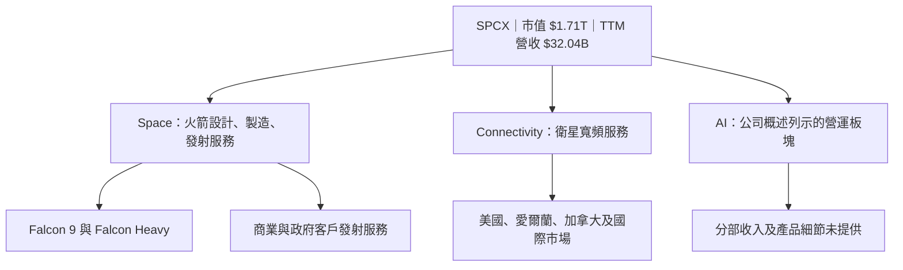
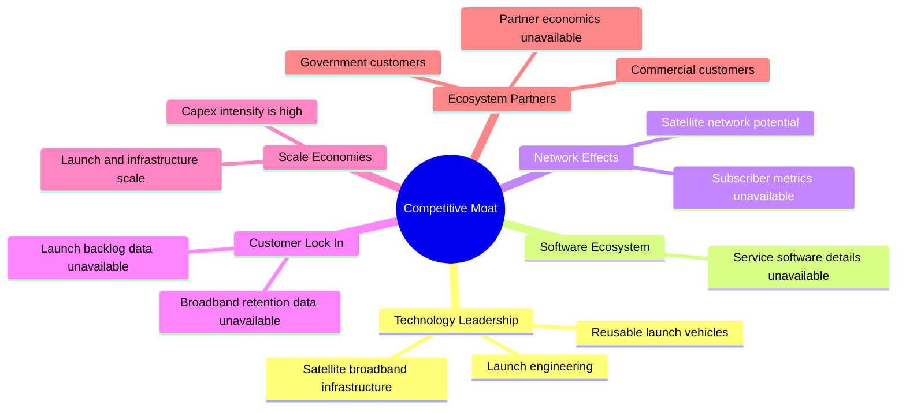
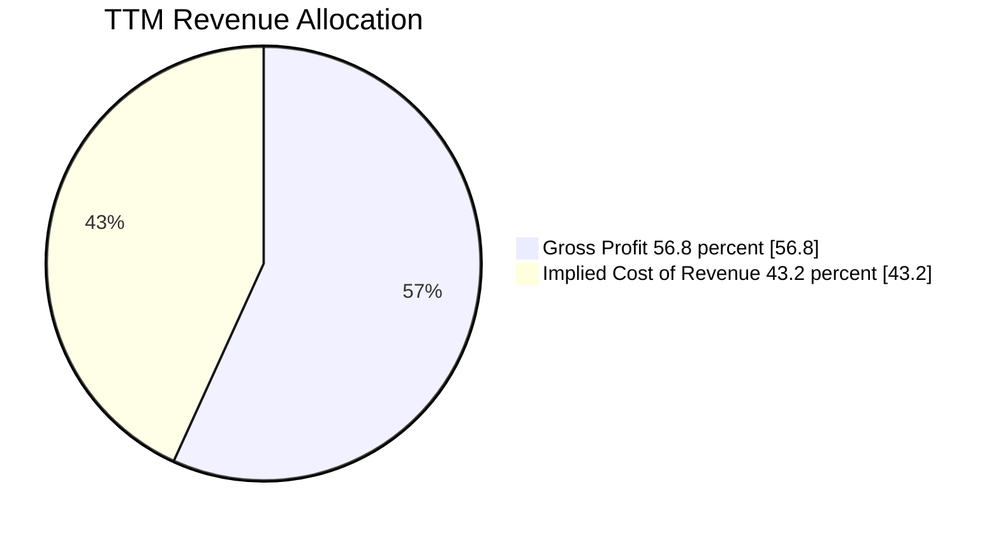
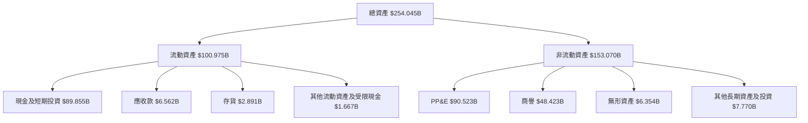
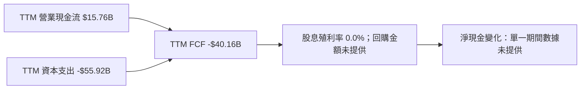
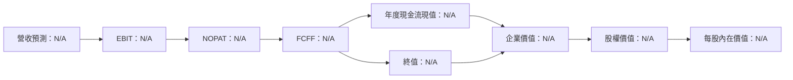
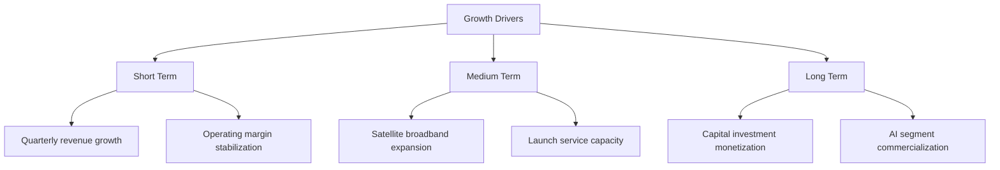
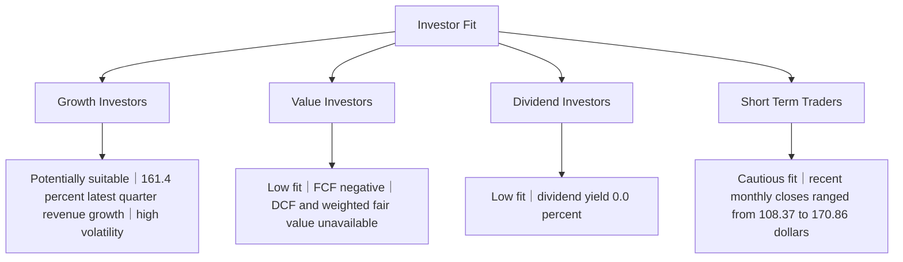

# SPCX 基本面深度分析報告
> **報告日期**：2026-11-25 ｜ **語言**：繁體中文 ｜ **數據來源**：Yahoo Finance、Finviz、StockAnalysis、Roic.ai ｜ **分析師**：CFA 級機構研究

> **資料品質提示**：財務資料主要來自 Yahoo Finance 等彙整平台，未提供 SEC 申報資料。公司描述、股數、市值及部分損益數字存在相互矛盾，且缺少可計算 DCF 與加權合理價值的必要模型結果。以下會區分原始數據、可核算數字與無法判定項目；不以臆測補齊估值輸入。

## 目錄

| # | 章節 | 核心結論 |
|---|------|----------|
| 1 | 執行摘要 | 無法計算加權合理價值與 MOS，因此不給 MOS 規則評級；營收快速成長，但 TTM FCF 為 -$40.16B |
| 2 | 公司概覽與商業模式 | 業務描述涵蓋太空、連線及 AI；各板塊營收與市場份額未提供 |
| 3 | 損益表深度分析 | TTM 營收 $32.04B；最新一季營收年增 161.4%，但 TTM 營業利益率 -2.0% |
| 4 | 資產負債表分析 | 現金及短期投資 $89.86B、淨現金 $50.64B；股數與部分報表數據有矛盾 |
| 5 | 現金流量深度分析 | TTM 營業現金流 $15.76B、資本支出 $55.92B，TTM FCF -$40.16B |
| 6 | 獲利能力與資本效率 | WACC 9.77%；ROIC 缺資料，無法判定是否創造經濟價值 |
| 7 | 相對估值分析 | SPCX 估值倍數高；不同資料來源與同業盈利狀況差異大 |
| 8 | DCF 內在價值評估 | DCF 與估值方法結果均為 N/A；不能可靠給出內在價值或 MOS |
| 9 | 成長催化劑 | 最近季度營收加速；具體 TAM、催化劑時程與分部數據未提供 |
| 10 | 風險矩陣 | 主要風險為資料可信度、巨額資本支出與獲利波動 |
| 11 | 投資建議 | 審慎觀望；建立以分部披露、FCF 與營業利潤率為核心的監控框架 |

## 1. 執行摘要

### 1.0 一頁式投資儀表板

| 項目 | 內容 |
|------|------|
| **投資論點（3 句）** | ① TTM 營收 $32.04B，最新一季年增 161.4%，顯示營收規模快速擴大，但前者的 TTM 成長率未提供。<br>② 現金及短期投資 $89.86B、總債務 $39.22B，淨現金 $50.64B，短期流動性有緩衝。<br>③ TTM 資本支出 $55.92B 高於營業現金流 $15.76B，導致 FCF -$40.16B；投資回收與資本效率仍是核心驗證項目。 |
| **綜合評分** | **5.5/10**，引用 1.1 六項算術平均 |
| **財務健康** | 🟡 現金充裕、淨現金 $50.64B；但 TTM FCF -$40.16B，且報表數據有來源矛盾 |
| **ROIC vs WACC** | ROIC：N/A ｜ WACC：9.77% ｜ **無法判定價值創造或摧毀** |
| **FCF 趨勢** | 近年 FCF 轉負，TTM FCF Yield -2.35%；巨額資本支出使營運現金流尚未轉成正自由現金流 |
| **估值** | Forward P/E 45.877045x ｜ EV/EBITDA 141.274x ｜ FCF Yield -2.35% |
| **DCF 內在價值（基準）** | **N/A**；DCF MODEL 因 TTM 營業利益不為正而未計算，折溢價 N/A |
| **安全邊際（MOS）** | **N/A**；無 8.8 加權合理價值，不能計算 MOS |
| **預期報酬（基準情境 12M）** | N/A；DCF 情境價值未提供 |
| **關鍵風險（前二）** | ① TTM FCF -$40.16B；② 重要財務數據、股數及分部資訊存在矛盾 |
| **評級 + 信心度** | **無法給予 MOS 規則評級**；質化立場為審慎觀望，信心：低 |

### 1.1 綜合評分卡（全報告唯一）

| 維度 | 評分（1–10） | 主要依據（引用數字與其來源章節） |
|------|--------------|----------------------------------|
| 成長性 | 8.0 | 最新一季營收年增 161.4%，但 TTM 成長率 N/A；見第 3 章 |
| 獲利能力 | 3.0 | TTM 營業利益率 -2.0%、淨利率 -8.6%、FCF -$40.16B；ROIC N/A；見第 3、5、6 章 |
| 財務健康 | 7.0 | 淨現金 $50.64B、流動比率 3.084；但自由現金流為負；見第 4、5 章 |
| 估值 | 2.0 | Forward P/E 45.877045x、P/S 53.323147x；加權合理價值與 MOS N/A；見第 7、8 章 |
| 護城河 | 7.0 | 可重複使用運載火箭與衛星寬頻業務具有技術及規模門檻；但缺少分部收入、客戶留存與市場份額數字；見第 2 章 |
| 管理層與資本配置 | 6.0 | FY2025 資本支出 $20.91B、SBC $1.95B；投資規模大但資本回報尚未由正 FCF 證實；見第 5 章 |
| **綜合評分** | **5.5** | 六項算術平均：(8.0 + 3.0 + 7.0 + 2.0 + 7.0 + 6.0) ÷ 6 = 5.5 |

### 1.2 五大投資論點 + 三大核心風險

| 類型 | 項目 | 具體依據 | 信心度 |
|------|------|----------|--------|
| 🟢 **投資論點①** | 營收快速擴大 | TTM 營收 $32.04B；最新一季營收 $14.57B，年增 161.4%。但單季加速是否可持續，需等待後續季度驗證 | 🟡 中 |
| 🟢 **投資論點②** | 現金緩衝充足 | 現金及短期投資 $89.86B，總債務 $39.22B，淨現金 $50.64B，可為高投資週期提供資金緩衝 | 🟢 高 |
| 🟢 **投資論點③** | 最新季度毛利額上升 | 2026-09-30 季毛利 $9.10B，營收 $14.57B；毛利率約 62.5%，高於 TTM 毛利率 56.8%。可能反映產品組合、交付或成本結構變化，需確認能否延續 | 🟡 中 |
| 🟢 **投資論點④** | 業務具技術與規模門檻 | 公司概述列出可重複使用火箭、商業及政府發射服務、衛星寬頻等業務；缺少分部利潤與客戶數，無法量化護城河變現能力 | 🟡 中 |
| 🟢 **投資論點⑤** | 近期分析師觀點偏正向 | 近期列示 38 位分析師，平均目標價 $256.25；但分析師目標價不是內在價值，且目標區間 $70–$800 顯示不確定性很大 | 🟡 低 |
| 🟡 **風險①** | 資本支出高於營運現金流 | TTM Capex $55.92B 對 OCF $15.76B，FCF -$40.16B；若投資回收延遲，外部融資需求及估值折現風險會上升 | 🔴 高衝擊 |
| 🔴 **風險②** | 財務數據一致性不足 | 來源對 TTM 營業利益、季度營業利益、淨利及股數的數字不一致，降低估值與每股分析可靠度 | 🔴 高衝擊 |
| 🟡 **風險③** | 高估值與盈餘波動 | P/S 53.323147x、EV/EBITDA 141.274x；TTM 營業利益率 -2.0%，FY2025 淨利 -$4.94B，估值對增長與利潤率假設高度敏感 | 🔴 高衝擊 |

### 1.3 快速統計卡片

| 指標 | 公司實際值（期間） | 同業中位數 | 狀態 |
|------|--------------------|------------|------|
| 營收成長（TTM） | **N/A** | — | 🟡 |
| 營收成長（最新一季年增） | **161.4%** | 72.7% | 🟢 |
| 毛利率（TTM） | **56.8%** | 37.0% | 🟢 |
| 營業利益率（TTM） | **-2.0%** | — | 🔴 |
| ROIC（TTM） | **N/A** | — | 🟡 |
| Forward P/E | **45.877045x** | 29.9x | 🔴 |
| FCF Yield（TTM） | **-2.35%** | — | 🔴 |
| Piotroski F-Score | **N/A** | — | 🟡 |

> 同業中位數以 Peer multiples 區塊中 RKLB、ASTS、IRDM 的可用數值計算。Forward P/E 排除不可比的負值 ASTS，對可用正值 642.4x、29.9x 取中位數；因此樣本僅兩家，參考性有限。其他中位數依可用樣本計算。

### 1.4 投資結論

```text
╔══════════════════════════════════════════════════════════════════╗
║                    📊 投資結論摘要                               ║
╠══════════════════════════════════════════════════════════════════╣
║  評級：N/A（無加權合理價值，無法按 MOS 規則定級）                ║
║  質化立場：審慎觀望                                               ║
║  價格（2026-11-24 收盤）：$125.81                                ║
║  DCF 內在價值（基準）：N/A（模型未計算）                         ║
║  安全邊際 MOS：N/A（8.8 無加權合理價值）                         ║
║  加權合理價值（8.8）：N/A                                        ║
║  DCF 情境價值：N/A（DCF MODEL 未提供）                           ║
║  綜合評分：5.5/10（引用 1.1）                                    ║
║  適合投資人：能承受高波動、以長期成長為核心且會追蹤現金流者      ║
╚══════════════════════════════════════════════════════════════════╝
```

## 2. 公司概覽與商業模式

### 2.1 業務結構與收入來源

公司概述描述 SPCX 涉及 Space、Connectivity、AI 三個營運板塊，但沒有分部收入、占比或分部利潤數據。因此不能把 $32.04B TTM 營收拆分至個別業務，也不以主觀比例繪製收入占比圖。



以上板塊與服務內容依公司概述；市值、TTM 營收及地域描述依 Yahoo Finance 彙整資料。公司概述中業務描述不完整，不能據此推定 AI 板塊的產品、收入或盈利。

### 2.2 市場份額

市場份額數據未提供，沒有可引用的市場份額或年份，因此不繪製市場份額圖。以營收規模看，SPCX TTM 營收 $32.04B，最新一季營收年增 161.4%；但缺少分部收入與可比口徑，無法把整體營收直接視作某一單一市場的份額。

### 2.3 競爭護城河分析



### 2.4 護城河強度

| 護城河項目 | 強度（強／中／弱） | 證據（引用數字或事實） | 會削弱它的情況 |
|------------|--------------------|------------------------|----------------|
| 技術與工程能力 | 強 | 公司概述包括可重複使用火箭、Falcon 9/Falcon Heavy 與發射服務；未提供可靠性、發射次數或成本數據 | 發射失敗、競爭技術降低發射成本、監管限制 |
| 規模效應 | 中 | TTM 營收 $32.04B，且 Capex TTM $55.92B，顯示資本與設施投入規模大 | 高固定成本未帶來足夠利用率或現金回收 |
| 網路效應 | 中 | 衛星寬頻服務涉及網路基礎設施，但訂戶數、每用戶收入、留存率均未提供 | 網路容量、覆蓋品質或價格競爭轉弱 |
| 客戶鎖定 | N/A | 客戶留存、合約期限、積壓訂單未提供 | 客戶可多源採購或更換服務商 |
| 軟體生態系統 | N/A | 未提供軟體營收、使用者或開發者數據 | 軟體服務未形成獨立收入或轉換成本 |
| 生態夥伴 | 中 | 公司概述提及商業與政府客戶；合作收入與集中度未提供 | 政府合約中止、客戶集中或供應鏈受限 |

1.1 的護城河評分為 7.0/10，依據是可重複使用運載火箭及衛星網路所需的技術、資本與規模門檻；由於客戶留存、分部盈利與市場份額缺資料，評分不代表護城河已被財務回報驗證。

## 3. 損益表深度分析

### 3.1 年度收入成長趨勢（近 3 個可用年度）

財務資料只有 FY2023–FY2025 三個年度收入，不能補造第四年。

```text
╔══════════════════════════════════════════════════════════════════╗
║        SPCX 年度收入趨勢（FY2023–FY2025）                       ║
╠══════════════════════════════════════════════════════════════════╣
║  FY2023  $10.39B  ███████████░░░░░░░░░  YoY：N/A                ║
║  FY2024  $14.02B  ███████████████░░░░░  YoY：+34.93% 🟢         ║
║  FY2025  $18.67B  ████████████████████  YoY：+33.24% 🟢         ║
╠══════════════════════════════════════════════════════════════════╣
║  FY2023–FY2025 兩年 CAGR：約 +34.1%                              ║
║  註：柱長只作相對展示；年度數值取自 Yahoo Finance 年度損益表。  ║
╚══════════════════════════════════════════════════════════════════╝
```

**計算：**年度收入 CAGR = \((18.674 ÷ 10.387)^{1/2} − 1\) ≈ 34.1%。年度收入由 FY2023 的 $10.39B 升至 FY2025 的 $18.67B，代表業務規模擴張；但最新單季增長明顯高於歷史年度增幅，是否為可持續趨勢仍需更多季度數據確認。

### 3.2 季度收入趨勢分析

單季金額採財報季度表，年增率在可取得時沿用來源數據。QoQ 為依所列季度收入計算的變化率，與單季 YoY 不同。

| 季度 | 營收 | QoQ | YoY | 備註 |
|------|------:|----:|----:|------|
| 2025-12-31 | $4.96B | +5.7% | N/A | QoQ 以 2025-09-30 季 $5.576B 為比較基期 |
| 2026-03-31 | $4.69B | -5.4% | +15.42% | QoQ 降低；YoY 依 StockAnalysis |
| 2026-06-30 | $7.81B | +66.5% | +91.94% | 季度收入明顯擴大 |
| 2026-09-30 | $14.57B | +86.5% | +161.4% | 最新一季加速；年增率是單季 YoY，不是 TTM |

最新一季成長可能代表交付、服務擴張或收入認列加速；但缺少分部營收及客戶量，不能判定是持續性訂閱收入、一次性交付或其他項目所帶動。

### 3.3 利潤率演變分析

年度毛利率由年度毛利 ÷ 年度營收計算；其他年度利潤率依收入表及 ROIC.ai 歷史數據。TTM 與 FY 年度是不同期間，不應直接視為同一時間序列。

| 利潤率指標 | FY2023 | FY2024 | FY2025 | TTM 至 2026-09-30 | 趨勢 | 評估 |
|------------|-------:|-------:|-------:|------------------:|------|------|
| **毛利率** | 41.2% | 42.9% | 49.4% | 56.8% | 上升；TTM 高於 FY2025 | 🟢 |
| **營業利益率** | 4.88% | 5.29% | -11.05% | -2.0% | FY2025 急降，TTM 仍為負 | 🔴 |
| **淨利率** | -44.56% | 5.64% | -26.44% | -8.6% | 大幅波動；TTM 仍虧損 | 🔴 |
| **EBITDA Margin** | N/A | N/A | N/A | 36.6% | TTM 指標，年度可比數據不足 | 🟡 |

最新 2026-09-30 單季營業利益率為 1.8%，高於 TTM -2.0%，顯示最新單季營業層面轉正；但季度營業利益在 Yahoo 與 StockAnalysis 的資料分別列為 $2.79B 與 $4.019B，不能據此推演單季獲利改善幅度。毛利率提升可能與產品組合、定價或規模有關，但因缺少分部成本及費用拆分，無法確認具體來源。FY2025 營業利益轉負與研發費用升至 $8.64B 同時出現，研發投資可能是費用壓力之一，但不能僅憑同時發生就認定因果。

### 3.4 費用結構分析

可以核算的只有 TTM 營收與毛利所隱含的銷貨成本；其他費用在 TTM 口徑沒有完整拆分，因此不製作完整費用比例圖。



以上為營收在毛利與銷貨成本之間的拆分，不代表全部營業費用結構。以 StockAnalysis TTM 營收 $32.043B、毛利 $18.186B 計算，銷貨成本為 $32.043B − $18.186B = $13.857B。

```text
╔══════════════════════════════════════════════════════════════════╗
║                  TTM 營收與毛利拆分                              ║
╠══════════════════════════════════════════════════════════════════╣
║  TTM 營收：       $32.043B                                       ║
║  毛利：           $18.186B                                       ║
║  推算銷貨成本：   $13.857B                                       ║
║  毛利率：         56.8%（資料來源列示）                           ║
║  R&D：            FY2025 $8.64B，非 TTM，不與上列混算             ║
║  其他營業費用：   TTM 明細未提供                                  ║
╚══════════════════════════════════════════════════════════════════╝
```

### 3.5 季度 EPS 趨勢與盈餘品質（Quality of Earnings）

財報資料提供的季度 EPS 為 StockAnalysis 口徑；EPS 預估值與實際值在 Earnings History 區塊均為 nan，故不能判斷超預期或不及預期。以下列出可取得的季度實際 EPS，不將其誤稱為盈餘 surprise。

| 季度 | EPS 實際值 | 預期值／盈餘 surprise | 原因與判讀 |
|------|-----------:|------------------------|-------------|
| 2025-12-31 | -$0.18 | N/A | EPS 預估缺失；季度淨利 -$2.35B |
| 2026-03-31 | -$0.47 | N/A | EPS 預估缺失；季度淨利約 -$4.28B，另一來源為 -$4.947B |
| 2026-06-30 | -$0.09 | N/A | EPS 預估缺失；季度淨利 -$541M |
| 2026-09-30 | +$0.37 | N/A | EPS 預估缺失；季度淨利 $4.40B，但淨利及營業利益來源間有差異 |

| 盈餘品質項目 | 數值／佔比 | 評估 |
|--------------|-----------|------|
| 股權薪酬 SBC / 營收 | 最近四季 SBC 合計 $4.733B ÷ TTM 營收 $32.04B = **14.8%** | 🔴 對股東具有顯著稀釋成本；SBC 並非無成本資金 |
| SBC / 營業現金流 | $4.733B ÷ $15.76B = **30.0%** | 🔴 營業現金流相當比例由非現金薪酬加回影響；需和股數變化一併追蹤 |
| FCF / 淨利（現金轉換率） | N/A | TTM 淨利在 StockAnalysis、ROIC.ai 等來源有不同數值，不能可靠計算單一比率 |
| 一次性／非經常性損益 | 明細 N/A | 最新季度淨利大幅轉正，但沒有非經常性項目拆分，無法排除一次性影響 |
| 有效稅率異常 | N/A | 未提供可核實的季度稅前利潤及稅費拆分 |
| 資本化支出 vs 費用化 | TTM Capex $55.92B；FY2025 R&D $8.64B | 資本支出很高；缺少資本化政策、折舊與費用明細，不能判斷是否有成本遞延問題 |

**盈餘品質結論**：TTM FCF 為 -$40.16B，且 SBC 相當於 TTM 營收約 14.8%、OCF 約 30.0%，顯示 GAAP 盈餘不能單獨代表可分配給股東的現金回報。最新季度淨利轉正值得觀察，但來源間存在淨利數值差異，尚不足以證明可持續盈利。

## 4. 資產負債表分析

### 4.1 資產結構分解

最新可列示的資產細項為 StockAnalysis 2026-09-30 資產負債表數據。總資產 $254.045B；分類依該來源列示。



**核對說明**：流動資產合計與現金、應收款、存貨、受限現金及其他流動資產明細存在來源口徑差異；上圖以 StockAnalysis 列示的資產總額及分項為準，不應視作 SEC 經審計數字。

### 4.2 流動性與營運資金分析

| 指標 | 最新值 | 一年前 | 變化 | 解讀 |
|------|-------:|-------:|------:|------|
| 流動比率 | 3.084 | N/A | N/A | 彙整資料顯示短期資產相對流動負債有緩衝；歷史同口徑值未提供 |
| 速動比率 | 2.945 | N/A | N/A | 顯示流動性不完全依賴存貨，但缺少歷史序列 |
| DSO 應收帳款天數 | 54 天 | N/A | N/A | 一年前品質指標未提供，不能判斷收款速度變化 |
| DIO 存貨天數 | 76 天 | N/A | N/A | 缺少一年前數據，不能判斷存貨周轉改善或惡化 |
| DPO 應付帳款天數 | 349 天 | N/A | N/A | DPO 偏長可能代表付款安排或供應商融資，但不能在缺少歷史及合約資訊時推定議價能力 |
| CCC 現金轉換週期 | -219 天 | N/A | N/A | 負值反映 DPO 高於 DSO + DIO；可能有利現金週轉，但應確認是否具有持續性 |

營運資金天數依 QUALITY FIGURES 數值照錄；一年前資料缺失，故不計算變化。

### 4.3 債務結構分析

```text
╔══════════════════════════════════════════════════════════════════╗
║                   SPCX 債務健康診斷                              ║
╠══════════════════════════════════════════════════════════════════╣
║  總債務：              $39.22B                                   ║
║  現金及短期投資：      $89.86B                                   ║
║  淨現金：              $50.64B  🟢                               ║
║  流動比率：            3.084x   🟢                               ║
║  速動比率：            2.945x   🟢                               ║
║  Debt/EBITDA：         N/A（可比 EBITDA 與債務口徑未核實）       ║
║  利息保障倍數：        N/A（利息費用與 EBIT 口徑不一致）         ║
╚══════════════════════════════════════════════════════════════════╝
```

淨現金為正，降低短期再融資壓力；然而高資本支出令現金使用量成為核心追蹤指標。Debt/Equity 22.186 的來源口徑與資產負債表股東權益差異明顯，故不以該數值作單獨槓桿結論。

### 4.4 股東權益趨勢

```text
╔══════════════════════════════════════════════════════════════════╗
║                 股東權益變化（年度）                             ║
╠══════════════════════════════════════════════════════════════════╣
║  FY2024  $25.80B  █████████████░░░░░░░░░░░░                      ║
║  FY2025  $41.33B  █████████████████████░░░░                      ║
║                                                                  ║
║  FY2024 至 FY2025 增加 $15.53B；變化來源未提供完整拆分。         ║
║  2026-09-30 權益數據在不同來源口徑不一致，未接續繪製。           ║
╚══════════════════════════════════════════════════════════════════╝
```

FY2024 股東權益 $25.80B、FY2025 $41.33B，增長可能受盈餘、股權融資或其他權益項目影響；因缺少可核對的權益變動表，不將增加額歸因於單一項目。

## 5. 現金流量深度分析

### 5.1 現金流量瀑布圖



公式為 OCF − Capex：$15.76B − $55.92B = -$40.16B。股息殖利率為 0.0%，但回購及完整融資現金流資訊未提供，不能推導淨現金變化。

### 5.2 FCF 轉換率趨勢

| 年度／期間 | FCF | 淨利 | FCF / 淨利 | 判讀 |
|------------|----:|-----:|-----------:|------|
| FY2023 | $0.105B | -$4.63B | N/A | 淨利為負，轉換率不具一般比較意義 |
| FY2024 | -$5.39B | $0.791B | -681.4% | 資本支出令 FCF 為負，現金轉換弱 |
| FY2025 | -$14.12B | -$4.94B | N/A | 淨利為負，比例不宜直接解讀 |
| TTM 至 2026-09-30 | -$40.16B | TTM 淨利來源不一致 | N/A | 不能可靠計算單一轉換率 |

FY2024 FCF/淨利 = \(-5.39 ÷ 0.791\) = -681.4%。FY2023 現金流表列示 FCF $105M，但 OCF $4.52B 減去 Capex $4.42B 約為 $0.10B，與 $105M 有小幅差異，可能來自原始數值四捨五入或口徑差異。

### 5.3 自由現金流趨勢

```text
╔══════════════════════════════════════════════════════════════════╗
║                   自由現金流趨勢                                 ║
╠══════════════════════════════════════════════════════════════════╣
║  FY2023  +$0.105B   ▏                                           ║
║  FY2024  -$5.39B    ███                                         ║
║  FY2025  -$14.12B   ███████                                     ║
║  TTM     -$40.16B   ████████████████████                         ║
╠══════════════════════════════════════════════════════════════════╣
║  TTM FCF Yield：-2.35%（原始列示值）                             ║
║  方向：自由現金流缺口擴大；主因是 TTM Capex $55.92B 高於 OCF     ║
╚══════════════════════════════════════════════════════════════════╝
```

此圖以負值絕對值呈現相對柱長，並非按比例比較不同年份的資產規模。TTM Capex 高於 FY2025 的 $20.91B，說明投資強度上升，但缺少投資項目與建設進度資料，無法預測資本支出何時回落。

### 5.4 資本配置評估

| 項目 | 可用數據 | 評估 |
|------|----------|------|
| 資本支出 | TTM $55.92B；FY2025 $20.91B | 投資強度大；需觀察投資成熟後的收入與現金回報 |
| 研發 | FY2025 $8.64B | 研發投入高，但缺少產品化收入或投資回報明細 |
| 股權薪酬 | FY2025 $1.95B；最近四季合計 $4.733B | SBC 會稀釋股東權益；需與流通股變化對照 |
| 股息 | 殖利率 0.0%；派息率 0.0% | 未見股息回饋 |
| 回購 | N/A | 回購金額與股數影響資料未提供 |
| 現金及短期投資 | $89.86B | 提供資金緩衝，但不足以單獨抵銷長期負 FCF |

未提供各資本配置項目占比的同期間完整數字，因此不繪製資本配置圓餅圖，避免混用 FY 與 TTM 資料。

## 6. 獲利能力與資本效率

### 6.1 ROE / ROA / ROIC 趨勢

| 指標 | FY2023 | FY2024 | FY2025 | TTM | 評估 |
|------|-------:|-------:|-------:|----:|------|
| ROE | N/A | N/A | N/A | N/A | TTM ROE 未提供；杜邦數據亦為 N/A |
| ROA | N/A | N/A | N/A | N/A | 淨利、平均資產口徑不足以可靠計算 |
| ROIC | N/A | N/A | N/A | N/A | ROIC.ai 歷史欄位未提供有效數值 |
| 營業利益率 | 4.88% | 5.29% | -11.05% | -2.0% | FY2025 轉負，TTM 仍未回到正值 |

沒有可靠的行業均值及歷史 ROIC 數據，不作同業或行業均值對照。

### 6.2 ROIC vs WACC 分析（核心價值創造判斷）

```text
╔══════════════════════════════════════════════════════════════════╗
║                ROIC vs WACC 深度分析                             ║
╠══════════════════════════════════════════════════════════════════╣
║  WACC（Cost of capital 原值）：9.77%                             ║
║  ├── 無風險利率（10Y 美債）：4.90%                               ║
║  ├── 市場風險溢酬：5.00%（假設值）                               ║
║  ├── 原始 Beta：N/A；採用調整後 Beta：1.00（假設值）             ║
║  ├── 股權成本：4.90% + 1.00 × 5.00% = 9.90%                    ║
║  ├── 稅前債務成本：4.96%                                         ║
║  ├── 稅後債務成本：4.96% × (1 − 21.0%) = 3.9184%                ║
║  ├── 股權／債務權重：97.8%／2.2%（原始列示）                    ║
║  └── WACC：9.77%（採用原始列示值）                               ║
║                                                                  ║
║  ROIC：N/A（缺少可核實的投入資本與 NOPAT）                       ║
║  EVA = ROIC − WACC：N/A                                          ║
║                                                                  ║
║  結論：無法判定 ROIC 是否高於 9.77% 的資本成本。                 ║
╚══════════════════════════════════════════════════════════════════╝
```

Cost of capital 提供 WACC 9.77%，本節直接沿用。Beta 原始值缺失，調整後 Beta 1.00 是資料源假設；Rf 與 ERP 未附精確觀察日期及 ERP 來源說明，故不另行替換或重算 WACC。債務成本稅後值為算術推導；權重依原始數據照錄，避免以不一致的市值、股數資料自行重建。

### 6.3 杜邦三因素分解

| 因素 | 數值（TTM） | 解讀 |
|------|-------------|------|
| 淨利率 | N/A | QUALITY FIGURES 標示 DuPont N/A；資料雖列 TTM 淨利率 -8.6%，但缺乏一致的淨利與資產口徑，不自行重算 |
| 資產週轉率 | N/A | 資產及收入期間口徑不一致 |
| 權益乘數 | N/A | 正權益與期末／平均權益口徑不足 |
| **ROE** | **N/A** | QUALITY FIGURES 標示 N/A，不能判斷 ROE 驅動因素 |

### 6.4 財務體質：Piotroski F-Score

Piotroski F-Score 為 **N/A**：缺少 SEC 申報資料及相隔一年的兩組 TTM 數據，無法判定九項測試結果。依資料要求，不以現有年度或平台數據自行補算個別測試，也不推定未通過項目。

## 7. 相對估值分析

### 7.1 同業估值比較

本公司倍數採 Yahoo Finance 彙整估值；同業數值照 Peer multiples。負盈餘或負 EBITDA 的倍數不應按一般正數倍數解讀。

| 估值指標 | **SPCX** | **RKLB** | **ASTS** | **IRDM** | SPCX 評估 |
|----------|---------:|---------:|---------:|---------:|-----------|
| **Trailing P/E** | 547.0x | N/A | N/A | 28.0x | 🔴 SPCX 倍數高；且高倍數對盈餘口徑敏感 |
| **Forward P/E** | 45.877045x | 642.4x | -15.1x | 29.9x | 🟡 高於 IRDM、低於 RKLB；ASTS 負值不可直接比較 |
| **P/S Ratio** | 53.323147x | 35.1x | 66.2x | 5.0x | 🔴 SPCX 高於 IRDM，低於 ASTS |
| **EV/EBITDA** | 141.274x | -142.9x | -18.3x | 16.8x | 🔴 SPCX 極高；兩家同業為負 EBITDA 倍數，不宜比較 |
| **最新一季營收 YoY** | 161.4% | 72.7% | 187.1% | 8.3% | 🟢 高於 RKLB、IRDM，低於 ASTS |
| **毛利率（TTM）** | 56.8% | 36.2% | 37.0% | 71.5% | 🟡 高於 RKLB、ASTS，低於 IRDM |

同業公司分別為 Rocket Lab（RKLB）、AST SpaceMobile（ASTS）及 Iridium Communications（IRDM）。各業務組合與盈利階段不同；特別是負 EBITDA 同業的 EV/EBITDA 值，不能據此推導 SPCX 公允價值。

### 7.2 歷史估值區間分析

N/A（未提供「Valuation vs own history」歷史估值區間、百分位或可比較的估值序列）。價格資料顯示，2026 年 6 月收盤 $170.86、7 月 $108.37、8 月 $143.69、9 月 $150.86、10 月 $134.72、11 月 $125.81；這是價格歷史，不能替代歷史 P/E 或 P/S 區間。

### 7.3 情境價值（Bear / Base / Bull）

N/A（DCF MODEL 未計算：TTM 營業利益不為正）。依資料要求，不提供悲觀、基準或樂觀情境價值。

### 7.4 相對估值隱含價格區間

N/A（VALUATION METHODS 顯示沒有可計算方法）。雖提供公司自身 Forward P/E、P/S 與 EV/EBITDA，但估值方法區塊未提供基於同業中位數推導的每股價值與權重，故不自行建立相對估值目標價。

## 8. DCF 內在價值評估（Discounted Cash Flow）

> **結論先行但依據在前**：TTM 營業利益率為 -2.0%，DCF MODEL 明確標示 TTM operating income is not positive，因此未計算 DCF。依數據規則，本章不自建模型、不填造營收預測、終值、每股內在價值或情境估值。

### 8.0 估值推理鏈（Thinking Logic）

**Step 1 — 價值來源**

公司描述涉及火箭發射、衛星寬頻及 AI，但各板塊收入占比未提供；能確認的僅是 TTM 營收 $32.04B、TTM 營業利益率 -2.0% 及 TTM FCF -$40.16B。因此無法可靠拆分現有主業現金流、成長業務與新業務選擇權價值。已知資料中，對估值影響最直接的變數是高資本支出能否轉化為正 FCF，但 DCF 模型本身因營業利益條件不符而未建立。

**Step 2 — 模型選擇與限制**

| 決策點 | 本報告採用 | 理由（含數字） | 曾考慮但否決 | 否決理由 |
|--------|-----------|----------------|--------------|----------|
| 現金流定義 | N/A | DCF MODEL 未建立；已知 TTM OCF $15.76B、Capex $55.92B、FCF -$40.16B | FCFF／FCFE 自建模型 | 規則要求不得在 DCF MODEL 為 N/A 時自行另建模型 |
| 預測期 N | N/A | 模型未提供預測年數 | 自訂 5–10 年 | 缺少模型輸入與管理層財測 |
| 終值方法 | N/A | 未提供終值假設 | Gordon Growth／退出倍數 | 缺少可驗算的年度 FCF 與估值倍數 |
| EBIT 基礎 | N/A | DCF MODEL 不適用 | GAAP／非 GAAP 自建 | TTM 營業利益不為正，且跨來源數據不一致 |

**Step 3 — 假設推導鏈**

DCF MODEL 沒有營收 CAGR、期末營業利潤率、有效稅率、Capex/營收、D&A、營運資金、SBC、稀釋股數、永續成長率等輸入，無法逐項建立「錨點 → 調整理由 → 採用值 → 否決值」的推導。任意補入這些數字會違反可稽核及不得自建模型的要求。

**Step 4 — 最脆弱一環**

最脆弱的投資假設是目前高額資本支出能否在合理期間內帶來足夠營業利益與 FCF；TTM Capex $55.92B 對比 OCF $15.76B，資本投入回收速度將左右未來現金流方向，但現有資料不足以量化每股價值變動。

**Step 5 — 計算路徑圖**

下圖僅表示模型計算關係，不含未提供的數值；本案因模型輸入缺失而不能走到每股估值。



### 8.1 模型假設總表（Model Inputs）

DCF MODEL 為 N/A，以下輸入均未提供，且不能自行補入。

| 假設項目 | 採用值 | 依據／來源 | 敏感度 |
|----------|--------|-------------|--------|
| 預測期長度 N | N/A | DCF MODEL 未提供預測期 | N/A |
| 營收 CAGR | N/A | 未提供模型假設；TTM 成長率 N/A | N/A |
| 期末營業利潤率 | N/A | 未提供模型假設；TTM 營業利益率 -2.0% | N/A |
| 有效稅率 | N/A | DCF 假設未提供；Cost of capital default tax rate 21.0% 不等於已驗證的 DCF 稅率 | N/A |
| Capex / 營收 | N/A | 未提供預測假設；TTM Capex $55.92B | N/A |
| D&A / 營收 | N/A | 未提供 DCF 假設 | N/A |
| 營運資金變動 / 營收增額 | N/A | 未提供 DCF 假設 | N/A |
| EBIT 基礎 | N/A | DCF MODEL 未建立 | N/A |
| SBC 處理 | N/A | DCF MODEL 未建立 | N/A |
| 年稀釋率 | N/A | 可用股數來源互相矛盾 | N/A |
| 永續成長率 g | N/A | DCF MODEL 未提供 | N/A |
| 終值方法 | N/A | DCF MODEL 未提供 | N/A |
| WACC | 9.77% | Cost of capital 列示值；但因 DCF MODEL 為 N/A，不代表可用其另建 DCF | N/A |

### 8.2 折現率推導（WACC）

DCF 不適用於本次估值；以下列示資料來源給定的 WACC 輸入，作為第 6.2 節一致的資本成本參考，不將其轉用於自建 DCF。

```text
╔══════════════════════════════════════════════════════════════════╗
║                    WACC 輸入（來源列示）                         ║
╠══════════════════════════════════════════════════════════════════╣
║  無風險利率 Rf：                4.90%                            ║
║  市場風險溢酬 ERP：             5.00%（假設值）                  ║
║  原始 Beta：                    N/A                              ║
║  調整後 Beta：                  1.00（假設值）                  ║
║  股權成本 Ke：                  9.90%                            ║
║  稅前債務成本 Kd：              4.96%                            ║
║  default tax rate：             21.0%                            ║
║  股權／債務權重：               97.8%／2.2%                     ║
║  WACC（直接採用來源列示）：      9.77%                            ║
╚══════════════════════════════════════════════════════════════════╝
```

來源提供的股權成本算式為 \(4.90\% + 1.00 \times 5.00\% = 9.90\%\)。但資料沒有提供 Beta 原始估值、ERP 依據日期、利息費用與計息債務明細，也未提供與權重相匹配的股數口徑，因此不另造完整五步 WACC 模型。WACC 全文與第 6.2 節統一使用 9.77%。

### 8.3 逐年自由現金流預測（基準情境）

N/A（DCF MODEL 未提供逐年預測，且原因為 TTM 營業利益不為正）。不建立 FY+1 至 FY+N 表格、不推算 FCFF 或 PV。已知歷史錨點為 TTM OCF $15.76B、Capex $55.92B、FCF -$40.16B；這些實際值不能替代未來預測。

### 8.4 終值計算（Terminal Value）

適用性檢查：WACC 9.77%，但永續成長率 g 未提供，且 DCF MODEL 為 N/A，故不能判定 WACC > g，也不能計算 Gordon Growth 或退出倍數終值。

### 8.5 企業價值 → 每股內在價值（Bridge）

N/A。預測期 FCF 現值、終值、DCF 股權價值及模型稀釋股數均未提供；因此不計算企業價值、每股內在價值或折溢價。不可用市場報價股數與不一致的財務股數自行填補模型股數。

### 8.6 敏感性分析（WACC × 永續成長率）

N/A（DCF MODEL 未提供敏感度矩陣，基準 DCF 值也不存在）。不推算矩陣格、上行空間或敏感度彈性。

### 8.7 反推 DCF（Reverse DCF）

N/A（沒有基準 DCF、預測期、營收增長、營業利潤率、終值與模型股數等可用輸入）。不能用現價 $125.81 反解多個缺失假設。

### 8.8 估值三角驗證與安全邊際

VALUATION METHODS 顯示「None could be computed」。缺少可用 DCF 基準值、同業估值回推每股價值與正式方法權重，因此本節不給加權合理價值、MOS、MOS 評級或買入區間。分析師平均目標價 $256.25、低位 $70、高位 $800 是共識資料，不是已驗證的估值方法結果，不能替代加權合理價值。

| 估值項目 | 結果 | 缺失原因 |
|----------|------|----------|
| DCF 基準價值 | N/A | TTM 營業利益不為正，DCF MODEL 未計算 |
| 相對估值方法價值 | N/A | VALUATION METHODS 無可計算方法及每股價值 |
| 分析師共識方法權重 | N/A | 未列為正式估值方法及固定權重 |
| **加權合理價值** | **N/A** | 沒有可加權的估值方法結果 |
| **MOS** | **N/A** | MOS 需以加權合理價值為分母 |
| **上行空間** | **N/A** | 沒有合理價值可比較 |

### 8.9 DCF 模型的局限與失效條件

- **終值依賴度**：N/A；沒有 DCF 預測及終值。
- **最脆弱的假設**：未來資本支出的現金回報與營業利潤率改善。現有 TTM FCF -$40.16B，若資本支出維持高位而營業現金流不相應增長，價值估計會下修，但本資料不足以給出下修幅度。
- **不適用情境**：公司目前營業利益與現金流波動大、投資強度高，DCF 可靠度有限。可考慮待分部資料完整後以 EV/Sales、單位經濟性或分部估值交叉驗證；本報告不提供虛構倍數或目標價。
- **與第 10 章風險連結**：資本支出延續、季度收入回落、營業利潤率再度轉負，以及數據披露不一致，都會削弱任何基於未來現金流的估值判斷。

### 8.10 複算檢核表（Audit Trail）

| # | 檢核項目 | 檢查方式 | 結果 |
|---|----------|----------|------|
| 1 | 高／中敏感度輸入皆有四段式推導 | DCF MODEL 未提供輸入，無可推導數值 | N/A |
| 2 | 每個假設都有來歷 | 未對 DCF 自行填入假設 | ✅ |
| 3 | WACC 五步算式齊全且相乘相加正確 | 直接引用來源列示 WACC 9.77%，未重建五步模型 | N/A |
| 4 | Kd 分母與權重 D 範圍一致 | 缺利息費用與計息債務明細 | N/A |
| 5 | WACC 與第 6.2 節同值 | 兩處均引用 9.77% | ✅ |
| 6 | 逐年表格年度數等於 N，且無省略符號 | DCF MODEL 無 N，未生成預測年度表 | N/A |
| 7 | FY+1 代表年度算式可複算 | 無 FY+1 輸入 | N/A |
| 8 | 預測期 PV 逐項相加等於合計 | 無預測 PV | N/A |
| 9 | WACC > g 或依情況處理 | g 未提供，無法比較 | N/A |
| 10 | 終值以 FY+N 現金流為基礎 | 無 FY+N 現金流 | N/A |
| 11 | 橋接算式可複算 | 無 EV、DCF 股權價值或模型股數 | N/A |
| 12 | SBC 三要素組合相容 | DCF MODEL 未建立，沒有 EBIT、SBC 與稀釋設定 | N/A |
| 13 | 矩陣基準格等於 DCF 每股價值 | 無 DCF 基準值與矩陣 | N/A |
| 14 | 矩陣有效格滿足 WACC > g | 無矩陣與 g | N/A |
| 15 | 三情境機率合計 100% | DCF 情境未提供 | N/A |
| 16 | 反推 DCF 每列只放開一個變數並有軌跡 | 無反推模型 | N/A |
| 17 | MOS 基於 8.8 加權合理價值；折溢價基於 8.5 DCF 值 | 兩個基準估值均為 N/A，未計算 MOS 或折溢價 | N/A |
| 18 | 報告完整輸出至第 11 章 | 章節 1–11 均列示 | ✅ |
| 19 | 加權合理價值等於方法價值加權總和 | 無估值方法可加權 | N/A |
| 20 | 評級符合 MOS 門檻 | MOS 無法計算，故不給規則 20 評級 | N/A |

## 9. 成長催化劑

### 9.1 催化劑時間軸

沒有可引用的產品上市、合約交付或管理層指引日期，故不以推測日期建立甘特圖。可確認的短期觀察點是下一期季度財報，而其發布日期未提供。

| 時間範圍 | 可觀察項目 | 目前依據 | 需驗證事項 |
|---------|----------|----------|----------|
| 下一季度 | 最新一季收入增長是否延續 | 2026-09-30 季收入 $14.57B，YoY +161.4% | 同口徑收入、毛利及客戶／服務數據 |
| 近期數季 | 營業利益率能否持續轉正 | 最新季度營業利益率 1.8%，TTM -2.0% | 季度轉正是否延續、是否來自持續性業務 |
| 中長期 | 高資本支出回收 | TTM Capex $55.92B，TTM FCF -$40.16B | Capex 是否轉化成產能、收入與正 FCF |
| 長期 | Connectivity 與 AI 板塊變現 | 公司概述提及相關板塊 | 分部收入、利潤、投資回報與客戶指標 |

### 9.2 TAM 市場規模分析

N/A（TAM 數據未提供）。公司 TTM 營收 $32.04B、最新一季營收年增 161.4%，顯示目前收入規模與單季增幅可觀；但沒有可引用的 TAM、年份或分部收入，不能計算市場滲透率。

### 9.3 成長驅動力結構圖



上述為公司概述所列業務方向與可追蹤指標，不代表已確認的業務預測；收入占比及預期變現時間尚未提供。

## 10. 風險矩陣

### 10.1 風險評分矩陣

未提供可量化的風險發生機率與衝擊幅度。依「有資料才寫」原則，不以主觀機率或虛構財務衝擊填入 quadrantChart；以下以定性方式列示主要風險。

### 10.2 風險清單詳細分析

| # | 風險項目 | 發生機率 | 財務衝擊 | 風險評估 | 緩解措施 |
|---|----------|----------|----------|----------|----------|
| 1 | 🔴 **高資本支出及負 FCF** | N/A，沒有可核實機率資料 | TTM FCF -$40.16B；若持續，將消耗現金或增加融資需求 | 🔴 高 | 逐季核對 OCF、Capex、FCF、現金餘額及投資項目回收進度 |
| 2 | 🔴 **數據不一致與估值不可驗證** | 已觀察到來源間差異 | 影響每股價值、盈利趨勢與資本效率判斷 | 🔴 高 | 優先追蹤公司正式財報及 SEC 文件；核對股數、淨利、營業利益及市值口徑 |
| 3 | 🟡 **營業利潤及淨利波動** | 高度波動已出現在年度及季度資料 | FY2025 營業利益 -$2.06B；TTM 營業利益率 -2.0% | 🔴 高 | 追蹤毛利率、營業費用、季度營業利益率與一次性損益 |
| 4 | 🟡 **估值對成長預期敏感** | 高倍數已反映於報價指標 | P/S 53.323147x、EV/EBITDA 141.274x | 🔴 高 | 不以分析師目標價代替估值；待可核驗的盈利及現金流改善後重估 |
| 5 | 🟡 **股權薪酬稀釋** | SBC 支出已在資料中呈現 | 最近四季 SBC 約 $4.733B，約佔 TTM 營收 14.8% | 🟡 中高 | 每季追蹤 SBC/營收、稀釋後股數及股票獎酬政策 |

上述風險評估為定性判斷，沒有虛構發生機率或收入衝擊百分比。

## 11. 投資建議

### 11.1 最終評級與評分

因第 8.8 節沒有加權合理價值，MOS 為 N/A，故不能依規則 20 給出買入、持有或賣出評級。本報告質化立場為**審慎觀望**：TTM 營收 $32.04B、最新季度營收年增 161.4% 與淨現金 $50.64B 為正面因素；但 TTM FCF -$40.16B、TTM 營業利益率 -2.0%，且重要財務數據有差異。1.1 綜合評分為 **5.5/10**，六項分數依序為成長性 8.0、獲利能力 3.0、財務健康 7.0、估值 2.0、護城河 7.0、管理層與資本配置 6.0。

### 11.2 合理價值與隱含報酬率

| 估值項目 | 每股價值 | 相對 2026-11-24 收盤價 $125.81 | 機率 | 說明 |
|----------|---------:|-------------------------------:|------|------|
| 加權合理價值 | N/A | N/A | N/A | 無可計算估值方法及權重 |
| DCF 悲觀情境 | N/A | N/A | N/A | DCF MODEL 未提供 |
| DCF 基準情境 | N/A | N/A | N/A | DCF MODEL 未提供 |
| DCF 樂觀情境 | N/A | N/A | N/A | DCF MODEL 未提供 |

分析師共識平均目標價為 $256.25、低位 $70、高位 $800；此範圍不視作本報告的內在價值或情境目標價。

### 11.3 買入時機與觸發因素

```text
╔══════════════════════════════════════════════════════════════════╗
║                  ✅ 投資觸發因素 Checklist                       ║
╠══════════════════════════════════════════════════════════════════╣
║  建立部位前，優先觀察：                                           ║
║  ☐ 取得可核驗的公司正式財報與一致的股數資料                      ║
║  ☐ 最新季度營收增長在後續季度維持，並有分部數據支持              ║
║  ☐ TTM 營業利益率由 -2.0% 改善，且單季轉正不依賴一次性項目       ║
║                                                                  ║
║  加碼觸發條件：                                                   ║
║  ☐ FCF 缺口連續收窄，且改善來自 OCF 增長而非單純延後 Capex       ║
║  ☐ SBC/營收下降，稀釋後股數與股東回報趨勢透明                    ║
║  ☐ 取得分部營收、分部利潤與投資回報資料                          ║
║                                                                  ║
║  減碼／重新檢視條件：                                             ║
║  ☐ 收入成長明顯回落且營業利潤率再度惡化                          ║
║  ☐ Capex 長期高於 OCF，現金餘額持續下降                          ║
║  ☐ 正式財報與彙整平台間仍持續存在重大差異                        ║
╚══════════════════════════════════════════════════════════════════╝
```

### 11.4 投資人適配度分析



成長型投資人需接受收入與盈利波動；價值型投資人目前缺少可驗證內在價值；股息型投資人面對 0.0% 殖利率；短期交易者則須承受價格波動與資料口徑不確定性。

### 11.5 每季財報監控清單（Quarterly Watch List）

| 監控指標 | 最新基準 | 觸發加碼的觀察方向 | 觸發減碼／重新檢視的方向 |
|----------|---------|--------------------|--------------------------|
| 營收及同比增長 | 最新季 $14.57B；YoY +161.4% | 後續季度增長有分部收入支持且可持續 | 成長顯著減速，且缺少可解釋的業務因素 |
| 營業利益率 | 最新季 1.8%；TTM -2.0% | 單季正利潤率延續並帶動 TTM 改善 | 單季再轉負或 TTM 持續惡化 |
| 毛利率 | TTM 56.8% | 穩定或提升，並能轉化成營業利潤 | 毛利率下滑且費用率不降 |
| OCF | TTM $15.76B | 營業現金流增長足以逐步縮小 FCF 缺口 | OCF 下滑或與淨利方向背離 |
| Capex | TTM $55.92B | 資本支出可對應可追蹤的新增產能或服務收入 | Capex 高位維持、投資回收未見改善 |
| FCF | TTM -$40.16B；Yield -2.35% | FCF 缺口連續收窄並有可核驗原因 | FCF 缺口進一步擴大、現金下降 |
| SBC 與股數 | 最近四季 SBC 約 $4.733B；市場資料列示股數 8.25B，但其他來源數字不一致 | SBC/營收及稀釋股數趨勢改善 | SBC 快於營收增長，或股數持續擴大 |
| 現金及債務 | 現金及短期投資 $89.86B；總債務 $39.22B | 淨現金保持充足且資本投入可回收 | 淨現金快速縮減或新增債務增加 |
| 分部與訂戶／訂單資料 | 未提供 | 開始提供可追蹤的分部營收、利潤、客戶及積壓訂單 | 披露不足以驗證增長來源 |
| 財測及 EPS surprise | 過去季度 EPS 預估值缺失 | 管理層財測透明、實績可驗證 | 財測反覆下修或季度數據難以核對 |

### 11.6 反面論證：什麼會證明論點錯誤（What Would Change My Mind）

```text
╔══════════════════════════════════════════════════════════════════╗
║              ⚠️ 論點失效條件（Disconfirming Evidence）           ║
╠══════════════════════════════════════════════════════════════════╣
║  下列條件出現時，應重新檢視成長與資本投入論點：                 ║
║  ☐ 後續季度營收增長大幅低於最新單季 YoY 161.4%，且缺少可解釋因素║
║  ☐ TTM 營業利益率仍低於 0%，且單季轉正未能延續                  ║
║  ☐ TTM FCF 缺口高於目前 -$40.16B，或現金及短期投資持續快速下降  ║
║  ☐ Capex $55.92B 未能帶動 OCF 高於目前 TTM $15.76B              ║
║  ☐ SBC/營收長期維持或高於目前約 14.8%，並伴隨稀釋股數上升       ║
║  ☐ 正式財報持續無法與平台資料對賬，致使收入、淨利或股數不可信  ║
║  ☐ ROIC 可計算後低於 WACC 9.77%，且沒有可驗證的改善路徑         ║
╚══════════════════════════════════════════════════════════════════╝
```

> **免責聲明**：本報告為 AI 自動生成，僅供研究參考，不構成投資建議。投資有風險，入市需謹慎。

---

## 資料與來源

| 項目 | 內容 |
|------|------|
| 價格 | 125.81 USD，2026-11-24 收盤（Yahoo Finance 日線） |
| 財務報表 | Yahoo quarterly statements (no SEC filing data)，最新季度 2026-09-30（TTM = four quarters to this date） |
| 有回應的資料來源 | Yahoo Finance、Finviz、StockAnalysis、Roic.ai |
| 未回應的資料來源 | SEC 申報資料 (XBRL) |
| 由程式計算 | TTM 數字、WACC、DCF 模型、估值方法與權重、加權合理價值、MOS、評級門檻、F-Score、杜邦分解、營運資金天數、綜合評分 |
| 撰寫模型 | openai / gpt-6-luna |

> 本區塊由產生報告的程式依實際取得的資料填寫，非模型撰寫。「由程式計算」的數字不是模型的估計；其餘判斷（評分、情境、策略）是模型的分析。
