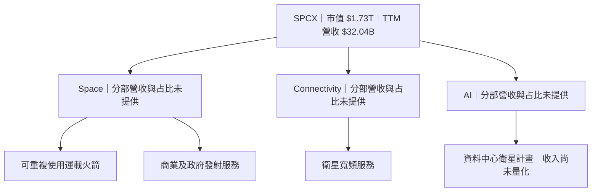
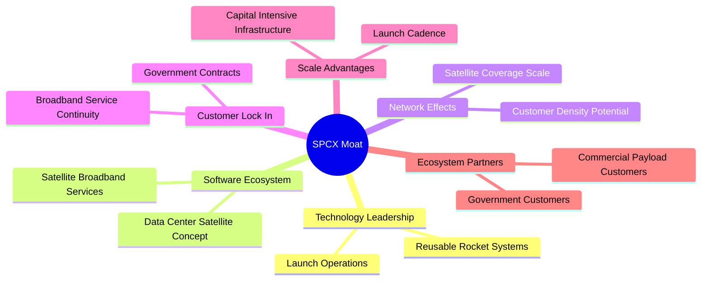
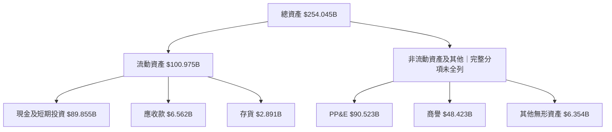
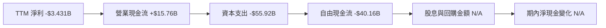
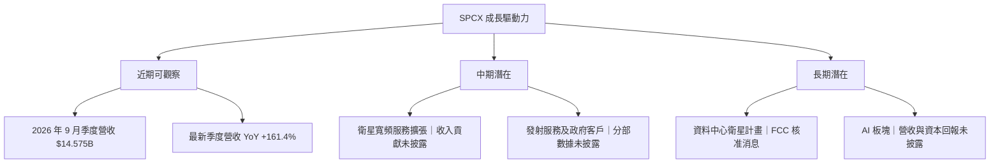
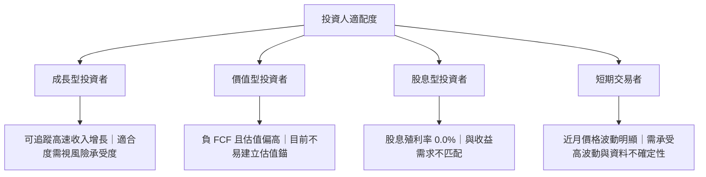

# SPCX 基本面深度分析報告
> **報告日期**：2026-11-26 ｜ **語言**：繁體中文 ｜ **數據來源**：Yahoo Finance、Finviz、StockAnalysis、Roic.ai ｜ **分析師**：CFA 級機構研究

## 目錄

| # | 章節 | 核心結論 |
|---|------|----------|
| 1 | 執行摘要 | 公司成長數據亮眼，但估值方法未能計算；合理價值、MOS 與規則 20 評級均為 N/A |
| 2 | 公司概覽與商業模式 | 涵蓋太空、連線與 AI；缺少分部營收及市場份額資料，護城河只能定性分析 |
| 3 | 損益表深度分析 | TTM 營收 $32.04B，最新一季年增 161.4%；TTM 營業利益率為 -2.0% |
| 4 | 資產負債表分析 | 現金及短期投資 $89.86B、淨現金 $50.64B；流動性指標偏強，但數據口徑有差異 |
| 5 | 現金流量深度分析 | TTM FCF 為 -$40.16B，主因資本支出 $55.92B 高於營業現金流 |
| 6 | 獲利能力與資本效率 | WACC 為 9.72%；ROIC 未提供，無法判定公司已持續創造股東價值 |
| 7 | 相對估值分析 | SPCX 的 P/S 為 54.0x，高於三家同業中位數 35.9x；自身歷史區間資料未提供 |
| 8 | DCF 內在價值評估 | DCF 模型未計算；缺少正的 TTM 營業利益基礎，不提供自建估值或 MOS |
| 9 | 成長催化劑 | 最新一季營收年增 161.4%；AI 衛星計畫有監管消息，但營收化時間與金額未提供 |
| 10 | 風險矩陣 | 主要風險為巨額資本支出、盈利波動及估值與資料口徑不確定 |
| 11 | 投資建議 | 目前無法形成 MOS-based 評級或買入區間；應以季度營運與現金流指標追蹤 |

---

## 1. 執行摘要

SPCX 最新一季營收年增 **161.4%**，TTM 營收為 **$32.04B**，最新一季營業利益率為 **1.8%**；但 TTM 營業利益率仍為 **-2.0%**，TTM FCF 為 **-$40.16B**，且資本支出達 **$55.92B**。估值方面，Forward P/E 為 **46.47x**、P/S 為 **54.01x**，而 DCF 與其他固定權重估值方法均未能計算。因此，**目前沒有可用的加權合理價值、MOS 或規則 20 評級**；不以分析師共識或單一倍數替代缺失的估值輸入。

### 1.0 一頁式投資儀表板（Portfolio Manager 30 秒速讀）

| 項目 | 內容 |
|------|------|
| **投資論點（3 句）** | ① 最新一季營收年增 **161.4%**，顯示收入動能正在加速，但該成長率屬單季 YoY，不是 TTM 成長率。② TTM 毛利率 **56.8%**，高於 RKLB、ASTS、IRDM 的同業中位數 **37.0%**，惟 TTM 營業利益率仍為 **-2.0%**。③ TTM 資本支出 **$55.92B**、FCF **-$40.16B**，高再投資需求令獲利轉現金尚未成立。 |
| **綜合評分** | **5.7/10**（引用 1.1 評分卡） |
| **財務健康** | 🟡 現金與短期投資 **$89.86B**，淨現金 **$50.64B**、流動比率 **3.084**；但 TTM FCF 為負。 |
| **ROIC vs WACC** | ROIC：**N/A**；WACC：**9.72%**。目前無法量化是否創造或摧毀長期價值。 |
| **FCF 趨勢** | FCF 惡化：FY2023 **+$0.105B**、FY2024 **-$5.39B**、FY2025 **-$14.12B**、TTM **-$40.16B**；FCF Yield **-2.32%**。 |
| **估值** | Forward P/E **46.47x** ｜ EV/EBITDA **143.16x** ｜ FCF Yield **-2.32%** |
| **DCF 內在價值（基準）** | **N/A**；DCF 未計算，故無法計算相對 DCF 的折溢價。 |
| **安全邊際（MOS）** | **N/A**；加權合理價值未能計算，不能使用 DCF 或單一估值法替代分母。 |
| **預期報酬（基準情境 12M）** | **N/A**；DCF 情境價值未提供。 |
| **關鍵風險（前二）** | 巨額資本支出使 TTM FCF 為 -$40.16B；年度營業利益由 FY2024 **+$0.742B**轉為 FY2025 **-$2.064B**。 |
| **評級 + 信心度** | **未能依規則 20 評級**；信心：低。估值方法不可用、營運與市場數據存在口徑差異。 |

> **數據完整性提示：**市場資料列示市值 **$1.73T**、流通股數 **8.25B**，而 $127.44 × 8.25B = **$1.051T**，兩者不一致；同時 Roic.ai 列示 2026 年 9 月流通股數 **13.579B**。此外，季度營業利益數據亦有來源差異。估值與股數相關分析應先核實一致口徑。

### 1.1 綜合評分卡（全報告唯一）

| 維度 | 評分（1–10） | 主要依據（引用數字與其來源章節） |
|------|--------------|----------------------------------|
| 成長性 | 8.0 | 最新一季營收年增 **161.4%**；年度營收由 FY2023 **$10.387B**增至 FY2025 **$18.674B**（第 3 章）。TTM 成長率依標準化欄位為 N/A。 |
| 獲利能力 | 4.0 | TTM 營業利益率 **-2.0%**、淨利率 **-8.6%**；最新一季營業利益率 **1.8%**。ROIC、F-Score 均 N/A（第 3、6 章）。 |
| 財務健康 | 7.5 | 淨現金 **$50.64B**、流動比率 **3.084**；但 TTM FCF **-$40.16B**，營運資金 DPO **349 天**（第 4、5 章）。 |
| 估值 | 2.0 | P/S **54.01x**，高於同業中位數 **35.9x**；FCF 為負，且正式估值方法不可計算（第 7、8 章）。 |
| 護城河 | 8.0 | 公司同時提供可重複使用運載火箭與衛星寬頻服務，並披露約 **21,000 名員工**；但分部營收、客戶留存與網路規模數據不足（第 2 章）。 |
| 管理層與資本配置 | 4.5 | FY2025 SBC **$1.95B**，TTM 四季 SBC 合計約 **$4.733B**；TTM Capex **$55.92B**。缺少回購與投資回報資料（第 3、5 章）。 |
| **綜合評分** | **5.7** | 六項算術平均：$(8.0+4.0+7.5+2.0+8.0+4.5)÷6=5.6667$，四捨五入為 **5.7/10**。 |

### 1.2 五大投資論點 + 三大核心風險

| 類型 | 項目 | 具體依據 | 信心度 |
|------|------|----------|--------|
| 🟢 **投資論點①** | 單季營收動能加速 | 2026 年 9 月季度營收 **$14.575B**，年增 **161.4%**；季度規模明顯高於 2025 年同期 **$5.576B**。 | 🟡 中；季度來源有差異 |
| 🟢 **投資論點②** | TTM 毛利率高於所列同業 | SPCX TTM 毛利率 **56.8%**；同業中位數 **37.0%**。若產品組合與成本結構能維持，毛利有利於未來營業槓桿。 | 🟡 中 |
| 🟢 **投資論點③** | 資產負債表淨現金 | 現金及短期投資 **$89.86B**，總債務 **$39.22B**，淨現金 **$50.64B**。 | 🟢 高；仍需核實股數等資料口徑 |
| 🟢 **投資論點④** | 業務具多元化成長選項 | 公司概況列出 Space、Connectivity、AI 三個板塊；新聞提及 FCC 核准大規模資料中心衛星計畫，但無分部收入與時程量化資料。 | 🟡 中低 |
| 🟢 **投資論點⑤** | 最近一季營業結果轉正 | 最新一季營業利益率標準化數值為 **1.8%**，相較 TTM **-2.0%**改善；但同一季營業利益有來源差異，需後續驗證。 | 🟡 中低 |
| 🟡 **風險①** | 巨額資本支出與 FCF 消耗 | TTM Capex **$55.92B**，OCF **$15.76B**，FCF **-$40.16B**。若投資未能轉化為可持續收入與利潤，價值可能受損。 | 🔴 高衝擊 |
| 🔴 **風險②** | 營業獲利波動 | FY2024 營業利益 **+$0.742B**，FY2025 **-$2.064B**；TTM 營業利益率 **-2.0%**。 | 🔴 高衝擊 |
| 🔴 **風險③** | 高估值與資料口徑不一致 | P/S **54.01x**、Forward P/E **46.47x**；市值、股數與季度營業利益資料存在不一致。 | 🔴 高 |

### 1.3 快速統計卡片

| 指標 | 公司實際值（期間） | 同業中位數 | 狀態 |
|------|--------------------|------------|------|
| 營收成長（TTM） | **N/A** | — | 🟡 無法判斷 |
| 營收成長（最新一季年增） | **161.4%** | **72.7%** | 🟢 高於同業中位數 |
| 毛利率（TTM） | **56.8%** | **37.0%** | 🟢 高於同業中位數 |
| 營業利益率（TTM） | **-2.0%** | — | 🔴 負值 |
| ROIC（TTM） | **N/A** | — | 🟡 數據未提供 |
| Forward P/E | **46.47x** | **30.1x**¹ | 🔴 高於可用同業中位數 |
| FCF Yield（TTM） | **-2.32%** | — | 🔴 負值 |
| Piotroski F-Score | **N/A** | — | 🟡 無法計算 |

¹ 可用同業 Forward P/E 為 RKLB **656.9x**、ASTS **-19.1x**、IRDM **30.1x**；中位數包含負值與極端高值，解讀須審慎。

### 1.4 投資結論

```text
╔══════════════════════════════════════════════════════════════════╗
║                    📊 投資結論摘要                               ║
╠══════════════════════════════════════════════════════════════════╣
║  評級：未能依規則 20 評級（加權合理價值與 MOS 均為 N/A）         ║
║  價格（2026-11-25 收盤）：$127.44                                ║
║  DCF 內在價值（基準）：N/A（模型未計算）                         ║
║  安全邊際 MOS：N/A（無加權合理價值，不以 DCF 值替代）           ║
║  加權合理價值（8.8）：N/A（估值方法均未能計算）                 ║
║  DCF 情境價值：N/A（DCF MODEL 未提供情境結果）                  ║
║  綜合評分：5.7/10（引用 1.1）                                    ║
║  適合投資人：可承受高波動、能追蹤資本支出與營運獲利的成長型投資人║
╚══════════════════════════════════════════════════════════════════╝
```

---

## 2. 公司概覽與商業模式

### 2.1 業務結構與收入來源

已知公司經營 Space、Connectivity、AI 三個板塊；未提供分部營收或占比，故不推估各板塊金額。公司概況描述其提供衛星寬頻服務，並以 Falcon 9、Falcon Heavy 提供發射服務。



上述市值採市場資料列示值；其與股價乘以所列股數存在不一致，見第 1.0 節。

### 2.2 市場份額

市場份額數據未提供，無法可靠計算其在發射服務、衛星寬頻或太空資料中心市場的占比。SPCX 最新一季營收年增 **161.4%**，高於所列三家同業最新季度年增率中位數 **72.7%**；但單季增長不能直接代表長期份額提升。

### 2.3 競爭護城河分析



圖中各項為依已知業務性質所作的質化拆解；客戶數、發射頻率、網路容量與續約率均未提供，不能據此確認網路效應或鎖定程度。

### 2.4 護城河強度

| 護城河項目 | 強度（強／中／弱） | 證據（引用數字或事實） | 會削弱它的情況 |
|------------|--------------------|------------------------|----------------|
| 技術與工程能力 | 中至強 | 業務包括可重複使用火箭及商業、政府發射；提供資料未列可靠度或發射次數。 | 發射失敗、技術迭代落後、監管限制 |
| 軟體與服務生態 | 中 | 有衛星寬頻服務，並列出 Connectivity 與 AI 板塊；未提供訂閱戶或客戶留存數。 | 服務品質、覆蓋、價格競爭不及替代方案 |
| 網路效應 | 未能確認 | 衛星網路存在規模擴張的可能性，但無用戶數與覆蓋數據。 | 用戶增長不足或頻譜、軌道容量受限 |
| 客戶鎖定 | 中 | 政府及商業發射服務通常涉及任務整合；本資料未披露續約率或客戶集中度。 | 客戶轉向替代發射商或自建能力 |
| 規模效應 | 中至強 | TTM 營收 **$32.04B**，員工約 **21,000**；但其規模效益是否轉成正營業利潤尚待驗證。 | Capex 長期高於營運現金流、固定成本過重 |
| 生態夥伴 | 中 | 客戶涵蓋商業與政府領域；未提供合作夥伴收入占比。 | 主要客戶流失、供應商或監管條件變動 |

1.1「護城河」評分為 **8.0/10**，理由是火箭發射、衛星寬頻與大量資本投入構成潛在進入障礙；但該評分尚未被客戶留存、發射紀錄及分部經濟性數據完整驗證。

---

## 3. 損益表深度分析

### 3.1 年度收入成長趨勢（近 3 個可用年度）

| 年度 | 營收 | YoY |
|------|------|-----|
| FY2023 | $10.387B | — |
| FY2024 | $14.015B | +34.9% |
| FY2025 | $18.674B | +33.2% |

FY2023 至 FY2025 營收 CAGR 約 **34.1%**，計算為 $(18.674÷10.387)^{1/2}-1$。年度成長保持在約三成，顯示既有業務擴張；惟 2026 年季度資料的營收成長顯著加速，不應直接線性外推。

```text
╔══════════════════════════════════════════════════════════════════╗
║              SPCX 年度收入趨勢（FY2023-FY2025）                  ║
╠══════════════════════════════════════════════════════════════════╣
║  FY2023  $10.387B  ███████████░░░░░░░░░░░░░░  基期            ║
║  FY2024  $14.015B  ███████████████░░░░░░░░░░  YoY +34.9% 🟢   ║
║  FY2025  $18.674B  ████████████████████░░░░░  YoY +33.2% 🟢   ║
║                                                                  ║
║  FY2023–FY2025 營收 CAGR：約 +34.1%                              ║
║  註：條形長度僅作年度營收相對呈現，精確值見上表。                ║
╚══════════════════════════════════════════════════════════════════╝
```

### 3.2 季度收入趨勢分析

| 季度 | 營收 | QoQ 成長 | YoY 成長 | 備註 |
|------|------|----------|----------|------|
| 2025-12-31 | $4.96B | -5.4%¹ | N/A | QoQ 比較 2025-09 季 **$5.576B**；未提供 2024-12 季營收。 |
| 2026-03-31 | $4.69B | -5.4% | +15.4% | 年增率來自 StockAnalysis 季度資料。 |
| 2026-06-30 | $7.81B | +66.5% | +91.9% | QoQ 擴張明顯；單季變化可能受交付與認列時點影響。 |
| 2026-09-30 | $14.57B | +86.5% | **+161.4%** | 年增率採標準化最新季度數值；不是 TTM 成長率。 |

¹ 2025-12-31 的 QoQ 使用可用季度資料 2025-09-30 **$5.576B** 計算，來源資料對財年與自然季標示不完全一致，應視為近似的連續季度比較。

2026 年前兩季營收由 **$4.69B**升至 **$7.81B**，再升至 **$14.57B**。若延續，較高營收規模可能帶來固定成本吸收；然而季度營收跳升也可能受到業務組合、認列時點或一次性因素影響，需觀察後續季度能否維持。

### 3.3 利潤率演變分析

| 利潤率指標 | FY2023 | FY2024 | FY2025 | TTM／最新季度 | 趨勢 | 評估 |
|------------|--------|--------|--------|---------------|------|------|
| **毛利率** | 41.2% | 42.9% | 49.4% | TTM **56.8%** | ↗️ 逐步提升 | 🟢 毛利改善，但需確認高毛利季度的持續性 |
| **營業利益率** | 4.9% | 5.3% | -11.1% | TTM **-2.0%**；最新季 **1.8%** | 先改善、FY2025 大幅轉負、最新季回升 | 🔴 年度波動大 |
| **淨利率** | -44.6% | 5.6% | -26.4% | TTM **-8.6%** | 高度波動 | 🔴 未形成穩定淨利 |

毛利率由 FY2023 的 **41.2%**升至 TTM **56.8%**，可能反映高毛利服務占比提升、產能利用改善或產品組合變化；但分部資料缺失，無法量化各因素貢獻。營業利益率則由 FY2024 **5.3%**轉為 FY2025 **-11.1%**，與營收擴張不同步，顯示研發、營運與擴張成本仍可能大幅吞噬毛利。FY2026 最新季度營業利益率為 **1.8%**，是轉正訊號，但不足以證明已形成結構性利潤。

### 3.4 費用結構分析

營收與毛利數據足以呈現收入成本分布，但未提供完整 TTM 研發、銷售管理及其他營業費用細項，因此不將未披露費用編成圓餅圖。

TTM 營收 **$32.04B**、毛利 **$18.186B**，推算營業成本約為 $32.04B−$18.186B＝**$13.854B**；此數為依披露營收與毛利算出的差額。FY2025 研發費用為 **$8.64B**，明顯高於 FY2024 **$3.46B**，研發投入上升可能支援新技術與未來產品，但短期會壓低營業利潤。

```text
╔══════════════════════════════════════════════════════════════════╗
║                    TTM 收入與毛利概況                            ║
╠══════════════════════════════════════════════════════════════════╣
║  營收             $32.040B                                       ║
║  ├─ 毛利           $18.186B  （毛利率 56.8%）                    ║
║  └─ 營業成本       $13.854B  （營收減毛利推算）                  ║
║  其他營業費用細項：未提供；無法完整拆分費用結構。                ║
╚══════════════════════════════════════════════════════════════════╝
```

### 3.5 季度 EPS 趨勢與盈餘品質（Quality of Earnings）

#### EPS 表現

| 季度 | EPS 實際值 | 預估值／驚喜幅度 | 評估與原因 |
|------|------------|----------------|------------|
| 2025-12-31 | -$0.18 | N/A | 預估值未提供。 |
| 2026-03-31 | -$0.47¹ | N/A | 預估值未提供；資料來源對季度 EPS 口徑可能不同。 |
| 2026-06-30 | -$0.09 | N/A | 虧損幅度收窄；無法判斷是否超預期。 |
| 2026-09-30 | +$0.37 | N/A | 轉正；EPS Estimates 與 Actual 均為 nan，不能定義為超預期或不及預期。 |

¹ Roic.ai 季度 EPS 序列列示 Q1 2026 為 -$0.47，StockAnalysis 列示為 -$1.27，屬明顯來源差異。其餘季度 EPS 亦不應視為完全一致的標準化數據。最近三季 EPS beat/miss 預估值均未提供，因此無法對「超預期／不及預期」作可靠分類。

#### 盈餘品質

| 盈餘品質項目 | 數值／佔比 | 評估 |
|--------------|-----------|------|
| 股權薪酬 SBC / 營收 | TTM SBC 約 **$4.733B**；除以 TTM 營收 **$32.04B**約 **14.8%** | 🔴 比重高；SBC 會稀釋現有股東，現金流口徑又可能將其加回，故不能只看 OCF。 |
| SBC / 營業現金流 | **$4.733B ÷ $15.76B ≈ 30.0%** | 🟡 SBC 相當於 OCF 約三成，經濟成本不可忽略。 |
| FCF / 淨利（現金轉換率） | TTM FCF **-$40.16B**；StockAnalysis TTM 淨利 **-$3.431B**；數學比值約 **11.7 倍** | 🔴 負淨利下正比值不代表良好轉換；FCF 大幅為負，不能用該比率判定盈餘含金量高。 |
| 一次性／非經常性損益 | N/A | 未提供足以拆分一次性損益的註記。 |
| 有效稅率異常 | N/A | 實際有效稅率未提供；WACC 使用的 **21.0%**是預設值，不是實際稅率。 |
| 資本化支出 vs 費用化 | TTM Capex **$55.92B**；FY2025 R&D **$8.64B** | 大額資本支出形成現金消耗，資產耐用年限與資本化政策明細未提供，無法判定是否延遲費用認列。 |

**盈餘品質結論：**目前 GAAP 盈利波動大，TTM 淨利為負且 FCF 大幅為負；加上 SBC 約為 TTM 營收 **14.8%**，帳面營業現金流並未完整代表股東可得的經濟現金流。TTM 淨利在不同來源間亦有差異，估值不應依賴單季轉正或未經核實的 EPS。

---

## 4. 資產負債表分析

### 4.1 資產結構分解

以下採 StockAnalysis 2026-09 資產負債表列示值，單位為 $B。總資產 **$254.045B**；流動資產 **$100.975B**；非流動資產細項中 PP&E **$90.523B**、商譽 **$48.423B**、無形資產 **$6.354B**。由於未列示所有資產細項，不以殘差填補其他項目。



### 4.2 流動性與營運資金分析

| 指標 | 最新 TTM | 一年前 TTM | 變化 | 解讀 |
|------|----------|------------|------|------|
| DSO 應收帳款天數 | **54 天** | N/A | N/A | 應收天數可用，但缺一年前對照，無法判斷收款變快或變慢。 |
| DIO 存貨天數 | **76 天** | N/A | N/A | 需配合存貨組成及交付週期判讀；歷史比較資料未提供。 |
| DPO 應付帳款天數 | **349 天** | N/A | N/A | 數值偏長，可能支撐負 CCC，但也可能反映付款週期拉長；缺供應商合約資料。 |
| CCC 現金轉換週期 | **-219 天** | N/A | N/A | 由應收、存貨及應付天數計算；負 CCC 有利於營運資金，但 DPO 長達 349 天需追蹤。 |

流動比率為 **3.084**、速動比率 **2.945**。可用年度數據顯示 FY2025 流動比率約為 $30.95B÷$21.40B＝**1.45**，FY2024 約為 $16.11B÷$11.79B＝**1.37**；最新資料的流動比率明顯較高，主要與現金及短期投資增加相符。

### 4.3 債務結構分析

```text
╔══════════════════════════════════════════════════════════════════╗
║                   SPCX 債務健康診斷                              ║
╠══════════════════════════════════════════════════════════════════╣
║  總債務：              $39.22B                                  ║
║  現金及短期投資：      $89.86B                                  ║
║  淨現金：              $50.64B  🟢                              ║
║  流動比率：            3.084x   🟢                              ║
║  速動比率：            2.945x   🟢                              ║
║  Debt/EBITDA：         約 3.34x（以 EBITDA margin × TTM 收入估算）║
║  利息保障倍數：        N/A（利息費用與可比 EBIT 口徑未提供）     ║
║  Debt/Equity：         22.186（資料未清楚標明單位，不作倍數解讀）║
╚══════════════════════════════════════════════════════════════════╝
```

Debt/EBITDA 的近似計算為：TTM EBITDA 約 $32.04B×36.6%＝**$11.73B**；$39.22B÷$11.73B≈**3.34x**。此為以披露 EBITDA margin 推算，不是經核對的 TTM EBITDA 金額。淨現金提供融資緩衝，但資本支出超過營業現金流的現況，使淨現金消耗速度成為重要監控項目。

### 4.4 股東權益趨勢

| 年度 | 股東權益 |
|------|----------|
| 2024-12-31 | $25.80B |
| 2025-12-31 | $41.33B |
| 2026-09-30 | N/A（同口徑股東權益數未列於標準化資產負債表摘要） |

```text
╔══════════════════════════════════════════════════════════════════╗
║                    股東權益變化                                  ║
╠══════════════════════════════════════════════════════════════════╣
║  FY2024  $25.80B  █████████████                                  ║
║  FY2025  $41.33B  █████████████████████                          ║
║  2026-09  N/A（同口徑數據未提供）                                ║
╚══════════════════════════════════════════════════════════════════╝
```

股東權益增長可能包含累積盈餘、發行股份或其他權益變動；缺乏完整權益變動表，不能將增加額單獨解釋為營運留存利潤。

---

## 5. 現金流量深度分析

### 5.1 現金流量瀑布圖

以下 TTM 數值來自標準化財務欄位。淨利採 StockAnalysis TTM 列示值，與其他來源口徑可能有差異；股息、回購與現金淨變動的 TTM 金額未提供。



淨利到營業現金流之間包含非現金項目及營運資金變動，並非單純加總關係；圖示用於呈現現金流順序，不代表逐項會計調節表。

### 5.2 FCF 轉換率趨勢

| 期間 | FCF | 淨利 | FCF / 淨利 | 評估 |
|------|-----|------|------------|------|
| FY2023 | +$0.105B | -$4.628B | 約 -2.3% | 分母為負，該比率不適合衡量現金轉換。 |
| FY2024 | -$5.39B | +$0.791B | 約 -681.4% | 盈利未轉為正 FCF，主要受投資支出影響。 |
| FY2025 | -$14.12B | -$4.937B | 約 +286.0% | 兩者皆負，正比率不代表轉換品質良好。 |
| TTM | -$40.16B | -$3.431B¹ | 約 +1,170.4% | 兩者皆負且來源口徑不一，不宜按正比率解讀。 |

¹ StockAnalysis TTM 淨利。上述比率用於呈現數學結果，不代表經濟上的盈餘轉換率。

### 5.3 自由現金流趨勢

| 期間 | OCF | Capex | FCF |
|------|-----|-------|-----|
| FY2023 | $4.52B | $4.42B | +$0.105B |
| FY2024 | $5.78B | $11.16B | -$5.39B |
| FY2025 | $6.79B | $20.91B | -$14.12B |
| TTM | $15.76B | $55.92B | **-$40.16B** |

```text
╔══════════════════════════════════════════════════════════════════╗
║                     自由現金流趨勢                               ║
╠══════════════════════════════════════════════════════════════════╣
║  FY2023  +$0.105B  ▏                                            ║
║  FY2024  -$5.390B  ██                                           ║
║  FY2025  -$14.120B ██████                                       ║
║  TTM     -$40.160B ██████████████████                           ║
║                                                                  ║
║  TTM FCF Yield：-2.32%                                          ║
║  主因：TTM Capex $55.92B 高於 OCF $15.76B。                     ║
╚══════════════════════════════════════════════════════════════════╝
```

FY2026 四季 FCF 分別為 **-$9.97B、-$16.82B、-$9.07B、-$4.30B**，合計 **-$40.16B**。單季虧損較前季收窄，但仍未轉正；未來價值取決於已投入資本能否帶來持續現金流，而非單看營收增長。

### 5.4 資本配置評估

股息殖利率與派息率均為 **0.0%**；FY2025 SBC 為 **$1.95B**，FY2024 為 **$0.784B**，FY2023 為 **$0.679B**。Capex 顯著增加，但回購金額、收購支出與留存現金用途未完整提供，故不製作資本配置比例圖。

| 資本配置項目 | 可用數據 | 評估 |
|--------------|----------|------|
| 資本支出 | FY2025 **$20.91B**；TTM **$55.92B** | 佔用大量現金；要以項目回報率驗證投資成效。 |
| 股權薪酬 | FY2025 **$1.95B**；TTM 約 **$4.733B** | 規模增加，造成股東稀釋成本。 |
| 股息 | 殖利率 **0.0%** | 未以股息回饋股東。 |
| 股票回購 | N/A | 未提供，不能判斷是否抵銷 SBC 稀釋。 |
| 收購與其他投資 | N/A | 缺少足夠現金流細項。 |

---

## 6. 獲利能力與資本效率

### 6.1 ROE / ROA / ROIC 趨勢

| 指標 | FY2023 | FY2024 | FY2025 | TTM | 評估 |
|------|--------|--------|--------|-----|------|
| ROE | N/A | N/A | N/A | N/A | 品質指標未提供可用的同口徑計算結果。 |
| ROA | N/A | N/A | N/A | N/A | 缺少標準化的季度平均資產與淨利配對數據。 |
| ROIC | N/A | N/A | N/A | N/A | Roic.ai 歷史欄位亦未提供可用 ROIC 值。 |

行業均值未提供，不作推估比較。

### 6.2 ROIC vs WACC 分析（核心價值創造判斷）

```text
╔══════════════════════════════════════════════════════════════════╗
║                ROIC vs WACC 深度分析                            ║
╠══════════════════════════════════════════════════════════════════╣
║  WACC 輸入（程式計算資料）：                                     ║
║  ├── 無風險利率（10Y 美債）：  4.85%（觀測日期未提供）           ║
║  ├── 市場風險溢酬 ERP：        5.00%（假設值）                   ║
║  ├── 原始 Beta：               N/A                                ║
║  ├── 調整後 Beta：             1.00（無原始 Beta，以 1.00 假設）  ║
║  ├── 股權成本 Ke：             4.85% + 1.00 × 5.00% = 9.85%     ║
║  ├── 稅前債務成本：            4.96%                              ║
║  ├── 稅後債務成本：            4.96% × (1−21.0%) = 3.92%         ║
║  ├── 股權／債務權重：          97.8%／2.2%                       ║
║  └── ✅ WACC：                 9.72%                              ║
║                                                                  ║
║  ROIC：N/A（沒有可用的 TTM ROIC）                                ║
║  EVA = ROIC − WACC：N/A                                          ║
║  判斷：缺少 ROIC，不能宣稱 SPCX 已創造或摧毀長期股東價值。       ║
╚══════════════════════════════════════════════════════════════════╝
```

WACC 直接採用資本成本資料列示的 **9.72%**，不另行替代。輸入驗算：  
$Ke=4.85\%+1.00×5.00\%=9.85\%$；稅後債務成本 $=4.96\%×(1-21.0\%)=3.9184\%$；加權結果 $=97.8\%×9.85\%+2.2\%×3.9184\%=9.7195\%\approx9.72\%$。  
上述 Beta 為假設值，無風險利率的觀測日期亦未提供，故 WACC 雖可引用，仍具有模型輸入不確定性。

### 6.3 杜邦三因素分解

N/A（品質資料未提供可用杜邦三因素；缺少同一 TTM 期間的淨利、營收、總資產與正權益組合，不自行重算）。

### 6.4 財務體質：Piotroski F-Score

N/A（需要相隔一年的兩期 SEC 申報資料；現有財務來源沒有足以計算九項測試的完整同口徑資料）。因此不列九項結果，也不以其他財務指標替代 F-Score。

---

## 7. 相對估值分析

### 7.1 同業估值比較表格

同業倍數採 Yahoo Finance 提供的 Peer multiples。負 P/E 或負 EV/EBITDA 在盈利為負時解讀有限。

| 估值指標 | **SPCX** | **RKLB** | **ASTS** | **IRDM** | 本公司評估 |
|----------|----------|----------|----------|----------|-----------|
| **Trailing P/E** | 554.09x | N/A | N/A | 27.9x | 🔴 SPCX 倍數極高，但自身 TTM EPS 與盈利品質具波動。 |
| **Forward P/E** | 46.47x | 656.9x | -19.1x | 30.1x | 🟡 高於 IRDM；三家中位數 30.1x，但樣本有負值及極端值。 |
| **P/S Ratio** | 54.01x | 35.9x | 73.0x | 5.0x | 🔴 高於同業中位數 **35.9x**。 |
| **EV/EBITDA** | 143.16x | -146.7x | -19.8x | 16.9x | 🔴 SPCX 極高；同業中位數為負數，代表該統計量不具經濟意義。 |
| **最新一季營收 YoY** | 161.4% | 72.7% | 187.1% | 8.3% | 🟢 高於同業中位數 **72.7%**，但低於 ASTS。 |
| **毛利率 TTM** | 56.8% | 36.2% | 37.0% | 71.5% | 🟢 高於兩家，但低於 IRDM；同業中位數 **37.0%**。 |

SPCX 的成長和毛利表現支持溢價，但負 FCF、TTM 營業利益率為負，令傳統盈利倍數的可比性下降。P/S **54.01x**相對同業中位數 **35.9x**，市場已反映較高成長預期。

### 7.2 歷史估值區間分析

N/A（未提供「Valuation vs own history」的歷史估值區間或百分位數據，不推估歷史 P/E 分位）。

### 7.3 情境價值（Bear / Base / Bull）

N/A（DCF 模型未計算：TTM 營業利益不為正；依估值資料規則，不自行建立情境目標價或退出倍數）。

### 7.4 相對估值隱含價格區間

N/A（固定估值方法區塊列示「None could be computed」，未提供可直接引用的相對估值每股價值與權重。即使可以比較同業倍數，也不能自行替代固定權重估值結果）。

---

## 8. DCF 內在價值評估（Discounted Cash Flow）

### 8.0 估值推理鏈（Thinking Logic）

**Step 1 — 價值由哪些變數決定？**  
SPCX 的價值可能來自 Space 發射服務、Connectivity 衛星寬頻與 AI 衛星計畫；但目前未披露三者營收占比，因此不能把 **$32.04B** TTM 營收可靠拆分為主業底盤與新業務選擇權。現有資料顯示，最重要的估值變數應是資本支出能否轉化為正且可持續的自由現金流。

**Step 2 — 模型選擇**

| 決策點 | 本報告採用 | 理由（含數字） | 曾考慮但否決 | 否決理由 |
|--------|-----------|----------------|--------------|----------|
| 現金流定義 | 不建立模型 | TTM FCF **-$40.16B**；DCF 模型已標為 N/A。 | FCFF／FCFE | 缺少可用盈利基礎與程式模型輸出。 |
| 預測期 N | N/A | 模型沒有提供預測年數。 | 自行選 5–10 年 | 會構成自建模型，與固定模型資料要求不符。 |
| 終值方法 | N/A | 無逐年 FCFF、g 或終值輸出。 | Gordon Growth／退出倍數 | 缺少模型輸入，不能以假設值填補。 |
| EBIT 基礎 | N/A | TTM 營業利益不為正；模型來源明示不做虧損折現。 | GAAP EBIT 推演 | 會建立資料源未提供的新模型。 |

**Step 3 — 假設推導鏈**  
由於模型資料本身為 N/A，營收 CAGR、期末營業利潤率、預測期、Capex/營收、D&A/營收、營運資金、SBC、股數稀釋率、g 與終值均沒有程式計算值。若另行填入這些輸入，將不再是所要求的固定 DCF 模型，因此不提供假設性估值。

**Step 4 — 最脆弱環節**  
最脆弱處是巨額資本支出能否轉化為成熟期現金流：TTM Capex **$55.92B**、FCF **-$40.16B**；若投資回報延後，合理價值方向將下修，但因模型缺失，無法量化幅度。

**Step 5 — 計算路徑圖**  
一般 FCFF 計算邏輯如下；本報告沒有輸入數值，因此此圖不是 SPCX 的實際 DCF 推算。


### 8.1 模型假設總表（Model Inputs）

N/A（DCF MODEL 明確未計算：TTM 營業利益不為正；虧損折現不是可用的估值基礎）。因此不填預測期、收入 CAGR、利潤率、稅率、Capex、D&A、ΔWC、SBC、股數稀釋率、g、終值方法或 WACC 模型表格，以免把未提供的模型假設誤寫成既定數據。

### 8.2 折現率推導（WACC）

第 6.2 節已列示所提供資本成本輸入與驗算；本節不另建立 DCF，也不改變 WACC。可引用的 WACC 為 **9.72%**。原始 Beta 為 N/A，調整後 Beta 採 **1.00**假設值；Rf **4.85%** 的觀測日期未提供；ERP **5.00%**為假設輸入。由於固定 DCF 模型未計算，這些輸入不能補足現金流預測與每股價值缺口。

### 8.3 逐年自由現金流預測（基準情境）

N/A（DCF MODEL 未提供逐年營收、EBIT、NOPAT、D&A、Capex、ΔWC、FCFF 或折現因子）。依規則不自行建立預測表，也不以歷史營收或 Capex 外推。歷史 TTM FCF 為 **-$40.16B**，但無法由此反推出未提供的模型輸入。

### 8.4 終值計算（Terminal Value）

N/A（缺少 DCF 預測期終年 FCFF、永續成長率 g、模型終值與折現因子）。因此不計算 Gordon Growth 終值或退出倍數終值，也不宣稱 WACC 大於 g。

### 8.5 企業價值 → 每股內在價值（Bridge）

N/A（固定估值模型沒有企業價值、終值現值、股權價值或模型稀釋股數輸出）。財報列示淨現金 **$50.64B**，但不可僅用淨現金推導每股內在價值。最新收盤價 **$127.44**；由於 DCF 內在價值未計算，折溢價亦為 N/A。

### 8.6 敏感性分析（WACC × 永續成長率）

N/A（DCF 模型未產生基準每股價值、g、預測 FCFF 或敏感度矩陣）。不建立假設性 5×5 矩陣，也不提供情境目標價或機率加權價值。

### 8.7 反推 DCF（Reverse DCF）

N/A（沒有可用的基準 DCF 模型，無法固定基準假設後令每股價值等於 **$127.44** 反解單一變數。若自行試算營收 CAGR、利潤率或成長年數，將違反不得自建 DCF 的要求）。

### 8.8 估值三角驗證與安全邊際

N/A（估值方法資料列示「None could be computed」）。沒有 DCF 每股價值、相對估值每股價值或固定權重可引用，因此不計加權合理價值、MOS、上行空間或 MOS-based 評級。分析師共識目標價均值 **$256.25**、低值 **$70.00**、高值 **$800.00**，僅作外部參考；因未提供各目標價假設與一致方法，不納入加權合理價值。

### 8.9 DCF 模型的局限與失效條件

- **終值依賴度：**N/A，終值及企業價值未計算。
- **最脆弱的假設：**無法量化；核心不確定性是 Capex 是否能轉化為持續現金流。TTM Capex **$55.92B**、TTM FCF **-$40.16B**提供了風險規模，但不能直接推導價值變動。
- **不適用情境：**公司 TTM 營業利益率 **-2.0%**，最新季度營業利益率 **1.8%**，盈利仍波動；DCF 可靠度低。現階段可參考 EV/Sales、分部估值與資本投入回報，但仍需一致的股數、分部收入與估值輸入。
- **與第 10 章風險連結：**資本支出持續上升會降低未來 FCF；發射或衛星網路執行延誤會壓低營收成長；利潤率回落會影響盈餘基礎。由於模型沒有輸出，無法量化各風險的每股影響。

### 8.10 複算檢核表（Audit Trail）

| # | 檢核項目 | 檢查方式 | 結果 |
|---|----------|----------|------|
| 1 | 高／中敏感度輸入有完整推導 | DCF 無假設輸入，未建立模型 | N/A |
| 2 | 每個假設都有來歷 | 未填造 DCF 假設；已列資料缺口 | ✅ |
| 3 | WACC 五步算式與加權結果 | 參考第 6.2 節；WACC 9.72% | ✅ |
| 4 | Kd 分母與債務權重範圍一致 | DCF 模型未使用自行推導的 Kd／D 權重 | N/A |
| 5 | WACC 與第 6.2 節同值 | 均採 9.72% | ✅ |
| 6 | 逐年預測欄數等於 N | N 未提供，沒有預測表 | N/A |
| 7 | FY+1 算式可複算 | 沒有 FY+1 模型數值 | N/A |
| 8 | 預測期 PV 加總 | 沒有模型 PV | N/A |
| 9 | WACC > g | g 未提供 | N/A |
| 10 | 終值基於 FY+N 並折現 N 期 | 沒有終值輸出 | N/A |
| 11 | EV 至每股價值橋接 | 沒有 DCF EV 或模型股數 | N/A |
| 12 | SBC 組合一致 | 沒有模型 EBIT 基礎或股數假設；不自建組合 | N/A |
| 13 | 敏感度矩陣基準格等於基準 DCF | 沒有矩陣或基準 DCF | N/A |
| 14 | 敏感度矩陣有效格符合 WACC > g | 沒有矩陣 | N/A |
| 15 | 情境機率合計 100% | 未提供 DCF 情境 | N/A |
| 16 | 反推 DCF 每列只放開一項 | 未計算反推 DCF | N/A |
| 17 | MOS 分母為 8.8 加權合理價值 | 加權合理價值未計算，因此 MOS 未計算 | ✅ |
| 18 | 報告完整至第 11 章 | 已依章節完整列示 | ✅ |
| 19 | 加權合理價值等於價值乘權重之和 | 沒有估值方法與權重 | N/A |
| 20 | 評級符合 MOS 門檻 | MOS 未計算，未套用 MOS 評級 | N/A |

---

## 9. 成長催化劑

### 9.1 催化劑時間軸

目前資料沒有提供各催化劑的可核實執行時間表或收入貢獻日期，因此不製作帶有推測日期的甘特圖。可觀察的催化因素包括最新季度營收年增 **161.4%**，以及新聞提及 FCC 核准一百萬顆資料中心衛星計畫；但後者的資本需求、部署時程與商業收入均未量化。

### 9.2 TAM 市場規模分析

N/A（未提供具來源及年份的 TAM 數據）。公司 TTM 營收為 **$32.04B**，最新季度營收年增 **161.4%**，說明業務規模及收入動能正在擴大；但缺少可比市場總額，不能推算滲透率或市場份額。

### 9.3 成長驅動力結構圖



---

## 10. 風險矩陣

### 10.1 風險評分矩陣

資料未提供風險事件的統計發生機率，也沒有可量化的損失分布。依「有資料才畫」原則，不填入主觀機率與衝擊分數建立 quadrantChart；風險排序以財務暴露與可觀察數字呈現。

### 10.2 風險清單詳細分析

| # | 風險項目 | 發生機率 | 財務衝擊 | 風險評分 | 緩解措施 |
|---|----------|----------|----------|----------|----------|
| 1 | 🔴 **資本支出與自由現金流風險** | 機率無法量化；目前已發生負 FCF | TTM FCF **-$40.16B**，Capex **$55.92B**；若投資回報延遲，現金餘額將承壓。 | 不評分；屬高衝擊觀察項 | 追蹤各季 Capex、OCF、現金及短期投資，並比較新增收入與投資額。 |
| 2 | 🔴 **盈利能力與費用風險** | FY2025 已錄得營業虧損 | FY2025 營業利益 **-$2.064B**；TTM 營業利益率 **-2.0%**。 | 不評分；盈利轉正仍待驗證 | 觀察營業利益率是否連續改善、研發支出是否帶來可量化收入。 |
| 3 | 🔴 **估值與高預期風險** | 市場倍數已偏高 | P/S **54.01x**；P/E TTM **554.09x**；FCF Yield **-2.32%**。 | 不評分；下行幅度無法由估值模型量化 | 以可持續利潤與現金流驗證高倍數，而非單季營收成長。 |
| 4 | 🟡 **股權薪酬與稀釋** | SBC 已具顯著規模 | TTM SBC 約 **$4.733B**，約為營收 **14.8%**、OCF **30.0%**。 | 不評分；需確認股數趨勢 | 追蹤稀釋股數、SBC/營收及回購是否抵銷稀釋。 |
| 5 | 🟡 **財務數據口徑風險** | 已觀察到不一致 | 市值 **$1.73T**與股價乘以 **8.25B**股所得約 **$1.051T**不一致；季度營業利益亦有來源差異。 | 不評分；會影響估值可信度 | 投資決策前核對原始申報、股數及市場資料口徑。 |

---

## 11. 投資建議

### 11.1 最終評級與評分

依規則 20，評級須根據第 8.8 節 MOS 判定；本案加權合理價值與 MOS 均為 N/A，因此**無法給予強烈買入、買入、持有、減碼或賣出評級**，亦不作質化調整。公司品質綜合評分引用第 1.1 節為 **5.7/10**；六項分數依序為成長性 **8.0**、獲利能力 **4.0**、財務健康 **7.5**、估值 **2.0**、護城河 **8.0**、管理層與資本配置 **4.5**。

### 11.2 合理價值與隱含報酬率

| 估值項目 | 每股價值 | 相對現價 $127.44 | 機率 | 說明 |
|----------|----------|------------------|------|------|
| 加權合理價值 | N/A | N/A | N/A | 固定估值方法均未能計算。 |
| 悲觀 DCF 情境 | N/A | N/A | N/A | DCF MODEL 未提供情境結果。 |
| 基準 DCF 情境 | N/A | N/A | N/A | DCF MODEL 未提供情境結果。 |
| 樂觀 DCF 情境 | N/A | N/A | N/A | DCF MODEL 未提供情境結果。 |

因此不提供目標價或可計算的買入、減碼價位。

### 11.3 買入時機與觸發因素

```text
╔══════════════════════════════════════════════════════════════════╗
║                  ✅ 買入觸發因素 Checklist                      ║
╠══════════════════════════════════════════════════════════════════╣
║  進一步研究／考慮建立部位前，建議確認：                          ║
║  ☐ 後續季度營收成長能由多季趨勢支持，而非單季跳升。              ║
║  ☐ 營業利益率能持續高於 0%，並能與收入成長同步改善。             ║
║  ☐ Capex 不再持續推高 FCF 赤字，或公司能說明投資回收路徑。        ║
║  ☐ 核實市值、股數、季度營業利益與 EPS 的資料口徑。               ║
║                                                                  ║
║  加碼觸發條件：                                                   ║
║  ☐ TTM FCF 較目前 -$40.16B 明顯改善，並逐步接近正值。            ║
║  ☐ TTM 營業利益率由 -2.0%轉正，且改善不是單季現象。               ║
║                                                                  ║
║  減碼／重新評估條件：                                             ║
║  ☐ 最新季度年增率從 161.4%快速回落，且連續季度下降。             ║
║  ☐ 營業利益率再度轉負，同時 Capex 上升、現金餘額下降。            ║
║  ☐ SBC 持續維持在營收約 14.8%或更高，且股數稀釋加速。            ║
╚══════════════════════════════════════════════════════════════════╝
```

以上為投資研究監控條件，不是公司財測或確定的價格觸發指令。

### 11.4 投資人適配度分析



| 投資人類型 | 適配度 | 理由 |
|------------|--------|------|
| 成長型 | 有條件適合 | 最新季度營收年增 **161.4%**，但 TTM FCF **-$40.16B**，須承受資本投入風險。 |
| 價值型 | 暫不適合 | P/S **54.01x**，且合理價值與 MOS 未能計算，缺乏可靠估值安全邊際。 |
| 股息型 | 不適合 | 股息殖利率 **0.0%**。 |
| 短期交易者 | 高風險 | 2026 年 6 月至 11 月月收盤價由 **$170.86**至 **$127.44**，波動明顯；單月價格資料不足以形成技術交易訊號。 |

### 11.5 每季財報監控清單（Quarterly Watch List）

| 監控指標 | 最新基準 | 觸發加碼的觀察條件 | 觸發減碼／重新評估的條件 |
|----------|----------|--------------------|---------------------------|
| 營收 YoY | 最新一季 **161.4%** | 成長在後續多季延續，且非單季認列造成 | YoY 持續明顯回落，或連續兩季低於 30%（分析師監控門檻） |
| 營業利益率 | TTM **-2.0%**；最新季 **1.8%** | 連續多季維持正值並逐步改善 | 連續兩季低於 0% |
| 毛利率 | TTM **56.8%** | 維持在現有水準附近且收入持續擴大 | 較 TTM 基準收縮超過 5 個百分點（分析師監控門檻） |
| 資本支出 | TTM **$55.92B** | 投資帶動營收與 OCF 增長，Capex 效率改善 | Capex 增長但收入、OCF 無相應改善 |
| FCF | TTM **-$40.16B**；Yield **-2.32%** | 赤字逐季縮窄，並有可驗證的轉正路徑 | TTM FCF 較 -$40.16B 進一步惡化 |
| SBC | TTM 約 **$4.733B**，約為營收 **14.8%** | SBC/營收下降，稀釋可控 | SBC/營收維持高位且股數增長加快 |
| 現金與債務 | 現金及短期投資 **$89.86B**；債務 **$39.22B** | 淨現金維持正值、投資支出回報可見 | 淨現金大幅下降或轉為淨負債 |
| 分部收入與 AI 商業化 | 未提供 | 開始披露分部營收、客戶及可重複收入指標 | 新業務投入增加但長期未披露商業化進展 |
| 財報資料一致性 | 市值、股數與營業利益數據有差異 | 財報及市場資料口徑能被一致核對 | 主要估值輸入持續矛盾、無法驗證 |

### 11.6 反面論證：什麼會證明論點錯誤（What Would Change My Mind）

```text
╔══════════════════════════════════════════════════════════════════╗
║              ⚠️ 論點失效條件（Disconfirming Evidence）           ║
╠══════════════════════════════════════════════════════════════════╣
║  ☐ 最新季度營收年增率自 161.4%回落至低於 30%，連續兩季未改善。   ║
║  ☐ 營業利益率連續兩季低於 0%，未能延續最新季 1.8%的轉正。       ║
║  ☐ TTM FCF 低於目前 -$40.16B，且 Capex 上升沒有收入回報證據。    ║
║  ☐ 現金及短期投資下降，淨現金 $50.64B 持續縮小或轉負。           ║
║  ☐ SBC/營收長期維持約 14.8%或更高，且股數稀釋持續加快。         ║
║  ☐ ROIC 可計算後仍低於 WACC 9.72%，表示資本投入未創造超額回報。 ║
║  ☐ 核實後的股數、市值與營運數據仍互相矛盾，無法建立可靠估值。   ║
╚══════════════════════════════════════════════════════════════════╝
```

> **免責聲明**：本報告為 AI 自動生成，僅供研究參考，不構成投資建議。投資有風險，入市需謹慎。

---

## 資料與來源

| 項目 | 內容 |
|------|------|
| 價格 | 127.44 USD，2026-11-25 收盤（Yahoo Finance 日線） |
| 財務報表 | Yahoo quarterly statements (no SEC filing data)，最新季度 2026-09-30（TTM = four quarters to this date） |
| 有回應的資料來源 | Yahoo Finance、Finviz、StockAnalysis、Roic.ai |
| 未回應的資料來源 | SEC 申報資料 (XBRL) |
| 由程式計算 | TTM 數字、WACC、DCF 模型、估值方法與權重、加權合理價值、MOS、評級門檻、F-Score、杜邦分解、營運資金天數、綜合評分 |
| 撰寫模型 | openai / gpt-6-luna |

> 本區塊由產生報告的程式依實際取得的資料填寫，非模型撰寫。「由程式計算」的數字不是模型的估計；其餘判斷（評分、情境、策略）是模型的分析。
