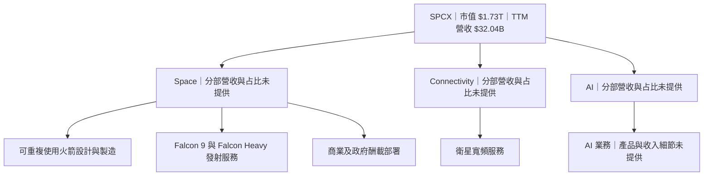
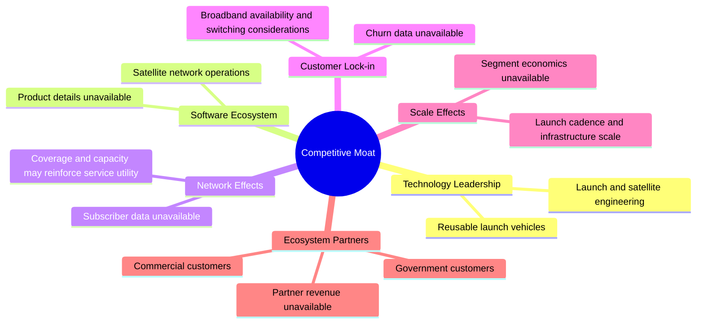
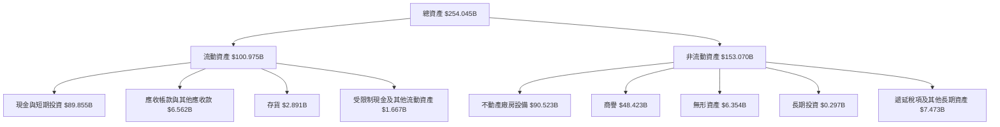
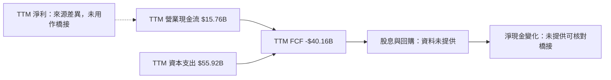
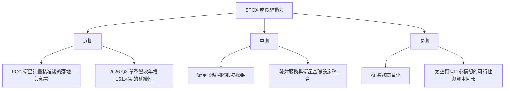
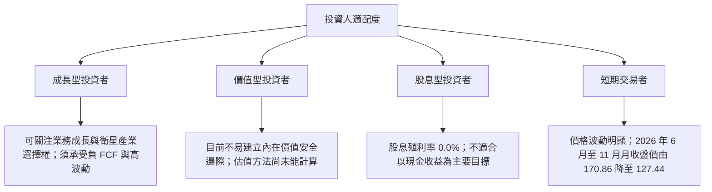

# SPCX 基本面深度分析報告
> **報告日期**：2026-11-27 ｜ **語言**：繁體中文 ｜ **數據來源**：Yahoo Finance、Finviz、StockAnalysis、Roic.ai ｜ **分析師**：CFA 級機構研究

## 目錄

| # | 章節 | 核心結論 |
|---|------|----------|
| 1 | 執行摘要 | TTM FCF 為 -$40.16B；DCF 與估值方法未能計算，因此不提供 MOS 或 MOS 評級 |
| 2 | 公司概覽與商業模式 | 航太、衛星連線與 AI 業務具策略關聯，但分部營收與市場份額未提供 |
| 3 | 損益表深度分析 | TTM 營收 $32.04B；最新一季營收年增 161.4%，但 TTM 營業利益率為 -2.0% |
| 4 | 資產負債表分析 | 淨現金 $50.64B、流動比率 3.084；部分股數及市場數據互相矛盾 |
| 5 | 現金流量深度分析 | TTM 營業現金流 $15.76B，資本支出 $55.92B，FCF -$40.16B |
| 6 | 獲利能力與資本效率 | WACC 9.72%；ROIC 缺少可用數據，無法判斷是否創造經濟價值 |
| 7 | 相對估值分析 | SPCX 的 P/S 54.0x、Forward P/E 46.5x；DCF 及估值方法輸入不足 |
| 8 | DCF 內在價值評估 | 因 TTM 營業利益為負，程式化 DCF 模型為 N/A；不自行建立模型 |
| 9 | 成長催化劑 | FCC 核准衛星相關計畫是潛在催化劑；TAM 與業務分部收入數據未提供 |
| 10 | 風險矩陣 | 主要風險為高資本支出、獲利波動與資料一致性不足 |
| 11 | 投資建議 | 暫不給 MOS 導向評級及買賣價格區間；以可量化財務里程碑追蹤 |

---

## 1. 執行摘要

TTM 營收為 **$32.04B**，最新一季營收年增 **161.4%**；但 TTM 營業利益率為 **-2.0%**，TTM FCF 為 **-$40.16B**，且資本支出 **$55.92B** 高於營業現金流 **$15.76B**。由於 TTM 營業利益為負，DCF 模型未能計算；估值方法亦無法提供可用的加權合理價值，因此本報告**不設定 MOS、MOS 評級、目標價或買入價格區間**。這不是對公司長期技術或市場前景的否定，而是基於估值輸入與盈利狀態不足所作的研究處理。

### 1.0 一頁式投資儀表板（Portfolio Manager 30 秒速讀）

| 項目 | 內容 |
|------|------|
| **投資論點（3 句）** | ① TTM 營收 $32.04B，最新一季年增 161.4%，顯示營收規模快速擴大。② TTM 淨現金 $50.64B、流動比率 3.084，提供財務緩衝。③ TTM FCF 為 -$40.16B，主因資本支出達 $55.92B，投資回報仍待驗證。 |
| **綜合評分** | **5.5/10**（引用 1.1 評分卡） |
| **財務健康** | 🟡 淨現金 $50.64B、流動比率 3.084；但 FCF 為負且資本支出高。 |
| **ROIC vs WACC** | ROIC：N/A；WACC：9.72%。缺 ROIC，無法判定價值創造或摧毀。 |
| **FCF 趨勢** | TTM FCF -$40.16B；FCF Yield **-2.32%**。 |
| **估值** | Forward P/E 46.47143x ｜ EV/EBITDA 143.161x ｜ FCF Yield -2.32%。 |
| **DCF 內在價值（基準）** | N/A；TTM 營業利益為負，DCF 模型未計算，無法計算折溢價。 |
| **安全邊際（MOS）** | N/A；無加權合理價值，故無法按定義計算 MOS。 |
| **預期報酬（基準情境 12M）** | N/A；DCF 情境模型未提供。分析師平均目標價為 $256.25，僅作外部共識參考，不作本報告內在價值。 |
| **關鍵風險（前二）** | TTM FCF -$40.16B；盈利與現金流波動，另有股數、市值口徑不一致。 |
| **評級 + 信心度** | **未定 MOS 導向評級**；信心：低。原因是估值方法無法計算，且重要市場數據存在矛盾。 |

### 1.1 綜合評分卡（全報告唯一）

| 維度 | 評分（1–10） | 主要依據（引用數字與其來源章節） |
|------|--------------|----------------------------------|
| 成長性 | 8 | 最新一季營收年增 161.4%；TTM 營收年增率 N/A（第 3 章）。 |
| 獲利能力 | 3 | TTM 營業利益率 -2.0%、淨利率 -8.6%、ROIC N/A（第 3、6 章）。 |
| 財務健康 | 8 | 淨現金 $50.64B、流動比率 3.084；但 TTM FCF -$40.16B（第 4、5 章）。 |
| 估值 | 2 | P/S 54.014008x、EV/EBITDA 143.161x；無可計算內在價值及 MOS（第 7、8 章）。 |
| 護城河 | 8 | 可重複使用運載火箭、衛星寬頻與軟體／服務組合具潛在規模優勢；業務分部收入及市場份額未披露（第 2 章）。 |
| 管理層與資本配置 | 4 | 2025 年 SBC $1.95B，資本支出 $20.91B，當年 FCF -$14.12B；投資回報仍需驗證（第 3、5 章）。 |
| **綜合評分** | **5.5** | 六項算術平均：(8 + 3 + 8 + 2 + 8 + 4) ÷ 6 = **5.5**。 |

### 1.2 五大投資論點 + 三大核心風險

| 類型 | 項目 | 具體依據 | 信心度 |
|------|------|----------|--------|
| 🟢 **投資論點①** | 營收快速擴張 | TTM 營收 $32.04B；最新一季營收年增 161.4%。業務規模上升可帶來營業槓桿，但要由持續獲利與現金流驗證。 | 🟡 中 |
| 🟢 **投資論點②** | 現金儲備充足 | 現金及短期投資 $89.86B、總債務 $39.22B，淨現金 $50.64B。 | 🟢 高 |
| 🟢 **投資論點③** | 毛利率基礎可觀 | TTM 毛利率 56.8%；高毛利有利於抵銷研發與擴張支出，但目前未轉化為正 TTM 營業利益。 | 🟡 中 |
| 🟢 **投資論點④** | 業務涵蓋多層價值鏈 | 火箭設計與發射、衛星寬頻及 AI 業務可形成技術與基礎設施協同；各業務貢獻數據未提供。 | 🟡 中 |
| 🟢 **投資論點⑤** | FCC 核准提供潛在選擇權 | 新聞摘要指出 FCC 核准衛星計畫，或拓展未來應用；落地時間、成本與收入貢獻尚未量化。 | 🟡 中 |
| 🟡 **風險①** | 資本支出遠高於營業現金流 | TTM 資本支出 $55.92B、營業現金流 $15.76B，FCF -$40.16B。若投資無法轉化為收入與回報，估值承壓。 | 🔴 高衝擊 |
| 🔴 **風險②** | 獲利波動且現金流尚未自我融資 | TTM 營業利益率 -2.0%，而年度及季度獲利數據波動明顯。 | 🔴 高衝擊 |
| 🟡 **風險③** | 市場資料口徑不一致 | 最新收盤價 $127.44 × 市場數據股數 8.25B 約為 $1.05T，與列示市值 $1.73T 不符；另有不同來源季度營業利益差異。 | 🔴 高 |

### 1.3 快速統計卡片

| 指標 | 公司實際值（期間） | 同業中位數 | 狀態 |
|------|--------------------|------------|------|
| 營收成長（TTM） | **N/A** | — | 🟡 未提供 |
| 營收成長（最新一季年增） | **161.4%** | **72.7%**（RKLB、ASTS、IRDM） | 🟢 高於同業中位數 |
| 毛利率（TTM） | **56.8%** | **37.0%**（同業中位數） | 🟢 高於同業中位數 |
| 營業利益率（TTM） | **-2.0%** | — | 🔴 負值 |
| ROIC（TTM） | **N/A** | — | 🟡 無法判定 |
| Forward P/E | **46.47143x** | **30.1x**（可用同業數值中位數） | 🔴 溢價；同業盈利與估值結構差異大 |
| FCF Yield（TTM） | **-2.32%** | — | 🔴 負值 |
| Piotroski F-Score | **N/A** | — | 🟡 缺少可比年度 SEC 申報資料 |

### 1.4 投資結論

```text
╔══════════════════════════════════════════════════════════════════╗
║                    📊 投資結論摘要                               ║
╠══════════════════════════════════════════════════════════════════╣
║  評級：未定 MOS 導向評級；估值方法無法計算                       ║
║  價格（2026-11-25 收盤）：$127.44                                ║
║  DCF 內在價值（基準）：N/A（TTM 營業利益為負）                   ║
║  安全邊際 MOS：N/A（無加權合理價值可作分母）                    ║
║  加權合理價值（8.8）：N/A                                        ║
║  綜合評分：5.5/10（引用 1.1）                                    ║
║  適合投資人：能承受高波動、重視長期航太與衛星產業選擇權者        ║
╚══════════════════════════════════════════════════════════════════╝
```

---

## 2. 公司概覽與商業模式

### 2.1 業務結構與收入來源

公司資料將 SPCX 描述為 Space Exploration Technologies Corp.，經營 Space、Connectivity 與 AI 三個業務板塊；資料同時提及 Falcon 9、Falcon Heavy、商業及政府發射服務與衛星寬頻。分部收入及各分部占比未提供，因此不以估算比例繪圖。



### 2.2 市場份額

市場份額數據未提供，無法可靠計算公司在火箭發射、衛星寬頻或 AI 市場的份額。SPCX TTM 營收為 $32.04B，最新一季營收年增 161.4%；但因同業商業模式不同，營收規模不能直接替代市場份額。

### 2.3 競爭護城河分析

> 以下 mindmap 節點文字依圖表語法限制使用英文。



### 2.4 護城河強度

| 護城河項目 | 強度（強／中／弱） | 證據（引用數字或事實） | 會削弱它的情況 |
|------------|--------------------|------------------------|----------------|
| 技術與工程能力 | 強 | 業務包含可重複使用火箭、發射服務與衛星基礎設施；量化成本與成功率資料未提供。 | 發射事故、可靠度下降、技術被快速追趕。 |
| 軟體與服務生態 | 中 | 公司提供衛星寬頻，但用戶、流失率與服務毛利未提供。 | 服務中斷、競爭者降價或用戶流失。 |
| 網路效應 | 中 | 衛星網路覆蓋和容量可能提升服務價值；訂戶與網路使用數據未提供。 | 網路容量不足、覆蓋不均或頻譜限制。 |
| 客戶鎖定 | 中 | 航太與政府客戶可能重視認證、可靠性與交付能力；合約續約資料未提供。 | 客戶集中、合約流失或採購延遲。 |
| 規模效應 | 強 | TTM 營收 $32.04B，最新一季營收年增 161.4%；分部收入及單位成本未提供。 | 高資本支出長期無法帶來成本下降或現金回報。 |
| 生態夥伴 | 中 | 客戶包括商業與政府領域；合作夥伴收入貢獻未提供。 | 監管、供應鏈或合作關係變化。 |

護城河評分 **8/10** 的理由是火箭、衛星與服務整合具潛在技術及規模優勢；但缺少分部收入、客戶留存、成本曲線與市場份額數據，故不能僅憑業務描述確認其經濟護城河已轉化為持續超額回報。

---

## 3. 損益表深度分析

### 3.1 年度收入成長趨勢（近年可得資料）

年度資料只有 2023–2025 三年，沒有完整四年序列。2023–2025 營收 CAGR 約 34.1%，計算為 \((18.67 ÷ 10.39)^{1/2}-1\)；此為依所列年度收入計算的近似值。

```text
╔══════════════════════════════════════════════════════════════════╗
║          SPCX 年度收入趨勢（FY2023–FY2025）                      ║
╠══════════════════════════════════════════════════════════════════╣
║  FY2023  $10.39B  ███████████░░░░░░░░░░░░░░░░  基期             ║
║  FY2024  $14.02B  ███████████████░░░░░░░░░░░░  YoY: +34.9% 🟢  ║
║  FY2025  $18.67B  ████████████████████░░░░░░░  YoY: +33.2% 🟢  ║
╠══════════════════════════════════════════════════════════════════╣
║  2023–2025 年收入 CAGR：約 +34.1%                                ║
╚══════════════════════════════════════════════════════════════════╝
```

年度增長在 2024、2025 均約三成，顯示高速擴張延續；但 2026 年最新一季營收明顯躍升，可能反映交付、服務收入或營收認列節奏變化，不能僅用單季年增率外推完整年度。

### 3.2 季度收入趨勢分析

QoQ 以當季營收除以前一季營收減 1 計算；YoY 優先引用已列的單季年增率。Q4 2025 前一季數據不足以計算同比。

| 季度 | 營收 | QoQ 成長 | YoY 成長（單季） | 備註 |
|------|------:|---------:|-----------------:|------|
| 2025 Q4 | $4.96B | +22.0%（相對 2025 Q3 $4.07B） | N/A | 同比基期未提供。 |
| 2026 Q1 | $4.69B | -5.4% | +15.42% | 年增仍正，但季營收略降。 |
| 2026 Q2 | $7.81B | +66.5% | +91.94% | 加速擴張；單季表現不應直接等同 TTM。 |
| 2026 Q3 | $14.57B | +86.5% | **161.4%** | 最新一季年增率；不得標為 TTM 成長率。 |

計算例：2026 Q3 QoQ = \((14.57 ÷ 7.81)-1\) ≈ 86.5%。同一季度的營收成長在不同來源表格中有少量四捨五入差異；本報告對最新一季年增率採用已核驗的 161.4%。

### 3.3 利潤率演變分析

| 利潤率指標 | FY2023 | FY2024 | FY2025 | TTM／最新一季 | 趨勢 | 評估 |
|------------|-------:|-------:|-------:|---------------:|------|------|
| **毛利率** | 約 41.2% | 約 42.9% | 約 49.4% | TTM **56.8%** | 逐步上升 | 🟢 毛利改善，但未充分轉為營業獲利。 |
| **營業利益率** | 約 4.9% | 約 5.3% | 約 -11.0% | TTM **-2.0%**；最新一季 **1.8%** | 2025 明顯轉負，TTM 仍負 | 🔴 投資與費用吸收仍待驗證。 |
| **淨利率** | 約 -44.6% | 約 5.6% | 約 -26.4% | TTM **-8.6%** | 波動極大 | 🔴 淨利不穩定。 |

年度毛利率由 2023 年約 41.2% 升至 2025 年約 49.4%，TTM 達 56.8%，表示收入組合、定價、成本效率或認列結構可能改善；但資料未拆分各驅動因素，無法確認來源。營業利益率則受研發及擴張投入影響：R&D 由 2024 年 $3.46B 增至 2025 年 $8.64B，增加約 150%；毛利改善尚不足以覆蓋營業費用與資本擴張相關成本。

> **資料差異提示：**Yahoo 核驗數據的最新一季營業利益率為 1.8%；季度損益表列示的營業利益 $2.79B 除以營收 $14.57B，則約為 19.1%。StockAnalysis 同季營業利益亦有不同數字。口徑差異未能由現有資料調和，因此本報告以核驗數據的 1.8% 作為指定指標，並將此差異列為資料風險。

### 3.4 費用結構分析

完整費用分類、各項營業費用與損益表細項未提供，無法建立可靠費用結構圓餅圖。可核對的項目包括 2025 年 R&D $8.64B，較 2024 年 $3.46B 上升；這代表公司選擇將資源投入技術與擴張，但也提高短期盈利與資金回收的不確定性。

### 3.5 季度 EPS 趨勢與盈餘品質（Quality of Earnings）

| 季度 | EPS 預估 | EPS 實際 | 超預期／不及預期 | 原因與限制 |
|------|---------:|---------:|------------------|------------|
| 2026-09-30 | N/A | N/A | 無法判定 | 預估與實際 EPS 均缺值。 |
| 2026-06-30 | N/A | N/A | 無法判定 | 預估與實際 EPS 均缺值。 |
| 2026-03-31 | N/A | N/A | 無法判定 | 預估與實際 EPS 均缺值。 |

Earnings History 列出的 EPS Est 與 EPS Act 為 nan，故不能把缺值解讀為超預期或不及預期。其他來源所列季度淨利及 EPS 存在口徑差異，亦不以其代替缺失的市場預期值。

| 盈餘品質項目 | 數值／佔比 | 評估 |
|--------------|-----------|------|
| 股權薪酬 SBC / 營收 | 近四季 SBC 約 $4.733B ÷ TTM 營收 $32.04B = **約 14.8%** | 🔴 高比例非現金薪酬可能造成股東稀釋；需與股數變化一併追蹤。 |
| SBC / 營業現金流 | 約 $4.733B ÷ $15.76B = **約 30.0%** | 🟡 營業現金流中相當部分對應股權薪酬成本；不能單看 OCF 評估現金盈利。 |
| FCF / 淨利（現金轉換率） | **N/A（不具解讀性）** | TTM 淨利為負，且不同來源淨利有差異；以負淨利作分母會產生誤導性比率。 |
| 一次性／非經常性損益 | **N/A（無法辨識）** | 季度淨利與營業利益差異大，但未提供非營業項目及稅項明細，不能斷定是否由一次性項目造成。 |
| 有效稅率異常 | **N/A** | 未提供可核對的所得稅費用與稅前利潤。 |
| 資本化支出 vs 費用化 | TTM Capex $55.92B；資本化明細 N/A | 🔴 投資支出規模重大；缺少資本化政策及折舊拆分，無法判斷成本遞延程度。 |

**盈餘品質結論：**TTM 營業利益率為負、FCF 為負，且 SBC 約占 TTM 營收 14.8%，因此目前不宜把單季正淨利或單季營業利益視為穩定經濟盈餘。稅項、非營業損益與 SBC 對稀釋股數的影響需要後續申報資料驗證。

---

## 4. 資產負債表分析

### 4.1 資產結構分解

下圖採用截至 2026-09-30 的資產負債表數據；各細項相加可與總資產 $254.045B 對應。單位為美元十億元。



### 4.2 流動性與營運資金分析

流動比率與速動比率顯示帳面短期流動性充足，但現金流承受高額資本支出壓力。營運資金天數依 QUALITY FIGURES 原值引用；一年前數據未提供，故變化不能計算。

| 指標 | 最新 TTM | 一年前 TTM | 變化 | 解讀 |
|------|----------:|-----------:|------:|------|
| 流動比率 | 3.084 | N/A | N/A | 流動資產相對流動負債較充足；仍需觀察資產可變現性。 |
| 速動比率 | 2.945 | N/A | N/A | 排除存貨後仍有流動性緩衝。 |
| DSO 應收帳款天數 | **54 天** | N/A | N/A | 一年前值未提供，無法判斷收款速度變化。 |
| DIO 存貨天數 | **76 天** | N/A | N/A | 一年前值未提供，無法判斷庫存累積或改善。 |
| DPO 應付帳款天數 | **349 天** | N/A | N/A | 天數偏長可能反映供應商付款週期或成本口徑，但不能僅憑該數字判定議價力。 |
| CCC 現金轉換週期 | **-219 天** | N/A | N/A | 負 CCC 表示應付帳款週期大於應收與存貨週期；須持續監控供應商條款與營運持續性。 |

### 4.3 債務結構分析

```text
╔══════════════════════════════════════════════════════════════════╗
║                   SPCX 債務健康診斷                              ║
╠══════════════════════════════════════════════════════════════════╣
║  總債務：        $39.22B     已核驗數據                           ║
║  現金及短期投資：$89.86B     已核驗數據                           ║
║  淨現金：        $50.64B     🟢 現金高於債務                      ║
║                                                                  ║
║  流動比率：      3.084       🟢 帳面流動性充足                    ║
║  速動比率：      2.945       🟢 排除存貨後仍有緩衝                ║
║  Debt/EBITDA：   N/A         TTM EBITDA 為正但口徑未供應債務倍數  ║
║  利息保障倍數：  N/A         未提供可核對利息費用與利息保障數據    ║
╚══════════════════════════════════════════════════════════════════╝
```

淨現金計算為 $89.86B − $39.22B = **$50.64B**。這提供研發與擴張的融資餘裕，但不代表資本支出可持續：TTM FCF 為 -$40.16B，若負 FCF 延續，現金儲備仍可能下降。

### 4.4 股東權益趨勢

```text
╔══════════════════════════════════════════════════════════════════╗
║                 SPCX 股東權益變化（年度）                         ║
╠══════════════════════════════════════════════════════════════════╣
║  2024-12-31   $25.80B  █████████████░░░░░░░░░░░                 ║
║  2025-12-31   $41.33B  █████████████████████░░░                 ║
╠══════════════════════════════════════════════════════════════════╣
║  年增約 $15.53B；增幅約 60.2%                                     ║
╚══════════════════════════════════════════════════════════════════╝
```

股東權益增加約 60.2%，與資產擴張相符；但新增權益的來源及股數稀釋影響需要股東權益變動表及股份發行明細驗證。不同資料來源列出的流通股數並不一致，不以帳面權益增長直接推論每股價值改善。

---

## 5. 現金流量深度分析

### 5.1 現金流量瀑布圖

TTM 淨利及股息、回購的完整橋接數據未提供，故不以假設值補入。以下呈現可核對的營業現金流、資本支出與 FCF。



### 5.2 FCF 轉換率趨勢

| 期間 | FCF | 淨利 | FCF／淨利 | 解讀 |
|------|----:|-----:|----------:|------|
| 2023 | $0.105B | -$4.63B | N/A（負淨利，比例易誤讀） | FCF 略正但會計淨利大幅為負。 |
| 2024 | -$5.39B | $0.791B | 約 -6.8x | 投資支出使現金流顯著低於淨利。 |
| 2025 | -$14.12B | -$4.94B | N/A（負淨利） | 負 FCF 擴大，且損益表為虧損。 |
| TTM 至 2026-09-30 | **-$40.16B** | TTM 淨利為負；來源口徑不一 | N/A | 高資本支出下，現金轉換能力尚未建立。 |

2024 年 FCF／淨利約為 \(-5.39 ÷ 0.791=-6.8\) 倍，反映資本支出高於營業現金流；負淨利期間不使用該比率評斷盈餘品質。

### 5.3 自由現金流趨勢

```text
╔══════════════════════════════════════════════════════════════════╗
║                   自由現金流歷史趨勢                              ║
╠══════════════════════════════════════════════════════════════════╣
║  FY2023       +$0.105B  ░░░░░░░░░░░░░░░░░░░░░░░░░░░             ║
║  FY2024       -$5.39B   ████░░░░░░░░░░░░░░░░░░░░░░░             ║
║  FY2025       -$14.12B  ███████████░░░░░░░░░░░░░░░             ║
║  TTM Sep-2026  -$40.16B  ███████████████████████████             ║
╠══════════════════════════════════════════════════════════════════╣
║  TTM FCF Yield：-2.32%｜TTM Capex：$55.92B                       ║
╚══════════════════════════════════════════════════════════════════╝
```

年度 FCF 由 2023 年小幅正值轉為 2024、2025 負值，TTM 負值進一步擴大。主要財務驅動是資本支出由 2023 年 $4.42B、2024 年 $11.16B、2025 年 $20.91B 上升至 TTM $55.92B；若這些投資提升產能及服務收入，未來可能形成經營槓桿，若投資回收延遲則會消耗現金。

### 5.4 資本配置評估

分項資本配置比例未提供，無法建立有可靠數字基礎的圓餅圖。

| 項目 | 可核對數據 | 評估 |
|------|------------|------|
| 資本支出 | TTM $55.92B；2025 年 $20.91B | 🔴 投資額大，需追蹤產能利用與回收期。 |
| 研發 | 2025 年 $8.64B；2024 年 $3.46B | 🟡 研發投入上升有助長期能力，但短期壓低獲利。 |
| SBC | 2025 年 $1.95B；TTM 季度合計約 $4.733B | 🔴 對現有股東有稀釋成本。 |
| 股息 | 股息殖利率 0.0% | 🟡 無現金股息回報。 |
| 回購 | N/A | 未提供可核對數據。 |
| 留存／併購 | N/A | 未提供足夠明細。 |

---

## 6. 獲利能力與資本效率

### 6.1 ROE / ROA / ROIC 趨勢

| 指標 | FY2023 | FY2024 | FY2025 | TTM | 評估 |
|------|-------:|-------:|-------:|----:|------|
| ROE | N/A | N/A | N/A | N/A | 質量指標區塊缺少可一致計算的淨利、總資產或正權益資料。 |
| ROA | N/A | N/A | N/A | N/A | 同上，未採不同來源自行拼接。 |
| ROIC | N/A | N/A | N/A | N/A | 投入資本及稅後營業利益資料不足，無法可靠計算。 |

### 6.2 ROIC vs WACC 分析（核心價值創造判斷）

```text
╔══════════════════════════════════════════════════════════════════╗
║                ROIC vs WACC 深度分析                            ║
╠══════════════════════════════════════════════════════════════════╣
║  WACC（依資本成本輸入）：9.72%                                    ║
║  ├── 無風險利率 Rf：4.85%                                        ║
║  ├── 股權風險溢酬 ERP：5.00%                                     ║
║  ├── Beta 原始值：N/A；採用調整後 Beta：1.00（假設）             ║
║  ├── 股權成本 Ke：9.85%                                          ║
║  ├── 稅前債務成本 Kd：4.96%                                      ║
║  ├── 稅率：21.0%                                                 ║
║  ├── 股權／債務權重：97.8%／2.2%                                 ║
║  └── WACC：9.72%                                                 ║
║                                                                  ║
║  ROIC：N/A（無可核對的投入資本及 NOPAT）                         ║
║  EVA = ROIC − WACC：N/A                                          ║
║                                                                  ║
║  結論：無法判定公司是否創造或摧毀經濟價值；不能以 N/A 推定高於   ║
║  或低於 9.72%。                                                  ║
╚══════════════════════════════════════════════════════════════════╝
```

已核驗 WACC 的組成可作交叉檢查：

- 股權成本：4.85% + 1.00 × 5.00% = **9.85%**。
- 稅後債務成本：4.96% × (1 − 21.0%) = **3.9184%**。
- WACC：97.8% × 9.85% + 2.2% × 3.9184% = 9.6333% + 0.0862% = **9.7195%**，四捨五入為 **9.72%**。

Beta 原始值為 N/A，調整後 Beta 1.00 為資本成本資料所採假設值。由於 ROIC N/A，本報告不宣稱 SPCX 正在創造股東價值，也不把 WACC 與任何自行估算的 ROIC 比較。

### 6.3 杜邦三因素分解

**N/A（QUALITY FIGURES 的 DuPont 為 N/A：缺少可一致使用的淨利、營收、總資產或正股東權益。）**不以不同來源拼湊杜邦比率。

### 6.4 財務體質：Piotroski F-Score

**Piotroski F-Score：N/A。**計算需要相隔一年的兩期 TTM SEC 申報資料；現有資料不是一致的 SEC 申報口徑，故九項測試無法逐項判定，不補填測試結果。

---

## 7. 相對估值分析

### 7.1 同業估值比較表格

同業倍數依 Yahoo Finance 同業資料引用。SPCX 自身估值採列示估值數據；公司與同業的業務、獲利成熟度不同，倍數比較應視為相對定位而非直接目標價。

| 估值指標 | **SPCX** | **RKLB** | **ASTS** | **IRDM** | SPCX 評估 |
|----------|---------:|--------:|--------:|--------:|-----------|
| **Trailing P/E** | 554.087x | N/A | N/A | 27.9x | 🔴 SPCX 倍數極高；其 TTM 獲利不穩定，P/E 可比性弱。 |
| **Forward P/E** | 46.47143x | 656.9x | -19.1x | 30.1x | 🟡 高於 IRDM、遠低於 RKLB；ASTS 為負值，不能作正常盈利倍數比較。 |
| **P/S（TTM）** | 54.014008x | 35.9x | 73.0x | 5.0x | 🔴 高於 RKLB、IRDM，低於 ASTS；仍屬高銷售倍數。 |
| **EV/EBITDA（TTM）** | 143.161x | -146.7x | -19.8x | 16.9x | 🔴 SPCX 倍數很高；負 EBITDA 同業倍數不可作正向估值比較。 |
| **最新一季營收年增** | 161.4% | 72.7% | 187.1% | 8.3% | 🟢 高於 RKLB、IRDM，低於 ASTS。 |
| **毛利率（TTM）** | 56.8% | 36.2% | 37.0% | 71.5% | 🟢 高於 RKLB、ASTS；低於 IRDM。 |

同業 Forward P/E 可用數值排序為 -19.1x、30.1x、656.9x，中位數 **30.1x**；但其中 ASTS 為負值、RKLB 倍數極高，樣本中位數不能直接等同合理估值。SPCX P/S 54.014008x 高於 RKLB 35.9x 與 IRDM 5.0x，代表市場對其未來成長要求較高，若營收成長回落或現金消耗未改善，估值可能收縮。

### 7.2 歷史估值區間分析

**N/A（未提供 Valuation vs own history 的歷史估值區間與百分位數。）**雖有 2026 年 6 月至 11 月月末收盤價，但不足以推算歷史 P/E 或 P/S 百分位。

### 7.3 情境價值（Bear / Base / Bull）

**N/A（DCF 無法計算：TTM 營業利益不為正；沒有程式化 DCF Scenarios 數據。依資料規則，不自行設定情境價值、假設與機率。）**

### 7.4 相對估值隱含價格區間

**N/A（VALUATION METHODS 未能計算任何估值方法。）**缺少能與公司類型相容的模型輸入及可靠估值橋接；因此不以同業 P/E、P/S 或 EV/EBITDA 自行回推每股價格。

---

## 8. DCF 內在價值評估（Discounted Cash Flow）

### 8.0 估值推理鏈（Thinking Logic：先判斷模型是否適用）

**模型適用性結論：**本報告不建立獨立 DCF。已核驗資料明確標示 TTM 營業利益不為正，DCF 模型為 N/A。公司 TTM FCF -$40.16B，且資本支出 $55.92B，顯示現金流仍處高投資期；在缺少正營業利益與可信的未來利潤率、資本支出及營運資金假設時，任意延伸現金流將產生不可稽核的估值。

| 決策點 | 本報告處理 | 理由（含數字） | 曾考慮但否決 | 否決理由 |
|--------|-----------|----------------|--------------|----------|
| 現金流定義 | N/A | 已核驗 DCF 模型未建立；TTM FCF -$40.16B。 | 自行預測 FCFF | 缺少可核對的預測假設與模型結果。 |
| 預測期 N | N/A | DCF MODEL 明確為 N/A。 | 任選 5 或 10 年 | 屬自建模型，違反數據使用規則。 |
| 終值方法 | N/A | 沒有程式化終值與終值輸入。 | Gordon Growth 或退出倍數 | 輸入不存在，不能補造。 |
| EBIT 基礎 | N/A | TTM 營業利益為負；模型未提供預測 EBIT。 | 自行轉為非 GAAP | 無調整項目及 SBC 明細支持。 |

公司價值可能取決於發射服務、衛星連線與新業務的成長，以及這些業務轉化為正營業利益與正 FCF 的速度；各業務占營收比重未提供，無法分拆其價值來源。最脆弱的估值環節是資本支出轉化為穩定現金流的時間與幅度；沒有可用敏感度矩陣，故不能量化價值變動幅度。

### 8.1 模型假設總表（Model Inputs）

**N/A（DCF MODEL 未提供：原因為 TTM 營業利益不為正，程式未生成模型假設、預測期、逐年現金流或終值。）**依規則不自行設定營收 CAGR、利潤率、稅率、Capex 比率、稀釋率、永續成長率或終值方法。

### 8.2 折現率推導（WACC）

本節 WACC 直接採用資本成本數據，與第 6.2 節一致；但它不代表本報告已完成 DCF。

```text
╔══════════════════════════════════════════════════════════════════╗
║                    WACC 輸入（不構成 DCF）                       ║
╠══════════════════════════════════════════════════════════════════╣
║  無風險利率 Rf：4.85%                                            ║
║  ERP：5.00%                                                      ║
║  原始 Beta：N/A｜採用調整後 Beta：1.00（資料採用的假設值）       ║
║  Ke：4.85% + 1.00 × 5.00% = 9.85%                               ║
║  稅前 Kd：4.96%｜稅率：21.0%                                     ║
║  資本權重：股權 97.8%｜債務 2.2%                                ║
║  WACC：9.72%                                                     ║
╚══════════════════════════════════════════════════════════════════╝
```

逐步計算採用資料所列組成：

1. **Ke** = 4.85% + 1.00 × 5.00% = **9.85%**。
2. **稅前 Kd** = 核驗輸入 **4.96%**；利息費用及平均計息負債明細未提供，不能重建其分子、分母。
3. **稅後 Kd** = 4.96% × (1 − 21.0%) = **3.9184%**。
4. **權重** = 股權 **97.8%**，債務 **2.2%**；兩者合計 **100.0%**。市場市值、股數口徑存在差異，故不另以價格與股數重算權重。
5. **WACC** = 97.8% × 9.85% + 2.2% × 3.9184% = 9.6333% + 0.0862% = **9.7195% ≈ 9.72%**。

稅前 Kd 的原始計算依據在現有資料中未提供；本報告照用已列成本資本輸入，不以總債務或其他負債反推。第 6.2 節與本節 WACC 均為 **9.72%**。

### 8.3 逐年自由現金流預測（基準情境）

**N/A（DCF MODEL 未提供逐年預測、折現因子及 FCFF；不自建預測表。）**目前可觀測的基期為 TTM FCF **-$40.16B**，不應以單一季度或任意的利潤率假設推導未來年度現金流。

### 8.4 終值計算（Terminal Value）

**N/A（無 DCF 預測期現金流、永續成長率 g、退出倍數或終值。）**因此不計算 Gordon Growth 終值、退出倍數、終值現值或終值占企業價值比例。

### 8.5 企業價值 → 每股內在價值（Bridge）

**N/A（無企業價值或終值可作橋接。）**現金及短期投資 $89.86B、總債務 $39.22B 可核對，但沒有 DCF 企業價值、少數股東權益調整及一致的稀釋股數，無法計算每股內在價值。

市場數據列示流通股數 8.25B，而其他資料列示的加權股數、季度股數亦不同。以 $127.44 × 8.25B 得出約 $1.05T，與列示市值 $1.73T 不一致；因此不以其中一組自行補造每股估值。

### 8.6 敏感性分析（WACC × 永續成長率）

**N/A（DCF MODEL 未提供敏感性矩陣、基準 g 或基準每股價值。）**無法計算非基準格、情境內在價值或對 WACC／g 的估值彈性。

### 8.7 反推 DCF（Reverse DCF：市場在預期什麼）

**N/A（沒有基準 DCF 模型，亦沒有可逐次試算的程式化反推結果。）**不得用目前股價反推出多個未知變數，亦不提供自行求解的營收成長率或利潤率。

### 8.8 估值三角驗證與安全邊際

**N/A（VALUATION METHODS：None could be computed。）**沒有可列示的方法、每股價值或權重，因此：

- 加權合理價值：**N/A**。
- 安全邊際 MOS：**N/A**；公式要求以加權合理價值作分母，而該數值缺失。
- 上行空間：**N/A**。
- 折溢價：**N/A**；沒有 DCF 基準內在價值。
- MOS 導向評級：**不適用**；不以外部分析師目標價替代加權合理價值。

分析師平均目標價 **$256.25**、低端 **$70.00**、高端 **$800.00**，代表外部預測分散度大；由於未提供其估值假設，本報告不將其納入加權合理價值。

### 8.9 DCF 模型的局限與失效條件

- **終值依賴度：**N/A；沒有終值或企業價值。
- **最脆弱的假設：**缺少可供測試的預測假設。從可觀測經營數據看，TTM Capex $55.92B 能否轉化為正 FCF 是重要的不確定因素。
- **不適用情境：**公司 TTM 營業利益率 -2.0%、TTM FCF -$40.16B，且支出仍快速擴張；傳統 DCF 在缺少正現金流軌跡時可靠度下降。後續可結合 EV/Sales、分部估值、單位經濟性與資本回收分析，但目前沒有足夠資料完成量化。
- **與第 10 章風險矩陣的連結：**資本支出延續高位會拖累 Capex／FCF；監管限制會影響可服務市場及營收成長；利潤率未改善會直接阻礙 DCF 轉為可用模型。

### 8.10 複算檢核表（Audit Trail）

| # | 檢核項目 | 檢查方式 | 結果 |
|---|----------|----------|------|
| 1 | 高／中敏感度假設都有四段式推導 | DCF 假設未建立 | 不適用；DCF 為 N/A。 |
| 2 | 每個假設都有來源 | 未填入模型假設 | 不適用；沒有自行設定假設。 |
| 3 | WACC 五步與相乘加總 | 檢查已列資本成本計算 | ✅ WACC 9.72%；但 Kd 底層分子、分母未提供。 |
| 4 | Kd 分母與債務權重範圍一致 | 檢查來源原始債務範圍 | 無法完整核驗；依規定直接採用已核驗 WACC 輸入。 |
| 5 | WACC 與第 6.2 節同值 | 比較兩節 | ✅ 均為 9.72%。 |
| 6 | 預測年數與年度表格完整 | DCF 模型未提供 | 不適用。 |
| 7 | FY+1 九步計算 | 無 FY+1 假設 | 不適用。 |
| 8 | 預測期 PV 加總 | 無逐年 PV | 不適用。 |
| 9 | WACC > g | g 未提供 | 不適用。 |
| 10 | 終值以 FY+N 現金流折現 N 期 | 無預測期及終值 | 不適用。 |
| 11 | EV 至每股價值橋接 | 無 EV 及一致股數 | 不適用。 |
| 12 | SBC 組合相容性 | 未建立 DCF EBIT、SBC 扣除或稀釋模型 | 不適用；未將 SBC 重複扣除或忽略。 |
| 13 | 敏感性矩陣基準格與 DCF 一致 | 無矩陣 | 不適用。 |
| 14 | 矩陣有效格符合 WACC > g | 無矩陣 | 不適用。 |
| 15 | 三情境機率總和 | 無情境模型 | 不適用。 |
| 16 | 反推 DCF 每列只解一變數 | 無反推模型 | 不適用。 |
| 17 | MOS 及折溢價口徑一致 | 8.8 與 8.5 均無估值 | ✅ 全文均標 N/A，未以其他分母代替。 |
| 18 | 報告完整至第 11 章 | 檢查章節 | ✅ 已完整列出 11 章。 |
| 19 | 加權合理價值等於方法價值乘權重之和 | 無方法及權重 | 不適用；未虛構加權值。 |
| 20 | 評級符合 MOS 門檻 | MOS 無法計算 | 不適用；未設定 MOS 導向評級。 |

---

## 9. 成長催化劑

### 9.1 催化劑時間軸

目前可引用資料沒有各催化劑預計實現日期，因此不以假定日期繪製時間軸。資料可識別的方向如下：

| 時間範圍 | 催化劑 | 目前可確認內容 | 後續驗證指標 |
|---------|--------|----------------|----------------|
| 近期 | 衛星計畫監管進展 | 新聞摘要指出 FCC 核准衛星相關計畫。 | 核准條件、部署進度、資本需求及實際收入。 |
| 中期 | 衛星寬頻擴張 | 公司業務資料包含美國及國際市場衛星寬頻服務。 | 訂戶數、ARPU、覆蓋率、服務毛利與流失率。 |
| 長期 | 太空資料中心及 AI | 新聞摘要提及太空資料中心構想及 AI 業務；尚非可量化營收。 | 技術可行性、電力與散熱成本、客戶合約、投入資本回報。 |

### 9.2 TAM 市場規模分析

**N/A（TAM 數據未提供，沒有可引用的市場規模數字及年份。）**公司 TTM 營收 $32.04B、最新一季營收年增 161.4%，說明業務規模正快速變化；但缺少市場總量與可服務市場定義，不能把營收成長直接轉化為 TAM 或滲透率。

### 9.3 成長驅動力結構圖



---

## 10. 風險矩陣

### 10.1 風險評分矩陣

**N/A（沒有可核對的風險事件發生機率與財務衝擊概率數據。）**為避免把主觀估計偽裝成財務數字，本報告不繪製具機率座標的 quadrantChart；下表以可觀察的財務或業務指標列示風險。

### 10.2 風險清單詳細分析

| # | 風險項目 | 發生可能性判斷 | 財務衝擊依據 | 風險程度 | 緩解措施／監控指標 |
|---|----------|----------------|--------------|----------|--------------------|
| 1 | 🔴 資本支出與 FCF 壓力 | 已在 TTM 數據中體現 | Capex $55.92B − OCF $15.76B = FCF -$40.16B | 🔴 高 | 每季核對 OCF、Capex、FCF；若資本支出增速持續高於營收與 OCF，重新評估投資回收假設。 |
| 2 | 🔴 營業獲利波動 | 已由年度及季度數據體現 | TTM 營業利益率 -2.0%，最新一季核驗營業利益率 1.8%；來源間同季營業利益存在差異。 | 🔴 高 | 以一致財報口徑追蹤連續季度營業利益率、費用率與營業利益。 |
| 3 | 🟡 高估值與預期落差 | 估值倍數已偏高 | P/S 54.014008x、EV/EBITDA 143.161x；若成長或利潤率未達預期，估值倍數可能下修。 | 🔴 高衝擊 | 追蹤營收增長是否保持、FCF 是否收斂、前瞻盈利是否轉為實際。 |
| 4 | 🟡 監管與部署風險 | 具體機率未提供 | FCC 核准新聞涉及衛星計畫，但未提供部署成本、時程及限制條件。 | 🟡 中至高 | 追蹤監管條件、部署里程碑、發射頻率及相關資本支出。 |
| 5 | 🟡 資料品質與股數口徑風險 | 已可觀察 | $127.44 × 8.25B 股約 $1.05T，與列示市值 $1.73T 不一致；不同來源營業利益亦有差異。 | 🔴 高 | 以公司正式申報資料、稀釋股數與價格日期重新核對市值、EV 及每股指標。 |

---

## 11. 投資建議

### 11.1 最終評級與評分

本報告不給 MOS 導向的買入、持有或賣出評級：DCF 與估值方法均未能計算，沒有加權合理價值可依 MOS 門檻定級。公司評分卡的綜合評分為 **5.5/10**，六個維度依序為成長性 8、獲利能力 3、財務健康 8、估值 2、護城河 8、管理層與資本配置 4。

### 11.2 合理價值與隱含報酬率

| 估值參考 | 每股價值 | 相對 2026-11-25 收盤價 $127.44 | 說明 |
|----------|---------:|------------------------------:|------|
| 加權合理價值 | N/A | N/A | VALUATION METHODS 無可計算方法。 |
| DCF 基準情境 | N/A | N/A | TTM 營業利益不為正，DCF MODEL 為 N/A。 |
| 悲觀情境 | N/A | N/A | 無程式化 DCF 情境輸出。 |
| 樂觀情境 | N/A | N/A | 無程式化 DCF 情境輸出。 |
| 分析師平均目標價 | $256.25 | N/A（非本報告估值） | 外部共識參考；未提供可驗證的目標價假設，故不計算為本報告預期報酬。 |

**買入區間與賣出區間：N/A。**沒有加權合理價值或 DCF 情境價值，不能依據 MOS 規則推導買入區間、合理持有區間或減碼價格。

### 11.3 買入時機與觸發因素

```text
╔══════════════════════════════════════════════════════════════════╗
║                  ✅ 投資觸發因素 Checklist                        ║
╠══════════════════════════════════════════════════════════════════╣
║  考慮建立或增加部位前，優先確認：                                ║
║  ☐ 營業利益率在一致的財報口徑下連續改善                          ║
║  ☐ TTM FCF 相較目前 -$40.16B 明顯收斂，並朝正值改善              ║
║  ☐ Capex 增長能由收入增長與營業現金流支持                        ║
║  ☐ 最新股數、市值、EV 與每股數據可由正式申報資料核對              ║
║                                                                  ║
║  加碼觸發條件：                                                  ║
║  ☐ 營收快速增長同時帶動可持續的營業利益及現金流                   ║
║  ☐ SBC 佔營收比例下降，且稀釋股數趨勢透明                         ║
║  ☐ FCC 核准相關計畫呈現具體部署、合約或收入里程碑                 ║
║                                                                  ║
║  減碼／重新評估觸發條件：                                        ║
║  ☐ FCF 持續低於目前 -$40.16B，或現金消耗速度加快                 ║
║  ☐ 最新一季營收年增率由 161.4% 大幅放緩且利潤率同步惡化           ║
║  ☐ 淨現金 $50.64B 快速下降，且資本支出缺少可驗證回報              ║
║  ☐ 重要財務指標仍無法與正式申報資料對帳                           ║
╚══════════════════════════════════════════════════════════════════╝
```

以上是監控條件，不是模型推導的買賣價格；在取得一致財報與可用估值輸入前，不把任何價格水平描述為安全買點。

### 11.4 投資人適配度分析



### 11.5 每季財報監控清單（Quarterly Watch List）

| 監控指標 | 目前基準 | 觸發加碼／正面訊號 | 觸發減碼／負面訊號 |
|----------|----------|-------------------|-------------------|
| 最新一季營收年增率 | 161.4% | 成長持續且分部收入可驗證 | 成長顯著放緩且沒有利潤改善 |
| 營業利益率 | TTM -2.0%；最新一季 1.8% | 以同一會計口徑連續改善 | 回落至更深負值或來源口徑仍無法對帳 |
| 營業現金流 | TTM $15.76B | OCF 隨營收擴張並足以支持投資 | OCF 下降且需以現金儲備填補營運 |
| 資本支出 | TTM $55.92B | 投資後產能、服務收入及回報可見 | Capex 維持高位但收入與現金回報不跟進 |
| FCF | TTM -$40.16B | 持續收斂並轉正 | 負值擴大或現金消耗惡化 |
| SBC／稀釋 | 近四季 SBC 合計約 $4.733B；占營收約 14.8% | SBC 占比下降、股數資料可核對 | SBC 占比上升或稀釋加快 |
| 現金與淨現金 | 現金及短期投資 $89.86B；淨現金 $50.64B | 淨現金維持充足且投資回報改善 | 淨現金快速下降且 FCF 未改善 |
| FCC／新業務里程碑 | 新聞摘要提及 FCC 核准 | 公布部署、客戶合約與資本回收路徑 | 計畫延遲、監管條件收緊或成本上升 |
| 股數、市值及 EV | 數據口徑有差異 | 公司申報資料與市場數據可互相核對 | 持續存在重大差異，影響每股估值可信度 |

### 11.6 反面論證：什麼會證明論點錯誤（What Would Change My Mind）

```text
╔══════════════════════════════════════════════════════════════════╗
║              ⚠️ 論點失效條件（Disconfirming Evidence）           ║
╠══════════════════════════════════════════════════════════════════╣
║  ☐ 最新一季營收年增率由 161.4% 大幅下滑，且連續季度未見改善      ║
║  ☐ TTM 營業利益率仍低於目前 -2.0%，無法建立穩定獲利趨勢          ║
║  ☐ TTM FCF 低於目前 -$40.16B，或資本支出繼續遠高於 OCF           ║
║  ☐ 淨現金 $50.64B 快速下降，但投資未形成可量化營收或現金回報      ║
║  ☐ SBC 約占 TTM 營收 14.8% 的比例不降反升，並加速股東稀釋        ║
║  ☐ FCC 相關計畫未能轉化為部署、客戶合約或可辨認收入               ║
║  ☐ 股數、市值及財報口徑差異無法由正式申報資料解釋                 ║
║  ☐ 後續可核對 ROIC 低於 WACC 9.72%，顯示投資回報低於資本成本      ║
╚══════════════════════════════════════════════════════════════════╝
```

> **免責聲明**：本報告為 AI 自動生成，僅供研究參考，不構成投資建議。投資有風險，入市需謹慎。

---

## 資料與來源

| 項目 | 內容 |
|------|------|
| 價格 | 127.44 USD，2026-11-25 收盤（Yahoo Finance 日線） |
| 財務報表 | Yahoo quarterly statements (no SEC filing data)，最新季度 2026-09-30（TTM = four quarters to this date） |
| 有回應的資料來源 | Yahoo Finance、Finviz、StockAnalysis、Roic.ai |
| 未回應的資料來源 | SEC 申報資料 (XBRL) |
| 由程式計算 | TTM 數字、WACC、DCF 模型、估值方法與權重、加權合理價值、MOS、評級門檻、F-Score、杜邦分解、營運資金天數、綜合評分 |
| 撰寫模型 | openai / gpt-6-luna |

> 本區塊由產生報告的程式依實際取得的資料填寫，非模型撰寫。「由程式計算」的數字不是模型的估計；其餘判斷（評分、情境、策略）是模型的分析。
