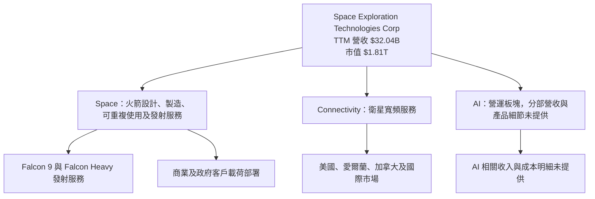
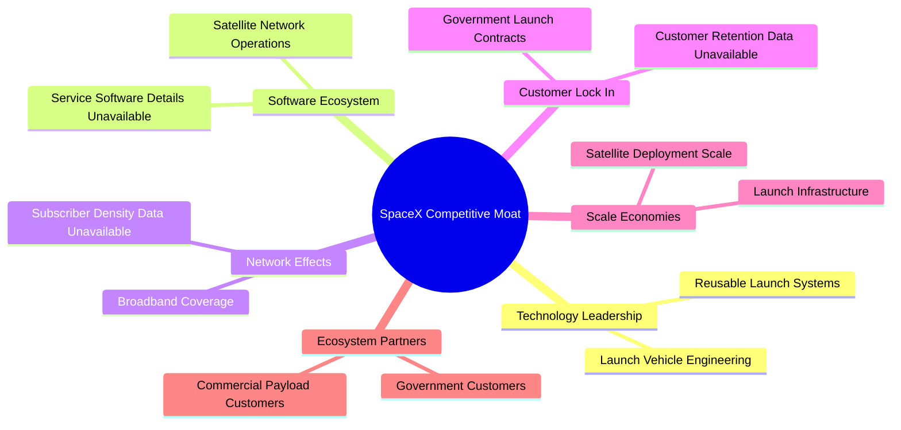
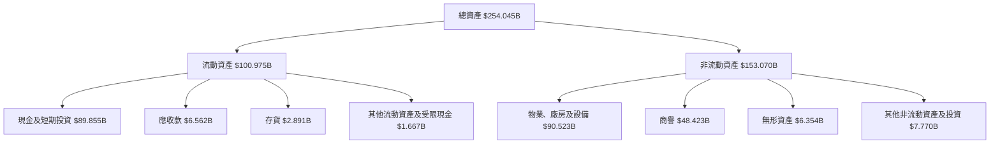
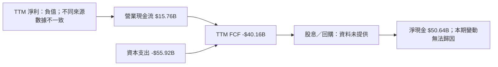
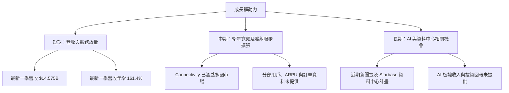
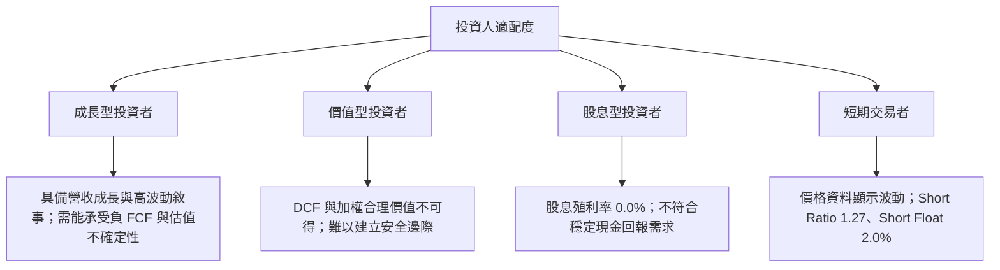

# SPCX 基本面深度分析報告
> **報告日期**：2026-11-28 ｜ **語言**：繁體中文 ｜ **數據來源**：Yahoo Finance、Finviz、StockAnalysis、Roic.ai ｜ **分析師**：CFA 級機構研究

## 目錄

| # | 章節 | 核心結論 |
|---|------|----------|
| 1 | 執行摘要 | TTM FCF 為 -$40.16B；DCF 與加權合理價值無法計算，因此 MOS 與 MOS 評級不可得 |
| 2 | 公司概覽與商業模式 | 業務涵蓋太空、連線與 AI；分部營收未提供，護城河有技術與規模潛力但難量化 |
| 3 | 損益表深度分析 | TTM 營收 $32.04B；最新一季營收年增 161.4%，TTM 營業利益率仍為 -2.0% |
| 4 | 資產負債表分析 | 現金及短期投資 $89.86B、淨現金 $50.64B；短期流動性充足，但營運資金資料需審慎解讀 |
| 5 | 現金流量深度分析 | TTM 營業現金流 $15.76B、資本支出 $55.92B，FCF 為 -$40.16B |
| 6 | 獲利能力與資本效率 | WACC 為 9.81%；ROIC 缺資料，無法判定是否創造股東價值 |
| 7 | 相對估值分析 | Forward P/E 48.71x、P/S 56.62x；估值倍數高，但與同業比較需考慮盈利狀態差異 |
| 8 | DCF 內在價值評估 | TTM 營業利益為負，DCF 與程式估值方法均不可用；不提供內在價值與 MOS |
| 9 | 成長催化劑 | 營收加速與 AI／資料中心相關新聞可能構成催化劑，具體營運貢獻未提供 |
| 10 | 風險矩陣 | 主要風險為高資本支出與負 FCF、估值高度依賴成長、財務資料一致性不足 |
| 11 | 投資建議 | 在盈利、FCF 與股數資料釐清前，維持審慎觀望；不虛構目標價或買入區間 |

---

## 1. 執行摘要

SPCX 的業務敘事具有高成長性：截至 2026-09-30 的 TTM 營收為 **$32.04B**，最新一季營收年增 **161.4%**；但同一期間 TTM 營業利益率為 **-2.0%**，TTM FCF 為 **-$40.16B**，FCF Yield 為 **-2.21%**。公司雖有 **$50.64B 淨現金**，但現價 **$133.59（2026-11-27 收盤）**對應 Forward P/E **48.714046x**、P/S **56.620613x**。由於 TTM 營業利益為負，DCF 模型不適用；程式亦未能計算任何估值方法，因此**無加權合理價值、無 MOS，亦不能依 MOS 門檻給出正式評級**。這不是低估值結論，而是估值資料不足以形成可稽核的目標價。

### 1.0 一頁式投資儀表板（Portfolio Manager 30 秒速讀）

| 項目 | 內容 |
|------|------|
| **投資論點（3 句）** | ① TTM 營收 $32.04B，最新一季年增 161.4%，顯示營收動能加速。② TTM 營業利益率 -2.0%、FCF -$40.16B，成長伴隨高投入與現金消耗。③ 現金及短期投資 $89.86B、淨現金 $50.64B，提供投資資金緩衝。 |
| **綜合評分** | **5.5/10**（引用 1.1 評分卡；六項算術平均） |
| **財務健康** | 🟡 現金緩衝充足、流動比率 3.084；但 TTM FCF 為 -$40.16B |
| **ROIC vs WACC** | ROIC：N/A vs WACC：9.81%；無法判定創造或摧毀價值 |
| **FCF 趨勢** | 2025 年 FCF -$14.12B；最新 TTM FCF -$40.16B，現金消耗增加；FCF Yield -2.21% |
| **估值** | Forward P/E 48.714046x ｜ EV/EBITDA 150.278x ｜ FCF Yield -2.21% |
| **DCF 內在價值（基準）** | N/A；TTM 營業利益為負，DCF 不適用，故折溢價 N/A |
| **安全邊際（MOS）** | N/A；加權合理價值未能計算，不能建立 MOS |
| **預期報酬（基準情境 12M）** | N/A；DCF 情境與加權合理價值均無法計算 |
| **關鍵風險（前二）** | 資本支出高於營業現金流；高估值對成長及利潤率假設敏感 |
| **評級 + 信心度** | 正式 MOS 評級：N/A；研究立場為審慎觀望，信心：低（估值輸入與部分財報數字存在矛盾） |

### 1.1 綜合評分卡（全報告唯一）

| 維度 | 評分（1–10） | 主要依據（引用數字與其來源章節） |
|------|--------------|----------------------------------|
| 成長性 | 8.0 | TTM 營收 $32.04B；最新一季年增 161.4%（第 3 章）。TTM 成長率欄位為 N/A，故不以單季增速替代 |
| 獲利能力 | 4.0 | TTM 營業利益率 -2.0%，但最新一季營業利益率為 1.8%；ROIC 與 Piotroski F-Score N/A（第 3、6 章） |
| 財務健康 | 7.0 | 淨現金 $50.64B、流動比率 3.084、速動比率 2.945；但 TTM FCF -$40.16B（第 4、5 章） |
| 估值 | 2.0 | Forward P/E 48.714046x、P/S 56.620613x；DCF 和估值方法未能提供可計算的合理價值（第 7、8 章） |
| 護城河 | 8.0 | 可重複使用火箭、發射服務與衛星寬頻等業務構成技術及規模壁壘；但各分部營收、客戶留存與市場份額未提供（第 2 章） |
| 管理層與資本配置 | 4.0 | 2025 年 SBC $1.95B、資本支出 $20.91B；截至 2026-09-30 最近四季 SBC 合計 $4.733B，但回購與分部投資回報資料不足（第 3、5 章） |
| **綜合評分** | **5.5** | 六項算術平均：\((8.0+4.0+7.0+2.0+8.0+4.0)÷6=5.5\) |

### 1.2 五大投資論點 + 三大核心風險

| 類型 | 項目 | 具體依據 | 信心度 |
|------|------|----------|--------|
| 🟢 **投資論點①** | 營收規模快速擴張 | TTM 營收 $32.04B；最新一季營收 $14.575B，年增 161.4% | 🟢 高 |
| 🟢 **投資論點②** | 現金緩衝足以支應投資 | 現金及短期投資 $89.86B、總債務 $39.22B，淨現金 $50.64B | 🟢 高 |
| 🟢 **投資論點③** | 最近一季營運轉正 | 最新一季營業利益率 1.8%；TTM 仍為 -2.0%，顯示尚未證明連續性 | 🟡 中 |
| 🟢 **投資論點④** | 毛利率具一定規模經濟潛力 | TTM 毛利率 56.8%；高於所列三家同業毛利率中位數 37.0%，但業務組合不同 | 🟡 中 |
| 🟢 **投資論點⑤** | 業務組合涵蓋發射、連線與 AI | 公司描述列出 Space、Connectivity、AI 三個營運板塊；分部營收及盈利未提供 | 🟡 中 |
| 🟡 **風險①** | 資本支出與現金流錯配 | TTM 資本支出 $55.92B，營業現金流 $15.76B，造成 FCF -$40.16B | 🔴 高衝擊 |
| 🔴 **風險②** | 高倍數承受盈利落差風險 | Forward P/E 48.714046x、EV/EBITDA 150.278x，且 TTM 營業利益率為負 | 🔴 高衝擊 |
| 🟡 **風險③** | 基礎資料存在內部矛盾 | 市場資料流通股 8.25B 股，Roic.ai 顯示 2026-09 流通股 13.579B 股；季度營業利益亦有不同來源差異 | 🔴 高衝擊 |

### 1.3 快速統計卡片

| 指標 | 公司實際值（期間） | 同業中位數 | 狀態 |
|------|--------------------|------------|------|
| 營收成長（TTM） | **N/A** | — | 🟡 無法判定 |
| 營收成長（最新一季年增） | **161.4%** | 72.7% | 🟢 高於所列同業中位數 |
| 毛利率（TTM） | **56.8%** | 37.0% | 🟢 高於所列同業中位數 |
| 營業利益率（TTM） | **-2.0%** | — | 🔴 負值 |
| ROIC（TTM） | **N/A** | — | 🟡 數據未提供 |
| Forward P/E | **48.714046x** | 31.0x | 🔴 高於所列有效同業中位數；同業分布差異大 |
| FCF Yield（TTM） | **-2.21%** | — | 🔴 負值 |
| Piotroski F-Score | **N/A** | — | 🟡 缺少跨年 SEC 財報資料 |

同業中位數計算依據：最新一季年增率為 RKLB 72.7%、ASTS 187.1%、IRDM 8.3%，中位數 72.7%；毛利率中位數為 37.0%；Forward P/E 三家為 710.8x、-19.7x、31.0x，中位數 31.0x。該組同業差異顯著，且倍數反映不同盈利狀態，不能視為精準可比估值。

### 1.4 投資結論

╔══════════════════════════════════════════════════════════════════╗  
║                    📊 投資結論摘要                               ║  
╠══════════════════════════════════════════════════════════════════╣  
║  評級：N/A（估值方法未能計算，沒有 MOS 可套用規則 20）           ║  
║  價格（2026-11-27 收盤）：$133.59                                ║  
║  DCF 內在價值（基準）：N/A（TTM 營業利益為負）                   ║  
║  安全邊際 MOS：N/A（加權合理價值未能計算）                       ║  
║  加權合理價值（8.8）：N/A                                        ║  
║  綜合評分：5.5/10（引用 1.1）                                    ║  
║  適合投資人：能承受高波動、以長期成長選擇權為核心的投資人；      ║  
║  不適合以穩定 FCF、低估值或股息為主要要求的投資人                ║  
╚══════════════════════════════════════════════════════════════════╝

---

## 2. 公司概覽與商業模式

### 2.1 業務結構與收入來源

公司業務描述列出 Space、Connectivity 與 AI 三個營運板塊，但沒有提供分部營收、利潤或佔比，因此不臆測各部門收入權重。公司整體 TTM 營收為 **$32.04B**，市場資料市值為 **$1.81T**；兩者分別衡量營運規模與市場定價，不能據此推導分部價值。

### 2.2 市場份額

市場份額數據未提供，且近期新聞未提供可核驗的公司市場份額與年份，故不填市場佔比。公司 TTM 營收 $32.04B、最新一季營收年增 161.4%，顯示營收規模與成長速度較高；但所列同業業務範圍不同，不能直接將營收差異解讀為市場份額差異。

### 2.3 競爭護城河分析

### 2.4 護城河強度

| 護城河項目 | 強度（強／中／弱） | 證據（引用數字或事實） | 會削弱它的情況 |
|------------|--------------------|------------------------|----------------|
| 技術與發射能力 | 強 | 公司提供 Falcon 9、Falcon Heavy 發射服務與可重複使用火箭；但成本優勢與發射成功率序列未提供 | 技術故障、競爭者追趕、監管限制或發射供給不足 |
| 衛星網路與服務 | 中 | Connectivity 業務涵蓋多國市場，TTM 營收 $32.04B 反映整體業務規模；分部營收及用戶數未提供 | 競爭性衛星網路、地面網路替代、用戶流失或頻譜限制 |
| 客戶鎖定與合約 | 中 | 公司服務商業與政府客戶；合約期限、續約率與集中度未提供 | 客戶轉向替代供應商、合約延後或政府預算縮減 |
| 規模效應 | 中 | TTM 毛利率 56.8%，但 TTM 營業利益率 -2.0%，表示毛利尚未轉化為正的 TTM 營業盈利 | 投資支出持續高於營運規模帶來的成本改善 |
| 軟體生態與網路效應 | 中 | 公司有衛星寬頻營運，但活躍用戶、ARPU、留存率與網路使用量未提供 | 競爭使每戶經濟效益下降，或網路品質、覆蓋、容量受限 |
| 生態夥伴 | 中 | 商業及政府發射客戶構成需求來源；客戶集中度及夥伴收入未提供 | 主要客戶自建能力、減少發射需求或改用替代方案 |

1.1 的「護城河」評分為 **8.0/10**，理由是可重複使用火箭與衛星網路具技術及規模壁壘，但缺少客戶留存、分部利潤與市場份額資料，不能將潛在壁壘直接等同於已量化的超額回報。

---

## 3. 損益表深度分析

### 3.1 年度收入成長趨勢（近 3 年可用資料）

可用完整年度資料為 2023–2025 三年，並非四年。2023 至 2025 營收 CAGR 約 **34.1%**，計算為 \((18.674÷10.387)^{1/2}-1\)。2025 年營收較 2024 年增 **33.24%**。

╔══════════════════════════════════════════════════════════════════╗  
║        Space Exploration Technologies 年度營收趨勢              ║  
╠══════════════════════════════════════════════════════════════════╣  
║  FY2023  $10.387B  ███████████░░░░░░░░░  基期                   ║  
║  FY2024  $14.015B  ███████████████░░░░░  YoY: +34.93% 🟢        ║  
║  FY2025  $18.674B  ████████████████████  YoY: +33.24% 🟢        ║  
╠══════════════════════════════════════════════════════════════════╣  
║  2023–2025 營收 CAGR：約 34.1%（依年度營收計算）                ║  
╚══════════════════════════════════════════════════════════════════╝

年度營收由 $10.387B 增至 $18.674B，提供了成長底盤；但最新一季營收已大幅高於先前季度，單季年增率不宜直接外推為多年成長率。

### 3.2 季度收入趨勢分析

| 季度 | 營收 | QoQ 成長 | YoY 成長 | 備註 |
|------|------:|---------:|---------:|------|
| 2025-12-31 | $4.96B | -11.1% | N/A | QoQ 以 2025-Q3 $5.576B 計；無 2024-Q4 對照 |
| 2026-03-31 | $4.69B | -5.4% | 15.42% | YoY 來自 StockAnalysis |
| 2026-06-30 | $7.81B | 66.5% | 91.94% | QoQ 加速；收入較前季提高 |
| 2026-09-30 | $14.57B | 86.5% | 161.4% | 單季營收大幅擴張；不可標為 TTM 成長率 |

QoQ 計算：2026-Q1 相對 2025-Q4 約 \((4.694÷4.960)-1=-5.4\%\)；2026-Q2 相對 Q1 約 \((7.814÷4.694)-1=66.5\%\)；2026-Q3 相對 Q2 約 \((14.575÷7.814)-1=86.5\%\)。急速加速需以後續季度檢驗是否來自可持續的服務收入、一次性合約認列或業務組合變化。

### 3.3 利潤率演變分析

| 利潤率指標 | FY2023 | FY2024 | FY2025 | 最新 TTM／季度 | 趨勢 | 評估 |
|------------|--------|--------|--------|----------------|------|------|
| **毛利率** | 41.2% | 43.0% | 49.4% | TTM 56.8% | 上升；TTM 高於 FY2025 | 🟢 毛利改善，分部組合未提供 |
| **營業利益率** | 4.9% | 5.3% | -11.1% | TTM -2.0%；最新季度 1.8% | FY2025 明顯轉負，最新季度回正 | 🟡 尚需確認能否持續 |
| **淨利率** | -44.6% | 5.6% | -26.4% | TTM -8.6% | 年度波動大，TTM 仍為負 | 🔴 盈利品質不穩 |
| **EBITDA 利潤率** | -6.4% | 40.3% | 23.7% | TTM 36.6% | 年度與 TTM 波動較大 | 🟡 口徑與業務組合需追蹤 |

年度毛利率以毛利除營收計算；年度營業利益率與淨利率以相應年度損益表數字計算。2025 年營收增加至 $18.674B，但營業利益為 -$2.064B、研發費用達 $8.64B，顯示費用與研發投入增幅可能超過當期營收帶來的營業槓桿。另一方面，TTM 毛利率升至 56.8%，而 TTM 營業利益率仍為 -2.0%，反映毛利改善尚未充分轉化為營業獲利，費用端仍是關鍵。

**資料一致性提醒：**季度損益表提供 2026-09 營業利益 $2.79B，StockAnalysis 季度資料則列 $4.019B；兩個數字不一致。報告以明確標示的最新季度營業利益率 1.8% 作為該項標準值，不以矛盾的季度營業利益自行替換。

### 3.4 費用結構分析

分部費用、銷售管理費、研發費用及營業成本的完整 TTM 明細未提供，不能以總額反推各項佔比，亦不繪製費用結構圓餅圖。已知 FY2025 研發費用為 **$8.64B**，高於 FY2024 的 **$3.46B**；投入快速增加可能支持新技術與新產品，但短期亦會壓低營業利潤。FY2025 研發費用約佔年度營收 46.3%，計算為 \(8.64÷18.674\)，但此比率不代表完整營業費用率。

### 3.5 季度 EPS 趨勢與盈餘品質（Quality of Earnings）

| 盈餘品質項目 | 數值／佔比 | 評估 |
|--------------|-----------|------|
| 股權薪酬 SBC / 營收 | 最近四季 SBC 合計 $4.733B ÷ TTM 營收 $32.043B = 約 14.8% | 🔴 SBC 佔比高；即使不當期支付現金，仍透過稀釋轉移股東價值 |
| SBC / 營業現金流 | $4.733B ÷ $15.76B = 約 30.0% | 🔴 SBC 規模相當於營業現金流約三成 |
| FCF / 淨利（現金轉換率） | N/A（TTM 淨利來源數據不一致且為負） | 🔴 負 FCF 與負淨利下，傳統轉換率解讀失真 |
| 一次性／非經常性損益 | N/A；詳細調節表未提供 | 🟡 無法量化是否有重大一次性項目 |
| 有效稅率異常 | N/A；年度有效稅率未提供 | 🟡 不推定稅務利益或正常化稅率 |
| 資本化支出 vs 費用化 | TTM 資本支出 $55.92B；資本化明細未提供 | 🟡 高資本支出代表投入規模大，無法判定是否有成本遞延問題 |
| EPS 超預期／不及預期 | EPS 預估與實際值為 NaN，沒有可比較數據 | 🟡 不能將資料源的 ❌ 標記解讀為實際 miss |

最近可查 EPS 實際值（Roic.ai）為 2026-Q1 -$0.47、Q2 -$0.09、Q3 $0.37；但 EPS estimate 缺漏，故過去四季是否超預期或不及預期均為 N/A。季度盈餘改善方向正面，但不同來源的淨利數值存在差異，且近期 SBC 與資本支出規模都大。整體而言，GAAP 盈利含金量尚未穩定建立：正單季淨利需與持續性 FCF、SBC 稀釋與費用分類一併檢驗，不能單憑單季盈利回正提高估值。

---

## 4. 資產負債表分析

### 4.1 資產結構分解

下列分項依 StockAnalysis 2026-09-30 資產負債表，金額單位為美元十億；各分項加總與其總資產 $254.045B 相符。

非流動資產合計為 \(254.045-100.975=$153.070B\)。資產表中的現金及短期投資為 $89.855B，與財務摘要四捨五入後的 $89.86B 一致；其餘資產項目包含小額受限現金與其他流動資產。

### 4.2 流動性與營運資金分析

| 指標 | 最新 TTM | 一年前 TTM | 變化 | 解讀 |
|------|----------|------------|------|------|
| DSO 應收帳款天數 | 54 天 | N/A | N/A | 未提供一年前品質指標，不能判定收款速度變化 |
| DIO 存貨天數 | 76 天 | N/A | N/A | 未提供一年前數據，不能判定是否庫存堆積 |
| DPO 應付帳款天數 | 349 天 | N/A | N/A | 單一期間顯示付款天數偏長；須結合供應商條款及應付帳款明細解讀 |
| CCC 現金轉換週期 | -219 天 | N/A | N/A | 依 DSO + DIO − DPO；負值可能反映供應商付款週期較長，不能單獨視為無風險 |

流動比率為 **3.084**、速動比率為 **2.945**，帳面短期流動性較充足。營運資金天數由程式依期末餘額與 TTM 流量計算，該方法不是平均餘額口徑；此外缺少一年前對照與應付帳款細項，不應據此推論議價力確定改善。

### 4.3 債務結構分析

╔══════════════════════════════════════════════════════════════════╗  
║                 SPCX 債務健康診斷                               ║  
╠══════════════════════════════════════════════════════════════════╣  
║  總債務：       $39.22B    ████████░░░░░░░░░░░░                 ║  
║  現金及短期投資：$89.86B   ████████████████████                 ║  
║  淨現金：       $50.64B    ███████████░░░░░░░░░ 🟢              ║  
║                                                                  ║  
║  流動比率：3.084x          🟢 短期資產高於短期負債               ║  
║  速動比率：2.945x          🟢 排除存貨後仍具流動性               ║  
║  Debt/EBITDA：N/A          TTM EBITDA 金額及債務口徑未能一致核驗  ║  
║  利息保障倍數：N/A         利息費用與 EBIT 口徑未提供             ║  
╚══════════════════════════════════════════════════════════════════╝

以程式計算的淨現金 **$50.64B**，是重要的投資緩衝；但不能據此忽略資本支出。當期 TTM 資本支出為 $55.92B，超過營業現金流 $15.76B，短期資金充足不等同於長期資本效率良好。

### 4.4 股東權益趨勢

╔══════════════════════════════════════════════════════════════════╗  
║                  股東權益年度變化                               ║  
╠══════════════════════════════════════════════════════════════════╣  
║  FY2024  $25.80B   ████████████░░░░░░░░                         ║  
║  FY2025  $41.33B   ████████████████████                         ║  
║                                                                  ║  
║  FY2024–FY2025 增幅約 60.2%（依年末股東權益計算）              ║  
╚══════════════════════════════════════════════════════════════════╝

年度資產負債表顯示股東權益由 FY2024 $25.80B 升至 FY2025 $41.33B，增加約 60.2%。但 Roic.ai 顯示 TTM Total Equity $176.768B，與年度資產負債表序列差異極大；故不將該 TTM 欄位與年度數據拼接成趨勢，也不據此重算 ROE 或資本效率。

---

## 5. 現金流量深度分析

### 5.1 現金流量瀑布圖

依明確提供的 TTM 指標，營業現金流減資本支出即為 FCF。股息與回購流量資料未提供，因此不推測 FCF 後續用途。

### 5.2 FCF 轉換率趨勢

| 年度／期間 | FCF | 淨利 | FCF／淨利 | 趨勢解讀 |
|------------|----:|----:|----------:|----------|
| FY2023 | $0.105B | -$4.63B | 不具經濟意義 | 盈利為負，正 FCF 不代表盈餘轉換良好 |
| FY2024 | -$5.39B | $0.791B | 約 -6.8x | 資本支出令 FCF 低於帳面淨利 |
| FY2025 | -$14.12B | -$4.94B | 約 2.9x | 分子與分母同為負，比例不代表正向轉換 |
| TTM 至 2026-09-30 | -$40.16B | N/A | N/A | TTM 淨利來源有差異且為負，避免產生誤導性比率 |

FY2024 比率計算為 \(-5.39÷0.791≈-6.8\)；FY2025 為 \(-14.12÷-4.94≈2.9\)，但在淨利與 FCF 同為負值時，正比率不代表現金轉換品質改善。

### 5.3 自由現金流趨勢

╔══════════════════════════════════════════════════════════════════╗  
║              自由現金流：歷史實際與最新 TTM                     ║  
╠══════════════════════════════════════════════════════════════════╣  
║  FY2023  +$0.105B  █░░░░░░░░░░░░░░░░░░░  接近損益兩平          ║  
║  FY2024  -$5.39B   ███░░░░░░░░░░░░░░░░░  🟡                    ║  
║  FY2025  -$14.12B  ███████░░░░░░░░░░░░░  🔴                    ║  
║  TTM     -$40.16B  ████████████████████  FCF Yield -2.21% 🔴   ║  
╚══════════════════════════════════════════════════════════════════╝

FY2025 年營業現金流 $6.79B，資本支出 $20.91B，形成 -$14.12B FCF；最新 TTM 資本支出增至 $55.92B，FCF 擴大至 -$40.16B。這反映公司仍處於重資本投入階段，未來需觀察投資是否轉化為可持續營收、毛利與現金回收。

### 5.4 資本配置評估

股息殖利率與 payout ratio 均為 **0.0%**。已知 FY2025 Capex 為 $20.91B、SBC 為 $1.95B；TTM Capex 為 $55.92B。回購、併購與留存現金的完整金額未提供，故不以比例圓餅圖呈現。

| 資本配置項目 | 可用數據 | 評估 |
|--------------|----------|------|
| 資本支出 | FY2025 $20.91B；TTM $55.92B | 🔴 規模大；投資回報尚未由正 FCF 證明 |
| 股權薪酬 | FY2025 $1.95B；最近四季合計 $4.733B | 🔴 高 SBC 可能帶來重大稀釋成本 |
| 股息 | 殖利率 0.0% | 🟡 未以股息回饋股東 |
| 股票回購 | N/A | 無法判定是否抵銷 SBC 稀釋 |
| 併購／其他投資 | N/A | 缺少完整現金流用途拆分 |

---

## 6. 獲利能力與資本效率

### 6.1 ROE / ROA / ROIC 趨勢

| 指標 | FY2023 | FY2024 | FY2025 | 最新 TTM | 評估 |
|------|--------|--------|--------|----------|------|
| ROE | N/A | N/A | N/A | N/A | TTM 杜邦品質指標為 N/A；跨期口徑不足 |
| ROA | N/A | N/A | N/A | N/A | 淨利、平均資產及資料一致性不足 |
| ROIC | N/A | N/A | N/A | N/A | 程式未提供可靠 ROIC，不自行拼接分子與資本基數 |
| WACC | — | — | — | 9.81% | 作為折現與資本成本參考，不等同已證明的 ROIC |

行業均值無可核驗資料，故不列對照欄。TTM 營業利益率 -2.0% 並不能直接代替 ROIC；缺少一致的投入資本與稅後營業利益資料，因此不能把公司判定為已創造或摧毀經濟價值。

### 6.2 ROIC vs WACC 分析（核心價值創造判斷）

╔══════════════════════════════════════════════════════════════════╗  
║                ROIC vs WACC 深度分析                            ║  
╠══════════════════════════════════════════════════════════════════╣  
║  資本成本輸入（程式計算）：                                      ║  
║  ├── 無風險利率（10Y 美債）：             4.94%                 ║  
║  ├── 市場風險溢酬：                       5.00%                 ║  
║  ├── Beta（原始）：                       N/A                   ║  
║  ├── Beta（調整後採用）：                 1.00                  ║  
║  ├── 股權成本：                           9.94%                 ║  
║  ├── 稅前債務成本：                       4.96%                 ║  
║  ├── 股權／債務權重：                     97.9%／2.1%           ║  
║  └── WACC：                               9.81%                 ║  
║                                                                  ║  
║  ROIC（TTM）：N/A；投入資本回報率無法與 WACC 比較                ║  
║  EVA = ROIC − WACC：N/A                                          ║  
║                                                                  ║  
║  結論：無可靠 ROIC 數值，不能判定公司正在創造或摧毀價值          ║  
╚══════════════════════════════════════════════════════════════════╝

資本成本輸入直接採用程式計算值；Beta 原始值為 N/A，調整後 Beta 1.00 是假設值。WACC 9.81% 可用於資本成本參考，但因 ROIC 缺失，不能推導 EVA 或 ROIC／WACC 倍數。

### 6.3 杜邦三因素分解

| 因素 | 數值（TTM） | 解讀 |
|------|-------------|------|
| 淨利率 | N/A | QUALITY FIGURES 判定杜邦資料 N/A |
| 資產週轉率 | N/A | 缺乏一致的平均資產與淨利資料 |
| 權益乘數 | N/A | 缺乏可比的正權益與平均資產口徑 |
| **ROE** | **N/A** | 程式品質指標已標示 N/A；不以不同來源自行重算 |

### 6.4 財務體質：Piotroski F-Score

Piotroski F-Score 為 **N/A**，因計算需要相隔一年的兩個 TTM 期間及 SEC 申報資料；目前財務資料未包含所需 SEC 財報，因此九項測試均無可核驗結果。

| 測試 | 結果 | 解讀 |
|------|------|------|
| 九項 Piotroski 測試 | N/A | 無法按標準逐項判定 |
| F-Score | N/A | 不以零分替代缺失值；缺資料不代表未通過 |

---

## 7. 相對估值分析

### 7.1 同業估值比較表格

SPCX 倍數取自所列估值數據；同業倍數取自 Yahoo Finance Peer multiples。資料源中部分公司因虧損而出現負倍數或 N/A，這些數字不宜當作常規盈利估值倍數。

| 估值指標 | **SPCX** | **RKLB** | **ASTS** | **IRDM** | 本公司評估 |
|----------|---------:|--------:|--------:|--------:|-----------|
| **Trailing P/E** | 580.82605x | N/A | N/A | 28.6x | 🔴 SPCX 過去盈餘基數有限，P/E 可比性弱 |
| **Forward P/E** | 48.714046x | 710.8x | -19.7x | 31.0x | 🟡 位於有效正值同業範圍內；但同業分布極端 |
| **P/S Ratio** | 56.620613x | 38.8x | 75.3x | 5.2x | 🔴 高於 IRDM，低於 ASTS；倍數仍高 |
| **EV/EBITDA** | 150.278x | -160.9x | -20.4x | 17.2x | 🔴 SPCX 倍數高；兩家同業負值倍數無法正常比較 |
| **最新一季營收年增** | 161.4% | 72.7% | 187.1% | 8.3% | 🟢 高於所列同業中位數 72.7% |
| **毛利率（TTM）** | 56.8% | 36.2% | 37.0% | 71.5% | 🟢 高於兩家、低於 IRDM；業務結構不同 |

同業中位數只用於上述同一 Peer multiples 的三家公司：Forward P/E 中位數 31.0x、P/S 中位數 38.8x、EV/EBITDA 中位數 -20.4x、最新一季營收年增中位數 72.7%、毛利率中位數 37.0%。EV/EBITDA 中位數因兩家公司 EBITDA 為負而失去一般解讀價值，不作為估值錨。

### 7.2 歷史估值區間分析

N/A（未提供「Valuation vs own history」歷史估值區間資料，不能推算歷史百分位）。

### 7.3 情境價值（Bear / Base / Bull）

N/A（DCF 無法計算：截至 2026-09-30 的 TTM 營業利益為負。依估值資料限制，不自行建立 DCF 或設定情境目標價。）

### 7.4 相對估值隱含價格區間

N/A（程式提供的 VALUATION METHODS 為「None could be computed」。因此沒有可照抄的相對估值方法、每股價值或權重；不自行以同業倍數回推目標價。）

---

## 8. DCF 內在價值評估（Discounted Cash Flow）

### 8.0 估值推理鏈（Thinking Logic）

**Step 1 — 公司價值的可驗證來源**

Space 業務涉及火箭與發射服務，Connectivity 涉及衛星寬頻，另有 AI 板塊；然而分部營收佔比、營業利益及現金流皆未提供，無法按分部建立可驗證的價值拆分。公司總 TTM 營收為 **$32.04B**，但該數字不能替代分部權重。最重要的估值變數原應是營業利潤率與再投資需求；目前 TTM 營業利益率 **-2.0%**、FCF **-$40.16B**，使長期利潤率與資本支出假設高度不確定。

**Step 2 — 模型選擇與適用性**

| 決策點 | 本報告採用 | 理由（含數字） | 曾考慮但否決 | 否決理由 |
|--------|-----------|----------------|--------------|----------|
| 現金流定義 | 不計算 DCF | 提供的 TTM 營業利益率為 -2.0%，而程式明確判定 TTM 營業利益不為正 | FCFF／FCFE 自建模型 | 財務資料已指定 DCF MODEL 為 N/A，不得另建模型 |
| 預測期 N | N/A | 沒有可使用的模型預測期 | 自行指定 5–10 年 | 缺乏足以支持期長及逐年現金流的模型輸入 |
| 終值方法 | N/A | 無基準 FCFF、g 或模型終值 | Gordon Growth、退出倍數 | 會變成自行建模，違反估值資料規則 |
| EBIT 基礎 | N/A | 模型未計算 | GAAP 或非 GAAP EBIT | 無法用替代假設推導 DCF |

**Step 3 — 關鍵假設推導鏈**

N/A（DCF MODEL 已由程式判定不可用；沒有可照抄的營收 CAGR、利潤率、終值、敏感度或情境輸入。為避免自建模型，不設定替代假設。）

**Step 4 — 最脆弱環節**

最脆弱的環節是營業利益率能否由 TTM -2.0% 持續轉正，以及 $55.92B TTM 資本支出能否形成足夠的未來現金流；現有資料無法量化其對每股價值的影響，因此估值信心低。

**Step 5 — 估值計算路徑**

本節不展示估值數字流程圖：沒有有效的 DCF 模型輸入與輸出，若畫出數值鏈會製造不存在的內在價值。一般 DCF 推理關係為：營收與利潤率推導現金流，再以 WACC 折現並橋接至股權價值；但本報告不代入任何未提供假設。

### 8.1 模型假設總表（Model Inputs）

N/A（DCF MODEL：N/A；原因為 TTM 營業利益不為正。預測期、逐年營收、利潤率、稅率、Capex 比率、D&A、營運資金、SBC 組合、稀釋股數、永續成長率及終值均沒有可照抄的程式模型輸入。）

### 8.2 折現率推導（WACC）

╔══════════════════════════════════════════════════════════════════╗  
║                    WACC 資本成本輸入                            ║  
╠══════════════════════════════════════════════════════════════════╣  
║  無風險利率（10Y 美債）：4.94%                                   ║  
║  市場風險溢酬：5.00%                                             ║  
║  原始 Beta：N/A；調整後採用 Beta：1.00（假設）                  ║  
║  股權成本：9.94%                                                 ║  
║  稅前債務成本：4.96%                                             ║  
║  預設稅率：21.0%                                                 ║  
║  股權／債務權重：97.9%／2.1%                                    ║  
║  WACC：9.81%                                                     ║  
║                                                                  ║  
║  本節採用程式提供的 WACC，不另行重算或替換。                    ║  
║  10Y 殖利率日期、利息費用明細及 Beta 調整方法未提供。            ║  
╚══════════════════════════════════════════════════════════════════╝

雖然已提供 WACC 及組成數值，但缺少 10Y 殖利率觀察日、Beta 調整公式、利息費用與債務明細，無法按所要求的五步 CAPM／Kd／權重算式獨立驗證。為遵守「WACC 直接採用程式數值」的規定，採用 **9.81%**，不以其他數字另算。第 6.2 節使用相同 WACC。

### 8.3 逐年自由現金流預測（基準情境）

N/A（DCF MODEL 未提供逐年預測；原因為 TTM 營業利益不為正。依規定不自行建立 FCFF 預測、折現因子或現值表。）

### 8.4 終值計算（Terminal Value）

適用性檢查：N/A（沒有程式模型提供的永續成長率 \(g\) 或終值現金流，不能檢查 WACC 與 \(g\) 的大小關係。）

Gordon Growth 與退出倍數終值均為 N/A；沒有可用的 FY+N FCFF、FY+N EBITDA、終值倍數或終值現值。

### 8.5 企業價值 → 每股內在價值（Bridge）

╔══════════════════════════════════════════════════════════════════╗  
║              企業價值 → 每股內在價值 橋接表                      ║  
╠══════════════════════════════════════════════════════════════════╣  
║  預測期 FCF 現值合計：N/A                                        ║  
║  終值現值 PV(TV)：N/A                                            ║  
║  企業價值 EV：N/A                                                ║  
║  現金及短期投資：$89.86B（實際資產負債表，不代表模型橋接值）      ║  
║  總債務：$39.22B（實際資產負債表，不代表模型橋接值）             ║  
║  股權價值：N/A                                                    ║  
║  稀釋後股數：N/A（股數來源彼此矛盾）                             ║  
║  ★ 每股內在價值：N/A                                             ║  
║  當前股價（2026-11-27）：$133.59                                 ║  
║  折溢價與 MOS：N/A                                                ║  
╚══════════════════════════════════════════════════════════════════╝

提供的市場資料稱流通股數為 **8.25B**，而 Roic.ai 2026-09 資料列示 Shares Outstanding **13.579B**；兩者相差甚大。因 DCF 本身亦為 N/A，不能選取其中一個股數作為模型分母。此處不計算 DCF 折溢價，也不計算 MOS；MOS 僅能以 8.8 的加權合理價值作分母，而 8.8 亦不可得。

### 8.6 敏感性分析（WACC × 永續成長率）

N/A（沒有程式提供的 DCF 基準值、\(g\)、逐年 FCFF、敏感度矩陣或三情境；不建立替代矩陣。）

### 8.7 反推 DCF（Reverse DCF：市場在預期什麼）

N/A（無有效 DCF 基準模型，不能在固定其他假設下反解單一變數，也不提供假造的市場隱含 CAGR、利潤率或預測期。）

### 8.8 估值三角驗證與安全邊際

N/A（估值方法區塊顯示「None could be computed」。無法提供 DCF、相對估值或分析師共識估值權重、加權合理價值、MOS 或 MOS 評級。分析師共識平均目標價 $256.25 及低／高目標 $70／$800 是外部分析師預測，不是本報告可複算的內在價值，不納入加權估值。）

### 8.9 DCF 模型的局限與失效條件

- **終值依賴度：** N/A，因沒有有效終值。
- **最脆弱假設：** 營業利潤率回升速度與高額 Capex 的現金回收；目前 TTM 營業利益率 -2.0%、TTM Capex $55.92B、FCF -$40.16B。
- **不適用情境：** TTM 營業利益為負且處於高再投資階段，短期 FCFF 外推風險高；可追蹤 EV/Sales、分部估值（SOTP）與單位經濟性，但在缺少分部營收及營運指標時也不應給出目標價。
- **與第 10 章風險矩陣連結：** 成長減速會下修收入假設；資本支出回報落空會壓低現金流；營業利潤率未能改善則延長負 FCF 期間。各項影響量級目前不可計算。

### 8.10 複算檢核表（Audit Trail）

| # | 檢核項目 | 檢查方式 | 結果 |
|---|----------|----------|------|
| 1 | 所有高／中敏感度輸入都有四段式推導 | DCF 假設不存在，無可逐項推導 | N/A |
| 2 | 每個假設都有來歷 | 未建立替代模型；不可用的輸入已標示 N/A | ✅ |
| 3 | WACC 五步算式及重算 | 直接引用程式 WACC 9.81%，不另算 | N/A |
| 4 | Kd 分母與債務權重範圍一致 | 利息費用與計息負債明細未提供 | N/A |
| 5 | WACC 與第 6.2 節同值 | 兩節均引用 9.81% | ✅ |
| 6 | 逐年表格年度數符合 N | DCF 無預測期 | N/A |
| 7 | FY+1 九步算式可複算 | 無程式年度預測值 | N/A |
| 8 | 預測期 PV 加總 | 無預測期 PV | N/A |
| 9 | WACC > g | 無 \(g\) 輸入，不能檢驗 | N/A |
| 10 | 終值以 FY+N 現金流折現 N 期 | 無終值模型 | N/A |
| 11 | EV 至每股價值橋接可複算 | DCF EV 與股數不可得 | N/A |
| 12 | SBC 組合在經濟上相容 | 無 DCF EBIT 與股數假設；未建立模型 | N/A |
| 13 | 敏感性矩陣基準格等於 DCF 基準值 | 無敏感性矩陣 | N/A |
| 14 | 矩陣有效格符合 WACC > g | 無敏感性矩陣 | N/A |
| 15 | 三情境機率合計 100% | 未提供 DCF 情境 | N/A |
| 16 | 反推 DCF 每列只放開一個變數 | 無有效基準模型 | N/A |
| 17 | MOS 分母及折溢價基準正確 | 兩者均未計算，避免以 DCF 值冒充 MOS | ✅ |
| 18 | 報告完整至第 11 章 | 章節 1 至 11 均列出 | ✅ |
| 19 | 加權合理價值等於加權總和 | 無估值方法及權重，不計加權值 | N/A |
| 20 | 評級符合 MOS 門檻 | MOS 不可得，正式評級標示 N/A | ✅ |

本章未建構任何替代 DCF；因此 DCF 專用複算項目為 N/A，未把缺少模型誤標為已完成計算。

---

## 9. 成長催化劑

### 9.1 催化劑時間軸

沒有管理層財測、訂單交付時間表、發射排程或各業務收入指引可供引用，因此不提供帶有推測日期的 Gantt 圖。可觀察的近期訊號包括最新一季營收年增 161.4%，以及近期新聞提及 Starbase 資料中心計畫和 AI 衛星相關監管進展；新聞所述為事件線索，不代表已確認收入或獲利。

### 9.2 TAM 市場規模分析

N/A（TAM 數據未提供）。公司 TTM 營收為 $32.04B，最新一季營收年增 161.4%，顯示營收規模與增速可觀；但沒有可引用的市場規模、滲透率或分部收入資料，不能計算 TAM 滲透率，也不填入外部估算金額。

### 9.3 成長驅動力結構圖

成長催化劑能否提升價值，需以分部收入、訂單執行、資本回報與 FCF 改善確認；新聞事件本身不能當成已實現的財務成果。

---

## 10. 風險矩陣

### 10.1 風險評分矩陣

財務數據未提供可量化的風險發生機率或每項事件的股價衝擊幅度，因此不以主觀座標製作 quadrantChart。以下以質化高／中分類呈現風險排序，不代表統計機率。

| 風險項目 | 發生可能性（質化） | 潛在衝擊 | 依據 |
|----------|---------------------|----------|------|
| 高 Capex 延續、FCF 持續為負 | 高 | 高 | TTM Capex $55.92B、FCF -$40.16B |
| 成長低於高估值所隱含要求 | 中至高 | 高 | Forward P/E 48.714046x、P/S 56.620613x |
| 財務資料及股份數不一致 | 中 | 高 | Shares Outstanding 8.25B 與 13.579B 不一致 |
| 利潤率改善未能延續 | 中 | 高 | TTM 營業利益率 -2.0%，最新季度為 1.8% |
| 監管與營運許可風險 | 中 | 中至高 | 涉及衛星、頻譜、發射與 AI 衛星監管；具體財務暴露未提供 |

### 10.2 風險清單詳細分析

| # | 風險項目 | 發生可能性 | 財務衝擊 | 風險評分 | 緩解措施 |
|---|----------|------------|----------|----------|----------|
| 1 | 🔴 **資本支出超前於現金創造** | 高（質化） | TTM FCF 已為 -$40.16B；未來衝擊金額不可據現有資料預測 | 高 | 逐季追蹤 Capex、營業現金流與每新增資產的收入回報；若 Capex 上升而收入與毛利不增，重新評估 |
| 2 | 🔴 **高估值與增長預期落差** | 中至高（質化） | Forward P/E 48.714046x、P/S 56.620613x；無可核驗的合理價值 | 高 | 以營收成長、營業利益率與 FCF 連續性作為估值支撐條件，不以分析師目標價替代估值 |
| 3 | 🔴 **利潤率與來源資料不一致** | 中（質化） | 最新季度營業利益數字來源不一；可能影響獲利趨勢判讀 | 高 | 以公司正式財報核對季度營業利益、淨利、股數與分部資料 |
| 4 | 🟡 **SBC 稀釋** | 中至高（質化） | 最近四季 SBC 約 $4.733B，約為營收 14.8% | 中至高 | 追蹤稀釋股數、SBC／營收比及回購抵銷情況；要求 SBC 下降或每股現金流改善 |
| 5 | 🟡 **監管、頻譜與發射執行** | 中（質化） | 單項財務暴露未提供 | 中至高 | 監控監管核准、發射排程、服務可用性及相關合約交付 |

---

## 11. 投資建議

### 11.1 最終評級與評分

依現有資料，DCF 及估值方法均無法計算，沒有加權合理價值與 MOS，因此**不能依規則 20 授予買入、持有或賣出評級**；研究立場為審慎觀望，而非正式 MOS 評級。公司綜合評分為 **5.5/10**，六項分數依序為成長性 8.0、獲利能力 4.0、財務健康 7.0、估值 2.0、護城河 8.0、管理層與資本配置 4.0；評分反映成長及資產負債表優勢，與負 FCF、高倍數及盈利不確定性的拉扯。

### 11.2 合理價值與隱含報酬率

| 項目 | 每股價值 | 相對 2026-11-27 收盤價 $133.59 | 說明 |
|------|---------|------------------------------|------|
| 加權合理價值 | N/A | N/A | 程式估值方法均未能計算 |
| DCF 悲觀情境 | N/A | N/A | DCF MODEL 為 N/A |
| DCF 基準情境 | N/A | N/A | DCF MODEL 為 N/A |
| DCF 樂觀情境 | N/A | N/A | DCF MODEL 為 N/A |
| 外部分析師共識平均目標價 | $256.25 | 約 +91.8% | 38 位分析師提供的共識；不是本報告的內在價值或保證報酬 |
| 外部分析師目標區間 | $70–$800 | 約 -47.6% 至 +498.9% | 區間極寬，顯示估值分歧很大 |

外部共識相對現價的上行幅度計算為 \((256.25÷133.59)-1≈91.8\%\)，僅是分析師目標價與現價的算術差，不應視為本報告的目標報酬。

### 11.3 買入時機與觸發因素

╔══════════════════════════════════════════════════════════════════╗  
║                  ✅ 買入觸發因素 Checklist                      ║  
╠══════════════════════════════════════════════════════════════════╣  
║  建立或提高部位前建議確認：                                      ║  
║  ☐ 正式財報核實營收、營業利益、流通股數與分部資訊                ║  
║  ☐ 營業利益率至少連續數季維持正值，且費用率趨勢可解釋            ║  
║  ☐ TTM FCF 由 -$40.16B 朝收斂方向改善                            ║  
║  ☐ Capex 增長能對應到收入、毛利或現金流回報                      ║  
║  ☐ SBC／營收比低於目前約 14.8%，或稀釋被實質回購抵銷             ║  
║                                                                  ║  
║  加碼觸發條件：                                                  ║  
║  ☐ 連續季度營業利益與營業現金流同步改善                          ║  
║  ☐ 正式披露的股數與估值輸入一致，可重新計算每股價值              ║  
║                                                                  ║  
║  減碼／暫停投入觸發條件：                                        ║  
║  ☐ 營收增長放緩且營業利益率轉弱                                  ║  
║  ☐ FCF 持續惡化或 Capex 上升未帶來可驗證的收入回報                ║  
║  ☐ SBC 持續高於收入增速，導致每股經濟價值被稀釋                  ║  
╚══════════════════════════════════════════════════════════════════╝

目前沒有可由程式估值方法推導的買入區間，因此不提供價格型觸發價位。現價 $133.59 是最新收盤價，不等於合理價值或買入價。

### 11.4 投資人適配度分析

### 11.5 每季財報監控清單（Quarterly Watch List）

| 監控指標 | 最新基準 | 加碼觀察門檻 | 減碼／重新評估門檻 |
|----------|----------|--------------|------------------|
| 營收成長 | 最新一季年增 161.4%；TTM 成長率 N/A | 最新一季年增仍為正，且分部數據可解釋增長來源 | 連續兩季年增轉負，或成長明顯降速且無清楚原因 |
| 營業利益率 | TTM -2.0%；最新季度 1.8% | 正值延續並由正式財報核實 | 轉負或改善完全來自不可持續項目 |
| 營業現金流 | TTM $15.76B | 營業現金流增速能支撐投資支出 | 營業現金流轉弱或無法覆蓋資本支出 |
| 資本支出 | TTM $55.92B | Capex 投入有明確產能與收入回報 | Capex 持續增加但收入、毛利與現金流無改善 |
| 自由現金流 | TTM -$40.16B；FCF Yield -2.21% | 連續季度縮小負值，並能辨別改善來源 | FCF 惡化或現金消耗加速且缺乏投資回報證據 |
| SBC／稀釋 | 最近四季 SBC 合計 $4.733B；約佔 TTM 營收 14.8% | SBC／營收下降，或稀釋被回購有效抵銷 | SBC／營收上升、流通股增加且每股現金流未改善 |
| 流動性 | 現金及短期投資 $89.86B；淨現金 $50.64B | 保持足以支應資本計畫的流動性 | 現金快速下降且 FCF 長期為負 |
| 分部／AI 投資 | 分部收入、研發回報 N/A | 公布分部營收與可衡量商業化里程碑 | 新投資持續增加但未披露收入或回報證據 |

### 11.6 反面論證：什麼會證明論點錯誤（What Would Change My Mind）

╔══════════════════════════════════════════════════════════════════╗  
║              ⚠️ 論點失效條件（Disconfirming Evidence）           ║  
╠══════════════════════════════════════════════════════════════════╣  
║  下列情況出現時，應重新檢視成長論點與持倉：                      ║  
║  ☐ 最新一季營收年增連續兩季低於 0%                               ║  
║  ☐ 最新一季營業利益率由 1.8% 轉負，且後續未能回升                ║  
║  ☐ TTM FCF 在資本支出維持高檔下進一步低於 -$40.16B               ║  
║  ☐ SBC／營收高於目前約 14.8%，且稀釋股數持續增加                 ║  
║  ☐ 正式財報證實股數或營業利益口徑與現有資料差異重大              ║  
║  ☐ 公司未能披露分部收入、資本回報或主要投資的商業化進度          ║  
║  ☐ 可驗證的 ROIC 長期低於 9.81% WACC                             ║  
╚══════════════════════════════════════════════════════════════════╝

以上門檻是重新檢視投資論點的監控條件，不代表已知的公司指引或財測。特別是 ROIC，目前資料為 N/A；只有在取得一致財報並可計算後，才可檢驗是否低於 WACC。

---

> **免責聲明**：本報告為 AI 自動生成，僅供研究參考，不構成投資建議。投資有風險，入市需謹慎。

---

## 資料與來源

| 項目 | 內容 |
|------|------|
| 價格 | 133.59 USD，2026-11-27 收盤（Yahoo Finance 日線） |
| 財務報表 | Yahoo quarterly statements (no SEC filing data)，最新季度 2026-09-30（TTM = four quarters to this date） |
| 有回應的資料來源 | Yahoo Finance、Finviz、StockAnalysis、Roic.ai |
| 未回應的資料來源 | SEC 申報資料 (XBRL) |
| 由程式計算 | TTM 數字、WACC、DCF 模型、估值方法與權重、加權合理價值、MOS、評級門檻、F-Score、杜邦分解、營運資金天數、綜合評分 |
| 撰寫模型 | openai / gpt-6-luna |

> 本區塊由產生報告的程式依實際取得的資料填寫，非模型撰寫。「由程式計算」的數字不是模型的估計；其餘判斷（評分、情境、策略）是模型的分析。
