# TSLA 基本面深度分析報告

**✏️ 程式複算更正**：8.8 節加權合理價值由模型原寫的 $87.36 更正為 **$74.40**（各項加總），MOS -346.7% → **-424.5%**，全文已同步。

> **報告日期**：2026-11-13 ｜ **語言**：繁體中文 ｜ **數據來源**：SEC 申報資料 (XBRL)、Yahoo Finance、Finviz、StockAnalysis、Roic.ai ｜ **分析師**：CFA 級機構研究

> **資料口徑註記**：本報告涉及價格、TTM 營收成長、TTM 營業利益率、TTM 現金流、淨現金、ROIC、資本成本及同業倍數時，優先採用 VERIFIED FIGURES 原值。資料包其他區塊存在口徑差異，例如債務、淨現金、營業利益率、毛利及股數；遇到差異時，本文明確標示採用口徑，不將不同口徑混算。模型假設不是已公告財測，均標示為估計值。

## 目錄

| # | 章節 | 核心結論 |
|---|------|----------|
| 1 | 執行摘要 | 賣出；加權合理價值約 $74.40，MOS -424.5% |
| 2 | 公司概覽與商業模式 | 汽車仍是核心，能源與軟體是成長選擇權；護城河中等 |
| 3 | 損益表深度分析 | TTM 營收 $103.57B、成長 8.3%；最新單季年減 0.2% |
| 4 | 資產負債表分析 | VERIFIED 淨現金 $36.18B，短期償債能力充足 |
| 5 | 現金流量深度分析 | TTM FCF $3.30B，FCF yield 僅 0.21% |
| 6 | 獲利能力與資本效率 | ROIC 5.1% 低於 WACC 13.80%，目前摧毀經濟價值 |
| 7 | 相對估值分析 | 多數倍數高於自身歷史中位數及傳統車廠 |
| 8 | DCF 內在價值評估 | 基準 DCF 約 $20.45；加權合理價值低於現價 |
| 9 | 成長催化劑 | 儲能、軟體、自動駕駛及新產品可能帶來上行，但變現時間不確定 |
| 10 | 風險矩陣 | 估值、獲利率與產品需求是主要風險 |
| 11 | 投資建議 | 賣出／避免新增；重新評估須等待盈利與估值改善 |

---

## 1. 執行摘要

### 1.0 一頁式投資儀表板

| 項目 | 內容 |
|------|------|
| **投資論點（3 句）** | ① TTM 營收 $103.57B、年增 8.3%，但最新一季營收年減 0.2%，成長動能仍不連續。② TTM 營業利益率 3.3%、ROIC 5.1%，低於 13.80% WACC，現階段未達創造經濟價值的門檻。③ TTM FCF $3.30B、FCF yield 0.21%，相對 $1.54T 市值現金收益率偏低。 |
| **護城河評分** | 5.5/10；品牌、充電網絡、製造規模具優勢，但價格競爭及替代品削弱其可持續性 |
| **管理層／資本配置評分** | 5.0/10；現金儲備大，但資本支出高，且關鍵新業務的經濟回報仍待驗證 |
| **財務健康** | 🟢 VERIFIED 淨現金 $36.18B；但另一資料口徑為 $29.00B，本文採 VERIFIED 數字 |
| **ROIC vs WACC** | 5.1% vs 13.80%；差距 -8.70 個百分點，表示目前資本回報低於資金成本 |
| **FCF 趨勢** | FY2025 FCF $6.22B；最新 TTM $3.30B；FCF yield 0.21% |
| **估值** | Forward P/E 180.7x ｜ EV/EBITDA 156.8x（資料包市場估值）｜ FCF yield 0.21% |
| **DCF 內在價值（基準）** | 約 $20.45；現價相對 DCF 溢價約 1,807% |
| **安全邊際（MOS）** | **-424.5%**＝($74.40 − $390.22) ÷ $74.40；以 8.8 加權合理價值為基準 |
| **預期報酬（基準情境 12M）** | 約 -80.9%（加權合理價值 $74.40 相對現價 $390.22） |
| **關鍵風險（前二）** | 高估值與低 FCF yield；汽車業務利潤率與需求週期 |
| **評級 + 信心度** | 🔴 **賣出** ｜ 信心：中（估值結論明確，業務新曲線及財務口徑仍有不確定性） |

> **評級推導**：加權合理價值 $74.40、現價 $390.22，MOS = -424.5%，依規則 20 為賣出；ROIC 5.1% 亦低於 WACC 13.80%。此結論不是因單一季度而定，而是估值、現金收益率與資本回報率共同指向下行風險。

### 1.1 核心評分儀表板

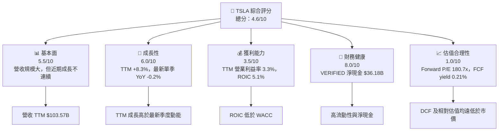

### 1.2 評分進度條視覺化

```
╔══════════════════════════════════════════════════════════════╗
║                  TSLA 多維度評分儀表板 (1-10分)             ║
╠══════════════════════════════════════════════════════════════╣
║ 基本面強度  5.5 ▓▓▓▓▓▓▓▓▓▓▓░░░░░░░░░  ★★★☆☆               ║
║ 成長動能    6.0 ▓▓▓▓▓▓▓▓▓▓▓▓░░░░░░░░  ★★★☆☆               ║
║ 獲利品質    4.0 ▓▓▓▓▓▓▓▓░░░░░░░░░░░░  ★★☆☆☆               ║
║ 財務健康    8.0 ▓▓▓▓▓▓▓▓▓▓▓▓▓▓▓▓░░░░  ★★★★☆               ║
║ 估值合理性  1.0 ▓▓░░░░░░░░░░░░░░░░░░  ★☆☆☆☆               ║
║ 護城河深度  5.5 ▓▓▓▓▓▓▓▓▓▓▓░░░░░░░░░  ★★★☆☆               ║
║ 管理層執行  5.0 ▓▓▓▓▓▓▓▓▓▓░░░░░░░░░░  ★★★☆☆               ║
║ 技術創新力  7.0 ▓▓▓▓▓▓▓▓▓▓▓▓▓▓░░░░░░  ★★★★☆               ║
╠══════════════════════════════════════════════════════════════╣
║ 綜合總分    4.6 ▓▓▓▓▓▓▓▓▓░░░░░░░░░░░  🔴 估值與回報不匹配   ║
╚══════════════════════════════════════════════════════════════╝
```

### 1.3 五大投資論點 + 三大核心風險

| 類型 | 項目 | 具體依據 | 信心度 |
|------|------|----------|--------|
| 🟢 **投資論點①** | 現金緩衝 | VERIFIED 現金及短期投資 $45.45B、淨現金 $36.18B，降低融資與景氣低迷風險 | 高 |
| 🟢 **投資論點②** | 多元業務選擇權 | 能源儲存、軟體及自動駕駛可能提供汽車以外收入；現有分部收入拆分未提供，故不給予未經驗證的估值溢價 | 中 |
| 🟢 **投資論點③** | TTM 營收仍擴張 | TTM 營收年增 8.3%，高於最新單季 -0.2%，若新品與能源持續放量可恢復成長 | 中 |
| 🟡 **風險①** | 高估值 | Forward P/E 180.7x、P/S 14.9x、FCF yield 0.21%，對盈利失速敏感 | 高 |
| 🔴 **風險②** | 資本回報不足 | ROIC 5.1% 對 WACC 13.80%，經濟利差 -8.70pp | 高 |
| 🔴 **風險③** | 汽車需求與價格競爭 | 最新季度營收年減 0.2%，EPS 年減 43.6%；降價或產品組合變差可進一步壓縮利潤 | 中高 |

### 1.4 快速統計卡片

| 指標 | 公司實際值 | 行業均值 | S&P 500 均值 | 狀態 |
|------|-------------|----------|--------------|------|
| TTM 收入 YoY 成長 | **8.3%** | N/A | N/A | 🟡 |
| 最新季度收入 YoY | **-0.2%** | 同業 GM +2.9%、F -2.0%、RIVN +38.3% | N/A | 🟡 |
| 毛利率 | **19.3%** | GM 11.4%、F 7.4%、RIVN 9.2% | N/A | 🟢 |
| 淨利率 | **3.1%** | N/A | N/A | 🟡 |
| ROE | **3.6%** | N/A | N/A | 🔴 |
| Forward P/E | **180.7x** | GM 5.8x、F 6.4x、RIVN -6.9x | N/A | 🔴 |
| FCF yield | **0.21%** | N/A | N/A | 🔴 |

### 1.5 投資結論

```
╔══════════════════════════════════════════════════════════════════╗
║                    📊 投資結論摘要                               ║
╠══════════════════════════════════════════════════════════════════╣
║  評級：🔴 賣出（MOS -424.5%，ROIC 5.1% < WACC 13.80%）           ║
║  價格（2026-11-13 收盤）：$390.22                                ║
║  DCF 內在價值（基準）：$20.45（現價溢價約 1,807%）              ║
║  安全邊際 MOS：-424.5%（基準：加權合理價值 $74.40）             ║
║  目標價區間：                                                   ║
║    悲觀情境：$42.00（相對現價 -89.2%）                          ║
║    基準情境：$74.40（相對現價 -80.9%）                          ║
║    樂觀情境：$180.00（相對現價 -53.9%）                         ║
║  投資評分：4.6/10                                               ║
║  適合投資人：高風險、能承受大幅波動且以選擇權式成長投資者       ║
╚══════════════════════════════════════════════════════════════════╝
```

---

## 2. 公司概覽與商業模式

### 2.1 業務結構與收入來源

公司概述為汽車、能源發電與儲能，並提供汽車服務、保險、零件及軟體相關服務。各分部收入金額未在數據包提供，因此不以推估占比冒充實際數字。

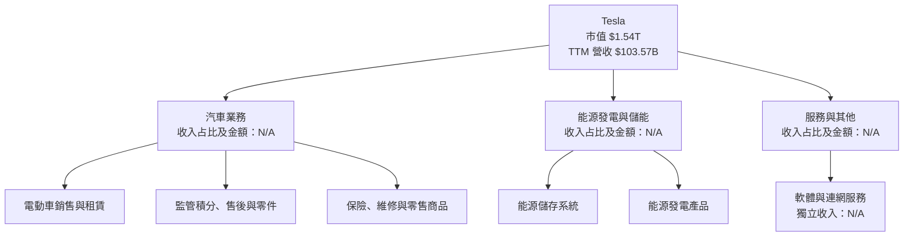

### 2.2 市場份額

提供的數據沒有可比市場定義、出貨量或地區市場份額，故不製作看似精確但不可驗證的份額餅圖。

| 市場 | Tesla 市占率 | 資料狀態 |
|------|--------------|----------|
| 全球電動車 | N/A | 未提供同口徑市場出貨量 |
| 美國電動車 | N/A | 未提供同口徑市場出貨量 |
| 儲能系統 | N/A | 未提供市場總量與公司部署量 |

### 2.3 競爭護城河分析

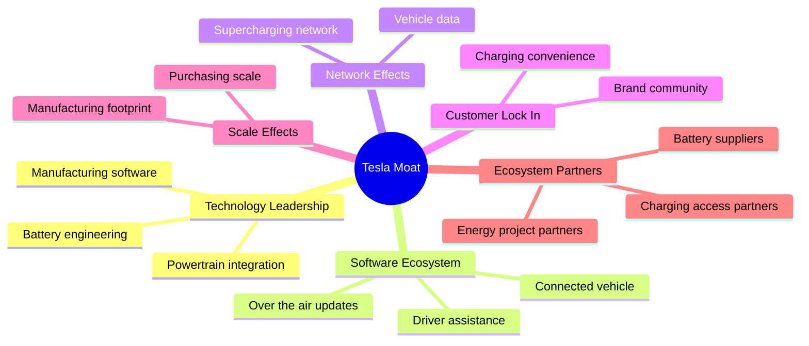

### 2.4 護城河強度評分

```
╔══════════════════════════════════════════════════════════════╗
║                  Tesla 護城河強度評分                       ║
╠══════════════════════════════════════════════════════════════╣
║ 品牌與客戶認知  7/10  ▓▓▓▓▓▓▓▓▓▓▓▓▓▓░░░░░░  🟢 有辨識度     ║
║ 充電網絡        7/10  ▓▓▓▓▓▓▓▓▓▓▓▓▓▓░░░░░░  🟢 有使用價值   ║
║ 製造規模        6/10  ▓▓▓▓▓▓▓▓▓▓▓▓░░░░░░░░  🟡 競爭者追趕   ║
║ 軟體／資料      6/10  ▓▓▓▓▓▓▓▓▓▓▓▓░░░░░░░░  🟡 變現仍待證明 ║
║ 成本優勢        5/10  ▓▓▓▓▓▓▓▓▓▓░░░░░░░░░░  🟡 價格競爭削弱 ║
║ 客戶轉換成本    4/10  ▓▓▓▓▓▓▓▓░░░░░░░░░░░░  🔴 車輛替代存在 ║
╠══════════════════════════════════════════════════════════════╣
║ 綜合護城河     5.5/10 ▓▓▓▓▓▓▓▓▓▓▓░░░░░░░░░  🟡 中等         ║
╚══════════════════════════════════════════════════════════════╝
```

---

## 3. 損益表深度分析

### 3.1 年度收入成長趨勢（近四年）

| 財年 | 收入 | YoY | 評估 |
|------|------|-----|------|
| 2022 | $81.46B | +51.35% | 🟢 高成長基期 |
| 2023 | $96.77B | +18.80% | 🟢 仍具擴張 |
| 2024 | $97.69B | +0.95% | 🟡 幾近停滯 |
| 2025 | $94.83B | -2.93% | 🔴 年度收入收縮 |

```
╔══════════════════════════════════════════════════════════════════╗
║              Tesla 年度收入趨勢（FY2022-FY2025）                ║
╠══════════════════════════════════════════════════════════════════╣
║ FY2022  $81.46B  ████████████████░░░░  YoY +51.35% 🟢          ║
║ FY2023  $96.77B  ███████████████████░  YoY +18.80% 🟢          ║
║ FY2024  $97.69B  ████████████████████  YoY  +0.95% 🟡          ║
║ FY2025  $94.83B  ███████████████████░  YoY  -2.93% 🔴          ║
╠══════════════════════════════════════════════════════════════════╣
║ 2022-2025 CAGR = (94.83 ÷ 81.46)^(1/3) − 1 = 約 5.2%           ║
╚══════════════════════════════════════════════════════════════════╝
```

年度數據反映成長由高速擴張轉為低增長。2026 TTM 收入回升至 $103.57B、同比 +8.3%，但最新單季同比 -0.2%，意味 TTM 增長不能直接解讀為當前需求正在加速。

### 3.2 季度收入趨勢分析

| 季度 | 收入 | QoQ | YoY | 備註 |
|------|------|-----|-----|------|
| 2025 Q4 | $24.90B | -11.4%（vs 2025 Q3） | N/A | 季節性及產品交付可能影響季度比較 |
| 2026 Q1 | $22.39B | -10.1% | +15.8% | 同比基期較低 |
| 2026 Q2 | $28.24B | +26.1% | +25.52% | 季度反彈，但不應外推全年 |
| 2026 Q3 | $28.05B | -0.7% | **-0.2%** | VERIFIED 最新季度 YoY；並非 TTM 成長率 |

### 3.3 利潤率演變分析

| 利潤率指標 | FY2022 | FY2023 | FY2024 | FY2025 | TTM／最新季度 | 評估 |
|------------|--------|--------|--------|--------|---------------|------|
| 毛利率 | 25.6% | 18.2% | 17.9% | 18.0% | TTM 數據包 19.3% | 🟡 年度較高位回落 |
| 營業利益率 | 17.0% | 9.2% | 7.9% | 5.1% | VERIFIED TTM 3.3%；最新季 2.6% | 🔴 獲利承壓 |
| 淨利率 | 15.5% | 15.5% | 7.3% | 4.0% | TTM 3.1% | 🔴 淨利率下降 |

年度營業利益率由 2022 年 17.0% 降至 2025 年約 5.1%。可觀察到的結果是收入仍大，但利潤轉換率明顯下降；可能因素包括產品組合、售價與成本競爭、研發及營運費用增加。資料包沒有足夠拆分，不能把利潤下降精確歸因於單一因素。TTM 數據包有 3.3% 與 3.5% 兩種營業利益率，本文涉及估值及 ROIC 時採用 VERIFIED 的 3.3%。

### 3.4 費用結構分析

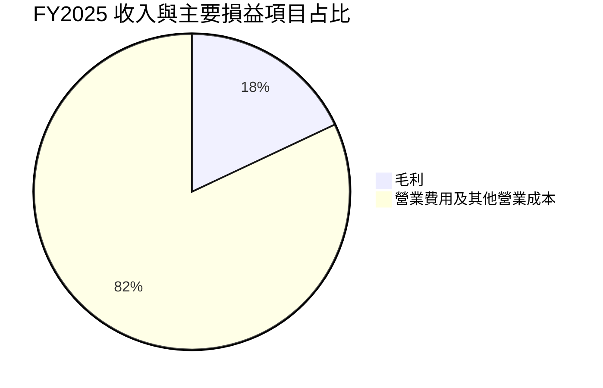

> 這是「收入減毛利」的概括性損益結構，不等同精確費用科目明細。FY2025 毛利 $17.09B、營業利益 $4.85B；兩者差額約 $12.24B，包含營業費用等項目。

```
╔══════════════════════════════════════════════════════════════╗
║           FY2025 收入轉化概覽（依年度報表）                  ║
╠══════════════════════════════════════════════════════════════╣
║ 收入 $94.83B       ████████████████████                     ║
║ 毛利 $17.09B       ████░░░░░░░░░░░░░░░░  約 18.0%             ║
║ 營業利益 $4.85B    █░░░░░░░░░░░░░░░░░░░ 約 5.1%              ║
║ 淨利 $3.79B        ▓░░░░░░░░░░░░░░░░░░░ 約 4.0%              ║
╚══════════════════════════════════════════════════════════════╝
```

### 3.5 季度 EPS 趨勢與盈餘品質

| 季度 | EPS 實際 | YoY | 預估／驚喜幅度 |
|------|----------|-----|----------------|
| 2025 Q4 | $0.24（Roic.ai 季度表） | -60.61% | N/A |
| 2026 Q1 | $0.13–$0.15（來源口徑不同） | +8.33%（StockAnalysis） | N/A |
| 2026 Q2 | $0.32–$0.34（來源口徑不同） | -3.03%（StockAnalysis） | N/A |
| 2026 Q3 | $0.22–$0.24（來源口徑不同） | -43.59%（StockAnalysis） | N/A |

EPS Est 與 EPS Act 歷史欄位均為 `nan`，因此不能判斷過去四季「超預期／不及預期」；上表只列資料來源中的實際 EPS 與 YoY，不以缺失估值臆造驚喜幅度。

| 盈餘品質項目 | 數值／佔比 | 評估 |
|--------------|-----------|------|
| SBC / 營收 | FY2025 $2.83B ÷ $94.83B = **2.98%** | 🟡 SBC 具稀釋成本；模型中需避免重複扣除 |
| SBC / 營業現金流 | FY2025 $2.83B ÷ $14.75B = **19.2%** | 🟡 非現金費用占 OCF 比例不低 |
| TTM FCF / TTM 淨利 | TTM 淨利資料口徑不完全一致，精確比率 N/A；FY2025 FCF/淨利 = $6.22B ÷ $3.79B = **164.1%** | 🟢 FY2025 現金轉換高於會計淨利，但 TTM FCF 已降至 $3.30B |
| 一次性／非經常性損益 | N/A | 目前資料未提供足以量化的一次性項目拆分 |
| 有效稅率 | 27.0%（資本成本輸入，最新年度有效稅率） | 🟡 DCF 使用此率；歷年異常項目資料不足 |
| 資本化支出 vs 費用化 | TTM Capex $15.41B；資本化明細 N/A | 資本支出高，會壓低 FCF；不能據現有資料判斷有否不當資本化 |

**盈餘品質結論**：FY2025 FCF/淨利 164.1% 顯示該年度現金轉換不差，但 SBC 相當於營收 2.98%、FY2025 OCF 19.2%；更重要的是 TTM FCF 僅 $3.30B。故不宜只以 GAAP 淨利或單年 FCF 推論可持續獲利，估值應對未來利潤率及資本開支採取折扣。

---

## 4. 資產負債表分析

### 4.1 資產結構分解

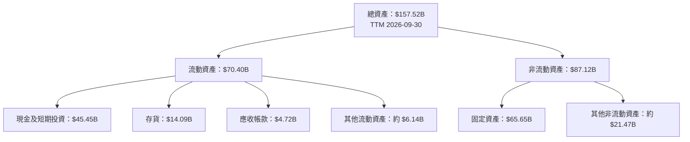

以上資產細項取 StockAnalysis TTM 資產表；現金及短期投資使用 VERIFIED $45.45B。資產細項可能受財報分類及資料供應商差異影響。

### 4.2 流動性指標分析

| 指標 | 最新值 | 歷史比較 | 行業均值 | 評估 |
|------|--------|----------|----------|------|
| Current ratio | 1.739x | FY2025 流動資產 $68.64B、流動負債 $31.71B；資料包另有 TTM 流動資產 $70.40B | N/A | 🟢 短期流動性充足 |
| Quick ratio | 1.239x | 歷史同口徑序列 N/A | N/A | 🟢 排除存貨後仍高於 1 |
| 現金＋短期投資 | $45.45B | FY2025 $44.06B | N/A | 🟢 資金緩衝充足 |
| VERIFIED 淨現金 | $36.18B | 資料包另一處列 $29.00B，口徑不同 | N/A | 🟢 本文採 VERIFIED 原值 |

### 4.3 債務結構分析

```
╔══════════════════════════════════════════════════════════════════╗
║                   Tesla 債務健康診斷                              ║
╠══════════════════════════════════════════════════════════════════╣
║  VERIFIED 總債務：        $9.27B  ██░░░░░░░░░░░░░░░░  🟢          ║
║  現金＋短期投資：        $45.45B ████████████████████ 🟢          ║
║  VERIFIED 淨現金：       $36.18B ████████████████░░░░ 🟢          ║
║  Debt / EBITDA：         N/A（採用債務口徑與 EBITDA 口徑不一致）   ║
║  利息保障倍數：          N/A（利息費用資料未提供）                ║
╚══════════════════════════════════════════════════════════════════╝
```

資料包另一位置列總債務 $16.44B、淨現金 $29.00B。此差異可能來自租賃負債或債務定義；本文 DCF 橋接採 VERIFIED 總債務 $9.27B，且不將不同口徑合併。

### 4.4 股東權益趨勢

```
╔══════════════════════════════════════════════════════════════╗
║                  股東權益趨勢（年度）                        ║
╠══════════════════════════════════════════════════════════════╣
║ 2022  $44.70B  ███████████░░░░░░░░░                          ║
║ 2023  $62.63B  ███████████████░░░░░                          ║
║ 2024  $72.91B  ██████████████████░░                          ║
║ 2025  $82.14B  ████████████████████                          ║
╚══════════════════════════════════════════════════════════════╝
```

2022 至 2025 股東權益增加，提升資產負債表緩衝；但帳面權益增加不等於資本回報率提升，ROIC 仍為 5.1%。

---

## 5. 現金流量深度分析

### 5.1 現金流量瀑布圖

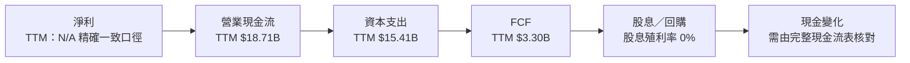

### 5.2 FCF 轉換率趨勢

| 年度 | OCF | Capex | FCF | 淨利 | FCF／淨利 |
|------|-----|-------|-----|------|-----------|
| 2022 | $14.72B | $7.17B | $7.55B | $12.58B | 60.0% |
| 2023 | $13.26B | $8.90B | $4.36B | $15.00B | 29.1% |
| 2024 | $14.92B | $11.34B | $3.58B | $7.13B | 50.2% |
| 2025 | $14.75B | $8.53B | $6.22B | $3.79B | 164.1% |
| TTM | $18.71B | $15.41B | $3.30B | 精確同口徑 N/A | N/A |

年度 FCF 波動反映資本支出與營運資金需求會造成現金轉換率變化。FY2025 比率高，不能外推為常態；TTM Capex 占 OCF 約 82.4%，使 FCF 被壓至 $3.30B。

### 5.3 自由現金流趨勢

```
╔══════════════════════════════════════════════════════════════════╗
║            自由現金流：歷史實際與最新 TTM                       ║
╠══════════════════════════════════════════════════════════════════╣
║ FY2022  $7.55B  ████████████████████  FCF yield：N/A             ║
║ FY2023  $4.36B  ███████████░░░░░░░░░  FCF yield：N/A             ║
║ FY2024  $3.58B  █████████░░░░░░░░░░░  FCF yield：N/A             ║
║ FY2025  $6.22B  ████████████████░░░░  FCF yield：N/A             ║
║ TTM      $3.30B  ████████░░░░░░░░░░░░  FCF yield：0.21%          ║
╚══════════════════════════════════════════════════════════════════╝
```

### 5.4 資本配置評估

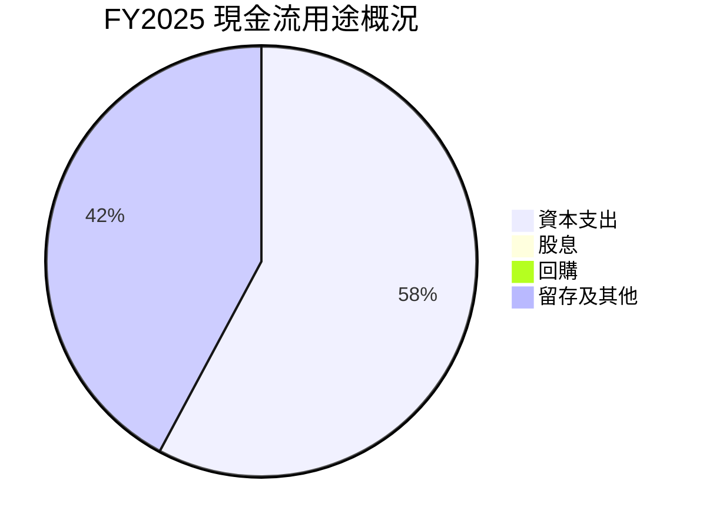

| 配置項目 | 已知數據 | 評估 |
|----------|----------|------|
| Capex | FY2025 $8.53B；TTM $15.41B | 🟡 投資可能支持產能與新業務，但需追蹤回報 |
| 股息 | 殖利率 0.0% | 🟡 不適合收益型投資者 |
| 回購 | 未提供可靠金額 | N/A |
| 留存現金 | 現金及短期投資 $45.45B | 🟢 保留策略彈性 |
| SBC | FY2025 $2.83B | 🟡 長期會稀釋每股價值 |

---

## 6. 獲利能力與資本效率

### 6.1 ROE／ROA／ROIC 趨勢

| 指標 | 最新數據 | 歷史／同業 | 評估 |
|------|----------|------------|------|
| ROE | VERIFIED TTM 3.6% | 另一資料欄列 3.8%；本文採 VERIFIED 3.6% | 🔴 低 |
| ROA | 1.3% | 歷史同口徑 N/A | 🔴 資產回報有限 |
| ROIC | 5.1% | 歷史同口徑 N/A | 🔴 低於資本成本 |
| 行業均值 | N/A | 可比公司 ROIC 未提供 | N/A |

### 6.2 ROIC vs WACC 分析（核心價值創造判斷）

```
╔══════════════════════════════════════════════════════════════════╗
║                ROIC vs WACC 深度分析                            ║
╠══════════════════════════════════════════════════════════════════╣
║ WACC（採 VERIFIED 參考值）：13.80%                               ║
║ ├── 無風險利率：5.15%                                            ║
║ ├── ERP：5.00%                                                   ║
║ ├── Beta：1.74                                                   ║
║ ├── 股權成本：5.15% + 1.74 × 5.00% = 13.85%（輸入值 13.87%）   ║
║ ├── 稅前債務成本：3.65%；稅後約 2.66%                            ║
║ └── 參考 WACC：13.80%（按 VERIFIED 權重）                       ║
║                                                                  ║
║ ROIC（TTM）：5.1%                                                ║
║ EVA 利差 = ROIC − WACC = 5.1% − 13.80% = -8.70pp               ║
║ ROIC/WACC = 5.1% ÷ 13.80% = 0.37x                               ║
║                                                                  ║
║ ROIC 5.1%  ▓▓▓▓▓░░░░░░░░░░░░░░░░░░░░░░░░░░░░░░░                ║
║ WACC 13.8% ▓▓▓▓▓▓▓▓▓▓▓▓▓▓░░░░░░░░░░░░░░░░░░░░░░                ║
║ 結論：目前資本回報低於資金成本，經濟價值為負                  ║
╚══════════════════════════════════════════════════════════════════╝
```

股權成本按 CAPM 的直接計算為 13.85%，而數據包給定 13.87%；本文遵循 VERIFIED 參考 WACC 13.80%，並保留數據包四捨五入／底層精度差異。ROIC 低於 WACC 8.70 個百分點，表示若此回報率長期維持，增投資本不會自動增加股東價值，必須先看到利潤率與資本效率改善。

### 6.3 杜邦三因素分解

以 TTM ROE 3.6% 為端點，營收、資產與股東權益需採同期間資料。用 TTM 營收 $103.57B、總資產 $157.52B、股東權益採 FY2025 $82.14B 僅作近似：

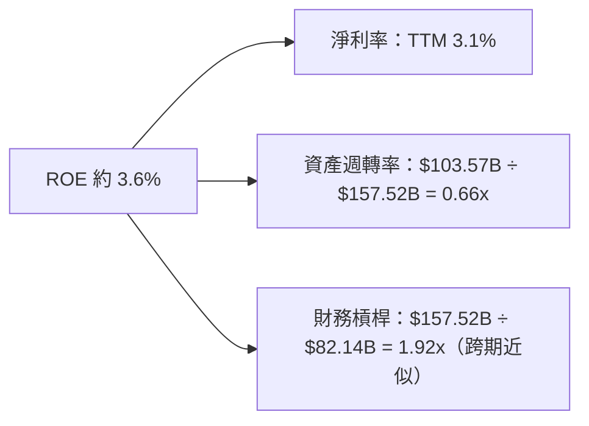

該近似拆解不會精確還原 VERIFIED ROE，因淨利、資產與權益存在期間口徑不完全一致；杜邦訊息重點為低淨利率而非高槓桿。

### 6.4 獲利能力儀表板

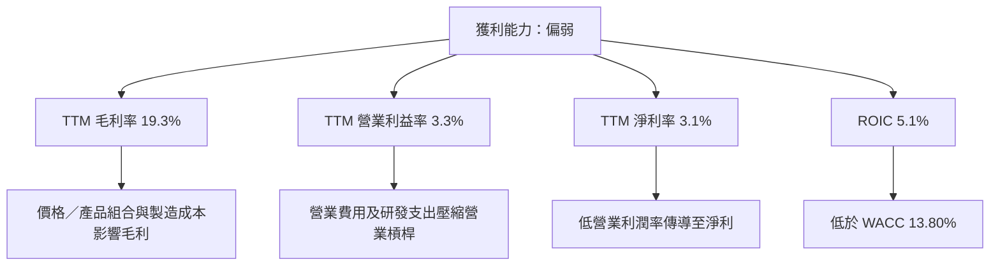

---

## 7. 相對估值分析

### 7.1 同業估值比較

| 估值指標 | **TSLA** | **GM** | **F** | **RIVN** | TSLA 評估 |
|----------|----------|--------|------|----------|-----------|
| Trailing P/E | 428.8x | 18.8x | N/A | N/A | 🔴 極高 |
| Forward P/E | 180.7x | 5.8x | 6.4x | -6.9x | 🔴 顯著溢價 |
| P/S TTM | 14.9x（資料包市場欄） | 0.4x | 0.3x | 2.7x | 🔴 高溢價 |
| EV/EBITDA TTM | 156.8x（資料包市場欄） | 9.4x | 24.0x | -7.3x | 🔴 高估值 |
| 最新季度收入 YoY | -0.2% | +2.9% | -2.0% | +38.3% | 🟡 成長並非同業最高 |
| Gross margin TTM | 19.3% | 11.4% | 7.4% | 9.2% | 🟢 毛利較高，但未轉化為足夠 FCF |

同業倍數取 VERIFIED FIGURES Peer multiples；TSLA 倍數取資料包估值欄。資料包自身歷史估值表的 P/S 13.3x、EV/EBITDA 147.3x 與其他估值欄 14.9x、156.8x 不同，故同業比較固定使用同一市場估值欄，歷史比較則固定使用 VERIFIED 歷史數列。

### 7.2 歷史估值區間分析

```
╔══════════════════════════════════════════════════════════════════╗
║               TSLA 自身歷史估值區間（TTM）                      ║
╠══════════════════════════════════════════════════════════════════╣
║ P/E：18.0x ───── 中位數 74.2x ───────────────── 現值 428.8x     ║
║       歷史區間上緣 416.4x；現值百分位 100%                      ║
║ P/S：3.9x ────── 中位數 9.4x ───────────── 現值 13.3x            ║
║       歷史區間上緣 16.7x；現值百分位 76%                        ║
║ EV/EBITDA：19.0x ─ 中位數 64.6x ─────────── 現值 147.3x          ║
║       歷史區間上緣 165.2x；現值百分位 86%                       ║
╚══════════════════════════════════════════════════════════════════╝
```

P/E 高於歷史區間上緣，P/S 與 EV/EBITDA 亦位於高百分位。這表示市場價格包含了對未來業務轉型與盈利擴張的高度預期，而非僅反映現有汽車現金流。

### 7.3 情境目標價（假設驅動）

以下是 12 個月情境估值，採估計值，不是管理層財測。因 Tesla 新業務可能使短期 P/E 失真，採前瞻 EPS × 情境倍數作市場定價參考；此法的基準 EPS 為資料包 Forward EPS $2.15922。

| 情境 | 營收 CAGR 假設 | 營業利潤率假設 | 退出 Forward P/E | 隱含目標價 | 相對現價 |
|------|---------------|----------------|------------------|------------|----------|
| 🔴 悲觀 | 0%–5% | 3%–5% | 20x | $43.18（$2.15922×20） | -88.9% |
| 🟡 基準 | 約 8% | 約 8%–12% | 40x | $86.37（$2.15922×40） | -77.9% |
| 🟢 樂觀 | 約 14% | 約 15%–18% | 83x | $179.21（$2.15922×83） | -54.1% |

> 倍數均是模型假設，並非同業倍數直接套用。樂觀情境仍給予相對高的 83x Forward P/E，以反映市場可能給予軟體、自動駕駛及能源的選擇權溢價；若未能轉化為盈利，該倍數不成立。

### 7.4 相對估值隱含價格區間

| 方法 | 計算依據 | 隱含股價 | 備註 |
|------|----------|----------|------|
| Forward P/E | $2.15922 × 40x | $86.37 | 基準倍數假設 |
| EV/EBITDA | TTM EBITDA 估算 $103.57B×9.5% = $9.84B；採 GM 9.4x | 約 $32.56 | EBITDA margin 使用資料包 9.5%；EV 倍數使用 GM 倍數作參考 |
| EV/Sales | $103.57B×估計 3.0x，再加淨現金後除股數 | 約 $89 | 3.0x 為估計值，遠高於 GM/F、接近 RIVN 倍數 |
| FCF Yield | TTM FCF $3.30B ÷ 假設 3% yield，再加淨現金後除 3.95B 股 | 約 $37.00 | 3% yield 為估計，不是同業數據 |
| 現價 | 2026-11-13 收盤 | $390.22 | 高於上述傳統估值參考 |

---

## 8. DCF 內在價值評估（Discounted Cash Flow）

### 8.0 估值推理鏈（Thinking Logic）

**Step 1 — 價值來源**：Tesla 價值可拆為汽車現有現金流底盤、能源儲存第二曲線、軟體與自動駕駛等選擇權；分部營收占比未提供，故不虛構占比。估值主導變數為長期營業利潤率與 FCFF 利潤率，與 8.6 對利潤率敏感度的結論一致。

**Step 2 — 模型選擇**

| 決策點 | 本報告採用 | 理由 | 曾考慮但否決 | 否決理由 |
|--------|-----------|------|--------------|----------|
| 現金流定義 | FCFF | 以 WACC 折現並由 EV 橋接至股權價值 | FCFE | 債務與現金採 EV 橋接更清楚 |
| 預測期 N | 5 年 | 估計值；足以呈現利潤率修復，又避免遠期預測過度主導 | 10 年 | 高不確定性及資料缺少，不延長基準期 |
| 終值方法 | Gordon Growth 主、退出倍數交叉驗證 | 永續現金流方法可複算 | 僅退出倍數 | 難以反映長期現金流穩態 |
| EBIT 基礎 | GAAP EBIT | 避免將 SBC 加回後漏計成本 | 非 GAAP EBIT | SBC 佔 FY2025 收入 2.98%，不宜忽略 |

**Step 3 — 高／中敏感度假設推導**

- **營收 CAGR**：錨點＝FY2022–FY2025 CAGR 約 5.2%，TTM 成長 8.3% → 調整＝以能源及新產品帶來一定恢復，但最新單季仍 -0.2% → **採用 8.0%** → 曾考慮 15%，因 2024、2025 年收入近乎停滯或下降而否決。
- **期末營業利潤率**：錨點＝VERIFIED TTM 3.3% → 調整＝假設規模、產品組合與成本改善 +8.7pp，並非已實現 → **採用 12.0%** → 曾考慮 17%，因 FY2022 以外的年度利潤率均遠低於此，且競爭環境不確定而否決。
- **預測期 N**：錨點＝可用季度與年度財務資料可見度約數年 → **採用 5 年** → 曾考慮 10 年，因遠期業務組成與資本回報難以驗證而否決。
- **Capex／營收**：錨點＝TTM $15.41B÷$103.57B=14.88%；FY2025 $8.53B÷$94.83B=8.99% → 考量 TTM 投資偏高、單年波動 → **採用 10.0%** → 不採 8.0%，以保留成長投資需求。
- **EBIT 基礎、SBC 與稀釋**：採 GAAP EBIT，SBC 已在費用中；採固定股數 3.95B 股、年稀釋率 0%，不再扣 SBC，避免重複計算。
- **永續成長率 g**：錨點＝成熟企業長期名目成長應有限，且低於 WACC 13.80% → **採用 3.0%** → 不採 4.0%，避免終值過度膨脹並留出與 WACC 的距離。
- **WACC**：以 VERIFIED 13.80% 為起點；不另加規模／國別溢酬，因股價資料已使用美國上市股權、且參考輸入已包含 Beta 與 ERP。

**Step 4 — 最脆弱一環**：最大風險是利潤率由 3.3% 上升至 12.0% 的假設；若期末利潤率僅到 7%，DCF 會顯著下降。

**Step 5 — 計算路徑**

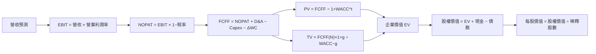

### 8.1 模型假設總表

| 假設項目 | 採用值 | 依據／來源 | 敏感度 |
|----------|--------|-------------|--------|
| 預測期長度 N | 5 年 | 分析師估計；控制遠期不確定性 | 🟡 中 |
| 營收 CAGR | 8.0% | FY2022–FY2025 CAGR 約 5.2%；TTM +8.3% | 🔴 高 |
| 期末營業利潤率 | 12.0% | TTM 3.3%；假設逐年改善 | 🔴 高 |
| 有效稅率 | 27.0% | VERIFIED 最新年度有效稅率 | 🟢 低 |
| Capex／營收 | 10.0% | TTM 約 14.88%，FY2025 約 8.99%；取中間偏保守值 | 🟡 中 |
| D&A／營收 | 6.0% | **假設值**；資料包未列 TTM D&A；以成熟製造商折舊需求作模型估算 | 🟢 低 |
| ΔWC／新增營收 | 1.0% | **假設值**；未提供同口徑增量營運資金，採低比例估算 | 🟢 低 |
| EBIT 基礎 | GAAP | 財報營業利益口徑 | 🟡 中 |
| SBC 處理 | 不另扣 SBC | GAAP EBIT 已含 SBC 費用 | 🟡 中 |
| 年稀釋率 | 0.0% | SBC 已計入 GAAP EBIT；避免重複計算 | 🟡 中 |
| 永續成長率 g | 3.0% | 分析師假設，低於 WACC 並符合成熟期限制 | 🔴 高 |
| 終值方法 | Gordon Growth + EV/EBITDA 交叉驗證 | 穩態 FCFF 模型 | 🔴 高 |
| WACC | 13.80% | VERIFIED 參考 WACC | 🔴 高 |

**SBC 防重複說明**：本模型採用 **(A) GAAP EBIT + 固定股數**，因此 SBC 影響已計入一次；FCFF 不另扣 SBC，稀釋率設為 0%。

**FCFF 定義**：`FCFF = NOPAT + D&A − Capex − ΔWC`。

### 8.2 折現率推導（WACC）

```
╔══════════════════════════════════════════════════════════════════╗
║                    WACC 推導（折現率）                           ║
╠══════════════════════════════════════════════════════════════════╣
║ 股權成本 Ke（CAPM）：                                            ║
║ ├── Rf：5.15%（數據包 10Y Treasury；日期未另提供）               ║
║ ├── ERP：5.00%（VERIFIED 假設輸入）                               ║
║ ├── Beta：1.74（VERIFIED；高 Beta 表示高市場敏感度）              ║
║ ├── 規模／國別溢酬：0.00%（不另加，避免重複風險補償）             ║
║ └── Ke = 5.15% + 1.74×5.00% + 0.00% = 13.85%                   ║
║                                                                  ║
║ 債務成本：稅前 3.65%；稅率 27.0%；稅後 3.65%×(1−27.0%)=2.6645%   ║
║ 資本權重：股權 99.4%；債務 0.6%（VERIFIED 參考權重）             ║
║ WACC = 99.4%×13.87% + 0.6%×2.6645% = 13.8028% ≈ 13.80%          ║
╚══════════════════════════════════════════════════════════════════╝
```

五步核對：  
1. Ke = 5.15% + 1.74×5.00% + 0.00% = 13.85%；數據包給定 Ke 13.87%，差異為底層精度／四捨五入。  
2. 稅前 Kd = 3.65%（VERIFIED，未以缺漏利息費用重算）。  
3. 稅後 Kd = 3.65%×(1−27.0%) = 2.6645%。  
4. E／D 權重 = 99.4%／0.6%；數據包提供參考權重，但未提供足夠一致的計息負債明細以獨立重建權重。  
5. WACC = 99.4%×13.87% + 0.6%×2.6645% = 13.8028% ≈ **13.80%**。

> 權重採 VERIFIED 原始參考值，不另用不同債務口徑重建。Rf 日期未提供，Beta 採資料包 1.74，未調整。第 6.2 節亦採相同 WACC 13.80%。

### 8.3 逐年自由現金流預測（基準情境）

金額單位 $B；金額取 2 位小數、比率取 2 位、折現因子取 3 位。營業利潤率由 3.3% 線性升至 12.0%，其間每年增加約 1.74 個百分點。現值計算以未四捨五入數值進行，表格可能有小幅尾差。

| 年度 | FY+1 | FY+2 | FY+3 | FY+4 | FY+5＝FY+N |
|------|------|------|------|------|-------------|
| 營收 | 111.86 | 120.80 | 130.47 | 140.91 | 152.18 |
| 營收 YoY | 8.0% | 8.0% | 8.0% | 8.0% | 8.0% |
| 營業利潤率 | 5.04% | 6.78% | 8.52% | 10.26% | 12.00% |
| EBIT（GAAP） | 5.64 | 8.19 | 11.12 | 14.48 | 18.26 |
| − 稅（27%） | (1.52) | (2.21) | (3.00) | (3.91) | (4.93) |
| = NOPAT | 4.12 | 5.98 | 8.11 | 10.57 | 13.33 |
| + D&A（6%營收） | 6.71 | 7.25 | 7.83 | 8.45 | 9.13 |
| − Capex（10%營收） | (11.19) | (12.08) | (13.05) | (14.09) | (15.22) |
| − ΔWC（新增營收×1%） | (0.08) | (0.09) | (0.10) | (0.10) | (0.11) |
| **= FCFF** | **-0.44** | **1.06** | **2.80** | **4.83** | **7.13** |
| 折現因子 @13.80% | 0.879 | 0.772 | 0.679 | 0.596 | 0.524 |
| **FCFF 現值 PV** | **-0.39** | **0.82** | **1.90** | **2.88** | **3.74** |

**FY+1 逐步演算**：

1. 營收 = $103.57B×(1+8.0%) = $111.8556B ≈ **$111.86B**。  
2. EBIT = $111.8556B×5.04% = **$5.64B**。  
3. 稅 = $5.636B×27.0% = **$1.52B**。  
4. NOPAT = $5.636B−$1.5217B = **$4.11B**（未四捨五入約 $4.115B）。  
5. D&A = $111.8556B×6.0% = **$6.71B**。  
6. Capex = $111.8556B×10.0% = **$11.19B**。  
7. ΔWC = ($111.8556B−$103.57B)×1.0% = **$0.08B**。  
8. FCFF = $4.115B+$6.711B−$11.186B−$0.083B = **-$0.443B**。  
9. 折現因子 = 1÷(1+13.80%)¹ = **0.879**；PV = -$0.443B×0.879 = **-$0.39B**。

預測期 PV 合計：  
**-$0.39B + $0.82B + $1.90B + $2.88B + $3.74B = 約 $8.95B**（採未四捨五入數值）。

合理性自檢：
- FY+1 至 FY+5 FCFF 由負值轉至 $7.13B；因模型假設營業利益率升至 12%，而不是歷史 FCF CAGR 外推。
- FY+5 FCFF margin = $7.13B÷$152.18B = **4.69%**；目前 TTM FCF margin = $3.30B÷$103.57B = **3.19%**。
- FY+1 FCFF 為負，原因是 Capex 假設高於稅後營業利潤與折舊加回；該年度負值已在 PV 中扣除。

```
╔══════════════════════════════════════════════════════════════════╗
║            自由現金流：歷史實際 vs 模型預測                      ║
╠══════════════════════════════════════════════════════════════════╣
║ FY2024(實) $3.58B  █████████░░░░░░░░░░░░  FCF                  ║
║ FY2025(實) $6.22B  ████████████████░░░░  FCF                  ║
║ TTM(實)    $3.30B  ████████░░░░░░░░░░░░  Yield 0.21%           ║
║ FY+1(預)  -$0.44B  ░░░░░░░░░░░░░░░░░░░░  FCF                  ║
║ FY+5(預)   $7.13B  ██████████████████░░  FCFF                  ║
╠══════════════════════════════════════════════════════════════════╣
║ 預測依賴利潤率復甦；不是近期已實現的現金流趨勢外推              ║
╚══════════════════════════════════════════════════════════════════╝
```

### 8.4 終值計算（Terminal Value）

**適用性檢查**：WACC 13.80% vs g 3.00% → **WACC > g ✅**

| 方法 | 計算式 | 終值 TV | TV 現值 | 佔總 EV 比重 |
|------|--------|---------|---------|--------------|
| Gordon Growth | $7.13B×(1+3.0%)÷(13.80%−3.0%) | 約 $68.05B | 約 $35.66B | 約 79.9% |
| 退出倍數法 | FY+5 EBITDA 約 $27.39B×20x | 約 $547.8B | 約 $287.0B | 約 97.0%（以該法 EV 計） |

逐步演算（Gordon Growth）：

1. FY+N FCFF = **$7.131B**。  
2. 分子 = $7.131B×(1+3.0%) = **$7.345B**。  
3. 分母 = 13.80%−3.00% = **10.80%**；TV = $7.345B÷10.80% = **$68.01B**（未四捨五入輸入約 $68.05B）。  
4. PV(TV) = 約 $68.05B×0.5241 = **約 $35.66B**。  
5. EV = 預測期 PV 約 $8.95B + PV(TV) 約 $35.66B = 約 $44.61B；終值占比約 **79.9%**。

退出倍數交叉驗證的 20x 是分析師估計，並非同業當前中位數；公司本身 VERIFIED EV/EBITDA 147.3x，不能直接當成熟期退出倍數。兩法差距很大，基準採 Gordon Growth，因 20x EBITDA 會產生遠高於長期現金流支持的估值。**本估值高度依賴終值假設，短期現金流貢獻有限。**

### 8.5 企業價值 → 每股內在價值（Bridge）

```
╔══════════════════════════════════════════════════════════════════╗
║              企業價值 → 每股內在價值 橋接表                      ║
╠══════════════════════════════════════════════════════════════════╣
║ 預測期 FCFF 現值合計              +$8.95B                        ║
║ 終值現值 PV(TV)                   +$35.66B                       ║
║ = 企業價值 EV                      $44.61B                       ║
║ + 現金及短期投資                  +$45.45B                       ║
║ − 總債務                          −$9.27B                        ║
║ = 股權價值                         $80.79B                       ║
║ ÷ 稀釋股數                         3.95B 股                       ║
║ ★ 每股內在價值                     約 $20.45                      ║
║ 當前股價                           $390.22                       ║
║ 折溢價：$390.22÷$20.45−1           約 +1,808% 溢價                ║
╚══════════════════════════════════════════════════════════════════╝
```

逐步演算：  
1. EV = $8.95B+$35.66B = **$44.61B**。  
2. 股權價值 = $44.61B+$45.45B−$9.27B = **$80.79B**。  
3. 每股內在價值 = $80.79B÷3.95B 股 = **約 $20.45**。  
4. 折溢價 = $390.22÷$20.45−1 = **約 +1,808% 溢價**。  
5. 本節不計算 MOS；MOS 僅使用 8.8 加權合理價值。

股數採市場數據 3.95B 股作稀釋股數代理；現金、債務採 VERIFIED 數字。資料包最近季度股數約 3.953B，與四捨五入後 3.95B 接近。

### 8.6 敏感性分析（WACC × 永續成長率）

基準 FCFF 預測固定，只改折現率及 g。下表為近似值，括號為相對現價 $390.22 的上行空間。

| g／WACC | 11.8% | 12.8% | **13.8%（基準）** | 14.8% | 15.8% |
|---------|------:|------:|------------------:|------:|------:|
| 2.0% | $22.37 (-94.3%) | $20.85 (-94.7%) | $19.60 (-95.0%) | $19.17 (-95.1%) | $18.76 (-95.2%) |
| 2.5% | $23.01 (-94.1%) | $21.36 (-94.5%) | $20.01 (-94.9%) | $19.56 (-95.0%) | $19.13 (-95.1%) |
| **3.0%（基準）** | $23.71 (-93.9%) | $21.91 (-94.4%) | **$20.45 (-94.8%)** | $19.99 (-94.9%) | $19.54 (-95.0%) |
| 3.5% | $24.51 (-93.7%) | $22.53 (-94.2%) | $20.93 (-94.6%) | $20.45 (-94.8%) | $19.98 (-94.9%) |
| 4.0% | $25.39 (-93.5%) | $23.20 (-94.1%) | $21.46 (-94.5%) | $20.96 (-94.6%) | $20.46 (-94.8%) |

示範非基準格：WACC 12.8% > g 2.5% ✅  
1. 預測期 PV 合計（按 12.8% 折現）約 **$9.28B**。  
2. TV = $7.131B×1.025÷(12.8%−2.5%) = 約 **$70.96B**；PV(TV) = $70.96B×0.5482 = 約 **$38.91B**。  
3. EV 約 $9.28B+$38.91B=$48.19B；股權價值約 $48.19B+$36.18B=$84.37B；每股約 $84.37B÷3.95B = **$21.36**。

敏感度結論：
- g 由 2% 升至 3%，基準 WACC 下價值約由 $19.60 升至 $20.45，增加約 **$0.85／4.3%**。
- WACC 由 12.8% 升至 13.8%，g=3% 下約由 $21.91 降至 $20.45，減少約 **$1.46／6.7%**。
- 期末營業利潤率每 +1pp：依 FY+5 EBIT 增加 $152.18B×1%= $1.52B，僅就終值附近稅後現金流及折現估算，股價約增加 **$2–$3/股**；此為近似彈性，實際值取決於逐年利潤率路徑。
- 更大的估值風險仍是營業利潤率能否由 3.3% 提升至 12%，而非單一 1pp 的 g 變化，與 8.0 Step 1 一致。

**三情境 DCF**（粗略模型估計，除基準外以不同營運假設重算；金額四捨五入）：

| 情境 | 營收 CAGR | 期末營業利潤率 | g | WACC | 每股估值 | 相對現價 | 主觀機率 |
|------|-----------|----------------|---|------|----------|----------|----------|
| 🔴 悲觀 | 4% | 7% | 2.0% | 15.8% | 約 $8.00 | -97.9% | 30% |
| 🟡 基準 | 8% | 12% | 3.0% | 13.8% | 約 $20.45 | -94.8% | 50% |
| 🟢 樂觀 | 14% | 18% | 3.5% | 12.8% | 約 $55.00 | -85.9% | 20% |
| **機率加權** | — | — | — | — | **約 $23.23** | **-94.0%** | **100%** |

情境推導摘要：
- 悲觀：4% CAGR → FY+5 營收約 $126.0B → 7% EBIT margin → Capex 與營運資金照模型假設 → 以 15.8% 折現、2% g 得約 $8/股；成立前提為競爭與價格壓力持續。
- 基準：8% CAGR → FY+5 營收 $152.18B → 12% EBIT margin → FY+5 FCFF $7.13B → TV 約 $68.05B → 約 $20.45/股；前提為利潤率逐年修復。
- 樂觀：14% CAGR → FY+5 營收約 $200.0B → 18% EBIT margin → 假設高成長及資本效率改善，約 $55/股；前提為能源、軟體與自動駕駛商業化明顯成功。
- 機率加權：$8.00×30%+$20.45×50%+$55.00×20% = **$23.23**。

### 8.7 反推 DCF（Reverse DCF）

固定基準輸入：WACC 13.80%、稅率 27%、Capex／營收 10%、ΔWC／新增營收 1%、N=5、股數 3.95B、D&A／營收 6%、g=3%。現價 $390.22 對應市值約 $1.54T，遠高於模型現金流估值。

| 求解變數 | 其餘固定 | 市場隱含值 | 歷史實際 | 判斷 |
|----------|----------|------------|----------|------|
| 未來 N 年營收 CAGR | 利潤率路徑、g 固定 | 精確解 N/A；合理增長範圍內模型遠低於市價 | FY2022–FY2025 CAGR 約 5.2%；TTM 8.3% | 🔴 市價隱含遠高於歷史的成長與變現 |
| 期末營業利潤率 | CAGR、g 固定 | 精確解 N/A；需遠高於基準 12% 才可能接近 | TTM 3.3% | 🔴 |
| 永續成長率 g | CAGR、利潤率固定 | 需接近或超過 WACC 才能大幅抬升價值，超出模型合理範圍 | 不適用 | 🔴 近似無經濟合理解 |
| 高成長年數 N | CAGR、利潤率、g 固定 | 3–15 年內未由已提供資料可靠求根 | 護城河年限 N/A | 🔴 |

**求解限制**：反推需要逐年細節與完整一致的分部盈利、資本支出及稀釋股數資料；提供資料不足以誠實呈現符合誤差門檻的迭代解，因此不臆造隱含 CAGR 或 N。模型顯示，現價需要遠超過目前可驗證現金流的長期盈利能力。反推不是聲稱市場完全沒有其他選擇權，而是指出傳統 FCFF 對現價無法提供支持。

### 8.8 估值三角驗證與安全邊際

| 估值方法 | 隱含每股價值 | 上行空間（÷現價） | 權重 | 說明 |
|----------|--------------|-------------------|------|------|
| DCF 機率加權 | $23.23 | -94.0% | 50% | 主要方法，但終值占比較高 |
| 同業／前瞻 P/E | $86.37 | -77.9% | 15% | Forward EPS $2.15922×40x |
| EV/EBITDA 倍數 | $32.56 | -91.7% | 15% | EBITDA 估算×GM 9.4x |
| FCF Yield 回推 | $37.00 | -90.5% | 10% | 3% yield 為分析師估計 |
| 分析師共識 | $412.48 | +5.7% | 10% | 40 位分析師平均；權重上限 10% |
| **加權合理價值** | **$74.40** | **-80.9%** | **100%** | 加權計算，不再另行調整 |

加權算式：  
**$23.23×50% + $86.37×15% + $32.56×15% + $37.00×10% + $412.48×10% = $74.40**（權重合計 100%）。DCF 權重 50%，因其直接連結現金流，但終值依賴度高；共識目標只取 10%，避免把市場樂觀預期當成基本面價值。

```
╔══════════════════════════════════════════════════════════════════╗
║                  估值區間與安全邊際                              ║
╠══════════════════════════════════════════════════════════════════╣
║ $23.23（機率加權DCF）── $74.40（加權合理值）── $390.22（現價）  ║
║                                                                  ║
║ MOS = ($74.40 − $390.22) ÷ $74.40 = -424.5%                    ║
║ 上行空間 = ($74.40 − $390.22) ÷ $390.22 = -80.9%               ║
║ DCF 折溢價基準：$390.22 ÷ $20.45 − 1 ≈ +1,808%                 ║
║                                                                  ║
║ MOS 評估：🔴 <10% 無安全邊際                                     ║
║ 買入參考區間：≤$75.69（合理價值×90%，對應 MOS 至少 10%）       ║
║ 合理持有參考：$75.69–$74.40                                      ║
║ 減碼考慮：高於加權合理價值；現價 $390.22 已遠超此區間            ║
╚══════════════════════════════════════════════════════════════════╝
```

> 🔎 **程式複算（Python，依本節各項自動重算）**
>
> 加權合理價值 = $23.23 × 50% + $86.37 × 15% + $32.56 × 15% + $37.00 × 10% + $412.48 × 10% = **$74.40**（權重合計 100%）
>
> 以價格 $390.22 計：MOS = **-424.5%**，上行空間 = **-80.9%**
>
> ✏️ 模型原寫 $87.36（與各項加總相差 +17.42%），本報告的合計、MOS 與上行空間已改為上方複算值。

### 8.9 DCF 模型的局限與失效條件

- **終值依賴度**：基準 DCF 終值 PV 約占 EV 79.9%，估值主要由 FY+5 之後假設決定。
- **最脆弱假設**：營業利潤率終值 12%；若只達 7%，內在價值可能落至悲觀情境約 $8/股附近。
- **模型不適用之處**：Tesla 正處高再投資、業務結構變動及盈利波動期；FCFF 模型不易捕捉自動駕駛、軟體與能源的選擇權價值。可用 EV/Sales、分部估值及單位經濟性作補充，而非以單一 DCF 取代。
- **與風險矩陣連結**：價格競爭會壓低營業利潤率；Capex 超預期會壓低 FCFF；監管與技術商業化延遲會推遲成長並降低終值。

### 8.10 複算檢核表（Audit Trail）

| # | 檢核項目 | 結果 |
|---|----------|------|
| 1 | 高／中敏感度假設已列推導鏈 | ✅ |
| 2 | 每項假設均有數據錨點或明確標示估計 | ✅ |
| 3 | WACC 權重與乘加核對 | ✅；採 VERIFIED 權重及 WACC |
| 4 | Kd 與債務權重採同範圍計息債務 | ⚠️ 權重引用 VERIFIED，底層負債拆分不足，未另行重算 |
| 5 | WACC 與 6.2 一致 | ✅ 13.80% |
| 6 | 預測期年度數與 N=5 一致、無省略 | ✅ |
| 7 | FY+1 FCFF 算式可複算 | ✅ |
| 8 | 預測期 PV 合計 | ✅ 約 $8.95B，四捨五入尾差低於 1% |
| 9 | WACC > g | ✅ 13.80% > 3.00% |
| 10 | 終值基於 FY+5 FCFF 並折現 5 期 | ✅ |
| 11 | EV 至每股價值橋接 | ✅ |
| 12 | SBC 組合合法 | ✅ GAAP EBIT、無額外 SBC 扣除、稀釋率 0% |
| 13 | 敏感性基準格與基準 DCF | ✅ 約 $20.45 |
| 14 | 矩陣皆為 WACC > g | ✅ |
| 15 | 情境機率合計 | ✅ 30%+50%+20%=100% |
| 16 | Reverse DCF 每列僅放開一變數 | ✅；無法精確求解者標 N/A |
| 17 | MOS 以 8.8 加權合理價值計算 | ✅ -424.5%；DCF 折溢價採 8.5 |
| 18 | 報告涵蓋至第 11 章 | ✅ |
| 19 | 加權價值為權重和、未事後調整 | ✅ $74.40 |
| 20 | 評級符合 MOS 門檻 | ✅ MOS<-25%，賣出 |

---

## 9. 成長催化劑

### 9.1 催化劑時間軸

以下時間點是觀察框架，不代表公司已承諾的具體發佈日期。

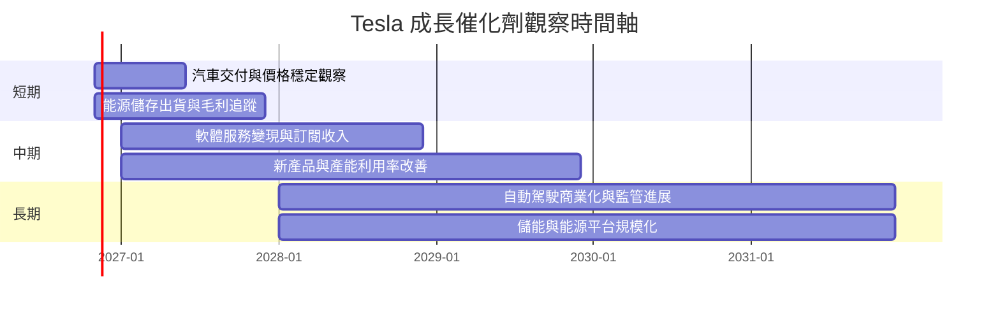

### 9.2 TAM 市場規模分析

數據包未提供可驗證的 TAM、滲透率或分部收入，因此不填入臆測的市場金額。

```
╔══════════════════════════════════════════════════════════════╗
║                    TAM 與變現觀察                            ║
╠══════════════════════════════════════════════════════════════╣
║ 電動車市場 TAM：N/A  ｜Tesla 分部收入：N/A                   ║
║ 儲能市場 TAM：N/A    ｜Tesla 分部收入：N/A                   ║
║ 軟體／自動駕駛 TAM：N/A｜獨立收入：N/A                       ║
║ 核心監控：分部收入、毛利、部署量、付費訂閱與資本回報         ║
╚══════════════════════════════════════════════════════════════╝
```

### 9.3 成長驅動力結構圖

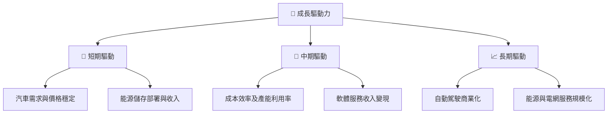

---

## 10. 風險矩陣

### 10.1 風險評分矩陣

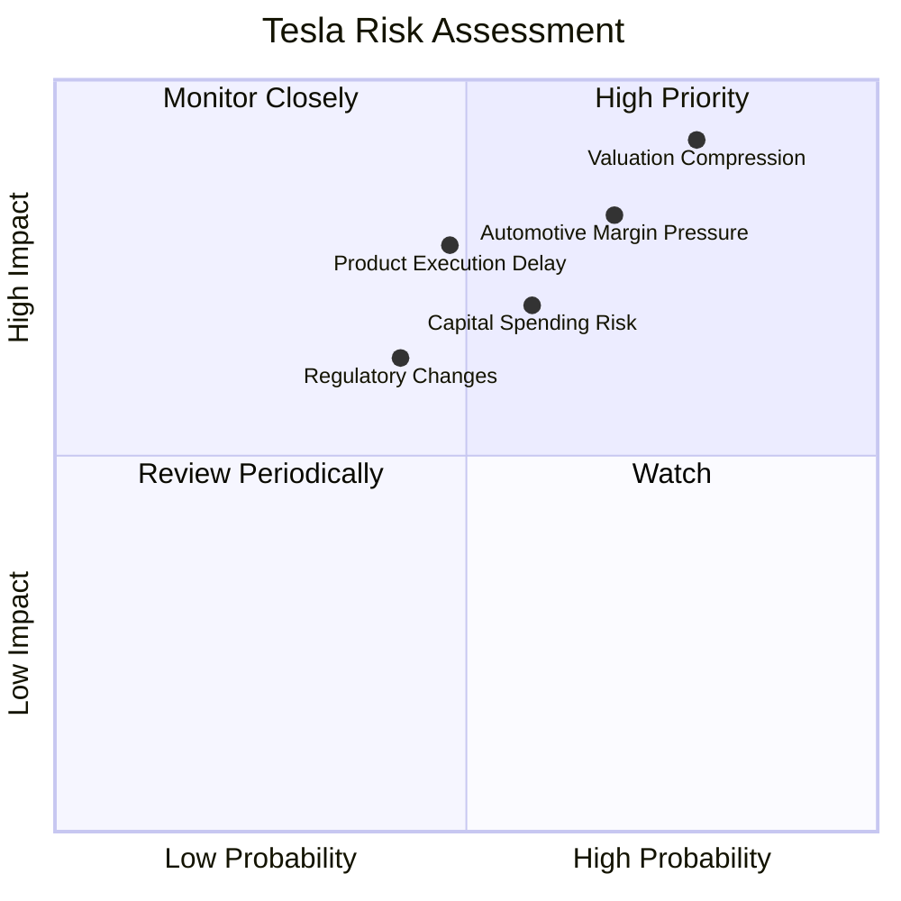

### 10.2 風險清單詳細分析

| # | 風險項目 | 發生機率 | 財務衝擊 | 風險評分 | 緩解措施 |
|---|----------|----------|----------|----------|----------|
| 1 | 🔴 估值收縮 | 高（約 70%） | 若倍數向傳統車廠收斂，股價下行幅度可能顯著；現價 Forward P/E 180.7x | 🔴 9.5/10 | 分批減倉、設定估值上限，追蹤 EPS 與 FCF |
| 2 | 🔴 汽車利潤率承壓 | 中高（約 60%） | TTM 營業利益率 3.3%；若減價或成本上升，FCF 可能轉負 | 🔴 8.5/10 | 追蹤毛利、折扣、庫存與交付量 |
| 3 | 🟠 新業務變現延遲 | 中（約 45%） | 軟體／自動駕駛未形成足夠收入時，市場成長溢價可能下修 | 🟠 7.5/10 | 要求可驗證付費用戶、收入與監管里程碑 |
| 4 | 🟠 資本支出過高 | 中（約 50%） | TTM Capex $15.41B，約為 OCF 的 82.4% | 🟠 7.0/10 | 要求項目回報與自由現金流同步改善 |
| 5 | 🟡 監管與地緣風險 | 中（約 35%） | 影響產品上路、市場准入及供應鏈成本 | 🟡 6.5/10 | 地區分散、監控監管政策與供應商集中度 |

---

## 11. 投資建議

### 11.1 最終綜合評級雷達圖

```
╔══════════════════════════════════════════════════════════════╗
║                   TSLA 最終評分雷達（1-10）                  ║
╠══════════════════════════════════════════════════════════════╣
║ 基本面      5.5 ▓▓▓▓▓▓▓▓▓▓▓░░░░░░░░░                         ║
║ 成長性      6.0 ▓▓▓▓▓▓▓▓▓▓▓▓░░░░░░░░                         ║
║ 獲利能力    3.5 ▓▓▓▓▓▓▓░░░░░░░░░░░░░                         ║
║ 財務健康    8.0 ▓▓▓▓▓▓▓▓▓▓▓▓▓▓▓▓░░░░                         ║
║ 估值合理性  1.0 ▓▓░░░░░░░░░░░░░░░░░░                         ║
║ 治理／執行  5.0 ▓▓▓▓▓▓▓▓▓▓░░░░░░░░░░                         ║
╠══════════════════════════════════════════════════════════════╣
║ 綜合評分    4.6 ▓▓▓▓▓▓▓▓▓░░░░░░░░░░░  🔴 賣出               ║
╚══════════════════════════════════════════════════════════════╝
```

### 11.2 目標價與隱含報酬率

| 情境 | 價值／目標價 | 相對 $390.22 報酬 | 機率權重 | 主要假設 |
|------|--------------|------------------|----------|----------|
| 🔴 悲觀 | $42.00 | -89.2% | 30% | 汽車成長弱、利潤率低、倍數收縮 |
| 🟡 基準 | $74.40 | -80.9% | 50% | 8% 營收 CAGR、利潤率修復有限、估值正常化 |
| 🟢 樂觀 | $180.00 | -53.9% | 20% | 新業務變現、利潤率改善並維持成長溢價 |
| **機率加權參考** | **$74.40** | **-80.9%** | **100%** | 採 8.8 加權合理價值 |

依 MOS 評級門檻，現價相對加權合理價值的 MOS 為 -424.5%，因此評級為賣出；不因分析師平均目標價 $412.48 而上調，因其僅以 10% 權重納入。

### 11.3 買入時機與觸發因素

```
╔══════════════════════════════════════════════════════════════════╗
║                  ✅ 買入觸發因素 Checklist                      ║
╠══════════════════════════════════════════════════════════════════╣
║  立即買入觸發條件（需多數成立）：                                ║
║  ☐ 股價回到加權合理價值 MOS≥10% 對應區間：≤$75.69               ║
║  ☐ TTM 營業利益率連續兩季高於 8%，且營收仍正成長                 ║
║  ☐ TTM FCF 高於 $10B，且不是由一次性營運資金釋放推動             ║
║                                                                  ║
║  加碼觸發條件：                                                  ║
║  ☐ ROIC 回升至高於 WACC 13.80%                                   ║
║  ☐ Capex 占 OCF 比例下降且現金流增長                             ║
║  ☐ 軟體或能源收入披露明確、可重複且具正毛利                      ║
║                                                                  ║
║  減碼／停損觸發條件：                                            ║
║  ☐ 最新季度收入 YoY 連續兩季低於 -5%                             ║
║  ☐ 營業利益率跌破 2% 或 TTM FCF 轉負                             ║
║  ☐ ROIC 持續低於 WACC，且新業務未見可驗證變現                    ║
╚══════════════════════════════════════════════════════════════════╝
```

### 11.4 投資人適配度分析

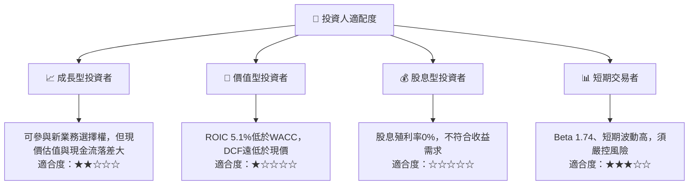

### 11.5 每季財報監控清單（Quarterly Watch List）

| 監控指標 | 最新基準 | 加碼觸發 | 減碼／論點惡化門檻 |
|----------|----------|----------|--------------------|
| 單季營收 YoY | -0.2% | 連續兩季 >10% | 連續兩季 <-5% |
| TTM 營業利益率 | 3.3% | >8% 且逐季上升 | <2% |
| TTM FCF | $3.30B | >$10B 且穩定 | 轉負或連續兩季下降 |
| Capex | TTM $15.41B | Capex 增加同時 FCF 增長 | OCF 被 Capex 長期大幅消耗 |
| ROIC vs WACC | 5.1% vs 13.80% | ROIC 高於 13.80% | 差距擴大或持續為負 |
| 庫存 | $14.09B | 庫存增長低於收入增長 | 庫存連續兩季快於收入增長 |
| SBC | FY2025 $2.83B | SBC 占收入下降 | SBC 增長快於收入且股數稀釋加速 |
| EPS | 最新季度 YoY -43.6% | EPS 恢復正增長且由營運改善驅動 | EPS 連續兩季加速下滑 |
| 財測／新業務 | 分部收入未提供 | 披露可驗證營收、毛利與訂閱數 | 商業化里程碑持續延遲 |

### 11.6 反面論證：什麼會證明論點錯誤

```
╔══════════════════════════════════════════════════════════════════╗
║              ⚠️ 論點失效條件（Disconfirming Evidence）           ║
╠══════════════════════════════════════════════════════════════════╣
║ 本報告偏空論點若遇到下列情況，應重新檢視：                      ║
║ ☐ TTM 營收連續兩年維持 >20% 成長，且非單靠降價換量              ║
║ ☐ TTM 營業利益率恢復至 >12%，並連續四季維持                     ║
║ ☐ TTM FCF 超過 $15B，且 FCF／淨利轉換率持續 >100%               ║
║ ☐ ROIC 超過 WACC 13.80%，並連續四季維持                         ║
║ ☐ 儲能、軟體或自動駕駛披露可驗證收入與正向單位經濟性             ║
║ ☐ 每股盈利成長使 Forward P/E 降至 60x 以下，且不是股數稀釋所致  ║
╚══════════════════════════════════════════════════════════════════╝
```

> **免責聲明**：本報告為 AI 自動生成，僅供研究參考，不構成投資建議。投資有風險，入市需謹慎。