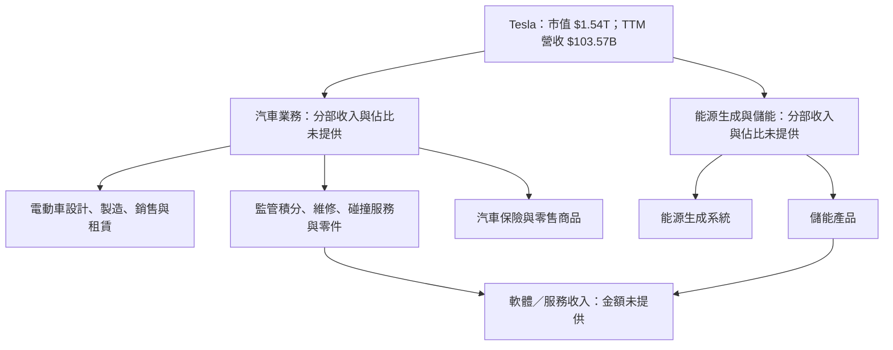
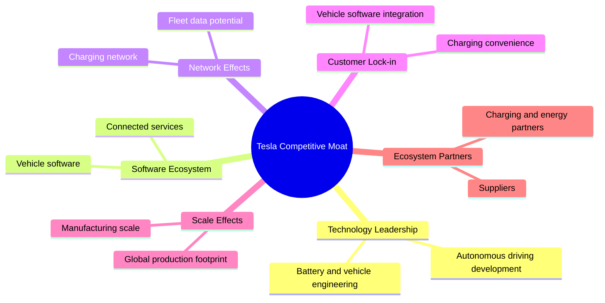
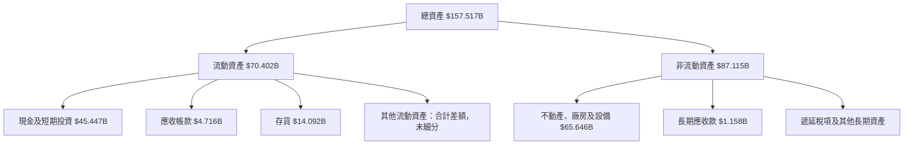
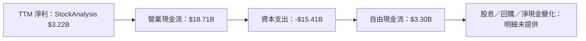
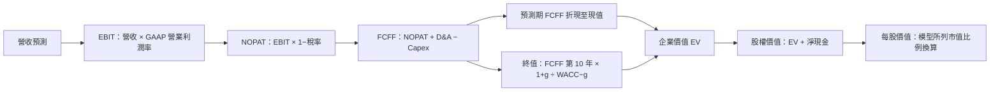
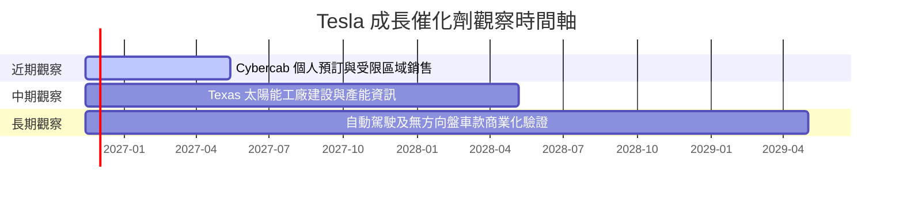
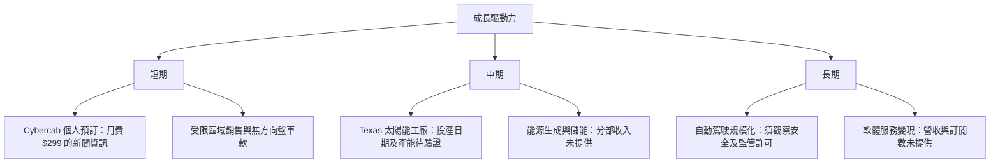
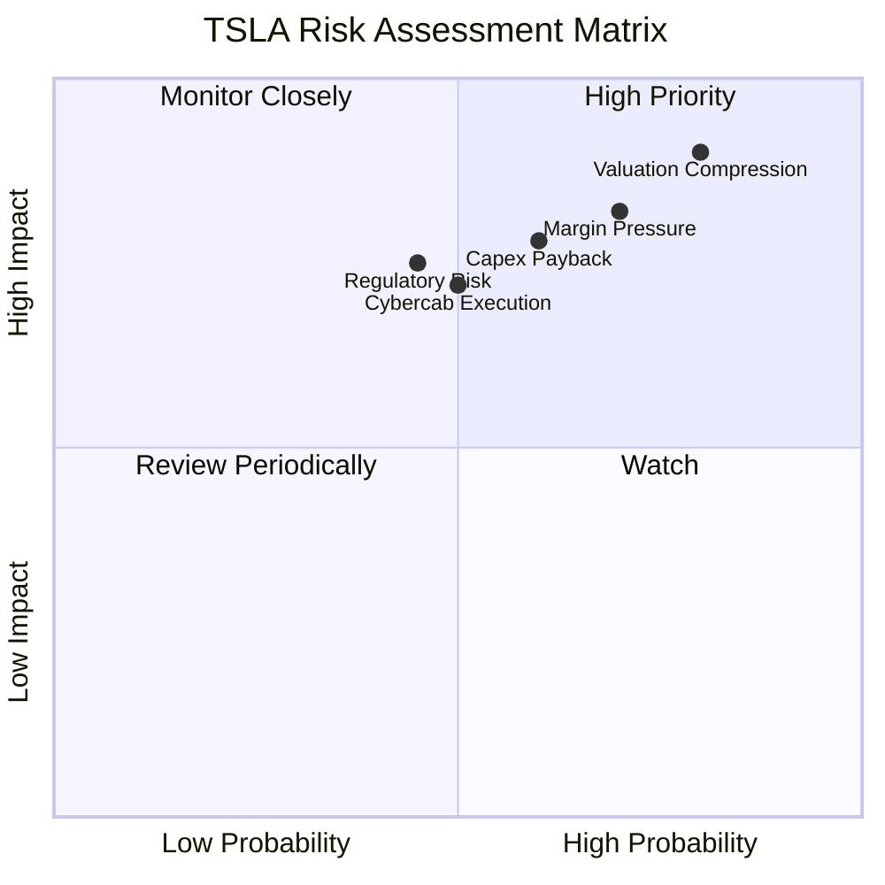
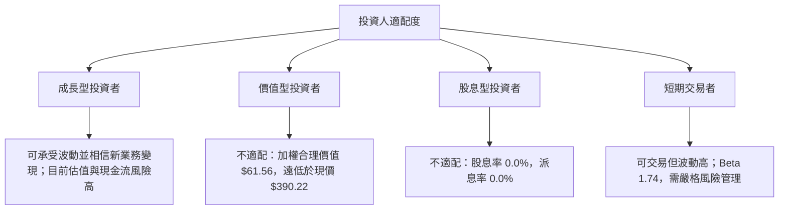

# TSLA 基本面深度分析報告
> **報告日期**：2026-11-14 ｜ **語言**：繁體中文 ｜ **數據來源**：SEC 申報資料 (XBRL)、Yahoo Finance、Finviz、StockAnalysis、Roic.ai ｜ **分析師**：CFA 級機構研究

## 目錄

| # | 章節 | 核心結論 |
|---|------|----------|
| 1 | 執行摘要 | 賣出；加權合理價值 $61.56，MOS -533.9% |
| 2 | 公司概覽與商業模式 | 汽車與能源業務並行；市場份額數據未提供 |
| 3 | 損益表深度分析 | TTM 營收 $103.57B、年增 8.3%；最新一季年減 0.2%，營業利潤率偏低 |
| 4 | 資產負債表分析 | 淨現金 $36.18B；流動性充足，營運資金效率改善 |
| 5 | 現金流量深度分析 | TTM FCF $3.30B，FCF Yield 0.21%；高資本支出壓低自由現金流 |
| 6 | 獲利能力與資本效率 | ROIC 5.1% 低於 WACC 12.57%，目前未創造足夠資本報酬 |
| 7 | 相對估值分析 | P/E、P/S 與 EV/EBITDA 均高於汽車同業；估值處於自身歷史高位 |
| 8 | DCF 內在價值評估 | DCF 基準價值 $12.69；加權合理價值 $61.56，仍遠低於現價 |
| 9 | 成長催化劑 | Cybercab、能源及太陽能產能是潛在催化劑，但商業化數據不足 |
| 10 | 風險矩陣 | 估值、低利潤率與新業務執行風險居前 |
| 11 | 投資建議 | 賣出；以盈利修復、ROIC 與 FCF 改善作為重新評估條件 |

## 1. 執行摘要

### 1.0 一頁式投資儀表板（Portfolio Manager 30 秒速讀）

| 項目 | 內容 |
|------|------|
| **投資論點（3 句）** | ① TTM 營收 $103.57B、年增 8.3%，但最新一季營收年減 0.2%，短期成長動能不穩。② TTM ROIC 5.1% 低於 WACC 12.57%，目前資本報酬低於資金成本。③ TTM FCF 僅 $3.30B、FCF Yield 0.21%，相對 $1.54T 市值現金流支撐有限。 |
| **綜合評分** | **4.4/10**（引用 1.1 評分卡） |
| **財務健康** | 🟢 現金及短期投資 $45.45B；按統一口徑，淨現金 $36.18B |
| **ROIC vs WACC** | **5.1% vs 12.57%**；差距 -7.47 個百分點，現階段未創造足夠股東價值 |
| **FCF 趨勢** | TTM FCF $3.30B；相較 FY2025 FCF $6.22B 偏弱，FCF Yield 0.21% |
| **估值** | Forward P/E 180.7x ｜ EV/EBITDA（Peer-valuation 區塊公司倍數）147.3x ｜ FCF Yield 0.21% |
| **DCF 內在價值（基準）** | $12.69 ｜ 現價相對 DCF 溢價 **2,974.2%**（折溢價定義：現價÷DCF價值−1） |
| **安全邊際（MOS）** | **-533.9%**＝($61.56 − $390.22) ÷ $61.56；🔴 無安全邊際 |
| **預期報酬（基準情境 12M）** | DCF 基準情境 $12.69，相對現價上行空間 **-96.7%** |
| **關鍵風險（前二）** | ① 現金流及利潤率不足以支撐高估值；② Cybercab、能源等成長選擇權的營收與盈利貢獻尚未量化 |
| **評級 + 信心度** | 🔴 **賣出** ｜ 信心：中；估值差距明確，但新業務未來收入尚有不確定性 |

**評級依據**：加權合理價值為 $61.56，對照 2026-11-13 收盤價 $390.22，MOS = ($61.56 − $390.22) ÷ $61.56 = **-533.9%**，依規則 20 為「賣出」。另有 ROIC 5.1% 低於 WACC 12.57%、TTM FCF Yield 僅 0.21% 支持風險偏高的結論；未依質化因素調整評級。

### 1.1 綜合評分卡（全報告唯一）

| 維度 | 評分（1–10） | 主要依據（引用數字與其來源章節） |
|------|--------------|----------------------------------|
| 成長性 | 5.0 | TTM 營收成長 8.3%，但最新一季年減 0.2%（第 3 章） |
| 獲利能力 | 3.0 | TTM 營業利益率 3.3%、ROIC 5.1% 低於 WACC 12.57%、F-Score 4/9（第 3、6 章） |
| 財務健康 | 8.0 | 淨現金 $36.18B；CCC 由 15 天降至 3 天（第 4 章） |
| 估值 | 1.0 | MOS -533.9%；P/E 428.8x，高於五年中位數 74.2x（第 7、8 章） |
| 護城河 | 5.0 | 有品牌、充電與軟體等差異化資產，但市場份額與客戶留存數據未提供（第 2 章） |
| 管理層與資本配置 | 4.0 | FY2025 SBC $2.83B；FY2025 資本支出 $8.53B；未提供完整回購與投資回報拆分 |
| **綜合評分** | **4.3** | 六項算術平均：(5.0 + 3.0 + 8.0 + 1.0 + 5.0 + 4.0) ÷ 6 = **4.3** |

### 1.2 五大投資論點 + 三大核心風險

| 類型 | 項目 | 具體依據 | 信心度 |
|------|------|----------|--------|
| 🟢 **投資論點①** | 大額流動性緩衝 | 現金及短期投資 $45.45B，統一口徑淨現金 $36.18B，可支持研發與產能投資 | 🟢 高 |
| 🟢 **投資論點②** | TTM 營收仍成長 | TTM 營收 $103.57B、年增 8.3%；但最新一季年減 0.2%，須確認成長能否延續 | 🟡 中 |
| 🟢 **投資論點③** | 能源與儲能具第二曲線可能性 | 公司經營能源生成與儲能；但分部收入、利潤率未提供，現階段不宜把未量化選擇權當作確定價值 | 🟡 中 |
| 🟢 **投資論點④** | 營運資金週期短 | CCC 3 天，較一年前 15 天下降 12 天，現金占用改善 | 🟢 中 |
| 🟢 **投資論點⑤** | 新產品與服務可能拓寬收入來源 | Cybercab 個人預訂、月費 $299 的新聞報導提供產品催化線索；尚缺訂單量、交付量與單位經濟數據 | 🟡 低 |
| 🟡 **風險①** | 高估值與低現金流收益率 | FCF Yield 0.21%；公司自身 P/E 五年歷史百分位 100%，若盈利未快速恢復，估值收縮風險高 | 🔴 高衝擊 |
| 🔴 **風險②** | 營運利潤率與 ROIC 偏低 | TTM 營業利益率 3.3%、ROIC 5.1%，均不足以覆蓋 WACC 12.57% | 🔴 高 |
| 🔴 **風險③** | 研發、資本支出與新業務回報不確定 | TTM Capex $15.41B，而 TTM FCF 僅 $3.30B；若投資不能形成新增收益，資本效率可能持續受壓 | 🟡 中高 |

### 1.3 快速統計卡片

| 指標 | 公司實際值（期間） | 同業中位數 | 狀態 |
|------|--------------------|------------|------|
| 營收成長（TTM） | **8.3%** | — | 🟡 |
| 營收成長（最新一季年增） | **-0.2%** | 2.9%（GM、F、RIVN） | 🔴 |
| 毛利率（TTM） | **19.3%** | 9.2%（GM、F、RIVN） | 🟢 |
| 營業利益率（TTM） | **3.3%** | — | 🔴 |
| ROIC（TTM） | **5.1%** | — | 🔴 |
| Forward P/E | **180.7x** | 6.4x（GM、F） | 🔴 |
| FCF Yield（TTM） | **0.21%** | — | 🔴 |
| Piotroski F-Score | **4 / 9** | — | 🟡 |

### 1.4 投資結論

╔══════════════════════════════════════════════════════════════════╗  
║                    📊 投資結論摘要                               ║  
╠══════════════════════════════════════════════════════════════════╣  
║ 評級：賣出（MOS -533.9%，依規則 20）                             ║  
║ 價格（2026-11-13 收盤）：$390.22                                ║  
║ DCF 內在價值（基準）：$12.69（現價溢價 2,974.2%）               ║  
║ 安全邊際 MOS：-533.9%＝($61.56−$390.22)÷$61.56                  ║  
║ 加權合理價值（8.8）：$61.56                                     ║  
║ DCF 情境價值：悲觀 $8.82（-97.7%）｜基準 $12.69（-96.7%）      ║  
║                 樂觀 $18.10（-95.4%）                            ║  
║ 綜合評分：4.3/10（引用 1.1）                                     ║  
║ 適合投資人：能承受高波動、且相信自動駕駛及能源業務能大幅變現者   ║  
╚══════════════════════════════════════════════════════════════════╝

## 2. 公司概覽與商業模式

### 2.1 業務結構與收入來源

Tesla 設計、開發、製造、租賃及銷售電動車，亦經營能源生成與儲能業務。現有資料未提供最新 TTM 各分部收入和佔比，因此不按分部虛構金額或繪製比例圖。

汽車監管積分、維修與保險等是汽車業務周邊來源；能源與儲能有機會降低公司對車輛銷售週期的依賴。不過缺少分部收入、分部毛利與訂閱收入資料，無法確認第二曲線對整體盈利的實際貢獻。

### 2.2 市場份額

市場份額數據未提供。Tesla 的 TTM 營收為 $103.57B，規模大於本報告列示的個別汽車同業營收資訊，但僅憑公司營收無法推導市場份額；最新一季收入年減 0.2%，相較 GM 的 2.9% 與 Ford 的 -2.0%（Peer multiples 資料）表現落在兩者之間。

### 2.3 競爭護城河分析

### 2.4 護城河強度

| 護城河項目 | 強度（強／中／弱） | 證據（引用數字或事實） | 會削弱它的情況 |
|------------|--------------------|------------------------|----------------|
| 技術與產品 | 中 | 公司從事電動車、軟體及能源系統；具體研發成效和技術領先指標未提供 | 同業產品性能追平、成本下降更快 |
| 軟體生態 | 中 | 車輛連網、軟體與服務構成差異化可能；軟體收入與付費用戶數未提供 | 付費轉換弱、功能難以持續差異化 |
| 網路效應 | 中 | 充電與車隊數據可能形成網路價值；可量化使用量與網路效應指標未提供 | 競爭者建立相容網路或充電標準普及 |
| 客戶鎖定 | 弱至中 | 車輛、充電與軟體整合可提高轉換成本；留存率未提供 | 車輛品牌偏好下降、換車週期延長 |
| 規模效應 | 中 | TTM 營收 $103.57B，具較大營運規模；單位成本數據未提供 | 產能利用率下滑、價格競爭侵蝕毛利 |
| 生態夥伴 | 弱至中 | 有供應商、能源與充電合作的業務需求，但合作營收貢獻未披露 | 關鍵供應商議價能力增加、合作方轉向競品 |

1.1「護城河」評分為 5.0/10，理由是公司有品牌、軟體與充電等差異化資產，但現有數據不足以證明高客戶留存、持續定價能力或高於同業的資本回報。

## 3. 損益表深度分析

### 3.1 年度收入成長趨勢（近 4 年）

| 財年 | 營收 | YoY |
|------|------|-----|
| 2022 | $81.46B | +51.4% |
| 2023 | $96.77B | +18.8% |
| 2024 | $97.69B | +1.0% |
| 2025 | $94.83B | -2.9% |

╔══════════════════════════════════════════════════════════════════╗  
║              Tesla 年度收入趨勢（FY2022-FY2025）                ║  
╠══════════════════════════════════════════════════════════════════╣  
║ FY2022  $81.46B  ████████████████████░░░░░░░░░░  YoY +51.4% 🟢 ║  
║ FY2023  $96.77B  ████████████████████████░░░░░░  YoY +18.8% 🟢 ║  
║ FY2024  $97.69B  █████████████████████████░░░░░  YoY  +1.0% 🟡 ║  
║ FY2025  $94.83B  ████████████████████████░░░░░░  YoY  -2.9% 🔴 ║  
╠══════════════════════════════════════════════════════════════════╣  
║ FY2022-FY2025 營收 CAGR：約 +5.2%                                ║  
╚══════════════════════════════════════════════════════════════════╝

CAGR 算式：($94.83B ÷ $81.46B)^(1/3) − 1 ≈ 5.2%。營收由高速擴張轉為停滯，顯示過去的產能擴張與市場滲透增速不能直接外推至未來。

### 3.2 季度收入趨勢分析

| 季度 | 營收 | QoQ | YoY | 備註 |
|------|------|-----|-----|------|
| 2025 Q4 | $24.90B | -11.4% | -3.1% | QoQ 以 2025 Q3 $28.095B 計 |
| 2026 Q1 | $22.39B | -10.1% | +15.8% | YoY 由 StockAnalysis 季度序列 |
| 2026 Q2 | $28.24B | +26.1% | +25.5% | 季度反彈，但需留意交付時點及基期 |
| 2026 Q3 | $28.05B | -0.7% | -0.2% | 最新一季營收年減，不得視為 TTM 成長率 |

QoQ 算式採季度收入相鄰比較；例如 Q3 2026 QoQ = ($28.046B ÷ $28.236B) − 1 = -0.7%。TTM 營收成長 8.3% 與最新一季年減 0.2% 所反映的時間範圍不同，不應混為同一趨勢。

### 3.3 利潤率演變分析

| 利潤率指標 | FY2022 | FY2023 | FY2024 | FY2025 | 趨勢 | 評估 |
|------------|--------|--------|--------|--------|------|------|
| **毛利率** | 25.6% | 18.2% | 17.9% | 18.0% | 2022 後回落、近年窄幅變動 | 🔴 |
| **營業利益率** | 17.0% | 9.2% | 7.9% | 5.1% | 持續收縮 | 🔴 |
| **淨利率** | 15.5% | 15.5% | 7.3% | 4.0% | FY2024 後下降 | 🔴 |

計算以年度損益表所列毛利、營業利益、淨利除以營收。毛利率由 FY2022 的 25.6% 降至 FY2025 的 18.0%，顯示售價、產品組合或製造成本優勢不足以維持原有水準；營業利益率則由 17.0% 降至 5.1%，反映營業費用與收入的槓桿不再像高速擴張期那樣有利。TTM 已核實營業利益率為 3.3%，低於 FY2025 年度表列比率，方向上表示近端盈利承壓。

### 3.4 費用結構分析

目前可得收入、毛利與年度研發支出，缺少 TTM 各費用科目完整拆分，故不製作容易誤導的費用圓餅圖。FY2025 研發費用為 $6.41B，約為該年營收 $94.83B 的 6.8%；研發投入有利於新產品與軟體開發，但若商業化延遲，短期會持續壓低利潤。

### 3.5 季度 EPS 趨勢與盈餘品質（Quality of Earnings）

| 季度 | EPS 實際值 | YoY | 超預期／不及預期 |
|------|------------|-----|------------------|
| 2025 Q4 | $0.26 | -60.6% | EPS 預估值 N/A，無法判定 |
| 2026 Q1 | $0.15 | +8.3% | EPS 預估值 N/A，無法判定 |
| 2026 Q2 | $0.34 | -3.0% | EPS 預估值 N/A，無法判定 |
| 2026 Q3 | $0.24 | -43.6% | EPS 預估值 N/A，無法判定 |

EPS 歷史資料中的估計值為 nan，因此不能嚴謹地判斷過去四季是超預期或不及預期。FY2026 Q3 單季 EPS 年減 43.6%，與淨利年減 42.7%相呼應，表示單季盈利明顯弱於上年同期。

| 盈餘品質項目 | 數值／佔比 | 評估 |
|--------------|-----------|------|
| 股權薪酬 SBC / 營收 | TTM SBC 約 $4.30B ÷ 營收 $103.57B = **4.2%** | 🟡 SBC 是經濟成本；若以 GAAP 費用列支，仍會透過股數稀釋影響股東回報 |
| SBC / 營業現金流 | 約 $4.30B ÷ $18.71B = **23.0%** | 🟡 占營運現金流規模不低，需關注稀釋 |
| FCF / 淨利（現金轉換率） | $3.30B ÷ StockAnalysis TTM 淨利 $3.22B = **約 102.5%** | 🟢 現金轉換約等於帳面淨利；分子使用核實 TTM FCF，分母依 StockAnalysis TTM 淨利 |
| 一次性／非經常性損益 | N/A（明細未提供） | 無法判定是否有一次性項目抬高或壓低盈餘 |
| 有效稅率異常 | 27.0%（最新年度有效稅率） | 🟡 TTM 稅項拆分未提供，不能確認最新季度是否由稅務項目帶動 |
| 資本化支出 vs 費用化 | TTM Capex $15.41B；資本化政策明細 N/A | N/A；僅憑 Capex 無法判定費用資本化是否改變盈餘 |

**盈餘品質結論**：TTM FCF 略高於 StockAnalysis 的 TTM 淨利，現金轉換本身尚可；但 SBC 約占營收 4.2%、占營業現金流約 23.0%，且稀釋股數未通過 Piotroski 測試，股東需將稀釋成本納入回報評估。非經常項目與資本化政策的明細缺漏，限制了對 GAAP 盈餘可持續性的判斷。

## 4. 資產負債表分析

### 4.1 資產結構分解

FY2026 Q3 總資產為 $157.517B，流動資產 $70.402B；以下細項按 StockAnalysis 2026-09-30 資產負債表呈列。

非流動資產 $87.115B 為總資產減流動資產的算術差額；其細項加總口徑可能受報表項目分類影響，故不將未列明項目強行分配。

### 4.2 流動性與營運資金分析

| 指標 | 最新 TTM | 一年前 TTM | 變化 | 解讀 |
|------|----------|------------|------|------|
| DSO 應收帳款天數 | 16 天 | 18 天 | -2 天 | 收款週期縮短，應收占用改善 |
| DIO 存貨天數 | 62 天 | 56 天 | +6 天 | 庫存停留時間增加，需監測需求與產品組合 |
| DPO 應付帳款天數 | 75 天 | 59 天 | +16 天 | 付款週期延長，可能反映供應商融資增加 |
| CCC 現金轉換週期 | 3 天 | 15 天 | -12 天 | 整體現金轉換改善，主要由 DPO 上升抵銷 DIO 增加 |

現金及短期投資 $45.45B、總債務 $9.27B、淨現金 $36.18B（均採核實口徑）。流動比率 1.739、速動比率 1.239，提供短期償付緩衝；但 DIO 增加 6 天，若持續上升，可能代表庫存去化速度放緩。

### 4.3 債務結構分析

不同來源的債務數字並不一致：核實財務指標列總債務 $9.27B、淨現金 $36.18B；合併市場資料另列總債務 $16.44B、淨現金 $29.00B。為保持全報告核心財務指標一致，以下以 SEC 10-Q 計算區塊的核實口徑為主；DCF 另照其模型所列淨現金 $36.18B。

╔══════════════════════════════════════════════════════════════════╗  
║                   Tesla 債務健康診斷                            ║  
╠══════════════════════════════════════════════════════════════════╣  
║ 總債務：          $9.27B   ██░░░░░░░░░░░░░░░░░░  🟢             ║  
║ 現金及短期投資： $45.45B   ████████████████████  🟢             ║  
║ 淨現金：         $36.18B   ████████████████░░░░  🟢             ║  
║ Debt/EBITDA：N/A（核實區塊未提供同口徑 EBITDA）                 ║  
║ 利息保障倍數：N/A（利息費用明細未提供）                          ║  
║ 流動比率：1.739 ｜速動比率：1.239                                ║  
╚══════════════════════════════════════════════════════════════════╝

### 4.4 股東權益趨勢

| 財年 | 股東權益 |
|------|----------|
| 2022 | $44.70B |
| 2023 | $62.63B |
| 2024 | $72.91B |
| 2025 | $82.14B |

股東權益逐年增加，反映累積權益與資本基礎擴張；然而帳面權益成長不等於股東資本回報改善，FY2026 Q3 ROIC 仍只有 5.1%，低於 WACC。

## 5. 現金流量深度分析

### 5.1 現金流量瀑布圖

完整股息、回購及淨現金變動拆分未提供；以下呈現可核實的 TTM 現金流主路徑，不臆造用途分配。

### 5.2 FCF 轉換率趨勢

| 年度／期間 | FCF | 淨利 | FCF / 淨利 |
|------------|-----|------|------------|
| FY2022 | $7.55B | $12.58B | 60.0% |
| FY2023 | $4.36B | $15.00B | 29.1% |
| FY2024 | $3.58B | $7.13B | 50.2% |
| FY2025 | $6.22B | $3.79B | 164.1% |
| TTM 至 2026-09-30 | $3.30B | $3.22B（StockAnalysis） | 約 102.5% |

轉換率波動明顯。FY2025 比率偏高，部分源自淨利下降而 FCF 回升；TTM 轉換率約 102.5%，不能單憑此比率推論盈利品質全面改善，仍需觀察 Capex 與營運資金的跨期變化。

### 5.3 自由現金流趨勢

╔══════════════════════════════════════════════════════════════════╗  
║                 自由現金流歷史趨勢（USD）                        ║  
╠══════════════════════════════════════════════════════════════════╣  
║ FY2022  $7.55B  ████████████████████  FCF Yield：N/A            ║  
║ FY2023  $4.36B  ████████████          FCF Yield：N/A            ║  
║ FY2024  $3.58B  █████████             FCF Yield：N/A            ║  
║ FY2025  $6.22B  ████████████████      FCF Yield：N/A            ║  
║ TTM     $3.30B  ████████              FCF Yield：0.21%          ║  
╚══════════════════════════════════════════════════════════════════╝

TTM FCF = 營業現金流 $18.71B − Capex $15.41B = **$3.30B**。TTM Capex 約占營收 14.9%，較高再投資需求使營業現金流未能完整轉為可自由支配現金。

### 5.4 資本配置評估

股息率 0%、派息率 0%。回購、收購與其他資本配置的完整金額未提供，不製作比例圖。

| 項目 | 已知數據 | 評估 |
|------|----------|------|
| Capex | TTM $15.41B；FY2025 $8.53B | 投資規模大；須以未來產能利用率與新增回報驗證 |
| SBC | FY2025 $2.83B | 形成股東稀釋成本，應持續追蹤股數變化 |
| 股息 | Yield 0.0%，Payout 0.0% | 現金主要留在企業或投入再投資 |
| 回購／收購 | 明細 N/A | 無法判定淨回購是否抵銷 SBC 稀釋 |

## 6. 獲利能力與資本效率

### 6.1 ROE / ROA / ROIC 趨勢

| 指標 | 可得數據 | 評估 |
|------|----------|------|
| ROE | TTM 3.6%（核實品質指標）；合併市場資料列 3.8% | 來源口徑有差異，採核實值；盈利回報偏低 |
| ROA | TTM 1.3% | 資產盈利能力偏弱 |
| ROIC | TTM 5.1% | 低於 12.57% WACC |
| 行業均值對比 | N/A（未提供一致口徑同業 ROE／ROA／ROIC） | 不以缺乏來源的均值比較 |

### 6.2 ROIC vs WACC 分析（核心價值創造判斷）

╔══════════════════════════════════════════════════════════════════╗  
║                ROIC vs WACC 深度分析                             ║  
╠══════════════════════════════════════════════════════════════════╣  
║ WACC 輸入（核實成本資本資料）：                                   ║  
║ ├── 無風險利率（10Y 美債）：5.15%                                ║  
║ ├── ERP：5.00%                                                   ║  
║ ├── 原始 Beta：1.74；採用調整後 Beta：1.50                       ║  
║ ├── Ke：資料列示 12.63%；WACC 權重：股權 99.4%、債務 0.6%       ║  
║ ├── 稅前 Kd：3.65%；稅率：27.0%                                  ║  
║ └── WACC：12.57%（全報告採用同一核實值）                         ║  
║                                                                  ║  
║ ROIC：5.1% ｜ WACC：12.57% ｜ 差額：5.1%−12.57%=−7.47pp          ║  
║                                                                  ║  
║ 結論：ROIC 低於 WACC，現階段投入資本回報未覆蓋資金成本            ║  
╚══════════════════════════════════════════════════════════════════╝

Beta 採用值由 ⅔ × 1.74 + ⅓ × 1 = 1.493，資料列示調整後 Beta 為 1.50。CAPM 用列示 Rf、Beta 與 ERP 計算為 5.15% + 1.50 × 5.00% = 12.65%，與資料列示 Ke 12.63% 有 0.02 個百分點差異；本報告不另改動已核實 WACC 12.57%。成本資本資料未提供額外規模／國別溢酬，未另加。

若以 ROIC 5.1% 減 WACC 12.57%，經濟利差為 **-7.47 個百分點**。由於投入資本的完整構成與稅後營業利益未提供，本文不另自建 EVA 金額或重算 ROIC；價值創造判斷依核實 ROIC 對 WACC。

### 6.3 杜邦三因素分解

| 因素 | 數值（TTM） | 解讀 |
|------|-------------|------|
| 淨利率 | 3.1% | 盈利能力降低，限制 ROE |
| 資產週轉率 | 0.66 | 資產每年轉化為收入的效率 |
| 權益乘數 | 1.76 | 提供適度槓桿，但不是主要盈利來源 |
| **ROE** | **3.6%** | 3.1% × 0.66 × 1.76 ≈ 3.6% |

ROE 主要受低淨利率限制；權益乘數 1.76 倍並未把低盈利轉化為高股東回報。

### 6.4 財務體質：Piotroski F-Score

**Piotroski F-Score：4 / 9**。分數與九項測試結果照品質指標列示。

| 測試 | 結果 | 解讀 |
|------|------|------|
| ROA > 0 | ✅ 通過 | TTM ROA 為正 |
| 營業現金流 > 0 | ✅ 通過 | TTM 營業現金流 $18.71B |
| ROA 高於一年前 | ❌ 未通過 | 資產盈利改善未能確認 |
| 營業現金流 > 淨利（應計品質） | ✅ 通過 | 現金流高於淨利 |
| 長期負債 ÷ 總資產低於一年前 | ❌ 未通過 | 槓桿相對改善未通過測試 |
| 流動比率高於一年前 | ❌ 未通過 | 相對前一年流動性指標未改善 |
| 稀釋股數未增加 | ❌ 未通過 | 股數增加是現有股東回報的稀釋因素 |
| 毛利率高於一年前 | ✅ 通過 | 毛利率改善測試通過 |
| 資產週轉率高於一年前 | ❌ 未通過 | 資產使用效率未改善 |

4/9 表示獲利與營運效率訊號混合：正向項目包括正營業現金流及現金高於淨利；負向訊號集中在 ROA 趨勢、槓桿、流動比率、稀釋及資產週轉。

## 7. 相對估值分析

### 7.1 同業估值比較

| 估值指標 | **TSLA** | **GM** | **F** | **RIVN** | TSLA 評估 |
|----------|----------|--------|-------|---------|-----------|
| **Trailing P/E** | 428.8x | 18.8x | N/A | N/A | 🔴 大幅溢價 |
| **Forward P/E** | 180.7x | 5.8x | 6.4x | -6.9x | 🔴 遠高於盈利型同業 |
| **P/S Ratio** | 13.3x（歷史估值區塊） | 0.4x | 0.3x | 2.7x | 🔴 顯著溢價 |
| **EV/EBITDA** | 147.3x（歷史估值區塊） | 9.4x | 24.0x | -7.0x | 🔴 顯著溢價 |
| **最新一季營收 YoY** | -0.2% | 2.9% | -2.0% | 38.3% | 🟡 成長落後 RIVN |
| **毛利率 TTM** | 19.3% | 11.4% | 7.4% | 9.2% | 🟢 高於列示同業 |

公司倍數採核實估值區塊的歷史估值口徑；Peer multiples 採 Yahoo Finance 列示值。合併估值資料另列 P/S 14.89x、EV/EBITDA 153.9x，與核實歷史估值區塊不同，為避免混用，本表採用要求優先的核實估值數字。Tesla 毛利率較高，但相對同業的高估值遠超目前低利潤率與現金流所能直接支持的幅度。

### 7.2 歷史估值區間分析

╔══════════════════════════════════════════════════════════════════╗  
║               TSLA 五年估值區間（TTM 倍數）                     ║  
╠══════════════════════════════════════════════════════════════════╣  
║ P/E：18.0x ───── 中位數 74.2x ───────────────── 現值 428.8x      ║  
║ 區間：18.0x–416.4x；當前百分位：100%                            ║  
║ P/S：3.9x ─── 中位數 9.4x ───────── 現值 13.3x ─── 16.7x        ║  
║ 當前百分位：76%                                                  ║  
║ EV/EBITDA：19.0x ─ 中位數 64.6x ───────── 現值 147.3x ─ 165.2x  ║  
║ 當前百分位：86%                                                  ║  
╚══════════════════════════════════════════════════════════════════╝

P/E 目前超出歷史區間上限；P/S 與 EV/EBITDA 均位於歷史偏高區域。這種位置意味著股價需要未來盈利與現金流大幅成長來消化，否則估值倍數回歸風險較高。

### 7.3 情境價值（照 DCF MODEL 的 Scenarios）

| 情境 | 第 1 年營收成長 | 期末營業利潤率 | WACC | 每股價值 | 相對現價 | 機率 | 會發生的條件 |
|------|----------------|----------------|------|----------|----------|------|--------------|
| 🔴 悲觀 | 4.1% | 6.2% | 13.57% | $8.82 | -97.7% | 25% | 成長放慢、利潤率改善有限，資本成本維持較高 |
| 🟡 基準 | 8.3% | 7.2% | 12.57% | $12.69 | -96.7% | TTM 成長延續，營業利潤率逐步回到五年中位水準 |
| 🟢 樂觀 | 12.4% | 8.0% | 11.57% | $18.10 | -95.4% | 營收加速、營業利潤率提升且折現率下降 |

三情境來自模型列示結果，未另改數字。即使樂觀情境價值仍遠低於現價，顯示問題不只是近期營收波動，而是現價對遠期現金流的要求很高。

### 7.4 相對估值隱含價格區間

╔══════════════════════════════════════════════════════════════════╗  
║                  相對估值每股價值參照                            ║  
╠══════════════════════════════════════════════════════════════════╣  
║ 同業 Forward P/E：$13.20 ────────────────── 現價 $390.22        ║  
║ 同業 EV/EBITDA： $47.75 ─────────────────── 現價 $390.22        ║  
║ 分析師共識：     $412.48 ────────────────── 現價 $390.22        ║  
╚══════════════════════════════════════════════════════════════════╝

同業 Forward P/E 使用 GM、F 的同業中位數 6.1x × TSLA Forward EPS $2.16 = $13.20。EV/EBITDA 使用 GM、F 中位數 16.7x 乘以 TTM EBITDA，再加回淨現金，得到 $47.75。分析師共識目標價 $412.48 是 40 位分析師平均值，屬市場參照，不代表現金流估值結論。

## 8. DCF 內在價值評估（Discounted Cash Flow）

### 8.0 估值推理鏈（Thinking Logic）

**Step 1 — 價值來源與主導變數**

Tesla 的價值可拆成汽車業務現金流底盤、能源與儲能成長，以及自動駕駛／Cybercab 等選擇權；分部收入比例未提供，不能假設各自佔比。模型中會主導估值的是可持續 FCFF，尤其是營業利潤率與 Capex 下降能否同時實現：基準模型第 1 年 Capex 為收入的 14.9%，第 10 年降至 6.0%，而營業利潤率由 3.3%升至 7.2%。

**Step 2 — 模型選擇**

| 決策點 | 本報告採用 | 理由（含數字） | 曾考慮但否決 | 否決理由 |
|--------|-----------|----------------|--------------|----------|
| 現金流定義 | FCFF | 配合 WACC 12.57%，先估 EV 再加淨現金 | FCFE | 資本結構與現金餘額可能變動 |
| 預測期 N | 10 年 | 直接採用程式模型設定，以容納收入及利潤率逐步淡化 | 短期 5 年模型 | 無法完整反映模型的長期轉型假設 |
| 終值方法 | Gordon Growth | 模型採永續成長 g=3.0% | 僅退出倍數 | DCF 模型未提供退出倍數計算，不能自行補造 |
| EBIT 基礎 | GAAP EBIT | TTM 營業利益率 3.3%，模型以 GAAP EBIT 預測 | 非 GAAP EBIT | 可能加回 SBC 而造成股東成本漏計 |

**Step 3 — 關鍵假設推導鏈**

- **營收成長**：錨點＝TTM 成長率 8.3% → 模型將年成長由 8.3% 線性降至第 10 年 3.0%，反映成熟化 → **採用第 1 年 8.3%、第 10 年 3.0%** → 未採持續 8.3% 十年，因最新一季年減 0.2%，持續不變的假設偏樂觀。
- **期末營業利潤率**：錨點＝TTM 3.3% → 模型淡化至近五年中位數 7.2% → **採用 7.2%** → 不採更高利潤率，因年度營業利益率從 FY2022 17.0%降至 FY2025 5.1%，目前缺乏回到歷史高位的證據。
- **永續成長率 g**：錨點＝模型設定 3.0% → 與長期成熟企業成長假設相容，且低於 WACC → **採用 3.0%** → 不採高於 3.0%的基準，避免提高終值權重。
- **預測期 N**：錨點＝模型設定 10 年 → 新業務變現週期長，使用十年呈現收入與利潤率淡化 → **採用 10 年** → 不採更短期間，因模型本身要求十年序列；另不將十年視為經營可見度確定。
- **Capex / 營收**：錨點＝TTM 約 14.9% → 模型逐年降至第 10 年 6.0%，假設投資強度成熟化 → **採用 14.9% 至 6.0%** → 不維持 14.9% 十年，因會放大再投資負擔；但 6.0%仍有投資效率改善要求。
- **有效稅率**：錨點與採用值均為 27.0%，依最新年度有效稅率；缺少更完整歷史稅項分解，未另調整。
- **D&A / 營收**：錨點＝TTM 5.5% → **採用 5.5% 固定**；以模型設定為準。
- **ΔWC**：模型明示未建模；**採用 0（不另扣 ΔWC）**，這是模型簡化而非實際營運資金變動為零。
- **SBC 與股數**：採用組合 **(A) GAAP EBIT + 固定股數**；GAAP EBIT 已含 SBC，不再扣 SBC，也不另做年稀釋。模型未提供稀釋股數絕對值，而是以「股權價值 × 股價 ÷ 市值」換算每股價值。
- **終值方法**：採 Gordon Growth，模型 g=3.0%、WACC=12.57%；因模型沒有退出倍數輸入，不自建第二種終值。
- **WACC**：錨點＝成本資本資料列示 12.57% → 依調整後 Beta 1.50、風險溢酬與資本結構作為折現率 → **採用 12.57%** → 不採較低 WACC，因資料已固定此值且股價波動 Beta 偏高。

**Step 4 — 最脆弱一環**

最脆弱的假設是 Capex/營收由 14.9%降至 6.0%，同時營業利潤率升至 7.2%；若投資強度不降或利潤率未改善，FCFF 轉正與終值都會下修。現有敏感性矩陣顯示，WACC 12.57%、g 3.0%時每股價值 $12.69，WACC 降至 10.57%也只有 $16.38，未足以接近現價。

**Step 5 — 計算路徑**

### 8.1 模型假設總表（Model Inputs）

| 假設項目 | 採用值 | 依據／來源 | 敏感度 |
|----------|--------|-------------|--------|
| 預測期長度 N | 10 年 | DCF 模型設定 | 🟡 中 |
| 營收成長 | 第 1 年 8.3%，第 10 年 3.0%，線性淡化 | TTM vs prior TTM 成長 8.3%，終年模型假設 3.0% | 🔴 高 |
| 營業利潤率 | 3.3% → 7.2% | TTM 3.3%；第 10 年取近五年中位數（含 TTM） | 🔴 高 |
| 有效稅率 | 27.0% | 最新年度有效稅率 | 🟢 低 |
| Capex / 營收 | 第 1 年 14.9% → 第 10 年 6.0% | TTM 比率，逐步淡化至 1.1×D&A | 🔴 高 |
| D&A / 營收 | 5.5% | TTM 模型輸入 | 🟢 低 |
| ΔWC | 未建模，FCFF 表不扣除 | 模型明示 working capital not modelled | 🟢 低 |
| EBIT 基礎 | GAAP | 模型明示 GAAP EBIT | 🟡 中 |
| SBC 處理 | GAAP 已列費用，不另扣 | 組合 (A) | 🟡 中 |
| 年稀釋率 | 0%（固定股數處理） | 組合 (A)；模型不再逐年稀釋 | 🟡 中 |
| 永續成長率 g | 3.0% | DCF 模型設定；小於 WACC | 🔴 高 |
| 終值方法 | Gordon Growth | DCF 模型終值公式 | 🔴 高 |
| WACC | 12.57% | 核實成本資本資料 | 🔴 高 |

本模型採用 **(A) GAAP EBIT + 固定股數**，故 SBC 影響已計入一次。FCFF 定義為 FCFF = NOPAT + D&A − Capex；營運資金變動未建模。

### 8.2 折現率推導（WACC）

╔══════════════════════════════════════════════════════════════════╗  
║                    WACC 推導（折現率）                           ║  
╠══════════════════════════════════════════════════════════════════╣  
║ 股權成本 Ke：                                                     ║  
║ ├── 無風險利率 Rf：5.15%                                         ║  
║ ├── ERP：5.00%                                                   ║  
║ ├── 原始 Beta：1.74；調整後 Beta：1.50                           ║  
║ ├── 規模／國別溢酬：未另加，資料未提供                            ║  
║ └── 資料列示 Ke：12.63%                                          ║  
║                                                                  ║  
║ 債務成本 Kd：                                                     ║  
║ ├── 稅前 Kd：3.65%                                               ║  
║ ├── 稅率：27.0%                                                  ║  
║ └── 稅後 Kd = 3.65% × (1−27.0%) = 2.6645%                       ║  
║                                                                  ║  
║ 資本權重：股權 99.4%；債務 0.6%                                 ║  
║ WACC：核實採用 12.57%                                            ║  
╚══════════════════════════════════════════════════════════════════╝

逐步演算：

1. **Ke（CAPM）**：資料列示 Ke = **12.63%**。依列示輸入重算，5.15% + 1.50 × 5.00% = 12.65%；差異 0.02 個百分點，故依要求採用成本資本區塊指定值。
2. **稅前 Kd**：資料列示利息 ÷ 債務成本為 **3.65%**；利息費用與平均計息負債的分項金額未提供，不能獨立重算分子、分母。
3. **稅後 Kd**：3.65% × (1 − 27.0%) = **2.6645%**。
4. **權重**：股權 99.4%、債務 0.6%，合計 99.4% + 0.6% = **100.0%**。資料未提供用於重算權重的同口徑市值與計息債務明細，照核實權重採用。
5. **WACC**：核實採用 **12.57%**。按列示 Ke、稅後 Kd 與權重重算為 99.4% × 12.63% + 0.6% × 2.6645% = 12.5702% ≈ **12.57%**。

第 6.2 節與本節均採用 WACC 12.57%。CAPM 中間值 12.65%與列示 Ke 12.63%存在微小輸入／四捨五入差異，最終折現率仍以核實 WACC 為準。

### 8.3 逐年自由現金流預測（基準情境）

單位：USD billions；折現因子保留三位小數。模型數值照列，不另重建模型。

| 年度 | FY+1 | FY+2 | FY+3 | FY+4 | FY+5 | FY+6 | FY+7 | FY+8 | FY+9 | FY+10 |
|------|------|------|------|------|------|------|------|------|------|-------|
| 營收 | 112.17 | 120.81 | 129.42 | 137.87 | 146.07 | 153.89 | 161.23 | 167.96 | 173.99 | 179.21 |
| 營收 YoY | 8.3% | 7.7% | 7.1% | 6.5% | 5.9% | 5.4% | 4.8% | 4.2% | 3.6% | 3.0% |
| 營業利潤率 | 3.3% | 3.8% | 4.2% | 4.6% | 5.1% | 5.5% | 5.9% | 6.4% | 6.8% | 7.2% |
| EBIT | 3.75 | 4.57 | 5.45 | 6.40 | 7.42 | 8.48 | 9.58 | 10.71 | 11.85 | 12.98 |
| − 稅 | (1.01) | (1.23) | (1.47) | (1.73) | (2.00) | (2.29) | (2.58) | (2.89) | (3.19) | (3.50) |
| NOPAT | 2.74 | 3.34 | 3.98 | 4.68 | 5.42 | 6.19 | 7.00 | 7.82 | 8.65 | 9.48 |
| + D&A | 6.14 | 6.61 | 7.09 | 7.55 | 8.00 | 8.42 | 8.83 | 9.20 | 9.53 | 9.81 |
| − Capex | (16.69) | (16.78) | (16.71) | (16.44) | (15.98) | (15.32) | (14.47) | (13.42) | (12.19) | (10.79) |
| = FCFF | -7.80 | -6.83 | -5.64 | -4.21 | -2.57 | -0.70 | 1.36 | 3.60 | 5.99 | 8.50 |
| 折現因子 | 0.888 | 0.789 | 0.701 | 0.623 | 0.553 | 0.491 | 0.437 | 0.388 | 0.344 | 0.306 |
| FCFF 現值 PV | -6.93 | -5.39 | -3.95 | -2.62 | -1.42 | -0.35 | 0.59 | 1.40 | 2.06 | 2.60 |

**預測期 FCF 現值合計**：  
-6.93 + (-5.39) + (-3.95) + (-2.62) + (-1.42) + (-0.35) + 0.59 + 1.40 + 2.06 + 2.60 = **-14.01B**。

**FY+1 逐步演算**：

1. 營收 = $103.57B × (1 + 8.3%) = **$112.17B**。
2. EBIT = $112.17B × 3.3% ≈ **$3.75B**。
3. 稅 = $3.75B × 27.0% ≈ **$1.01B**。
4. NOPAT = $3.75B − $1.01B = **$2.74B**。
5. D&A = $112.17B × 5.5% ≈ **$6.14B**。
6. Capex = $112.17B × 14.9% ≈ **$16.69B**。
7. ΔWC = 模型未建模，故該項不列入。
8. FCFF = $2.74B + $6.14B − $16.69B = **-$7.81B**；模型列示為 **-$7.80B**，差異來自表格中間數字四捨五入。
9. 折現因子 = 1 ÷ (1 + 12.57%)¹ ≈ **0.888**；PV = 模型 FCFF -$7.80B × 0.888 ≈ **-$6.93B**。

**合理性自檢**：

- 預測期 FCF CAGR：由 FY+1 -$7.80B 至 FY+10 $8.50B，因起始 FCFF 為負，CAGR 無經濟意義；歷史 FCF 2022–2025 為 $7.55B、$4.36B、$3.58B、$6.22B，波動明顯。
- FY+10 FCF 利潤率 = $8.50B ÷ $179.21B = **4.7%**；目前 TTM FCF 利潤率 = $3.30B ÷ $103.57B = **3.2%**。同業最佳值未提供，不作比較。
- FY+1 至 FY+6 FCFF 為負，原因是模型假設 Capex 高於 NOPAT 與折舊的合計；其負現值使預測期 PV 合計為 -$14.01B，降低 EV。

╔══════════════════════════════════════════════════════════════════╗  
║            自由現金流：歷史實際 vs 模型預測                      ║  
╠══════════════════════════════════════════════════════════════════╣  
║ FY2024（實） $3.58B   ████████░░░░░░░░░░░░  FCF                ║  
║ FY2025（實） $6.22B   ██████████████░░░░░░  FCF                ║  
║ TTM（實）    $3.30B   ███████░░░░░░░░░░░░░  FCF                ║  
║ FY+1（預）  -$7.80B   負 FCFF；Capex $16.69B                  ║  
║ FY+10（預）  $8.50B   FCFF 轉正；收入 $179.21B                ║  
╠══════════════════════════════════════════════════════════════════╣  
║ 模型預測前六年 FCFF 為負，回報取決於投資強度下降與利潤率改善     ║  
╚══════════════════════════════════════════════════════════════════╝

### 8.4 終值計算（Terminal Value）

**適用性檢查**：WACC 12.57% vs g 3.0% → **WACC > g ✅**

| 方法 | 計算式 | 終值 TV | TV 現值 | 佔總 EV 比重 |
|------|--------|---------|---------|--------------|
| Gordon Growth | $8.50 × (1+3.0%) ÷ (12.57%−3.0%) | $91.47B | $27.99B | 200.3% |
| 退出倍數法 | N/A（模型未提供退出倍數及依據） | N/A | N/A | N/A |

逐步演算：

1. FY+10 FCFF = **$8.50B**。
2. 分子 = $8.50B × (1 + 3.0%) = **$8.755B**。
3. 分母 = 12.57% − 3.0% = **9.57%**；TV = $8.50B × 1.03 ÷ 0.0957 = **$91.47B**。
4. PV(TV) = $91.47B × 0.306 = **$27.99B**。
5. 終值佔比 = $27.99B ÷ EV $13.98B = **200.3%**。

終值現值超過 EV，是因預測期 FCFF 現值合計為負；因此本估值高度依賴終值假設，短期現金流貢獻為負而非正。退出倍數法需要模型未提供的 EBITDA 倍數，不另行編造。

### 8.5 企業價值 → 每股內在價值（Bridge）

╔══════════════════════════════════════════════════════════════════╗  
║              企業價值 → 每股內在價值 橋接表                      ║  
╠══════════════════════════════════════════════════════════════════╣  
║ 預測期 FCF 現值合計             -$14.01B                         ║  
║ 終值現值 PV(TV)                 +$27.99B                         ║  
║ = 企業價值 EV                     $13.98B                         ║  
║ + 淨現金                         +$36.18B                         ║  
║ = 股權價值                        $50.16B                         ║  
║ 每股內在價值                      $12.69                          ║  
║ 2026-11-13 收盤價                 $390.22                         ║  
║ 折溢價：現價÷DCF價值−1            +2,974.2%（溢價）               ║  
╚══════════════════════════════════════════════════════════════════╝

1. EV = -$14.01B + $27.99B = **$13.98B**。
2. 股權價值 = $13.98B + $36.18B = **$50.16B**。
3. 每股價值按模型所列換算：股權價值 × 價格 ÷ 市值 = **$12.69**；模型未以單獨稀釋股數除法呈列。
4. 折溢價 = $390.22 ÷ $12.69 − 1 = **+2,974.2%**。
5. **本節不計算 MOS**；MOS 僅以 8.8 加權合理價值作分母。

現金與債務採 DCF 模型橋接列示的淨現金 $36.18B；模型按組合 (A) 固定股數處理。每股換算採程式提供的「股權價值 × 價格 ÷ 市值」方法，不以未提供的稀釋股數反推替代。

### 8.6 敏感性分析（WACC × 永續成長率）

| g（列）／WACC（欄） | 10.57% | 11.57% | **12.57%（基準）** | 13.57% | 14.57% |
|-----------|------:|------:|----------------:|------:|------:|
| 2.0% | $15.04 | $13.30 | $11.96 | $10.90 | $10.05 |
| 2.5% | $15.67 | $13.77 | $12.30 | $11.16 | $10.26 |
| **3.0%（基準）** | $16.38 | $14.28 | **$12.69** | $11.46 | $10.49 |
| 3.5% | $17.20 | $14.86 | $13.12 | $11.78 | $10.73 |
| 4.0% | $18.13 | $15.52 | $13.59 | $12.13 | $11.00 |

上表照列模型敏感度數字。依矩陣基準情境每股價值 $12.69 計，相對現價的上行空間為 -96.7%；其他格子的每股價值均顯示大幅低於現價。模型未提供矩陣各格的折現後年度現金流拆分，故不另重建單格推導，避免與指定模型不一致。

**三情境 DCF（模型列示）**

| 情境 | 第 1 年營收成長 | 期末營業利潤率 | WACC | 每股內在價值 | 相對現價 | 主觀機率 |
|------|-----------:|-----------:|-----:|-------------:|---------:|---------:|
| 🔴 悲觀 | 4.1% | 6.2% | 13.57% | $8.82 | -97.7% | 25% |
| 🟡 基準 | 8.3% | 7.2% | 12.57% | $12.69 | -96.7% | 50% |
| 🟢 樂觀 | 12.4% | 8.0% | 11.57% | $18.10 | -95.4% | 25% |

模型未提供三情境逐年營收、FY+10 FCFF 與終值拆分，不能在不重建模型的前提下補出逐情境完整推導鏈。可確定的情境價值依原模型列示。機率加權檢核：$8.82 × 25% + $12.69 × 50% + $18.10 × 25% = **$13.075 ≈ $13.07**（模型列示值）。

敏感度可由模型矩陣讀取：

- **g 提高 1.0 個百分點**（2.0%至3.0%，WACC 12.57%）：$11.96 → $12.69，增加 **$0.73，約 +6.1%**。
- **WACC 提高 1.0 個百分點**（12.57%至13.57%，g 3.0%）：$12.69 → $11.46，減少 **$1.23，約 -9.7%**。
- **期末營業利潤率每 +1 個百分點**：矩陣沒有此單變量測試，N/A；不可從多變量情境直接拆解。
- 在已提供的敏感度範圍內，WACC 變化的影響較大；這與 8.0 所指估值受折現率與長期 FCFF 驅動一致，但模型的終值佔 EV 200.3%，顯示終值現金流假設同樣關鍵。

### 8.7 反推 DCF（Reverse DCF）

基準固定輸入：WACC 12.57%、稅率 27.0%、Capex/營收按模型逐年淡化、ΔWC 未建模、預測期 10 年、股數按模型固定處理。

| 求解的變數（一次一個） | 其餘變數設定 | 市場隱含值（令 DCF = 現價） | 公司歷史實際 | 判斷 |
|------------------------|--------------|------------------------------|--------------|------|
| 年 1 營收成長 | 其餘採基準值 | -10%至100%範圍內無解 | TTM 成長 8.3% | 市場價值超出該變數可解釋範圍 |
| 固定營業利潤率 | 其餘採基準值 | 0.5%至95%範圍內無解 | TTM 營業利益率 3.3% | 單一利潤率變數不能解釋現價 |
| 永續成長率 g | 未提供求解結果 | 未計算 | — | N/A |
| 預測期長度 N | 未提供求解結果 | 未計算 | — | N/A |

模型給出的前兩個變數均無解；沒有足夠資料製作數值迭代軌跡。反推結果的含義是：在基準 WACC、成本與利潤率路徑固定時，僅調高近端成長或維持一個固定營業利潤率，無法在模型指定範圍內推導出 $390.22 現價。

### 8.8 估值三角驗證與安全邊際

| 估值方法 | 隱含每股價值 | 上行空間（÷現價） | 權重 | 說明 |
|----------|--------------|-------------------|------|------|
| DCF（基準） | $12.69 | -96.7% | 40% | 10 年 FCFF；WACC 12.57%、g 3.0% |
| 同業 Forward P/E | $13.20 | -96.6% | 25% | 同業中位數 6.1x × Forward EPS $2.16 |
| 同業 EV/EBITDA | $47.75 | -87.8% | 25% | 同業中位數 16.7x × TTM EBITDA，加回淨現金 |
| 分析師共識目標價 | $412.48 | +5.7% | 10% | 40 位分析師平均目標價 |
| **加權合理價值** | **$61.56** | **-84.2%** | **100%** | 盈利型公司固定方法權重 |

逐步演算：  
$12.69 × 40% + $13.20 × 25% + $47.75 × 25% + $412.48 × 10%  
= $5.076 + $3.300 + $11.9375 + $41.248  
= **$61.5615 ≈ $61.56**。

權重對應盈利型公司估值方法。四個指定方法均可計算，未剔除方法；分析師共識占 10%，僅作參照，但按固定權重仍納入加權值。

╔══════════════════════════════════════════════════════════════════╗  
║                  估值區間與安全邊際                              ║  
╠══════════════════════════════════════════════════════════════════╣  
║ 悲觀 DCF $8.82 ─ 現價 $390.22 ─ 加權合理值 $61.56 ─ 樂觀 DCF $18.10║  
║                                                                  ║  
║ MOS = ($61.56−$390.22)÷$61.56 = -533.9%                         ║  
║ 上行空間 = ($61.56−$390.22)÷$390.22 = -84.2%                    ║  
║ MOS 評估：🔴 無安全邊際                                          ║  
║                                                                  ║  
║ 建議買入區間：本報告不建議按現價買入；估值參照 $8.82–$61.56      ║  
║ 合理持有區間：N/A（MOS 遠低於持有門檻）                          ║  
║ 減碼考慮區間：現價 $390.22 已遠高於加權合理價值 $61.56           ║  
╚══════════════════════════════════════════════════════════════════╝

安全邊際依規則以加權合理價值 $61.56 為分母；與第 1.0 儀表板一致。

> 🔎 **程式複算（Python，依本節各項自動重算）**
>
> 加權合理價值 = $12.69 × 40% + $13.20 × 25% + $47.75 × 25% + $412.48 × 10% = **$61.56**（權重合計 100%）
>
> 以價格 $390.22 計：MOS = **-533.9%**，上行空間 = **-84.2%**
>
> ✅ 與本節所寫數值一致。

### 8.9 DCF 模型的局限與失效條件

- **終值依賴度**：終值現值 $27.99B，占 EV $13.98B 的 200.3%；由於預測期現值為負，終值假設是估值能為正的必要支柱。
- **最脆弱假設**：Capex/營收由 14.9%下降至 6.0%，以及營業利益率由 3.3%升至 7.2%。若 Capex 長期維持高位、利潤率又停留在目前水準，FCFF 轉正會延後，估值將下修。
- **模型可靠度**：前六年 FCFF 為負，且 ΔWC 未建模；此時單一 DCF 對高再投資公司容易低估或過度依賴終值。估值應與 EV/Sales、分部估值及單位經濟性共同檢驗，但分部數據不足，無法在此量化。
- **風險連結**：價格競爭或產品組合惡化會壓低營業利潤率；新工廠與太陽能投資延遲回收會使 Capex 下降假設失效；利率上升會推高 WACC。
- **模型輸入一致性限制**：成本資本資料列示 Ke 12.63%，但以 Rf 5.15%、調整後 Beta 1.50、ERP 5.00%重算為 12.65%；本報告保留核實 WACC 12.57%並揭露差異，未自行替換。

### 8.10 複算檢核表（Audit Trail）

| # | 檢核項目 | 檢查方式 | 結果 |
|---|----------|----------|------|
| 1 | 高／中敏感度輸入有推導 | 對照 8.0、8.1；缺少的替代輸入明確標示未提供 | ✅ |
| 2 | 每個假設都有來歷 | 8.1 依據欄列明模型或財務錨點 | ✅ |
| 3 | WACC 五步算式與權重 | 99.4% + 0.6% = 100%；揭露 Ke 12.63%與 CAPM 算術 12.65%差異 | ✅ |
| 4 | Kd 與 D 範圍一致 | 利息與平均計息負債明細不足，直接採核實 Kd 及資本權重 | ⚠️ |
| 5 | WACC 與第 6.2 節同值 | 兩處均為 12.57% | ✅ |
| 6 | 逐年表格等於 N 且無省略 | FY+1 至 FY+10 共 10 年 | ✅ |
| 7 | 代表年度算式可複算 | FY+1 以列示數字演算；表內取整造成約 $0.01B 尾差 | ⚠️ |
| 8 | 預測期 PV 合計 | 十項逐年相加 = -$14.01B | ✅ |
| 9 | WACC > g | 12.57% > 3.0% | ✅ |
| 10 | 終值基期與折現期 | 使用 FY+10 FCFF，折現因子 0.306 | ✅ |
| 11 | EV 至每股橋接 | EV $13.98B、股權價值 $50.16B、每股 $12.69照模型列示 | ✅ |
| 12 | SBC 組合相容 | GAAP EBIT、無 −SBC 列、固定股數 | ✅ |
| 13 | 敏感度矩陣基準格 | g 3.0%、WACC 12.57%為 $12.69 | ✅ |
| 14 | 矩陣有效格 | 所列 WACC 均高於 g，沒有 WACC≤g 格 | ✅ |
| 15 | 情境機率合計 | 25% + 50% + 25% = 100%；加權 $13.075 ≈ $13.07 | ✅ |
| 16 | 反推 DCF 每列單一變數 | 模型僅提供兩項無解範圍，未提供其他求解 | ⚠️ |
| 17 | MOS 與折溢價基準 | MOS 以 $61.56；折溢價以 DCF $12.69 | ✅ |
| 18 | 報告至第 11 章 | 11 章完整列示 | ✅ |
| 19 | 加權價值加總 | 加權總和 $61.5615 ≈ $61.56，未事後調整 | ✅ |
| 20 | 評級與 MOS 門檻 | MOS -533.9%，符合賣出門檻 | ✅ |

差異說明：Kd 的分子及平均計息負債明細、逐情境完整現金流路徑、反推迭代軌跡及稀釋股數絕對值未提供，因此依核實模型輸出而不補造；FY+1 表格中間數字四捨五入造成約 $0.01B 的計算差異。

## 9. 成長催化劑

### 9.1 催化劑時間軸

可得新聞提及 Cybercab 預訂、Cybercab 選擇性銷售，以及 Texas 太陽能工廠動工；未提供具體投產及量產日期，時間分類僅為研究觀察框架，不代表公司承諾。

### 9.2 TAM 市場規模分析

**N/A（TAM 數據未提供）**。公司 TTM 營收為 $103.57B、年增 8.3%，但最新一季營收年減 0.2%；能源、儲能、自動駕駛及車輛市場的可引用 TAM 數字未提供，因此不估算市場滲透率或市場金額。

### 9.3 成長驅動力結構圖

成長催化劑的投資價值取決於能否轉化為可核實收入、毛利與自由現金流；目前新聞提供產品方向，但尚不足以更新 DCF 的分部收入或單位經濟假設。

## 10. 風險矩陣

### 10.1 風險評分矩陣

下列機率與衝擊位置為定性研究判斷，不是公司公布的統計機率或財務預測。

### 10.2 風險清單詳細分析

| # | 風險項目 | 發生機率 | 財務衝擊 | 風險評分 | 緩解措施 |
|---|----------|----------|----------|----------|----------|
| 1 | 🔴 **估值倍數收縮** | 高（定性） | 高；P/E 428.8x、FCF Yield 0.21%，盈利若無增長則股價對估值下修敏感 | 🔴 高 | 分批控制倉位，以 FCF Yield、盈利修正與估值倍數作風險限額 |
| 2 | 🔴 **利潤率與價格競爭** | 中高（定性） | 高；TTM 營業利益率 3.3%，ROIC 5.1%低於 WACC 12.57% | 🔴 高 | 追蹤單車毛利、營業利益率及交付與營收的匹配 |
| 3 | 🟠 **高資本支出回報不及預期** | 中（定性） | 高；TTM Capex $15.41B、FCF $3.30B | 🟠 中高 | 追蹤新產能利用率、Capex/營收與增量 FCF |
| 4 | 🟠 **Cybercab／自動駕駛商業化延後** | 中（定性） | 中高；模型無法由單一變數反推現價，且新業務收入未量化 | 🟠 中高 | 以實際交付、付費使用、監管批准和單位經濟確認進度 |
| 5 | 🟡 **營運資金與庫存風險** | 中（定性） | 中；DIO 由 56 天增至 62 天，但 CCC 降至 3 天 | 🟡 中 | 監測庫存天數與應付帳款天數，避免以延長付款掩蓋需求放緩 |

## 11. 投資建議

### 11.1 最終評級與評分

依 MOS -533.9% 對應規則 20 的**賣出**，沒有作一級調整。公司 1.1 綜合評分為 **4.3/10**；六項評分依序為成長性 5.0、獲利能力 3.0、財務健康 8.0、估值 1.0、護城河 5.0、管理層與資本配置 4.0。

### 11.2 合理價值與隱含報酬率

| 估值參照 | 每股價值 | 相對 2026-11-13 收盤 $390.22 | 機率／權重 |
|----------|---------:|-----------------------------:|-----------:|
| 加權合理價值 | $61.56 | -84.2% | 方法權重合計 100% |
| 悲觀 DCF | $8.82 | -97.7% | 25% |
| 基準 DCF | $12.69 | -96.7% | 50% |
| 樂觀 DCF | $18.10 | -95.4% | 25% |

DCF 三情境皆低於現價；加權合理價值則受分析師共識 $412.48 的 10% 權重向上拉動。兩種估值框架均未顯示現價具有足夠安全邊際。

### 11.3 買入時機與觸發因素

╔══════════════════════════════════════════════════════════════════╗  
║                  ✅ 買入觸發因素 Checklist                      ║  
╠══════════════════════════════════════════════════════════════════╣  
║ 立即建立／加碼前需觀察：                                         ║  
║ ☐ 最新一季營收恢復年增，且連續兩季不低於 8.3% TTM 成長基準      ║  
║ ☐ TTM 營業利益率由 3.3%持續改善，而非只靠單季波動               ║  
║ ☐ TTM FCF 高於目前 $3.30B，且 FCF Yield 有可見提升              ║  
║ ☐ ROIC 朝 WACC 12.57%收斂，並能說明資本回報來源                 ║  
║                                                                  ║  
║ 加碼觸發條件：                                                   ║  
║ ☐ Capex/營收下降，同時收入與營業利益沒有同步惡化                 ║  
║ ☐ DIO 回落至 62 天以下，CCC 維持改善                             ║  
║ ☐ Cybercab 或能源業務披露可核實交付、收入及毛利                 ║  
║                                                                  ║  
║ 減碼／停損觸發條件：                                             ║  
║ ☐ TTM FCF 轉負或現金及短期投資持續下降                           ║  
║ ☐ 營業利益率從 3.3%進一步收縮，ROIC 與 WACC 差距擴大             ║  
║ ☐ 股價上升但盈利與現金流未同步改善，估值倍數進一步偏離現金流      ║  
╚══════════════════════════════════════════════════════════════════╝

### 11.4 投資人適配度分析

### 11.5 每季財報監控清單（Quarterly Watch List）

| 監控指標 | 目前基準 | 觸發加碼觀察 | 觸發減碼／重新評估 |
|----------|----------|--------------|--------------------|
| 營收成長 | TTM +8.3%；最新一季 YoY -0.2% | 連續兩季恢復正成長且不低於 TTM 基準 | 連續兩季營收年減 |
| 營業利益率 | TTM 3.3%；最新一季核實 2.6% | TTM 連續改善並高於 3.3% | 連續兩季低於 2.6% |
| Capex | TTM $15.41B | Capex/營收下降、同時 FCF 上升 | Capex 持續高於營業現金流 |
| FCF | TTM $3.30B；Yield 0.21% | TTM FCF 高於基準且轉換具持續性 | TTM FCF 轉負 |
| 庫存天數 DIO | 62 天 | 下降且不以應付帳款惡化換取 | 持續上升並伴隨營收年減 |
| SBC | FY2025 $2.83B；TTM 約 $4.30B | SBC/營收下降、稀釋股數穩定 | SBC 增長快於營收或股數持續增加 |
| 研發與新業務 | FY2025 R&D $6.41B | 公布可核實新產品收入或單位經濟 | 持續投入但無商業化指標 |
| ROIC | TTM 5.1% | 朝 WACC 12.57%收斂 | ROIC 進一步下滑 |
| Cybercab／能源 | 交付與分部盈利未提供 | 披露交付、收入、毛利及投資回收 | 延期且沒有可量化進度 |

### 11.6 反面論證：什麼會證明論點錯誤（What Would Change My Mind）

╔══════════════════════════════════════════════════════════════════╗  
║              ⚠️ 論點失效條件（Disconfirming Evidence）           ║  
╠══════════════════════════════════════════════════════════════════╣  
║ 若下列條件持續成立，應重新檢視目前偏空估值判斷：                ║  
║ ☐ TTM 營收成長連續兩季高於 8.3%，且最新季度不再年減              ║  
║ ☐ TTM 營業利益率持續由 3.3%提升，且改善來自營運而非一次性項目    ║  
║ ☐ TTM FCF 顯著高於 $3.30B，FCF Yield 不再停留於 0.21%           ║  
║ ☐ ROIC 持續接近或超過 WACC 12.57%，證明投資回報開始覆蓋資金成本  ║  
║ ☐ DIO 由 62 天下降，且不依賴 DPO 進一步延長來維持 CCC            ║  
║ ☐ Cybercab／能源業務披露可核實收入、毛利與資本回報               ║  
║ ☐ SBC/營收下降，且稀釋股數趨穩                                  ║  
╚══════════════════════════════════════════════════════════════════╝

> **免責聲明**：本報告為 AI 自動生成，僅供研究參考，不構成投資建議。投資有風險，入市需謹慎。

---

## 資料與來源

| 項目 | 內容 |
|------|------|
| 價格 | 390.22 USD，2026-11-13 收盤（Yahoo Finance 日線） |
| 財務報表 | SEC 10-Q filed 2026-10-22，最新季度 2026-09-30（FY2026 Q3） |
| 有回應的資料來源 | SEC 申報資料 (XBRL)、Yahoo Finance、Finviz、StockAnalysis、Roic.ai |
| 由程式計算 | TTM 數字、WACC、DCF 模型、估值方法與權重、加權合理價值、MOS、評級門檻、F-Score、杜邦分解、營運資金天數、綜合評分 |
| 撰寫模型 | openai / gpt-6-luna |

> 本區塊由產生報告的程式依實際取得的資料填寫，非模型撰寫。「由程式計算」的數字不是模型的估計；其餘判斷（評分、情境、策略）是模型的分析。
