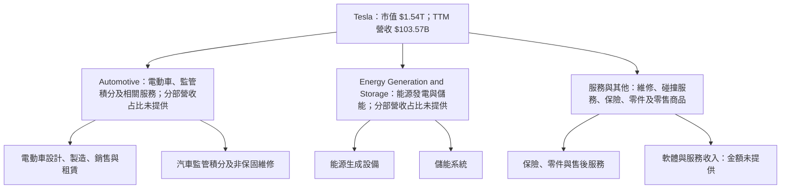
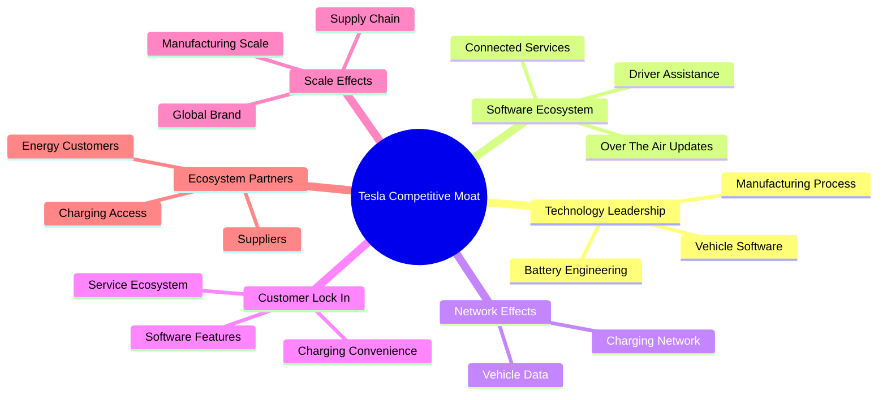
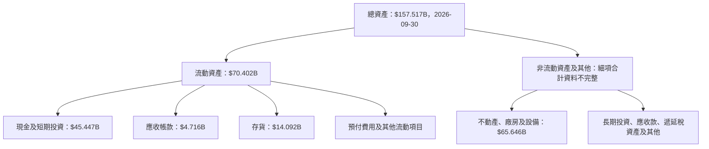
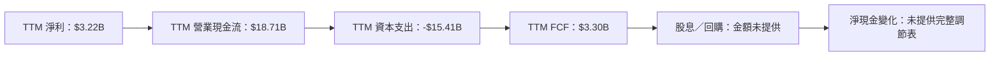
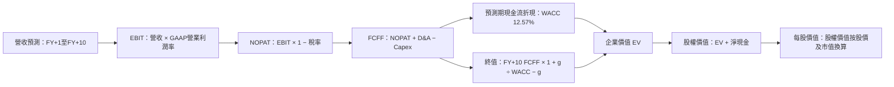
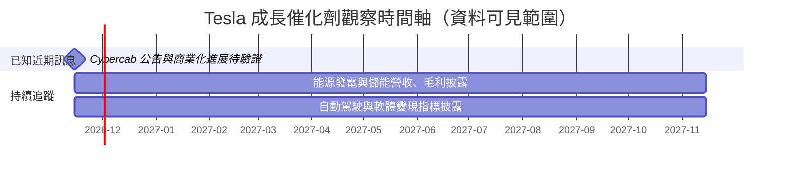
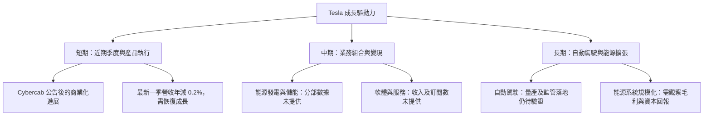
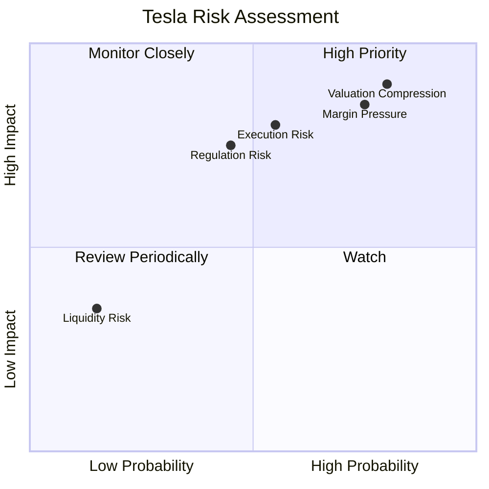
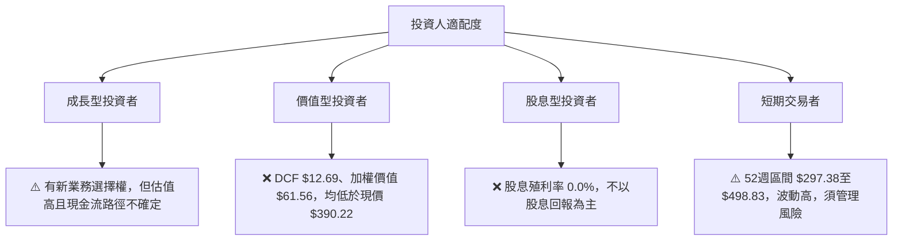

# TSLA 基本面深度分析報告
> **報告日期**：2026-11-15 ｜ **語言**：繁體中文 ｜ **數據來源**：SEC 申報資料 (XBRL)、Yahoo Finance、Finviz、StockAnalysis、Roic.ai ｜ **分析師**：CFA 級機構研究

## 目錄

| # | 章節 | 核心結論 |
|---|------|----------|
| 1 | 執行摘要 | 賣出；加權合理價值 $61.56，MOS -533.9% |
| 2 | 公司概覽與商業模式 | 汽車、能源及服務業務具品牌與規模優勢，但市場份額數據未提供 |
| 3 | 損益表深度分析 | TTM 營收 $103.57B、成長 8.3%；TTM 營業利益率 3.3% |
| 4 | 資產負債表分析 | 依統一口徑淨現金 $36.18B；流動性與短期償付能力充足 |
| 5 | 現金流量深度分析 | TTM FCF $3.30B，資本支出高，FCF Yield 僅 0.21% |
| 6 | 獲利能力與資本效率 | ROIC 5.1% 低於 WACC 12.57%，目前未創造超額股東價值 |
| 7 | 相對估值分析 | 相對傳統車廠估值溢價極高；自身估值處五年高位區域 |
| 8 | DCF 內在價值評估 | 基準 DCF 每股 $12.69；加權合理價值 $61.56 |
| 9 | 成長催化劑 | Cybercab、能源儲存與自動駕駛是選擇權，現有資料不足以量化其價值 |
| 10 | 風險矩陣 | 高估值、利潤率與資本支出、執行及監管風險居前 |
| 11 | 投資建議 | 賣出；需等待估值與基本面落差收斂，並監控毛利、利潤率及 FCF |

---

## 1. 執行摘要

### 1.0 一頁式投資儀表板（Portfolio Manager 30 秒速讀）

| 項目 | 內容 |
|------|------|
| **投資論點（3 句）** | ① TTM 營收 $103.57B、年增 8.3%，但最新一季營收年減 0.2%，成長動能尚未轉化為穩定加速。② ROIC 5.1% 低於 WACC 12.57%，而 TTM 營業利益率僅 3.3%，目前資本回報低於資金成本。③ 以 2026-11-13 收盤價 $390.22 計，DCF 基準價值 $12.69、加權合理價值 $61.56，兩者均顯著低於市價。 |
| **綜合評分** | **4.5/10**（引用 1.1 評分卡） |
| **財務健康** | 🟢 現金及短期投資 $45.45B，總債務 $9.27B，淨現金 $36.18B；流動性充裕，但獲利率偏低。 |
| **ROIC vs WACC** | 5.1% vs 12.57%；差距 -7.47 個百分點，現階段摧毀而非創造經濟價值。 |
| **FCF 趨勢** | TTM FCF $3.30B；相較 FY2025 年度 FCF $6.22B 較低；FCF Yield 0.21%。 |
| **估值** | Forward P/E 180.7x ｜ EV/EBITDA 153.9x ｜ FCF Yield 0.21%。 |
| **DCF 內在價值（基準）** | $12.69 ｜以 DCF 價值為基準，現價溢價 **2,974.2%**。 |
| **安全邊際（MOS）** | **-533.9%**＝($61.56 加權合理價值 − $390.22 現價) ÷ $61.56；🔴 加權合理價值低於現價。 |
| **預期報酬（基準情境 12M）** | 分析師共識 $412.48，較現價隱含 **+5.7%**；這是分析師共識代理，不是 DCF 的 12 個月預測。 |
| **關鍵風險（前二）** | 高估值所隱含的未來成長未實現；低營業利潤率與高 Capex 限制 FCF。 |
| **評級 + 信心度** | 🔴 **賣出** ｜ 信心：中（估值差距大，但新業務價值與未來獲利路徑存在不確定性） |

### 1.1 綜合評分卡（全報告唯一）

| 維度 | 評分（1–10） | 主要依據（引用數字與其來源章節） |
|------|--------------|----------------------------------|
| 成長性 | 5.0 | TTM 營收成長 8.3%，但最新一季年減 0.2%（第 3 章）；季度表現波動。 |
| 獲利能力 | 3.0 | TTM 營業利益率 3.3%、ROIC 5.1% 對比 WACC 12.57%，F-Score 4/9（第 3、6 章）。 |
| 財務健康 | 8.0 | 淨現金 $36.18B，現金及短期投資 $45.45B；CCC 由 15 天降至 3 天（第 4 章）。 |
| 估值 | 1.0 | 加權合理價值 $61.56、MOS -533.9%；P/E 428.8x，五年估值百分位 100%（第 7、8 章）。 |
| 護城河 | 6.0 | 品牌、充電／軟體生態及製造規模提供差異化，但同業競爭與價格壓力削弱定價能力（第 2 章）。 |
| 管理層與資本配置 | 4.0 | FY2025 SBC $2.83B；TTM Capex $15.41B。投入規模大，但當前 ROIC 低於 WACC（第 3、5、6 章）。 |
| **綜合評分** | **4.5** | 六項算術平均：(5.0 + 3.0 + 8.0 + 1.0 + 6.0 + 4.0) ÷ 6 = **4.5**。 |

### 1.2 五大投資論點 + 三大核心風險

| 類型 | 項目 | 具體依據 | 信心度 |
|------|------|----------|--------|
| 🟢 **投資論點①** | 資產負債表有韌性 | 現金及短期投資 $45.45B、債務 $9.27B、淨現金 $36.18B。可承受景氣循環及高額投資。 | 🟢 高 |
| 🟢 **投資論點②** | TTM 營收仍成長 | TTM 營收 $103.57B、年增 8.3%；但最新一季年減 0.2%，需觀察成長是否恢復。 | 🟡 中 |
| 🟢 **投資論點③** | 能源與軟體具有潛在選擇權 | 公司業務包括能源儲存、軟體及服務；但分部收入與獲利數據未提供，暫不將其單獨資本化。 | 🟡 中 |
| 🟢 **投資論點④** | 現金轉換能力尚可 | TTM OCF $18.71B、FCF $3.30B；現金流為正，但 Capex 消耗大。 | 🟡 中 |
| 🟢 **投資論點⑤** | 營運資金效率改善 | CCC 從一年前 15 天降至 3 天，主要來自 DPO 增加；仍需注意供應商付款條件變化。 | 🟡 中 |
| 🟡 **風險①** | 市價遠高於估值錨 | 收盤價 $390.22，DCF 基準 $12.69、加權價值 $61.56；估值依賴未來新業務兌現。 | 🔴 高 |
| 🔴 **風險②** | 資本回報低於資金成本 | ROIC 5.1% vs WACC 12.57%，差距 -7.47pp；若不能提高營業利潤率，增長可能無法創造價值。 | 🔴 高 |
| 🟡 **風險③** | SBC 與資本支出稀釋股東回報 | FY2025 SBC $2.83B；TTM Capex $15.41B，遠高於 TTM FCF $3.30B。 | 🟡 中 |

### 1.3 快速統計卡片

| 指標 | 公司實際值（期間） | 同業中位數 | 狀態 |
|------|--------------------|------------|------|
| 營收成長（TTM） | **8.3%** | — | 🟢 |
| 營收成長（最新一季年增） | **-0.2%** | 2.9%（GM、F、RIVN） | 🔴 |
| 毛利率（TTM） | **19.3%** | 9.2%（GM、F、RIVN） | 🟢 |
| 營業利益率（TTM） | **3.3%** | — | 🟡 |
| ROIC（TTM） | **5.1%** | — | 🔴 |
| Forward P/E | **180.7x** | 6.1x（GM、F） | 🔴 |
| FCF Yield（TTM） | **0.21%** | — | 🔴 |
| Piotroski F-Score | **4 / 9** | — | 🟡 |

> 同業中位數僅以 Peer multiples 區塊中的 GM、F、RIVN 計算；Forward P/E 中位數採有正值的 GM 與 F。

### 1.4 投資結論

╔══════════════════════════════════════════════════════════════════╗  
║                    📊 投資結論摘要                               ║  
╠══════════════════════════════════════════════════════════════════╣  
║  評級：🔴 賣出（依 8.8 MOS -533.9%，符合 MOS < -25%）            ║  
║  價格（2026-11-13 收盤）：$390.22                                 ║  
║  DCF 內在價值（基準）：$12.69（現價溢價 2,974.2%）                ║  
║  安全邊際 MOS：-533.9%（以加權合理價值 $61.56 為分母）           ║  
║  加權合理價值（8.8）：$61.56                                      ║  
║  DCF 情境價值：                                                   ║  
║    悲觀情境：$8.82（相對現價 -97.7%）                             ║  
║    基準情境：$12.69（相對現價 -96.7%）                            ║  
║    樂觀情境：$18.10（相對現價 -95.4%）                            ║  
║  綜合評分：4.5/10（引用 1.1）                                     ║  
║  適合投資人：能承受高波動、以新業務選擇權為核心論點的投資人；     ║  
║              不適合重視估值折價或當期現金回報者。                 ║  
╚══════════════════════════════════════════════════════════════════╝

---

## 2. 公司概覽與商業模式

### 2.1 業務結構與收入來源

公司資料顯示 Tesla 主要經營 Automotive、Energy Generation and Storage，另有汽車服務、保險、監管積分與其他服務。分部營收金額及占比未提供，故不虛構分部比例。

### 2.2 市場份額

市場份額數據未提供，亦無法從現有資料可靠推算。Tesla TTM 營收 $103.57B、年增 8.3%，規模高於表列的純新創競爭者，但傳統車廠營收與 Tesla 的業務組成並不完全可比；最新一季營收年減 0.2%，表示規模優勢尚不能直接等同於短期成長優勢。

### 2.3 競爭護城河分析

### 2.4 護城河強度

| 護城河項目 | 強度（強／中／弱） | 證據（引用數字或事實） | 會削弱它的情況 |
|------------|--------------------|------------------------|----------------|
| 技術與品牌 | 中 | 公司有全球電動車品牌與自研軟體，但可比的技術差異、定價溢價數據未提供。 | 競爭對手縮小產品差距，或價格競爭持續。 |
| 軟體生態系統 | 中 | 業務涵蓋軟體及服務；軟體訂閱收入與用戶指標未提供。 | 軟體變現低於預期，或功能未形成持續付費。 |
| 網路效應 | 中 | 充電網路與車輛資料可形成便利性，但網路使用與轉換率數據未提供。 | 充電標準普及、替代網路增加，降低專屬性。 |
| 客戶鎖定 | 中 | 售後、保險、軟體可增加客戶接觸；重購率等資料未提供。 | 車輛品牌轉換成本低，服務品質或產品更新落後。 |
| 規模效應 | 中 | TTM 營收 $103.57B，具製造與採購規模；但 TTM 營業利益率僅 3.3%。 | 產能利用不足、價格下調或新工廠投資回報偏低。 |
| 生態夥伴 | 弱至中 | 有供應商、充電與能源客戶合作的業務模式，合作帶來的收入未提供。 | 關鍵供應受限，或合作方發展自有替代方案。 |

**1.1 護城河評分 6.0/10**：品牌、規模及軟體生態提供一定差異化，但缺少分部獲利、訂閱收入與客戶留存數據，且低營業利益率反映其優勢尚未充分轉化為穩定定價能力。

---

## 3. 損益表深度分析

### 3.1 年度收入成長趨勢（近4年）

╔══════════════════════════════════════════════════════════════════╗  
║                 Tesla 年度收入趨勢（FY2022–FY2025）              ║  
╠══════════════════════════════════════════════════════════════════╣  
║ FY2022  $81.46B  █████████████████  YoY：+51.35% 🟢              ║  
║ FY2023  $96.77B  ████████████████████  YoY：+18.80% 🟢           ║  
║ FY2024  $97.69B  ████████████████████  YoY：+0.95% 🟡            ║  
║ FY2025  $94.83B  ███████████████████  YoY：-2.93% 🔴             ║  
╠══════════════════════════════════════════════════════════════════╣  
║ FY2022–FY2025 CAGR = (94.83 ÷ 81.46)^(1/3) − 1 = 約 +5.2%         ║  
╚══════════════════════════════════════════════════════════════════╝

收入由 FY2022 的 $81.46B 升至 FY2025 的 $94.83B，但年度增速由 51.35% 放緩至 FY2025 的 -2.93%。這表示過去的高速擴張尚未轉為穩定的高成長；TTM 年增 8.3% 高於 FY2025，但最新一季年減 0.2%，需以未來數季確認是否恢復。

### 3.2 季度收入趨勢分析

| 季度 | 營收 | QoQ | YoY | 備註 |
|------|------|-----|-----|------|
| 2025 Q4 | $24.90B | +28.8% | -3.1% | QoQ 以 2025 Q3 $28.10B 計；季度營收有明顯季節與交付波動。 |
| 2026 Q1 | $22.39B | -10.1% | +15.8% | YoY 依季度資料所列。 |
| 2026 Q2 | $28.24B | +26.1% | +25.5% | QoQ 反彈，但單季變動不宜外推全年。 |
| 2026 Q3 | $28.05B | -0.7% | -0.2% | 略低於 Q2，年增轉負；與 TTM 成長 8.3% 是不同期間指標。 |

### 3.3 利潤率演變分析

| 利潤率指標 | FY2022 | FY2023 | FY2024 | FY2025 | 趨勢 | 評估 |
|------------|--------|--------|--------|--------|------|------|
| **毛利率** | 25.6% | 18.2% | 17.9% | 18.0% | FY2022 後下降，近兩年大致持平 | 🟡 |
| **營業利益率** | 17.0% | 9.2% | 7.8% | 5.1% | 連年收縮 | 🔴 |
| **淨利率** | 15.4% | 15.5% | 7.3% | 4.0% | FY2025 明顯下降 | 🔴 |

年度毛利率及營業利益率由年度收入、毛利及營業利益計算。TTM 口徑則為毛利率 19.3%、營業利益率 3.3%；季度財務表與不同資料來源存在單季營業利益及毛利數字差異，因此年度趨勢採年度財報欄位，TTM 採 VERIFIED FIGURES 數值，不混用。

**利潤率演變深度解析**：FY2022 至 FY2025，年度營業利益由 $13.83B 降至 $4.85B，而營收由 $81.46B 增至 $94.83B。營收規模擴大未帶來營業槓桿，代表降價、產品組合、製造成本或營業費用增加至少部分抵銷規模效益。FY2025 R&D 為 $6.41B，高於 FY2024 的 $4.54B；研發投入可能支持後續產品與軟體，但短期會壓低營業利潤率。

### 3.4 費用結構分析

年度費用明細不足以建立完整且可加總的費用結構圖；因此不製作 pie chart。可確認 FY2025 R&D 為 $6.41B，FY2024 為 $4.54B，年增 41.2%；FY2025 毛利 $17.09B、營業利益 $4.85B，兩者差額反映營業費用合計約 $12.24B，但細項未提供，不能將差額拆成銷管、研發等自創數字。

### 3.5 季度 EPS 趨勢與盈餘品質（Quality of Earnings）

| 季度 | EPS 實際 | EPS 年增 | 預估／驚喜幅度 | 說明 |
|------|----------|---------|----------------|------|
| 2025 Q4 | $0.26 | -60.61% | N/A | 估計 EPS 與實際 EPS 欄位為 nan，無法判定 beat／miss。 |
| 2026 Q1 | $0.15 | +8.33% | N/A | 同上。 |
| 2026 Q2 | $0.34 | -3.03% | N/A | 同上。 |
| 2026 Q3 | $0.24 | -43.59% | N/A | 同上；單季 EPS 仍同比下降。 |

| 盈餘品質項目 | 數值／佔比 | 評估 |
|--------------|-----------|------|
| 股權薪酬 SBC / 營收 | TTM SBC 約 $4.304B ÷ TTM 營收 $103.57B = **4.2%** | 🔴 SBC 對股東的經濟成本不低；FY2025 SBC 為 $2.83B。TTM SBC 由近四季列示值加總。 |
| SBC / 營業現金流 | $4.304B ÷ $18.71B = **23.0%** | 🟡 SBC 是非現金加回的重要部分；若以 GAAP 盈餘衡量，仍需留意未來稀釋。 |
| FCF / 淨利（現金轉換率） | $3.30B ÷ TTM 淨利 $3.22B = **102.5%** | 🟢 FCF 略高於淨利；但 FCF 受高 Capex 壓制且年度間波動大。 |
| 一次性／非經常性損益 | N/A（缺少可核實拆分） | 不判定一次性項目是否美化盈餘。 |
| 有效稅率異常 | 27.0%（最新年度有效稅率） | 暫無足夠年度比較資料判定異常；DCF 沿用此稅率。 |
| 資本化支出 vs 費用化 | TTM Capex $15.41B；資本化明細 N/A | Capex 反映大量投資，但資本化政策與資產減損明細未提供。 |

**盈餘品質結論**：TTM FCF 約為淨利的 102.5%，顯示現金轉換尚可；但 SBC 約占 TTM 營收 4.2%、OCF 23.0%，且資本支出高。GAAP 淨利並非必然高估，但若忽略股權稀釋與再投資需求，會高估可分配給股東的經濟盈餘。EPS 估計值缺失，不能據此聲稱最近四季超預期或不及預期。

---

## 4. 資產負債表分析

### 4.1 資產結構分解

以最新季度總資產 $157.517B 為基礎；以下列示可取得的部分流動資產與資產負債表項目，部分非流動細項及分類總和不足，故不以圖表比例假裝完整。

### 4.2 流動性與營運資金分析

| 指標 | 最新 TTM | 一年前 TTM | 變化 | 解讀 |
|------|----------|------------|------|------|
| DSO 應收帳款天數 | 16 天 | 18 天 | -2 天 | 收款天數下降，營收轉現速度改善。 |
| DIO 存貨天數 | 62 天 | 56 天 | +6 天 | 存貨天數增加，可能代表庫存管理或交付節奏需監控；單靠此數無法判定滯銷。 |
| DPO 應付帳款天數 | 75 天 | 59 天 | +16 天 | 延長付款天數有助現金，但需確認是否反映供應商條款或付款時點。 |
| CCC 現金轉換週期 | 3 天 | 15 天 | -12 天 | CCC 明顯縮短；改善主要由 DPO 上升抵銷 DIO 增加。 |

流動比率 1.739、速動比率 1.239，均高於 1；與 $45.45B 現金及短期投資相互印證，短期流動性充足。

### 4.3 債務結構分析

╔══════════════════════════════════════════════════════════════════╗  
║                    Tesla 債務健康診斷                            ║  
╠══════════════════════════════════════════════════════════════════╣  
║  總債務（估值口徑）：          $9.27B                            ║  
║  現金及短期投資：             $45.45B                            ║  
║  淨現金：                     $36.18B  🟢                       ║  
║  流動比率：                    1.739x                            ║  
║  速動比率：                    1.239x                            ║  
║  Debt/EBITDA：                 N/A（債務口徑與 EBITDA 不可直接配對）║  
║  利息保障倍數：                 N/A（利息費用明細未提供）         ║  
╠══════════════════════════════════════════════════════════════════╣  
║  注意：其他彙整欄列示總債務 $16.44B、淨現金 $29.00B；本文估值及  ║  
║  淨現金統一採 SEC 相關計算區塊的債務 $9.27B 與淨現金 $36.18B。    ║  
╚══════════════════════════════════════════════════════════════════╝

### 4.4 股東權益趨勢

╔══════════════════════════════════════════════════════════════════╗  
║                 Tesla 歷年股東權益（年度）                        ║  
╠══════════════════════════════════════════════════════════════════╣  
║ FY2022  $44.70B  ███████████                                      ║  
║ FY2023  $62.63B  ███████████████                                  ║  
║ FY2024  $72.91B  ██████████████████                               ║  
║ FY2025  $82.14B  ████████████████████                             ║  
╚══════════════════════════════════════════════════════════════════╝

FY2022 至 FY2025 股東權益持續增加，提供資產負債表緩衝；但權益增長不等同於股東回報，需和 ROIC、稀釋及現金流共同判讀。

---

## 5. 現金流量深度分析

### 5.1 現金流量瀑布圖

淨利與股息／回購的現金流細分不足，圖中不填入未提供金額。

### 5.2 FCF 轉換率趨勢

| 期間 | FCF | 淨利 | FCF / 淨利 | 趨勢解讀 |
|------|-----|------|------------|----------|
| FY2022 | $7.55B | $12.58B | 60.0% | 盈餘轉現金比例低於 1，資本支出與營運資金會影響轉換。 |
| FY2023 | $4.36B | $15.00B | 29.1% | 現金轉換率下滑，淨利高於自由現金流。 |
| FY2024 | $3.58B | $7.13B | 50.2% | 仍未完全轉換為 FCF。 |
| FY2025 | $6.22B | $3.79B | 164.1% | FCF 高於淨利，但不代表可長期維持。 |
| TTM 至 2026-09-30 | $3.30B | $3.22B | 102.5% | 大致一比一轉換；FCF Yield 僅 0.21%。 |

### 5.3 自由現金流趨勢

╔══════════════════════════════════════════════════════════════════╗  
║                  自由現金流：歷史實際                            ║  
╠══════════════════════════════════════════════════════════════════╣  
║ FY2022  $7.55B  ████████████████████                              ║  
║ FY2023  $4.36B  ████████████                                      ║  
║ FY2024  $3.58B  █████████                                         ║  
║ FY2025  $6.22B  ████████████████                                  ║  
║ TTM     $3.30B  █████████                                         ║  
╠══════════════════════════════════════════════════════════════════╣  
║ TTM FCF Yield：0.21%；高市值使正 FCF 的股東現金收益率仍偏低。     ║  
╚══════════════════════════════════════════════════════════════════╝

年度 FCF 由 FY2024 的 $3.58B 回升到 FY2025 的 $6.22B，最新 TTM 為 $3.30B。年度與 TTM 期間不同，不能視為連續單季趨勢；但 TTM FCF Yield 只有 0.21%，顯示現價主要依賴未來成長及新業務價值，而非當期現金回報。

### 5.4 資本配置評估

| 配置項目 | 可得資料 | 評估 |
|----------|----------|------|
| Capex | TTM $15.41B；FY2025 $8.53B | 投資強度高，若產能與新業務帶來的回報不足，會拖累 FCF。 |
| 股權薪酬 | FY2025 $2.83B | 應納入股東稀釋成本；是否以回購抵銷，資料未提供。 |
| 股息 | 殖利率 0.0% | 未以現金股息作主要股東回報。 |
| 回購 | 金額未提供 | 不對回購成效作推斷。 |
| 留存現金 | 現金及短期投資 $45.45B | 可支應投資與景氣下行，但現金累積本身不代表資本效率高。 |

股息、回購與留存的完整金額缺失，不製作比例型 pie chart，以免暗示不存在的配置比例。

---

## 6. 獲利能力與資本效率

### 6.1 ROE / ROA / ROIC 趨勢

| 指標 | 最新可得值 | 歷史資訊 | 評估 |
|------|------------|----------|------|
| ROE | TTM 3.6%（品質指標口徑） | 另一彙整資料列 3.8%，口徑不同 | 低回報，且來源口徑有差異，本文採品質指標 3.6%。 |
| ROA | 1.3% | 連續年度數據不足以作一致趨勢比較 | 資產獲利率偏低。 |
| ROIC | 5.1% | TTM 至 2026-09-30 | 低於資本成本。 |

### 6.2 ROIC vs WACC 分析（核心價值創造判斷）

╔══════════════════════════════════════════════════════════════════╗  
║                ROIC vs WACC 深度分析                            ║  
╠══════════════════════════════════════════════════════════════════╣  
║ WACC 輸入（採用成本資本計算值）：                                 ║  
║ ├── 無風險利率（10Y 美債）：5.15%                                ║  
║ ├── 市場風險溢酬：5.00%                                          ║  
║ ├── Beta 原始值：1.74；調整值：1.50                              ║  
║ ├── 股權成本（資料列示）：12.63%                                 ║  
║ ├── 稅前債務成本：3.65%；稅率：27.0%                             ║  
║ ├── 股權／債務權重：99.4%／0.6%                                  ║  
║ └── WACC：12.57%                                                 ║  
║                                                                  ║  
║ ROIC（TTM，SEC 計算口徑）：5.1%                                   ║  
║ EVA 利差 = ROIC − WACC = 5.1% − 12.57% = -7.47 個百分點          ║  
║ ROIC/WACC = 5.1% ÷ 12.57% = 0.41 倍                             ║  
║                                                                  ║  
║ 結論：ROIC 低於 WACC，當前投資資本回報未達資本成本；若差距延續，   ║  
║ 增長會增加資本投入而不必然增加股東價值。                          ║  
╚══════════════════════════════════════════════════════════════════╝

WACC 的原始 Beta 1.74 按資料所列調整為 1.50；股權成本採用資料所列 12.63%，WACC 直接採用 12.57%。由於模型規定採用該資本成本區塊，本文不另行重算替代 WACC。

### 6.3 杜邦三因素分解

| 因素 | 數值（TTM） | 解讀 |
|------|-------------|------|
| 淨利率 | 3.1% | 淨利潤率偏低，限制 ROE。 |
| 資產週轉率 | 0.66 | 每單位資產創造的收入有限，需留意重資產擴張回報。 |
| 權益乘數 | 1.76 | 槓桿不是主要 ROE 驅動來源。 |
| **ROE** | **3.6%** | 3.1% × 0.66 × 1.76 = 約 3.6%（品質指標原值）。 |

### 6.4 財務體質：Piotroski F-Score

F-Score 為 **4/9**。各項測試照錄如下：

| 測試 | 結果 | 解讀 |
|------|------|------|
| ROA > 0 | ✅ 通過 | TTM 資產報酬為正。 |
| 營業現金流 > 0 | ✅ 通過 | TTM OCF $18.71B。 |
| ROA 高於一年前 | ❌ 未通過 | 資產獲利能力未改善。 |
| 營業現金流 > 淨利（應計品質） | ✅ 通過 | 現金流高於淨利，應計品質測試通過。 |
| 長期負債 ÷ 總資產低於一年前 | ❌ 未通過 | 相對負債比未改善。 |
| 流動比率高於一年前 | ❌ 未通過 | 流動比率同比未提高，但目前仍為 1.739。 |
| 稀釋股數未增加 | ❌ 未通過 | 股數增加，反映稀釋風險。 |
| 毛利率高於一年前 | ✅ 通過 | 毛利率同比測試通過。 |
| 資產週轉率高於一年前 | ❌ 未通過 | 資產運用效率未改善。 |

---

## 7. 相對估值分析

### 7.1 同業估值比較表格

| 估值指標 | **TSLA** | **GM** | **F** | **RIVN** | 本公司評估 |
|----------|----------|--------|-------|---------|-----------|
| **Trailing P/E** | 428.8x | 18.8x | N/A | N/A | 🔴 遠高於有正盈餘同業；低淨利率使倍數敏感。 |
| **Forward P/E** | 180.7x | 5.8x | 6.4x | -6.9x | 🔴 遠高於 GM、F；RIVN 為負值，不具一般 P/E 可比性。 |
| **P/S Ratio** | 14.9x | 0.4x | 0.3x | 2.7x | 🔴 顯著溢價，需由更高的長期利潤能力支撐。 |
| **EV/EBITDA** | 153.9x | 9.4x | 24.0x | -7.0x | 🔴 遠高於 GM、F；RIVN 倍數為負，不適合直接比較。 |
| **最新一季營收年增** | -0.2% | 2.9% | -2.0% | 38.3% | 🟡 TSLA 當季成長低於 GM、RIVN，高於 F。 |
| **毛利率（TTM）** | 19.3% | 11.4% | 7.4% | 9.2% | 🟢 高於表列同業，但該優勢尚未充分反映於營業利潤率。 |

註：Peer multiples 來源為 Yahoo Finance。公司估值摘要與歷史估值區塊的 P/S、EV/EBITDA 數字存在不同口徑／更新時間；此表採市場估值欄所列值，7.2 採歷史估值區塊原值。

### 7.2 歷史估值區間分析

╔══════════════════════════════════════════════════════════════════╗  
║                 TSLA 五年歷史估值位置（TTM）                     ║  
╠══════════════════════════════════════════════════════════════════╣  
║ P/E：     18.0x ───── 中位數 74.2x ───────── 現值 428.8x         ║  
║            歷史區間上限 416.4x；當前百分位 100% 🔴               ║  
║ P/S：      3.9x ───── 中位數 9.4x ─── 現值 13.3x ── 上限 16.7x   ║  
║            當前百分位 76% 🔴                                      ║  
║ EV/EBITDA：19.0x ─── 中位數 64.6x ───── 現值 147.3x ─ 上限165.2x║  
║            當前百分位 86% 🔴                                      ║  
╚══════════════════════════════════════════════════════════════════╝

P/E 現值 428.8x 高於歷史區間列示上限 416.4x；百分位為資料庫提供的 100%。即使公司維持增長，現有倍數仍使估值對利潤率、成長率或折現率變動極度敏感。

### 7.3 情境價值（Bear / Base / Bull，照抄 DCF MODEL）

| 情境 | 第 1 年營收成長 | 期末營業利潤率 | WACC | 每股價值 | 相對現價 | 機率 | 會發生的條件 |
|------|----------------|----------------|------|----------|----------|------|--------------|
| 🔴 悲觀 | 4.1% | 6.2% | 13.57% | $8.82 | -97.7% | 25% | 需求或價格承壓，營收成長放緩且規模效益未能充分抵銷競爭。 |
| 🟡 基準 | 8.3% | 7.2% | 12.57% | $12.69 | -96.7% | 50% | TTM 成長率維持起始錨點，利潤率逐步回歸過去五年中位數。 |
| 🟢 樂觀 | 12.4% | 8.0% | 11.57% | $18.10 | -95.4% | 25% | 新產品與能源業務帶來更快成長、利潤率擴張，風險折現率降低。 |

情境概率是模型設定，不是客觀發生機率；即使樂觀情境，估值仍遠低於現價。

### 7.4 相對估值隱含價格區間

╔══════════════════════════════════════════════════════════════════╗  
║             估值方法隱含每股價值 vs 現價                          ║  
╠══════════════════════════════════════════════════════════════════╣  
║ DCF 基準                 $12.69                                  ║  
║ 同業 Forward P/E         $13.20                                  ║  
║ 同業 EV/EBITDA           $47.75                                  ║  
║ 分析師共識目標價         $412.48                                 ║  
║ 現價                     $390.22                                 ║  
╚══════════════════════════════════════════════════════════════════╝

- 同業 Forward P/E：GM、F 的中位數 6.1x × 公司 Forward EPS $2.16 = 每股 $13.20。
- 同業 EV/EBITDA：GM、F 中位數 16.7x × 公司 TTM EBITDA，再加淨現金後，模型回推出每股 $47.75。
- 分析師共識目標價：40 位分析師均值 $412.48，較現價高 5.7%；此為市場預期參考，不等同內在價值。

---

## 8. DCF 內在價值評估（Discounted Cash Flow）

### 8.0 估值推理鏈（Thinking Logic）

**核心命題**：估值由現有汽車營收與利潤底盤、能源與服務的增量成長、以及長期營業利潤率共同決定；目前只知道公司 TTM 總營收 $103.57B，分部營收占比未提供，不能把自動駕駛或能源選擇權另加一筆價值。模型中的主導變數是長期利潤率與終值，因預測期終值現值占 EV 200.3%。

| 決策點 | 本報告採用 | 理由（含數字） | 曾考慮但否決 | 否決理由 |
|--------|-----------|----------------|--------------|----------|
| 現金流定義 | FCFF | 以 WACC 折現並導出 EV，模型採 FCFF = NOPAT + D&A − Capex；營運資金不建模。 | FCFE | 需另行預測利息與融資變動，現有模型未提供。 |
| 預測期 N | 10 年 | DCF 模型固定 10 年，並讓營收成長由 8.3% 線性降至 3.0%。 | 較短預測期 | 無法保留既定模型的成長率遞減路徑。 |
| 終值方法 | Gordon Growth | 使用永續成長率 3.0%，且 WACC 12.57% 大於 g。 | 退出倍數 | DCF 區塊未提供退出倍數及其計算值，不另建模型。 |
| EBIT 基礎 | GAAP EBIT | TTM 營業利益率 3.3%；採用模型 GAAP EBIT。 | 非 GAAP EBIT | 沒有可核實的調整後 EBIT，且可能把 SBC 加回而高估盈餘。 |

**關鍵假設推導鏈**

- **營收成長**：錨點＝TTM 成長率 8.3%；調整＝模型設定十年線性淡化至 3.0%，反映成長正常化；採用值＝第一年 8.3%、第十年 3.0%；否決以最新一季年減 0.2%作為全期起始值，因單季波動不等於 TTM 趨勢。
- **期末營業利潤率**：錨點＝TTM 3.3%；調整＝模型依過去五個財年中位數逐步提升；採用值＝第十年 7.2%；不採用更高的樂觀值作基準，因現有營業利益率仍低，且價格競爭可能抵銷規模效益。
- **永續成長率 g**：錨點＝模型採 3.0%；採用理由＝作為成熟期長期增長假設，且低於 WACC 12.57%；不採用更高永續成長率作基準，避免終值被過度放大。
- **預測期 N**：採用 10 年，沿用模型設定；否決縮短期數作基準，因模型成長率與利潤率需逐步淡化，短期截斷會改變模型定義。
- **Capex／營收**：錨點＝TTM Capex $15.41B ÷ TTM 營收 $103.57B，約 14.9%；採用值由第一年 14.9%逐步降至第十年 6.0%；否決維持長期高 Capex 比率，因模型假定成熟後再投資強度下降，但此假設是估值主要風險之一。
- **EBIT、SBC 與股數**：採 GAAP EBIT，並依模型組合 (A) 固定股數；SBC 已是 GAAP 費用的一部分，不另扣 SBC，也不再加年稀釋率。否決非 GAAP 加回 SBC，因缺乏完整調整數據。
- **終值方法**：採 Gordon Growth，模型終值占比為 200.3%；退出倍數只能作交叉驗證，但模型未提供倍數與計算值，故不自建。
- **WACC**：採 12.57%，直接沿用資本成本資料；否決另行重估折現率，以維持與已計算 DCF 及敏感度矩陣一致。

**最脆弱一環**：模型假設 Capex／營收由 14.9%降至 6.0%，同時營業利潤率由 3.3%升至 7.2%；若再投資強度下降或利潤率改善不成立，終值與每股價值會進一步下修。

### 8.1 模型假設總表（Model Inputs）

| 假設項目 | 採用值 | 依據／來源 | 敏感度 |
|----------|--------|-------------|--------|
| 預測期長度 N | 10 年 | DCF 模型設定；以十年逐步淡化成長與利潤率。 | 🟡 中 |
| 營收成長 | 年 1 8.3% 至年 10 3.0% | TTM 年增 8.3%為起點；年 10 收斂至模型長期值。 | 🔴 高 |
| 營業利潤率 | 3.3%升至 7.2% | TTM 3.3%；期末 7.2%採近五財年中位數（模型設定）。 | 🔴 高 |
| 有效稅率 | 27.0% | 最新年度有效稅率。 | 🟢 低 |
| Capex / 營收 | 年 1 14.9%至年 10 6.0% | TTM Capex／營收約 14.9%；模型淡化至成熟期值。 | 🔴 高 |
| D&A / 營收 | 5.5% | 模型採 TTM 比率並固定。 | 🟢 低 |
| 營運資金變動 | 不建模 | DCF 模型明列 working capital is not modelled。 | N/A |
| EBIT 基礎 | GAAP | DCF 模型明列 GAAP EBIT。 | 🟡 中 |
| SBC 處理 | 組合 (A)：GAAP EBIT、無額外 −SBC、固定股數 | SBC 已包含在 GAAP 費用中；模型不再稀釋股數。 | 🟡 中 |
| 年稀釋率 | 0%（固定股數） | 與組合 (A) 一致；DCF 模型設定。 | 🟡 中 |
| 永續成長率 g | 3.0% | DCF 模型設定；低於 WACC 12.57%。 | 🔴 高 |
| 終值方法 | Gordon Growth | DCF 模型提供 Gordon Growth 終值。 | 🔴 高 |
| WACC | 12.57% | Cost of capital 資料列示，直接採用。 | 🔴 高 |

模型採 **FCFF = NOPAT + D&A − Capex**，不另扣 ΔWC，也不另扣 SBC。模型每股價值按原模型方式以股權價值、價格與市值換算，並非另行填入一個未提供的稀釋股數。

### 8.2 折現率推導（WACC）

╔══════════════════════════════════════════════════════════════════╗  
║                    WACC 推導（折現率）                           ║  
╠══════════════════════════════════════════════════════════════════╣  
║ 股權成本 Ke（CAPM，採資料列示值）：                              ║  
║ ├── 無風險利率 Rf：5.15%                                         ║  
║ ├── 市場風險溢酬 ERP：5.00%                                      ║  
║ ├── 原始 Beta：1.74；調整後 Beta：1.50                           ║  
║ ├── 規模／國別溢酬：0.00%（資料未列額外溢酬）                    ║  
║ └── Ke（資料列示）：12.63%                                       ║  
║                                                                  ║  
║ 債務成本：                                                       ║  
║ ├── 稅前 Kd：3.65%                                               ║  
║ ├── 有效稅率：27.0%                                              ║  
║ └── 稅後 Kd = 3.65% × (1 − 27.0%) = 2.6645%                     ║  
║                                                                  ║  
║ 資本結構權重：股權 99.4%；債務 0.6%                              ║  
║ WACC（採用值）：12.57%                                           ║  
╚══════════════════════════════════════════════════════════════════╝

**逐步演算與一致性說明**

1. CAPM 以未四捨五入調整 Beta 推導；可見資料列示 Beta 1.50 時，5.15% + 1.50 × 5.00% = 12.65%，與資料列示 Ke 12.63% 相差 0.02pp，屬 Beta 顯示精度差異；本報告照採列示 Ke 12.63%。
2. 稅前 Kd = 利息 ÷ 計息負債；利息費用及同口徑平均計息負債未提供，無法獨立重建；採資料列示稅前 Kd 3.65%。
3. 稅後 Kd = 3.65% × (1 − 27.0%) = **2.6645%**。
4. 股權／債務權重直接採資料列示 99.4%／0.6%；同口徑市值及計息負債細項未提供，故不能從股數與負債明細獨立重算權重。
5. WACC = 99.4% × 12.63% + 0.6% × 2.6645% = 12.5542% + 0.0160% = 12.5702% ≈ **12.57%**。本文與第 6.2 節一致使用 12.57%。

### 8.3 逐年自由現金流預測（基準情境）

金額為 $B；逐年數字照 DCF 模型。模型不列 ΔWC，故表內不另設該列；FCFF 使用 GAAP EBIT 與組合 (A)。

| 年度 | FY+1 | FY+2 | FY+3 | FY+4 | FY+5 | FY+6 | FY+7 | FY+8 | FY+9 | FY+10 |
|------|------|------|------|------|------|------|------|------|------|-------|
| 營收 | 112.17 | 120.81 | 129.42 | 137.87 | 146.07 | 153.89 | 161.23 | 167.96 | 173.99 | 179.21 |
| 營收 YoY | 8.3% | 7.7% | 7.1% | 6.5% | 5.9% | 5.4% | 4.8% | 4.2% | 3.6% | 3.0% |
| 營業利潤率 | 3.3% | 3.8% | 4.2% | 4.6% | 5.1% | 5.5% | 5.9% | 6.4% | 6.8% | 7.2% |
| EBIT（GAAP） | 3.75 | 4.57 | 5.45 | 6.40 | 7.42 | 8.48 | 9.58 | 10.71 | 11.85 | 12.98 |
| − 稅 | (1.01) | (1.23) | (1.47) | (1.73) | (2.00) | (2.29) | (2.58) | (2.89) | (3.19) | (3.50) |
| NOPAT | 2.74 | 3.34 | 3.98 | 4.68 | 5.42 | 6.19 | 7.00 | 7.82 | 8.65 | 9.48 |
| + D&A | 6.14 | 6.61 | 7.09 | 7.55 | 8.00 | 8.42 | 8.83 | 9.20 | 9.53 | 9.81 |
| − Capex | (16.69) | (16.78) | (16.71) | (16.44) | (15.98) | (15.32) | (14.47) | (13.42) | (12.19) | (10.79) |
| = FCFF | -7.80 | -6.83 | -5.64 | -4.21 | -2.57 | -0.70 | 1.36 | 3.60 | 5.99 | 8.50 |
| 折現因子 | 0.888 | 0.789 | 0.701 | 0.623 | 0.553 | 0.491 | 0.437 | 0.388 | 0.344 | 0.306 |
| FCFF 現值 PV | -6.93 | -5.39 | -3.95 | -2.62 | -1.42 | -0.35 | 0.59 | 1.40 | 2.06 | 2.60 |

預測期 PV 加總：  
**-6.93 + -5.39 + -3.95 + -2.62 + -1.42 + -0.35 + 0.59 + 1.40 + 2.06 + 2.60 = -14.01B**

**FY+1 逐步演算（模型表列值）**

1. 營收 = $103.57B × (1 + 8.3%) = $112.17B。
2. EBIT：模型列示 $3.75B。以顯示後的營收與 3.3%直接相乘得 $112.17B × 3.3% = $3.70B；與模型 $3.75B 相差，反映模型採用未四捨五入的營業利潤率，故後續沿用模型 EBIT。
3. 稅 = $3.75B × 27.0% = $1.0125B，模型列示 $1.01B。
4. NOPAT = 模型列示 $2.74B。
5. D&A 模型列示 $6.14B；按表列值：$2.74B + $6.14B − $16.69B = -$7.81B，模型 FCFF 列示 -$7.80B。差額 $0.01B 來自輸入值未四捨五入。
6. 折現因子 = 1 ÷ (1 + 12.57%)¹ = 0.888（模型列示）。
7. PV = 模型使用未四捨五入 FCFF 與折現因子，列示 **-$6.93B**。

**合理性自檢**

- 預測 FCF 從負值轉為正值，負值起點無法用通常 CAGR 有意義地表示；FY2022–FY2025 年度 FCF 由 $7.55B 降至 $6.22B，三年 CAGR 約 -6.3%，而模型假設未來由 -$7.80B 改善至 +$8.50B，主要依靠 Capex／營收下降及營業利潤率上升。
- FY+10 FCFF 利潤率 = $8.50B ÷ $179.21B = **4.7%**；當前 TTM FCF 利潤率 = $3.30B ÷ $103.57B = **3.2%**。同業最佳可比值未提供。
- FY+1 至 FY+6 FCFF 為負，因 Capex 高於 NOPAT 加 D&A；模型中這些年度 PV 合計為負，直接壓低 EV，而非被忽略。

╔══════════════════════════════════════════════════════════════════╗  
║                 自由現金流：歷史實際 vs 模型預測                  ║  
╠══════════════════════════════════════════════════════════════════╣  
║ FY2023（實） $4.36B  ████████████                                  ║  
║ FY2024（實） $3.58B  ██████████                                    ║  
║ FY2025（實） $6.22B  █████████████████                             ║  
║ FY+1（預）  -$7.80B  負值                                          ║  
║ FY+10（預）  $8.50B  ████████████████████                          ║  
╠══════════════════════════════════════════════════════════════════╣  
║ 模型改善依賴利潤率擴張與 Capex 強度下降；並非單靠營收增長。        ║  
╚══════════════════════════════════════════════════════════════════╝

### 8.4 終值計算（Terminal Value）

**適用性檢查**：WACC 12.57% vs g 3.0% → WACC > g？✅

| 方法 | 計算式 | 終值 TV | TV 現值 | 佔總 EV 比重 |
|------|--------|---------|---------|--------------|
| Gordon Growth | $8.50 × (1 + 3.0%) ÷ (12.57% − 3.0%) | $91.47B | $27.99B | 200.3% |
| 退出倍數法 | N/A（DCF 模型未提供退出倍數與計算值） | N/A | N/A | N/A |

**終值逐步演算**

1. FY+10 FCFF = $8.50B。
2. 分子 = $8.50B × 1.03 = $8.755B。
3. 分母 = 12.57% − 3.0% = 9.57%；TV = $8.755B ÷ 9.57% = **$91.47B**（四捨五入）。
4. PV(TV) = $91.47B × 0.306 = **$27.99B**（模型使用未四捨五入折現因子）。
5. 終值占 EV = $27.99B ÷ $13.98B = **200.3%**。

終值現值大於企業價值，是因預測期 FCFF 現值合計為負 $14.01B；本估值高度依賴終值假設，短期現金流貢獻有限。

### 8.5 企業價值 → 每股內在價值（Bridge）

╔══════════════════════════════════════════════════════════════════╗  
║              企業價值 → 每股內在價值 橋接表                      ║  
╠══════════════════════════════════════════════════════════════════╣  
║ 預測期 FCF 現值合計              -$14.01B                        ║  
║ 終值現值 PV(TV)                  +$27.99B                        ║  
║ = 企業價值 EV                     $13.98B                        ║  
║ + 淨現金                         +$36.18B                        ║  
║ = 股權價值                        $50.16B                        ║  
║ 每股基準內在價值                  $12.69                          ║  
║ 2026-11-13 收盤價                 $390.22                         ║  
║ 折溢價：現價÷DCF價值−1            +2,974.2%（溢價）               ║  
╚══════════════════════════════════════════════════════════════════╝

**逐步演算（依模型原列數值）**

1. EV = -$14.01B + $27.99B = **$13.98B**。
2. 股權價值 = $13.98B + $36.18B = **$50.16B**。
3. 每股內在價值：模型計算為 **$12.69**。模型指定換算方式為股權價值 × 收盤價 ÷ 市值；由於 $50.16B × $390.22 ÷ $1.54T 會因市值顯示精度產生差異，故每股價值照錄模型的 $12.69，不用已四捨五入市值重算。
4. 折溢價 = $390.22 ÷ $12.69 − 1 = **2,974.2%**。
5. 本節不計算 MOS；MOS 僅在 8.8 以加權合理價值為分母。

股數處理採模型的 GAAP EBIT 固定股數組合 (A)，不額外稀釋；現金與債務淨額採模型淨現金 $36.18B。資料中總債務另有 $16.44B 口徑，本模型明確採用淨現金欄位，不混搭兩種口徑。

### 8.6 敏感性分析（WACC × 永續成長率）

下表為模型每股價值；括號上行空間按現價 $390.22 計算，均遠低於現價。

| g（列）／WACC（欄） | 10.57% | 11.57% | **12.57%（基準）** | 13.57% | 14.57% |
|-----------|------:|------:|------------------:|------:|------:|
| 2.0% | $15.04 (-96.1%) | $13.30 (-96.6%) | $11.96 (-96.9%) | $10.90 (-97.2%) | $10.05 (-97.4%) |
| 2.5% | $15.67 (-96.0%) | $13.77 (-96.5%) | $12.30 (-96.8%) | $11.16 (-97.1%) | $10.26 (-97.4%) |
| 3.0% | $16.38 (-95.8%) | $14.28 (-96.3%) | **$12.69 (-96.7%)** | $11.46 (-97.1%) | $10.49 (-97.3%) |
| 3.5% | $17.20 (-95.6%) | $14.86 (-96.2%) | $13.12 (-96.6%) | $11.78 (-97.0%) | $10.73 (-97.2%) |
| 4.0% | $18.13 (-95.4%) | $15.52 (-96.0%) | $13.59 (-96.5%) | $12.13 (-96.9%) | $11.00 (-97.2%) |

**示範一格**：所選格 WACC 11.57% > g 3.0% ✅。模型敏感度表該格每股價值為 $14.28；相對現價 = ($14.28 ÷ $390.22) − 1 = **-96.3%**。DCF 模型未提供該格逐年 PV 與新終值的中間值，故不自行重建第二套模型，數值採模型原列結果。

**三情境算式鏈限制**：模型僅提供每股價值及營收成長、期末利潤率、WACC、機率，未提供各情境逐年收入、FCFF 與終值明細。依規則不另建模型，因此不能捏造逐情境中間計算。

| 情境 | 模型每股價值 | 相對現價 | 機率 | 假設 |
|------|--------------:|----------:|------:|------|
| 🔴 悲觀 | $8.82 | -97.7% | 25% | 年 1 成長 4.1%、期末營業利潤率 6.2%、WACC 13.57%。 |
| 🟡 基準 | $12.69 | -96.7% | 50% | 年 1 成長 8.3%、期末營業利潤率 7.2%、WACC 12.57%。 |
| 🟢 樂觀 | $18.10 | -95.4% | 25% | 年 1 成長 12.4%、期末營業利潤率 8.0%、WACC 11.57%。 |
| **機率加權** | **$13.07** | **-96.6%** | **100%** | $8.82 × 25% + $12.69 × 50% + $18.10 × 25% = $13.075，模型列示 $13.07，尾差來自未四捨五入值。 |

敏感度結論：在模型矩陣內，g 由 2.0%升至 3.0%（WACC 12.57%）使價值由 $11.96 升至 $12.69，增加 $0.73；WACC 由 11.57%升至 12.57%（g 3.0%）使價值由 $14.28 降至 $12.69，減少 $1.59。營業利潤率每 +1pp 的獨立敏感度未提供，不能計算。終值占比高，與 8.0 所指的終值／長期獲利假設是主導變數一致。

### 8.7 反推 DCF（Reverse DCF：市場在預期什麼）

反推 DCF 模型給定的兩個單變數結果，均在規定範圍內無解：

| 求解的變數（一次一個） | 固定其他基準輸入 | 市場隱含值 | 公司歷史實際 | 判斷 |
|------------------------|------------------|------------|--------------|------|
| 年 1 營收成長 | 其他輸入固定為基準 | 在 -10% 至 100% 間無解 | TTM 成長 8.3% | 現價無法由單靠年 1 成長解釋。 |
| 固定營業利潤率 | 其他輸入固定為基準 | 在 0.5% 至 95% 間無解 | TTM 營業利潤率 3.3% | 單靠固定利潤率無法使模型價值等於市價。 |
| 永續成長率 | 模型未解出 | 未計算 | — | N/A；不另行疊代。 |
| 預測期 N | 模型未解出 | 未計算 | — | N/A；不另行疊代。 |

資料只提供「無解」的搜尋區間結果，未提供試算迭代軌跡，故不虛構收斂值或中間試算表。含義是：在模型其他條件不變時，現價需要多項假設同時偏離基準，單一變數不足以解釋其估值。

### 8.8 估值三角驗證與安全邊際

| 估值方法 | 隱含每股價值 | 上行空間（÷現價） | 權重 | 說明 |
|----------|--------------|-------------------|------|------|
| DCF（基準） | $12.69 | -96.7% | 40% | 10 年 FCFF、WACC 12.57%、永續成長 3.0%。 |
| 同業 Forward P/E | $13.20 | -96.6% | 25% | GM、F 中位數 6.1x × Forward EPS $2.16。 |
| 同業 EV/EBITDA | $47.75 | -87.8% | 25% | GM、F 中位數 16.7x × TTM EBITDA，加淨現金。 |
| 分析師共識目標價 | $412.48 | +5.7% | 10% | 40 位分析師均值；作市場參考。 |
| **加權合理價值** | **$61.56** | **-84.2%** | **100%** | 類型為 profitable；固定權重照錄。 |

加權合理價值算式：  
**$12.69 × 40% + $13.20 × 25% + $47.75 × 25% + $412.48 × 10%  
= $5.076 + $3.300 + $11.9375 + $41.248 = $61.5615 ≈ $61.56。**

MOS 算式：  
**($61.56 − $390.22) ÷ $61.56 = -$328.66 ÷ $61.56 = -533.9%。**  
上行空間：  
**($61.56 − $390.22) ÷ $390.22 = -$328.66 ÷ $390.22 = -84.2%。**

╔══════════════════════════════════════════════════════════════════╗  
║                  估值區間與安全邊際                              ║  
╠══════════════════════════════════════════════════════════════════╣  
║ 悲觀DCF $8.82 ─ 加權價值 $61.56 ─ 基準DCF $12.69 ─ 現價 $390.22 ║  
║                                                                  ║  
║ MOS = (加權合理價值 $61.56 − 現價 $390.22) ÷ $61.56 = -533.9%   ║  
║ 上行空間 = ($61.56 − $390.22) ÷ $390.22 = -84.2%                ║  
║                                                                  ║  
║ 評估：🔴 現價遠高於加權合理價值；評級依 MOS 為賣出。             ║  
║ 買入參考上限：若以 MOS ≥10% 作條件，價格須 ≤ $55.40             ║  
║ （$61.56 × 90%）；不代表價格到達該位即自動構成買入。             ║  
╚══════════════════════════════════════════════════════════════════╝

> 🔎 **程式複算（Python，依本節各項自動重算）**
>
> 加權合理價值 = $12.69 × 40% + $13.20 × 25% + $47.75 × 25% + $412.48 × 10% = **$61.56**（權重合計 100%）
>
> 以價格 $390.22 計：MOS = **-533.9%**，上行空間 = **-84.2%**
>
> ✅ 與本節所寫數值一致。

### 8.9 DCF 模型的局限與失效條件

- **終值依賴度**：終值現值占 EV 200.3%；預測期現值為 -$14.01B，估值高度受第十年後現金流與 3.0% 永續成長假設左右。
- **最脆弱假設**：Capex／營收由 14.9%降至 6.0%；以及營業利益率由 3.3%升至 7.2%。若未實現，估值低於 $12.69 的風險增加；模型未提供可直接重算的單變數下修值。
- **適用性**：預測期前六年 FCFF 為負，且 TTM FCF Yield 僅 0.21%，表示公司仍在高再投資期；DCF 可靠度低於穩定成熟企業。可搭配同業 EV/EBITDA、P/S 及分部估值檢視，但本報告不另建未提供的 SOTP。
- **與第 10 章連結**：價格競爭及需求放緩會衝擊營收成長與營業利潤率；高額產能投資會影響 Capex；利率上升會透過 WACC 壓低終值。

### 8.10 複算檢核表（Audit Trail）

| # | 檢核項目 | 檢查方式 | 結果 |
|---|----------|----------|------|
| 1 | 高／中敏感度輸入均有推導 | 對照 8.0 與 8.1 | ✅ |
| 2 | 每項假設都有來歷 | 8.1 逐項列依據 | ✅ |
| 3 | WACC 五步算式及權重 | 權重 99.4% + 0.6% = 100%；Ke 採資料列示值 | ⚠️ Beta 顯示精度造成 Ke 約 0.02pp 差異，已註明並沿用 12.57%。 |
| 4 | Kd 分母與債務權重口徑一致 | 利息費用及計息負債細項不足以獨立核對 | ⚠️ 採用資料列示 Kd、權重，未聲稱獨立重算。 |
| 5 | WACC 與第 6.2 節相同 | 兩節均 12.57% | ✅ |
| 6 | 預測年度數等於 N | FY+1 至 FY+10 共十年，無省略 | ✅ |
| 7 | FY+1 FCFF 與 PV | 模型顯示值受未四捨五入輸入影響 | ⚠️ 已揭露顯示值的 $0.01B 差異。 |
| 8 | 預測期 PV 合計 | 十年 PV 加總 = -$14.01B | ✅ |
| 9 | WACC > g | 12.57% > 3.0% | ✅ |
| 10 | 終值基於 FY+10 並折現十期 | 模型終值與折現值照錄 | ✅ |
| 11 | EV 至每股價值橋接 | EV 與股權價值可加總；每股值採模型 $12.69 | ⚠️ 顯示市值取整後無法精確重建模型換算。 |
| 12 | SBC 組合相容 | GAAP EBIT、無 −SBC 列、固定股數 | ✅ |
| 13 | 敏感度基準格等於基準 DCF | $12.69 | ✅ |
| 14 | 敏感度格有效 | 全部 WACC 高於最高 g 4.0% | ✅ |
| 15 | 情境機率及加權 | 25% + 50% + 25% = 100%；模型加權 $13.07 | ⚠️ 顯示值直接相加 $13.075，四捨五入尾差已說明。 |
| 16 | 反推每列單一變數 | 模型僅給兩項無解區間，未提供迭代軌跡 | ⚠️ 未偽造求解過程。 |
| 17 | MOS 與折溢價分母正確 | MOS 用 $61.56；DCF 折溢價用 $12.69 | ✅ |
| 18 | 報告完整至第 11 章 | 已列出第 1–11 章 | ✅ |
| 19 | 加權價值未事後調整 | 加權合計 $61.5615，顯示 $61.56 | ✅ |
| 20 | 評級符合 MOS | MOS -533.9% < -25%，評級賣出 | ✅ |

---

## 9. 成長催化劑

### 9.1 催化劑時間軸

時間軸是監控安排而非公司指引；除新聞提及 Cybercab 公告外，具體量產或營收時間未提供。

### 9.2 TAM 市場規模分析

N/A（TAM 數據未提供）。Tesla TTM 營收 $103.57B、TTM 成長 8.3%，但最新一季營收年減 0.2%；可觀察汽車、能源、軟體各自的增長空間，然而缺少市場規模與分部滲透率，無法可靠計算 TAM 或市場滲透率。

### 9.3 成長驅動力結構圖

---

## 10. 風險矩陣

### 10.1 風險評分矩陣

下圖位置為分析師對風險相對機率與衝擊的定性排序，不代表歷史統計機率。

### 10.2 風險清單詳細分析

| # | 風險項目 | 發生機率 | 財務衝擊 | 風險評分 | 緩解措施 |
|---|----------|----------|----------|----------|----------|
| 1 | 🔴 **估值收縮** | 高（定性） | 高；Forward P/E 180.7x、DCF 基準遠低於市價 | 🔴 高 | 避免只依賴新業務選擇權定價；以分批與估值安全邊際管理曝險。 |
| 2 | 🔴 **汽車價格競爭與利潤率壓力** | 高（定性） | 高；TTM 營業利益率 3.3%，最新一季營收年減 0.2% | 🔴 高 | 追蹤 ASP、毛利率、交付量及營業費用；要求成長伴隨獲利改善。 |
| 3 | 🟠 **資本支出回報不足** | 中至高（定性） | 高；TTM Capex $15.41B，TTM FCF $3.30B | 🟠 高 | 按項目追蹤產能利用、投入資本回報及新增產能貢獻。 |
| 4 | 🟡 **新業務落地／監管風險** | 中（定性） | 高；Cybercab、軟體與能源分部貢獻未提供 | 🟡 中高 | 以商業化里程碑、監管批准、付費用戶及分部毛利作驗證。 |
| 5 | 🟢 **短期流動性風險** | 低（定性） | 低至中；淨現金 $36.18B、流動比率 1.739 | 🟢 低 | 維持足夠流動性，避免低回報擴張累積為長期資本效率問題。 |

---

## 11. 投資建議

### 11.1 最終評級與評分

評級為 **🔴 賣出**：加權合理價值 $61.56，MOS -533.9%，依規則 20 對應賣出；未作質化上調或下調。1.1 綜合評分為 **4.5/10**，六項分數依序為成長性 5.0、獲利能力 3.0、財務健康 8.0、估值 1.0、護城河 6.0、管理層與資本配置 4.0。

### 11.2 合理價值與隱含報酬率

| 估值項目 | 每股價值 | 相對現價 $390.22 | 機率／權重 |
|----------|----------:|-----------------:|-----------:|
| 加權合理價值 | $61.56 | -84.2% | 100% 權重 |
| 悲觀 DCF | $8.82 | -97.7% | 25% |
| 基準 DCF | $12.69 | -96.7% | 50% |
| 樂觀 DCF | $18.10 | -95.4% | 25% |

上述 DCF 情境是模型內在價值情境，不是 12 個月股價目標。分析師共識目標價 $412.48，較現價 +5.7%，作為外部參考，不能取代 DCF 與加權估值。

### 11.3 買入時機與觸發因素

╔══════════════════════════════════════════════════════════════════╗  
║                  ✅ 買入觸發因素 Checklist                       ║  
╠══════════════════════════════════════════════════════════════════╣  
║  目前操作立場：不因單一催化劑追價；先要求基本面與估值改善。      ║  
║                                                                  ║  
║  重新評估買入條件：                                              ║  
║  ☐ 股價接近或低於加權價值 MOS 10% 門檻約 $55.40，並重新檢視假設。║  
║  ☐ 營收恢復正成長，且連續季度營業利益率較 3.3% TTM 水準改善。    ║  
║  ☐ Capex 相對營收下降，同時 FCF 持續為正而非單季偶發。          ║  
║  ☐ 能源、軟體或自動駕駛披露可核實的收入、毛利及客戶指標。      ║  
║                                                                  ║  
║  加碼觸發條件：                                                  ║  
║  ☐ ROIC 朝 WACC 12.57%收斂，且非依賴一次性收益。                 ║  
║  ☐ FCF Yield 從目前 0.21%改善，並由營業現金流支持。             ║  
║                                                                  ║  
║  減碼／退出觸發條件：                                            ║  
║  ☐ 營業利益率進一步收縮、FCF 轉負或債務增加且未形成產能回報。   ║  
║  ☐ 成長催化劑延後，市場仍以高估值反映未實現的未來收益。        ║  
╚══════════════════════════════════════════════════════════════════╝

### 11.4 投資人適配度分析

### 11.5 每季財報監控清單（Quarterly Watch List）

| 監控指標 | 目前錨點 | 加碼觀察條件 | 減碼／重新評估條件 |
|----------|----------|--------------|--------------------|
| 營收成長 | TTM +8.3%；最新一季 YoY -0.2% | 單季年增恢復正值並持續改善 | 連續兩季年減，且未見產品或分部改善 |
| 營業利益率 | TTM 3.3%；最新季 2.6%（SEC 驗證口徑） | 連續改善並由核心營運支持 | 持續低於目前 TTM 3.3% |
| 毛利率 | TTM 19.3% | 穩定或改善且不是只靠監管積分 | 明顯收縮或以降價換量 |
| Capex | TTM $15.41B | Capex 強度下降且產能回報提高 | Capex 上升但營收、FCF 未同步改善 |
| FCF | TTM $3.30B；Yield 0.21% | FCF 持續為正並提升 | FCF 轉負或連續下降 |
| 庫存與現金週期 | DIO 62 天、CCC 3 天 | DIO 回落且 CCC 保持低位 | DIO 持續上升，且銷售未加速 |
| SBC／稀釋 | FY2025 SBC $2.83B；F-Score 股數測試未通過 | SBC 占營收下降或稀釋減緩 | SBC 維持高占比、股數持續增加 |
| 能源／軟體／自動駕駛 | 分部營收與毛利未提供 | 披露可查核的付費收入與獲利貢獻 | 僅有公告，長期未形成可量化收入 |
| ROIC | 5.1% | 向 WACC 12.57%收斂 | ROIC 進一步下跌 |

### 11.6 反面論證：什麼會證明論點錯誤（What Would Change My Mind）

╔══════════════════════════════════════════════════════════════════╗  
║              ⚠️ 論點失效條件（Disconfirming Evidence）            ║  
╠══════════════════════════════════════════════════════════════════╣  
║ 本報告的估值偏保守，若以下條件持續成立，應重新檢視賣出結論：    ║  
║ ☐ TTM 營收成長連續加速，且最新一季年增持續高於 8.3% TTM 錨點。  ║  
║ ☐ TTM 營業利益率由 3.3%向 7.2%模型期末假設收斂，且非一次性收益。║  
║ ☐ TTM FCF 高於目前 $3.30B並持續增加，Capex／營收同步下降。     ║  
║ ☐ ROIC 從 5.1%升至高於 WACC 12.57%，形成可持續正 EVA。         ║  
║ ☐ 能源、軟體或自動駕駛披露可核實的營收與利潤，足以支持高於     ║  
║    傳統汽車同業的估值溢價。                                     ║  
║ 若相反地營收連續兩季年減、營業利潤率低於 3.3%且 FCF 轉負，     ║  
║ 則估值與營運假設都需再下修。                                    ║  
╚══════════════════════════════════════════════════════════════════╝

> **免責聲明**：本報告為 AI 自動生成，僅供研究參考，不構成投資建議。投資有風險，入市需謹慎。

---

## 資料與來源

| 項目 | 內容 |
|------|------|
| 價格 | 390.22 USD，2026-11-13 收盤（Yahoo Finance 日線） |
| 財務報表 | SEC 10-Q filed 2026-10-22，最新季度 2026-09-30（FY2026 Q3） |
| 有回應的資料來源 | SEC 申報資料 (XBRL)、Yahoo Finance、Finviz、StockAnalysis、Roic.ai |
| 由程式計算 | TTM 數字、WACC、DCF 模型、估值方法與權重、加權合理價值、MOS、評級門檻、F-Score、杜邦分解、營運資金天數、綜合評分 |
| 撰寫模型 | openai / gpt-6-luna |

> 本區塊由產生報告的程式依實際取得的資料填寫，非模型撰寫。「由程式計算」的數字不是模型的估計；其餘判斷（評分、情境、策略）是模型的分析。
