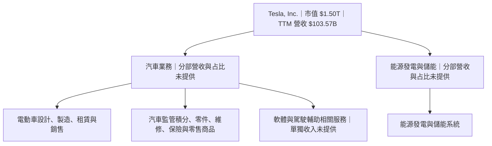
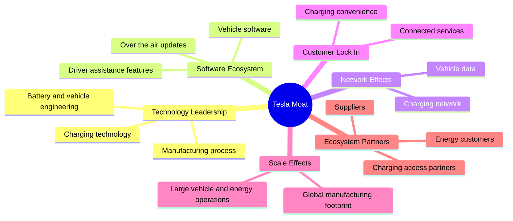
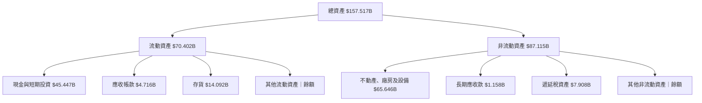
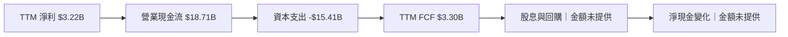
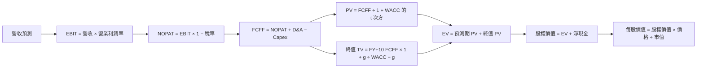
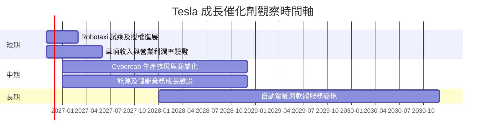
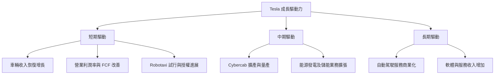
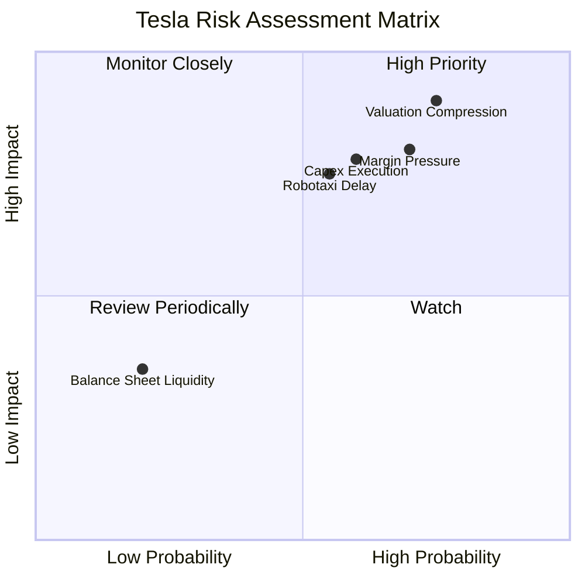
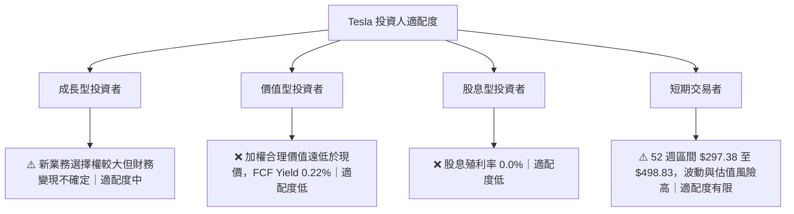

# TSLA 基本面深度分析報告
> **報告日期**：2026-11-17 ｜ **語言**：繁體中文 ｜ **數據來源**：SEC 申報資料 (XBRL)、Yahoo Finance、Finviz、StockAnalysis、Roic.ai ｜ **分析師**：CFA 級機構研究

## 目錄

| # | 章節 | 核心結論 |
|---|------|----------|
| 1 | 執行摘要 | 賣出；加權合理價值 $61.36；MOS -519.5% |
| 2 | 公司概覽與商業模式 | 車輛、能源與服務構成業務；細分營收占比未提供，護城河部分成立但面臨競爭 |
| 3 | 損益表深度分析 | TTM 營收 $103.57B、成長 8.3%；TTM 營業利益率 3.3%，單季營收年減 0.2% |
| 4 | 資產負債表分析 | SEC／程式計算口徑淨現金 $36.18B；營運資金週期 3 天 |
| 5 | 現金流量深度分析 | TTM FCF $3.30B，FCF Yield 0.22%；高資本支出壓低現金流 |
| 6 | 獲利能力與資本效率 | ROIC 5.1% 低於 WACC 12.52%，目前未創造足夠資本報酬 |
| 7 | 相對估值分析 | 估值顯著高於同業倍數與自身歷史中位數 |
| 8 | DCF 內在價值評估 | 基準 DCF $12.76／股；加權合理價值 $61.36／股 |
| 9 | 成長催化劑 | Cybercab、能源儲能與自動駕駛具選擇權，但營收貢獻與變現時間未量化 |
| 10 | 風險矩陣 | 估值、利潤率與執行風險居前 |
| 11 | 投資建議 | 不建議追價；監控利潤率、FCF、資本支出與新業務變現 |

---

## 1. 執行摘要

Tesla 的財務證據呈現「資產負債表強、營運報酬弱、估值要求高」的組合：TTM 營收 $103.57B、TTM 成長 8.3%，但最新一季營收年減 0.2%；TTM 營業利益率 3.3%、ROIC 5.1%，均低於 12.52% 的 WACC；TTM FCF 為 $3.30B，FCF Yield 僅 0.22%。在此基礎上，DCF 基準價值為 $12.76，估值方法加權後合理價值為 $61.36，而 2026-11-17 收盤價為 $380.11。依加權合理價值計算，MOS 為 -519.5%，符合規則 20 的**賣出**門檻；這一評級是低現金流收益率、ROIC 低於資本成本與極高估值倍數共同推導的結果。

### 1.0 一頁式投資儀表板（Portfolio Manager 30 秒速讀）

| 項目 | 內容 |
|------|------|
| **投資論點（3 句）** | ① TTM 營收成長 8.3%，但最新一季營收年減 0.2%，短期成長動能尚未穩定。② ROIC 5.1% 低於 WACC 12.52%，目前回報不足以覆蓋資本成本。③ TTM FCF $3.30B、FCF Yield 0.22%，相對 $1.50T 市值的現金流支撐有限。 |
| **綜合評分** | **4.8/10**（引用 1.1 評分卡） |
| **財務健康** | 🟢 有流動性緩衝：現金與短期投資 $45.45B；但須留意財務資料來源間的債務口徑差異。 |
| **ROIC vs WACC** | **5.1% vs 12.52%**；ROIC 低於 WACC，現階段在經濟上摧毀價值。 |
| **FCF 趨勢** | FY2025 FCF $6.22B，最新 TTM FCF $3.30B；TTM FCF Yield **0.22%**，現金流收益率低。 |
| **估值** | Forward P/E **176.0x** ｜ EV/EBITDA（TTM，估值資料）**149.8x** ｜ FCF Yield **0.22%** |
| **DCF 內在價值（基準）** | **$12.76** ｜現價相對 DCF 溢價 **+2,878.5%**（折溢價定義：現價 ÷ DCF 價值 − 1） |
| **安全邊際（MOS）** | **-519.5%**＝($61.36 − $380.11) ÷ $61.36；🔴 無安全邊際（基準為 8.8 加權合理價值） |
| **預期報酬（基準情境 12M）** | **-96.6%**（DCF 基準情境 $12.76 相對現價；不是加權合理價值的上行空間） |
| **關鍵風險（前二）** | 估值回落風險；車輛定價、競爭及資本支出壓力使利潤率與 FCF 不及預期。 |
| **評級 + 信心度** | 🔴 **賣出** ｜ 信心：中（財務數據足以支持估值警示，但來源口徑及 DCF 模型局限降低精確度） |

### 1.1 綜合評分卡（全報告唯一）

| 維度 | 評分（1–10） | 主要依據（引用數字與其來源章節） |
|------|--------------|----------------------------------|
| 成長性 | 5.5 | TTM 營收成長 8.3%，但最新一季年減 0.2%；年度收入成長放緩，見第 3 章。 |
| 獲利能力 | 3.5 | TTM 營業利益率 3.3%、ROIC 5.1% 低於 WACC 12.52%、Piotroski F-Score 4/9，見第 3、6 章。 |
| 財務健康 | 8.0 | 現金與短期投資 $45.45B、已計算淨現金 $36.18B；CCC 3 天，見第 4 章。 |
| 估值 | 1.5 | MOS -519.5%；Forward P/E 176.0x；自身 P/E 歷史百分位 100%，見第 7、8 章。 |
| 護城河 | 6.5 | 有車輛軟體、充電／服務與能源產品基礎，但市場份額、訂閱收入與客戶留存數字未提供，見第 2 章。 |
| 管理層與資本配置 | 3.0 | FY2025 SBC $2.83B，稀釋股數測試未通過；FY2025 資本支出 $8.53B，且 TTM 資本支出 $15.41B，投入回報仍待驗證。 |
| **綜合評分** | **4.7** | 六項算術平均：($5.5 + $3.5 + $8.0 + $1.5 + $6.5 + $3.0) ÷ 6 = **4.7/10**。 |

### 1.2 五大投資論點 + 三大核心風險

| 類型 | 項目 | 具體依據 | 信心度 |
|------|------|----------|--------|
| 🟢 **投資論點①** | 資產負債表有緩衝 | 現金與短期投資 $45.45B、計算淨現金 $36.18B，為產品投資與景氣下行提供緩衝。 | 🟢 高 |
| 🟢 **投資論點②** | TTM 營收仍增長 | TTM 營收 $103.57B，年增 8.3%；但最新一季年減 0.2%，需觀察成長能否恢復。 | 🟡 中 |
| 🟢 **投資論點③** | 能源與儲能有第二曲線可能 | 公司經營能源發電及儲能業務；但分部營收、利潤與成長數字未提供，選擇權尚不能轉化為可量化估值。 | 🟡 中低 |
| 🟢 **投資論點④** | 營運資金週期短 | CCC 由一年前 15 天縮短至 3 天，主要為 DPO 上升所致；短週期有利營運現金管理。 | 🟡 中 |
| 🟢 **投資論點⑤** | 新產品與自動駕駛催化劑 | 新聞指出 Cybercab 德國擴產計畫及 Robotaxi 測試／授權進展；但時間、量產與收入實現存在不確定性。 | 🟡 中低 |
| 🟡 **風險①** | 高估值對成長與利潤率要求極高 | P/E 417.7x、P/S 13.0x（自有歷史計算口徑），而 TTM 營業利益率僅 3.3%。 | 🔴 高衝擊 |
| 🔴 **風險②** | 資本投入未形成相應自由現金流 | TTM Capex $15.41B，FCF 僅 $3.30B；若投資回報延遲，估值與現金流可能同時承壓。 | 🔴 高衝擊 |
| 🟡 **風險③** | 業務數據與財務來源口徑不一致 | SEC／程式計算淨現金 $36.18B，但合併市場資料段落列示總債務 $16.44B、淨現金 $29.00B；需以正式申報資料逐項核實。 | 🟡 中度 |

### 1.3 快速統計卡片

| 指標 | 公司實際值（期間） | 同業中位數 | 狀態 |
|------|--------------------|------------|------|
| 營收成長（TTM） | **8.3%** | — | 🟡 |
| 營收成長（最新一季年增） | **-0.2%** | **2.9%**（GM、F、RIVN 中位數） | 🔴 |
| 毛利率（TTM） | **19.3%** | **9.2%**（GM、F、RIVN 中位數） | 🟢 |
| 營業利益率（TTM） | **3.3%** | — | 🔴 |
| ROIC（TTM） | **5.1%** | — | 🔴 |
| Forward P/E | **176.0x** | **5.9x**（GM、F 中位數） | 🔴 |
| FCF Yield（TTM） | **0.22%** | — | 🔴 |
| Piotroski F-Score | **4 / 9** | — | 🟡 |

> 各同業中位數只依可計算的 Peer multiples 欄位呈現；P/E 同業中位數採 GM、F 的 Forward P/E。

### 1.4 投資結論

```text
╔══════════════════════════════════════════════════════════════════╗
║                    📊 投資結論摘要                               ║
╠══════════════════════════════════════════════════════════════════╣
║  評級：🔴 賣出（依 MOS 評級門檻，未做質化調整）                  ║
║  價格（2026-11-17 收盤）：$380.11                                ║
║  DCF 內在價值（基準）：$12.76（現價溢價 +2,878.5%）             ║
║  安全邊際 MOS：-519.5%（＝(加權合理價值−現價)÷加權合理價值）     ║
║  加權合理價值（8.8）：$61.36                                     ║
║  DCF 情境價值：                                                  ║
║    悲觀情境：$8.86（相對現價 -97.7%）                            ║
║    基準情境：$12.76（相對現價 -96.6%）                           ║
║    樂觀情境：$18.23（相對現價 -95.2%）                           ║
║  綜合評分：4.7/10（引用 1.1）                                    ║
║  適合投資人：能承受高波動、以新業務選擇權為主要論據的投資人；    ║
║              不適合以現金流收益率或股息收入為主要目標者。        ║
╚══════════════════════════════════════════════════════════════════╝
```

---

## 2. 公司概覽與商業模式

Tesla 設計、開發、製造、租賃並銷售電動車及能源發電與儲能系統，另有汽車監管積分、維修、零件、保險及零售商品等服務。FY2025 全年收入為 $94.83B，最新 TTM 營收為 $103.57B。公司分為汽車與能源發電及儲能兩大報告分部；各分部營收、毛利及其占總營收比重在可引用數據中未提供，因此不拆分數字、不繪製比例圖。

### 2.1 業務結構與收入來源



### 2.2 市場份額

市場份額數據未提供，因此不繪製市占率圖、不推估比例。Tesla TTM 營收 $103.57B，規模高於所列 GM、Ford 與 Rivian 同業資料所示的相對企業定位，但單季營收年增 -0.2%，低於同業最新一季營收成長中位數 2.9%。這表示公司規模仍大，但近期成長表現不能單憑規模推定其市場份額正在擴張。

### 2.3 競爭護城河分析



### 2.4 護城河強度

| 護城河項目 | 強度（強／中／弱） | 證據（引用數字或事實） | 會削弱它的情況 |
|------------|--------------------|------------------------|----------------|
| 技術與製造 | 中 | 公司在多地設計與製造電動車，並發展能源產品；但研發成果轉化為利潤的效率需以毛利率及 ROIC 驗證。 | 技術差距縮小、產品迭代放慢、產能利用率下降。 |
| 軟體生態系統 | 中 | 公司有車載軟體及駕駛輔助產品；但軟體收入占比與續訂率未提供。 | 監管限制、付費轉換率不佳、競品替代。 |
| 網路效應 | 中 | 充電設施與車隊資料可能提升使用便利性；可量化網路效應指標未提供。 | 充電標準普及、第三方設施擴張或服務體驗下降。 |
| 客戶鎖定 | 中 | 車輛服務、充電與軟體功能有助維持黏著度，但客戶留存及轉換成本數據未提供。 | 品牌偏好減弱、換車成本下降、價格競爭加劇。 |
| 規模效應 | 中 | TTM 營收 $103.57B，具有較大營運規模；但 TTM 營業利益率為 3.3%，顯示規模未完全轉化為高利潤。 | 降價、產能閒置、固定成本吸收不足。 |
| 生態夥伴 | 弱至中 | 供應商、充電合作與能源客戶形成外部網絡；具體合作營收及夥伴依賴程度未提供。 | 供應鏈瓶頸、合作條件改變或自建替代方案成本過高。 |

1.1 的護城河評分為 **6.5/10**：業務與軟體、充電、能源產品的互補性提供質化支持，但缺少訂閱收入、留存率、市占率及分部利潤等量化證據，且 TTM 營業利益率僅 3.3%。

---

## 3. 損益表深度分析

### 3.1 年度收入成長趨勢（近4年）

FY2022 至 FY2025 營收依序為 $81.46B、$96.77B、$97.69B、$94.83B。FY2023 大幅增長後，FY2024 接近持平，FY2025 年減約 2.9%。三年 CAGR 計算為 \((94.83 ÷ 81.46)^{1/3} - 1 \approx 5.2\%\)。相較 FY2022，增長趨勢已明顯放緩。

```text
╔══════════════════════════════════════════════════════════════════╗
║              Tesla 年度收入趨勢（FY2022-FY2025）                 ║
╠══════════════════════════════════════════════════════════════════╣
║  FY2022  $81.46B  ████████████████████░░░░░░░░  YoY: 基期        ║
║  FY2023  $96.77B  ████████████████████████░░░░  YoY: +18.8%      ║
║  FY2024  $97.69B  █████████████████████████░░░  YoY: +1.0%       ║
║  FY2025  $94.83B  ████████████████████████░░░░  YoY: -2.9%       ║
║                                                                  ║
║  三年累計 CAGR：約 +5.2%                                          ║
╚══════════════════════════════════════════════════════════════════╝
```

### 3.2 季度收入趨勢分析

QoQ 以同一張損益表的相鄰季度營收計算；YoY 使用同季度同比數據。FY2026 Q3 收入與 FY2025 Q3 相比年減 0.2%，反映單季收入未能延續前兩季的年增幅度。

| 季度 | 營收 | QoQ | YoY | 備註 |
|------|------|-----|-----|------|
| FY2025 Q4 | $24.90B | -11.4% | -3.1% | QoQ 比較 FY2025 Q3 $28.10B；同比依 StockAnalysis 季度列示。 |
| FY2026 Q1 | $22.39B | -10.1% | +15.8% | 同比增長但環比回落。 |
| FY2026 Q2 | $28.24B | +26.1% | +25.5% | 營收較 Q1 回升；單季年增率較高。 |
| FY2026 Q3 | $28.05B | -0.7% | -0.2% | 環比略降，同比近乎持平。 |

> 年增率採單季 YoY，不能視為 TTM 成長率。季節性、交付節奏與產品組合可能影響單季比較，細項拆解數據未提供。

### 3.3 利潤率演變分析

| 利潤率指標 | FY2022 | FY2023 | FY2024 | FY2025 | 趨勢 | 評估 |
|------------|--------|--------|--------|--------|------|------|
| **毛利率** | 25.6% | 18.2% | 17.9% | 18.0% | FY2022 後回落，近兩年大致持平 | 🔴 |
| **營業利益率** | 17.0% | 9.2% | 7.9% | 5.1% | 連續收縮 | 🔴 |
| **淨利率** | 15.4% | 15.5% | 7.3% | 4.0% | FY2024–25 下滑 | 🔴 |

毛利率以各年度毛利 ÷ 營收計算；營業利益率以年度營業利益 ÷ 營收計算。FY2025 年度損益表數字顯示營收 $94.83B、毛利 $17.09B、營業利益 $4.85B、淨利 $3.79B。營業利益率由 FY2022 的約 17.0% 降至 FY2025 的約 5.1%，顯示毛利以外的營業費用、價格與產品組合等因素共同壓縮營業槓桿。現有資料不足以分解價格、單位成本、產品組合與固定成本各自的貢獻，不宜把收縮歸因於單一因素。

TTM 口徑另列營業利益率 3.3%；FY2026 Q3 單季營業利益率採 VERIFIED FIGURES 的 2.6%。其他彙整來源另列 3.5% 及 3.0%，與本報告採用口徑不一致，因此 TTM 與最新單季分析以 SEC／程式計算口徑為準。

### 3.4 費用結構分析

分部費用細項並未完整提供，且不同費用行項可能包含於總營業成本或營業費用中，不適合繪製容易造成誤解的費用占比圓餅圖。FY2025 可核對的摘要如下：

```text
╔══════════════════════════════════════════════════════════════════╗
║                 FY2025 收入與利潤結構（USD）                    ║
╠══════════════════════════════════════════════════════════════════╣
║  營收             $94.83B                                        ║
║  毛利             $17.09B                                        ║
║  營業利益          $4.85B                                        ║
║  淨利              $3.79B                                        ║
║  研發費用          $6.41B                                        ║
║  TTM Capex        $15.41B（非 FY2025 營業費用，不與上列相加）    ║
╚══════════════════════════════════════════════════════════════════╝
```

FY2025 研發費用較 FY2024 的 $4.54B 增加至 $6.41B，反映研發投入提高；但是否形成未來可持續收入，仍需觀察產品推出、商業化與利潤率的實際結果。資本支出屬現金流項目，不應當作當期損益表費用重複計算。

### 3.5 季度 EPS 趨勢與盈餘品質（Quality of Earnings）

| 盈餘品質項目 | 數值／佔比 | 評估 |
|--------------|-----------|------|
| 股權薪酬 SBC / 營收 | 約 **4.2%**（TTM SBC $4.304B ÷ 營收 $103.57B） | 🟡 SBC 會稀釋股東經濟權益；Piotroski 稀釋股數測試未通過。 |
| SBC / 營業現金流 | 約 **23.0%**（$4.304B ÷ $18.71B） | 🟡 SBC 相對 OCF 規模不可忽略，不能只看非現金費用標籤而忽略稀釋成本。 |
| FCF / 淨利（現金轉換率） | 約 **102.5%**（$3.30B ÷ TTM 淨利 $3.22B） | 🟢 略高於 100%；但 FCF 絕對值不高，不能單憑轉換率判斷估值便宜。 |
| 一次性／非經常性損益 | 無法判定；明細未提供 | 不據此調整盈餘。 |
| 有效稅率異常 | **27.0%**（成本資本資料所列最新年度有效稅率） | 當期稅項明細與多年稅率序列未提供，無法判斷是否有一次性稅務因素。 |
| 資本化支出 vs 費用化 | TTM Capex $15.41B；資本化與費用化明細未提供 | 不能判定是否有成本資本化造成當期盈餘高估。 |

過去四季 EPS surprise 資料的估計值與實際值均為 NaN，無法可靠判斷每季是超預期或不及預期。可用的季度 EPS 數據顯示 FY2026 Q3 為 $0.24、Q2 $0.34、Q1 $0.15、FY2025 Q4 $0.26；EPS 趨勢有波動，且最新一季 EPS 年增為 -43.6%。同季淨利年增 -42.7%，顯示單季盈餘承壓；但市場一致預期缺失，不能將實際結果標記為 beat 或 miss。

**盈餘品質結論**：現金轉換率約 102.5% 是正面因素，但 SBC 相當於 TTM 營收約 4.2%、OCF 約 23.0%，且 FCF Yield 僅 0.22%。目前資料不足以證明 GAAP 淨利明顯高估或低估經濟盈餘；估值時應保留對股權稀釋、資本支出與一次性損益的審慎折扣。

---

## 4. 資產負債表分析

### 4.1 資產結構分解

最新 TTM 資產負債表資料列示總資產 $157.517B，流動資產 $70.402B；非流動資產以差額計算為 $87.115B。細項使用 StockAnalysis 截至 2026-09-30 的資料。



> 「其他」為未逐項展示項目的餘額，不代表單一資產科目。

### 4.2 流動性與營運資金分析

| 指標 | 最新 TTM | 一年前 TTM | 變化 | 解讀 |
|------|----------|------------|------|------|
| DSO 應收帳款天數 | 16 天 | 18 天 | -2 天 | 收款週期縮短；支持營運資金效率，但需留意應收款分類與收入組合變動。 |
| DIO 存貨天數 | 62 天 | 56 天 | +6 天 | 存貨天數上升，可能反映備貨或銷售速度變化；需與交付量、庫存金額及減值趨勢一併監控。 |
| DPO 應付帳款天數 | 75 天 | 59 天 | +16 天 | 付款週期延長降低短期資金占用，但若供應商條款轉差，可能反向回升。 |
| CCC 現金轉換週期 | 3 天 | 15 天 | -12 天 | 主要因 DPO 上升抵銷 DIO 增加；短週期改善現金轉換，但來源數字不能單獨證明供應商議價能力提高。 |

流動比率 **1.739**、速動比率 **1.239**，表示流動資產高於流動負債；但不同資料段對流動資產與負債的取值期間未完全一致，因此不以歷史趨勢推估未來。

### 4.3 債務結構分析

依 SEC／程式計算的 VERIFIED FIGURES，現金與短期投資為 $45.45B、總債務 $9.27B、淨現金 $36.18B。其他市場資料彙整列示總債務 $16.44B、淨現金 $29.00B，口徑不一致；本節以 VERIFIED FIGURES 作為主口徑，並將差異視為需核查項目。未提供利息費用與 EBITDA 完整一致的債務覆蓋分子，不推算利息保障倍數。

```text
╔══════════════════════════════════════════════════════════════════╗
║                    Tesla 債務健康診斷                           ║
╠══════════════════════════════════════════════════════════════════╣
║  總債務（主口徑）：          $9.27B                              ║
║  現金＋短期投資：            $45.45B                             ║
║  淨現金（主口徑）：          $36.18B  🟢                         ║
║  Debt/EBITDA：               N/A（口徑與計算資料不足）            ║
║  Interest Coverage：         N/A（利息費用資料未提供）            ║
║  債務口徑核對事項：          另有來源列示總債務 $16.44B            ║
╚══════════════════════════════════════════════════════════════════╝
```

### 4.4 股東權益趨勢

| 年度 | 股東權益 | YoY 變化 | 說明 |
|------|----------|----------|------|
| 2022 | $44.70B | — | 基期。 |
| 2023 | $62.63B | +40.1% | 權益增加。 |
| 2024 | $72.91B | +16.4% | 持續增加。 |
| 2025 | $82.14B | +12.7% | 增幅放緩，需結合盈利與股數變化評估。 |

```text
╔══════════════════════════════════════════════════════════════════╗
║                  Tesla 股東權益變化（USD）                      ║
╠══════════════════════════════════════════════════════════════════╣
║  FY2022  $44.70B  ███████████░░░░░░░░░░░                         ║
║  FY2023  $62.63B  ███████████████░░░░░░                          ║
║  FY2024  $72.91B  ██████████████████░░░                          ║
║  FY2025  $82.14B  ████████████████████                           ║
╚══════════════════════════════════════════════════════════════════╝
```

---

## 5. 現金流量深度分析

### 5.1 現金流量瀑布圖

最新 TTM 淨利約 $3.22B、營業現金流 $18.71B、資本支出 $15.41B、FCF $3.30B。分紅與回購金額未提供，不在瀑布中填入推測值。



### 5.2 FCF 轉換率趨勢

| 年度 | 營業現金流 | 資本支出 | FCF | 淨利 | FCF／淨利 |
|------|------------|----------|-----|------|-----------|
| FY2022 | $14.72B | $7.17B | $7.55B | $12.58B | 60.0% |
| FY2023 | $13.26B | $8.90B | $4.36B | $15.00B | 29.1% |
| FY2024 | $14.92B | $11.34B | $3.58B | $7.13B | 50.2% |
| FY2025 | $14.75B | $8.53B | $6.22B | $3.79B | 164.1% |
| TTM 至 2026-09-30 | $18.71B | $15.41B | $3.30B | $3.22B | 約 102.5% |

FY2025 的 FCF／淨利率較高，部分原因是淨利較低；因此比率提升不等同於 FCF 結構性增長。TTM FCF 較 FY2025 全年 FCF 少，反映近期香港資本支出高，現金流轉化仍受投資節奏影響。

### 5.3 自由現金流趨勢

```text
╔══════════════════════════════════════════════════════════════════╗
║                 Tesla 自由現金流與收益率                        ║
╠══════════════════════════════════════════════════════════════════╣
║  FY2022  FCF $7.55B  ████████████████████                        ║
║  FY2023  FCF $4.36B  ████████████                                ║
║  FY2024  FCF $3.58B  █████████                                   ║
║  FY2025  FCF $6.22B  ████████████████                            ║
║  TTM     FCF $3.30B  ████████    FCF Yield：0.22%                ║
╚══════════════════════════════════════════════════════════════════╝
```

FY2025 年度資本支出 $8.53B，TTM 資本支出升至 $15.41B；若投資增加能形成新產品收入、產能利用率或軟體服務收入，短期 FCF 可能換取長期增長。反之，若投資不能帶動營收與利潤率，則自由現金流與估值都可能受壓。

### 5.4 資本配置評估

目前可確認的資本配置項目包括研發與資本支出，但缺乏同期間完整回購、股息、債務償還及收購現金流明細，故不繪製資本配置圓餅圖。

| 項目 | 可確認數據 | 評估 |
|------|------------|------|
| 資本支出 | FY2025 $8.53B；TTM $15.41B | TTM 投入相對年度歷史較高，需追蹤新增投資的產能與現金回報。 |
| 研發 | FY2025 $6.41B；FY2024 $4.54B | 研發支出增加，可能支持新產品與技術；回報尚需後續收入驗證。 |
| SBC | FY2025 $2.83B；TTM 估算約 $4.304B | 對員工激勵有用，但帶來稀釋；Piotroski 股數測試未通過。 |
| 股息／回購 | 股息殖利率 0.0%；回購金額未提供 | 不以推測補足資本配置比例。 |

---

## 6. 獲利能力與資本效率

### 6.1 ROE / ROA / ROIC 趨勢

完整歷年 ROIC／ROA／ROE 序列未提供。可直接核對的 TTM 指標為 ROE 3.6%、ROIC 5.1%；另一彙整資料列示 ROE 3.8%、ROA 1.3%，存在來源與計算口徑差異。依品質指標區塊，ROE 採 3.6%。

| 指標 | 最新數值 | 其他年度可比數據 | 評估 |
|------|----------|------------------|------|
| ROE（TTM） | 3.6% | N/A（無一致歷史序列） | 🔴 對帳面權益的回報偏低。 |
| ROA（TTM） | N/A（品質指標未提供） | 另一彙整來源列 1.3%，口徑不一致 | 🔴 不混用不同來源重算趨勢。 |
| ROIC（TTM） | 5.1% | N/A（無一致歷史序列） | 🔴 低於 WACC 12.52%。 |
| 行業均值對比 | N/A（未提供同口徑行業均值） | — | 不以非來源數字補值。 |

### 6.2 ROIC vs WACC 分析（核心價值創造判斷）

ROIC 5.1% 低於 WACC 12.52%，差距為 **-7.42 個百分點**。因此，以目前 TTM 資本回報衡量，企業投資尚未達到股東要求報酬。WACC 直接採用成本資本資料中的數值，不另行估算替代 WACC。

```text
╔══════════════════════════════════════════════════════════════════╗
║                ROIC vs WACC 深度分析                            ║
╠══════════════════════════════════════════════════════════════════╣
║  WACC（成本資本資料）：                                         ║
║  ├── 無風險利率（10Y 美債）：     5.10%                         ║
║  ├── 市場風險溢酬 ERP：           5.00%                         ║
║  ├── Beta 原始值：                1.74                          ║
║  ├── 調整後 Beta：                1.50                          ║
║  ├── 股權成本 Ke：                12.58%                        ║
║  ├── 稅前債務成本：               3.65%                         ║
║  ├── 資本結構 E / D：             99.4% / 0.6%                 ║
║  └── ✅ WACC：                    12.52%                        ║
║                                                                  ║
║  ROIC（TTM，截至 2026-09-30）：  5.1%                           ║
║  ROIC − WACC：                   -7.42 個百分點                 ║
║  判斷：目前 ROIC 低於資本成本，尚未創造超額經濟價值。           ║
╚══════════════════════════════════════════════════════════════════╝
```

成本資本資料中的 Beta 調整為 \(⅔ × 1.74 + ⅓ = 1.49\)，資料採用值為 **1.50**。Ke 由 CAPM 得出：\(5.10\% + 1.50 × 5.00\% = 12.60\%\)，但成本資本資料指定 Ke 為 **12.58%**；WACC 也指定為 **12.52%**。依規則直接採用指定的 Ke 與 WACC，不用自行調整 Beta 或重算後替代。ROIC 減 WACC 的差距表示，若未來不能提升營業利潤率或提高資本周轉，擴大投入可能降低股東價值。

### 6.3 杜邦三因素分解

| 因素 | 數值（TTM） | 解讀 |
|------|-------------|------|
| 淨利率 | 3.1% | 盈利能力偏低，對 ROE 形成主要限制。 |
| 資產週轉率 | 0.66 | 每單位資產產生營收的效率；需與資產擴張及產能利用率一併觀察。 |
| 權益乘數 | 1.76 | 財務槓桿程度並不高，ROE 並非主要靠高槓桿撐起。 |
| **ROE** | **3.6%** | 3.1% × 0.66 × 1.76 = 約 3.6%（採用品質指標區塊列示值）。 |

### 6.4 財務體質：Piotroski F-Score

**Piotroski F-Score：4 / 9**。九項測試的結果如下，直接採用品質指標資料。

| 測試 | 結果 | 解讀 |
|------|------|------|
| ROA > 0 | ✅ 通過 | 仍為正盈利。 |
| 營業現金流 > 0 | ✅ 通過 | TTM OCF 為正，且為 $18.71B。 |
| ROA 高於一年前 | ❌ 未通過 | 資產報酬未改善，盈利效率承壓。 |
| 營業現金流 > 淨利（應計品質） | ✅ 通過 | 現金流高於淨利，應計品質測試通過。 |
| 長期負債 ÷ 總資產低於一年前 | ❌ 未通過 | 槓桿改善測試未通過。 |
| 流動比率高於一年前 | ❌ 未通過 | 流動性比率未改善。 |
| 稀釋股數未增加 | ❌ 未通過 | 顯示股數稀釋對既有股東仍是成本。 |
| 毛利率高於一年前 | ✅ 通過 | 毛利率比較測試通過，但不代表營業利潤率已回升。 |
| 資產週轉率高於一年前 | ❌ 未通過 | 資產利用效率未改善。 |

4/9 表示基本面訊號好壞參半：正向項目集中於盈利、現金流與毛利率測試，未通過項目則包含股數、資產效率與流動性趨勢。

---

## 7. 相對估值分析

### 7.1 同業估值比較表格

Tesla 倍數採市場估值段落；同業估值及最新一季營收成長、毛利率依 Peer multiples。由於不同資料來源及估值日可能不同，倍數比較只作相對定位，不代表完全同口徑的即時套利估值。

| 估值指標 | **TSLA** | **GM** | **F** | **RIVN** | 本公司評估 |
|----------|---------|-------|------|--------|-----------|
| **Trailing P/E** | 417.7x | 18.4x | N/A | N/A | 🔴 顯著偏高；Tesla 的盈利倍數高度依賴未來盈利回升。 |
| **Forward P/E** | 176.0x | 5.7x | 6.1x | -6.7x | 🔴 遠高於 GM／F 中位數 5.9x；RIVN 為負值，不具直接可比性。 |
| **P/S Ratio** | 14.5x（市場資料） | 0.4x | 0.2x | 2.7x | 🔴 溢價大；反映市場已為長期新業務選擇權付出高價。 |
| **EV / EBITDA（TTM）** | 149.8x（市場資料） | 9.3x | 23.7x | -6.8x | 🔴 高於 GM、F 可計算中位數 16.5x；RIVN EBITDA 為負。 |
| **最新一季營收 YoY** | -0.2% | 2.9% | -2.0% | 38.3% | 🟡 Tesla 單季近乎持平；低於 GM 和 RIVN。 |
| **毛利率（TTM）** | 19.3% | 11.4% | 7.4% | 9.2% | 🟢 高於同業，但較高毛利尚未轉成高營業利益率。 |

同業 Forward P/E 中位數以 GM 5.7x 與 F 6.1x 計算，為 5.9x；EV/EBITDA 中位數為 GM 9.3x 與 F 23.7x 的中位數 16.5x。相對估值方法採該同業中位數，而非 Tesla 自身倍數。

### 7.2 歷史估值區間分析

```text
╔══════════════════════════════════════════════════════════════════╗
║             Tesla 近五年估值位置（TTM 倍數）                    ║
╠══════════════════════════════════════════════════════════════════╣
║  P/E：      18.0x ───────── 中位數 74.2x ───────── 416.4x       ║
║             現值 417.7x｜百分位 100%｜高於區間上緣              ║
║  P/S：       3.9x ───────── 中位數 9.4x ────────── 16.7x        ║
║             現值 13.0x｜百分位 76%                              ║
║  EV/EBITDA：19.0x ───────── 中位數 64.6x ───────── 165.2x       ║
║             現值 143.4x｜百分位 86%                             ║
╚══════════════════════════════════════════════════════════════════╝
```

P/E 現值 417.7x 高於資料列示的五年區間上緣 416.4x，且百分位為 100%；P/S 與 EV/EBITDA 分別位於自身歷史第 76 與第 86 百分位。歷史位置不是合理價值的替代品，但顯示估值回落風險偏高。

### 7.3 情境價值（Bear / Base / Bull，照抄 DCF MODEL 的 Scenarios）

| 情境 | 第 1 年營收成長 | 期末營業利潤率 | WACC | 每股價值 | 相對現價 | 機率 | 會發生的條件 |
|------|----------------|----------------|------|----------|----------|------|--------------|
| 🔴 悲觀 | 4.1% | 6.2% | 13.52% | $8.86 | -97.7% | 25% | 車輛需求與定價偏弱、利潤率改善較慢、風險溢酬上升。 |
| 🟡 基準 | 8.3% | 7.2% | 12.52% | $12.76 | -96.6% | 25%? | DCF 模型所列機率為 50%；需營收回到 TTM 成長且利潤率逐步改善。 |
| 🟢 樂觀 | 12.4% | 8.0% | 11.52% | $18.23 | -95.2% | 25% | 新產品與能源業務加速變現、營收及利潤率改善，同時資本成本下降。 |

> 基準情境機率為 **50%**；上表其餘兩情境各為 25%。情境估值本身仍遠低於現價，顯示模型對目前市值的解釋能力有限，且模型未將新業務選擇權單獨估值。

### 7.4 相對估值隱含價格區間

```text
╔══════════════════════════════════════════════════════════════════╗
║           同業倍數回推價格與現價位置（每股 USD）                ║
╠══════════════════════════════════════════════════════════════════╣
║  $12.73 ───── $12.76 ─────────────────────── $47.31 ───── $380.11║
║  Forward P/E   基準 DCF                      EV/EBITDA      現價 ║
╚══════════════════════════════════════════════════════════════════╝
```

| 方法 | 每股價值 | 依據 |
|------|----------|------|
| 同業 Forward P/E | $12.73 | GM、F 同業中位數 5.9x × Forward EPS $2.16。 |
| 同業 EV/EBITDA | $47.31 | GM、F 同業中位數 16.5x × TTM EBITDA，並加回淨現金。 |

即使是相對估值中較高的 EV/EBITDA 回推值 $47.31，仍遠低於 2026-11-17 收盤價 $380.11。

---

## 8. DCF 內在價值評估（Discounted Cash Flow）

> 本章 DCF 數值採程式計算的 DCF MODEL；依規定不自行調整模型輸入或另建估值模型。模型的中間數字以原列值呈現；顯示精度造成的細微尾差，不以自行推算值取代原模型值。

### 8.0 估值推理鏈（Thinking Logic）

**Step 1 — 這家公司的價值由哪幾個變數決定？**

本模型把 Tesla 的價值拆為：汽車與相關服務的現金流底盤、能源發電與儲能的第二成長曲線，以及 Robotaxi／Cybercab 等新業務選擇權。TTM 總營收為 $103.57B，但分部營收比例未提供，因此無法量化三者占比或獨立估值。模型中最主導價值的因素是期末自由現金流及其終值；敏感性矩陣顯示，在既定假設下 WACC 與永續成長率變動會明顯改變估值。需要特別指出，模型終值現值占 EV 超過 100%，是因預測期 FCFF 現值合計為負數，令終值主導程度高於一般穩態公司。

**Step 2 — 用哪一種模型、為什麼？**

| 決策點 | 本報告採用 | 理由（含數字） | 曾考慮但否決 | 否決理由 |
|--------|-----------|----------------|--------------|----------|
| 現金流定義 | FCFF | 以 NOPAT + D&A − Capex 計算，對應 WACC 折現並得到 EV。 | FCFE | 既定模型使用企業現金流與 WACC。 |
| 預測期 N | 10 年 | DCF MODEL 明列 10 年；給予利潤率與資本支出逐步成熟的時間。 | 5 年 | 與程式模型不一致，不替換。 |
| 終值方法 | Gordon Growth | DCF MODEL 使用永續成長率 3.0%。 | 退出倍數 | 模型未提供終值 EBITDA 倍數，不另建模型。 |
| EBIT 基礎 | GAAP EBIT | 模型明列 GAAP EBIT，TTM 營業利益率 3.3%。 | 非 GAAP EBIT | 缺乏一致的加回口徑；避免把 SBC 重複或漏計。 |

**Step 3 — 關鍵假設的推導鏈**

- **營收成長**：錨點＝TTM 營收年增 8.3%，最新一季單季年減 0.2% → 調整＝短期沿用 TTM 成長率，但收入動能並非最新季度已驗證 → **第 1 年採 8.3%，線性降至第 10 年 3.0%** → 曾考慮以最新一季年增 -0.2% 直接作首年成長，但會忽略 TTM 基礎與單季波動；模型仍面臨季度趨勢不支持的風險。
- **營業利潤率**：錨點＝TTM 3.3%，FY2025 年度約 5.1% → 調整＝模型假設逐年改善，並以最近五個財政年度中位數（含 TTM）作期末錨 → **第 1 年 3.3%，第 10 年 7.2%** → 曾考慮直接採更高的歷史峰值，但模型選擇較低的五年中位數；即便如此，7.2% 仍需實際營業槓桿驗證。
- **永續成長率 g**：錨點＝模型採長期成熟企業成長率假設 → 調整＝為避免高於長期經濟名目成長，採 3.0%，且低於 WACC 12.52% → **採 3.0%** → 否決高於 3.0% 的替代值，因長期高於經濟成熟成長的假設會放大終值依賴。
- **預測期 N**：錨點＝模型指定 10 年；現有業務仍有產品更新與新業務商業化不確定性 → 調整＝10 年足以呈現利潤率與 Capex 過渡，但遠期誤差增加 → **採 10 年** → 否決縮短預測期，因模型不再符合既定 DCF；不能把 10 年視為可高度確定預測。
- **Capex／營收**：錨點＝TTM 約 14.9% → 調整＝假設投資強度隨成熟而下降，並向 1.1 倍 D&A 靠攏 → **FY+1 14.9%，FY+10 6.0%** → 否決永久維持 14.9%，因模型預期投資率正常化；若高投資長期持續，DCF 將高估 FCF。
- **EBIT 基礎與 SBC**：錨點＝GAAP EBIT 已把 SBC 作為費用處理 → **採組合 (A)：GAAP EBIT、固定股數、股數年稀釋率 0%，不再另扣 SBC** → 否決「GAAP EBIT 再扣 SBC」及「非 GAAP EBIT 不扣 SBC」以避免重複扣除或漏計。
- **D&A／營收**：錨點＝TTM 5.5% → **採 5.5% 固定**；屬模型指定，不另作調整。
- **有效稅率**：錨點＝最新年度有效稅率 27.0% → **採 27.0%**。
- **ΔWC**：DCF MODEL 註明不建模營運資金，故 **不列 ΔWC 輸入、不自行估算**。
- **WACC**：錨點＝成本資本資料提供 WACC 12.52%，採用調整後 Beta 1.50 → **採 12.52%** → 否決自行另算 WACC，因模型及報告要求固定使用指定折現率。
- **終值方法**：錨點＝程式模型使用 Gordon Growth、g 3.0% → **採用 Gordon Growth** → 否決自訂退出倍數，因沒有模型提供的退出倍數與終值計算列。

**Step 4 — 這條推理鏈最可能錯在哪裡？**

最脆弱的環節是 10 年期營業利潤率與 Capex 逐步正常化；如果投資強度未下降或利潤率未改善，價值可能低於 $12.76，而模型本身的負預測期 FCFF 與高度依賴終值已顯示其對遠期假設敏感。

**Step 5 — 計算路徑圖**



### 8.1 模型假設總表（Model Inputs）

| 假設項目 | 採用值 | 依據／來源 | 敏感度 |
|----------|--------|------------|--------|
| 預測期長度 **N** | 10 年 | DCF MODEL；按指定 10 年預測期逐年列值。 | 🟡 中 |
| 營收成長 | 第 1 年 8.3%，第 10 年 3.0% | 第 1 年錨定 TTM 年增 8.3%；線性遞減至模型指定 3.0%。 | 🔴 高 |
| 營業利潤率 | 第 1 年 3.3% → 第 10 年 7.2% | 第 1 年採 TTM 利潤率；期末採最近五財政年度中位數（含 TTM）。 | 🔴 高 |
| 有效稅率 | 27.0% | 成本資本資料列示最新年度有效稅率。 | 🟢 低 |
| Capex／營收 | 第 1 年 14.9% → 第 10 年 6.0% | TTM 約 14.9%，逐步降至模型所列 1.1 倍 D&A 規則導出的終點。 | 🔴 高 |
| D&A／營收 | 5.5% | TTM 比率，模型固定。 | 🟢 低 |
| 營運資金變動 | 不建模 | DCF MODEL 明註 working capital is not modelled；不補估數字。 | — |
| EBIT 基礎 | GAAP EBIT | 模型明列 GAAP EBIT，TTM 營業利益率 3.3%。 | 🟡 中 |
| SBC 處理 | 組合 (A)：GAAP EBIT 已含 SBC；不再扣 SBC | 模型指定 GAAP EBIT、固定股數。 | 🟡 中 |
| 年稀釋率 | 0%（固定股數） | 與組合 (A) 相容；採用模型處理，不另增加稀釋。 | 🟡 中 |
| 永續成長率 g | 3.0% | DCF MODEL 指定；低於 WACC。 | 🔴 高 |
| 終值方法 | Gordon Growth | 模型明列終值計算式。 | 🔴 高 |
| WACC | 12.52% | 成本資本資料指定。 | 🔴 高 |

**FCFF 定義**：FCFF = NOPAT + D&A − Capex；營運資金不建模。**本模型採用 (A)，故 SBC 影響已計入一次**：GAAP EBIT 已含 SBC 費用，無額外 SBC 扣除，股數不再放大。

四捨五入依模型呈現：金額以 $B 兩位小數、比率一位小數、折現因子三位小數；模型內部使用較高精度，展示數值可能產生約 $0.01B 尾差。

### 8.2 折現率推導（WACC）

```text
╔══════════════════════════════════════════════════════════════════╗
║                    WACC 推導（折現率）                           ║
╠══════════════════════════════════════════════════════════════════╣
║  股權成本 Ke（CAPM，採成本資本資料指定值）：                     ║
║  ├── 無風險利率 Rf（10Y 美債）：      5.10%                      ║
║  ├── 市場風險溢酬 ERP：               5.00%                      ║
║  ├── 原始 Beta（Yahoo）：              1.74                       ║
║  ├── 調整後 Beta：                    1.50                       ║
║  ├── 規模／國別溢酬：                 0.00%（未另列）             ║
║  └── Ke（指定）：                     12.58%                     ║
║                                                                  ║
║  債務成本 Kd：                                                    ║
║  ├── 稅前債務成本（指定）：           3.65%                      ║
║  ├── 有效稅率：                       27.0%                      ║
║  └── 稅後 Kd：                        2.6645%                    ║
║                                                                  ║
║  資本結構（成本資本資料指定權重）：                              ║
║  ├── 股權 E 權重：                    99.4%                      ║
║  ├── 債務 D 權重：                     0.6%                      ║
║  └── ✅ WACC（指定）：                12.52%                     ║
╚══════════════════════════════════════════════════════════════════╝
```

Rf 的資料日期未提供，僅引用成本資本資料所列 5.10%；ERP 為資料列示的假設值 5.00%。Yahoo 原始 Beta 為 1.74，依成本資本資料採調整後 Beta 1.50；指定 Ke 12.58%，不另加入未提供的規模或國別溢酬。利息費用金額及平均計息負債沒有可一致核對的分項，故不反推利息金額；稅前 Kd 直接採用資料所列 3.65%。

**逐步演算（WACC）**

1. **Ke（CAPM）**：依成本資本資料指定 Ke = **12.58%**。代入未四捨五入原始 Beta 1.74 及調整後 Beta 1.50 時，公式顯示值可能與指定 Ke 有細微差異；依規則採用指定 Ke，不自行覆寫。
2. **稅前 Kd**：直接採用指定值 **3.65%**；利息費用分子與平均計息負債分母未提供，不能據此重新構造。
3. **稅後 Kd**：\(3.65\% × (1 - 27.0\%) = 3.65\% × 0.73 = 2.6645\%\)。
4. **權重**：股權權重 99.4%，債務權重 0.6%；\(99.4\% + 0.6\% = 100.0\%\)。該權重直接採成本資本資料，並非以帳面股東權益代替市值。
5. **WACC**：\(99.4\% × 12.58\% + 0.6\% × 2.6645\% = 12.50452\% + 0.015987\% = 12.520507\% \approx \mathbf{12.52\%}\)。

> 第 6.2 節與本節均採 WACC **12.52%**。由於成本資本資料未提供 E、D 的金額及計息負債逐項組成，權重直接引用指定值；不以不完整數據重算債務權重。

### 8.3 逐年自由現金流預測（基準情境）

單位：USD billions。所有列值照 DCF MODEL；FCFF 不含營運資金變動列。

| 年度 | FY+1 | FY+2 | FY+3 | FY+4 | FY+5 | FY+6 | FY+7 | FY+8 | FY+9 | FY+10 |
|------|------|------|------|------|------|------|------|------|------|-------|
| 營收 | 112.17 | 120.81 | 129.42 | 137.87 | 146.07 | 153.89 | 161.23 | 167.96 | 173.99 | 179.21 |
| 營收 YoY | 8.3% | 7.7% | 7.1% | 6.5% | 5.9% | 5.4% | 4.8% | 4.2% | 3.6% | 3.0% |
| 營業利潤率 | 3.3% | 3.8% | 4.2% | 4.6% | 5.1% | 5.5% | 5.9% | 6.4% | 6.8% | 7.2% |
| 營業利益 EBIT（GAAP） | 3.75 | 4.57 | 5.45 | 6.40 | 7.42 | 8.48 | 9.58 | 10.71 | 11.85 | 12.98 |
| − 稅（27.0%） | (1.01) | (1.23) | (1.47) | (1.73) | (2.00) | (2.29) | (2.58) | (2.89) | (3.19) | (3.50) |
| = NOPAT | 2.74 | 3.34 | 3.98 | 4.68 | 5.42 | 6.19 | 7.00 | 7.82 | 8.65 | 9.48 |
| + D&A | 6.14 | 6.61 | 7.09 | 7.55 | 8.00 | 8.42 | 8.83 | 9.20 | 9.53 | 9.81 |
| − Capex | (16.69) | (16.78) | (16.71) | (16.44) | (15.98) | (15.32) | (14.47) | (13.42) | (12.19) | (10.79) |
| **= FCFF** | **-7.80** | **-6.83** | **-5.64** | **-4.21** | **-2.57** | **-0.70** | **1.36** | **3.60** | **5.99** | **8.50** |
| 折現因子 @12.52% | 0.889 | 0.790 | 0.702 | 0.624 | 0.554 | 0.493 | 0.438 | 0.389 | 0.346 | 0.307 |
| **FCFF 現值 PV** | **-6.94** | **-5.40** | **-3.96** | **-2.63** | **-1.42** | **-0.35** | **0.60** | **1.40** | **2.07** | **2.61** |

預測期 FCFF 現值加總：
\[
-6.94 + (-5.40) + (-3.96) + (-2.63) + (-1.42) + (-0.35) + 0.60 + 1.40 + 2.07 + 2.61 = -14.02\text{B}
\]
DCF MODEL 原列合計為 **-$14.01B**；差額約 $0.01B，來自逐年列值四捨五入，保留模型合計，不以展示數字替換。

**逐步演算（FY+1）**

1. **營收** = $103.57B × (1 + 8.3%) = 模型列值 **$112.17B**。
2. **EBIT** = $112.17B × 3.3% = 模型列值 **$3.75B**。
3. **稅** = $3.75B × 27.0% = 模型列值 **$1.01B**。
4. **NOPAT** = $3.75B − $1.01B = **$2.74B**。
5. **D&A** = $112.17B × 5.5% = **$6.14B**。
6. **Capex** = 模型採用 FY+1 Capex／營收約 14.9%；列值 **$16.69B**。
7. **ΔWC** = 不建模；模型未加入營運資金扣項。
8. **FCFF** = 模型以未四捨五入內部值計算，列示 **-$7.80B**。以兩位小數展示的 NOPAT、D&A 與 Capex 相加會出現約 $0.01B 尾差；不以展示精度重算替換原模型值。
9. **折現因子與 PV** = \(1 ÷ (1 + 12.52\%)^1 \approx 0.889\)；\(-$7.80B × 0.889\) 經模型精度計算後列示 PV **-$6.94B**。

**合理性自檢**

- 預測期 FCFF CAGR：不計算，因預測期初始 FCFF 為負，CAGR 無定義；FY2022–FY2025 FCF 由 $7.55B 變 $6.22B，期間端點 CAGR 約 -6.3%，但中間波動明顯。
- FY+10 FCF 利潤率：\(8.50 ÷ 179.21 = 4.7\%\)；目前 TTM FCF 利潤率 \(3.30 ÷ 103.57 \approx 3.2\%\)。同業最佳值未提供，不作排名。
- FY+1 至 FY+6 FCFF 為負，因模型假設 Capex 高於 NOPAT 加 D&A；負現金流降低預測期 PV，並使估值更依賴終值。

```text
╔══════════════════════════════════════════════════════════════════╗
║            自由現金流：歷史實際 vs 模型預測                      ║
╠══════════════════════════════════════════════════════════════════╣
║  FY2023(實)  $4.36B   ███████████                                ║
║  FY2024(實)  $3.58B   █████████                                  ║
║  FY2025(實)  $6.22B   ████████████████                           ║
║  TTM(實)     $3.30B   ████████                                   ║
║  FY+1 (預)  -$7.80B   負 FCFF                                    ║
║  FY+10(預)   $8.50B   正 FCFF                                    ║
╠══════════════════════════════════════════════════════════════════╣
║  早期預測 FCF 為負；模型依賴後期利潤率改善與 Capex 下降。        ║
╚══════════════════════════════════════════════════════════════════╝
```

### 8.4 終值計算（Terminal Value）

**適用性檢查**：WACC **12.52%** vs g **3.0%** → WACC > g？✅

| 方法 | 計算式 | 終值 TV | TV 現值 | 佔總 EV 比重 |
|------|--------|---------|---------|--------------|
| Gordon Growth | $8.50 × (1 + 3.0%) ÷ (12.52% − 3.0%) | $91.97B | $28.28B | 198.2% |
| 退出倍數法 | N/A（DCF MODEL 未提供退出倍數或該方法數值） | N/A | N/A | N/A |

**逐步演算（Gordon Growth）**

1. **FY+10 FCFF** = **$8.50B**（取自 8.3）。
2. **分子** = \(8.50 × (1 + 3.0\%) = 8.50 × 1.03 = 8.755\text{B}\)。
3. **分母** = \(12.52\% - 3.0\% = 9.52\%\)；\(8.755 ÷ 0.0952 = 91.96\text{B}\)，模型列值 **$91.97B**（使用未四捨五入 FCFF）。
4. **PV(TV)** = 模型列值 \(91.97 × 0.307\)，採內部未四捨五入折現因子後列示 **$28.28B**。
5. **終值占比** = \(28.28 ÷ 14.27 = 198.2\%\)。

> 終值現值占 EV 198.2%，超過 75% 警戒值。原因是預測期 FCFF 現值合計為負數，抵銷部分終值價值；本估值高度依賴終值假設，短期現金流貢獻有限。退出倍數交叉驗證因模型沒有提供而不另造數字。

### 8.5 企業價值 → 每股內在價值（Bridge）

```text
╔══════════════════════════════════════════════════════════════════╗
║              企業價值 → 每股內在價值 橋接表                      ║
╠══════════════════════════════════════════════════════════════════╣
║  預測期 FCF 現值合計             -$14.01B                        ║
║  終值現值 PV(TV)                 +$28.28B                        ║
║  ─────────────────────────────────────────────                  ║
║  = 企業價值 EV                     $14.27B                       ║
║  + 淨現金                         +$36.18B                       ║
║  = 股權價值                        $50.45B                       ║
║  每股內在價值（模型列值）           $12.76                        ║
║  當前股價（2026-11-17 收盤）       $380.11                       ║
║  折溢價（現價÷DCF 價值−1）          +2,878.5%（溢價）             ║
╚══════════════════════════════════════════════════════════════════╝
```

**逐步演算（橋接）**

1. **EV** = \(-$14.01B + $28.28B = $14.27B\)。
2. **股權價值** = \(EV $14.27B + 淨現金 $36.18B = $50.45B\)。
3. **每股內在價值**：DCF MODEL 指定採用「股權價值 × 價格 ÷ 市值」換算，原列每股價值 **$12.76**。其估值底層市值及更精確股數未完整列出，故以模型原列值為準，不另以 rounded market cap 重算替代。
4. **折溢價** = \(380.11 ÷ 12.76 - 1 = 28.785 \approx +2,878.5\%\)。此處是現價相對 DCF 內在價值的**溢價**；DCF 模型的 -96.6% 是內在價值相對現價的報酬率，兩者分母不同。
5. **本節不計算 MOS**：MOS 僅使用 8.8 的加權合理價值作分母。

股數處理採用 DCF MODEL 的固定股數／價格乘市值換算方式，與組合 (A) 相容；模型沒有單列稀釋股數。現金與債務淨額採截至 2026-09-30 的主口徑淨現金 $36.18B。DCF MODEL 的逐項數字來自內部未四捨五入資料；僅使用展示精度直接相加可能產生約 $0.01B 尾差，報告保留原模型企業價值 $14.27B、股權價值 $50.45B 與每股價值 $12.76。

### 8.6 敏感性分析（WACC × 永續成長率）

格內括號為相對現價 $380.11 的上行／下行空間；矩陣數字照 DCF MODEL。

| g（列）／WACC（欄） | 10.52% | 11.52% | **12.52%（基準）** | 13.52% | 14.52% |
|-----------|------:|------:|------:|------:|------:|
| 2.0% | $15.15 (-96.0%) | $13.38 (-96.5%) | $12.02 (-96.8%) | $10.95 (-97.1%) | $10.09 (-97.3%) |
| 2.5% | $15.79 (-95.8%) | $13.85 (-96.4%) | $12.37 (-96.7%) | $11.22 (-97.0%) | $10.30 (-97.3%) |
| **3.0%（基準）** | $16.51 (-95.7%) | $14.38 (-96.2%) | **$12.76 (-96.6%)** | $11.51 (-97.0%) | $10.53 (-97.2%) |
| 3.5% | $17.34 (-95.4%) | $14.97 (-96.1%) | $13.20 (-96.5%) | $11.84 (-96.9%) | $10.78 (-97.2%) |
| 4.0% | $18.29 (-95.2%) | $15.64 (-95.9%) | $13.68 (-96.4%) | $12.20 (-96.8%) | $11.06 (-97.1%) |

相對現價百分比以「每股價值 ÷ $380.11 − 1」計算，百分比取一位小數；表中敏感度矩陣價值本身照抄模型。完整的任意格逐年重折現中間值未在 DCF MODEL 提供；依規定不另建模型、不以自行重算結果取代矩陣。

**三情境 DCF（依 DCF MODEL Scenarios）**

| 情境 | 第 1 年營收成長 | 第 10 年營業利潤率 | 永續成長 g | WACC | 每股內在價值 | 相對現價 | 主觀機率 |
|------|----------------|-------------------|------------|------|--------------|----------|----------|
| 🔴 悲觀 | 4.1% | 6.2% | 3.0%（基準模型） | 13.52% | $8.86 | -97.7% | 25% |
| 🟡 基準 | 8.3% | 7.2% | 3.0% | 12.52% | $12.76 | -96.6% | 50% |
| 🟢 樂觀 | 12.4% | 8.0% | 3.0%（基準模型） | 11.52% | $18.23 | -95.2% | 25% |
| **機率加權** | — | — | — | — | **$13.15** | **-96.5%** | **100%** |

情境價值及機率依模型原列，不另重建三套現金流推導。模型列示機率加權值為 $13.15；8.8 估值權重計算按規定使用 DCF 基準值 $12.76，而非機率加權值。

**敏感度結論**：基準 WACC 下，g 由 2.0% 提升至 3.0%，價值由 $12.02 升至 $12.76，差額 \(12.76 - 12.02 = $0.74\)，約為基準值的 5.8%；WACC 由 12.52% 升至 13.52%，價值由 $12.76 降至 $11.51，差額 \($11.51 - $12.76 = -$1.25\)，約 -9.8%。期末利潤率每增加 1 個百分點的獨立敏感度數字未提供，不能另行推算。方向上，WACC 及終值假設重要；也與 8.0 所指「遠期現金流與終值決定價值」一致。

### 8.7 反推 DCF（Reverse DCF：市場在預期什麼）

DCF MODEL 的反推結果顯示，在其他輸入固定於基準值、只逐一變動單一變數時：

| 求解的變數（一次一個） | 其餘變數設定 | 市場隱含值（令 DCF = 現價） | 公司歷史實際 | 判斷 |
|------------------------|--------------|------------------------------|--------------|------|
| 第 1 年營收成長 | 其他變數固定基準值 | 在 -10% 至 100% 範圍內無解 | TTM 成長 8.3% | 模型內無解；現價不能由單一首年成長率解釋。 |
| 固定營業利潤率 | 其他變數固定基準值 | 在 0.5% 至 95% 範圍內無解 | TTM 營業利益率 3.3% | 模型內無解；現價不能由單一固定利潤率解釋。 |
| 永續成長率 g | 未提供求解結果 | 未計算 | — | 不自行反解。 |
| 預測期長度 N | 未提供求解結果 | 未計算 | — | 不自行反解。 |

由於兩個已測變數在寬廣範圍內都沒有解，不能提供虛構的收斂迭代表。**反推結論**：依既定 DCF 架構，現價不是單靠提高一項成長或利潤率假設即可支持；市場價格可能包含模型未單獨估值的新業務選擇權，或採用了此模型範圍外的盈利與終值假設。

### 8.8 估值三角驗證與安全邊際

| 估值方法 | 隱含每股價值 | 上行空間（÷現價） | 權重 | 說明 |
|----------|--------------|-------------------|------|------|
| DCF（基準） | $12.76 | -96.6% | 40% | 10 年 FCFF、WACC 12.52%、終值成長 3.0%。 |
| 同業 Forward P/E | $12.73 | -96.7% | 25% | GM、F 同業中位數 5.9x × Forward EPS $2.16。 |
| 同業 EV/EBITDA | $47.31 | -87.6% | 25% | GM、F 同業中位數 16.5x × TTM EBITDA，加回淨現金。 |
| 分析師共識目標價 | $412.48 | +8.5% | 10% | 40 位分析師平均目標價；作參考，不代表內在價值。 |
| **加權合理價值** | **$61.36** | **-83.9%** | **100%** | 程式固定權重，盈利型公司估值組合。 |

**逐步演算（權重與 MOS）**

加權合理價值：
\[
12.76 × 40\% + 12.73 × 25\% + 47.31 × 25\% + 412.48 × 10\%
= 5.104 + 3.1825 + 11.8275 + 41.248 = 61.362 \approx \mathbf{\$61.36}
\]
權重合計：\(40\% + 25\% + 25\% + 10\% = 100\%\)。公司類型為盈利型；區塊中列示的四種方法均保留，沒有額外方法可計算而被剔除。

- **MOS** = \((61.36 - 380.11) ÷ 61.36 = -318.75 ÷ 61.36 = -519.5\%\)。
- **上行空間** = \((61.36 - 380.11) ÷ 380.11 = -318.75 ÷ 380.11 = -83.9\%\)。
- **現價相對 DCF 的折溢價** = \(380.11 ÷ 12.76 - 1 = +2,878.5\%\)。

```text
╔══════════════════════════════════════════════════════════════════╗
║                  估值區間與安全邊際                              ║
╠══════════════════════════════════════════════════════════════════╣
║  $8.86 ─── $12.76 ─── $61.36 ──────────────────── $380.11        ║
║  悲觀DCF    基準DCF    加權合理值                    現價          ║
║                                                                  ║
║  安全邊際 MOS = (加權合理價值 − 現價) ÷ 加權合理價值 = -519.5%  ║
║  MOS 評估：🔴 無（MOS < 10%）                                    ║
║  上行空間 = (合理價值 − 現價) ÷ 現價 = -83.9%                   ║
║                                                                  ║
║  參考價格：MOS +10% 對應價格 $55.22；非現價附近的買入訊號。     ║
║  合理持有價格區間：依 MOS -10% 至 +10% 約 $55.22–$67.50。        ║
║  加權合理價值以上：應重新檢視估值；不以情境價值替代評級。         ║
╚══════════════════════════════════════════════════════════════════╝
```

> 「建議買入區間」依現價與規則 20 的賣出評級處理：現價 $380.11 不符合買入條件，本報告不建議目前買入。$55.22 是依加權合理價值計算 MOS +10% 的參考上限，不代表保證可達價格或獨立目標價。

> 🔎 **程式複算（Python，依本節各項自動重算）**
>
> 加權合理價值 = $12.76 × 40% + $12.73 × 25% + $47.31 × 25% + $412.48 × 10% = **$61.36**（權重合計 100%）
>
> 以價格 $380.11 計：MOS = **-519.5%**，上行空間 = **-83.9%**
>
> ✅ 與本節所寫數值一致。

### 8.9 DCF 模型的局限與失效條件

- **終值依賴度**：終值現值 $28.28B，占 EV 198.2%；預測期 PV 為 -$14.01B。估值主要依賴 FY+10 以後的現金流假設，短期現金流貢獻有限。
- **最脆弱假設**：其一，營業利潤率需由 TTM 3.3% 升至第十年 7.2%；其二，Capex／營收需從 FY+1 的 14.9% 降至 FY+10 的 6.0%。若任一條件未達成，DCF 低於基準 $12.76 的方向性風險增加；現有情境模型列出的悲觀值為 $8.86。
- **不適用情境**：FY+1 至 FY+6 FCFF 為負，且終值占比極高，DCF 可靠度低於成熟穩態公司。宜以相對估值、分部估值、單位經濟性及新業務可驗證收入補充，而非單獨依賴 DCF。
- **與風險矩陣連結**：價格競爭及產品組合衝擊營業利潤率；擴建及新產品投資推高 Capex；監管與 Robotaxi 商業化延遲影響收入成長、終值現金流與風險折現率。

### 8.10 複算檢核表（Audit Trail）

| # | 檢核項目 | 檢查方式 | 結果 |
|---|----------|----------|------|
| 1 | 所有 🔴高／🟡中敏感度輸入都有推導 | 對照 8.0 Step 3 與 8.1 | ✅ 已逐項列出；模型未提供的細分營運資料明確標註。 |
| 2 | 每個假設都有來歷 | 檢查 8.1 依據欄 | ✅ 有來源；ΔWC 依模型明示不建模。 |
| 3 | WACC 五步算式與權重 | 重算權重及稅後 Kd | ✅ 99.4% + 0.6% = 100%；使用指定 WACC。 |
| 4 | Kd 分母與權重的 D 同範圍 | 檢查平均負債及期末計息負債組成 | ⚠️ 計息負債分項及平均餘額未提供；未自行反推。 |
| 5 | WACC 與第 6.2 節同值 | 比對 | ✅ 皆為 12.52%。 |
| 6 | 逐年表格年度數 = N | 計算年度欄位 | ✅ FY+1 至 FY+10 共 10 年。 |
| 7 | FY+1 算式可複算 | 用展示精度檢查 FCFF、PV | ⚠️ 展示精度出現約 $0.01B 尾差；保留模型原值，不以四捨五入數替換。 |
| 8 | 預測期 PV 加總 | 逐項加總展示值 | ⚠️ 展示值合計 -$14.02B，模型原合計 -$14.01B；差異約 $0.01B，屬四捨五入。 |
| 9 | WACC > g | 比較 12.52% 與 3.0% | ✅ 成立。 |
| 10 | 終值基於 FY+N 並折現 N 期 | 檢查模型終值輸入 | ✅ 使用 FY+10 FCFF 與第十年折現因子。 |
| 11 | 橋接 EV 至每股價值 | 檢查原模型列值 | ⚠️ EV 與股權價值可核對；每股值按模型指定價格／市值換算，未提供完整底層精度。 |
| 12 | SBC 三要素組合相容 | GAAP、無 SBC 扣項、固定股數 | ✅ 組合 (A)。 |
| 13 | 矩陣基準格 = DCF 每股價值 | 比對基準格 | ✅ $12.76。 |
| 14 | 敏感度有效格及示範格 | WACC > g | ✅ 表內均滿足 WACC > g；未另造重算格。 |
| 15 | 情境機率與加權值 | 25% + 50% + 25% | ✅ 機率合計 100%；採模型原列機率加權值。 |
| 16 | 反推每列只放開一個變數 | 檢查模型反推結果 | ⚠️ 模型只提供兩項搜尋範圍無解，未提供疊代軌跡；不虛構收斂值。 |
| 17 | MOS／折溢價基準一致 | 比對 1.0、8.5、8.8 | ✅ MOS 使用 $61.36；折溢價使用 DCF $12.76。 |
| 18 | 完整輸出至第 11 章 | 檢查報告章節 | ✅ 11 章均有呈現。 |
| 19 | 加權價值與方法加總一致 | 重算各項權重乘積 | ✅ $61.362，顯示 $61.36。 |
| 20 | 評級符合 MOS 門檻 | MOS -519.5% | ✅ 賣出；未作質化調整。 |

---

## 9. 成長催化劑

### 9.1 催化劑時間軸

以下時間軸只表示催化因素的觀察階段，不代表已確認的量產或收入日期；新聞未提供確切季度者以季度區間示意。



新聞提到德國 Cybercab 擴產計畫與 Robotaxi 試行／授權進展，但沒有提供正式投產時程、產能、訂單或收入數字。因此應以後續監管核准、量產進度及實際收入，而非新聞標題本身作為催化劑驗證依據。

### 9.2 TAM 市場規模分析

**N/A（TAM 數據未提供）**。Tesla TTM 營收為 $103.57B，TTM 成長 8.3%，但最新一季年增 -0.2%；能源、Robotaxi、自動駕駛與軟體各自的 TAM、公司營收及滲透率沒有可引用數字，故不估算市場規模或滲透率。

### 9.3 成長驅動力結構圖



---

## 10. 風險矩陣

### 10.1 風險評分矩陣

以下機率與衝擊座標為研究分析的定性排序，非財務資料或程式計算的概率。圖中節點名稱依語法規定使用英文。



### 10.2 風險清單詳細分析

| # | 風險項目 | 發生機率 | 財務衝擊 | 風險評分 | 緩解措施 |
|---|----------|----------|----------|----------|----------|
| 1 | 🔴 **估值倍數收縮** | 高（分析判斷，非統計機率） | 高；P/E 417.7x、Forward P/E 176.0x，估值倍數下修可放大股價跌幅 | 🔴 高 | 分批控制倉位；以 FCF、EPS、利潤率而非敘事更新估值。 |
| 2 | 🔴 **利潤率與定價壓力** | 中高（分析判斷） | 高；TTM 營業利益率 3.3%，最新季度為 2.6% | 🔴 高 | 追蹤單季毛利率、營業利益率、產品組合及價格變化。 |
| 3 | 🔴 **高資本支出回報不足** | 中高（分析判斷） | 高；TTM Capex $15.41B、FCF $3.30B | 🔴 高 | 對照新增產能、交付、收入增量與資本回報，對未產生回報的項目調整預期。 |
| 4 | 🟡 **Robotaxi／Cybercab 商業化延遲** | 中（分析判斷） | 中高；新業務收入與利潤未在分部數據中量化，可能使選擇權價值延後。 | 🟡 中高 | 追蹤監管核准、商業營運、車隊規模與實際服務收入。 |
| 5 | 🟡 **股權稀釋與 SBC** | 中（分析判斷） | 中；TTM SBC 約 $4.304B，稀釋股數測試未通過。 | 🟡 中 | 逐季追蹤稀釋股數、SBC／營收及回購抵銷情形。 |
| 6 | 🟢 **短期流動性不足** | 低（分析判斷） | 相對低；主口徑現金與短期投資 $45.45B、淨現金 $36.18B。 | 🟢 低 | 核對季報債務口徑及現金用途，維持現金緩衝。 |

---

## 11. 投資建議

### 11.1 最終評級與評分

依加權合理價值 $61.36 與 2026-11-17 收盤價 $380.11 計算，MOS 為 -519.5%，對應規則 20 的**賣出**，未作質化調整。1.1 綜合評分為 **4.7/10**；其中財務健康與業務能力仍有支撐，但估值 1.5/10、獲利能力 3.5/10、管理層與資本配置 3.0/10 拉低整體評價。

### 11.2 合理價值與隱含報酬率

| 估值項目 | 每股價值 | 相對現價報酬 | 機率／權重 |
|----------|----------|--------------|------------|
| 加權合理價值 | $61.36 | -83.9% | 估值方法加權 100% |
| 🔴 悲觀 DCF 情境 | $8.86 | -97.7% | 25% |
| 🟡 基準 DCF 情境 | $12.76 | -96.6% | 50% |
| 🟢 樂觀 DCF 情境 | $18.23 | -95.2% | 25% |
| DCF 情境機率加權值 | $13.15 | -96.5% | 100% |

DCF 情境價值與加權合理價值是兩種不同計算結果；加權合理價值依估值方法權重計算，情境機率加權值只作 DCF 情境參考。

### 11.3 買入時機與觸發因素

```text
╔══════════════════════════════════════════════════════════════════╗
║                  ✅ 買入觸發因素 Checklist                      ║
╠══════════════════════════════════════════════════════════════════╣
║  立即買入觸發條件（目前未符合；需多數成立）：                    ║
║  ☐ 最新一季營收年增率恢復為正，並連續兩季改善                    ║
║  ☐ TTM 營業利益率高於目前 3.3%，且不是由一次性項目推動           ║
║  ☐ TTM FCF 高於目前 $3.30B，且 FCF Yield 明顯改善               ║
║                                                                  ║
║  加碼觸發條件（出現以下任一並確認可持續）：                      ║
║  ☐ 資本支出下降或持平，營業現金流仍增加                          ║
║  ☐ Robotaxi／Cybercab 有可核實的商業收入與可持續單位經濟性       ║
║  ☐ 股數稀釋放緩，SBC／營收比例下降                               ║
║                                                                  ║
║  減碼／停損觸發條件（出現以下任一）：                             ║
║  ☐ 單季營收連續兩季年減，且營業利益率同步收縮                    ║
║  ☐ TTM FCF 轉負或資本支出持續增加而收入、利潤率未改善             ║
║  ☐ 現金及短期投資明顯下降，且淨現金轉為淨負債                    ║
╚══════════════════════════════════════════════════════════════════╝
```

目前收盤價遠高於加權合理價值及 DCF 情境價值，不構成基於本報告模型的買入觸發。MOS +10% 對應價格約 $55.22；此數字是基於估值基準計算的參考門檻，不代表價格必然回落至該區間，也不構成單獨買入建議。

### 11.4 投資人適配度分析



### 11.5 每季財報監控清單（Quarterly Watch List）

| 監控指標 | 目前基準 | 加碼觀察條件 | 減碼／重新評估條件 |
|----------|----------|--------------|--------------------|
| 營收年增率 | TTM +8.3%；最新一季 -0.2% | 單季 YoY 轉正，且連續兩季改善 | 連續兩季年減 |
| 營業利益率 | TTM 3.3%；最新一季 2.6%（主口徑） | 連續改善並高於 TTM 基準 | 低於 2.6% 且趨勢惡化 |
| 毛利率 | TTM 19.3% | 維持或改善，且非只靠一次性收入 | 顯著低於 TTM 基準並延續兩季 |
| 資本支出 | TTM $15.41B | 投入穩定或下降，同時營收與 OCF 增長 | Capex 增加但新增收入、FCF 未跟進 |
| FCF | TTM $3.30B；FCF Yield 0.22% | FCF 持續增加、收益率改善 | 轉負或連續兩季低於目前 TTM run-rate |
| 庫存 | 存貨 $14.092B；DIO 62 天 | DIO 穩定或下降 | DIO 繼續上升且營收轉弱 |
| 現金與債務 | 現金＋短期投資 $45.45B；主口徑淨現金 $36.18B | 維持淨現金緩衝 | 現金快速下滑或淨負債增加 |
| SBC 與股數 | SBC／TTM 營收約 4.2%；稀釋股數測試未通過 | SBC／營收下降，稀釋放緩 | SBC 維持高位且股數加速增加 |
| 新業務商業化 | 分部收入與訂閱／Robotaxi 量化資料未提供 | 公布可核實收入、用戶或營運規模指標 | 進度延遲且資本支出持續增加 |

### 11.6 反面論證：什麼會證明論點錯誤（What Would Change My Mind）

```text
╔══════════════════════════════════════════════════════════════════╗
║              ⚠️ 論點失效條件（Disconfirming Evidence）           ║
╠══════════════════════════════════════════════════════════════════╣
║  以下狀況會推翻本報告對獲利能力與現金流的正向觀察：              ║
║  ☐ TTM 營收成長率由目前 8.3% 轉為負值，且連續兩季未改善          ║
║  ☐ TTM 營業利益率低於目前 3.3%，或最新單季低於 2.6% 並持續收縮   ║
║  ☐ TTM FCF 由目前 $3.30B 轉負，或 Capex 增長而 OCF 未跟上        ║
║  ☐ ROIC 由目前 5.1% 進一步下滑，且長期低於 WACC 12.52%           ║
║  ☐ DIO 高於目前 62 天並伴隨營收年減，顯示庫存周轉惡化             ║
║  ☐ Robotaxi／Cybercab 延遲，且未能公布可核實的商業收入或單位經濟  ║
║  ☐ SBC／營收高於目前約 4.2%，或稀釋股數加速增加                  ║
╚══════════════════════════════════════════════════════════════════╝
```

> **免責聲明**：本報告為 AI 自動生成，僅供研究參考，不構成投資建議。投資有風險，入市需謹慎。

---

## 資料與來源

| 項目 | 內容 |
|------|------|
| 價格 | 380.11 USD，2026-11-17 收盤（Yahoo Finance 日線） |
| 財務報表 | SEC 10-Q filed 2026-10-22，最新季度 2026-09-30（FY2026 Q3） |
| 有回應的資料來源 | SEC 申報資料 (XBRL)、Yahoo Finance、Finviz、StockAnalysis、Roic.ai |
| 由程式計算 | TTM 數字、WACC、DCF 模型、估值方法與權重、加權合理價值、MOS、評級門檻、F-Score、杜邦分解、營運資金天數、綜合評分 |
| 撰寫模型 | openai / gpt-6-luna |

> 本區塊由產生報告的程式依實際取得的資料填寫，非模型撰寫。「由程式計算」的數字不是模型的估計；其餘判斷（評分、情境、策略）是模型的分析。
