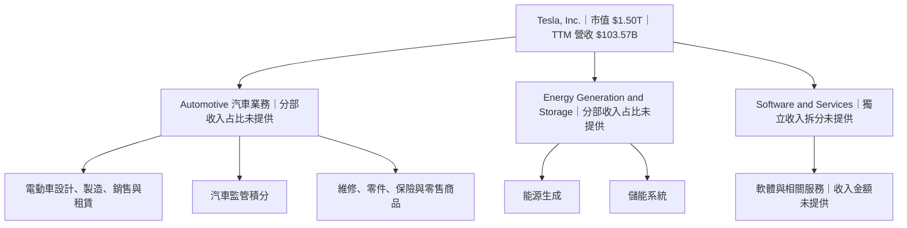
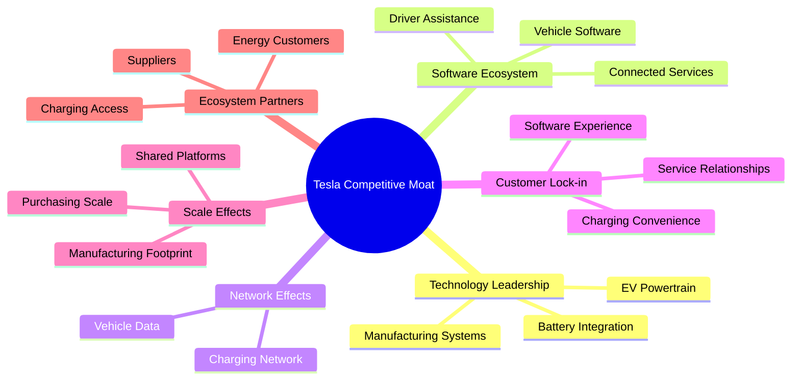
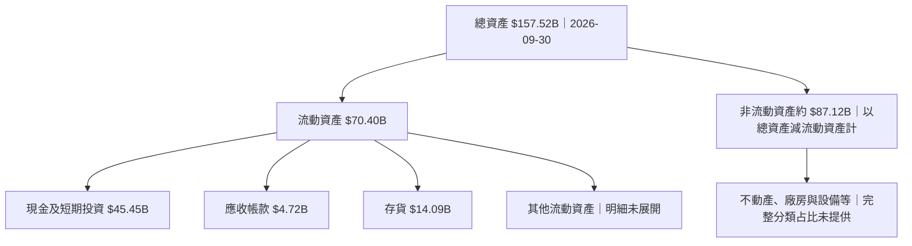
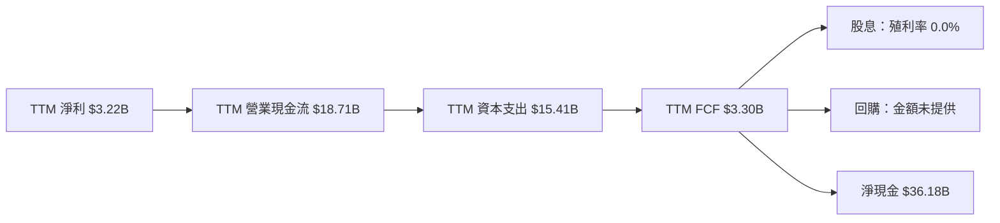
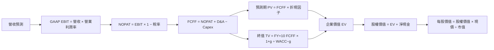
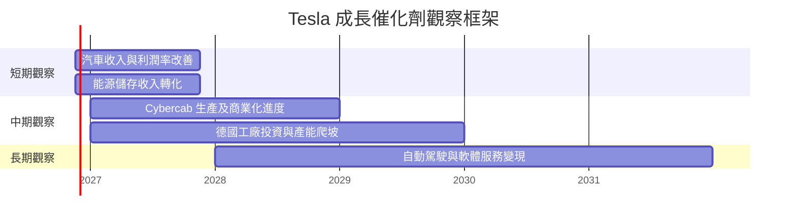
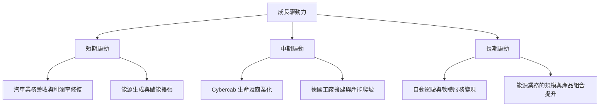
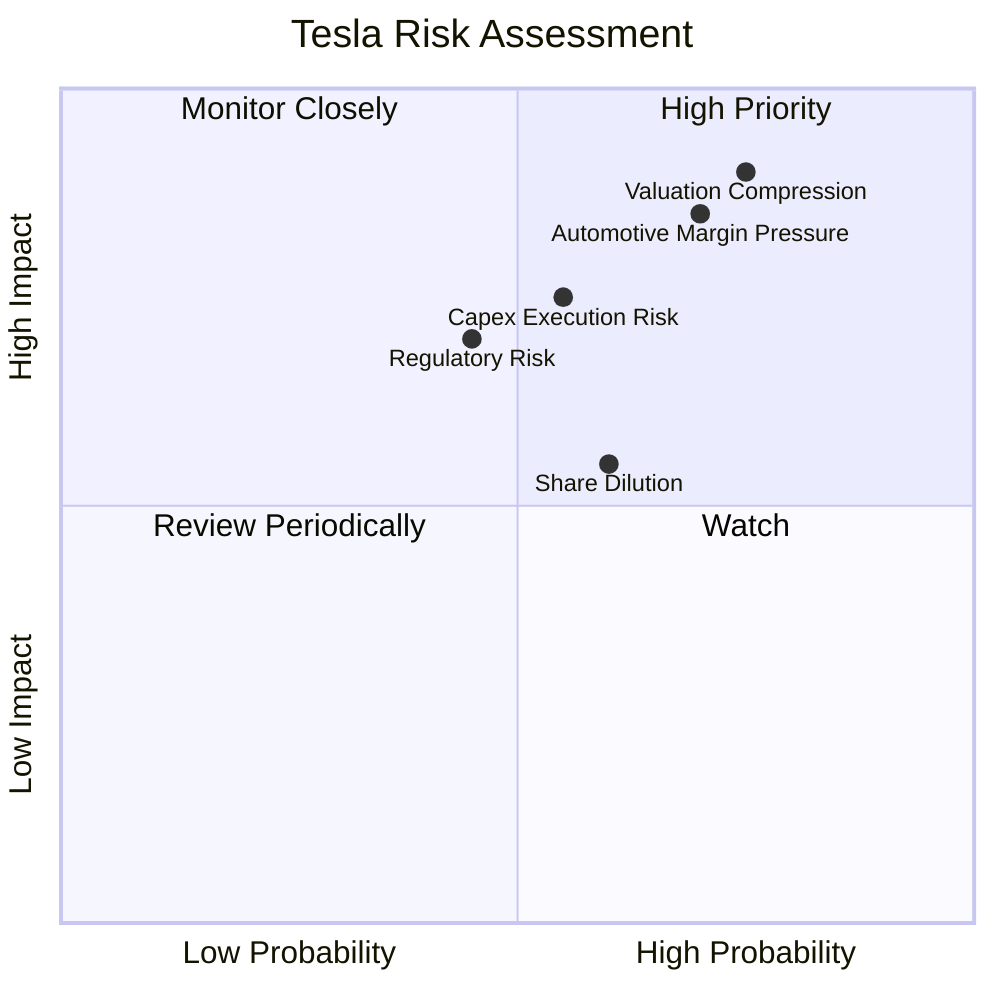
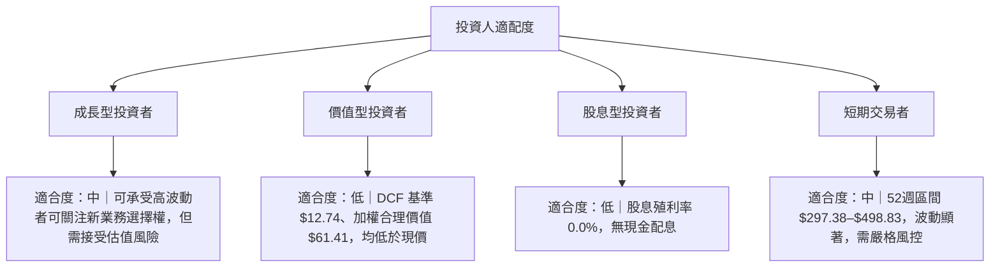

# TSLA 基本面深度分析報告
> **報告日期**：2026-11-17 ｜ **語言**：繁體中文 ｜ **數據來源**：SEC 申報資料 (XBRL)、Yahoo Finance、Finviz、StockAnalysis、Roic.ai ｜ **分析師**：CFA 級機構研究

> **資料口徑說明**：不同資料源對 TTM 營業利益率、債務及淨現金有不一致數字。本報告對核心指標優先採用 SEC 申報資料衍生的標準化數值：TTM 營業利益率 **3.3%**、總債務 **$9.27B**、淨現金 **$36.18B**、ROIC **5.1%**、WACC **12.54%**、TTM FCF **$3.30B**。其他來源數字只在明確標示時引用。價格全篇採用 **2026-11-16 收盤價 $379.74**。

## 目錄

| # | 章節 | 核心結論 |
|---|------|----------|
| 1 | 執行摘要 | 賣出；加權合理價值 $61.41；MOS -518.4% |
| 2 | 公司概覽與商業模式 | 多業務平台具規模，但可量化護城河證據不足 |
| 3 | 損益表深度分析 | TTM 營收 $103.57B、成長 8.3%；最新一季營收年減 0.2% |
| 4 | 資產負債表分析 | 淨現金 $36.18B；流動性及現金緩衝充足 |
| 5 | 現金流量深度分析 | TTM FCF $3.30B，FCF Yield 0.22% |
| 6 | 獲利能力與資本效率 | ROIC 5.1% 低於 WACC 12.54%，目前未創造經濟價值 |
| 7 | 相對估值分析 | 多數估值指標高於同業與自身歷史中位數 |
| 8 | DCF 內在價值評估 | 基準 DCF 每股 $12.74；模型高度依賴終值 |
| 9 | 成長催化劑 | 能源儲存、Cybercab 等提供選擇權，但數據未足以量化其價值 |
| 10 | 風險矩陣 | 估值、利潤率與資本支出是主要下行風險 |
| 11 | 投資建議 | 依 MOS 為賣出；需等營運指標改善或估值顯著回落 |

---

## 1. 執行摘要

### 1.0 一頁式投資儀表板（Portfolio Manager 30 秒速讀）

| 項目 | 內容 |
|------|------|
| **投資論點（3 句）** | ① TTM 營收 $103.57B、年增 8.3%，但最新一季營收年減 0.2%，近期成長尚未形成連續加速。② TTM 營業利益率僅 3.3%、ROIC 5.1% 低於 WACC 12.54%，目前資本報酬未覆蓋資金成本。③ TTM FCF $3.30B、FCF Yield 0.22%，相較 $1.50T 市值，現金流對估值的支撐有限。 |
| **綜合評分** | **4.3/10**（引用 1.1 六項算術平均） |
| **財務健康** | 🟢 淨現金 $36.18B、現金及短期投資 $45.45B；但 F-Score 4/9，營運效率與獲利趨勢仍有弱點。 |
| **ROIC vs WACC** | **5.1% vs 12.54%**：差距 **-7.44 個百分點**，現階段摧毀經濟價值。 |
| **FCF 趨勢** | 年度 FCF 由 2024 年 $3.58B 回升至 2025 年 $6.22B；最新 TTM FCF $3.30B，FCF Yield **0.22%**。 |
| **估值** | Forward P/E **175.9x** ｜ EV/EBITDA **149.7x**（市場資料）｜ FCF Yield **0.22%** |
| **DCF 內在價值（基準）** | **$12.74** ｜ 現價相對 DCF 基準溢價 **+2,879.9%**（折溢價以 DCF 值為基準） |
| **安全邊際（MOS）** | **-518.4%＝($61.41 − $379.74) ÷ $61.41**；加權合理價值 $61.41，MOS 為負且小於 10%，無下檔保護。 |
| **預期報酬（基準情境 12M）** | DCF 基準情境 $12.74，相對現價上行空間 **-96.6%**；這是模型內在價值情境，不代表價格預測。 |
| **關鍵風險（前二）** | ① 高估值與現金流殖利率偏低；② 汽車定價競爭及高資本支出壓縮利潤率。 |
| **評級 + 信心度** | 🔴 **賣出** ｜ 信心：中（估值結論明確，但 DCF 終值依賴高且資料來源存在口徑差異） |

### 1.1 綜合評分卡（全報告唯一）

| 維度 | 評分（1–10） | 主要依據（引用數字與其來源章節） |
|------|--------------|----------------------------------|
| 成長性 | 4.0 | TTM 營收成長 8.3%，但最新一季營收年減 0.2%（第 3 章）。 |
| 獲利能力 | 3.0 | TTM 營業利益率 3.3%、ROIC 5.1% 低於 WACC 12.54%、F-Score 4/9（第 3、6 章）。 |
| 財務健康 | 8.0 | 淨現金 $36.18B、現金及短期投資 $45.45B，CCC 由 15 天改善至 3 天（第 4 章）。 |
| 估值 | 1.0 | MOS -518.4%；P/E 417.3x，高於自身五年中位數 74.2x（第 7、8 章）。 |
| 護城河 | 6.0 | 全球化製造、軟體與充電服務形成差異化，但分部營收拆分、市占及網路效應量化資料未提供（第 2 章）。 |
| 管理層與資本配置 | 3.5 | 2025 年研發費用 $6.41B、SBC $2.83B；稀釋股數測試未通過，回購資料未提供（第 3、5、6 章）。 |
| **綜合評分** | **4.3** | 六項算術平均：(4.0 + 3.0 + 8.0 + 1.0 + 6.0 + 3.5) ÷ 6 = **4.25，四捨五入為 4.3**。 |

### 1.2 五大投資論點 + 三大核心風險

| 類型 | 項目 | 具體依據 | 信心度 |
|------|------|----------|--------|
| 🟢 **投資論點①** | 資產負債表具韌性 | 現金及短期投資 $45.45B、總債務 $9.27B、淨現金 $36.18B，可支應周期性波動及投資需求。 | 🟢 高 |
| 🟢 **投資論點②** | 多業務平台有擴張選項 | 公司涵蓋汽車、能源生成與儲能、軟體及服務；但各業務營收占比沒有可引用拆分。 | 🟡 中 |
| 🟢 **投資論點③** | TTM 營收仍呈正成長 | TTM 營收年增 8.3%，但最新一季年減 0.2%，需觀察後續是否重回正成長。 | 🟡 中 |
| 🟢 **投資論點④** | 營運資金週期短 | CCC 由一年前 15 天降至 3 天，主要因 DPO 上升；對營運現金需求有利，但供應商付款周期延長須持續監控。 | 🟡 中 |
| 🟢 **投資論點⑤** | 儲能與自動駕駛具潛在催化 | 公司業務描述及近期新聞提及儲能與 Cybercab 投資；資料未提供相關訂單、收入或利潤量化值。 | 🟡 低至中 |
| 🟡 **風險①** | 高估值與低現金流殖利率 | FCF Yield 0.22%；DCF 基準價值 $12.74，遠低於 $379.74 現價。 | 🔴 高衝擊 |
| 🔴 **風險②** | 獲利能力低於資金成本 | ROIC 5.1% 對 WACC 12.54%；TTM 營業利益率 3.3%。 | 🔴 高衝擊 |
| 🔴 **風險③** | 高資本支出與稀釋 | TTM Capex $15.41B、SBC 約 $4.30B（依最近四季列示值加總），SBC 約為 TTM FCF 的 130%。 | 🔴 高衝擊 |

### 1.3 快速統計卡片

| 指標 | 公司實際值（期間） | 同業中位數 | 狀態 |
|------|--------------------|------------|------|
| 營收成長（TTM） | **8.3%** | — | 🟢 |
| 營收成長（最新一季年增） | **-0.2%** | **2.9%**（GM、F、RIVN） | 🔴 |
| 毛利率（TTM） | **19.3%** | **9.2%**（GM、F、RIVN） | 🟢 |
| 營業利益率（TTM） | **3.3%** | — | 🟡 |
| ROIC（TTM） | **5.1%** | — | 🔴 |
| Forward P/E | **175.9x** | **6.2x**（GM、F；RIVN 為負值，未納入正值中位數） | 🔴 |
| FCF Yield（TTM） | **0.22%** | — | 🔴 |
| Piotroski F-Score | **4 / 9** | — | 🟡 |

### 1.4 投資結論

╔══════════════════════════════════════════════════════════════════╗  
║　　　　　　　　　📊 投資結論摘要　　　　　　　　　　　　　　　║  
╠══════════════════════════════════════════════════════════════════╣  
║　評級：🔴 賣出（依加權合理價值 MOS -518.4%）　　　　　　　　　║  
║　價格（2026-11-16 收盤）：$379.74　　　　　　　　　　　　　　　║  
║　DCF 內在價值（基準）：$12.74（現價溢價 +2,879.9%）　　　　　║  
║　安全邊際 MOS：-518.4%（以加權合理價值 $61.41 為基準）　　　║  
║　加權合理價值（8.8）：$61.41　　　　　　　　　　　　　　　　　║  
║　悲觀情境：$8.85（相對現價 -97.7%）　　　　　　　　　　　　　║  
║　基準情境：$12.74（相對現價 -96.6%）　　　　　　　　　　　　║  
║　樂觀情境：$18.18（相對現價 -95.2%）　　　　　　　　　　　　║  
║　綜合評分：4.3/10（引用 1.1）　　　　　　　　　　　　　　　　 ║  
║　適合投資人：能承受高波動且將新業務視為高風險選擇權的投資人；║  
║　　　　　　　 不適合作為以現金流與估值安全邊際為核心的價值投資║  
╚══════════════════════════════════════════════════════════════════╝

---

## 2. 公司概覽與商業模式

### 2.1 業務結構與收入來源

公司資料指出 Tesla 從事電動車設計、製造、銷售與租賃，以及能源生成與儲能，另有汽車積分、維修、零件、保險及零售商品等業務。資料未提供最新年度各板塊營收金額與占比，因此不在圖表中推算或填入比例。

**分析**：$103.57B TTM 營收已形成大規模製造與服務平台，但 TTM 成長 8.3% 與最新一季年減 0.2% 顯示增長並非均勻。分部營收和毛利率未提供，故不能判斷能源、軟體服務是否已足以抵銷汽車業務的定價壓力。

### 2.2 市場份額

市場份額數據未提供，無法可靠繪製市占圖或計算滲透率。以營收規模看，Tesla TTM 營收 $103.57B，高於本報告列示的傳統汽車同業市銷率比較範圍所代表的成熟汽車公司，但收入成長與利潤表現仍需和同業分開比較：Tesla 最新一季營收年減 0.2%，GM 同期年增 2.9%，Ford 年減 2.0%，Rivian 年增 38.3%。

### 2.3 競爭護城河分析

此圖為質化分類，不代表已量化的市場份額或經濟收益。電動車、軟體和能源產品的整合可提高產品差異，但競爭者追趕、跨品牌充電接入，以及客戶對品牌與產品的選擇變化，都可能削弱鎖定效應。

### 2.4 護城河強度

| 護城河項目 | 強度（強／中／弱） | 證據（引用數字或事實） | 會削弱它的情況 |
|------------|--------------------|------------------------|----------------|
| 技術與製造整合 | 中 | 公司經營汽車及能源生成與儲能；TTM 營收 $103.57B，提供規模基礎。 | 產品差異縮小、良率或成本改善落後於競爭者。 |
| 軟體生態系統 | 中 | 公司提供車輛軟體及相關服務，但獨立軟體收入與訂閱數未提供。 | 軟體變現低於預期，或監管限制功能部署。 |
| 網路效應 | 中偏弱 | 充電和車隊資料具潛在網路價值，但活躍使用者、充電網路收入與留存數據未提供。 | 競爭網路普及、標準互通降低排他優勢。 |
| 客戶鎖定 | 中偏弱 | 車輛軟體、充電及服務可能提升切換成本；無續購率或客戶流失率數據。 | 價格、產品更新或售後服務不具競爭力。 |
| 規模效應 | 中 | TTM 營收 $103.57B；但最新一季營收年減 0.2%，TTM 營業利益率僅 3.3%。 | 產能利用率下滑、價格競爭使規模無法轉化為利潤。 |
| 生態夥伴 | 中偏弱 | 供應鏈與充電接入有助擴張，但夥伴貢獻及合約經濟條件未提供。 | 供應商議價、替代方案普及或夥伴關係變化。 |

**1.1 護城河分數 6.0/10 的理由**：Tesla 有跨汽車、軟體與能源的整合能力和規模，但收入拆分、留存、網路效應及服務變現數據缺少，且低營業利潤率尚未證明規模能持續轉化為超額報酬。

---

## 3. 損益表深度分析

### 3.1 年度收入成長趨勢（近 4 年）

╔══════════════════════════════════════════════════════════════════╗  
║　　　　　　 Tesla 年度收入趨勢（FY2022–FY2025）　　　　　　　　║  
╠══════════════════════════════════════════════════════════════════╣  
║ FY2022　$81.46B　████████████████████　　　　　YoY：+51.4% 🟢　║  
║ FY2023　$96.77B　████████████████████████　　　YoY：+18.8% 🟢　║  
║ FY2024　$97.69B　████████████████████████　　　YoY：+1.0%　🟡　║  
║ FY2025　$94.83B　███████████████████████　　　 YoY：-2.9%　🔴　║  
║　　　　　　　　　　　　　　　　　　　　　　　　　　　　　　║  
║ 2022–2025 營收 CAGR：($94.83B ÷ $81.46B)^(1/3) − 1 ≈ 5.2%　║  
╚══════════════════════════════════════════════════════════════════╝

**解讀**：營收由 2022 年 $81.46B 增至 2025 年 $94.83B，但年度增速從 51.4% 降到 2025 年 -2.9%。三年 CAGR 約 5.2%，遠低於 2022 年單年增速；這反映高基期與市場需求、定價和產品組合的影響，不能把早期高速擴張直接外推。

### 3.2 季度收入趨勢分析

| 季度 | 營收 | QoQ 成長 | YoY 成長 | 備註 |
|------|------:|---------:|---------:|------|
| 2025 Q4 | $24.90B | -11.4% | -3.1% | QoQ 以 2025 Q3 $28.095B 計算；季度波動明顯。 |
| 2026 Q1 | $22.39B | -10.1% | +15.8% | YoY 依資料源列示；受 2025 Q1 低基期影響。 |
| 2026 Q2 | $28.24B | +26.1% | +25.5% | 季度回升，但不能視為全年化成長。 |
| 2026 Q3 | $28.05B | -0.7% | -0.2% | YoY 為標準化最新單季數據；收入與去年同期大致持平。 |

> QoQ 以相鄰季度營收直接計算；年度增長率採資料列示的單季 YoY。資料源對季度收入與同比數據有少量差異，季度比較應視為趨勢觀察而非精確預測。

### 3.3 利潤率演變分析

| 利潤率指標 | FY2022 | FY2023 | FY2024 | FY2025 | 趨勢 | 評估 |
|------------|-------:|-------:|-------:|-------:|------|------|
| 毛利率（由年度毛利÷營收計） | 25.6% | 18.2% | 17.9% | 18.0% | 2022 大幅下降，近三年約在 18% 附近 | 🔴 |
| 營業利益率（由年度營業利益÷營收計） | 17.0% | 9.2% | 7.9% | 5.1% | 連續收縮 | 🔴 |
| TTM 營業利益率（標準化指標） | — | — | — | **3.3%** | 低於 FY2025 水準 | 🔴 |
| TTM 淨利率 | — | — | — | **3.1%** | 利潤緩衝有限 | 🔴 |

> 年度比率由年度收入表的毛利、營業利益及營收計算；TTM 營業利益率採標準化數值 3.3%。其他整合資料來源提供 3.5% 或 3.0% 的不同口徑，本報告不混用。

**利潤率演變深度解析**：2022 至 2025 年毛利率由約 25.6% 降至約 18.0%，營業利益率由約 17.0% 降至約 5.1%。在缺少單車 ASP、交付量、汽車分部毛利、積分收入及固定成本分解的情況下，無法把降幅精確拆分到個別原因；但價格競爭、產品組合與製造成本是需要驗證的主要營運變數。TTM 營業利益率 3.3% 表示，即使收入維持增長，利潤轉換率偏低也會限制 EPS 和 FCF 的增幅。

### 3.4 費用結構分析

收入、毛利及營業利益有年度數據，但缺少同一期間完整且一致的銷貨成本、研發、銷售管理費與其他費用明細，故不繪製會造成比例錯覺的費用結構圓餅圖。

╔══════════════════════════════════════════════════════════════════╗  
║　　　　　　　已提供的 FY2025 費用相關數據　　　　　　　　　　　 ║  
╠══════════════════════════════════════════════════════════════════╣  
║ 營收　　　　　　　　　　　　　 $94.83B　　　　　　　　　　　　║  
║ 毛利　　　　　　　　　　　　　 $17.09B　　　　　　　　　　　　║  
║ 營業利益　　　　　　　　　　　 $4.85B　　　　　　　　　　　　 ║  
║ 研發費用　　　　　　　　　　　 $6.41B　　　　　　　　　　　　 ║  
║ 股權薪酬 SBC　　　　　　　　　 $2.83B　　　　　　　　　　　　 ║  
╚══════════════════════════════════════════════════════════════════╝

FY2025 研發支出較 FY2024 的 $4.54B 增加，可能支持新產品與技術投入；但營業利益仍低於歷史高點，須追蹤研發投入能否轉化為可辨認的收入、毛利與現金流。

### 3.5 季度 EPS 趨勢與盈餘品質（Quality of Earnings）

| 盈餘品質項目 | 數值／佔比 | 評估 |
|--------------|-----------|------|
| 股權薪酬 SBC / 營收 | 近四季列示 SBC 加總約 $4.30B；$4.30B ÷ $103.57B ≈ **4.2%** | 🔴 SBC 是實質股東成本；4.2% 的營收比例意味稀釋不可忽略。 |
| SBC / 營業現金流 | $4.30B ÷ $18.71B ≈ **23.0%** | 🟡 現金流中有相當比例來自非現金薪酬回加；股數增加測試亦未通過。 |
| FCF / 淨利（現金轉換率） | TTM FCF $3.30B ÷ TTM 淨利 $3.22B ≈ **102.5%** | 🟢 TTM 現金轉換率略高於 100%；但 FCF 絕對值小且波動大。 |
| 一次性／非經常性損益 | 單項金額及調整後盈餘未提供 | 🟡 無法判定是否存在顯著一次性盈餘美化。 |
| 有效稅率異常 | 27.0%（最新年度有效稅率） | 🟡 未提供多年度稅務調節表，無法完整判斷是否受一次性稅務利益影響。 |
| 資本化支出 vs 費用化 | TTM Capex $15.41B；資本化項目細節未提供 | 🟡 Capex 是現金流出，未發現足夠資料支持遞延成本或資本化異常結論。 |

**過去四季 EPS 驚喜**：EPS Est 與 EPS Act 均為缺值（nan），因此 **超預期／不及預期狀態 N/A**，不能把資料源的叉號當成實際未達預期。已知季度 EPS（StockAnalysis）為 2025 Q4 $0.26、2026 Q1 $0.15、2026 Q2 $0.34、2026 Q3 $0.24；季度變化受到獲利基數與收入波動影響，但缺少一致的分析師預期，無法判定 surprise 原因。

**盈餘品質結論**：TTM FCF/淨利約 102.5%，顯示報表淨利大體有現金支持；然而 FCF Yield 僅 0.22%，SBC 約為 TTM FCF 的 130%，且股數未增加測試失敗。整體而言，盈餘轉現金能力尚可，但股東實際回報仍受稀釋與高估值影響。

---

## 4. 資產負債表分析

### 4.1 資產結構分解

最新季度總資產依 StockAnalysis 為 $157.52B；流動資產 $70.40B。非流動資產為總資產減流動資產所得的約 $87.12B。因流動資產細項以外的完整資產分類及數字未在同一口徑集中提供，圖中不細分非流動資產的占比。

### 4.2 流動性與營運資金分析

| 指標 | 最新 TTM／期末 | 一年前 TTM／期末 | 變化 | 解讀 |
|------|---------------:|-----------------:|------:|------|
| 流動比率 | 1.739x | N/A | N/A | Yahoo Finance 最新值；超過 1x，短期資產高於短期負債。 |
| 速動比率 | 1.239x | N/A | N/A | Yahoo Finance 最新值；不依賴存貨亦有流動性緩衝。 |
| DSO 應收帳款天數 | 16 天 | 18 天 | -2 天 | 收款天數縮短，營運資金占用略減。 |
| DIO 存貨天數 | 62 天 | 56 天 | +6 天 | 存貨周轉放慢或備貨增加；若需求轉弱，可能增加折價或減值風險。 |
| DPO 應付帳款天數 | 75 天 | 59 天 | +16 天 | 延長供應商付款周期支撐現金流，但若超出供應商可接受範圍會傷及供應鏈關係。 |
| CCC 現金轉換週期 | 3 天 | 15 天 | -12 天 | CCC 改善，主要由 DPO 上升帶動，而不是存貨效率改善。 |

> DSO、DIO、DPO、CCC 依財務品質資料原值引用；不另行重算。

### 4.3 債務結構分析

╔══════════════════════════════════════════════════════════════════╗  
║　　　　　　　　　Tesla 債務健康診斷　　　　　　　　　　　　　　║  
╠══════════════════════════════════════════════════════════════════╣  
║ 總債務（標準化）　　　　　　$9.27B　　██░░░░░░░░░░░░░░░　　　　 ║  
║ 現金及短期投資　　　　　　　$45.45B　 ████████████████░　　　 ║  
║ 淨現金（標準化）　　　　　　$36.18B　 🟢　　　　　　　　　　　 ║  
║ 營業現金流（TTM）　　　　　$18.71B　　　　　　　　　　　　　 ║  
║ 短期債務到期表／利息保障倍數　N/A（資料未提供可比口徑）　　　　 ║  
╚══════════════════════════════════════════════════════════════════╝

**解讀**：淨現金 $36.18B 提供抵禦營運波動的資產負債表緩衝。其他整合資料源列示債務 $16.44B、淨現金 $29.00B，與 SEC 標準化口徑不一致；本報告採前述標準化數字，不將兩組數據混算。

### 4.4 股東權益趨勢

╔══════════════════════════════════════════════════════════════════╗  
║　　　　　　　歷年股東權益（年度，資料來源：Yahoo）　　　　　　　║  
╠══════════════════════════════════════════════════════════════════╣  
║ FY2022　$44.70B　███████████░░░░░░░░░░░░　　　　　　　　　　　　║  
║ FY2023　$62.63B　████████████████░░░░░░░░　　　　　　　　　　　║  
║ FY2024　$72.91B　███████████████████░░░░░　　　　　　　　　　　║  
║ FY2025　$82.14B　██████████████████████░░　　　　　　　　　　　║  
╚══════════════════════════════════════════════════════════════════╝

FY2022 至 FY2025 權益增加，但不能單憑帳面權益增加判斷股東回報改善；同期 ROIC 5.1% 仍低於 WACC，且 F-Score 顯示稀釋股數測試未通過。

---

## 5. 現金流量深度分析

### 5.1 現金流量瀑布圖

> 淨利到營業現金流並非單純加總關係，差額含非現金項目及營運資金變化；圖示只呈現現金流方向，不表示淨現金變動可直接等於 FCF。

### 5.2 FCF 轉換率趨勢

| 年度 | FCF | 淨利 | FCF / 淨利 | 評估 |
|------|----:|-----:|-----------:|------|
| 2022 | $7.55B | $12.58B | 60.0% | 🟡 現金轉換低於淨利。 |
| 2023 | $4.36B | $15.00B | 29.1% | 🔴 當年淨利與 FCF 差距擴大。 |
| 2024 | $3.58B | $7.13B | 50.2% | 🟡 FCF 低於淨利。 |
| 2025 | $6.22B | $3.79B | 164.1% | 🟢 FCF 高於淨利，年度間波動明顯。 |
| TTM 至 2026-09-30 | $3.30B | $3.22B | 102.5% | 🟡 大致轉現，但絕對值相對市值偏小。 |

### 5.3 自由現金流趨勢

╔══════════════════════════════════════════════════════════════════╗  
║　　　　　　　年度 FCF：營業現金流 − 資本支出　　　　　　　　　　║  
╠══════════════════════════════════════════════════════════════════╣  
║ FY2022　$7.55B　████████████████████████　　　　　　　　　　　　║  
║ FY2023　$4.36B　██████████████　　　　　　　　　　　　　　　　║  
║ FY2024　$3.58B　███████████　　　　　　　　　　　　　　　　　　║  
║ FY2025　$6.22B　████████████████████　　　　　　　　　　　　　║  
║ TTM　　 $3.30B　██████████　　　　　　　　　　　　　　　　　　║  
║ TTM FCF Yield：0.22%　　　　　　　　　　　　　　　　　　　　　║  
╚══════════════════════════════════════════════════════════════════╝

TTM 營業現金流 $18.71B 看似充裕，但 TTM Capex $15.41B 消耗大部分營業現金流，留下 $3.30B FCF。較高的再投資支出可能支持產能與新業務，但若資本投入未能提高產能利用率或長期利潤，會拖累股東自由現金流。

### 5.4 資本配置評估

股息殖利率為 0.0%，配息率 0.0%。FY2025 資本支出為 $8.53B，TTM Capex 為 $15.41B；SBC、研發支出有數據，但回購金額與完整資本配置比例未提供，因此不繪製比例圓餅圖。

| 資本用途 | 已知數值 | 評估 |
|----------|---------:|------|
| 資本支出 | TTM $15.41B；FY2025 $8.53B | 🟡 投資規模大，需檢驗投資回報。 |
| 股息 | 殖利率 0.0% | 中性；目前未向股東派息。 |
| 回購 | N/A | 無法判定回購是否抵銷 SBC 稀釋。 |
| 研發 | FY2025 $6.41B | 🟡 研發投入提高，但對新產品與服務的增量回報未提供。 |
| 現金留存 | 現金及短期投資 $45.45B | 🟢 提供財務彈性。 |

---

## 6. 獲利能力與資本效率

### 6.1 ROE / ROA / ROIC 趨勢

| 指標 | 可用數值 | 評估 |
|------|----------|------|
| ROE | TTM **3.6%**（標準化品質數據）；其他資料源列示 3.8% | 🔴 報酬偏低；本報告主要引用 3.6%。 |
| ROA | TTM **1.3%** | 🔴 資產獲利能力有限。 |
| ROIC | TTM **5.1%** | 🔴 低於 WACC 12.54%。 |
| 歷年 ROIC／行業均值 | 可比歷史序列與同業 ROIC 未提供 | N/A（數據未提供）。 |

### 6.2 ROIC vs WACC 分析（核心價值創造判斷）

╔══════════════════════════════════════════════════════════════════╗  
║　　　　　　　　ROIC vs WACC 深度分析　　　　　　　　　　　　　　║  
╠══════════════════════════════════════════════════════════════════╣  
║ 無風險利率 Rf（10Y 美債）：　　　　5.12%　　　　　　　　　　　 ║  
║ ERP：　　　　　　　　　　　　　　5.00%　　　　　　　　　　　 ║  
║ 原始 Beta：　　　　　　　　　　　1.74　　　　　　　　　　　　 ║  
║ 調整後 Beta：　　　　　　　　　　1.50　　　　　　　　　　　　 ║  
║ 股權成本（資料列示）：　　　　　　12.60%　　　　　　　　　　　║  
║ 稅前債務成本：　　　　　　　　　　3.65%　　　　　　　　　　　 ║  
║ 有效稅率：　　　　　　　　　　　27.0%　　　　　　　　　　　 ║  
║ 股權／債務權重：　　　　　　　　99.4%／0.6%　　　　　　　　　║  
║ WACC（採用）：　　　　　　　　　12.54%　　　　　　　　　　　 ║  
║ ROIC（TTM）：　　　　　　　　　　5.10%　　　　　　　　　　　 ║  
║ EVA 差額：5.10% − 12.54% =　　　 **-7.44 個百分點**　　　　　 ║  
║ 結論：目前 ROIC 低於資金成本，未創造正經濟價值　　　　　　　║  
╚══════════════════════════════════════════════════════════════════╝

**推導說明**：調整 Beta 為 `⅔ × 1.74 + ⅓ × 1.00 = 1.493 ≈ 1.50`。以 CAPM 列示輸入計算，`5.12% + 1.50 × 5.00% = 12.62%`，與財務資料列示股權成本 12.60% 存在 0.02 個百分點差異；本報告依要求採用資料列示的 **WACC 12.54%**，不另改模型折現率。稅後債務成本為 `3.65% × (1 − 27.0%) = 2.6645%`；加權結果受權重與底層未四捨五入數影響，直接引用程式列示 WACC 12.54%。

以 ROIC 減 WACC 衡量，`5.1% − 12.54% = -7.44pp`。若公司未能提升營業利潤率或改善資本周轉，新增投資可能增加營收，卻未必增加經濟利潤。

### 6.3 杜邦三因素分解

| 因素 | 數值（TTM） | 解讀 |
|------|-------------|------|
| 淨利率 | 3.1% | 淨利潤緩衝有限，營收稍有波動即可能放大至淨利。 |
| 資產週轉率 | 0.66 | 每一美元資產帶來約 0.66 美元營收。 |
| 權益乘數 | 1.76 | 槓桿程度不高，並非主要 ROE 驅動來源。 |
| **ROE** | **3.6%** | `3.1% × 0.66 × 1.76 ≈ 3.6%`；ROE 主要受低淨利率限制。 |

### 6.4 財務體質：Piotroski F-Score

**F-Score：4 / 9**。九項測試結果如下，原值照列：

| 測試 | 結果 | 解讀 |
|------|------|------|
| ROA > 0 | ✅ 通過 | TTM 資產報酬為正。 |
| 營業現金流 > 0 | ✅ 通過 | TTM 營業現金流為 $18.71B。 |
| ROA 高於一年前 | ❌ 未通過 | 獲利相對資產的改善未獲確認。 |
| 營業現金流 > 淨利（應計品質） | ✅ 通過 | 現金流高於淨利，支持盈餘現金轉換。 |
| 長期負債 ÷ 總資產低於一年前 | ❌ 未通過 | 槓桿相對資產的趨勢未改善。 |
| 流動比率高於一年前 | ❌ 未通過 | 短期流動性指標未見同比改善。 |
| 稀釋股數未增加 | ❌ 未通過 | 股數稀釋可能稀釋每股經濟利益。 |
| 毛利率高於一年前 | ✅ 通過 | 該測試期毛利率較一年前改善。 |
| 資產週轉率高於一年前 | ❌ 未通過 | 資產使用效率未改善。 |

4/9 表示有部分現金流與毛利項目通過，但五項未通過集中在資產效率、槓桿、流動性及稀釋，整體財務趨勢並非全面改善。

---

## 7. 相對估值分析

### 7.1 同業估值比較表格

| 估值指標 | **TSLA** | **GM** | **F** | **RIVN** | TSLA 評估 |
|----------|---------:|-------:|------:|--------:|-----------|
| **Trailing P/E** | 417.3x | 18.3x | N/A | N/A | 🔴 顯著偏高；盈利基數偏小會放大倍數。 |
| **Forward P/E** | 175.9x | 5.7x | 6.2x | -6.9x | 🔴 遠高於有正盈利同業；RIVN 為負值不可直接作便宜比較。 |
| **P/S Ratio** | 14.5x（Yahoo 市場資料） | 0.4x | 0.2x | 2.7x | 🔴 高估值溢價需要更高成長與利潤兌現。 |
| **EV/EBITDA** | 149.7x（Yahoo 市場資料） | 9.3x | 23.8x | -6.9x | 🔴 遠高於 GM、F；RIVN 負值不具同一經濟含義。 |
| **最新一季營收 YoY** | -0.2% | 2.9% | -2.0% | 38.3% | 🟡 TSLA 低於 GM、RIVN，高於 F。 |
| **毛利率（TTM）** | 19.3% | 11.4% | 7.4% | 9.2% | 🟢 TSLA 高於列示同業，但不等於營業利潤率同樣占優。 |

> 同業倍數取 Yahoo Finance Peer multiples；TSLA 倍數採同一財務數據中的公司估值欄。Forward P/E 同業中位數採正值 GM、F 的中位數 **5.95x，程式估值方法使用 5.9x**。

### 7.2 歷史估值區間分析

╔══════════════════════════════════════════════════════════════════╗  
║　　　　　　　TSLA 自身五年估值位置（TTM）　　　　　　　　　　　 ║  
╠══════════════════════════════════════════════════════════════════╣  
║ P/E：區間 18.0x–416.4x　中位數 74.2x　目前 417.3x　排名 100%　║  
║ P/S：區間 3.9x–16.7x　　中位數 9.4x　 目前 13.0x　排名 76%　║  
║ EV/EBITDA：區間 19.0x–165.2x 中位數 64.6x 目前 143.2x 排名 86%║  
╚══════════════════════════════════════════════════════════════════╝

目前 P/E 略高於提供的五年歷史區間上緣，P/S 與 EV/EBITDA 亦處於各自區間高端。P/E 417.3x 與歷史區間上緣 416.4x 的微小差異可能來自四捨五入或計算時點，不應過度解讀其 0.9x 差距；整體結論仍是估值位於自身歷史偏高位置。

### 7.3 情境價值（Bear / Base / Bull，依 DCF 情境）

| 情境 | 第 1 年營收成長 | 期末營業利潤率 | WACC | 每股價值 | 相對現價 | 機率 | 會發生的條件 |
|------|----------------:|----------------:|-----:|----------:|---------:|------:|--------------|
| 🔴 悲觀 | 4.1% | 6.2% | 13.54% | $8.85 | -97.7% | 25% | 汽車收入增長疲弱、毛利受價格競爭擠壓、資金成本維持高位。 |
| 🟡 基準 | 8.3% | 7.2% | 12.54% | $12.74 | -96.6% | 50% | 收入由 TTM 成長率起步並逐步降至 3.0%，利潤率緩慢回升。 |
| 🟢 樂觀 | 12.4% | 8.0% | 11.54% | $18.18 | -95.2% | 25% | 新業務與核心汽車營收同步改善，營業利潤率更快擴張，風險溢價下降。 |

### 7.4 相對估值隱含價格區間

╔══════════════════════════════════════════════════════════════════╗  
║　　　　　估值方法每股價值（相對現價 $379.74）　　　　　　　　　　║  
╠══════════════════════════════════════════════════════════════════╣  
║ DCF 基準　　　　　$12.74　───　　　　　　　　　　　　　　　　║  
║ 同業 Forward P/E　$12.83　───　　　　　　　　　　　　　　　　║  
║ 同業 EV/EBITDA　　$47.43　──────　　　　　　　　　　　　　　║  
║ 加權合理價值　　　$61.41　────────　　　　　　　　　　　　　║  
║ 分析師共識　　　　$412.48　────────────────────────●　　║  
║ 現價　　　　　　　$379.74　──────────────────────●　　　║  
╚══════════════════════════════════════════════════════════════════╝

- **同業 Forward P/E：$12.83**，依 peer median **5.9x（GM、F）× forward EPS $2.16**。
- **同業 EV/EBITDA：$47.43**，依 peer median **16.6x（GM、F）× TTM EBITDA，再加回淨現金**。
- DCF 與相對估值法的價值均遠低於現價；分析師共識目標價 $412.48 高於現價，但僅代表分析師平均目標，與現金流估值結果差異顯著。

---

## 8. DCF 內在價值評估（Discounted Cash Flow）

### 8.0 估值推理鏈（Thinking Logic）

#### Step 1 — 價值由哪些變數決定？

本模型將價值拆為汽車業務現金流底盤、能源生成與儲能、軟體及其他服務選擇權；目前各板塊收入占比未提供，不能把總營收拆成未經證實的比例。模型主導變數是 **營業利潤率與終值現金流**：FY+1 至 FY+6 的 FCFF 為負，企業價值主要靠終值支撐。

#### Step 2 — 模型選擇

| 決策點 | 本報告採用 | 理由（含數字） | 曾考慮但否決 | 否決理由 |
|--------|-----------|----------------|--------------|----------|
| 現金流定義 | FCFF | 以 WACC 12.54% 折現，得出企業價值，再加淨現金。 | FCFE | 欠缺逐年融資及還債假設，FCFF 較一致。 |
| 預測期 N | 10 年 | DCF 模型設定 FY+1 至 FY+10，收入成長由 8.3% 線性降至 3.0%。 | 5 年 | 模型已固定為 10 年；不自行改動期間。 |
| 終值方法 | Gordon Growth | 永續成長率 3.0%，低於 WACC 12.54%。 | 退出倍數 | 模型沒有提供退出倍數終值及其現值，不自行補建。 |
| EBIT 基礎 | GAAP EBIT | 模型採 GAAP EBIT，TTM 營業利益率 3.3%。 | 非 GAAP EBIT | 避免把 SBC 從費用中加回。 |

#### Step 3 — 關鍵假設推導鏈

- **營收成長**：錨點＝TTM 成長 8.3%、FY2022–FY2025 約 5.2% CAGR → 模型以近年 TTM 成長作首年起點，並逐年衰減至 3.0% → **採用 FY+1 8.3%、FY+10 3.0%** → 曾可採近三年 CAGR 5.2% 作首年，但模型選用近期 TTM 錨點；未採更高的長期高速成長，因最新一季營收年減 0.2% 尚未證明加速。
- **期末營業利潤率**：錨點＝TTM GAAP 營業利益率 3.3%；模型指定五年歷史中位數為期末參考 → **FY+10 採用 7.2%** → 未採更高利潤率，因目前季度利潤率及 TTM 獲利尚未證明高毛利服務收入已足以改變整體利潤結構。
- **終值成長率 g**：錨點＝長期成熟企業需低於折現率；模型設定 3.0% → **採用 3.0%** → 不採高於 3.0% 的持續成長假設，避免終值假設超出成熟期長期成長能力；且 3.0% 明顯低於 12.54% WACC。
- **預測期 N**：錨點＝模型輸入為 10 年，涵蓋成長與利潤率逐步收斂 → **採用 10 年** → 未採更短期限，因模型本身已規定 10 年；未採更長期限，避免在資料缺乏下延長預測能見度。
- **Capex／營收**：錨點＝TTM Capex $15.41B、TTM 營收 $103.57B，即 Capex／營收約 14.9% → 模型將比例降至 FY+10 的 6.0%，並以 1.1 倍 D&A 作長期下限參考 → **採用 FY+1 14.9% 線性降至 FY+10 6.0%** → 未把當期 14.9% 永久外推，因將資本密集度永久維持當期水準會壓低成熟期現金流；但下降速度是模型風險。
- **GAAP EBIT 與 SBC**：錨點＝SEC 報表 GAAP 利益已將 SBC 作費用；模型採 GAAP EBIT → **SBC 不再從 FCFF 額外扣除、股數不另行稀釋** → 不採「GAAP EBIT 再扣 SBC」或「非 GAAP EBIT 且忽略稀釋」，避免重複計入或漏計。
- **年稀釋率**：錨點＝組合 A 要求固定股數，且 SBC 已在 GAAP EBIT 扣除 → **年稀釋率 0%** → 不採額外股數稀釋，避免與已費用化的 SBC 重複計算；但此假設可能低估真實股份稀釋風險。
- **終值方法**：錨點＝模型有 Gordon Growth 終值，終值現值占企業價值 198.9% → **採用 Gordon Growth** → 退出倍數法沒有模型輸出，故不自行建構第二終值。
- **WACC**：錨點＝資本成本資料列示 WACC 12.54% → **DCF 採 12.54%** → 不另算替代 WACC；利率、Beta、權重來源及限制見 8.2。

#### Step 4 — 最脆弱一環

最脆弱的是「成熟期營業利潤率升至 7.2%、Capex 比率同時降至 6.0%」的組合；若利潤率或資本密集度不如模型假設，FY+10 FCFF 和終值將下降，而終值已超過模型企業價值，敏感度極高。

#### Step 5 — 計算路徑圖

### 8.1 模型假設總表（Model Inputs）

| 假設項目 | 採用值 | 依據／來源 | 敏感度 |
|----------|--------|-------------|--------|
| 預測期長度 N | 10 年 | DCF 模型固定設定；FY+1 至 FY+10。 | 🟡 中 |
| 營收成長 | FY+1 8.3% → FY+10 3.0% | TTM 營收成長 8.3%，模型線性衰減。 | 🔴 高 |
| 營業利潤率 | FY+1 3.3% → FY+10 7.2% | TTM 營業利益率 3.3%；模型採五年期中位數 7.2% 作期末值。 | 🔴 高 |
| 有效稅率 | 27.0% | 最新年度有效稅率。 | 🟢 低 |
| Capex／營收 | FY+1 14.9% → FY+10 6.0% | TTM Capex／營收：$15.41B ÷ $103.57B 約 14.9%；模型逐步降至 6.0%。 | 🔴 高 |
| D&A／營收 | 5.5% | DCF 模型以 TTM 比率固定。 | 🟢 低 |
| 營運資金變動 | 未建模 | 模型明確不納入營運資金變動；不是假設為歷史比例。 | 🟡 中 |
| EBIT 基礎 | GAAP | 模型使用 GAAP EBIT。 | 🟡 中 |
| SBC 處理 | 組合 A：GAAP EBIT + 固定股數 | SBC 已在 GAAP EBIT 費用化；FCFF 不再扣 SBC，股數不另行稀釋。 | 🟡 中 |
| 年稀釋率 | 0% | 與組合 A 相容；此為模型設定，不等於實際股數未稀釋。 | 🟡 中 |
| 永續成長率 g | 3.0% | DCF 模型設定；低於 WACC 12.54%。 | 🔴 高 |
| 終值方法 | Gordon Growth | 模型提供 Gordon Growth；退出倍數交叉驗證未提供。 | 🔴 高 |
| WACC | 12.54% | 直接採用資本成本資料列示值；見 8.2。 | 🔴 高 |

FCFF 定義為 **NOPAT + D&A − Capex**；營運資金不建模。模型採用 **(A) GAAP EBIT + 固定股數**，故 SBC 影響已計入一次，不能再扣一次或再加股數稀釋。

### 8.2 折現率推導（WACC）

╔══════════════════════════════════════════════════════════════════╗  
║　　　　　　　　　WACC 推導（折現率）　　　　　　　　　　　　　　║  
╠══════════════════════════════════════════════════════════════════╣  
║ 無風險利率 Rf：　　　　　　　　　5.12%　　　　　　　　　　　　║  
║ ERP（假設值，資本成本資料）：　　 5.00%　　　　　　　　　　　　║  
║ 原始 Beta（Yahoo）：　　　　　　　1.74　　　　　　　　　　　　║  
║ 調整後 Beta：　　　　　　　　　　1.50　　　　　　　　　　　　║  
║ Beta 調整：⅔×1.74 + ⅓×1.00 =　　1.493 ≈ 1.50　　　　　　　 ║  
║ 股權成本（資料列示）：　　　　　　12.60%　　　　　　　　　　　║  
║ 稅前債務成本：　　　　　　　　　　3.65%　　　　　　　　　　　║  
║ 稅率：　　　　　　　　　　　　　27.0%　　　　　　　　　　　　║  
║ 股權／債務權重：　　　　　　　　99.4%／0.6%　　　　　　　　　║  
║ WACC（模型採用）：　　　　　　　 **12.54%**　　　　　　　　　║  
╚══════════════════════════════════════════════════════════════════╝

**逐步演算與資料限制**

1. **Ke（CAPM）**：依列示值，`5.12% + 1.50 × 5.00% = 12.62%`；資本成本資料列示股權成本為 **12.60%**，兩者相差 0.02 個百分點，本報告照引列示值。
2. **稅前 Kd**：資本成本資料列示為 **3.65%**。利息費用與平均計息負債明細未提供，故無法由 SEC 項目獨立重算 3.65%。
3. **稅後 Kd**：`3.65% × (1 − 27.0%) = 2.6645%`。
4. **權重**：直接引用資料列示股權權重 **99.4%**、債務權重 **0.6%**，合計 100.0%。市值及計息負債在同一期間的詳細權重計算底稿未提供，不自行反推。
5. **WACC**：按列示組成的近似加權值為 `99.4% × 12.60% + 0.6% × 2.6645% = 12.540387% ≈ 12.54%`。DCF 與第 6.2 節一致採用 **12.54%**。

### 8.3 逐年自由現金流預測（基準情境）

金額單位為 $B；折現因子保留三位小數。以下逐年輸出採 DCF 模型原值；ΔWC 未建模，所以不列為另行計算的現金流項目。

| 年度 | FY+1 | FY+2 | FY+3 | FY+4 | FY+5 | FY+6 | FY+7 | FY+8 | FY+9 | FY+10 |
|------|-----:|-----:|-----:|-----:|-----:|-----:|-----:|-----:|-----:|------:|
| 營收 | 112.17 | 120.81 | 129.42 | 137.87 | 146.07 | 153.89 | 161.23 | 167.96 | 173.99 | 179.21 |
| 營收 YoY | 8.3% | 7.7% | 7.1% | 6.5% | 5.9% | 5.4% | 4.8% | 4.2% | 3.6% | 3.0% |
| 營業利潤率 | 3.3% | 3.8% | 4.2% | 4.6% | 5.1% | 5.5% | 5.9% | 6.4% | 6.8% | 7.2% |
| EBIT（GAAP） | 3.75 | 4.57 | 5.45 | 6.40 | 7.42 | 8.48 | 9.58 | 10.71 | 11.85 | 12.98 |
| − 稅 | (1.01) | (1.23) | (1.47) | (1.73) | (2.00) | (2.29) | (2.58) | (2.89) | (3.19) | (3.50) |
| NOPAT | 2.74 | 3.34 | 3.98 | 4.68 | 5.42 | 6.19 | 7.00 | 7.82 | 8.65 | 9.48 |
| + D&A | 6.14 | 6.61 | 7.09 | 7.55 | 8.00 | 8.42 | 8.83 | 9.20 | 9.53 | 9.81 |
| − Capex | (16.69) | (16.78) | (16.71) | (16.44) | (15.98) | (15.32) | (14.47) | (13.42) | (12.19) | (10.79) |
| = FCFF | -7.80 | -6.83 | -5.64 | -4.21 | -2.57 | -0.70 | 1.36 | 3.60 | 5.99 | 8.50 |
| 折現因子 @12.54% | 0.889 | 0.790 | 0.702 | 0.623 | 0.554 | 0.492 | 0.437 | 0.389 | 0.345 | 0.307 |
| FCFF 現值 PV | -6.93 | -5.40 | -3.96 | -2.63 | -1.42 | -0.35 | 0.59 | 1.40 | 2.07 | 2.61 |

**預測期 PV 合計**：以表中四捨五入值逐項相加，`-6.93 − 5.40 − 3.96 − 2.63 − 1.42 − 0.35 + 0.59 + 1.40 + 2.07 + 2.61 = -14.02B`。模型使用未四捨五入底層數值所得合計為 **-$14.01B**；差異 $0.01B 來自逐列四捨五入。

**FY+1 逐步演算**

1. 營收：`$103.57B × (1 + 8.3%) = $112.17B`。
2. EBIT：`$112.17B × 3.3% ≈ $3.75B`。
3. 稅：`$3.75B × 27.0% ≈ $1.01B`。
4. NOPAT：`$3.75B − $1.01B = $2.74B`。
5. D&A：`$112.17B × 5.5% ≈ $6.14B`。
6. Capex：依模型 FY+1 值 **$16.69B**；約為收入的 14.9%。
7. ΔWC：模型未納入，故 FCFF 不包含該項。
8. FCFF：`$2.74B + $6.14B − $16.69B = -$7.81B`；模型列示值 **-$7.80B**，差異來自各輸入顯示精度與底層未四捨五入數。
9. 折現因子及 PV：`1 ÷ (1 + 12.54%)^1 = 0.889`；`-$7.80B × 0.889 ≈ -$6.93B`。

**合理性自檢**

- 預測期 FCF 由 FY+1 -$7.80B 增至 FY+10 $8.50B；由於起點為負值，通常的 CAGR 不具解讀意義。歷史年度 FCF 2022–2025 為 $7.55B、$4.36B、$3.58B、$6.22B，顯示歷史波動大。
- FY+10 FCF 利潤率：`$8.50B ÷ $179.21B ≈ 4.7%`；目前 TTM FCF 利潤率：`$3.30B ÷ $103.57B ≈ 3.2%`。同業最佳 FCF 利潤率資料未提供，無法判斷是否超越產業最佳水準。
- FY+1 至 FY+6 FCFF 為負，因前期 Capex 高於 NOPAT 加 D&A；負值已透過 WACC 折現納入，並對企業價值形成扣減。

╔══════════════════════════════════════════════════════════════════╗  
║　　　　　自由現金流：歷史實際 vs 模型預測（$B）　　　　　　　　　║  
╠══════════════════════════════════════════════════════════════════╣  
║ FY2023（實）　$4.36　████████████　　　　　　　　　　　　　　║  
║ FY2024（實）　$3.58　███████████　　　　　　　　　　　　　　　║  
║ FY2025（實）　$6.22　███████████████████　　　　　　　　　　　║  
║ FY+1（預）　　-$7.80　負值；Capex 高於 NOPAT + D&A　　　　　║  
║ FY+10（預）　 $8.50　████████████████████████　　　　　　　　 ║  
╠══════════════════════════════════════════════════════════════════╣  
║ 預測由前六年負 FCF 轉正；歷史波動與終值依賴使遠期預測不確定性高║  
╚══════════════════════════════════════════════════════════════════╝

### 8.4 終值計算（Terminal Value）

**適用性檢查**：`WACC 12.54% vs g 3.0% → WACC > g？✅`

| 方法 | 計算式 | 終值 TV | TV 現值 | 佔總 EV 比重 |
|------|--------|--------:|--------:|-------------:|
| Gordon Growth | `$8.50B × (1 + 3.0%) ÷ (12.54% − 3.0%)` | $91.80B | $28.18B | 198.9% |
| 退出倍數法 | 模型未提供退出倍數終值 | N/A | N/A | N/A |

**逐步演算**

1. FY+10 FCFF：**$8.50B**。
2. 分子：`$8.50B × (1 + 3.0%) = $8.755B ≈ $8.76B`。
3. 分母：`12.54% − 3.0% = 9.54%`；模型列示 TV：`$8.50B × 1.03 ÷ 9.54% = $91.80B`。
4. PV(TV)：`$91.80B × 0.307 = $28.18B`。
5. 終值占 EV：`$28.18B ÷ $14.17B = 198.9%`。

終值現值占企業價值超過 100%，是因為預測期 FCF 現值合計為負數；這表示估值高度依賴終值假設，短期現金流貢獻有限。退出倍數法未提供足夠模型輸入，不自行補建。

### 8.5 企業價值 → 每股內在價值（Bridge）

╔══════════════════════════════════════════════════════════════════╗  
║　　　　　　　企業價值 → 每股內在價值 橋接表　　　　　　　　　　 ║  
╠══════════════════════════════════════════════════════════════════╣  
║ 預測期 FCF 現值合計　　　　　　-$14.01B　　　　　　　　　　　 ║  
║ 終值現值 PV(TV)　　　　　　　 +$28.18B　　　　　　　　　　　 ║  
║ = 企業價值 EV　　　　　　　　　$14.17B　　　　　　　　　　　 ║  
║ + 淨現金　　　　　　　　　　　+$36.18B　　　　　　　　　　　 ║  
║ = 股權價值　　　　　　　　　　$50.35B　　　　　　　　　　　 ║  
║ 每股價值（模型股數換算公式）　 $12.74　　　　　　　　　　　　 ║  
║ 2026-11-16 收盤價　　　　　　　$379.74　　　　　　　　　　　 ║  
║ 折溢價（現價÷DCF價值−1）　　　+2,879.9%（溢價）　　　　　　　║  
╚══════════════════════════════════════════════════════════════════╝

**逐步演算**

1. EV：`-$14.01B + $28.18B = $14.17B`。
2. 股權價值：`$14.17B + $36.18B = $50.35B`。
3. 每股內在價值：依模型指定公式 `股權價值 × 價格 ÷ 市值`；模型列示 **$12.74**。該公式使用價格及市值做比例換算，未另列稀釋股數數值。
4. 折溢價：`$379.74 ÷ $12.74 − 1 = +2,879.9%`。
5. 本節不計算 MOS；MOS 僅於 8.8 以加權合理價值為分母計算。

現金及債務使用標準化截至 2026-09-30 的淨現金 $36.18B。DCF 模型採固定股數、不額外稀釋；但原始模型沒有列示 8.5 單獨的稀釋股數與市值換算底稿，故每股數字以模型輸出為準。

### 8.6 敏感性分析（WACC × 永續成長率）

下表數值依 DCF 模型敏感度矩陣照列；括號為相對 $379.74 現價的上行空間。基準格以粗體標示。

| g（列）／WACC（欄） | 10.54% | 11.54% | **12.54%（基準）** | 13.54% | 14.54% |
|-----------|------:|------:|-------------------:|------:|------:|
| 2.0% | $15.11 (-96.0%) | $13.36 (-96.5%) | $12.00 (-96.8%) | $10.93 (-97.1%) | $10.08 (-97.3%) |
| 2.5% | $15.75 (-95.9%) | $13.82 (-96.4%) | $12.35 (-96.7%) | $11.20 (-97.0%) | $10.29 (-97.3%) |
| **3.0%（基準）** | $16.47 (-95.7%) | $14.34 (-96.2%) | **$12.74 (-96.6%)** | $11.49 (-97.0%) | $10.52 (-97.2%) |
| 3.5% | $17.29 (-95.4%) | $14.93 (-96.1%) | $13.17 (-96.5%) | $11.82 (-96.9%) | $10.76 (-97.2%) |
| 4.0% | $18.24 (-95.2%) | $15.60 (-95.9%) | $13.65 (-96.4%) | $12.18 (-96.8%) | $11.04 (-97.1%) |

**逐步演算限制**：敏感度矩陣由模型直接提供；沒有提供各替代 WACC 下的逐年折現因子、PV 合計及終值橋接明細。為遵守不自行另建或改動 DCF 的限制，本報告不虛構非基準格的中間計算。以模型表格確認所選有效格為 **WACC 11.54% > g 3.0%**，其每股值照列為 **$14.34**。

**三情境 DCF（模型情境原值）**

| 情境 | 第 1 年成長 | 期末營業利潤率 | WACC | 每股內在價值 | 相對現價 | 機率 |
|------|-----------:|---------------:|-----:|-------------:|---------:|------:|
| 🔴 悲觀 | 4.1% | 6.2% | 13.54% | $8.85 | -97.7% | 25% |
| 🟡 基準 | 8.3% | 7.2% | 12.54% | $12.74 | -96.6% | 50% |
| 🟢 樂觀 | 12.4% | 8.0% | 11.54% | $18.18 | -95.2% | 25% |

三情境的完整營收路徑、FY+N FCFF 及各情境終值明細未提供；因此只引用模型情境值，不用未提供的中間數字拼造推導鏈。情境加權檢核：`$8.85 × 25% + $12.74 × 50% + $18.18 × 25% = $13.1275 ≈ $13.13`；機率合計 `25% + 50% + 25% = 100%`。模型所列 $13.13 為背景參考，估值三角驗證仍依 8.8 的基準 DCF $12.74。

**敏感度結論**

- g 每增加 1 個百分點（基準 WACC 下由 2.0% 至 3.0%）：價值由 $12.00 升至 $12.74，變動 **+$0.74／+6.2%**（以 $12.00 為基準）。
- WACC 每增加 1 個百分點（g=3.0%）：價值由 $12.74 降至 $11.49，變動 **-$1.25／-9.8%**（以 $12.74 為基準）。
- 期末營業利潤率每增加 1 個百分點：模型未提供單變數敏感度，**N/A**；不能由三個同時變動的情境隔離出利潤率單因子效果。
- 就已提供矩陣而言，WACC 變化的相對影響大於 g 在上述區間的變化；而 8.0 Step 1 指出的利潤率主導判斷不能以矩陣單獨驗證。

### 8.7 反推 DCF（Reverse DCF：市場在預期什麼）

模型固定其餘輸入後的反推結果為：

| 求解的變數 | 其餘變數設定 | 市場隱含值（令 DCF = 現價） | 歷史／目前參考 | 判斷 |
|------------|--------------|------------------------------|---------------|------|
| 第 1 年營收成長 | 其餘基準假設固定 | -10% 至 100% 範圍內無解 | TTM 成長 8.3%；最新一季年增 -0.2% | 🔴 單靠此變數無法解釋現價 |
| 固定營業利潤率 | 其餘基準假設固定 | 0.5% 至 95% 範圍內無解 | TTM 營業利益率 3.3% | 🔴 單靠利潤率無法解釋現價 |
| 永續成長率 | 未提供解值 | 未計算 | — | N/A（模型未列解值） |
| 高成長持續年數 N | 未提供解值 | 未計算 | 模型基準 N=10 年 | N/A（模型未列解值） |

模型沒有提供逐步試算軌跡或上述無解區間以外的完整求解資料，故不捏造收斂表。反推結論是：依現有 DCF 框架，市場價格不能由單獨提高營收成長或固定營業利潤率來解釋；市場可能在給予自動駕駛、能源、軟體或其他選擇權價值，但現有資料不足以量化該選擇權。

### 8.8 估值三角驗證與安全邊際

| 估值方法 | 隱含每股價值 | 上行空間（÷現價） | 權重 | 說明 |
|----------|--------------:|------------------:|------:|------|
| DCF（基準） | $12.74 | -96.6% | 40% | 十年 FCFF、WACC 12.54%、永續成長率 3.0%。 |
| 同業 Forward P/E | $12.83 | -96.6% | 25% | GM、F peer median 5.9x × forward EPS $2.16。 |
| 同業 EV/EBITDA | $47.43 | -87.5% | 25% | GM、F peer median 16.6x × TTM EBITDA，加回淨現金。 |
| 分析師共識目標價 | $412.48 | +8.6% | 10% | 40 位分析師平均目標價；僅作參考。 |
| **加權合理價值** | **$61.41** | **-83.8%** | **100%** | 適用公司類型：profitable；權重固定。 |

**加權計算**：  
`$12.74 × 40% + $12.83 × 25% + $47.43 × 25% + $412.48 × 10%`  
`= $5.096 + $3.2075 + $11.8575 + $41.248`  
`= $61.409 ≈ $61.41`。

四項方法均有估值，沒有方法因缺值而剔除。權重依公司類型及程式設定照列，並非分析師另行判斷。

╔══════════════════════════════════════════════════════════════════╗  
║　　　　　　　　估值區間與安全邊際　　　　　　　　　　　　　　　║  
╠══════════════════════════════════════════════════════════════════╣  
║ $8.85 ─── $12.74 ─── $61.41 ─── $379.74 ─── $412.48　　　　　　║  
║ 悲觀DCF　　基準DCF　 加權合理值　 現價　　 分析師共識　　　　　　║  
║　　　　　　　　　　　　　　　　　　　　　　　　　　　　　　║  
║ MOS = ($61.41 − $379.74) ÷ $61.41 = -518.4%　　　　　　　　║  
║ 上行空間 = ($61.41 − $379.74) ÷ $379.74 = -83.8%　　　　　　║  
║ 建議買入區間：不適用（現行評級為賣出）　　　　　　　　　　　　║  
║ 合理持有區間：不適用（DCF 情境均遠低於現價）　　　　　　　　║  
║ 減碼考慮區間：現價 $379.74 已高於加權合理價值及 DCF 情境值　║  
╚══════════════════════════════════════════════════════════════════╝

> 🔎 **程式複算（Python，依本節各項自動重算）**
>
> 加權合理價值 = $12.74 × 40% + $12.83 × 25% + $47.43 × 25% + $412.48 × 10% = **$61.41**（權重合計 100%）
>
> 以價格 $379.74 計：MOS = **-518.4%**，上行空間 = **-83.8%**
>
> ✅ 與本節所寫數值一致。

### 8.9 DCF 模型的局限與失效條件

- **終值依賴度**：終值現值 $28.18B 占 EV $14.17B 的 **198.9%**；預測期 PV 為負，終值假設對估值結果具有決定性。
- **最脆弱假設**：期末營業利潤率升至 7.2%、Capex／營收降至 6.0%。若利潤率只達到目前附近水準，或再投資強度維持高檔，價值將低於基準 DCF；但模型未提供逐個單變數的利潤率敏感值，不能提供精確下修金額。
- **FCF 負值與可靠度**：前六年 FCFF 為負，且預測期 PV 合計為負。對高再投資、產品組合可能改變的公司，DCF 對長期假設敏感，需配合同業倍數、單位經濟性及分部估值觀察。
- **與第 10 章風險連結**：價格競爭會壓低營業利潤率；新工廠或 AI／自動駕駛投資會影響 Capex；利率上升會推高 WACC；新業務變現不如預期會削弱成長與終值。

### 8.10 複算檢核表（Audit Trail）

| # | 檢核項目 | 檢查方式 | 結果 |
|---|----------|----------|------|
| 1 | 所有高／中敏感度輸入都有推導 | 逐項檢查 8.0 Step 3；已列出主要假設及資料限制。 | ✅ |
| 2 | 每個假設有來歷 | 8.1 依據欄有資料來源或模型來源。 | ✅ |
| 3 | WACC 五步算式及乘加 | 組成採列示值；Ke 推算與列示值有 0.02pp 差異，採用列示 WACC。 | ⚠️ 已揭露差異 |
| 4 | Kd 分母與權重 D 同範圍 | 利息費用、平均計息負債及權重底稿未提供，無法獨立核驗。 | ⚠️ 資料不足 |
| 5 | WACC 與第 6.2 節一致 | 兩處均採 12.54%。 | ✅ |
| 6 | 逐年表格年度數等於 N | FY+1 至 FY+10，共 10 年。 | ✅ |
| 7 | FY+1 算式可複算 | 逐步列示；個別小差異來自底層未四捨五入輸入。 | ✅ |
| 8 | 預測期 PV 加總 | 顯示值合計 -$14.02B，模型未四捨五入值 -$14.01B，差異低於 1%。 | ✅ |
| 9 | WACC > g | 12.54% > 3.0%。 | ✅ |
| 10 | 終值以 FY+N 為基礎並折現 N 期 | FY+10 FCFF $8.50B，折現因子 0.307。 | ✅ |
| 11 | EV 至每股價值橋接 | EV $14.17B，加淨現金後股權價值 $50.35B；每股換算依模型原公式。 | ✅ |
| 12 | SBC 組合相容 | GAAP EBIT、無 −SBC 列、年稀釋率 0%，組合 A。 | ✅ |
| 13 | 敏感度基準格等於 DCF 基準 | 12.54%、g=3.0% 為 $12.74。 | ✅ |
| 14 | 矩陣格有效性 | 全部列示格均 WACC > g。 | ✅ |
| 15 | 三情境機率與加權 | 25% + 50% + 25% = 100%；加權約 $13.13。 | ✅ |
| 16 | 反推只放開一個變數 | 模型列出單變數無解區間，未提供試算軌跡。 | ⚠️ 無法補造軌跡 |
| 17 | MOS 與折溢價口徑 | MOS 以 $61.41；折溢價以 DCF $12.74。 | ✅ |
| 18 | 報告完整輸出至第 11 章 | 第 1–11 章均列示。 | ✅ |
| 19 | 加權合理價值等於加權總和 | 四項方法加權總和 $61.409，四捨五入 $61.41。 | ✅ |
| 20 | 評級符合 MOS 門檻 | MOS -518.4%，對應賣出，未作級別調整。 | ✅ |

**未能完全核驗項目**：平均計息負債與 WACC 權重底稿、敏感度非基準格中間計算、反推 DCF 試算軌跡未提供；因此使用已列示模型輸出，未自行填補缺失數據。

---

## 9. 成長催化劑

### 9.1 催化劑時間軸

以下時間是研究追蹤框架，不是公司正式財測；資料沒有提供可核實的落地季度，故以觀察期分類。

新聞資料提及 Tesla 將投資 $3.31B 擴建德國工廠以生產 Cybercab；此為新聞資訊，不等同 SEC 已披露的最終資本支出實績或可確定收入。應追蹤投資額、產能爬坡、交付及單位經濟性。

### 9.2 TAM 市場規模分析

N/A（TAM 數據未提供）。公司 TTM 營收 $103.57B、成長 8.3%，代表已有大規模營運基礎；但最新一季營收年減 0.2%，且汽車、儲能、軟體各自的收入與滲透率未披露，無法據此估算 TAM 或市場滲透率。

### 9.3 成長驅動力結構圖

目前缺少各驅動的收入、毛利率、訂單量和預期投資回報，故催化劑應視為待驗證選項，而不是納入已確定盈利的基礎。

---

## 10. 風險矩陣

### 10.1 風險評分矩陣

機率與衝擊位置為分析師定性評估，不代表財務資料庫提供的統計機率。

### 10.2 風險清單詳細分析

| # | 風險項目 | 發生機率 | 財務衝擊 | 風險評分 | 緩解措施 |
|---|----------|----------|----------|----------|----------|
| 1 | 🔴 **估值收縮** | 高（分析師估計 70%） | 高；DCF 基準 $12.74 對比股價 $379.74，估值溢價巨大 | 🔴 9.5/10 | 分批降低集中度；以 FCF Yield、營業利潤率及估值倍數設定風險限額。 |
| 2 | 🔴 **汽車定價與利潤率壓力** | 高（估計 65%） | 高；TTM 營業利益率僅 3.3%，最新一季營收年減 0.2% | 🔴 8.5/10 | 追蹤每季毛利率、營業利益率、收入與產品組合；若利潤率連續下行，重新評估成長假設。 |
| 3 | 🟠 **高資本支出回報不及預期** | 中高（估計 55%） | 高；TTM Capex $15.41B、TTM FCF $3.30B | 🟠 7.5/10 | 將資本支出與新增產能、交付、單位經濟性及自由現金流連結。 |
| 4 | 🟡 **SBC 與股份稀釋** | 中（估計 50%） | 中；近四季列示 SBC 約 $4.30B，F-Score 稀釋股數測試未通過 | 🟡 6.5/10 | 監控稀釋後股數、SBC／營收比例及回購是否抵銷稀釋。 |
| 5 | 🟡 **監管、自動駕駛與產品執行風險** | 中（估計 45%） | 高；若新業務延遲變現，可能降低估值中未量化的選擇權價值 | 🟡 6.5/10 | 追蹤監管決策、實際商業化里程碑與服務收入；不把尚未實現的選擇權視為當期現金流。 |

> 機率與風險分數為定性評估，非公司財務數據或統計模型輸出。

---

## 11. 投資建議

### 11.1 最終評級與評分

**評級為賣出**：加權合理價值 $61.41、現價 $379.74，MOS **-518.4%**，符合規則 20 的賣出門檻，未作質化調整。1.1 綜合評分為 **4.3/10**，六項分數依序為成長性 4.0、獲利能力 3.0、財務健康 8.0、估值 1.0、護城河 6.0、管理層與資本配置 3.5。

### 11.2 合理價值與隱含報酬率

| 估值參考 | 每股價值 | 相對現價報酬 | 機率／權重 | 說明 |
|----------|---------:|--------------:|-----------:|------|
| 加權合理價值 | $61.41 | -83.8% | — | 估值三角驗證加權結果。 |
| 悲觀 DCF | $8.85 | -97.7% | 25% | DCF 模型情境原值。 |
| 基準 DCF | $12.74 | -96.6% | 50% | DCF 基準情境原值。 |
| 樂觀 DCF | $18.18 | -95.2% | 25% | DCF 模型情境原值。 |
| DCF 情境機率加權參考 | $13.13 | -96.5% | 100% | `$8.85×25% + $12.74×50% + $18.18×25% ≈ $13.13`；只作情境參考，8.8 採基準 DCF。 |
| 分析師共識 | $412.48 | +8.6% | 40 位分析師平均值 | 與 DCF、同業估值的差距顯著，需檢視共識對長期選擇權的假設。 |

所有情境的營收、利潤率與 WACC 假設列於 7.3；本表不另行改動模型目標價。

### 11.3 買入時機與觸發因素

╔══════════════════════════════════════════════════════════════════╗  
║　　　　　　　✅ 買入觸發因素 Checklist　　　　　　　　　　　　　║  
╠══════════════════════════════════════════════════════════════════╣  
║ 目前價格尚未符合本報告估值安全條件；以下為重新評估的先決條件：║  
║　　　　　　　　　　　　　　　　　　　　　　　　　　　　　　║  
║ 重新評估條件（多數符合）：　　　　　　　　　　　　　　　　　║  
║ ☐ TTM 營業利益率由 3.3% 持續上升，並非單季一次性改善　　　　　║  
║ ☐ TTM FCF 高於 $3.30B 且 FCF Yield 明顯高於目前 0.22%　　　 ║  
║ ☐ 最新一季營收恢復正年增，並連續兩季維持正成長　　　　　　　║  
║ ☐ ROIC 向 WACC 12.54% 收斂，且資本投入有可驗證回報　　　　　║  
║　　　　　　　　　　　　　　　　　　　　　　　　　　　　　　║  
║ 加碼觸發條件（須配合估值）：　　　　　　　　　　　　　　　　║  
║ ☐ 股價回到加權合理價值 $61.41 附近或以下，並重新核對模型　　　║  
║ ☐ 儲能或軟體收入、訂單及毛利披露，證明新業務正在變現　　　　　║  
║　　　　　　　　　　　　　　　　　　　　　　　　　　　　　　║  
║ 減碼／停損觸發條件：　　　　　　　　　　　　　　　　　　　　║  
║ ☐ 營業利益率連續兩季低於 3.3%　　　　　　　　　　　　　　　　║  
║ ☐ TTM FCF 轉負，或 Capex 上升而營業現金流未同步改善　　　　　║  
║ ☐ 稀釋股數持續增加，且回購未能抵銷稀釋　　　　　　　　　　　║  
║ ☐ 核心汽車收入下降、能源與服務收入未能補位　　　　　　　　　║  
╚══════════════════════════════════════════════════════════════════╝

> $61.41 是本報告加權合理價值的數學參考，不是保證的成交底部；若基本面或估值假設變動，應重新估值。

### 11.4 投資人適配度分析

### 11.5 每季財報監控清單（Quarterly Watch List）

| 監控指標 | 最新基準 | 加碼／改善觸發 | 減碼／惡化觸發 |
|----------|---------|---------------|---------------|
| 營收成長 | TTM +8.3%；最新一季 YoY -0.2% | 單季 YoY 轉正並連續兩季改善 | 連續兩季單季 YoY 低於 -5% |
| 營業利益率 | TTM 3.3%；最新季度標準化值 2.6% | TTM 連續上升並高於 3.3% | 連續兩季低於 2.6% |
| 毛利率 | TTM 19.3% | 維持或提升，且營業利潤率同步改善 | 連續兩季下降且營業利潤率受壓 |
| 營業現金流 | TTM $18.71B | 增長且不依賴存貨或應付款單項變化 | 連續兩季下降 |
| Capex | TTM $15.41B | Capex 對應新增產能、收入或生產率改善 | Capex 上升而 FCF／營收下降 |
| FCF | TTM $3.30B；FCF Yield 0.22% | TTM FCF 上升、轉換率保持健康 | TTM FCF 轉負 |
| 存貨與現金轉換週期 | DIO 62 天；CCC 3 天 | DIO 回落且 CCC 維持低位 | DIO 持續上升或 CCC 回升至 15 天以上 |
| SBC／股數 | 近四季列示 SBC 約 $4.30B；F-Score 稀釋測試未過 | SBC／營收下降、稀釋股數穩定 | 稀釋股數持續增加且 SBC 比例上升 |
| ROIC vs WACC | 5.1% vs 12.54% | ROIC 逐步接近或超過 WACC | ROIC 進一步下降 |
| 新業務與財測 | 分部營收、訂單及量化財測未提供 | SEC 申報披露可核實收入及利潤貢獻 | 商業化延遲、投入增加但收入未落地 |

### 11.6 反面論證：什麼會證明論點錯誤（What Would Change My Mind）

╔══════════════════════════════════════════════════════════════════╗  
║　　　　　⚠️ 論點失效條件（Disconfirming Evidence）　　　　　　　║  
╠══════════════════════════════════════════════════════════════════╣  
║ 若以下數據持續出現，應重新檢視本報告的營運判斷：　　　　　　　║  
║ ☐ 最新一季營收年增連續兩季高於 10%，且非單純低基期反彈　　　　║  
║ ☐ TTM 營業利益率由 3.3% 持續升至 7.2% 或以上　　　　　　　　　║  
║ ☐ TTM FCF 持續高於目前 $3.30B，並使 FCF Yield 顯著高於 0.22% ║  
║ ☐ ROIC 超過 WACC 12.54%，並至少連續兩個年度維持　　　　　　　║  
║ ☐ 能源、軟體或自動駕駛業務披露可核實的營收、毛利與現金流　　 ║  
║ ☐ 股數稀釋停止，SBC／營收低於目前約 4.2%　　　　　　　　　　 ║  
╚══════════════════════════════════════════════════════════════════╝

**報告判斷失效的核心條件**：若 Tesla 能將 TTM 營業利益率從 3.3% 持續提升、使 ROIC 超越 12.54% WACC，並將更高營收轉化為可持續 FCF，則目前對資本效率與估值的保守判斷需要重新評估；反之，若 FCF 轉負或利潤率繼續收縮，估值風險將進一步上升。

> **免責聲明**：本報告為 AI 自動生成，僅供研究參考，不構成投資建議。投資有風險，入市需謹慎。

---

## 資料與來源

| 項目 | 內容 |
|------|------|
| 價格 | 379.74 USD，2026-11-16 收盤（Yahoo Finance 日線） |
| 財務報表 | SEC 10-Q filed 2026-10-22，最新季度 2026-09-30（FY2026 Q3） |
| 有回應的資料來源 | SEC 申報資料 (XBRL)、Yahoo Finance、Finviz、StockAnalysis、Roic.ai |
| 由程式計算 | TTM 數字、WACC、DCF 模型、估值方法與權重、加權合理價值、MOS、評級門檻、F-Score、杜邦分解、營運資金天數、綜合評分 |
| 撰寫模型 | openai / gpt-6-luna |

> 本區塊由產生報告的程式依實際取得的資料填寫，非模型撰寫。「由程式計算」的數字不是模型的估計；其餘判斷（評分、情境、策略）是模型的分析。
