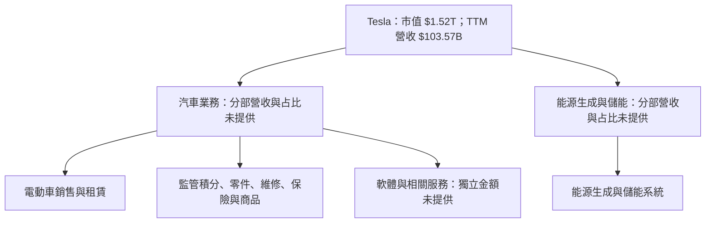
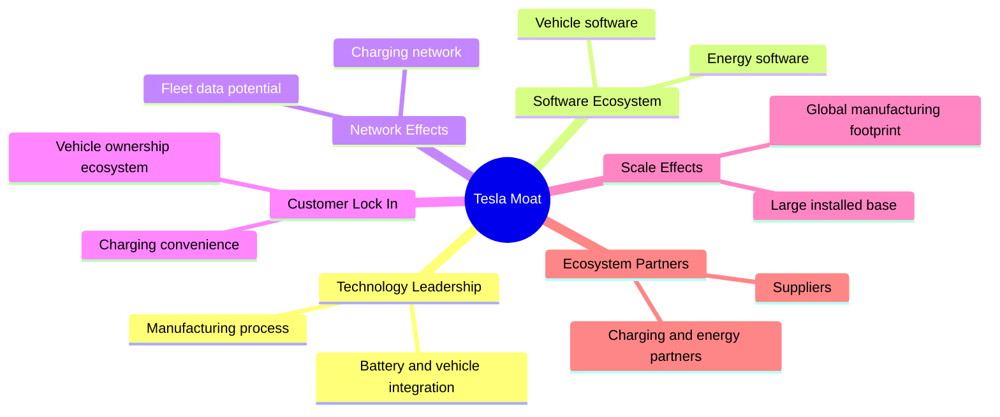
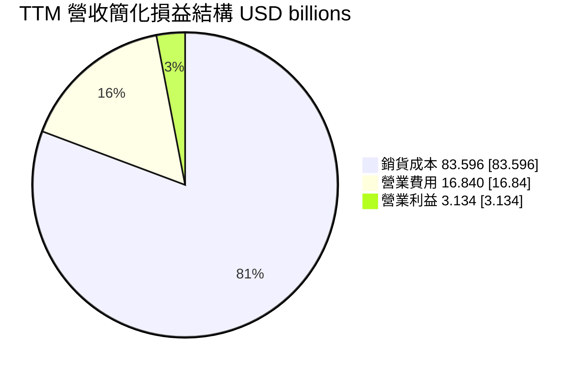
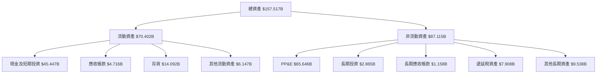
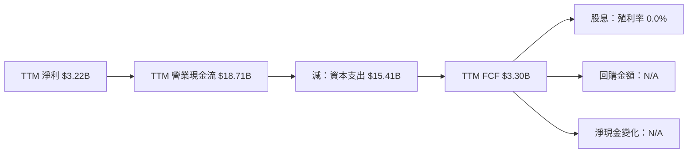
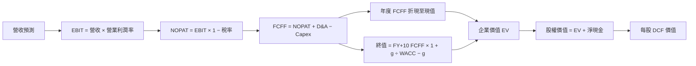
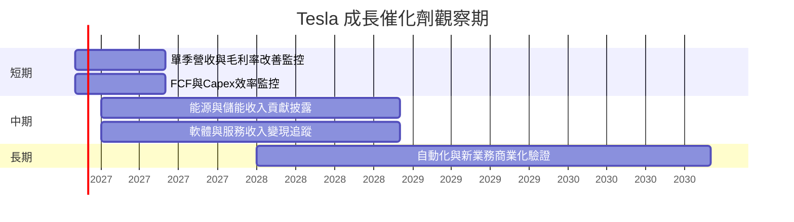
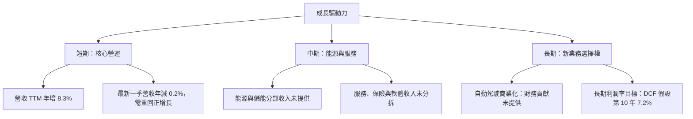
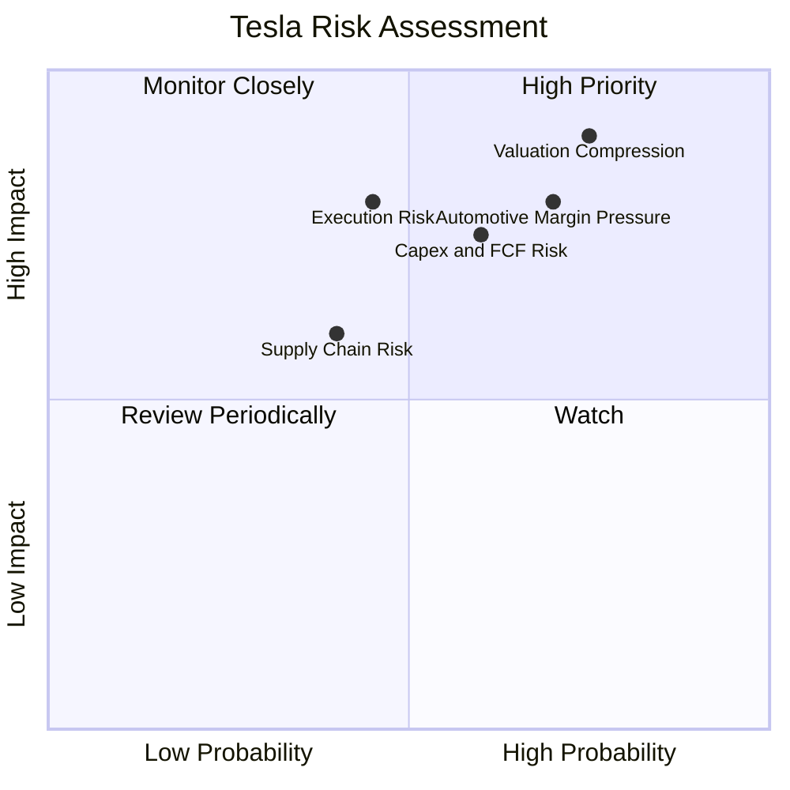
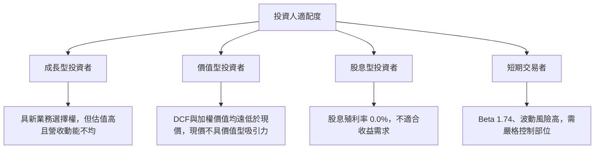

# TSLA 基本面深度分析報告
> **報告日期**：2026-11-18 ｜ **語言**：繁體中文 ｜ **數據來源**：SEC 申報資料 (XBRL)、Yahoo Finance、Finviz、StockAnalysis、Roic.ai ｜ **分析師**：CFA 級機構研究

## 目錄

| # | 章節 | 核心結論 |
|---|------|----------|
| 1 | 執行摘要 | 賣出；加權合理價值 $61.34，MOS -525.6% |
| 2 | 公司概覽與商業模式 | 汽車仍是核心，能源與服務提供多元化；護城河強度不一 |
| 3 | 損益表深度分析 | TTM 營收 $103.57B、成長 8.3%；最新一季年減 0.2%，利潤承壓 |
| 4 | 資產負債表分析 | VERIFIED 淨現金 $36.18B；短期流動性尚可 |
| 5 | 現金流量深度分析 | TTM FCF $3.30B，FCF Yield 0.22%，資本支出吸收大量營運現金 |
| 6 | 獲利能力與資本效率 | ROIC 5.1% 低於 WACC 12.48%，目前未創造足額資本報酬 |
| 7 | 相對估值分析 | 倍數遠高於汽車同業及自身歷史中位數 |
| 8 | DCF 內在價值評估 | 基準 DCF 每股 $12.81；估值高度依賴遠期利潤率與終值 |
| 9 | 成長催化劑 | 能源、軟體與自動駕駛具選擇權，但財務資料未量化其收入貢獻 |
| 10 | 風險矩陣 | 估值、汽車利潤率及資本支出是主要風險 |
| 11 | 投資建議 | 依 MOS 評級為賣出；觀察利潤率、FCF 與資本回報改善 |

---

## 1. 執行摘要

### 1.0 一頁式投資儀表板

| 項目 | 內容 |
|------|------|
| **投資論點（3 句）** | ① TTM 營收 $103.57B、年增 8.3%，但最新一季營收年減 0.2%，成長動能不均。② TTM 營業利益率 3.3%、ROIC 5.1%，低於 12.48% WACC，現階段資本報酬不足。③ TTM FCF $3.30B、FCF Yield 0.22%，相對 $1.52T 市值現金流回報偏低。 |
| **綜合評分** | **4.7/10**（引用 1.1 六項算術平均） |
| **財務健康** | 🟢 VERIFIED 淨現金 $36.18B；但資料源另列淨現金 $29.00B，存在口徑差異，應以最新 SEC 調節表核對 |
| **ROIC vs WACC** | 5.1% vs 12.48%；🟠 ROIC 低於資本成本，現階段摧毀經濟價值 |
| **FCF 趨勢** | TTM FCF $3.30B；FCF Yield 0.22%。近年 FCF 波動，Capex 高 |
| **估值** | Forward P/E 177.7x ｜ EV/EBITDA 149.8x（另一估值口徑）｜ FCF Yield 0.22% |
| **DCF 內在價值（基準）** | $12.81 ｜ 現價相對 DCF 溢價 **2,895.3%**（以 DCF 基準值為分母） |
| **安全邊際（MOS）** | **-525.6%**＝($61.34 − $383.72) ÷ $61.34；🔴 <10% 無 |
| **預期報酬（基準情境 12M）** | -96.7%（照抄基準 DCF 情境相對現價結果；不是保證報酬） |
| **關鍵風險（前二）** | 高估值與利潤率低；資本支出維持高檔、FCF Yield 偏低 |
| **評級 + 信心度** | 🔴 **賣出** ｜ 信心：中（估值落差大，但資料口徑及遠期業務選擇權造成不確定性） |

> DCF 折溢價計算：$383.72 ÷ $12.81 − 1 = 28.952，約 **+2,895.3%**。MOS 則以加權合理價值 $61.34 為分母，兩者基準不同。

### 1.1 綜合評分卡（全報告唯一）

| 維度 | 評分（1–10） | 主要依據（引用數字與其來源章節） |
|------|--------------|----------------------------------|
| 成長性 | 5.0 | TTM 營收年增 8.3%，最新一季年減 0.2%（第 3 章） |
| 獲利能力 | 3.0 | TTM 營業利益率 3.3%、ROIC 5.1% 低於 WACC 12.48%，F-Score 4/9（第 6 章） |
| 財務健康 | 8.0 | VERIFIED 淨現金 $36.18B；CCC 由 15 天降至 3 天（第 4 章） |
| 估值 | 1.0 | MOS -525.6%；Forward P/E 177.7x，高於 GM 5.6x、Ford 6.0x（第 7–8 章） |
| 護城河 | 6.0 | 全球製造、充電與軟體整合具差異化，但最新一季營收年減 0.2%、毛利率 19.3%（第 2 章） |
| 管理層與資本配置 | 5.0 | FY2025 SBC $2.83B、流通股數增加測試未通過；股息殖利率 0%（第 3、5 章） |
| **綜合評分** | **4.7** | 六項算術平均：$(5+3+8+1+6+5) ÷ 6 = 4.6667$，四捨五入至一位小數 |

### 1.2 五大投資論點 + 三大核心風險

| 類型 | 項目 | 具體依據 | 信心度 |
|------|------|----------|--------|
| 🟢 **投資論點①** | 資產負債表有緩衝 | VERIFIED 現金及短期投資 $45.45B、總債務 $9.27B、淨現金 $36.18B | 🟢 高 |
| 🟢 **投資論點②** | TTM 營收仍成長 | TTM 營收 $103.57B，年增 8.3% | 🟡 中 |
| 🟢 **投資論點③** | 現金營運能力仍為正 | TTM OCF $18.71B，FCF $3.30B | 🟡 中 |
| 🟢 **投資論點④** | 營運資金週期短 | CCC 3 天，較一年前 15 天改善 12 天 | 🟢 中 |
| 🟢 **投資論點⑤** | 產品與能源業務提供選擇權 | 公司披露汽車、能源與儲能、服務等業務，但分部金額未提供 | 🟡 中 |
| 🟡 **風險①** | 估值明顯高於現金流支撐 | FCF Yield 0.22%、DCF 基準 $12.81、加權合理價值 $61.34，均遠低於現價 $383.72 | 🔴 高衝擊 |
| 🔴 **風險②** | 資本報酬未達資金成本 | ROIC 5.1% vs WACC 12.48%，差距 -7.38 個百分點 | 🔴 高衝擊 |
| 🔴 **風險③** | 近期獲利下滑 | 最新一季 EPS 年減 43.6%、淨利年減 42.7%；營收年減 0.2% | 🔴 高衝擊 |

### 1.3 快速統計卡片

| 指標 | 公司實際值（期間） | 同業中位數 | 狀態 |
|------|--------------------|------------|------|
| 營收成長（TTM） | **8.3%** | — | 🟢 |
| 營收成長（最新一季年增） | **-0.2%** | 2.9%（GM、Ford、Rivian） | 🔴 |
| 毛利率（TTM） | **19.3%** | 9.2%（GM、Ford、Rivian） | 🟢 |
| 營業利益率（TTM） | **3.3%** | — | 🟡 |
| ROIC（TTM） | **5.1%** | — | 🔴 |
| Forward P/E | **177.7x** | 5.8x（GM、Ford） | 🔴 |
| FCF Yield（TTM） | **0.22%** | — | 🔴 |
| Piotroski F-Score | **4 / 9** | — | 🟡 |

### 1.4 投資結論

```text
╔══════════════════════════════════════════════════════════════════╗
║                    📊 投資結論摘要                               ║
╠══════════════════════════════════════════════════════════════════╣
║  評級：賣出（依規則 20 的 MOS 評級）                             ║
║  價格（2026-11-18 收盤）：$383.72                                ║
║  DCF 內在價值（基準）：$12.81（現價溢價約 2,895.3%）             ║
║  安全邊際 MOS：-525.6%（以加權合理價值 $61.34 為分母）           ║
║  加權合理價值（8.8）：$61.34                                     ║
║  DCF 情境價值：                                                   ║
║    悲觀情境：$8.89（-97.7%）                                     ║
║    基準情境：$12.81（-96.7%）                                    ║
║    樂觀情境：$18.32（-95.2%）                                    ║
║  綜合評分：4.7/10（引用 1.1）                                    ║
║  適合投資人：可承受高波動、以長期新業務選擇權為主的投資人；      ║
║              不適合以現金流估值或股息收益為核心的投資人          ║
╚══════════════════════════════════════════════════════════════════╝
```

---

## 2. 公司概覽與商業模式

### 2.1 業務結構與收入來源

公司資料顯示 Tesla 主要分為汽車、能源生成與儲能兩大報告分部，另有汽車服務、保險、監管積分等收入。各分部最新營收金額與占比未提供，因此不以推估值製作占比圖。



### 2.2 市場份額

市場份額數據未提供，故不呈現份額圖或自行估計比例。以營收規模比較，Tesla TTM 營收為 $103.57B，最新一季營收年減 0.2%；同業 GM 最新一季營收年增 2.9%、Ford 年減 2.0%、Rivian 年增 38.3%。這些成長率反映不同規模與基期，不能直接等同市場份額變化。

### 2.3 競爭護城河分析



### 2.4 護城河強度

| 護城河項目 | 強度（強／中／弱） | 證據（引用數字或事實） | 會削弱它的情況 |
|------------|--------------------|------------------------|----------------|
| 技術與製造整合 | 中 | 公司跨汽車、電池及能源系統經營；TTM 毛利率 19.3% | 同業縮小成本與產品差距、車價競爭加劇 |
| 軟體與服務 | 中 | 軟體、服務與保險均列為業務，但獨立營收未提供 | 服務收入無法擴大、軟體付費轉換偏低 |
| 網路效應 | 中 | 車輛與充電生態具潛在正向循環，但用戶與網路數據未提供 | 充電標準普及、競品接入使差異化下降 |
| 客戶鎖定 | 中 | 維修、零件、保險與充電服務構成使用生態，續約率未提供 | 品牌偏好減弱或替代車款降低轉換成本 |
| 規模效應 | 中至強 | TTM 營收 $103.57B；員工 134,785 人 | 產能利用率下滑、固定成本無法由銷量攤薄 |
| 生態夥伴 | 弱至中 | 供應鏈合作為產業必要條件，具體夥伴營收貢獻未提供 | 供應集中、關鍵零組件或技術受限 |

**1.1「護城河」評分 6.0/10**：產品、製造與服務生態有一定差異化，但分部營收、客戶留存及軟體收入等證據不足，且最新一季營收年減 0.2%。

---

## 3. 損益表深度分析

### 3.1 年度收入成長趨勢（近4年）

年度營收取公司年報資料。2022–2025 三年 CAGR 約 5.2%：$(94.83 ÷ 81.46)^{1/3} − 1 ≈ 5.2\%$。

```text
╔══════════════════════════════════════════════════════════════════╗
║              Tesla 年度收入趨勢（FY2022–FY2025）                 ║
╠══════════════════════════════════════════════════════════════════╣
║  FY2022  $81.46B  ████████████████████░░░░░░░░  YoY: +51.35%   ║
║  FY2023  $96.77B  ████████████████████████░░░░  YoY: +18.80%   ║
║  FY2024  $97.69B  ████████████████████████░░░░  YoY: +0.95%    ║
║  FY2025  $94.83B  ███████████████████████░░░░░  YoY: -2.93%    ║
║                                                                  ║
║  📊 FY2022–FY2025 營收 CAGR：約 +5.2%                            ║
╚══════════════════════════════════════════════════════════════════╝
```

FY2022–FY2023 高增長後，FY2024 大致持平、FY2025 下滑。TTM 營收成長 8.3% 顯示近期累計表現改善，但最新一季年減 0.2%，不宜將 TTM 增長直接外推為目前單季趨勢。

### 3.2 季度收入趨勢分析

| 季度 | 營收（$B） | QoQ | YoY | 備註 |
|------|-----------:|----:|----:|------|
| 2025 Q4 | 24.90 | -11.4% | -3.14% | 相對 2025 Q3 下降；同比為 StockAnalysis 季度序列 |
| 2026 Q1 | 22.39 | -10.1% | +15.78% | 低於前季，但同比反彈 |
| 2026 Q2 | 28.24 | +26.1% | +25.52% | 季度營收反彈 |
| 2026 Q3 | 28.05 | -0.7% | -0.17% | 最新一季同比近乎持平、略為下滑 |

QoQ 依相鄰季度營收計算，四捨五入至一位小數；YoY 採季度資料來源所列增長率。這組資料顯示季度波動明顯，2026 Q2 的反彈未在 Q3 延續為同比增長。

### 3.3 利潤率演變分析

| 利潤率指標 | FY2022 | FY2023 | FY2024 | FY2025 | 趨勢 | 評估 |
|------------|-------:|-------:|-------:|-------:|------|------|
| **毛利率** | 25.6% | 18.2% | 17.9% | 18.0% | 高位回落後大致持平 | 🔴 |
| **營業利益率** | 17.0% | 9.2% | 7.9% | 5.1% | 連續收縮 | 🔴 |
| **淨利率** | 15.4% | 15.5% | 7.3% | 4.0% | FY2025 明顯下降 | 🔴 |

年度毛利率及營業利益率以年度營收、毛利及營業利益相除計算。另需注意：SEC/程式計算的 TTM 營業利益率為 3.3%，資料供應商其他位置分別列 3.5% 或最新一季 3.0%；本報告涉及估值與資本效率時採用 VERIFIED TTM 3.3% 及最新一季 2.6%，並將差異視為資料口徑警示。

**利潤率演變深度解析**：FY2022 營業利益率約 17.0%，至 FY2025 降至約 5.1%，與毛利率從 25.6% 降至約 18.0% 同方向。資料沒有提供價格、產品組合、單車成本或分項費用的完整因果拆解；可以確認的是營收在 FY2025 年減 2.93%，研發支出由 FY2022 的 $3.08B 升至 FY2025 的 $6.41B，投入增加但同期營業利益下降，短期費用與營收的槓桿尚未改善。

### 3.4 費用結構分析

依 TTM 營收 $103.57B、毛利 $19.974B、營業利益 $3.134B 推導：銷貨成本約 $83.596B，營業費用約 $16.840B。這是由提供的 TTM 數字相減推導的簡化損益結構，不等同完整費用明細。



```text
╔══════════════════════════════════════════════════════════════════╗
║                     TTM 簡化費用結構                             ║
╠══════════════════════════════════════════════════════════════════╣
║  營收 $103.57B                                                   ║
║  ├─ 銷貨成本約 $83.60B                                           ║
║  ├─ 毛利約 $19.97B                                               ║
║  │  ├─ 營業費用約 $16.84B                                        ║
║  │  └─ 營業利益約 $3.13B                                         ║
╚══════════════════════════════════════════════════════════════════╝
```

### 3.5 季度 EPS 趨勢與盈餘品質（Quality of Earnings）

過去四季 EPS 預估與實際值在 Yahoo Finance 的盈餘歷史表中均為缺漏，因此無法判斷超預期或不及預期；可用的季度 EPS 成長資料顯示 2026 Q3 年減 43.6%。季度淨利分別為 2025 Q4 $0.84B、2026 Q1 $0.477B、Q2 $1.11B、Q3 $0.787B。

| 盈餘品質項目 | 數值/佔比 | 評估 |
|--------------|-----------|------|
| 股權薪酬 SBC / 營收 | 約 4.2%（TTM SBC 約 $4.30B ÷ $103.57B） | 🔴 SBC 為實質股東成本；季度 SBC 加總依 2025 Q4 至 2026 Q3 資料 |
| SBC / 營業現金流 | 約 23.0%（$4.30B ÷ $18.71B） | 🟡 非現金費用仍代表稀釋或等值經濟成本 |
| FCF / 淨利（現金轉換率） | 約 102.5%（$3.30B ÷ TTM 淨利 $3.22B） | 🟢 略高於 100%，但 TTM FCF 金額本身偏低 |
| 一次性/非經常性損益 | N/A（沒有足夠明細） | 無法確認一次性項目對盈餘的影響 |
| 有效稅率異常 | 27.0%（WACC inputs 使用最新年度有效稅率） | 未見足夠稅項明細判定是否異常 |
| 資本化支出 vs 費用化 | TTM Capex $15.41B；資本化明細 N/A | 資本支出高，無法由現有資料評估資本化政策是否改變 |

**盈餘品質結論**：FCF 約為 TTM 淨利的 102.5%，現金轉換尚可；但 SBC 約占營收 4.2%、營業現金流 23.0%，對股東報酬具有實質稀釋成本。年度 SBC 從 FY2022 $1.56B 增至 FY2025 $2.83B。由於一次性損益及資本化細節缺漏，不宜對 GAAP 盈餘作過度調整；估值採用 GAAP EBIT，並在 DCF 中不重複扣除 SBC。

---

## 4. 資產負債表分析

### 4.1 資產結構分解

依 StockAnalysis 2026-09-30 資產負債表列示總資產 $157.517B，以下為該來源所列分類；資產項加總等於該總額。



### 4.2 流動性與營運資金分析

| 指標 | 最新 TTM | 一年前 TTM | 變化 | 解讀 |
|------|----------|------------|------|------|
| DSO 應收帳款天數 | 16 天 | 18 天 | -2 天 | 收款天數縮短，方向正面；但客戶組合與付款條件未提供 |
| DIO 存貨天數 | 62 天 | 56 天 | +6 天 | 庫存天數上升，可能代表庫存占用資金增加；需觀察交付與庫存品項 |
| DPO 應付帳款天數 | 75 天 | 59 天 | +16 天 | 付款週期延長，短期有助現金，但可能提高供應商融資依賴 |
| CCC 現金轉換週期 | 3 天 | 15 天 | -12 天 | 整體現金週期改善；改善主要由 DPO 延長及 DSO 縮短抵銷 DIO 上升 |

其他流動性資料列示流動比率 1.739、速動比率 1.239。VERIFIED 淨現金為 $36.18B；同一資料集中市場摘要另列總債務 $16.44B、淨現金 $29.00B，與 VERIFIED 總債務 $9.27B、淨現金 $36.18B 不一致，可能來自債務是否含融資租賃等口徑差異，應以 SEC 債務附註核對。

### 4.3 債務結構分析

```text
╔══════════════════════════════════════════════════════════════════╗
║                   Tesla 債務健康診斷                             ║
╠══════════════════════════════════════════════════════════════════╣
║  VERIFIED 總債務：       $9.27B                                  ║
║  現金及短期投資：        $45.45B                                 ║
║  VERIFIED 淨現金：       $36.18B  🟢                             ║
║  Debt/EBITDA：           N/A（債務與 EBITDA 口徑不一致）         ║
║  利息保障倍數：          N/A（利息支出明細未提供）               ║
║  口徑警示：市場摘要另列總債務 $16.44B、淨現金 $29.00B            ║
║  結論：以 VERIFIED 口徑為準，淨現金緩衝大；需核對租賃債務口徑   ║
╚══════════════════════════════════════════════════════════════════╝
```

### 4.4 股東權益趨勢

```text
╔══════════════════════════════════════════════════════════════════╗
║                     股東權益歷史趨勢                              ║
╠══════════════════════════════════════════════════════════════════╣
║  FY2022  $44.70B  ███████████                                    ║
║  FY2023  $62.63B  ███████████████                                ║
║  FY2024  $72.91B  ██████████████████                             ║
║  FY2025  $82.14B  ████████████████████                           ║
╚══════════════════════════════════════════════════════════════════╝
```

FY2022 至 FY2025 股東權益上升，但不能單憑帳面權益增加推論每股價值同步提高；期間稀釋股數未通過 Piotroski 的「稀釋股數未增加」測試。

---

## 5. 現金流量深度分析

### 5.1 現金流量瀑布圖



### 5.2 FCF 轉換率趨勢

| 年度 | OCF（$B） | Capex（$B） | FCF（$B） | 淨利（$B） | FCF/淨利 |
|------|----------:|------------:|----------:|-----------:|---------:|
| 2022 | 14.72 | 7.17 | 7.55 | 12.58 | 60.0% |
| 2023 | 13.26 | 8.90 | 4.36 | 15.00 | 29.1% |
| 2024 | 14.92 | 11.34 | 3.58 | 7.13 | 50.2% |
| 2025 | 14.75 | 8.53 | 6.22 | 3.79 | 164.1% |
| TTM | 18.71 | 15.41 | 3.30 | 3.22 | 102.5% |

FCF 轉換率受淨利波動與資本支出影響，FY2025 比率偏高部分源於淨利下降；TTM FCF 雖高於淨利，但 Capex 已吸收大部分營業現金流。

### 5.3 自由現金流趨勢

```text
╔══════════════════════════════════════════════════════════════════╗
║                自由現金流歷史實際趨勢                            ║
╠══════════════════════════════════════════════════════════════════╣
║  FY2022  $7.55B  ████████████████████                            ║
║  FY2023  $4.36B  ████████████                                    ║
║  FY2024  $3.58B  █████████                                       ║
║  FY2025  $6.22B  ████████████████                                ║
║  TTM     $3.30B  █████████                                       ║
║                                                                  ║
║  TTM FCF Yield：0.22%（依 VERIFIED FIGURES）                    ║
╚══════════════════════════════════════════════════════════════════╝
```

### 5.4 資本配置評估

| 項目 | 可取得資料 | 評估 |
|------|------------|------|
| Capex | TTM $15.41B | 約為 TTM OCF 的 82.4%，再投資需求高 |
| 股息 | 殖利率 0.0%、派息率 0.0% | 未以股息回饋股東 |
| 回購 | 金額 N/A | 無法判斷回購規模及是否抵銷稀釋 |
| 留存現金 | 現金及短期投資 $45.45B | 提供投資與景氣下行緩衝 |
| SBC | FY2025 $2.83B | 股權薪酬增加，股數稀釋需持續監控 |

無法依現有資料製作各項資本配置比例圓餅圖，因回購、留存現金變動及分部投資額未完整提供。

---

## 6. 獲利能力與資本效率

### 6.1 ROE / ROA / ROIC 趨勢

| 指標 | FY2022 | FY2023 | FY2024 | FY2025 / TTM | 評估 |
|------|-------:|-------:|-------:|-------------:|------|
| ROE | N/A | N/A | N/A | TTM 3.6%（VERIFIED） | 低；其他資料源列 3.8%，口徑有差異 |
| ROA | N/A | N/A | N/A | TTM 1.3% | 資產獲利能力偏低 |
| ROIC | N/A | N/A | N/A | TTM 5.1% | 低於 12.48% WACC |
| 行業均值 | — | — | — | 未提供 | 不作無來源比較 |

### 6.2 ROIC vs WACC 分析（核心價值創造判斷）

```text
╔══════════════════════════════════════════════════════════════════╗
║                ROIC vs WACC 深度分析                            ║
╠══════════════════════════════════════════════════════════════════╣
║  資本成本輸入（依 Cost of capital）：                            ║
║  ├── 無風險利率 10Y 美債：       5.07%                           ║
║  ├── 股權風險溢酬 ERP：          5.00%                           ║
║  ├── 原始 Beta：                 1.74                            ║
║  ├── 調整後 Beta：               1.50                            ║
║  ├── Ke（來源列示）：            12.54%                          ║
║  ├── 稅前 Kd：                   3.65%                           ║
║  ├── 稅率：                      27.0%                           ║
║  ├── E / D 權重：                99.4% / 0.6%                    ║
║  └── WACC（採用值）：            12.48%                          ║
║                                                                  ║
║  ROIC（TTM）：                   5.1%                            ║
║  EVA spread = ROIC − WACC：      5.1% − 12.48% = -7.38pp         ║
║  結論：ROIC 低於 WACC，現階段未能覆蓋資本成本                  ║
╚══════════════════════════════════════════════════════════════════╝
```

Beta 調整方式為原始 Beta 1.74 經均值回歸調整後採用 1.50。來源列示 Ke 為 12.54%、WACC 為 12.48%；直接以顯示的 Rf、Beta、ERP 重算 Ke 得 12.57%，與來源列示值相差 0.03 個百分點，可能來自未四捨五入的 Beta 或輸入值。依嚴格要求採用來源列示 WACC 12.48%，不另改折現率。利息費用、平均計息負債及資本投入明細不足，不自行重建 ROIC 或 WACC。

### 6.3 杜邦三因素分解

| 因素 | 數值（TTM） | 解讀 |
|------|-------------|------|
| 淨利率 | 3.1% | 淨利率偏低，限制 ROE |
| 資產週轉率 | 0.66 | 每單位資產帶來的營收有限 |
| 權益乘數 | 1.76 | 槓桿有貢獻，但不是高槓桿結構 |
| **ROE** | **3.6%** | 3.1% × 0.66 × 1.76 ≈ 3.6%（照抄 QUALITY FIGURES） |

ROE 主要受低淨利率限制；權益乘數 1.76 不是極端槓桿，但亦無法抵銷獲利率偏低。

### 6.4 財務體質：Piotroski F-Score

| 測試 | 結果 | 解讀 |
|------|------|------|
| ROA > 0 | ✅ 通過 | TTM 資產報酬為正 |
| 營業現金流 > 0 | ✅ 通過 | TTM OCF $18.71B |
| ROA 高於一年前 | ❌ 未通過 | 資產獲利能力未改善 |
| 營業現金流 > 淨利 | ✅ 通過 | 現金流高於會計淨利 |
| 長期負債 ÷ 總資產低於一年前 | ❌ 未通過 | 槓桿相對資產的測試未改善 |
| 流動比率高於一年前 | ❌ 未通過 | 流動性比率同比未提升 |
| 稀釋股數未增加 | ❌ 未通過 | 股東持股比例面臨稀釋 |
| 毛利率高於一年前 | ✅ 通過 | 毛利率測試通過 |
| 資產週轉率高於一年前 | ❌ 未通過 | 資產使用效率未改善 |

Piotroski F-Score 為 **4/9**。九項均有可判定結果，得分反映現金流與毛利率有正面項目，但資產報酬、流動性、稀釋及資產週轉等指標仍有弱點。

---

## 7. 相對估值分析

### 7.1 同業估值比較表格

TSLA 倍數取估值資料；同業數據嚴格採 Peer multiples。由於來源間倍數口徑有差異，本表 P/E、P/S、EV/EBITDA 比較以該同業區塊提供的數值為準；TSLA Forward P/E 採市場估值資料 177.7x。

| 估值指標 | **TSLA** | **GM** | **Ford** | **Rivian** | TSLA 評估 |
|----------|---------:|-------:|--------:|---------:|-----------|
| **Trailing P/E** | 421.7x | 18.0x | N/A | N/A | 🔴 遠高於 GM；虧損公司不適用 |
| **Forward P/E** | 177.7x | 5.6x | 6.0x | -6.7x | 🔴 遠高於可盈利同業；Rivian 為負值 |
| **P/S Ratio** | 14.6x（市場資料） | 0.4x | 0.2x | 2.7x | 🔴 極高溢價 |
| **EV/EBITDA** | 149.8x（市場資料） | 9.3x | 23.7x | -6.8x | 🔴 高於正 EBITDA 同業 |
| **最新一季營收 YoY** | -0.2% | 2.9% | -2.0% | 38.3% | 🟡 成長落後 GM、Rivian |
| **TTM 毛利率** | 19.3% | 11.4% | 7.4% | 9.2% | 🟢 高於表列同業 |

TSLA 的盈利能力及產品組合與傳統車廠不同，P/E 與 EV/EBITDA 直接比較有局限；但其估值溢價遠大於營收成長差異，市場定價包含大量尚未在當前獲利中體現的未來價值。

### 7.2 歷史估值區間分析

```text
╔══════════════════════════════════════════════════════════════════╗
║                  TSLA 自身歷史估值位置                           ║
╠══════════════════════════════════════════════════════════════════╣
║  P/E：       範圍 18.0x–416.4x｜中位數 74.2x｜目前 421.7x        ║
║              目前歷史百分位：100%  🔴                           ║
║  P/S：       範圍 3.9x–16.7x｜中位數 9.4x｜目前 13.1x            ║
║              目前歷史百分位：76%   🔴                           ║
║  EV/EBITDA： 範圍 19.0x–165.2x｜中位數 64.6x｜目前 144.8x        ║
║              目前歷史百分位：86%   🔴                           ║
╚══════════════════════════════════════════════════════════════════╝
```

TSLA P/E 已略高於該資料庫五年區間上限 416.4x，P/S 與 EV/EBITDA 亦處歷史高百分位。與同業比較及自身歷史共同指向估值風險偏高。

### 7.3 情境價值（Bear / Base / Bull，照抄 DCF MODEL）

| 情境 | 第 1 年營收成長 | 期末營業利潤率 | WACC | 每股價值 | 相對現價 | 機率 | 會發生的條件 |
|------|----------------|----------------|------|----------|----------|------|--------------|
| 🔴 悲觀 | 4.1% | 6.2% | 13.48% | $8.89 | -97.7% | 25% | 營收增速低於 TTM、成本或價格競爭限制利潤率，資本成本上升 |
| 🟡 基準 | 8.3% | 7.2% | 12.48% | $12.81 | -96.7% | 50% | TTM 增長延續、利潤率逐步回升至模型假設 |
| 🟢 樂觀 | 12.4% | 8.0% | 11.48% | $18.32 | -95.2% | 25% | 增長加速、規模效應改善利潤率且折現率下降 |

### 7.4 相對估值隱含價格區間

```text
╔══════════════════════════════════════════════════════════════════╗
║          估值方法每股價值與 2026-11-18 現價 $383.72               ║
╠══════════════════════════════════════════════════════════════════╣
║  DCF 基準                 $12.81                                  ║
║  同業 Forward P/E         $12.55                                  ║
║  同業 EV/EBITDA           $47.31                                  ║
║  分析師共識                $412.48                                 ║
║  加權合理價值              $61.34                                  ║
║  現價                      $383.72                                 ║
╚══════════════════════════════════════════════════════════════════╝
```

| 方法 | 計算依據 | 每股價值 |
|------|----------|---------:|
| DCF（基準） | 10 年 FCFF、WACC 12.48%、永續成長 3.0% | $12.81 |
| 同業 Forward P/E | GM、Ford 同業中位數 5.8x × Forward EPS $2.16 | $12.55 |
| 同業 EV/EBITDA | GM、Ford 中位數 16.5x × TTM EBITDA，再加淨現金 | $47.31 |

---

## 8. DCF 內在價值評估（Discounted Cash Flow）

### 8.0 估值推理鏈（Thinking Logic）

**Step 1 — 價值來源與主導變數**

本模型價值由汽車及其他現有業務的現金流底盤、能源與儲能成長、以及軟體／服務的潛在選擇權構成；財務資料未提供分部營收占比，因此不能將能源或軟體貢獻另行量化。DCF 內可明確驗證的主要變數是 GAAP 營業利潤率、Capex/營收及折現率；敏感度表顯示 WACC 與永續成長率會改變終值，但估值仍受遠期 EBIT/FCFF 能否由負轉正主導。

**Step 2 — 模型選擇**

| 決策點 | 本報告採用 | 理由（含數字） | 曾考慮但否決 | 否決理由 |
|--------|-----------|----------------|--------------|----------|
| 現金流定義 | FCFF | 以 WACC 折現並推導 EV；模型明定 FCFF = NOPAT + D&A − Capex | FCFE | 缺少逐年融資與淨借款預測 |
| 預測期 N | 10 年 | DCF 模型固定列 FY+1 至 FY+10 | 5 年 | 模型輸入不允許替換；且遠期利潤率需時間漸進 |
| 終值方法 | Gordon Growth | g = 3.0%，低於 WACC 12.48% | 退出倍數 | DCF 模型未提供 FY+10 EBITDA 退出倍數終值，故不自行補建 |
| EBIT 基礎 | GAAP EBIT | 模型以 GAAP EBIT 建模 | 非 GAAP EBIT | 避免加回 SBC 後再忽略股東成本 |

**Step 3 — 關鍵假設推導鏈**

- **營收成長**：錨點＝TTM 營收成長 8.3%；調整＝第 1 年沿用 TTM 增長，之後線性降至第 10 年 3.0%，反映成熟化與競爭；**採用第 1 年 8.3%、第 10 年 3.0%**；曾考慮全期維持 8.3%，但否決，因最新一季營收年減 0.2%。
- **期末營業利潤率**：錨點＝TTM 3.3%；調整＝模型逐年提升至過去五年中位水準；**採用第 10 年 7.2%**；曾考慮回到 FY2022 年度約 17.0%，否決，因近期年度營業利益率已連續下降，缺乏支撐短期大幅回升的數字。
- **永續成長率 g**：錨點＝長期成熟企業通常需低於名目經濟成長的保守假設，資料未提供管理層長期指引；**採用 3.0%**；不採用高於 3.0% 的基準值，避免終值占比進一步上升，且必須低於 WACC。
- **預測期 N**：錨點＝DCF 模型固定 10 年；**採用 10 年**；不改為 5 年，因程式模型與指定估值輸入固定此年數。
- **Capex/營收**：錨點＝TTM 約 14.9%；調整＝模型逐步下降至第 10 年 6.0%；**採用 14.9% 降至 6.0%**；未假設立即落到 D&A 的 1.1 倍，因目前資本投入仍高。
- **EBIT 與 SBC**：錨點＝模型採 GAAP EBIT；**採用組合 (A)：GAAP EBIT + 固定股數、SBC 不再另扣、年稀釋率 0%**；不採非 GAAP 加回 SBC，避免把 SBC 在現金流或股數中重複處理。本模型採用 (A)，故 SBC 影響已計入一次。
- **D&A/營收**：錨點＝TTM 5.5%；採用 5.5% 固定，模型未另作調整。
- **營運資金變動**：模型未建模 ΔWC；不能自行補入。
- **WACC**：錨點＝程式計算 12.48%；採用 12.48%；不另採較低折現率，因原始 Beta 1.74、調整後 Beta 1.50，且採用資料來源指定資本成本。

**Step 4 — 最脆弱環節**

最脆弱的假設是利潤率能由 TTM 3.3% 提升至第 10 年 7.2%、同時 Capex/營收由 14.9% 降至 6.0%；若利潤率或投資效率未改善，價值將向悲觀情境 $8.89 甚至更低移動。

**Step 5 — 計算路徑**



### 8.1 模型假設總表（Model Inputs）

| 假設項目 | 採用值 | 依據 / 來源 | 敏感度 |
|----------|--------|-------------|--------|
| 預測期長度 N | 10 年 | DCF MODEL 固定假設 | 🟡 中 |
| 營收成長 | 第 1 年 8.3%，第 10 年 3.0%，線性遞減 | TTM 增長 8.3%；末年採模型指定值 | 🔴 高 |
| 營業利潤率 | 3.3% → 7.2% | TTM 起點、五年中位數終點 | 🔴 高 |
| 有效稅率 | 27.0% | 最新年度有效稅率 | 🟢 低 |
| Capex/營收 | 14.9% → 6.0% | TTM 起點，逐步降至模型終點 | 🔴 高 |
| D&A/營收 | 5.5% | TTM | 🟢 低 |
| 營運資金變動/營收增額 | 未建模 | DCF MODEL 明定不含 working capital | 🟡 中 |
| EBIT 基礎 | GAAP | DCF MODEL 假設 | 🟡 中 |
| SBC 處理 | 組合 A：不額外扣 SBC | GAAP EBIT 已含 SBC；股數不再稀釋 | 🟡 中 |
| 年稀釋率 | 0% | 與組合 A 相容，模型固定股數 | 🟡 中 |
| 永續成長率 g | 3.0% | DCF MODEL 指定，且低於 WACC | 🔴 高 |
| 終值方法 | Gordon Growth | DCF MODEL 指定 | 🔴 高 |
| WACC | 12.48% | Cost of capital 指定值 | 🔴 高 |

FCFF 定義採 FCFF，與 WACC 配對：`FCFF = NOPAT + D&A − Capex`。因 DCF 模型明確不含 ΔWC，本章不補造營運資金變動數字。

### 8.2 折現率推導（WACC）

```text
╔══════════════════════════════════════════════════════════════════╗
║                    WACC 推導（折現率）                           ║
╠══════════════════════════════════════════════════════════════════╣
║  股權成本 Ke（CAPM，來源列示）：                                 ║
║  ├── 無風險利率 Rf：                 5.07%                       ║
║  ├── 市場風險溢酬 ERP：              5.00%                       ║
║  ├── 原始 Beta：                     1.74                        ║
║  ├── 調整後 Beta：                   1.50                        ║
║  ├── Beta 調整：                     ⅔ × 1.74 + ⅓ × 1.00 ≈ 1.50  ║
║  └── Ke（來源列示）：                12.54%                      ║
║                                                                  ║
║  債務成本：                                                     ║
║  ├── 稅前 Kd：                       3.65%                       ║
║  ├── 有效稅率：                      27.0%                       ║
║  └── 稅後 Kd：                       3.65% × (1 − 27.0%) = 2.66% ║
║                                                                  ║
║  資本結構權重：                                                 ║
║  ├── 股權 E 權重：                   99.4%                       ║
║  ├── 債務 D 權重：                   0.6%                        ║
║  └── WACC（採用）：                  12.48%                      ║
╚══════════════════════════════════════════════════════════════════╝
```

**逐步演算與一致性說明**

1. Ke 來源列示為 12.54%；以已四捨五入輸入重算為 `5.07% + 1.50 × 5.00% = 12.57%`。差異為 0.03 個百分點，可能來自未四捨五入輸入；本報告不替換來源列示 Ke。
2. 稅前 Kd = 利息費用 ÷ 平均計息負債 = **3.65%**（SEC 利息費用及平均計息負債明細未完整提供，故引用 Cost of capital 計算值，不反推分子或分母）。
3. 稅後 Kd = `3.65% × (1 − 27.0%) = 2.6645% ≈ 2.66%`。
4. 權重 = 股權 99.4%、債務 0.6%；兩者相加 `99.4% + 0.6% = 100.0%`。市值與計息負債明細未提供足以重建精確權重的同口徑輸入，引用 Cost of capital 的權重。
5. WACC = `99.4% × 12.54% + 0.6% × 2.6645% = 12.46476% + 0.015987% = 12.480747% ≈ 12.48%`。

Rf 日期未在 Cost of capital 欄位另列，故不能補寫精確觀察日；未加入規模或國別溢酬。第 6.2 與本章一致採用 WACC 12.48%。

### 8.3 逐年自由現金流預測（基準情境）

金額單位為 $B；表格逐年照抄 DCF MODEL。模型內部使用未四捨五入輸入，表列數字四捨五入至兩位，折現因子保留三位。

| 年度 | FY+1 | FY+2 | FY+3 | FY+4 | FY+5 | FY+6 | FY+7 | FY+8 | FY+9 | FY+10 |
|------|------:|------:|------:|------:|------:|------:|------:|------:|------:|-------:|
| 營收 | 112.17 | 120.81 | 129.42 | 137.87 | 146.07 | 153.89 | 161.23 | 167.96 | 173.99 | 179.21 |
| 營收 YoY | 8.3% | 7.7% | 7.1% | 6.5% | 5.9% | 5.4% | 4.8% | 4.2% | 3.6% | 3.0% |
| 營業利潤率 | 3.3% | 3.8% | 4.2% | 4.6% | 5.1% | 5.5% | 5.9% | 6.4% | 6.8% | 7.2% |
| EBIT（GAAP） | 3.75 | 4.57 | 5.45 | 6.40 | 7.42 | 8.48 | 9.58 | 10.71 | 11.85 | 12.98 |
| − 稅 | (1.01) | (1.23) | (1.47) | (1.73) | (2.00) | (2.29) | (2.58) | (2.89) | (3.19) | (3.50) |
| NOPAT | 2.74 | 3.34 | 3.98 | 4.68 | 5.42 | 6.19 | 7.00 | 7.82 | 8.65 | 9.48 |
| + D&A | 6.14 | 6.61 | 7.09 | 7.55 | 8.00 | 8.42 | 8.83 | 9.20 | 9.53 | 9.81 |
| − Capex | (16.69) | (16.78) | (16.71) | (16.44) | (15.98) | (15.32) | (14.47) | (13.42) | (12.19) | (10.79) |
| **= FCFF** | **-7.80** | **-6.83** | **-5.64** | **-4.21** | **-2.57** | **-0.70** | **1.36** | **3.60** | **5.99** | **8.50** |
| 折現因子 @12.48% | 0.889 | 0.790 | 0.703 | 0.625 | 0.555 | 0.494 | 0.439 | 0.390 | 0.347 | 0.308 |
| **FCFF 現值 PV** | **-6.94** | **-5.40** | **-3.96** | **-2.63** | **-1.43** | **-0.35** | **0.60** | **1.40** | **2.08** | **2.62** |

FCFF 現值合計：  
`-6.94 + (-5.40) + (-3.96) + (-2.63) + (-1.43) + (-0.35) + 0.60 + 1.40 + 2.08 + 2.62 = -14.01B`（依原模型未四捨五入值加總）。

**FY+1 代表年度演算**

1. 營收 = `$103.57B × (1 + 8.3%) = $112.17B`（四捨五入）。
2. EBIT = 模型列示 `$3.75B`；表列營收 $112.17B 與利潤率 3.3% 均已四捨五入，直接相乘為 `$112.17B × 3.3% = $3.7016B`，與列示 EBIT 差異顯示模型使用未四捨五入利潤率。
3. 稅 = `$3.75B × 27.0% = $1.0125B ≈ $1.01B`。
4. NOPAT = `$3.75B − $1.01B = $2.74B`。
5. D&A = 模型列示 `$6.14B`，約為營收的 5.5%。
6. Capex = 模型列示 `$16.69B`，約為營收的 14.9%。
7. ΔWC = DCF 模型未建模，**不納入計算**。
8. FCFF = `$2.74B + $6.14B − $16.69B = -$7.81B`；模型未四捨五入值列示 -$7.80B，差異約 $0.01B。
9. 折現因子 = `1 ÷ (1 + 12.48%)^1 = 0.889`；PV = `-$7.80B × 0.889 ≈ -$6.94B`。

模型年度表以內部未四捨五入值計算，表面數字無法逐格完全重現，這是本報告複算的明確限制。另 FY+1 以後六年 FCFF 為負值，因高 Capex 超過 NOPAT 與 D&A；負現值抵銷後期正現金流，並非可忽略項目。

- **預測 FCF CAGR vs 歷史**：FY2022 FCF $7.55B 至 FY2025 $6.22B，三年 CAGR 約 -6.2%；模型 FY+1 至 FY+10 FCFF 由 -$7.80B 轉為 $8.50B，因起始值為負，不適合用一般 CAGR 比較。轉正依賴 Capex/營收下降與利潤率上升。
- **FY+10 FCF 利潤率**：$8.50B ÷ $179.21B = 約 4.7%；目前 TTM FCF 利潤率 $3.30B ÷ $103.57B = 約 3.2%。同業最佳值未提供，無法比較。
- 負 FCFF 年度共六年，會壓低預測期 PV；若實際投資需求高於模型，估值將更低。

```text
╔══════════════════════════════════════════════════════════════════╗
║            自由現金流：歷史實際 vs 模型預測                      ║
╠══════════════════════════════════════════════════════════════════╣
║  FY2023(實)  $4.36B  ███████████                                 ║
║  FY2024(實)  $3.58B  █████████                                   ║
║  FY2025(實)  $6.22B  ████████████████                            ║
║  FY+1 (預)  -$7.80B  負值                                         ║
║  FY+10(預)   $8.50B  █████████████████████                       ║
╠══════════════════════════════════════════════════════════════════╣
║  歷史 FCF 波動；預測轉正仰賴 Capex/營收下降及利潤率擴張          ║
╚══════════════════════════════════════════════════════════════════╝
```

### 8.4 終值計算（Terminal Value）

**適用性檢查**：`WACC 12.48% vs g 3.0% → WACC > g？✅`

| 方法 | 計算式 | 終值 TV | TV 現值 | 佔總 EV 比重 |
|------|--------|---------|---------|--------------|
| Gordon Growth | $8.50 × (1 + 3.0%) ÷ (12.48% − 3.0%) | $92.33B | $28.47B | 196.8% |
| 退出倍數法 | N/A（DCF 模型未提供 FY+10 EBITDA 退出倍數） | N/A | N/A | N/A |

逐步演算：

1. FY+10 FCFF = `$8.50B`。
2. 分子 = `$8.50B × (1 + 3.0%) = $8.755B`。
3. 分母 = `12.48% − 3.0% = 9.48%`；TV = `$8.755B ÷ 9.48% = $92.33B`。
4. PV(TV) = `$92.33B × 0.308 = $28.43B`（模型列示 $28.47B；差異來自折現因子及現金流未四捨五入值，照抄模型值）。
5. 模型列示 PV(TV) 占 EV 196.8%；大於 75%，代表預測期現金流現值為負，終值超過企業價值總額，估值高度依賴長期假設。

### 8.5 企業價值 → 每股內在價值（Bridge）

```text
╔══════════════════════════════════════════════════════════════════╗
║              企業價值 → 每股內在價值 橋接表                      ║
╠══════════════════════════════════════════════════════════════════╣
║  預測期 FCF 現值合計             -$14.01B                        ║
║  終值現值 PV(TV)                 +$28.47B                        ║
║  = 企業價值 EV                    $14.47B                        ║
║  + 淨現金                         +$36.18B                       ║
║  = 股權價值                       $50.65B                        ║
║  ÷ 股數等值                       約 3.953B 股                   ║
║  ★ 每股 DCF 基準價值               $12.81                         ║
║  現價（2026-11-18 收盤）           $383.72                        ║
║  折溢價：現價 ÷ DCF 價值 − 1       約 +2,895.3%                   ║
╚══════════════════════════════════════════════════════════════════╝
```

橋接演算：

1. EV = 預測期 PV 合計 `-$14.01B + $28.47B = $14.46B`；模型列示 $14.47B，約 $0.01B 的四捨五入差。
2. 股權價值 = `$14.47B + $36.18B = $50.65B`。
3. 每股價值 = `$50.65B ÷ 約 3.953B 股 = $12.81`。模型依 equity value 與股數等值轉換列示 $12.81。
4. 折溢價 = `$383.72 ÷ $12.81 − 1 = 28.9524 ≈ +2,895.3%`。
5. 本節不計算 MOS；MOS 僅在 8.8 以加權合理價值為分母計算。

現金、債務採 VERIFIED 口徑的淨現金 $36.18B（現金及短期投資 $45.45B、總債務 $9.27B）。模型使用固定股數，不另放大股數，與 SBC 組合 (A) 一致。資料提供的 3.953B 為流通股數近似值；DCF 模型自身每股計算按其價格／市值轉換方式列示，市值精確值及股數精度存在四捨五入差異。

### 8.6 敏感性分析（WACC × 永續成長率）

以下每股價值照抄 DCF MODEL；括號為依收盤價 $383.72 計算的上行空間約值。

| g（列）／WACC（欄） | 10.48% | 11.48% | **12.48%（基準）** | 13.48% | 14.48% |
|-----------|------:|------:|-------------------:|------:|------:|
| 2.0% | $15.22 (-96.0%) | $13.44 (-96.5%) | $12.06 (-96.9%) | $10.98 (-97.1%) | $10.12 (-97.4%) |
| 2.5% | $15.87 (-95.9%) | $13.91 (-96.4%) | $12.42 (-96.8%) | $11.25 (-97.1%) | $10.33 (-97.3%) |
| **3.0%（基準）** | $16.60 (-95.7%) | $14.44 (-96.2%) | **$12.81 (-96.7%)** | $11.55 (-97.0%) | $10.56 (-97.2%) |
| 3.5% | $17.44 (-95.5%) | $15.04 (-96.1%) | $13.25 (-96.5%) | $11.88 (-96.9%) | $10.82 (-97.2%) |
| 4.0% | $18.41 (-95.2%) | $15.72 (-95.9%) | $13.74 (-96.4%) | $12.25 (-96.8%) | $11.09 (-97.1%) |

示範有效非基準格：`WACC 11.48% > g 2.5% ✅`。模型敏感度矩陣直接列示每股價值 $13.91；由於矩陣未提供該格逐年現值與精確未四捨五入 FCFF，本報告不另建模型重算該格，避免與程式模型數值不一致。

**三情境 DCF（照抄模型）**

| 情境 | 營收 CAGR 起點 | 期末營業利潤率 | 永續 g | WACC | 每股內在價值 | 相對現價 | 機率 |
|------|----------------|----------------|--------|------|--------------|----------|------:|
| 🔴 悲觀 | 4.1% | 6.2% | DCF 模型未另列情境值 | 13.48% | $8.89 | -97.7% | 25% |
| 🟡 基準 | 8.3% | 7.2% | 3.0% | 12.48% | $12.81 | -96.7% | 50% |
| 🟢 樂觀 | 12.4% | 8.0% | DCF 模型未另列情境值 | 11.48% | $18.32 | -95.2% | 25% |

情境表的悲觀與樂觀每股價值由模型提供，但模型摘錄沒有明確列出兩者各自的永續成長率；因此不補造該輸入。機率加權價值照模型列示：`$8.89 × 25% + $12.81 × 50% + $18.32 × 25% = $13.2075 ≈ $13.21`。

**敏感度結論**：在基準 WACC 下，g 由 2.0% 提高至 3.0%，每股價值由 $12.06 升至 $12.81，即 `+$0.75`；由 3.0% 升至 4.0%，$12.81 升至 $13.74，即 `+$0.93`。WACC 由 11.48% 升至 12.48%，基準 g 下價值由 $14.44 降至 $12.81，即 `-$1.63`。模型沒有提供只改變期末營業利潤率的敏感度矩陣，故其每 +1pp 影響為 N/A；不能冒充精確估算。終值假設及資本成本仍是重要敏感項，符合 8.0 所述估值風險。

### 8.7 反推 DCF（Reverse DCF）

模型反推結果明確列示：在其他變數固定為基準值時，年 1 營收成長率於 -10% 至 100% 區間內無解；固定營業利潤率於 0.5% 至 95% 區間內亦無解。按要求不自行疊代並捏造隱含值。

| 求解的變數（一次一個） | 其餘變數設定 | 市場隱含值（令 DCF = 現價） | 公司歷史實際 | 判斷 |
|------------------------|--------------|------------------------------|--------------|------|
| 年 1 營收成長率 | 其餘基準輸入固定 | -10% 至 100% 內無解 | TTM 成長 8.3% | 🔴 超出模型可解範圍 |
| 固定營業利潤率 | 其餘基準輸入固定 | 0.5% 至 95% 內無解 | TTM 營業利益率 3.3% | 🔴 超出模型可解範圍 |
| 永續成長率 | 其餘基準輸入固定 | 未計算 | — | N/A |
| 預測期長度 N | 其餘基準輸入固定 | 未計算 | 模型 N=10 年 | N/A |

逐步試算軌跡未由模型提供，且模型明確表示指定範圍無解，因此不製作虛構的收斂表。含義是：在現有模型結構及基準其他輸入下，現價無法由單一營收增長率或單一固定營業利潤率解釋，必須仰賴模型之外的更高長期現金流、不同業務估值或更長成長期；現有資料不足以量化其所需幅度。

### 8.8 估值三角驗證與安全邊際

| 估值方法 | 隱含每股價值 | 上行空間（÷現價） | 權重 | 說明 |
|----------|--------------:|-------------------:|------:|------|
| DCF（基準） | $12.81 | -96.7% | 40% | 10 年 FCFF、WACC 12.48%、g 3.0% |
| 同業 Forward P/E | $12.55 | -96.7% | 25% | 同業中位數 5.8x × Forward EPS $2.16 |
| 同業 EV/EBITDA | $47.31 | -87.7% | 25% | 同業中位數 16.5x × TTM EBITDA，加回淨現金 |
| 分析師共識目標價 | $412.48 | +7.5% | 10% | 40 位分析師平均目標價 |
| **加權合理價值** | **$61.34** | **-84.0%** | **100%** | — |

逐步演算：  
`$12.81 × 40% + $12.55 × 25% + $47.31 × 25% + $412.48 × 10%`  
`= $5.124 + $3.1375 + $11.8275 + $41.248`  
`= $61.337 ≈ $61.34`。權重合計 `40% + 25% + 25% + 10% = 100%`。公司類型為 profitable；方法與權重依該類型固定，無方法被剔除。

MOS = `($61.34 − $383.72) ÷ $61.34 = -$322.38 ÷ $61.34 ≈ -525.6%`。  
上行空間 = `($61.34 − $383.72) ÷ $383.72 = -$322.38 ÷ $383.72 ≈ -84.0%`。

```text
╔══════════════════════════════════════════════════════════════════╗
║                  估值區間與安全邊際                              ║
╠══════════════════════════════════════════════════════════════════╣
║  $8.89 ─── $12.81 ─── $61.34 ─── $383.72 ─── $412.48            ║
║  悲觀DCF    基準DCF    加權合理值     現價        分析師共識       ║
║                                                                  ║
║  安全邊際 MOS = (加權合理價值 − 現價) ÷ 加權合理價值 = -525.6%  ║
║  MOS 評估：🔴 <10% 無                                            ║
║  上行空間 = (合理價值 − 現價) ÷ 現價 = -84.0%                   ║
║  建議重新評估價格：≤ $55.21（加權價值的 90%，MOS 達 10%）        ║
╚══════════════════════════════════════════════════════════════════╝
```

> 🔎 **程式複算（Python，依本節各項自動重算）**
>
> 加權合理價值 = $12.81 × 40% + $12.55 × 25% + $47.31 × 25% + $412.48 × 10% = **$61.34**（權重合計 100%）
>
> 以價格 $383.72 計：MOS = **-525.6%**，上行空間 = **-84.0%**
>
> ✅ 與本節所寫數值一致。

### 8.9 DCF 模型的局限與失效條件

- **終值依賴度**：PV(TV) 占模型 EV 196.8%；預測期 PV 為負，終值現值超過 EV，顯示短期現金流貢獻有限且模型高度依賴長期假設。
- **最脆弱假設**：營業利益率由 TTM 3.3% 升至第 10 年 7.2%；Capex/營收由 14.9% 降至 6.0%。任一假設不成立，都會令 FCFF 與終值下降。
- **模型適用性**：目前 TTM FCF 為正 $3.30B，但 DCF 前六年 FCFF 為負，顯示公司處於高再投資假設階段；若現金流預測波動大，應輔以 EV/Sales、單位經濟性及分部估值，而非只依賴單一 DCF。
- **與第 10 章風險的連結**：價格競爭會壓低 EBIT margin；資本開支超預期會抬高 Capex/營收；利率上升會推高 WACC；能源或軟體商業化不及預期會壓低營收成長與終值。

### 8.10 複算檢核表（Audit Trail）

| # | 檢核項目 | 檢查方式 | 結果 |
|---|----------|----------|------|
| 1 | 高／中敏感度輸入有推導 | 對照 8.0 Step 3 | ✅ |
| 2 | 每項假設有依據 | 對照 8.1 依據欄 | ✅ |
| 3 | WACC 算式與來源一致 | 顯示輸入重算 Ke 有 0.03pp 四捨五入差，採來源 WACC | ⚠️ |
| 4 | Kd 分母與 D 權重同口徑 | 原始利息及計息債務明細未提供，引用來源權重 | ⚠️ |
| 5 | WACC 與第 6.2 節相同 | 兩處均 12.48% | ✅ |
| 6 | 年度數等於 N，無省略 | FY+1 至 FY+10 共 10 年 | ✅ |
| 7 | FY+1 算式可複算 | 表列取整造成 EBIT、FCFF 約 $0.01B 差異 | ⚠️ |
| 8 | PV 加總 | 表列值加總為 -$14.01B | ✅ |
| 9 | WACC > g | 12.48% > 3.0% | ✅ |
| 10 | 終值基於 FY+N 並折現 10 期 | 模型以 FY+10 FCFF 建終值 | ✅ |
| 11 | EV 至每股橋接 | 模型使用未四捨五入值，展示值有約 $0.01B 尾差 | ⚠️ |
| 12 | SBC 組合相容 | GAAP EBIT、無額外 SBC 扣除、股數不增 | ✅ |
| 13 | 敏感度基準格等於 DCF | 基準格 $12.81 | ✅ |
| 14 | 敏感度矩陣有效格 | 所列 WACC 均大於 g | ✅ |
| 15 | 三情境機率與加權 | 25% + 50% + 25% = 100%；加權約 $13.21 | ✅ |
| 16 | 反推每列僅解一個變數 | 來源結果為無解；未自行補造試算軌跡 | ⚠️ |
| 17 | MOS 與折溢價基準分開 | MOS 用 $61.34；折溢價用 $12.81 | ✅ |
| 18 | 完整至第 11 章 | 已列出全部章節 | ✅ |
| 19 | 加權價值等於方法加權總和 | 算得 $61.337，四捨五入 $61.34 | ✅ |
| 20 | 評級符合 MOS 門檻 | MOS -525.6%，對應賣出 | ✅ |

⚠️ 項目為原始資料或模型展示精度不足，未以自行建模數字替換；因此 DCF 精確度需審慎看待。

---

## 9. 成長催化劑

### 9.1 催化劑時間軸

財務數據與新聞未提供可驗證的產品量產、產能或軟體商業化日期，以下以監控期間表示，而非當作公司指引。



### 9.2 TAM 市場規模分析

**N/A（TAM 數據未提供）**。TSLA TTM 營收 $103.57B、TTM 年增 8.3%，但最新一季營收年減 0.2%；在沒有可引用市場總量、年份及滲透率資料時，不估算 TAM 或市場份額。能源、軟體及自動駕駛的市場空間可作質化觀察，不能直接當作已實現收入。

### 9.3 成長驅動力結構圖



---

## 10. 風險矩陣

### 10.1 風險評分矩陣

下列機率與衝擊座標為分析師定性評估，不是財務數據或公司指引。



### 10.2 風險清單詳細分析

| # | 風險項目 | 發生機率 | 財務衝擊 | 風險評分 | 緩解措施 |
|---|----------|----------|----------|----------|----------|
| 1 | 🔴 **估值收縮** | 高（約 70%） | 高；DCF 基準 $12.81、加權合理價值 $61.34，均大幅低於現價 $383.72 | 🔴 9.0/10 | 分批投資、以估值與現金流而非股價動能設定部位 |
| 2 | 🔴 **汽車毛利與營業利益率承壓** | 高（約 65%） | 高；TTM 營業利益率 3.3%，最新一季營收年減 0.2%、EPS 年減 43.6% | 🔴 8.5/10 | 追蹤單季毛利率、價格變化及營業費用率 |
| 3 | 🟠 **高 Capex 令 FCF 低於預期** | 中高（約 55%） | 高；TTM Capex $15.41B，FCF Yield 0.22% | 🟠 8.0/10 | 監控 Capex/營收、FCF 及投資回報 |
| 4 | 🟠 **新業務商業化不確定** | 中（約 45%） | 高；能源、軟體及自動駕駛分部收入未提供，估值無法獨立驗證 | 🟠 7.5/10 | 要求分部收入、毛利與客戶採用數據 |
| 5 | 🟡 **股權薪酬與稀釋** | 中（約 40%） | 中；FY2025 SBC $2.83B，F-Score 稀釋股數測試未通過 | 🟡 6.5/10 | 追蹤流通股數變化及 SBC/營收比 |

---

## 11. 投資建議

### 11.1 最終評級與評分

按 8.8 加權合理價值 $61.34 與 2026-11-18 收盤價 $383.72 計算，MOS 為 -525.6%，依規則 20 評級為**賣出**，未作質化調整。1.1 綜合評分為 **4.7/10**，六項分數為成長性 5.0、獲利能力 3.0、財務健康 8.0、估值 1.0、護城河 6.0、管理層與資本配置 5.0。

### 11.2 合理價值與隱含報酬率

| 估值依據 | 每股價值 | 相對現價 | 機率 |
|----------|---------:|---------:|------:|
| 加權合理價值 | $61.34 | -84.0% | — |
| 悲觀 DCF 情境 | $8.89 | -97.7% | 25% |
| 基準 DCF 情境 | $12.81 | -96.7% | 50% |
| 樂觀 DCF 情境 | $18.32 | -95.2% | 25% |
| DCF 機率加權值（背景參考） | $13.21 | -96.6% | 100% |

情境價值為模型輸出，並非 12 個月價格保證；加權合理價值與 DCF 機率加權值是不同計算口徑，不互相替代。

### 11.3 買入時機與觸發因素

```text
╔══════════════════════════════════════════════════════════════════╗
║                  ✅ 買入觸發因素 Checklist                      ║
╠══════════════════════════════════════════════════════════════════╣
║  目前策略：現價高於估值支持區，避免因題材追價                  ║
║                                                                  ║
║  重新評估買入條件（需多數符合）：                                ║
║  ☐ 股價進入 $55.21 以下（加權合理價值的 90%，MOS 約達 10%）      ║
║  ☐ TTM FCF Yield 較目前 0.22% 有持續改善                        ║
║  ☐ ROIC 向 12.48% WACC 收斂，且不依賴單季一次性改善             ║
║  ☐ TTM 營業利益率高於目前 3.3%，並持續數季                      ║
║                                                                  ║
║  加碼觸發條件：                                                  ║
║  ☐ 最新一季營收恢復同比正成長，且毛利率同步改善                  ║
║  ☐ Capex/營收下滑而 FCF 絕對值上升                               ║
║                                                                  ║
║  減碼／退出觸發條件：                                            ║
║  ☐ FCF 轉負或連續兩季低於近年正常水準                            ║
║  ☐ 營業利益率持續低於 3.3%，ROIC 與 WACC 差距擴大                ║
║  ☐ 淨現金顯著下降或債務口徑調節後槓桿高於預期                    ║
╚══════════════════════════════════════════════════════════════════╝
```

### 11.4 投資人適配度分析



### 11.5 每季財報監控清單（Quarterly Watch List）

| 指標 | 最新基準 | 觸發加碼觀察 | 觸發減碼觀察 |
|------|----------|--------------|--------------|
| 營收成長 | TTM +8.3%；最新一季 YoY -0.2% | 單季同比回到正成長且延續 | 連續兩季同比低於 0% |
| 毛利率 | TTM 19.3% | 連續改善且不靠一次性項目 | 持續下降，並伴隨營收下滑 |
| 營業利益率 | TTM 3.3%；最新季 VERIFIED 2.6% | 回升並連續數季高於 TTM | 連續低於 2.6% |
| EPS | TTM $0.91；最新季 EPS YoY -43.6% | EPS 年增轉正、預估誤差可核實 | EPS 年減擴大 |
| OCF | TTM $18.71B | OCF 成長且轉化為 FCF | OCF 明顯走弱 |
| Capex | TTM $15.41B | Capex/營收下降且產能投資效率改善 | Capex 上升、FCF 同步惡化 |
| FCF | TTM $3.30B；Yield 0.22% | FCF 持續增加、Yield 改善 | FCF 轉負或連續下降 |
| SBC 與股數 | FY2025 SBC $2.83B；稀釋股數測試未通過 | SBC/營收下降、股數趨穩 | SBC 持續快於營收增長 |
| 庫存與 CCC | DIO 62 天、CCC 3 天 | DIO 回落且 CCC 維持低檔 | DIO 進一步上升並壓低 FCF |
| 新業務披露 | 分部營收未提供 | 定期披露收入、毛利及變現數據 | 長期只披露願景而無收入驗證 |
| 資本報酬 | ROIC 5.1%、WACC 12.48% | ROIC 持續向 WACC 靠攏 | ROIC 進一步低於目前水準 |

### 11.6 反面論證：什麼會證明論點錯誤（What Would Change My Mind）

```text
╔══════════════════════════════════════════════════════════════════╗
║              ⚠️ 論點失效條件（Disconfirming Evidence）           ║
╠══════════════════════════════════════════════════════════════════╣
║  下列條件若持續成立，應重新檢視估值與投資結論：                 ║
║  ☐ 核心營收連續兩季同比低於 0%，目前最新一季為 -0.2%             ║
║  ☐ TTM 營業利益率低於 3.3%，且單季利潤率無法回升                 ║
║  ☐ TTM FCF 轉負，或 FCF Yield 長期停留在 0.22% 附近              ║
║  ☐ ROIC 長期低於 12.48% WACC，資本回報差距無改善                 ║
║  ☐ Capex/營收未按模型假設由 14.9% 逐步下降                        ║
║  ☐ SBC 持續占營收約 4.2% 或更高、流通股數持續稀釋                 ║
║  ☐ 能源、軟體或自動駕駛長期未披露可驗證的營收與利潤               ║
╚══════════════════════════════════════════════════════════════════╝
```

> **免責聲明**：本報告為 AI 自動生成，僅供研究參考，不構成投資建議。投資有風險，入市需謹慎。

---

## 資料與來源

| 項目 | 內容 |
|------|------|
| 價格 | 383.72 USD，2026-11-18 收盤（Yahoo Finance 日線） |
| 財務報表 | SEC 10-Q filed 2026-10-22，最新季度 2026-09-30（FY2026 Q3） |
| 有回應的資料來源 | SEC 申報資料 (XBRL)、Yahoo Finance、Finviz、StockAnalysis、Roic.ai |
| 由程式計算 | TTM 數字、WACC、DCF 模型、估值方法與權重、加權合理價值、MOS、評級門檻、F-Score、杜邦分解、營運資金天數、綜合評分 |
| 撰寫模型 | openai / gpt-6-luna |

> 本區塊由產生報告的程式依實際取得的資料填寫，非模型撰寫。「由程式計算」的數字不是模型的估計；其餘判斷（評分、情境、策略）是模型的分析。
