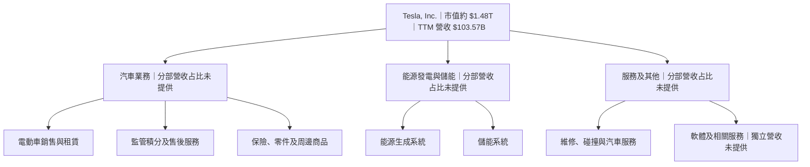
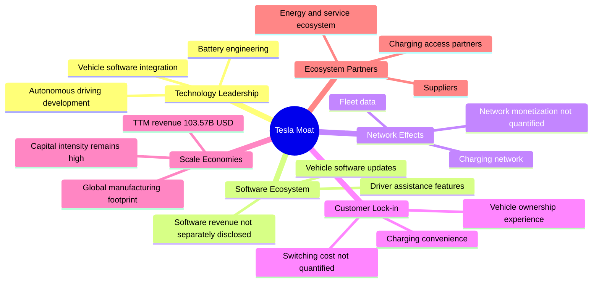
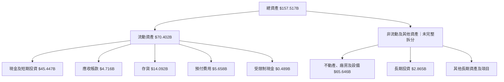
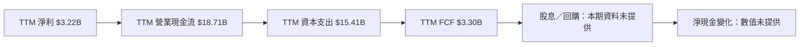
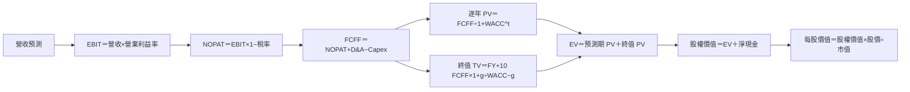
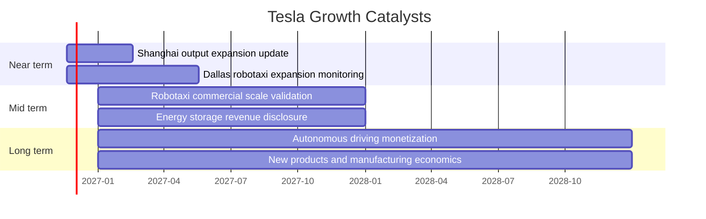
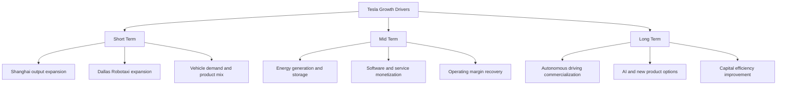
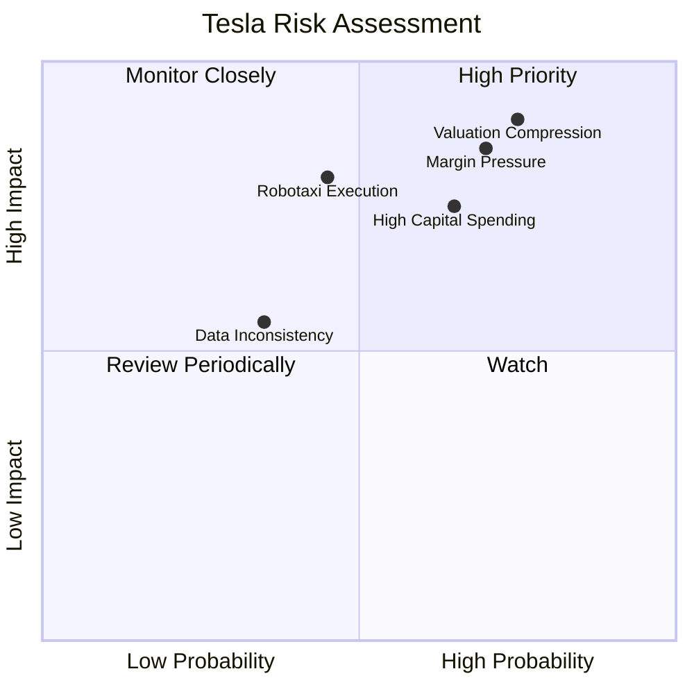
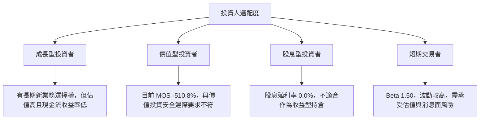

# TSLA 基本面深度分析報告
> **報告日期**：2026-11-19 ｜ **語言**：繁體中文 ｜ **數據來源**：SEC 申報資料 (XBRL)、Yahoo Finance、Finviz、StockAnalysis、Roic.ai ｜ **分析師**：CFA 級機構研究

## 目錄

| # | 章節 | 核心結論 |
|---|------|----------|
| 1 | 執行摘要 | 賣出；加權合理價值 $61.30；MOS -510.8% |
| 2 | 公司概覽與商業模式 | 現有規模與品牌有優勢，但營收組成及市場份額未提供，護城河變現能力仍須驗證 |
| 3 | 損益表深度分析 | TTM 營收 $103.57B、年增 8.3%；最新一季年減 0.2%，利潤率承壓 |
| 4 | 資產負債表分析 | 依 SEC 核心資料口徑為淨現金 $36.18B；流動性良好，但不同資料來源債務數據不一致 |
| 5 | 現金流量深度分析 | TTM FCF $3.30B，FCF Yield 0.22%；資本支出高，現金轉換需持續監控 |
| 6 | 獲利能力與資本效率 | ROIC 5.1% 低於 WACC 12.47%，目前資本回報未覆蓋資金成本 |
| 7 | 相對估值分析 | 相對同業及自身歷史均偏高；估值包含較高成長預期 |
| 8 | DCF 內在價值評估 | 基準 DCF 每股 $12.84；終值現值占 EV 196.2%，模型高度依賴終值假設 |
| 9 | 成長催化劑 | 能源、Robotaxi、AI 與新產品具選擇權，但缺乏可核實的 TAM 與分部營收資料 |
| 10 | 風險矩陣 | 估值、利潤率及高資本支出是主要風險 |
| 11 | 投資建議 | 依 MOS 評級為賣出；追蹤利潤率、FCF、ROIC 與新業務商業化 |

## 1. 執行摘要

2026-11-19 收盤價為 **$374.41**。公司 TTM 營收 $103.57B、年增 8.3%，但最新一季營收年減 0.2%；TTM 營業利益率為 3.3%、ROIC 為 5.1%，低於 12.47% 的 WACC。TTM FCF 為 $3.30B，FCF Yield 僅 0.22%。DCF 基準價值 $12.84，而依四種估值方法及固定權重計算的加權合理價值為 $61.30，MOS 為 -510.8%。**依 MOS 評級為賣出**；此結論反映現價相對模型估值的溢價，不代表公司缺乏技術、品牌或長期成長選擇權。

### 1.0 一頁式投資儀表板

| 項目 | 內容 |
|------|------|
| **投資論點（3 句）** | ① TTM 營收 $103.57B、年增 8.3%，但最新一季年減 0.2%，成長動能並不均勻。② TTM FCF $3.30B、FCF Yield 0.22%，資本支出對自由現金流形成明顯壓力。③ ROIC 5.1% 低於 WACC 12.47%，而現價 $374.41 高於加權合理價值 $61.30。 |
| **綜合評分** | **4.7/10**（引用 1.1 評分卡） |
| **財務健康** | 🟢 現金與短期投資 $45.45B、總債務 $9.27B，淨現金 $36.18B；但不同資料來源的債務數字有差異 |
| **ROIC vs WACC** | 5.1% vs 12.47%；目前回報低於資本成本，未創造經濟價值 |
| **FCF 趨勢** | TTM FCF $3.30B；FCF Yield 0.22%，資本支出仍高 |
| **估值** | Forward P/E 173.4x ｜ EV/EBITDA 151.286x ｜ FCF Yield 0.22% |
| **DCF 內在價值（基準）** | $12.84 ｜相對 DCF 基準價值，現價溢價 2,815.0% |
| **安全邊際（MOS）** | **-510.8%**＝($61.30 − $374.41) ÷ $61.30；🔴 無安全邊際（基準為 8.8 加權合理價值） |
| **預期報酬（基準情境 12M）** | DCF 基準情境相對現價 **-96.6%**；此為模型情境差額，不是分析師預測 |
| **關鍵風險（前二）** | 高估值與低 FCF Yield；營業利益率及 ROIC 未能改善 |
| **評級 + 信心度** | 🔴 **賣出** ｜ 信心：中（估值訊號明確，但高估值中所含的新業務選擇權難以由現有財務數字量化） |

**指標定義**：MOS＝(加權合理價值−現價)÷加權合理價值；上行空間＝(加權合理價值−現價)÷現價；折溢價＝現價÷DCF 基準內在價值−1。

### 1.1 綜合評分卡（全報告唯一）

| 維度 | 評分（1–10） | 主要依據（引用數字與其來源章節） |
|------|--------------|----------------------------------|
| 成長性 | 5.0 | TTM 營收成長 8.3%，但最新一季年增 -0.2%（第 3 章） |
| 獲利能力 | 3.0 | TTM 營業利益率 3.3%、ROIC 5.1% 低於 WACC 12.47%、F-Score 4/9（第 3、6 章） |
| 財務健康 | 8.0 | 淨現金 $36.18B、流動比率 1.739；CCC 由 15 天降至 3 天（第 4 章） |
| 估值 | 1.0 | MOS -510.8%；P/E 411.4x，高於五年中位數 74.2x（第 7、8 章） |
| 護城河 | 7.0 | 品牌、軟體與充電生態具差異化；但缺少分部營收、市占率等量化證據（第 2 章） |
| 管理層與資本配置 | 4.0 | FY2025 SBC $2.83B；稀釋股數測試未通過，且 TTM Capex $15.41B（第 3、5 章） |
| **綜合評分** | **4.7** | 六項算術平均：(5+3+8+1+7+4)÷6＝4.7 |

### 1.2 五大投資論點 + 三大核心風險

| 類型 | 項目 | 具體依據 | 信心度 |
|------|------|----------|--------|
| 🟢 **投資論點①** | 規模與現金資源 | TTM 營收 $103.57B；現金與短期投資 $45.45B，為產品、工廠及新業務投資提供資金彈性 | 🟢 高 |
| 🟢 **投資論點②** | 營運資金效率 | CCC 由一年前 15 天降至 3 天，DPO 增加 16 天，短期現金循環改善 | 🟢 中 |
| 🟢 **投資論點③** | 能源及軟體選擇權 | 公司經營能源儲存、服務與軟體相關業務，但分部營收尚未提供，價值尚難量化 | 🟡 中 |
| 🟢 **投資論點④** | 資產負債表有彈性 | 核心數據口徑淨現金 $36.18B，負債壓力相對低 | 🟢 高 |
| 🟢 **投資論點⑤** | 長期品牌與生態資產 | 具電動車、軟體、充電及能源產品的整合能力；競爭優勢需要轉化為可持續利潤 | 🟡 中 |
| 🟡 **風險①** | 估值與現金流脫節 | FCF Yield 0.22%，而 DCF 基準價值 $12.84、加權合理價值 $61.30，均遠低於現價 | 🔴 高衝擊 |
| 🔴 **風險②** | 營業槓桿與利潤率 | 最新一季營業利益率 2.6%，TTM ROIC 5.1% 低於 WACC 12.47% | 🔴 高 |
| 🟡 **風險③** | 投資支出與資料品質 | TTM Capex $15.41B；市場資料另列總債務 $16.44B，與核心驗證口徑 $9.27B 不同 | 🟡 中 |

### 1.3 快速統計卡片

| 指標 | 公司實際值（期間） | 同業中位數 | 狀態 |
|------|--------------------|------------|------|
| 營收成長（TTM） | **8.3%** | — | 🟢 |
| 營收成長（最新一季年增） | **-0.2%** | 2.9%（GM、F、RIVN） | 🔴 |
| 毛利率（TTM） | **19.3%** | 9.2%（GM、F、RIVN） | 🟢 |
| 營業利益率（TTM） | **3.3%** | — | 🟡 |
| ROIC（TTM） | **5.1%** | — | 🔴 |
| Forward P/E | **173.4x** | 5.8x（GM、F） | 🔴 |
| FCF Yield（TTM） | **0.22%** | — | 🔴 |
| Piotroski F-Score | **4 / 9** | — | 🟡 |

### 1.4 投資結論

```text
╔══════════════════════════════════════════════════════════════════╗
║                    📊 投資結論摘要                               ║
╠══════════════════════════════════════════════════════════════════╣
║  評級：🔴 賣出（依 MOS 門檻）                                    ║
║  價格（2026-11-19 收盤）：$374.41                                ║
║  DCF 內在價值（基準）：$12.84（現價溢價 2,815.0%）              ║
║  安全邊際 MOS：-510.8%（以加權合理價值 $61.30 為分母）           ║
║  加權合理價值（8.8）：$61.30                                     ║
║  DCF 情境價值：                                                  ║
║    悲觀情境：$8.90（相對現價 -97.6%）                            ║
║    基準情境：$12.84（相對現價 -96.6%）                           ║
║    樂觀情境：$18.36（相對現價 -95.1%）                           ║
║  綜合評分：4.7/10（引用 1.1）                                    ║
║  適合投資人：能承受高波動、看重長期技術選擇權且不依賴估值安全邊際 ║
╚══════════════════════════════════════════════════════════════════╝
```

## 2. 公司概覽與商業模式

### 2.1 業務結構與收入來源

公司業務包括汽車、能源發電與儲能，以及汽車相關服務等。SEC 10-Q 財務資料提供 TTM 總營收 $103.57B，但未提供本報告可用的分部營收及占比，因此不拆分比例，也不以示意數字繪圖。



### 2.2 市場份額

市場份額數據未提供，因此不列市占率或繪製市場份額圓餅圖。公司 TTM 營收 $103.57B，規模高於此處列示的直接競爭者披露資料，但不同公司的營收範圍與商業模式並不完全相同，不能單憑規模推斷競爭地位。

### 2.3 競爭護城河分析



### 2.4 護城河強度

| 護城河項目 | 強度（強／中／弱） | 證據（引用數字或事實） | 會削弱它的情況 |
|------------|--------------------|------------------------|----------------|
| 技術整合 | 中 | 車輛、軟體與能源產品由同一企業提供；研發費用 FY2025 為 $6.41B | 研發投入未轉化為更高毛利或可持續付費功能 |
| 軟體生態系統 | 中 | 公司提供車載軟體與服務；相關獨立營收未提供 | 競爭者功能追平、消費者不願為軟體付費 |
| 網路效應 | 中 | 車隊及充電網路可能帶來使用資料與便利性；網路變現數字未提供 | 充電網路開放後差異化降低，或競爭網路快速擴張 |
| 客戶鎖定 | 中 | 車輛、充電與服務整合可提高使用便利性；轉換成本未量化 | 品牌偏好或服務體驗惡化、替代車款增多 |
| 規模效應 | 中 | TTM 營收 $103.57B；但 TTM Capex $15.41B，資本需求高 | 產能利用率下降、價格競爭使固定成本吸收能力轉弱 |
| 生態夥伴 | 弱至中 | 供應商、充電及服務夥伴支援營運；夥伴經濟價值未量化 | 供應鏈集中、合作條款變化或替代生態形成 |

**1.1 護城河評分 7.0/10**：品牌、技術整合與生態具質化優勢，但市場份額、分部營收及軟體變現數據不足以證明護城河已穩定轉化為超額報酬。

## 3. 損益表深度分析

### 3.1 年度收入成長趨勢（近 4 年）

年度營收與 YoY 依年度損益表計算；2022–2025 累計 CAGR＝(94.83÷81.46)^(1/3)−1＝約 5.2%。

```text
╔══════════════════════════════════════════════════════════════════╗
║              Tesla 年度收入趨勢（FY2022-FY2025）                 ║
╠══════════════════════════════════════════════════════════════════╣
║  FY2022  $81.46B  ████████████████████░░░░░░░░  YoY：—          ║
║  FY2023  $96.77B  ████████████████████████░░░░  YoY：+18.8% 🟢  ║
║  FY2024  $97.69B  ████████████████████████░░░░  YoY：+1.0%  🟡  ║
║  FY2025  $94.83B  ███████████████████████░░░░░  YoY：-2.9%  🔴  ║
╠══════════════════════════════════════════════════════════════════╣
║  2022–2025 三年累計 CAGR：約 +5.2%                               ║
╚══════════════════════════════════════════════════════════════════╝
```

2023 年營收增長後，2024 年近乎停滯、2025 年下降 2.9%。這表示近年成長不再只由產能擴張驅動；產品週期、價格競爭與產品組合變化，會直接影響營收與利潤率。

### 3.2 季度收入趨勢分析

| 季度 | 營收 | QoQ | YoY | 備註 |
|------|------|-----|-----|------|
| 2025 Q4 | $24.90B | -11.4% | -3.1% | 以 2025 Q3 $28.095B、2025 Q4 前一季 $28.095B 為比較基準 |
| 2026 Q1 | $22.39B | -10.1% | +15.8% | QoQ 依 2025 Q4 $24.90B；YoY 依 2025 Q1 $19.335B |
| 2026 Q2 | $28.24B | +26.1% | +25.5% | QoQ 回升；YoY 為單季年增率 |
| 2026 Q3 | $28.05B | -0.7% | -0.2% | 最新一季年增率為單季數字，不是 TTM 成長率 |

**口徑說明**：以季度資料列示值計算 QoQ；YoY 優先引用 SEC 財務數據所列最新一季 -0.2%。最新一季營收近乎持平、低於前一季，說明 TTM 8.3% 成長不能直接外推為近期加速。

### 3.3 利潤率演變分析

年度利潤率依年度損益表數字計算；TTM 及最新季度營業利益率引用 SEC 口徑的核心數據。

| 利潤率指標 | FY2022 | FY2023 | FY2024 | FY2025 | 趨勢 | 評估 |
|------------|--------|--------|--------|--------|------|------|
| **毛利率** | 25.6% | 18.2% | 17.9% | 18.0% | 2022 後回落，近兩年約持平 | 🟡 |
| **營業利益率** | 17.0% | 9.2% | 7.9% | 5.1% | 持續收縮 | 🔴 |
| **淨利率** | 15.4% | 15.5% | 7.3% | 4.0% | 2024 後顯著下行 | 🔴 |

年度毛利率以毛利÷營收計算；年度營業利益率以年度營業利益÷營收計算。最新 SEC 口徑 TTM 營業利益率為 **3.3%**、最新一季為 **2.6%**。不同資料截面所列毛利、營業利益數值並非完全一致，因此本表按年度損益表計算，TTM 指標則維持核心驗證口徑。

**利潤率演變深度解析**：2022 至 2025 年營業利益由 $13.83B 降至 $4.85B，營收同期仍由 $81.46B 升至 $94.83B。收入規模未能抵銷成本及費用壓力，顯示價格、產品組合與固定成本吸收等因素可能抵消規模效應。資料未提供足以量化拆解的單車價格、產量與分部成本，故不把利潤率變化歸因於單一因素。

### 3.4 費用結構分析

N/A（資料未提供可完整拆分的銷貨成本、銷售管理費及其他費用明細，故不製作費用比例圓餅圖）。已知 FY2025 研發費用為 $6.41B，FY2024 為 $4.54B；研發費用增加可能支援新產品與技術開發，但亦提高短期獲利壓力。

### 3.5 季度 EPS 趨勢與盈餘品質（Quality of Earnings）

| 季度 | EPS 實際值 | EPS 年增 | 驚喜幅度 |
|------|------------|---------|----------|
| 2025 Q4 | $0.24 | -60.6% | 預估值缺失，無法判定超預期或不及預期 |
| 2026 Q1 | $0.13 | +8.3% | 預估值缺失，無法判定 |
| 2026 Q2 | $0.32 | -3.0% | 預估值缺失，無法判定 |
| 2026 Q3 | $0.22 | -43.6% | 預估值缺失，無法判定 |

Yahoo Finance 的近四季 EPS 預估與實際值欄位為空，不能據此認定 beat 或 miss。可確認的是 EPS 年增走勢波動，2026 Q3 EPS 年減 43.6%，與同期收入年減 0.2%相比，反映盈餘端較收入端弱。

| 盈餘品質項目 | 數值／佔比 | 評估 |
|--------------|-----------|------|
| 股權薪酬 SBC / 營收 | 估計 TTM SBC $4.304B ÷ TTM 營收 $103.57B＝約 **4.2%** | 🟡 股權薪酬占收入比不可忽視，構成股東稀釋成本 |
| SBC / 營業現金流 | $4.304B ÷ $18.71B＝約 **23.0%** | 🟡 營業現金流包含非現金薪酬加回，現金流轉換需與稀釋一併看 |
| FCF / 淨利（現金轉換率） | $3.30B ÷ $3.22B＝約 **102.5%** | 🟢 TTM FCF 略高於 StockAnalysis TTM 淨利；但 Capex 高，不能單看轉換率 |
| 一次性／非經常性損益 | N/A（缺少可完整核對的一次性項目明細） | 無法判斷非經常項目對 TTM 盈餘的淨影響 |
| 有效稅率異常 | 27.0%（最新年度有效稅率） | 未提供歷史完整稅務橋接，無法判定是否由一次性稅務利益主導 |
| 資本化支出 vs 費用化 | TTM Capex $15.41B；資本化與費用化細項 N/A | 資本支出規模高；不能僅由此推斷是否延後費用認列 |

TTM SBC 由 2025 Q4 至 2026 Q3 的季度數據加總：$0.954B+$1.03B+$1.15B+$1.17B＝$4.304B。**盈餘品質結論**：FCF 對淨利的轉換並未明顯失真，但 SBC 需視作經濟成本，且 Capex 對 FCF 有重大影響；估值不宜只以會計淨利或經調整盈餘倍數判斷。

## 4. 資產負債表分析

### 4.1 資產結構分解

下圖列示 StockAnalysis 2026-09-30 資產負債表所提供數字；其總資產 $157.517B，流動資產 $70.402B。細項未完整涵蓋全部非流動資產，故不以不完整數據強行加總。



### 4.2 流動性與營運資金分析

| 流動性指標 | 數值 | 期間／解讀 |
|------------|------|-----------|
| 流動比率 | 1.739 | 市場資料所列；流動資產高於流動負債 |
| 速動比率 | 1.239 | 市場資料所列；仍有一定短期流動性緩衝 |
| 現金與短期投資 | $45.45B | TTM 核心財務數據 |
| 淨現金 | $36.18B | 核心財務數據口徑 |

| 指標 | 最新 TTM | 一年前 TTM | 變化 | 解讀 |
|------|----------|------------|------|------|
| DSO 應收帳款天數 | 16 天 | 18 天 | -2 天 | 收款週期縮短，短期有利於現金回收 |
| DIO 存貨天數 | 62 天 | 56 天 | +6 天 | 庫存週轉變慢，可能反映備貨、需求或產品組合變化；單靠天數不能確定原因 |
| DPO 應付帳款天數 | 75 天 | 59 天 | +16 天 | 付款期限延長，支持營運資金，但須關注供應商條款與關係 |
| CCC 現金轉換週期 | 3 天 | 15 天 | -12 天 | 現金轉換改善；CCC＝DSO+DIO−DPO |

### 4.3 債務結構分析

不同資料來源對債務口徑不一致：核心財務數據列總債務 $9.27B；市場資料另列 $16.44B；Roic.ai 的長期借款與租賃資料亦採不同分類。本報告在淨現金及估值橋接使用核心驗證口徑，不把各口徑混加。

```text
╔══════════════════════════════════════════════════════════════════╗
║                   Tesla 債務健康診斷                             ║
╠══════════════════════════════════════════════════════════════════╣
║  總債務（核心口徑）：      $9.27B   🟢                           ║
║  現金＋短期投資：          $45.45B  🟢                           ║
║  淨現金：                  $36.18B  🟢                           ║
║  流動比率：                1.739    🟢                           ║
║  Debt/EBITDA：             N/A（債務及 EBITDA 口徑不一致）       ║
║  利息保障倍數：            N/A（利息費用絕對值未提供）           ║
║  資料口徑提示：市場資料另列總債務 $16.44B，估值以核心口徑為準   ║
╚══════════════════════════════════════════════════════════════════╝
```

### 4.4 股東權益趨勢

依年度資產負債表，股東權益由 FY2022 $44.70B 增至 FY2025 $82.14B；反映留存盈餘與資本累積，但股權薪酬亦可能帶來稀釋。

```text
╔══════════════════════════════════════════════════════════════════╗
║                 Tesla 股東權益趨勢（年度）                       ║
╠══════════════════════════════════════════════════════════════════╣
║  FY2022  $44.70B  ███████████░░░░░░░░░░                         ║
║  FY2023  $62.63B  ███████████████░░░░░                         ║
║  FY2024  $72.91B  ██████████████████░░                         ║
║  FY2025  $82.14B  ████████████████████                         ║
╚══════════════════════════════════════════════════════════════════╝
```

## 5. 現金流量深度分析

### 5.1 現金流量瀑布圖



### 5.2 FCF 轉換率趨勢

| 年度 | FCF | 淨利 | FCF / 淨利 | 趨勢 |
|------|-----|------|------------|------|
| FY2022 | $7.55B | $12.58B | 60.0% | 現金流低於淨利 |
| FY2023 | $4.36B | $15.00B | 29.1% | 現金轉換率下降 |
| FY2024 | $3.58B | $7.13B | 50.2% | 相對改善，FCF 仍下降 |
| FY2025 | $6.22B | $3.79B | 164.1% | FCF 高於淨利 |
| TTM | $3.30B | $3.22B | 102.5% | 近於一比一 |

各年度 FCF/淨利由年度現金流量表與損益表計算；TTM 指標使用核心 FCF 與 StockAnalysis TTM 淨利。FY2025 的比率提高不代表趨勢已穩固，因 TTM FCF 仍低於 FY2025 全年 FCF。

### 5.3 自由現金流趨勢

| 期間 | FCF | 解讀 |
|------|-----|------|
| FY2022 | $7.55B | 高於近兩年 |
| FY2023 | $4.36B | 年減 |
| FY2024 | $3.58B | 再度下降 |
| FY2025 | $6.22B | 回升 |
| TTM 至 2026-09-30 | $3.30B | 低於 FY2025；FCF Yield 0.22% |

```text
╔══════════════════════════════════════════════════════════════════╗
║                  自由現金流趨勢（USD B）                         ║
╠══════════════════════════════════════════════════════════════════╣
║  FY2022  $7.55B  ████████████████████                           ║
║  FY2023  $4.36B  ████████████                                   ║
║  FY2024  $3.58B  █████████                                      ║
║  FY2025  $6.22B  ████████████████                               ║
║  TTM     $3.30B  █████████                                      ║
║  TTM FCF Yield：0.22%                                           ║
╚══════════════════════════════════════════════════════════════════╝
```

### 5.4 資本配置評估

股息殖利率為 0.0%，派息率為 0.0%；資料未提供足以拆分回購、併購、留存現金與各項投資金額的完整數據，因此不製作資本配置比例圖。

| 資本用途 | 可確認數據 | 評估 |
|----------|------------|------|
| 資本支出 | TTM $15.41B | 高於 TTM FCF，降低當期可分配現金 |
| 股權薪酬 | FY2025 $2.83B；估計 TTM $4.304B | 提供員工激勵，但形成稀釋成本 |
| 股息 | 殖利率 0.0% | 未見現金股息回報 |
| 回購 | N/A（缺少可核實金額） | 不對回購成效下結論 |
| 留存／其他投資 | N/A（缺少完整分配資料） | 需追蹤投入資本回報 |

## 6. 獲利能力與資本效率

### 6.1 ROE / ROA / ROIC 趨勢

| 指標 | 最新值 | 歷史資料可得性 | 評估 |
|------|--------|----------------|------|
| ROE（TTM） | 3.6% | 歷史同口徑序列未提供 | 🟡 低回報 |
| ROA（TTM） | 1.3% | 歷史同口徑序列未提供 | 🔴 資產回報偏低 |
| ROIC（TTM） | 5.1% | 歷史同口徑序列未提供 | 🔴 低於資金成本 |
| 行業均值 | N/A | 沒有可核實同口徑來源 | 不列比較 |

### 6.2 ROIC vs WACC 分析（核心價值創造判斷）

```text
╔══════════════════════════════════════════════════════════════════╗
║                ROIC vs WACC 深度分析                            ║
╠══════════════════════════════════════════════════════════════════╣
║  WACC（成本資本數據）：                                          ║
║  ├── 無風險利率（10Y 美債）：       5.05%                        ║
║  ├── 市場風險溢酬 ERP：             5.00%                        ║
║  ├── Beta 原始值：                  1.74                         ║
║  ├── Beta 採用值（調整後）：        1.50                         ║
║  ├── 股權成本 Ke（指定值）：        12.53%                       ║
║  ├── 稅前債務成本：                 3.65%                        ║
║  ├── 稅率：                         27.0%                        ║
║  ├── 股權／債務權重：               99.4%／0.6%                  ║
║  └── WACC（指定值）：               12.47%                       ║
║                                                                  ║
║  ROIC：5.1%（TTM）                                               ║
║  EVA Spread = ROIC − WACC = 5.10% − 12.47% = -7.37 個百分點     ║
║                                                                  ║
║  ROIC  5.10%  ▓▓▓▓▓░░░░░░░░░░░░░░░░░░░░░░░░░░░░░░░░░░         ║
║  WACC 12.47%  ▓▓▓▓▓▓▓▓▓▓▓▓░░░░░░░░░░░░░░░░░░░░░░░░             ║
║                                                                  ║
║  結論：ROIC 低於 WACC，現有資本回報未覆蓋資金成本。             ║
╚══════════════════════════════════════════════════════════════════╝
```

ROIC 採 TTM 5.1%，WACC 採成本資本資料指定的 12.47%；兩者差額為 **5.1%−12.47%＝-7.37 個百分點**。因此，以此口徑衡量，公司目前尚未創造正的經濟附加價值。WACC 輸入值與 CAPM 元件採程式計算口徑；底層債務成本計算所需的利息費用及完整負債範圍未能在其餘財務表格中逐項核對，故不另行改算 WACC。

### 6.3 杜邦三因素分解

| 因素 | 數值（TTM） | 解讀 |
|------|-------------|------|
| 淨利率 | 3.1% | 低淨利率限制 ROE |
| 資產週轉率 | 0.66 | 資產每年約產生相當於其 0.66 倍的營收 |
| 權益乘數 | 1.76 | 財務槓桿溫和，並非主要 ROE 驅動 |
| **ROE** | **3.6%** | 3.1% × 0.66 × 1.76＝約 3.6% |

此處照錄 TTM 杜邦品質指標。ROE 主要受低淨利率及資產週轉率限制，並非依靠高槓桿撐起。

### 6.4 財務體質：Piotroski F-Score

**Piotroski F-Score：4 / 9。**

| 測試 | 結果 | 解讀 |
|------|------|------|
| ROA > 0 | ✅ 通過 | TTM 資產報酬為正 |
| 營業現金流 > 0 | ✅ 通過 | TTM 營業現金流為 $18.71B |
| ROA 高於一年前 | ❌ 未通過 | 資產獲利能力未改善 |
| 營業現金流 > 淨利（應計品質） | ✅ 通過 | 現金流高於淨利 |
| 長期負債 ÷ 總資產低於一年前 | ❌ 未通過 | 槓桿相關測試未改善 |
| 流動比率高於一年前 | ❌ 未通過 | 相較一年前未提高 |
| 稀釋股數未增加 | ❌ 未通過 | 存在股數稀釋 |
| 毛利率高於一年前 | ✅ 通過 | 毛利率測試通過 |
| 資產週轉率高於一年前 | ❌ 未通過 | 資產利用效率未提升 |

測試顯示現金流與正報酬項目尚可，但盈利改善、流動性改善、稀釋及資產效率未通過，整體財務動能並不全面。

## 7. 相對估值分析

### 7.1 同業估值比較表格

| 估值指標 | **TSLA** | **GM** | **F** | **RIVN** | 本公司評估 |
|----------|---------:|-------:|------:|--------:|-----------|
| **Trailing P/E** | 411.4x | 17.9x | N/A | N/A | 🔴 顯著高於獲利車廠；對虧損同業不適用 |
| **Forward P/E** | 173.4x | 5.6x | 6.0x | -6.4x | 🔴 遠高於 GM、F；RIVN 預期為負 |
| **P/S Ratio** | 14.289x | 0.4x | 0.2x | 2.5x | 🔴 顯著高於同業 |
| **EV/EBITDA** | 151.286x | 9.2x | 23.7x | -6.7x | 🔴 高倍數；RIVN 為負值不具常規解讀性 |
| **最新一季營收 YoY** | -0.2% | 2.9% | -2.0% | 38.3% | 🟡 增長落後 GM、RIVN，高於 F |
| **毛利率（TTM）** | 19.3% | 11.4% | 7.4% | 9.2% | 🟢 高於表列同業 |

Peer multiples 依 Yahoo Finance 所列數字；TSLA 估值倍數依市場資料。由於公司與同業的產品、業務組合及盈利階段不同，倍數比較不代表等風險；但高估值要求更高的持續成長與利潤改善。

### 7.2 歷史估值區間分析

```text
╔══════════════════════════════════════════════════════════════════╗
║             TSLA 五年歷史估值區間（TTM）                         ║
╠══════════════════════════════════════════════════════════════════╣
║  P/E        18.0x ───────── 中位數 74.2x ───────── 現值 411.4x  ║
║                                                  百分位：95%     ║
║  P/S         3.9x ───────── 中位數 9.4x ───────── 現值 12.8x   ║
║                                                  百分位：76%     ║
║  EV/EBITDA  19.0x ──────── 中位數 64.6x ───────── 現值 141.2x  ║
║                                                  百分位：86%     ║
╚══════════════════════════════════════════════════════════════════╝
```

P/E 與 EV/EBITDA 分別位於五年歷史 95 與 86 百分位；P/S 位於 76 百分位。自身歷史比較顯示現價估值處於偏高區域，但歷史倍數本身不代表合理價值。

### 7.3 情境價值（Bear / Base / Bull，依 DCF MODEL）

| 情境 | 第 1 年營收成長 | 期末營業利潤率 | WACC | 每股價值 | 相對現價 | 機率 | 會發生的條件 |
|------|----------------|----------------|------|----------|----------|------|--------------|
| 🔴 悲觀 | 4.1% | 6.2% | 13.47% | $8.90 | -97.6% | 25% | 需求低於基準、競爭壓低利潤率，折現率上升 |
| 🟡 基準 | 8.3% | 7.2% | 12.47% | $12.84 | -96.6% | 50% | TTM 成長延續，利潤率逐步回升至模型期末假設 |
| 🟢 樂觀 | 12.4% | 8.0% | 11.47% | $18.36 | -95.1% | 25% | 成長高於 TTM、營運槓桿改善且資本成本下降 |

三個情境的價值均遠低於現價。上述為 DCF 模型情境值，不等於分析師共識目標價。

### 7.4 相對估值隱含價格區間

```text
╔══════════════════════════════════════════════════════════════════╗
║                 估值方法隱含每股價值                             ║
╠══════════════════════════════════════════════════════════════════╣
║  DCF（基準）            $12.84                                  ║
║  同業 Forward P/E       $12.50                                  ║
║  同業 EV/EBITDA         $47.18                                  ║
║  分析師共識目標價       $412.48                                 ║
║  市場現價               $374.41                                 ║
╚══════════════════════════════════════════════════════════════════╝
```

- 同業 Forward P/E：GM、F 中位數 **5.8x × TSLA Forward EPS $2.16＝$12.50**。
- 同業 EV/EBITDA：GM、F 中位數 **16.5x × TTM EBITDA，再加淨現金＝$47.18**；依估值方法資料所列結果。
- 分析師共識：40 位分析師平均目標價 $412.48，不屬於相對估值倍數推導。

## 8. DCF 內在價值評估（Discounted Cash Flow）

### 8.0 估值推理鏈（Thinking Logic）

**Step 1 — 價值來源與主導變數**  
本模型只估算公司整體自由現金流，不將未量化的新業務選擇權額外加價。可辨識的營收來源是汽車、能源與服務，但各分部營收占比未提供，不能聲稱其中一項已占特定比例。模型估值主要受**營業利潤率、Capex 路徑與 WACC**影響：基準情境中，FY+1 至 FY+6 FCFF 均為負，只有後四年轉正；終值現值占 EV 196.2%，顯示長期利潤率與資本支出收斂程度主導估值。

**Step 2 — 模型選擇**

| 決策點 | 本報告採用 | 理由（含數字） | 曾考慮但否決 | 否決理由 |
|--------|-----------|----------------|--------------|----------|
| 現金流定義 | FCFF | 配合 WACC 折現並求 EV；模型公式為 NOPAT+D&A−Capex | FCFE | 模型未提供股權現金流與債務融資預測 |
| 預測期 N | 10 年 | DCF 模型固定提供 FY+1 至 FY+10 | 5 年 | 與既定模型預測期不符，且不得另建模型 |
| 終值方法 | Gordon Growth | 模型提供 g=3.0% 的終值 | 退出倍數 | 模型未提供退出倍數終值數字，不自行新增 |
| EBIT 基礎 | GAAP EBIT | 模型明列 GAAP EBIT | 非 GAAP | 避免加回 SBC 後又未反映股東成本 |

**Step 3 — 關鍵假設推導鏈**

- **營收成長**：錨點＝TTM 年增 8.3% → 模型將其作為第 1 年成長，再線性降至第 10 年 3.0% → 採用模型提供的 8.3% 至 3.0% 路徑 → 否決十年固定 8.3%，因為會忽略基期成長正常化；也不自行下調首年成長，避免改動模型。
- **期末營業利益率**：錨點＝TTM 3.3% → 模型逐步提高至 7.2%，依據為近五年財年中位數含 TTM → 採用 7.2% → 否決更高的樂觀利潤率，因目前最新季度營業利益率僅 2.6%，缺乏已實現證據支撐更高終值。
- **永續成長率 g**：錨點＝模型採用 3.0% → 調整理由是長期永續成長需低於 WACC 且避免把短期高增長永久化 → 採用 3.0% → 否決 4.0% 等更高數值作為基準，因模型並未採用，且越高會提升終值依賴。
- **預測期 N**：錨點＝模型明列 10 年 → 採用 10 年 → 否決 5 年或更長期間，因估值模型只允許使用所提供的 10 年路徑。
- **Capex/營收**：錨點＝TTM Capex $15.41B÷營收 $103.57B，約 14.9% → 模型由第 1 年 14.9% 線性降至第 10 年 6.0% → 採用該路徑 → 否決固定維持 14.9%，因模型假設成熟期投資強度下降；此為重要且偏樂觀假設。
- **EBIT 基礎、SBC 與稀釋**：錨點＝模型使用 GAAP EBIT，且明定 SBC 已含於費用、股數不再稀釋 → 採用組合 **(A) GAAP EBIT＋固定股數，年稀釋率 0%** → 否決再扣 SBC 或再加股數稀釋，避免重複計入。
- **WACC**：錨點＝成本資本資料指定 12.47% → 採用 12.47% → 否決自建另一套折現率，因要求採用指定 WACC；見 8.2。
- **D&A/營收**：錨點＝TTM 5.5% → 採用模型固定 5.5%。
- **有效稅率**：錨點＝最新年度有效稅率 27.0% → 採用 27.0%。
- **營運資金**：模型未建模，不能補造 ΔWC 數字；FCFF 按提供模型的定義計算。
- **終值方法**：採模型提供 Gordon Growth；否決另行加上退出倍數終值，因模型未提供該計算結果，且不能更改既定模型。

**Step 4 — 最脆弱的一環**  
最脆弱假設是 Capex/營收由 14.9% 收斂至 6.0%並同時將營業利益率升至 7.2%；若投資強度維持較高或利潤率未改善，FCFF 及終值都會低於基準。

**Step 5 — 計算路徑圖**



### 8.1 模型假設總表（Model Inputs）

| 假設項目 | 採用值 | 依據／來源 | 敏感度 |
|----------|--------|-------------|--------|
| 預測期長度 **N** | 10 年 | DCF 模型預測期 | 🟡 中 |
| 營收成長路徑 | FY+1 8.3% 線性降至 FY+10 3.0% | 起始錨點為 TTM 成長 8.3%；末年模型假設 3.0% | 🔴 高 |
| 營業利益率 | 3.3% → 7.2% | TTM 營業利益率及模型所列近五年中位數 | 🔴 高 |
| 有效稅率 | 27.0% | 最新年度有效稅率 | 🟢 低 |
| Capex / 營收 | 14.9% → 6.0% | TTM Capex/營收約 14.9%；模型末年假設 6.0% | 🔴 高 |
| D&A / 營收 | 5.5% | DCF 模型所列 TTM 比率 | 🟢 低 |
| 營運資金變動 | 未建模 | DCF 模型明示 working capital is not modelled | 🟢 低 |
| EBIT 基礎 | GAAP | DCF 模型明列 GAAP EBIT | 🟡 中 |
| SBC 處理 | GAAP 費用中已反映，不另扣除 | 模型說明 | 🟡 中 |
| 年稀釋率 | 0%（固定股數） | 組合 (A)，模型不再稀釋 | 🟡 中 |
| 永續成長率 g | 3.0% | DCF 模型 | 🔴 高 |
| 終值方法 | Gordon Growth | DCF 模型提供該終值 | 🔴 高 |
| WACC | 12.47% | Cost of capital 指定值 | 🔴 高 |

**FCFF 定義**：本模型採 FCFF＝NOPAT＋D&A−Capex；模型未包含 ΔWC 列。  
**SBC 防重複計算**：本模型採用 **(A)**，GAAP EBIT 已含 SBC 費用，不另減 SBC，股數亦不再稀釋，因此 SBC 影響在模型中計入一次。

### 8.2 折現率推導（WACC）

```text
╔══════════════════════════════════════════════════════════════════╗
║                    WACC 推導（折現率）                           ║
╠══════════════════════════════════════════════════════════════════╣
║  股權成本 Ke（CAPM，採指定成本資本輸入）：                       ║
║  ├── 無風險利率 Rf（10Y 美債）：      5.05%                      ║
║  ├── 市場風險溢酬 ERP：               5.00%                      ║
║  ├── Beta 原始值（Yahoo）：           1.74                       ║
║  ├── Beta 調整值：                    1.50                       ║
║  ├── Beta 調整式：                    ⅔×1.74＋⅓＝1.50            ║
║  └── Ke（指定值）：                   12.53%                     ║
║                                                                  ║
║  債務成本：                                                      ║
║  ├── 稅前 Kd（指定值）：              3.65%                      ║
║  ├── 有效稅率：                       27.0%                      ║
║  └── 稅後 Kd = 3.65%×(1−27.0%) = 2.66%                         ║
║                                                                  ║
║  資本結構權重：                                                  ║
║  ├── 股權 E 權重：                    99.4%                      ║
║  ├── 債務 D 權重：                    0.6%                       ║
║  └── WACC = 99.4%×12.53% + 0.6%×2.66% = 12.47%                  ║
╚══════════════════════════════════════════════════════════════════╝
```

逐步演算（依指定成本資本數據；輸入數字保留原值，因四捨五入而可能有尾差）：

1. **Ke（CAPM）**：指定 Ke＝12.53%；原始 Beta 1.74 經調整後為 1.50，調整公式為 ⅔×1.74＋⅓＝1.50。使用顯示至兩位小數的 Rf 及 ERP 重算可能與指定 Ke 有微小四捨五入差異，因此採用模型提供的 Ke。
2. **稅前 Kd**：指定值 **3.65%**；利息費用絕對金額與平均計息負債明細未提供，不能由債務餘額反推利息費用。
3. **稅後 Kd**：3.65%×(1−27.0%)＝2.6645% ≈ **2.66%**。
4. **權重**：指定股權權重 99.4%，債務權重 0.6%；99.4%＋0.6%＝100.0%。計息負債範圍及市值明細未提供，故不另以不同債務口徑重算權重。
5. **WACC**：99.4%×12.53%＋0.6%×2.6645%＝12.45482%＋0.015987%＝12.470807% ≈ **12.47%**。

Rf 的日期未在成本資本資料中細列，ERP 標示為假設輸入，故不聲稱有更細的日期或外部溢酬來源。Beta 原始值來自 Yahoo Finance，採用調整後 Beta 1.50。未另加規模或國別溢酬。第 6.2 與本節均採用 **12.47%**。

### 8.3 逐年自由現金流預測（基準情境）

金額單位為 USD B；逐年數值照錄 DCF 模型。因模型未建模營運資金，表中不另列或估算 ΔWC。FCFF 行為 GAAP EBIT 口徑，SBC 已含於費用，不再扣除。

| 年度 | FY+1 | FY+2 | FY+3 | FY+4 | FY+5 | FY+6 | FY+7 | FY+8 | FY+9 | FY+10 |
|------|------:|------:|------:|------:|------:|------:|------:|------:|------:|-------:|
| 營收 | 112.17 | 120.81 | 129.42 | 137.87 | 146.07 | 153.89 | 161.23 | 167.96 | 173.99 | 179.21 |
| 營收 YoY | 8.3% | 7.7% | 7.1% | 6.5% | 5.9% | 5.4% | 4.8% | 4.2% | 3.6% | 3.0% |
| 營業利潤率 | 3.3% | 3.8% | 4.2% | 4.6% | 5.1% | 5.5% | 5.9% | 6.4% | 6.8% | 7.2% |
| EBIT（GAAP） | 3.75 | 4.57 | 5.45 | 6.40 | 7.42 | 8.48 | 9.58 | 10.71 | 11.85 | 12.98 |
| − 稅 | (1.01) | (1.23) | (1.47) | (1.73) | (2.00) | (2.29) | (2.58) | (2.89) | (3.19) | (3.50) |
| NOPAT | 2.74 | 3.34 | 3.98 | 4.68 | 5.42 | 6.19 | 7.00 | 7.82 | 8.65 | 9.48 |
| + D&A | 6.14 | 6.61 | 7.09 | 7.55 | 8.00 | 8.42 | 8.83 | 9.20 | 9.53 | 9.81 |
| − Capex | (16.69) | (16.78) | (16.71) | (16.44) | (15.98) | (15.32) | (14.47) | (13.42) | (12.19) | (10.79) |
| **FCFF** | **-7.80** | **-6.83** | **-5.64** | **-4.21** | **-2.57** | **-0.70** | **1.36** | **3.60** | **5.99** | **8.50** |
| 折現因子 | 0.889 | 0.791 | 0.703 | 0.625 | 0.556 | 0.494 | 0.439 | 0.391 | 0.347 | 0.309 |
| **FCFF 現值 PV** | **-6.94** | **-5.40** | **-3.96** | **-2.63** | **-1.43** | **-0.35** | **0.60** | **1.41** | **2.08** | **2.63** |

**預測期 FCF 現值加總**：  
-$6.94-$5.40-$3.96-$2.63-$1.43-$0.35+$0.60+$1.41+$2.08+$2.63＝**-$13.99B**；模型列示合計 **-$14.00B**，差額 $0.01B 為逐年數值四捨五入造成，低於 1%。

**逐步演算（FY+1；表內數值採模型四捨五入值）**

1. **營收**＝TTM 營收 $103.57B×(1＋8.3%)；模型列示結果 **$112.17B**。  
2. **EBIT**＝營收 $112.17B×營業利益率 3.3%；模型列示 **$3.75B**。  
3. **稅**＝EBIT $3.75B×27.0%＝$1.0125B ≈ **$1.01B**。  
4. **NOPAT**＝$3.75B−$1.01B＝**$2.74B**。  
5. **D&A**＝$112.17B×5.5%；模型列示 **$6.14B**。  
6. **Capex**＝$112.17B×14.9%；模型列示 **$16.69B**。  
7. **ΔWC**＝模型未建模，故不填數、不推算。  
8. **FCFF**＝$2.74B+$6.14B−$16.69B＝**-$7.81B**；模型列示 -$7.80B，差額源於表內各項四捨五入。  
9. **折現因子**＝1÷(1+12.47%)¹＝0.889；按模型 FCFF -$7.80B×0.889＝-$6.9342B ≈ **-$6.94B**。

**合理性自檢**

- FY+1 至 FY+10 FCFF 由 -$7.80B 轉至 $8.50B，因前段 Capex 超過 NOPAT+D&A，後段模型假設資本支出占比下降；無法計算負數序列的常規 FCF CAGR。
- FY+10 FCFF 利潤率＝$8.50B÷$179.21B＝約 **4.7%**；當前 TTM FCF 利潤率＝$3.30B÷$103.57B＝約 **3.2%**。同業最佳水準未提供，不能比較。
- FY+1 至 FY+6 FCFF 為負；這些負現金流降低預測期 PV，模型價值轉正主要依靠終值。

```text
╔══════════════════════════════════════════════════════════════════╗
║            自由現金流：歷史實際 vs 模型預測                      ║
╠══════════════════════════════════════════════════════════════════╣
║  FY2023(實)  $4.36B   ███████████                                ║
║  FY2024(實)  $3.58B   █████████                                  ║
║  FY2025(實)  $6.22B   ████████████████                           ║
║  TTM(實)     $3.30B   █████████                                  ║
║  FY+1 (預)  -$7.80B   負 FCFF                                    ║
║  FY+10(預)   $8.50B   ██████████████████████                     ║
╠══════════════════════════════════════════════════════════════════╣
║  模型依賴 Capex/營收由 14.9% 降至 6.0%，不是單純營收成長假設。  ║
╚══════════════════════════════════════════════════════════════════╝
```

### 8.4 終值計算（Terminal Value）

**適用性檢查**：WACC 12.47% vs g 3.0% → **WACC > g？✅**

| 方法 | 計算式 | 終值 TV | TV 現值 | 佔總 EV 比重 |
|------|--------|---------|---------|--------------|
| Gordon Growth | $8.50×(1+3.0%)÷(12.47%−3.0%) | $92.48B | $28.56B | 196.2% |
| 退出倍數法 | 模型未提供退出倍數及相應終值 | N/A | N/A | N/A |

逐步演算（Gordon Growth）：

1. **FY+N FCFF**＝FY+10 FCFF **$8.50B**。
2. **分子**＝$8.50B×(1+3.0%)＝$8.755B，按模型精度列示為 **$8.50×1.03**。
3. **分母**＝12.47%−3.0%＝**9.47%**；TV＝$8.50B×1.03÷9.47%＝模型列示 **$92.48B**。
4. **PV(TV)**＝$92.48B×0.309＝$28.575B，模型列示 **$28.56B**。
5. **終值佔比**＝$28.56B÷$14.56B＝**196.2%**。

終值現值大於 EV，是因預測期 PV 合計為負數；這表示本估值高度依賴終值假設，短期現金流貢獻有限。模型未提供退出倍數假設，不自行補入一個倍數或估算結果。

### 8.5 企業價值 → 每股內在價值（Bridge）

```text
╔══════════════════════════════════════════════════════════════════╗
║              企業價值 → 每股內在價值橋接                         ║
╠══════════════════════════════════════════════════════════════════╣
║  預測期 FCF 現值合計              -$14.00B                       ║
║  終值現值 PV(TV)                  +$28.56B                       ║
║  = 企業價值 EV                     $14.56B                       ║
║  + 淨現金                          +$36.18B                       ║
║  = 股權價值                        $50.74B                       ║
║  每股基準價值（模型指定公式）      $12.84                        ║
║  2026-11-19 收盤價                 $374.41                       ║
║  DCF 折溢價：現價÷DCF 價值−1       +2,815.0% 溢價                ║
╚══════════════════════════════════════════════════════════════════╝
```

逐步演算：

1. **EV**＝預測期 PV -$14.00B＋PV(TV) $28.56B＝**$14.56B**。
2. **股權價值**＝EV $14.56B＋淨現金 $36.18B＝**$50.74B**。
3. **每股價值**：依模型指定公式「股權價值×價格÷市值」，用未四捨五入的市值／股數比率計算，模型列示 **$12.84**。資料所列股數 3.95B 為四捨五入值；直接用 $50.74B÷3.95B 約為 $12.85，與模型結果的細微差異來自模型採用未四捨五入市值／股數資料，故本報告保留指定的 $12.84。
4. **折溢價**＝$374.41÷$12.84−1＝**+2,815.0%**（四捨五入）。
5. **本節不計算 MOS**：MOS 僅以 8.8 的加權合理價值為分母。

股權價值橋接採模型的淨現金 $36.18B。總現金與短期投資為 $45.45B、總債務為 $9.27B；少數股東權益未提供，模型橋接未列。

### 8.6 敏感性分析（WACC × 永續成長率）

下列每股數值照錄 DCF 模型；括號為相對 $374.41 現價計算的上行／下行幅度。

| g（列）／WACC（欄） | 10.47% | 11.47% | **12.47%（基準）** | 13.47% | 14.47% |
|-----------|--------|--------|------------------|--------|--------|
| 2.0% | $15.25 (-95.9%) | $13.46 (-96.4%) | $12.08 (-96.8%) | $11.00 (-97.1%) | $10.13 (-97.3%) |
| 2.5% | $15.90 (-95.8%) | $13.94 (-96.3%) | $12.44 (-96.7%) | $11.27 (-97.0%) | $10.34 (-97.2%) |
| 3.0% | $16.64 (-95.6%) | $14.47 (-96.1%) | **$12.84 (-96.6%)** | $11.57 (-96.9%) | $10.58 (-97.2%) |
| 3.5% | $17.48 (-95.3%) | $15.07 (-96.0%) | $13.28 (-96.5%) | $11.90 (-96.8%) | $10.83 (-97.1%) |
| 4.0% | $18.46 (-95.1%) | $15.75 (-95.8%) | $13.77 (-96.3%) | $12.27 (-96.7%) | $11.11 (-97.0%) |

**有效格示範**：選取 WACC 13.47%、g 2.5%，13.47% > 2.5% ✅。模型矩陣列示該格每股價值 **$11.27**。該格的預測期 PV、終值及橋接中間值未在模型明細中提供，依「不得自建或改寫模型」要求，不另行重建中間計算。矩陣數值顯示 WACC 上升會降低估值；g 上升會提高估值。

**三情境 DCF（照錄模型情境）**

| 情境 | 營收成長假設 | 期末營業利潤率 | 永續 g | WACC | 每股內在價值 | 相對現價 | 機率 |
|------|-------------|----------------|--------|------|--------------|----------|------|
| 🔴 悲觀 | 第 1 年 4.1% | 6.2% | 3.0%（基準模型值） | 13.47% | $8.90 | -97.6% | 25% |
| 🟡 基準 | 第 1 年 8.3% | 7.2% | 3.0% | 12.47% | $12.84 | -96.6% | 50% |
| 🟢 樂觀 | 第 1 年 12.4% | 8.0% | 3.0%（基準模型值） | 11.47% | $18.36 | -95.1% | 25% |
| **機率加權** | — | — | — | — | **$13.23** | **-96.5%** | 100% |

**情境算式限制**：模型只提供三情境的每股結果、首年成長、期末利潤率、WACC 與機率，沒有提供每一情境的 FY+10 營收、FCFF、TV 等中間數字；為遵守不得另建 DCF 的規定，不以新增假設補出情境推導鏈。機率加權：$8.90×25%+$12.84×50%+$18.36×25%＝$13.225≈**$13.23**；機率合計 25%+50%+25%＝100%。

**敏感度結論**：基準列 g 由 2.0%升至 4.0%，每股價值由 $12.08升至 $13.77，變化為 **+$1.69**；基準 g=3.0%時，WACC 由 11.47%升至 13.47%，價值由 $14.47降至 $11.57，變化為 **-$2.90**。營業利潤率每 +1pp 的獨立價值變動未提供，不能自行試算。模型給出的結果顯示折現率在上述測試區間的影響大於 g 的同幅度測試；與 8.0 指出的利潤率、Capex、WACC 共同決定價值一致，但無法由既有矩陣單獨量化利潤率彈性。

### 8.7 反推 DCF（Reverse DCF）

模型固定其他基準輸入後，對以下變數逐一求解；使用的固定條件包括基準 WACC、稅率、Capex 路徑、預測期等。模型未提供足夠的迭代軌跡，且兩項求解均回報指定區間內無解，故不製作虛構的試算表。

| 求解的變數（一次一個） | 其餘變數設定 | 市場隱含值（令 DCF＝現價） | 公司歷史實際 | 判斷 |
|------------------------|--------------|------------------------------|--------------|------|
| 第 1 年營收成長 | 其餘基準值固定 | -10% 至 100% 區間內無解 | TTM 成長 8.3% | 現價無法由此變數單獨解釋 |
| 固定營業利潤率 | 其餘基準值固定 | 0.5% 至 95% 區間內無解 | TTM 3.3% | 現價無法由此變數單獨解釋 |
| 永續成長率 | 未提供可解結果 | 未計算 | — | N/A |
| 預測期長度 N | 未提供可解結果 | 未計算 | — | N/A |

**反推結論**：在模型測試範圍內，單靠拉高首年營收成長或固定營業利潤率均無法令 DCF 價值達到現價，表示市場價格依賴模型之外的長期選擇權或假設，而非現有 DCF 現金流可單獨支持。

### 8.8 估值三角驗證與安全邊際

| 估值方法 | 隱含每股價值 | 上行空間（÷現價） | 權重 | 說明 |
|----------|--------------|-------------------|------|------|
| DCF（基準） | $12.84 | -96.6% | 40% | 10 年 FCFF、WACC 12.47%、g 3.0% |
| 同業 Forward P/E | $12.50 | -96.7% | 25% | 同業中位數 5.8x × Forward EPS $2.16 |
| 同業 EV/EBITDA | $47.18 | -87.4% | 25% | GM、F 中位數 EV/EBITDA 16.5x，並加回淨現金 |
| 分析師共識目標價 | $412.48 | +10.2% | 10% | 40 位分析師平均目標價 |
| **加權合理價值** | **$61.30** | **-83.6%** | **100%** | 四種方法按公司類型固定權重 |

**逐步演算**：  
$12.84×40%+$12.50×25%+$47.18×25%+$412.48×10%  
＝$5.136+$3.125+$11.795+$41.248  
＝$61.304 ≈ **$61.30**。權重為盈利型公司固定權重，合計 100%；沒有計入其他未提供方法。

**MOS 與上行空間**：

- **MOS**＝($61.30−$374.41)÷$61.30＝-$313.11÷$61.30＝**-510.8%**。
- **上行空間**＝($61.30−$374.41)÷$374.41＝-$313.11÷$374.41＝**-83.6%**。
- **DCF 折溢價**＝$374.41÷$12.84−1＝**+2,815.0%**。

```text
╔══════════════════════════════════════════════════════════════════╗
║                  估值區間與安全邊際                              ║
╠══════════════════════════════════════════════════════════════════╣
║  $8.90 ─── $12.84 ─── $61.30 ─── $374.41 ─── $412.48            ║
║ 悲觀DCF    基準DCF    加權合理值   現價       分析師共識          ║
║                                                                  ║
║  MOS = (加權合理價值−現價)÷加權合理價值 = -510.8%               ║
║  MOS 評估：🔴 無安全邊際                                         ║
║  上行空間 = (加權合理價值−現價)÷現價 = -83.6%                  ║
║                                                                  ║
║  建議觀察／建倉上限：$55.17                                      ║
║  （加權合理價值 $61.30×(1−10%)＝$55.17，對應 MOS 至少 10%）       ║
║  MOS 為 -10% 對應價格：$67.43；MOS 為 -25% 對應價格：$76.63     ║
╚══════════════════════════════════════════════════════════════════╝
```

建議觀察／建倉上限依加權合理價值的 10% MOS 門檻推導，並非另一個估值方法。現價遠高於該區間，與賣出評級一致。

> 🔎 **程式複算（Python，依本節各項自動重算）**
>
> 加權合理價值 = $12.84 × 40% + $12.50 × 25% + $47.18 × 25% + $412.48 × 10% = **$61.30**（權重合計 100%）
>
> 以價格 $374.41 計：MOS = **-510.8%**，上行空間 = **-83.6%**
>
> ✅ 與本節所寫數值一致。

### 8.9 DCF 模型的局限與失效條件

- **終值依賴度**：終值現值占 EV 196.2%，且預測期 PV 為負值；模型價值主要由第 10 年後假設決定。
- **最脆弱假設**：Capex/營收由 14.9%降至 6.0%；營業利益率由 3.3%提高至 7.2%。若兩者未實現，FCFF 及每股價值將低於 $12.84 基準。
- **FCF 與再投資**：FY+1 至 FY+6 FCFF 為負，顯示公司仍處於高投資期；若資本支出維持高位，Gordon Growth 終值會更難達成。
- **模型限制**：未建模營運資金變動，且未另行估值自動駕駛、能源或其他新業務選擇權。可用分部估值、單位經濟性及 EV/Sales 做補充，但目前缺少分部數據以量化。
- **與第 10 章風險連結**：價格競爭壓低利潤率；新工廠或 AI 支出推高 Capex；新業務商業化延後則壓低成長與終值。

### 8.10 複算檢核表（Audit Trail）

| # | 檢核項目 | 檢查方式 | 結果 |
|---|----------|----------|------|
| 1 | 高／中敏感度輸入具推導理由 | 對照 8.0 Step 3 與 8.1 | ✅ |
| 2 | 假設均有來源或明示缺漏 | 檢查 8.1 依據欄 | ✅ |
| 3 | WACC 算式及權重合計 | 99.4%+0.6%=100%；依指定輸入可得 12.47% | ✅ |
| 4 | Kd 分母與 D 權重負債範圍一致 | 利息費用及負債分類明細缺失，未自行重算 | ⚠️ 限制已揭露 |
| 5 | WACC 與第 6.2 節一致 | 兩處均為 12.47% | ✅ |
| 6 | 預測年度數等於 N | 10 年完整列示 | ✅ |
| 7 | FY+1 算式可依四捨五入數字核對 | 各表內數字有四捨五入尾差 | ⚠️ 尾差已揭露 |
| 8 | 預測期 PV 加總 | 顯示數字加總 -$13.99B；模型合計 -$14.00B，差 $0.01B | ✅ |
| 9 | WACC > g | 12.47% > 3.0% | ✅ |
| 10 | 終值基於 FY+10 FCFF 並折現 10 期 | FY+10 FCFF $8.50B、折現因子 0.309 | ✅ |
| 11 | EV、股權價值橋接 | -$14.00B+$28.56B=$14.56B；加淨現金=$50.74B | ✅ |
| 12 | SBC 三要素組合 | GAAP EBIT、無 −SBC 列、0% 稀釋，符合 (A) | ✅ |
| 13 | 矩陣基準格等於 8.5 價值 | 12.47%／3.0% 為 $12.84 | ✅ |
| 14 | 矩陣有效格與 WACC > g | 提供矩陣的 WACC 均高於列示 g | ✅ |
| 15 | 三情境機率與加權值 | 25%+50%+25%=100%；加權結果 $13.23 | ✅ |
| 16 | 反推 DCF 單變數求解 | 模型回報兩項無解；無試算軌跡可引用 | ⚠️ 依模型輸出揭露 |
| 17 | MOS 與折溢價基準一致 | MOS 用 $61.30；折溢價用 $12.84 | ✅ |
| 18 | 報告完整至第 11 章 | 章節 1–11 完整 | ✅ |
| 19 | 加權合理價值無事後調整 | 計算總和 $61.304，列示 $61.30 | ✅ |
| 20 | 評級符合 MOS 門檻 | MOS -510.8%，對應賣出 | ✅ |

**資料限制說明**：第 4 項受限於負債分類及利息費用明細缺失；第 7 項受限於逐年表列數值四捨五入；第 16 項依模型提供的無解結果，不自行補造求解軌跡。

## 9. 成長催化劑

### 9.1 催化劑時間軸

精確上線日期未提供，以下以近期新聞事件描述，不將新聞標題視為已實現收入或利潤。



新聞列示 Tesla 擴展 Dallas Robotaxi，以及上海工廠產量相關消息；實際產能、付費用戶及新增收入未提供，故不直接計入 DCF。

### 9.2 TAM 市場規模分析

N/A（TAM 數據未提供）。公司 TTM 營收 $103.57B、TTM 年增 8.3%，但最新一季年增 -0.2%；是否能擴大成長取決於車輛、能源、軟體與服務的實際變現，不能以未披露的 TAM 金額推導市場滲透率。

### 9.3 成長驅動力結構圖



## 10. 風險矩陣

### 10.1 風險評分矩陣

機率及衝擊座標是分析師的定性判斷，不是財務報表預測值；風險數字不代表財務數據。



### 10.2 風險清單詳細分析

| # | 風險項目 | 發生機率 | 財務衝擊 | 風險評估 | 緩解措施 |
|---|----------|----------|----------|----------|----------|
| 1 | 🔴 **估值壓縮** | 高；主觀約 75% | 估值方法加權價值 $61.30，遠低於現價 $374.41；衝擊可能為倍數下修 | 🔴 高 | 以加權價值及 MOS 設定部位上限，避免僅依成長敘事追價 |
| 2 | 🔴 **利潤率與價格競爭** | 中高；主觀約 70% | 最新一季營收年減 0.2%，營業利益率 2.6%；若持續收縮，ROIC 可能進一步低於 WACC | 🔴 高 | 追蹤季度營業利益率、毛利率及折扣／產品組合資訊 |
| 3 | 🔴 **高資本支出** | 中高；主觀約 65% | TTM Capex $15.41B，TTM FCF $3.30B | 🔴 高 | 監控 Capex/營收、現金流與新增產能利用率 |
| 4 | 🟡 **Robotaxi／AI 商業化不及預期** | 中；主觀約 45% | 可能使市場選擇權價值下修；相關營收目前未單獨披露 | 🟡 高衝擊 | 以商業區域、付費使用、收入及監管進度驗證，不將產品公告等同收入 |
| 5 | 🟡 **資料口徑與報表解讀風險** | 中；主觀約 35% | 債務資料存在 $9.27B 與 $16.44B 等不同口徑，可能影響淨現金及估值橋接 | 🟡 中 | 以 SEC 申報資料核對債務定義、租賃負債與現金項目 |

## 11. 投資建議

### 11.1 最終評級與評分

依加權合理價值 $61.30 與現價 $374.41 計算，MOS 為 -510.8%，符合規則 20 的 **賣出**門檻，未作質化上調或下調。1.1 評分卡的六項分數為成長性 5.0、獲利能力 3.0、財務健康 8.0、估值 1.0、護城河 7.0、管理層與資本配置 4.0；綜合評分 **4.7/10**。

### 11.2 合理價值與隱含報酬率

| 估值項目 | 每股價值 | 相對現價 | 機率／權重 |
|----------|---------:|---------:|-----------|
| 加權合理價值 | $61.30 | -83.6% 上行空間 | 權重合計 100% |
| DCF 悲觀情境 | $8.90 | -97.6% | 25% |
| DCF 基準情境 | $12.84 | -96.6% | 50% |
| DCF 樂觀情境 | $18.36 | -95.1% | 25% |
| 分析師共識目標價 | $412.48 | +10.2% | 40 位分析師平均 |

### 11.3 買入時機與觸發因素

```text
╔══════════════════════════════════════════════════════════════════╗
║                  ✅ 買入觸發因素 Checklist                       ║
╠══════════════════════════════════════════════════════════════════╣
║  目前評級為賣出；不建議僅因短期價格下跌而買入。                   ║
║                                                                  ║
║  重新評估／建立觀察部位的條件：                                  ║
║  ☐ 股價回落至加權合理價值 MOS ≥10% 的推導上限 $55.17 附近        ║
║  ☐ 最新季度營業利益率持續改善，且不是只靠一次性項目               ║
║  ☐ TTM FCF 高於 $3.30B，且 Capex/營收未再上升                    ║
║  ☐ ROIC 持續向 12.47% WACC 靠近                                  ║
║                                                                  ║
║  加碼觸發條件：                                                  ║
║  ☐ FCF Yield 明顯高於目前 0.22%，且獲利品質同步改善              ║
║  ☐ Robotaxi 或能源業務披露可驗證的付費收入與毛利                 ║
║                                                                  ║
║  減碼／停損觸發條件：                                            ║
║  ☐ TTM FCF 轉負或 Capex 長期高於營業現金流                       ║
║  ☐ ROIC 持續低於 WACC 12.47%，且營業利益率再收縮                 ║
║  ☐ 債務或租賃負債上升、淨現金顯著下降                            ║
╚══════════════════════════════════════════════════════════════════╝
```

### 11.4 投資人適配度分析



### 11.5 每季財報監控清單（Quarterly Watch List）

| 監控指標 | 目前基準 | 觸發加碼／改善觀察 | 觸發減碼／風險警示 |
|----------|----------|---------------------|-------------------|
| 營收成長 | TTM +8.3%；最新一季 YoY -0.2% | 最新季度 YoY 回到正成長，且非單一季度波動 | 連續兩季 YoY 為負 |
| 營業利益率 | TTM 3.3%；最新季度 2.6% | 連續改善並帶動 ROIC 向 WACC 靠近 | 低於 2.6% 且營收未成長 |
| 毛利率 | TTM 19.3% | 保持或改善並轉化為營業利益 | 毛利率下降且折扣增加 |
| Capex | TTM $15.41B | Capex/營收下降但產能與收入維持成長 | Capex 上升、FCF 同時下降 |
| FCF | TTM $3.30B | TTM FCF 持續增加、FCF Yield 脫離 0.22% 低位 | TTM FCF 轉負 |
| 庫存／營運資金 | DIO 62 天；CCC 3 天 | DIO 回落且 CCC 維持低位 | DIO 繼續增加、CCC 明顯拉長 |
| SBC／股數稀釋 | 估計 TTM SBC $4.304B；稀釋股數測試未通過 | SBC/營收下降且股數稀釋減緩 | SBC 占營收持續高於約 4.2% 基準或稀釋加快 |
| 新業務變現 | 獨立營收未提供 | 披露可核驗付費收入、毛利與使用規模 | 多期只有擴張公告，未有營收或現金流證據 |
| 現金與債務 | 核心淨現金 $36.18B | 淨現金維持且資本支出產生回報 | 淨現金下降並伴隨負債上升 |

### 11.6 反面論證：什麼會證明論點錯誤（What Would Change My Mind）

```text
╔══════════════════════════════════════════════════════════════════╗
║              ⚠️ 論點失效條件（Disconfirming Evidence）           ║
╠══════════════════════════════════════════════════════════════════╣
║  本報告的賣出判斷若出現下列數據，應重新檢視：                    ║
║  ☐ TTM 營收成長持續高於 8.3%，且最新季度 YoY 明顯轉正           ║
║  ☐ 最新季度營業利益率連續改善，並高於目前 2.6%                   ║
║  ☐ TTM FCF 明顯超過目前 $3.30B，FCF Yield 不再只有 0.22%        ║
║  ☐ ROIC 超越 WACC 12.47%，且不是一次性改善                       ║
║  ☐ SBC/營收低於目前估計約 4.2%，稀釋股數趨於穩定                 ║
║  ☐ Robotaxi、能源或軟體披露可持續的收入、毛利及現金流             ║
║  ☐ 資本支出下降至模型假設的成熟化路徑，同時不犧牲營收成長        ║
╚══════════════════════════════════════════════════════════════════╝
```

> **免責聲明**：本報告為 AI 自動生成，僅供研究參考，不構成投資建議。投資有風險，入市需謹慎。

---

## 資料與來源

| 項目 | 內容 |
|------|------|
| 價格 | 374.41 USD，2026-11-19 收盤（Yahoo Finance 日線） |
| 財務報表 | SEC 10-Q filed 2026-10-22，最新季度 2026-09-30（FY2026 Q3） |
| 有回應的資料來源 | SEC 申報資料 (XBRL)、Yahoo Finance、Finviz、StockAnalysis、Roic.ai |
| 由程式計算 | TTM 數字、WACC、DCF 模型、估值方法與權重、加權合理價值、MOS、評級門檻、F-Score、杜邦分解、營運資金天數、綜合評分 |
| 撰寫模型 | openai / gpt-6-luna |

> 本區塊由產生報告的程式依實際取得的資料填寫，非模型撰寫。「由程式計算」的數字不是模型的估計；其餘判斷（評分、情境、策略）是模型的分析。
