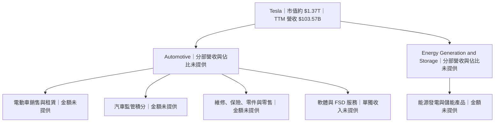
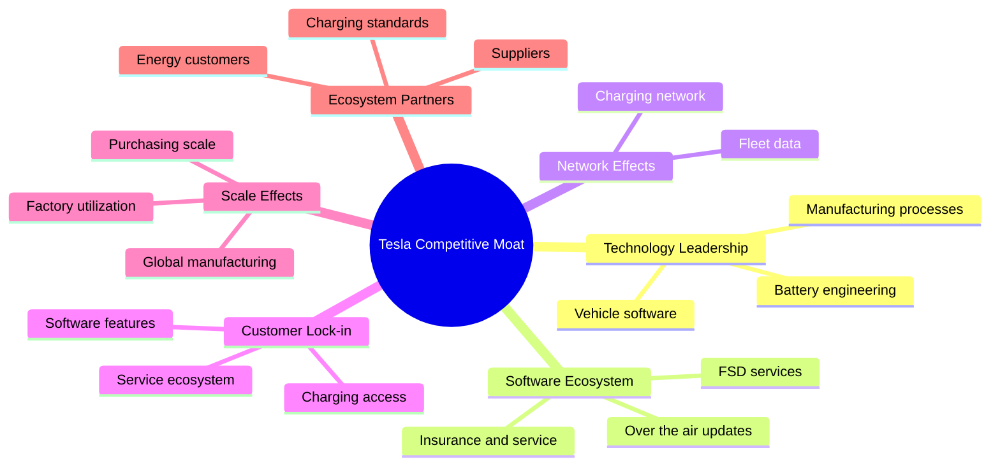
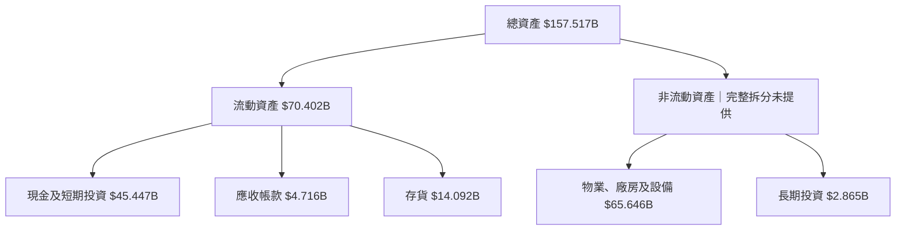
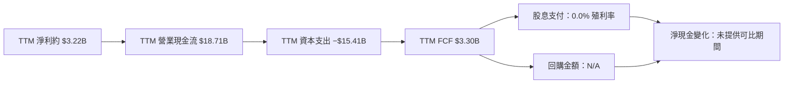
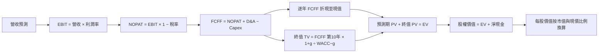
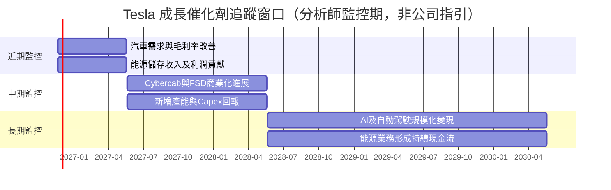
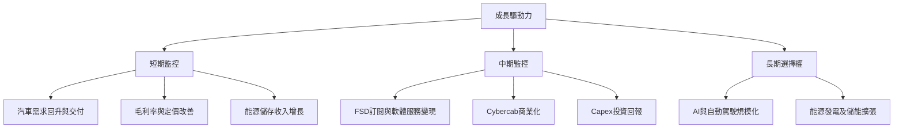
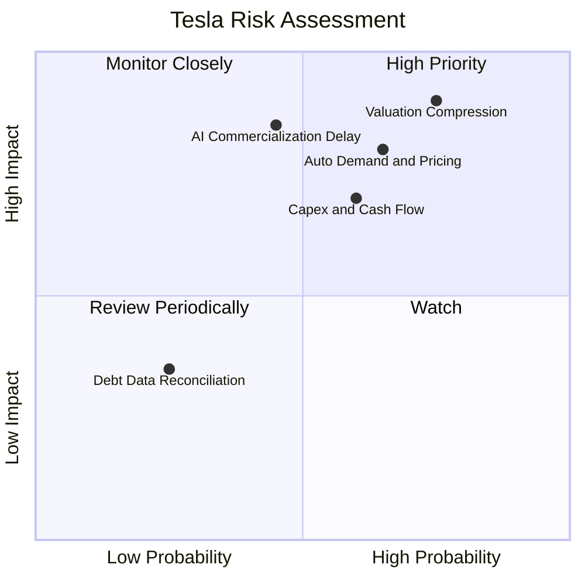
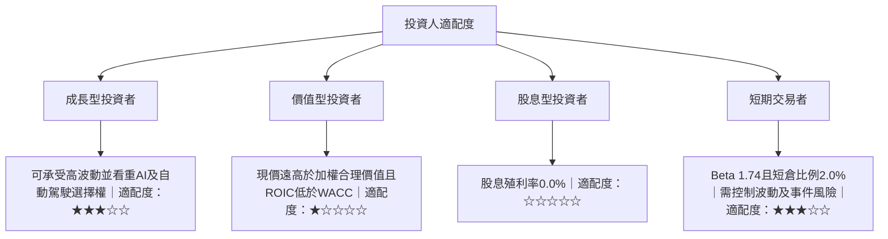

# TSLA 基本面深度分析報告
> **報告日期**：2026-11-20 ｜ **語言**：繁體中文 ｜ **數據來源**：SEC 申報資料 (XBRL)、Yahoo Finance、Finviz、StockAnalysis、Roic.ai ｜ **分析師**：CFA 級機構研究

## 目錄

| # | 章節 | 核心結論 |
|---|------|----------|
| 1 | 執行摘要 | 評級：賣出；加權合理價值 $61.81；MOS −459.5% |
| 2 | 公司概覽與商業模式 | 汽車與能源業務兼具規模，但細分收入數據未提供，護城河的財務轉化仍待驗證 |
| 3 | 損益表深度分析 | TTM 營收 $103.57B、年增 8.3%；最新一季年減 0.2%，TTM 營業利益率 3.3% |
| 4 | 資產負債表分析 | 現金及短期投資 $45.45B；採用核實口徑淨現金 $36.18B |
| 5 | 現金流量深度分析 | TTM FCF $3.30B，FCF Yield 0.24%，資本支出吸收大部分營業現金流 |
| 6 | 獲利能力與資本效率 | ROIC 5.1% 低於 WACC 12.32%，目前資本回報未覆蓋資本成本 |
| 7 | 相對估值分析 | 高於同業估值倍數及自身五年中位數；同業相對估值仍顯示明顯下行風險 |
| 8 | DCF 內在價值評估 | DCF 基準值 $13.05；模型高度依賴終值，且多項輸入／顯示數據存在可複算差異 |
| 9 | 成長催化劑 | 能源、Cybercab／FSD、AI 等有選擇權價值，但部分商業化時程及 TAM 數據未提供 |
| 10 | 風險矩陣 | 估值、汽車需求與定價、AI／自動駕駛商業化是主要風險 |
| 11 | 投資建議 | 依 MOS 為賣出；現價與加權合理價值差距大，需以財報改善而非敘事驗證投資論點 |

---

## 1. 執行摘要

### 1.0 一頁式投資儀表板（Portfolio Manager 30 秒速讀）

| 項目 | 內容 |
|------|------|
| **投資論點（3 句）** | ① TTM 營收 $103.57B、年增 8.3%，但最新一季營收年減 0.2%，成長趨勢仍不穩。② TTM ROIC 5.1% 低於 WACC 12.32%，表示目前資本回報不足以覆蓋資本成本。③ TTM FCF $3.30B、FCF Yield 0.24%，相對 $1.37T 市值，現金流對估值支撐有限。 |
| **綜合評分** | **4.5/10**（引用 1.1 評分卡） |
| **財務健康** | 🟢 現金及短期投資 $45.45B，高於核實總債務 $9.27B；但不同資料來源對債務及淨現金口徑有差異。 |
| **ROIC vs WACC** | **5.1% vs 12.32%**：目前摧毀經濟價值，差距 −7.22 個百分點。 |
| **FCF 趨勢** | TTM FCF $3.30B；FCF Yield **0.24%**。FY2025 FCF 為 $6.22B，但最近季度 FCF 有正有負，持續性需觀察。 |
| **估值** | Forward P/E **160.2x** ｜ EV/EBITDA **147.5x** ｜ FCF Yield **0.24%** |
| **DCF 內在價值（基準）** | **$13.05** ｜現價相對 DCF 折溢價 **+2,550.2%**（以 $13.05 為分母；市場價格約為 DCF 值的 26.5 倍） |
| **安全邊際（MOS）** | **−459.5%**＝($61.81 加權合理價值 − $345.82 現價) ÷ $61.81；🔴 無安全邊際 |
| **預期報酬（基準情境 12M）** | DCF 基準情境為 **−96.2%**（情境模型價值 $13.05 相對現價；不是價格預測保證） |
| **關鍵風險（前二）** | ① 現價估值遠高於 DCF 及相對估值法推導值。② 最新一季營收年減 0.2%、EPS 年減 43.6%，盈利承壓。 |
| **評級 + 信心度** | 🔴 **賣出** ｜信心：中（估值方向明確，但 DCF 模型輸入及不同來源口徑有不一致） |

> **評級推導**：加權合理價值 $61.81，現價 $345.82，MOS = −459.5%；依規則 20 為 🔴 賣出。ROIC 5.1% 低於 WACC 12.32%，且 FCF Yield 僅 0.24%，與估值判斷方向一致；本報告不作評級調整。

### 1.1 綜合評分卡（全報告唯一）

| 維度 | 評分（1–10） | 主要依據（引用數字與其來源章節） |
|------|--------------|----------------------------------|
| 成長性 | 5.0 | TTM 營收年增 8.3%，但最新一季年減 0.2%；見 3.1–3.2。 |
| 獲利能力 | 3.0 | TTM 營業利益率 3.3%、ROIC 5.1% 低於 WACC 12.32%，Piotroski F-Score 4/9；見 3、6 章。 |
| 財務健康 | 8.0 | 核實現金及短期投資 $45.45B、淨現金 $36.18B；CCC 由 15 天降至 3 天；見 4 章。 |
| 估值 | 1.0 | 加權合理價值 $61.81 對比現價 $345.82，MOS −459.5%；P/E 380.0x 對比五年中位數 74.2x；見 7–8 章。 |
| 護城河 | 6.0 | 全球製造與充電／軟體生態有助差異化，但數據未提供市場份額或軟體收入拆分，且汽車毛利率承壓；見 2 章。 |
| 管理層與資本配置 | 4.0 | FY2025 SBC $2.83B；最新四季 SBC 合計約 $4.30B（季度資料加總），而稀釋股數測試未通過；見 3.5、6.4。 |
| **綜合評分** | **4.5** | 六項算術平均：(5.0 + 3.0 + 8.0 + 1.0 + 6.0 + 4.0) ÷ 6 = **4.3**。 |

### 1.2 五大投資論點 + 三大核心風險

| 類型 | 項目 | 具體依據 | 信心度 |
|------|------|----------|--------|
| 🟢 **投資論點①** | 現金緩衝充足 | 現金及短期投資 $45.45B；核實總債務 $9.27B，核實淨現金 $36.18B。 | 🟢 高 |
| 🟢 **投資論點②** | TTM 營收仍有增長 | TTM 營收 $103.57B，較前一 TTM 成長 8.3%；但最新一季年減 0.2%，需判斷增長能否延續。 | 🟡 中 |
| 🟢 **投資論點③** | 營運資金週轉有改善 | CCC 由一年前 15 天降至 3 天，主要來自 DSO 降低與 DPO 增加；可能降低營運資金佔用。 | 🟡 中 |
| 🟢 **投資論點④** | 能源及自動駕駛具有選擇權價值 | 公司經營能源儲存、FSD 與 Cybercab 等業務方向；但數據未提供細分收入與商業化財務貢獻，估值不宜先行全額資本化。 | 🟡 中 |
| 🟢 **投資論點⑤** | 歷史上有規模化製造基礎 | FY2025 收入 $94.83B，員工 134,785 人；可支持大規模製造及服務網絡，但成本與資本回報仍需改善。 | 🟡 中 |
| 🟡 **風險①** | 估值與現金流脫節 | FCF Yield 0.24%；DCF 基準 $13.05，遠低於現價 $345.82。 | 🔴 高衝擊 |
| 🔴 **風險②** | 汽車需求、競爭與定價 | 最新一季營收年減 0.2%、EPS 年減 43.6%；若價格競爭延續，低營業利益率可能限制現金流。 | 🔴 高 |
| 🟡 **風險③** | 新業務變現與資本支出 | TTM Capex $15.41B，約為 TTM FCF 的 4.7 倍；若新產能、AI 或能源投資回報延後，FCF 將受壓。 | 🟡 中高 |

### 1.3 快速統計卡片

| 指標 | 公司實際值（期間） | 同業中位數 | 狀態 |
|------|--------------------|------------|------|
| 營收成長（TTM） | **8.3%** | — | 🟢 |
| 營收成長（最新一季年增） | **−0.2%** | 2.9%（GM、F、RIVN 中位數） | 🔴 |
| 毛利率（TTM） | **19.3%** | 9.2%（GM、F、RIVN 中位數） | 🟢 |
| 營業利益率（TTM） | **3.3%** | — | 🟡 |
| ROIC（TTM） | **5.1%** | — | 🔴 |
| Forward P/E | **160.2x** | 5.7x（GM、F 中位數） | 🔴 |
| FCF Yield（TTM） | **0.24%** | — | 🔴 |
| Piotroski F-Score | **4 / 9** | — | 🟡 |

### 1.4 投資結論

```text
╔══════════════════════════════════════════════════════════════════╗
║                    📊 投資結論摘要                               ║
╠══════════════════════════════════════════════════════════════════╣
║  評級：🔴 賣出（MOS 門檻結果，未作一級調整）                    ║
║  價格（2026-11-20 收盤）：$345.82                                ║
║  DCF 內在價值（基準）：$13.05（現價相對價值溢價約 +2,550.2%）   ║
║  安全邊際 MOS：−459.5%（加權價值為分母）                        ║
║  加權合理價值（8.8）：$61.81                                     ║
║  DCF 情境價值：                                                  ║
║    悲觀情境：$9.00（−97.4%）                                     ║
║    基準情境：$13.05（−96.2%）                                    ║
║    樂觀情境：$18.74（−94.6%）                                    ║
║  綜合評分：4.5/10（引用 1.1）                                    ║
║  適合投資人：能承受高波動、以長期技術商業化為主題的投資人；     ║
║              不適合要求低估值或穩定股息現金流的投資人。         ║
╚══════════════════════════════════════════════════════════════════╝
```

---

## 2. 公司概覽與商業模式

### 2.1 業務結構與收入來源

公司資料顯示 Tesla 經營 Automotive，以及 Energy Generation and Storage 兩個主要分部，並有監管積分、維修、保險、零件、零售商品等收入。分部營收與佔比未提供，因此不推算細項比例。



汽車業務以車輛銷售、租賃及服務為現金流基礎；軟體、保險與能源業務可能提高每位客戶的終身價值，但目前沒有可核實的分部收入及毛利資料，故不能把其潛在價值直接等同於已實現盈利。

### 2.2 市場份額

市場份額數據未提供，因此不繪製市場份額圖或填入比例。以營收規模看，Tesla TTM 營收 $103.57B，最新一季年減 0.2%；同業 GM 最新一季年增 2.9%、Ford 年減 2.0%、Rivian 年增 38.3%，但公司規模及盈利階段差異很大，不能單以成長率推導市佔變化。

### 2.3 競爭護城河分析



### 2.4 護城河強度

| 護城河項目 | 強度（強／中／弱） | 證據（引用數字或事實） | 會削弱它的情況 |
|------------|--------------------|------------------------|----------------|
| 技術與製造 | 中 | 公司以電動車、電池與製造為核心，FY2025 營收 $94.83B；但最新 TTM 營業利益率只有 3.3%。 | 競爭者追平成本、電池或產品能力，或工廠利用率下降。 |
| 軟體生態 | 中 | FSD、OTA、保險等可增加服務收入；但個別收入、訂閱數與毛利貢獻未提供。 | 軟體訂閱採用率或續訂率低，監管限制自動駕駛功能。 |
| 充電網絡 | 中 | 充電網絡與車輛使用體驗可能形成互補；可核實網點數、利用率與單位經濟性未提供。 | 充電標準開放後差異化下降，第三方網絡快速擴張。 |
| 規模效應 | 中 | TTM 營收 $103.57B、員工 134,785 人，具大型製造體量。 | 產能利用不足、降價或資本支出高於規模帶來的成本優勢。 |
| 客戶鎖定 | 弱至中 | 車輛、軟體、充電與服務整合可提高轉換成本；客戶留存率資料未提供。 | 車輛品牌轉換成本有限，競品提供更高性價比。 |
| 生態夥伴 | 弱至中 | 供應商、充電與能源合作可擴張服務覆蓋；合作收入及依賴度未提供。 | 供應鏈集中、關鍵零組件缺貨或夥伴轉向競爭者。 |

**1.1 護城河分數 6.0/10**：規模、軟體與充電網絡有可辨識的差異化來源，但分部收入與單位經濟性未提供，且 TTM 營業利益率為 3.3%，所以尚不足以判定護城河已轉化成穩定超額回報。

---

## 3. 損益表深度分析

### 3.1 年度收入成長趨勢（近 4 年）

以下收入取自年度損益表；FY2022–FY2025 三年 CAGR = \((94.83 ÷ 81.46)^{1/3} - 1\) = 約 **5.2%**。

```text
╔══════════════════════════════════════════════════════════════════╗
║              Tesla 年度收入趨勢（FY2022-FY2025）                ║
╠══════════════════════════════════════════════════════════════════╣
║  FY2022  $81.46B  ██████████████████████████░░░░░░  YoY: 基期   ║
║  FY2023  $96.77B  ███████████████████████████████░  YoY: +18.8% ║
║  FY2024  $97.69B  ███████████████████████████████░  YoY: +0.95% ║
║  FY2025  $94.83B  ██████████████████████████████░░  YoY: −2.93% ║
╠══════════════════════════════════════════════════════════════════╣
║  FY2022–FY2025 三年收入 CAGR：約 +5.2%                           ║
╚══════════════════════════════════════════════════════════════════╝
```

FY2023 收入增長 18.8%，但 FY2024 幾乎持平、FY2025 年減 2.93%，反映收入規模未能持續轉化成線性成長。TTM 營收回升至 $103.57B、同比增加 8.3%，但最新一季收入年減 0.2%，應區分 TTM 滾動改善與最新單季的停滯。

### 3.2 季度收入趨勢分析

| 季度 | 營收 | QoQ 成長 | YoY 成長 | 備註 |
|------|------|----------|----------|------|
| 2025 Q4 | $24.90B | −11.4% | −3.14% | 相較 Q3 的季節性高基期下降。 |
| 2026 Q1 | $22.39B | −10.1% | +15.78% | 年增主要反映去年同期較低基期。 |
| 2026 Q2 | $28.24B | +26.1% | +25.52% | 季度回升，但不能用單季增長代替 TTM 成長。 |
| 2026 Q3 | $28.05B | −0.7% | −0.17% | 最新一季營收年減 0.2%，與 TTM 成長 8.3%方向不同。 |

QoQ 由收入金額計算：例如 2026 Q3 QoQ = \($28.05B ÷ $28.24B − 1\) ≈ −0.7%。季度經營利益資料存在供應商差異：財務數據表列 Q3 經營利益 $718M，StockAnalysis 列 $1.504B；本報告以核實 TTM 利益率 3.3%及核實最新季營業利益率 2.6%為主，不把不一致的季度明細混用。

### 3.3 利潤率演變分析

| 利潤率指標 | FY2022 | FY2023 | FY2024 | FY2025 | 趨勢 | 評估 |
|------------|--------|--------|--------|--------|------|------|
| **毛利率** | 25.6% | 18.2% | 17.9% | 18.0% | 2022 至 2024 明顯下降，2025 大致持平 | 🔴 |
| **營業利益率** | 17.0% | 9.2% | 7.9% | 5.1% | 連續下滑，規模增加未抵銷毛利及費用壓力 | 🔴 |
| **淨利率** | 15.4% | 15.5% | 7.3% | 4.0% | 2023 淨利率受淨利組成影響，之後下降 | 🔴 |

計算依年度損益表：毛利率 = 毛利 ÷ 收入；營業利益率 = 營業利益 ÷ 收入；淨利率 = 淨利 ÷ 收入。FY2022–FY2025 營業利益由 $13.83B 降至 $4.85B，而收入由 $81.46B 增至 $94.83B，顯示收入規模增加並未帶來相應的營業槓桿。價格競爭、產品組合、固定成本吸收、研發支出上升都是可能影響因素；現有資料無法將各因素的貢獻拆分，故不把原因定量歸因於單一項目。

核實 TTM 營業利益率為 3.3%，最新一季為 2.6%；另一合併資料來源列 TTM 3.5%、最新季 3.0%。本報告以核實數值作估值與跨章比較的主口徑。

### 3.4 費用結構分析

完整 TTM 費用分類與分部成本拆解未提供，不繪製可能誤導的費用圓餅圖。可確認 FY2025 研發費用 $6.41B，高於 FY2024 的 $4.54B；FY2025 研發佔收入約 6.8%（$6.41B ÷ $94.83B）。研發投入可能支持軟體、AI、車輛與能源產品，但若無法帶動毛利或營收，短期將壓縮營業利潤。

### 3.5 季度 EPS 趨勢與盈餘品質（Quality of Earnings）

最近四季的 EPS 預估值與實際值欄位為 NaN，因此不能判定哪一季「超預期」或「不及預期」。可取得的最新單季資料顯示 Q3 2026 EPS 年增 **−43.6%**；淨利年增 **−42.7%**。這代表盈利降幅大於同期收入變化，需重點觀察利潤率及成本。

| 盈餘品質項目 | 數值／佔比 | 評估 |
|--------------|-----------|------|
| 股權薪酬 SBC / 營收 | 最新四季 SBC 約 $4.30B ÷ TTM 收入 $103.57B = 約 **4.2%** | 🔴 SBC 對每股股東報酬具實質稀釋成本；季度值加總，不代表 SEC 單一 TTM 報表欄位。 |
| SBC / 營業現金流 | 約 $4.30B ÷ $18.71B = 約 **23.0%** | 🟡 SBC 是非現金加回項，但仍代表股東稀釋；約佔營業現金流近四分之一。 |
| FCF / 淨利（現金轉換率） | TTM FCF $3.30B ÷ TTM 淨利約 $3.22B = 約 **102.5%** | 🟢 當期 FCF 略高於淨利；惟資本開支高，年度間波動明顯。 |
| 一次性／非經常性損益 | **N/A（未提供可量化拆分）** | 無法判斷本期淨利是否受一次性項目顯著影響。 |
| 有效稅率異常 | WACC 輸入採最新年度有效稅率 **27.0%** | 🟡 稅率來源為年度資料，缺乏多年稅項拆分；不宜假設此稅率代表長期現金稅率。 |
| 資本化支出 vs 費用化 | TTM Capex $15.41B；資本化項目明細未提供 | 🟡 Capex 會延後以折舊方式進入損益；缺乏資產類別與資本化政策細節，不能推定存在盈餘美化。 |

FY2025 SBC 為 $2.83B，FY2024 為 $2.00B，FY2023 為 $1.81B，呈上升趨勢。最新四季 SBC 加總約 $4.30B，與 FY2025 單年數字不同，原因是期間不同。FCF/淨利約 102.5%顯示現金轉換尚可，但不能忽略 SBC 稀釋與高額 Capex。

**盈餘品質結論**：現金流並未顯示淨利完全缺乏現金支撐，但 FCF Yield 只有 0.24%，且 SBC 佔 TTM 營收約 4.2%、佔營業現金流約 23.0%。由於一次性損益與資本化明細未提供，不宜判定 GAAP 淨利被高估；估值時則應同時考慮低 FCF 回報及股權稀釋。

---

## 4. 資產負債表分析

### 4.1 資產結構分解

截至 2026-09-30 的資產負債表資料：總資產 $157.517B，流動資產 $70.402B，物業、廠房及設備 $65.646B。其他資產細項並非完整列示，圖中只呈現有明確數字的項目，不以推算殘值補齊。



### 4.2 流動性與營運資金分析

| 指標 | 最新 TTM | 一年前 TTM | 變化 | 解讀 |
|------|----------|------------|------|------|
| 流動比率 | 1.739 | N/A | N/A | 最新流動資產相對短期負債有緩衝；歷史比較欄位未提供。 |
| 速動比率 | 1.239 | N/A | N/A | 高於 1，流動性不只依賴存貨；歷史比較欄位未提供。 |
| DSO 應收帳款天數 | 16 天 | 18 天 | −2 天 | 收款週期縮短，應收帳款效率改善；仍需檢查客戶及付款條件組合。 |
| DIO 存貨天數 | 62 天 | 56 天 | +6 天 | 存貨持有時間拉長，可能增加庫存資金佔用及減值風險。 |
| DPO 應付帳款天數 | 75 天 | 59 天 | +16 天 | 付款週期延長，短期有助供應商融資；需確認是否來自付款條件改善，而非付款壓力。 |
| CCC 現金轉換週期 | 3 天 | 15 天 | −12 天 | 現金轉換週期改善；主要算術來源是 DSO 降低 2 天、DIO 增加 6 天、DPO 增加 16 天。 |

營運資金天數依 SEC 流量與季度資產負債表餘額計算口徑取用，完全照列品質指標；CCC 由 15 天降至 3 天是正面變化，但存貨天數升高，且 DPO 拉長的可持續性需要監控。

### 4.3 債務結構分析

各資料來源的債務口徑有差異：核實數據列總債務 $9.27B、淨現金 $36.18B；其他合併市場資料列總債務 $16.44B、淨現金約 $29.00B。下列診斷採核實口徑，不能把兩套數字混為同一資產負債表。

```text
╔══════════════════════════════════════════════════════════════════╗
║                   Tesla 債務健康診斷                            ║
╠══════════════════════════════════════════════════════════════════╣
║  核實總債務：          $9.27B   ██░░░░░░░░░░░░░░░░░░  🟢       ║
║  現金及短期投資：     $45.45B   ████████████████████  🟢       ║
║  核實淨現金：         $36.18B   ████████████████░░░░  🟢       ║
║                                                                  ║
║  Debt / EBITDA：N/A（債務口徑與 EBITDA 期間未能一致核實）       ║
║  利息保障倍數：N/A（利息費用明細未提供）                        ║
║  解讀：流動資金充足；但需在後續報表釐清總債務口徑差異。         ║
╚══════════════════════════════════════════════════════════════════╝
```

### 4.4 股東權益趨勢

股東權益歷史值依年度資產負債表：

```text
╔══════════════════════════════════════════════════════════════════╗
║                  Tesla 股東權益趨勢                              ║
╠══════════════════════════════════════════════════════════════════╣
║  FY2022  $44.70B  ███████████░░░░░░░░░░░░░░░░░░░░░░             ║
║  FY2023  $62.63B  ███████████████░░░░░░░░░░░░░░░░░             ║
║  FY2024  $72.91B  ██████████████████░░░░░░░░░░░░░░             ║
║  FY2025  $82.14B  ████████████████████░░░░░░░░░░░░             ║
╠══════════════════════════════════════════════════════════════════╣
║  FY2022–FY2025 權益增加 $37.44B；增長不等於每股價值同比增長，   ║
║  尚須考量股數稀釋及資本回報。                                   ║
╚══════════════════════════════════════════════════════════════════╝
```

---

## 5. 現金流量深度分析

### 5.1 現金流量瀑布圖



營業現金流比淨利高，可能含非現金費用與營運資金變動；但在 $15.41B Capex 後只剩 $3.30B FCF。股息殖利率為 0.0%；回購及現金變化的同期資料未提供。

### 5.2 FCF 轉換率趨勢

| 財年 | FCF | 淨利 | FCF / 淨利 | 評估 |
|------|-----|------|------------|------|
| FY2022 | $7.55B | $12.58B | 60.0% | 🟡 FCF 低於淨利，資本支出較高。 |
| FY2023 | $4.36B | $15.00B | 29.1% | 🔴 淨利與現金流差距擴大；淨利組成可能有重要非現金因素。 |
| FY2024 | $3.58B | $7.13B | 50.2% | 🟡 現金轉換較 FY2023 改善，但仍低於 100%。 |
| FY2025 | $6.22B | $3.79B | 164.1% | 🟢 FCF 高於淨利，惟單年比率不能視為長期常態。 |
| TTM 至 2026-09-30 | $3.30B | 約 $3.22B | 約 102.5% | 🟢 當期接近淨利轉現金；FCF 絕對額仍受 Capex 影響。 |

### 5.3 自由現金流趨勢

| 期間 | FCF | FCF Yield |
|------|-----|-----------|
| FY2022 | $7.55B | — |
| FY2023 | $4.36B | — |
| FY2024 | $3.58B | — |
| FY2025 | $6.22B | — |
| TTM 至 2026-09-30 | $3.30B | 0.24% |

歷史年度 FCF Yield 未提供，故不反推或填入。TTM FCF $3.30B 由營業現金流 $18.71B 減 Capex $15.41B 得出；資本支出佔營業現金流約 82.4%，表示公司仍處於高再投資階段。

```text
╔══════════════════════════════════════════════════════════════════╗
║              Tesla 自由現金流：年度與 TTM                       ║
╠══════════════════════════════════════════════════════════════════╣
║  FY2022  $7.55B  ████████████████████                           ║
║  FY2023  $4.36B  ████████████                                   ║
║  FY2024  $3.58B  █████████                                      ║
║  FY2025  $6.22B  ████████████████                               ║
║  TTM     $3.30B  █████████                                      ║
╠══════════════════════════════════════════════════════════════════╣
║  TTM FCF Yield：0.24%｜現金流尚為正，但相對市值回報率偏低。     ║
╚══════════════════════════════════════════════════════════════════╝
```

### 5.4 資本配置評估

現有資料不足以把完整資本配置拆成一致口徑的圓餅圖，故不以不完整分類繪製比例。

| 項目 | 已知數據 | 分析 |
|------|----------|------|
| 資本支出 | TTM $15.41B；FY2025 $8.53B | TTM Capex 高於 FY2025 單年數值，需確認新增產能與 AI／能源投資的回報週期。 |
| 股息 | 殖利率 0.0% | 目前沒有現金股息回報。 |
| 股權薪酬 | FY2025 $2.83B；最新四季加總約 $4.30B | SBC 是員工報酬成本，也是股東稀釋來源。 |
| 回購 | N/A | 期間內回購金額未提供。 |
| 留存／現金變化 | N/A | 缺少與同一期間配套的現金用途完整資料。 |

---

## 6. 獲利能力與資本效率

### 6.1 ROE / ROA / ROIC 趨勢

可核實的歷史 ROE／ROA／ROIC 序列未完整提供，因此不補造年度數列。

| 指標 | 最新值 | 歷史比較 | 評估 |
|------|--------|----------|------|
| ROE（TTM） | 3.6% | 歷史趨勢 N/A | 🔴 回報偏低；DuPont 顯示淨利率只有 3.1%。 |
| ROA（TTM） | 1.3% | 歷史趨勢 N/A | 🔴 資產使用產生的淨利有限。 |
| ROIC（TTM） | 5.1% | 歷史趨勢 N/A | 🔴 低於 WACC 12.32%，資本回報未覆蓋資本成本。 |

### 6.2 ROIC vs WACC 分析（核心價值創造判斷）

```text
╔══════════════════════════════════════════════════════════════════╗
║                ROIC vs WACC 深度分析                            ║
╠══════════════════════════════════════════════════════════════════╣
║  WACC（採用核實資本成本輸入）：12.32%                            ║
║  ├── 無風險利率（10Y 美債）：4.91%                              ║
║  ├── 市場風險溢酬 ERP：5.00%                                     ║
║  ├── Beta 原始值：1.74；調整後使用值：1.50                      ║
║  ├── 股權成本（來源值）：12.39%                                 ║
║  ├── 稅前債務成本：3.65%；稅率：27.0%                           ║
║  ├── 股權／債務權重：99.3%／0.7%                               ║
║  └── ✅ WACC：12.32%                                             ║
║                                                                  ║
║  ROIC（TTM）：5.1%                                                ║
║  EVA 利差 = ROIC − WACC = 5.1% − 12.32% = −7.22 個百分點        ║
║                                                                  ║
║  ROIC  5.1%   ▓▓▓▓▓░░░░░░░░░░░░░░░░░░░░░░░░░░░  🔴              ║
║  WACC 12.32%  ▓▓▓▓▓▓▓▓▓▓▓▓░░░░░░░░░░░░░░░░░░░░  ──              ║
║                                                                  ║
║  結論：ROIC 約為 WACC 的 0.41 倍，現階段未覆蓋資本成本。       ║
╚══════════════════════════════════════════════════════════════════╝
```

**解讀**：ROIC/WACC = 5.1% ÷ 12.32% ≈ 0.41 倍。若 ROIC 長期低於 WACC，新增投資即使帶動收入，也可能降低每投入一美元資本所創造的經濟價值。公司淨現金充足並不能替代營運資本回報的改善。

### 6.3 杜邦三因素分解

| 因素 | 數值（TTM） | 解讀 |
|------|-------------|------|
| 淨利率 | 3.1% | 低淨利率限制 ROE，是目前回報的主要瓶頸。 |
| 資產週轉率 | 0.66 | 每一美元資產產生約 0.66 美元營收，反映資產密集型製造業特徵。 |
| 權益乘數 | 1.76 | 財務槓桿不算極高；ROE 並非主要靠高槓桿撐起。 |
| **ROE** | **3.6%** | 3.1% × 0.66 × 1.76 ≈ 3.6%；以淨利率為主要限制因素。 |

### 6.4 財務體質：Piotroski F-Score

Piotroski F-Score **4/9**。九項測試結果照列：

| 測試 | 結果 | 解讀 |
|------|------|------|
| ROA > 0 | ✅ 通過 | TTM 資產報酬率為正。 |
| 營業現金流 > 0 | ✅ 通過 | TTM 營業現金流為 $18.71B。 |
| ROA 高於一年前 | ❌ 未通過 | 資產報酬未見年度改善。 |
| 營業現金流 > 淨利（應計品質） | ✅ 通過 | 現金流高於淨利，支持當期盈餘的現金轉換。 |
| 長期負債 ÷ 總資產低於一年前 | ❌ 未通過 | 該槓桿方向未通過改善測試。 |
| 流動比率高於一年前 | ❌ 未通過 | 流動性比率未改善。 |
| 稀釋股數未增加 | ❌ 未通過 | 股數稀釋對每股價值構成壓力。 |
| 毛利率高於一年前 | ✅ 通過 | 該年度比較中毛利率較前一年改善。 |
| 資產週轉率高於一年前 | ❌ 未通過 | 資產使用效率未改善。 |

F-Score 4/9 表示正面與負面訊號並存；現金流為正，但 ROA、流動比率、股數稀釋與資產週轉率等測試未通過。

---

## 7. 相對估值分析

### 7.1 同業估值比較表格

同業倍數採 Yahoo Finance 的 Peer multiples；Tesla 倍數採市場資料。Tesla EV/EBITDA 在市場資料與自身歷史估值資料中有口徑差異，表內使用市場資料的 147.5x；歷史分析另採核實的歷史序列。

| 估值指標 | **Tesla** | **GM** | **Ford** | **Rivian** | Tesla 評估 |
|----------|----------|--------|---------|-----------|-------------|
| **Trailing P/E** | 380.0x | 17.2x | N/A | N/A | 🔴 顯著溢價；Tesla 盈利基數低，倍數對盈餘變化高度敏感。 |
| **Forward P/E** | 160.2x | 5.3x | 6.0x | −5.9x | 🔴 遠高於可盈利同業；Rivian 為負值，不宜直接比較。 |
| **P/S Ratio** | 13.2x | 0.4x | 0.2x | 2.3x | 🔴 Tesla 以遠高銷售倍數交易，價格要求更高的未來利潤率與成長。 |
| **EV / EBITDA** | 147.5x | 9.2x | 23.6x | −6.5x | 🔴 倍數差距大；Rivian EBITDA 為負，該倍數沒有直接可比性。 |
| **最新一季營收年增** | −0.2% | 2.9% | −2.0% | 38.3% | 🟡 Tesla 單季成長低於 GM、但高於 Ford；Rivian 基期及規模不同。 |
| **毛利率（TTM）** | 19.3% | 11.4% | 7.4% | 9.2% | 🟢 Tesla 毛利率較高，但這尚未轉化成足夠的 ROIC。 |

Tesla 高倍數需要以未來利潤率和新業務現金流支撐；同業比較顯示市場給 Tesla 的估值溢價顯著高於目前的營收成長及資本回報差距。

### 7.2 歷史估值區間分析

```text
╔══════════════════════════════════════════════════════════════════╗
║           Tesla 近五年 TTM 估值區間與目前位置                   ║
╠══════════════════════════════════════════════════════════════════╣
║  P/E        18.0x ├────────中位數 74.2x────────────● 380.0x     ║
║                                           目前百分位：86%         ║
║  P/S         3.9x ├──────中位數 9.4x────────● 11.8x             ║
║                                           目前百分位：62%         ║
║  EV/EBITDA  19.0x ├────中位數 64.6x────────────● 130.1x         ║
║                                           目前百分位：81%         ║
╠══════════════════════════════════════════════════════════════════╣
║  三項倍數皆高於自身五年中位數；P/E 與 EV/EBITDA 位於歷史高位區。║
╚══════════════════════════════════════════════════════════════════╝
```

上述歷史倍數使用核實的五年歷史口徑：P/E 目前 380.0x、中位數 74.2x；P/S 目前 11.8x、中位數 9.4x；EV/EBITDA 目前 130.1x、中位數 64.6x。資料來源間的當前 P/S、EV/EBITDA 數值不同，故不將此圖與 7.1 的市場即時倍數混用。

### 7.3 情境價值（Bear / Base / Bull，照抄 DCF Scenarios）

| 情境 | 第 1 年營收成長 | 期末營業利潤率 | WACC | 每股價值 | 相對現價 | 機率 | 會發生的條件 |
|------|----------------|----------------|------|----------|----------|------|--------------|
| 🔴 悲觀 | 4.1% | 6.2% | 13.32% | $9.00 | −97.4% | 25% | 汽車收入增長低於基準，降價或產品組合壓抑利潤率，資本成本維持偏高。 |
| 🟡 基準 | 8.3% | 7.2% | 12.32% | $13.05 | −96.2% | 50% | TTM 成長延續起步，之後逐步減速；營業利潤率逐步回到近五年中位數。 |
| 🟢 樂觀 | 12.4% | 8.0% | 11.32% | $18.74 | −94.6% | 25% | 營收成長快於基準、期末利潤率改善，且折現率下降。 |

以上情境價值為模型輸出，不代表分析師自行給出的價格目標；即使樂觀情境，每股價值仍大幅低於 $345.82 現價。

### 7.4 相對估值隱含價格區間

```text
╔══════════════════════════════════════════════════════════════════╗
║                 相對估值與市場參照價值                          ║
╠══════════════════════════════════════════════════════════════════╣
║  $12.23 ── $13.05 ───────── $47.13 ─────────────── $345.82      ║
║  Forward P/E  DCF基準        EV/EBITDA             現價          ║
║                                                                  ║
║  分析師共識均值：$417.53（40 位分析師；參考值，非相對估值法）   ║
╚══════════════════════════════════════════════════════════════════╝
```

- **同業 Forward P/E：$12.23**：GM、Ford 的同業中位數 Forward P/E 5.7x × Tesla Forward EPS $2.16。
- **同業 EV/EBITDA：$47.13**：GM、Ford 的同業中位數 EV/EBITDA 16.4x × TTM EBITDA，再加核實淨現金。
- 兩個相對估值法均顯著低於現價；同業倍數法未反映 Tesla 未來軟體或自動駕駛選擇權價值，但若要給該選擇權估值，需有可驗證營收與利潤數據支持。

---

## 8. DCF 內在價值評估（Discounted Cash Flow）

> 本章以程式計算的 DCF 模型為唯一模型來源。金額以美元十億計；表內數值依模型照列。由於模型中的若干四捨五入數據無法完全重現原始運算，本章將差異明確列示，不以自建數字替換模型值。

### 8.0 估值推理鏈（Thinking Logic）

**Step 1 — 價值由哪些因素決定？**  
此模型將 Tesla 價值拆成汽車及相關服務的現金流底盤、能源業務第二成長曲線，以及 FSD／AI／Cybercab 等尚未單獨量化的選擇權。已知總 TTM 營收為 $103.57B，但兩大分部營收佔比及新業務收入未提供，因此不能為各部分指定營收百分比。基準 DCF 直接對整體公司建模，並未另外加入新業務選擇權價值。模型敏感度顯示折現率和終值假設重要；但以現有模型看，預測期自由現金流與資本支出路徑也是估值的核心限制。

**Step 2 — 模型選擇**

| 決策點 | 本報告採用 | 理由（含數字） | 曾考慮但否決 | 否決理由 |
|--------|-----------|----------------|--------------|----------|
| 現金流定義 | FCFF | 與 WACC 12.32% 配對，先估 EV 再加淨現金。 | FCFE | 債務權重與負債口徑須納入資本結構，FCFF 較一致。 |
| 預測期 N | 10 年 | 模型提供 FY+1 至 FY+10 逐年預測。 | 5 年 | 會與已核定模型不一致，故不更改。 |
| 終值方法 | Gordon Growth | 模型採永續成長率 3.0%。 | 退出倍數 | 模型未提供退出 EBITDA 倍數及其計算結果，不能自行新增。 |
| EBIT 基礎 | GAAP EBIT | 模型說明為 GAAP EBIT，SBC 已計為費用。 | 非 GAAP EBIT | 會加回或重複處理 SBC，與原模型不一致。 |

**Step 3 — 關鍵假設推導鏈**

- **營收成長**：錨點＝TTM 年增 8.3%（$103.57B TTM 收入）→ 模型將成長由第 1 年 8.3% 線性降至第 10 年 3.0%，反映目前增速不應直接永久外推 → **採用第 1 年 8.3%、第 10 年 3.0%** → 曾可考慮 2023 財年 18.8% 的單年成長作起點，但該增速未在後續年度維持，且 2025 年收入年減 2.93%，故不以 18.8% 作基準。
- **期末營業利潤率**：錨點＝TTM GAAP 營業利益率 3.3%；FY2022–FY2025 年度營業利益率約由 17.0% 降至 5.1% → 模型假設長期逐步回升，採第 10 年 7.2% → 曾可採用更高的 FY2022 歷史水準，但近期利潤率下降且競爭強，故模型不回到歷史高點。
- **永續成長率 g**：錨點＝模型給定 3.0%，且低於 WACC 12.32% → 對成熟公司長期現金流採低於短期成長的終值假設 → **採用 3.0%** → 不採更高值，因為終值會快速擴張；亦不採高於 WACC 的值，以免 Gordon Growth 公式失效。
- **預測期 N**：錨點＝模型指定 10 年 → Tesla 仍處於高 Capex、利潤率轉型階段，十年期可容納成長淡化 → **採用 10 年** → 不縮短為 5 年，因為必須依原模型，亦不自行延長以避免把未驗證的遠期成長外推。
- **Capex／營收**：錨點＝TTM Capex $15.41B ÷ TTM 營收 $103.57B，約 14.9% → 模型將 Capex 比率從第 1 年 14.9% 逐步降至第 10 年 6.0% → **採用該逐年淡化路徑** → 不把當前高比率永久維持，因模型預期資本強度下降；也不假設快速低於折舊。
- **有效稅率**：錨點＝最新年度有效稅率 27.0% → 模型維持 27.0% → **採用 27.0%**；稅務資料缺少更長期拆分，故不自行改值。
- **D&A／營收**：錨點＝TTM 5.5% → 模型維持 5.5% → **採用 5.5%**。
- **營運資金變動**：歷史 CCC 為 3 天，但模型明確不建模營運資金變動 → **採用不列 ΔWC**；這可能高估或低估未來 FCFF，方向取決於營運規模擴張對存貨、應收及應付的實際需求。
- **EBIT 與 SBC**：採 GAAP EBIT，模型已把 SBC 作為費用反映；不在 FCFF 再扣 SBC。
- **年稀釋率**：模型採固定股數、年稀釋率 0%；其邏輯是 SBC 成本已在 GAAP EBIT 費用化。但這種組合不會額外反映未來股數變化，對每股價值可能偏樂觀。
- **WACC**：錨點＝核實資本成本 WACC 12.32%，由 4.91% 無風險利率、5.00% ERP、調整後 Beta 1.50、稅前債務成本 3.65% 與 99.3%／0.7% 資本權重提供 → **採用 12.32%** → 不另以外部 WACC 取代程式值，因核實數據要求採用此輸入。

**Step 4 — 最脆弱的一環**  
最脆弱的是長期營業利潤率能否由目前 3.3% 回升至 FY+10 的 7.2%、同時 Capex／營收由 14.9% 降至 6.0%；若兩者不成立，終值及每股價值會進一步下降，而模型終值現值已佔 EV 的 190.9%。

**Step 5 — 計算路徑圖**



### 8.1 模型假設總表（Model Inputs）

| 假設項目 | 採用值 | 依據／來源 | 敏感度 |
|----------|--------|-------------|--------|
| 預測期長度 N | 10 年 | 模型設定；逐年表列 FY+1 至 FY+10。 | 🟡 中 |
| 營收成長 | 第 1 年 8.3% 線性淡化至第 10 年 3.0% | TTM vs 前一 TTM 成長 8.3%；終年採模型輸入。 | 🔴 高 |
| 營業利潤率（GAAP EBIT） | 第 1 年 3.3% → 第 10 年 7.2% | TTM 營業利益率及模型的近五年中位數終點假設。 | 🔴 高 |
| 有效稅率 | 27.0% | 最新年度有效稅率。 | 🟢 低 |
| Capex / 營收 | 第 1 年 14.9% → 第 10 年 6.0% | TTM Capex／TTM 營收約 14.9%；模型逐年淡化。 | 🔴 高 |
| D&A / 營收 | 5.5% | TTM 口徑，模型固定。 | 🟢 低 |
| 營運資金變動 | 不建模 | 模型明確排除；最新 CCC 3 天，但未提供預測 ΔWC。 | 🟡 中 |
| EBIT 基礎 | GAAP | 模型定義 GAAP EBIT。 | 🟡 中 |
| SBC 處理 | GAAP EBIT 已費用化，FCFF 不再扣 SBC | 模型指定組合 (A)。 | 🟡 中 |
| 年稀釋率 | 0%／固定股數 | 與模型組合 (A) 一致，SBC 已透過費用反映。 | 🟡 中 |
| 永續成長率 g | 3.0% | 模型輸入；低於 WACC 12.32%。 | 🔴 高 |
| 終值方法 | Gordon Growth | 模型提供此法；退出倍數未提供。 | 🔴 高 |
| WACC | 12.32% | 核實資本成本輸入。 | 🔴 高 |
| FCFF 定義 | NOPAT + D&A − Capex | 模型未列 ΔWC，因此全章按模型定義。 | — |

**SBC 防呆聲明**：本模型採用 **(A) GAAP EBIT + 固定股數**，故 SBC 影響已透過 GAAP 費用計入一次；FCFF 不再扣 SBC，也不另加年稀釋率。

### 8.2 折現率推導（WACC）

```text
╔══════════════════════════════════════════════════════════════════╗
║                    WACC 推導（折現率）                           ║
╠══════════════════════════════════════════════════════════════════╣
║  股權成本 Ke（CAPM，採核實來源值）：12.39%                       ║
║  ├── 無風險利率 Rf（10Y 美債）：4.91%                            ║
║  ├── ERP：5.00%                                                   ║
║  ├── Beta 原始值：1.74；Beta used adjusted：1.50                 ║
║  ├── 調整方式：2/3 × 1.74 + 1/3 × 1 = 1.493，來源顯示 1.50       ║
║  └── 來源列示 Ke：12.39%                                          ║
║                                                                  ║
║  債務成本 Kd：                                                    ║
║  ├── 稅前 Kd（來源值）：3.65%                                    ║
║  ├── 有效稅率：27.0%                                              ║
║  └── 稅後 Kd = 3.65% × (1 − 27.0%) = 2.6645%                     ║
║                                                                  ║
║  資本結構（來源權重）：                                           ║
║  ├── 股權權重 E：99.3%                                            ║
║  ├── 債務權重 D：0.7%                                             ║
║  └── WACC = 99.3% × 12.39% + 0.7% × 2.6645% = 12.32%            ║
╚══════════════════════════════════════════════════════════════════╝
```

**逐步演算與限制：**

1. **Ke**：來源列示 12.39%；若直接以顯示後的 Rf、Beta、ERP 計算，\(4.91\% + 1.50 × 5.00\% = 12.41\%\)。差異 0.02 個百分點，可能來自 Beta 未四捨五入前的精度；本報告依要求保留來源 Ke 12.39%，不替換。
2. **稅前 Kd**：來源提供 3.65%；利息費用及平均計息負債的原始金額未完整列示，無法獨立重算利息 ÷ 平均負債。
3. **稅後 Kd**：\(3.65\% × (1 − 27.0\%) = 2.6645\%\)。
4. **權重**：來源列示股權 99.3%、債務 0.7%，合計 100.0%；未提供本項計算所用的未四捨五入市值及完整計息負債橋接。
5. **WACC**：\(99.3\% × 12.39\% + 0.7\% × 2.6645\% = 12.3229\%\)，四捨五入至兩位小數為 **12.32%**。

WACC 與第 6.2 節一致。Beta 調整值、Ke 與顯示輸入存在四捨五入差異；未提供原始精度，故採用核實 WACC 12.32%，並將該差異列入 8.10 檢核。

### 8.3 逐年自由現金流預測（基準情境）

單位：$B。下表逐項照列模型輸出；ΔWC 不建模，SBC 不另扣。

| 年度 | FY+1 | FY+2 | FY+3 | FY+4 | FY+5 | FY+6 | FY+7 | FY+8 | FY+9 | FY+10 |
|------|------|------|------|------|------|------|------|------|------|-------|
| 營收 | 112.17 | 120.81 | 129.42 | 137.87 | 146.07 | 153.89 | 161.23 | 167.96 | 173.99 | 179.21 |
| 營收 YoY | 8.3% | 7.7% | 7.1% | 6.5% | 5.9% | 5.4% | 4.8% | 4.2% | 3.6% | 3.0% |
| 營業利潤率 | 3.3% | 3.8% | 4.2% | 4.6% | 5.1% | 5.5% | 5.9% | 6.4% | 6.8% | 7.2% |
| 營業利益 EBIT（GAAP） | 3.75 | 4.57 | 5.45 | 6.40 | 7.42 | 8.48 | 9.58 | 10.71 | 11.85 | 12.98 |
| − 稅 | (1.01) | (1.23) | (1.47) | (1.73) | (2.00) | (2.29) | (2.58) | (2.89) | (3.19) | (3.50) |
| = NOPAT | 2.74 | 3.34 | 3.98 | 4.68 | 5.42 | 6.19 | 7.00 | 7.82 | 8.65 | 9.48 |
| + D&A | 6.14 | 6.61 | 7.09 | 7.55 | 8.00 | 8.42 | 8.83 | 9.20 | 9.53 | 9.81 |
| − Capex | (16.69) | (16.78) | (16.71) | (16.44) | (15.98) | (15.32) | (14.47) | (13.42) | (12.19) | (10.79) |
| − ΔWC | 未建模 | 未建模 | 未建模 | 未建模 | 未建模 | 未建模 | 未建模 | 未建模 | 未建模 | 未建模 |
| **= FCFF** | **−7.80** | **−6.83** | **−5.64** | **−4.21** | **−2.57** | **−0.70** | **1.36** | **3.60** | **5.99** | **8.50** |
| 折現因子 @12.32% | 0.890 | 0.793 | 0.706 | 0.628 | 0.559 | 0.498 | 0.443 | 0.395 | 0.351 | 0.313 |
| **FCFF 現值 PV** | **−6.95** | **−5.42** | **−3.98** | **−2.65** | **−1.44** | **−0.35** | **0.60** | **1.42** | **2.10** | **2.66** |

**預測期 PV 合計與複算差異**：逐格顯示值相加為  
\(-6.95 - 5.42 - 3.98 - 2.65 - 1.44 - 0.35 + 0.60 + 1.42 + 2.10 + 2.66 = -14.01B\)。  
模型報告合計 **−$13.99B**，差額 **$0.02B**，約為總額的 0.14%，屬逐列四捨五入尾差；後續 EV 橋接依模型合計 −$13.99B。

**FY+1 代表年度演算（模型列示值）**

1. 營收：\(103.57 × (1 + 8.3\%) = 112.17B\)（按模型顯示精度）。
2. EBIT：模型列示 **$3.75B**；但 \(112.17 × 3.3\% = 3.70B\)，與模型 EBIT 差約 $0.05B。以下保留模型 EBIT，不以自行計算值覆蓋。
3. 稅：\(3.75 × 27.0\% = 1.0125B\)，模型列示 $1.01B。
4. NOPAT：\(3.75 - 1.01 = 2.74B\)。
5. D&A：\(112.17 × 5.5\% = 6.17B\)，模型列示 $6.14B；差異可能來自未顯示的精確比率或底層未四捨五入營收。
6. Capex：模型列示 $16.69B；\(112.17 × 14.9\% = 16.71B\)，與顯示值有小幅差異。
7. ΔWC：模型未建模，不列金額。
8. FCFF：按模型展示項目計算 \(2.74 + 6.14 - 16.69 = -7.81B\)，模型列示 **−$7.80B**，差額 $0.01B。
9. 折現與 PV：模型列示折現因子 0.890；\(-7.80 × 0.890 = -6.942B\)，模型列示 **−$6.95B**，為未顯示底層精度造成的尾差。

**合理性自檢**

- 預測期 FCFF 從第 1 年 −$7.80B 轉至第 10 年 +$8.50B；因前六年為負，不適合以單一正向 FCF CAGR 與歷史 FCF CAGR 比較。歷史 FY2022 FCF $7.55B、FY2025 $6.22B；三年間 FCF CAGR 約 −6.3%，而模型假設十年內由負轉正，轉折仰賴 Capex 比率下降與營業利潤率提升。
- FY+10 FCFF 利潤率 = \(8.50 ÷ 179.21\) ≈ **4.7%**；目前 TTM FCF 利潤率 = \(3.30 ÷ 103.57\) ≈ **3.2%**。同業最佳 FCF 利潤率未提供，不能作數值比較。
- FY+1 至 FY+6 FCFF 為負，原因是模型 Capex 高於 NOPAT 加 D&A；這些負值降低預測期 PV，沒有被忽略，但終值 PV 遠高於預測期 PV。

```text
╔══════════════════════════════════════════════════════════════════╗
║            自由現金流：歷史實際 vs 模型預測                      ║
╠══════════════════════════════════════════════════════════════════╣
║  FY2023(實)   $4.36B   ███████████░░░░░░░░░                     ║
║  FY2024(實)   $3.58B   █████████░░░░░░░░░░░                     ║
║  FY2025(實)   $6.22B   ████████████████░░░                      ║
║  FY+1 (預)   −$7.80B   負 FCFF                                  ║
║  FY+10 (預)   $8.50B   ████████████████████                     ║
╠══════════════════════════════════════════════════════════════════╣
║  模型由負 FCFF 轉正，主要依賴營業利益率上升及 Capex 率下降。    ║
╚══════════════════════════════════════════════════════════════════╝
```

### 8.4 終值計算（Terminal Value）

**適用性檢查**：WACC 12.32% vs g 3.0% → **WACC > g？✅**

| 方法 | 計算式 | 終值 TV | TV 現值 | 佔總 EV 比重 |
|------|--------|---------|---------|--------------|
| Gordon Growth | FCFF(FY+10) × (1+g) ÷ (WACC − g) | $93.90B（模型值） | $29.38B（模型值） | 190.9% |
| 退出倍數法 | N/A | N/A（模型未提供退出倍數） | N/A | N/A |

**逐步演算與模型差異**

1. FY+10 FCFF：**$8.50B**。
2. 分子：\(8.50 × (1 + 3.0\%) = 8.755B\)。
3. 分母：\(12.32\% − 3.0\% = 9.32\%\)。以顯示值直接計算，\(8.755 ÷ 0.0932 ≈ 93.94B\)；模型列示終值 **$93.90B**，差約 $0.04B，後續沿用模型值。
4. PV(TV)：模型列示 \(93.90 × 0.313 = 29.38B\)；按顯示數字乘法為 $29.39B，約 $0.01B 差異。
5. 終值佔比：模型列示 **190.9%**。以模型橋接值直接計算，\(29.38 ÷ 15.39 ≈ 190.9\%\)。

終值 PV 超過 EV 的 100%，是因為預測期現金流現值合計為負 **−$13.99B**，抵銷部分終值價值。因此本估值高度依賴第 10 年以後的假設，短期現金流貢獻有限。

### 8.5 企業價值 → 每股內在價值（Bridge）

```text
╔══════════════════════════════════════════════════════════════════╗
║              企業價值 → 每股內在價值 橋接表                      ║
╠══════════════════════════════════════════════════════════════════╣
║  預測期 FCF 現值合計             −$13.99B                        ║
║  終值現值 PV(TV)                 +$29.38B                        ║
║  ─────────────────────────────────────────────                  ║
║  = 企業價值 EV                    $15.39B                        ║
║  + 核實現金及短期投資             +$45.45B                        ║
║  − 核實總債務                     −$9.27B                         ║
║  ─────────────────────────────────────────────                  ║
║  = 股權價值                       $51.57B                        ║
║  稀釋股數：模型固定股數；股數數值按市值比例換算                 ║
║  ★ DCF 基準每股價值               $13.05                          ║
║    2026-11-20 收盤價              $345.82                         ║
║    折溢價（現價÷DCF價值−1）       +2,550.2%（溢價）              ║
╚══════════════════════════════════════════════════════════════════╝
```

1. EV：\(-13.99 + 29.38 = 15.39B\)。
2. 股權價值：\(15.39 + 45.45 - 9.27 = 51.57B\)。
3. 每股價值：模型公式為股權價值按市值與現價比例換算；模型列示 **$13.05**。截至 2026-11-20 股價 $345.82、流通股數約 3.95B，市值約 $1.37T；模型使用未四捨五入的市值及價格比例，保留原每股價值。
4. DCF 折溢價：\($345.82 ÷ $13.05 − 1\) ≈ **+2,550.2%**。模型另列每股值「−96.2% vs price」，該數字是內在價值相對現價的報酬率，不是本節要求的現價／內在價值折溢價。
5. **本節不計算 MOS**：MOS 統一以 8.8 加權合理價值為分母。

股數處理採模型固定股數、GAAP EBIT 已計 SBC 費用，不另做年稀釋；現金及債務採核實 TTM 資產負債表口徑。此股數處理的缺點是未另反映未來流通股數變化。

### 8.6 敏感性分析（WACC × 永續成長率）

格內每股價值照列模型輸出；括號為 \((每股價值 ÷ $345.82) − 1\) 的近似上行空間。基準格以粗體標示。

| g（列）／WACC（欄） | 10.32% | 11.32% | **12.32%（基準）** | 13.32% | 14.32% |
|-----------|------|------|------------------|------|-------|
| 2.0% | $15.55（−95.5%） | $13.69（−96.0%） | $12.26（−96.5%） | $11.14（−96.8%） | $10.24（−97.0%） |
| 2.5% | $16.23（−95.3%） | $14.19（−95.9%） | $12.63（−96.3%） | $11.42（−96.7%） | $10.47（−97.0%） |
| **3.0%（基準）** | $17.01（−95.1%） | $14.75（−95.7%） | **$13.05（−96.2%）** | $11.73（−96.6%） | $10.71（−96.9%） |
| 3.5% | $17.90（−94.8%） | $15.38（−95.6%） | $13.50（−96.1%） | $12.08（−96.5%） | $10.97（−96.8%） |
| 4.0% | $18.93（−94.5%） | $16.09（−95.3%） | $14.02（−95.9%） | $12.46（−96.4%） | $11.26（−96.7%） |

**非基準格檢查**：所選格 WACC 13.32% > g 3.0% ✅。模型矩陣直接給出每股價值 **$11.73**。若要完整重建該格的新預測期 PV 與終值 PV，需要模型未提供的未四捨五入逐年現金流和折現因子，因此不另造中間值；這是矩陣可複算性的資料限制。

**敏感度結論**

- g 每增加 1 個百分點（3.0% → 4.0%），在 WACC 12.32% 下，價值由 $13.05 至 $14.02：增加 **$0.97，約 +7.4%**（$0.97 ÷ $13.05）。
- WACC 每增加 1 個百分點（12.32% → 13.32%），在 g 3.0% 下，價值由 $13.05 降至 $11.73：減少 **$1.32，約 −10.1%**（−$1.32 ÷ $13.05）。
- 期末營業利潤率每增加 1 個百分點：**N/A（敏感度矩陣未提供利潤率維度，禁止自行重建模型）**。
- 在提供的矩陣區間內，WACC 變動造成的百分比影響略大於 g 的 1 個百分點變動；這與估值對折現率及長期現金流持續性的高度敏感相符。

### 8.7 反推 DCF（Reverse DCF）

Reverse DCF 模型輸出顯示，在指定變數範圍內，單獨改變年 1 營收成長或固定營業利潤率都無法使 DCF 等於現價。沒有求解點或迭代軌跡時，不另造假設值。

| 求解的變數（一次一個） | 其餘變數設定 | 市場隱含值（令 DCF = 現價） | 公司歷史實際 | 判斷 |
|------------------------|--------------|------------------------------|--------------|------|
| 第 1 年營收成長 | 其餘固定基準；求解區間 −10% 至 100% | **無解** | TTM 成長 8.3% | 現價無法由該區間單一成長率解釋。 |
| 固定營業利潤率 | 其餘固定基準；求解區間 0.5% 至 95% | **無解** | TTM 營業利益率 3.3% | 現價無法由該區間單一固定利潤率解釋。 |
| 永續成長率 g | 未提供可解結果 | 未計算 | — | N/A。 |
| 預測期長度 N | 未提供可解結果 | 未計算 | — | N/A。 |

模型未提供能使 DCF 等於現價的成長率或固定利潤率，亦未提供反推迭代表。這表示在現有 DCF 架構下，市場價值不能由單一營運變數合理解釋；市場價格很可能包含未被模型列入的選擇權價值或不同的現金流假設，但現有資料不能量化其規模。

### 8.8 估值三角驗證與安全邊際

| 估值方法 | 隱含每股價值 | 上行空間（÷現價） | 權重 | 說明 |
|----------|--------------|-------------------|------|------|
| DCF（基準） | $13.05 | −96.2% | 40% | 10 年 FCFF、WACC 12.32%、g 3.0%。 |
| 同業 Forward P/E | $12.23 | −96.5% | 25% | GM、Ford 同業中位數 5.7x × Tesla Forward EPS $2.16。 |
| 同業 EV/EBITDA | $47.13 | −86.4% | 25% | GM、Ford 同業中位數 16.4x × TTM EBITDA，並加回淨現金。 |
| 分析師共識目標價 | $417.53 | +20.7% | 10% | 40 位分析師平均目標價；作參考權重。 |
| **加權合理價值** | **$61.81** | **−82.1%** | **100%** | 依公司類型 profitable 的固定權重。 |

**加權價值逐步演算**：

\[
\$13.05 × 40\% + \$12.23 × 25\% + \$47.13 × 25\% + \$417.53 × 10\%
\]
\[
= \$5.220 + \$3.0575 + \$11.7825 + \$41.753 = \$61.813 \approx \mathbf{\$61.81}
\]

权重合计 \(40\%+25\%+25\%+10\%=100\%\)。此處依 profitable 公司固定方法及權重計算；提供的四種方法均保留，沒有額外剔除方法。

- **MOS** = \(($61.81 − $345.82) ÷ $61.81\) = **−459.5%**。
- **上行空間** = \(($61.81 − $345.82) ÷ $345.82\) = **−82.1%**。
- MOS 評估：🔴 無安全邊際。
- **折溢價**：現價相對 DCF 基準值 = \($345.82 ÷ $13.05 − 1\) = **+2,550.2%**。此折溢價以 DCF 基準值為分母，與 MOS 的加權價值分母不同。

```text
╔══════════════════════════════════════════════════════════════════╗
║                  估值區間與安全邊際                              ║
╠══════════════════════════════════════════════════════════════════╣
║  $9.00 ─ $13.05 ─ $61.81 ─ $345.82 ─ $417.53                    ║
║  悲觀DCF   基準DCF  加權合理值   現價       分析師共識均值        ║
║                                                                  ║
║  安全邊際 MOS = (加權合理價值 − 現價) ÷ 加權合理價值 = −459.5%  ║
║  評估：🔴 <10% 無安全邊際                                        ║
║  上行空間 = (加權合理價值 − 現價) ÷ 現價 = −82.1%              ║
║                                                                  ║
║  MOS ≥ 10% 對應價格上限：$61.81 × 90% = $55.63                  ║
║  現價高於此門檻；當前不符合以安全邊際為基礎的買入條件。         ║
╚══════════════════════════════════════════════════════════════════╝
```

此價格上限是依 MOS 門檻反推的機械計算值，不是額外估值方法或目標價。按規則 20，現有 MOS 對應賣出評級，故不把現價列入建議買入區間。

> 🔎 **程式複算（Python，依本節各項自動重算）**
>
> 加權合理價值 = $13.05 × 40% + $12.23 × 25% + $47.13 × 25% + $417.53 × 10% = **$61.81**（權重合計 100%）
>
> 以價格 $345.82 計：MOS = **-459.5%**，上行空間 = **-82.1%**
>
> ✅ 與本節所寫數值一致。

### 8.9 DCF 模型的局限與失效條件

- **終值依賴度**：模型列示終值 PV 佔 EV **190.9%**；預測期現金流 PV 為負，終值支撐整體正 EV。估值主要由 FY+10 後的現金流假設決定。
- **最脆弱假設**：第 10 年營業利益率升至 7.2%，以及 Capex／營收降至 6.0%。若未能達成，基準 DCF $13.05 可能高估價值；模型沒有提供能精確映射至替代利潤率的每股值。
- **現金流品質與再投資**：TTM FCF $3.30B，相較 TTM Capex $15.41B，且模型前六年 FCFF 為負；高再投資期降低 DCF 可見度。
- **非模型化項目**：營運資金變動未建模；未提供退出倍數；固定股數假設不反映未來股數稀釋。
- **適用性**：公司目前 FCF 為正，但季度波動、低 FCF Yield 及高 Capex 使 DCF 可靠度中等偏低。可用 EV/Sales、同業估值與分部估值交叉檢驗，但本資料未提供足夠分部收入與利潤數據以建立可靠 SOTP。
- **與第 10 章風險連結**：競爭或需求衝擊會影響營收成長與利潤率；AI／Cybercab 商業化延遲會影響選擇權價值；資本支出增加會壓低 FCFF；利率上升會提高 WACC 並壓低終值。

### 8.10 複算檢核表（Audit Trail）

| # | 檢核項目 | 檢查方式 | 結果 |
|---|----------|----------|------|
| 1 | 所有高／中敏感度輸入都有推導 | 對照 8.0 Step 3 與 8.1 | ✅ 已列推導；營運資金不建模及固定股數限制已揭露。 |
| 2 | 每個假設都有來歷 | 逐項檢查 8.1 依據欄 | ✅ 已列來源或模型設定。 |
| 3 | WACC 五步算式及權重 | 99.3% + 0.7%；計算 WACC | ⚠️ 權重及 WACC 可復算；Ke 顯示值與四捨五入 Beta 有 0.02pp 差異。 |
| 4 | Kd 分母與權重的 D 範圍一致 | 檢查利息與計息負債分母 | ⚠️ 原始利息及平均計息負債明細未提供，無法獨立核實。 |
| 5 | WACC 與第 6.2 節一致 | 交叉比對 | ✅ 均為 12.32%。 |
| 6 | 逐年表格年數等於 N，無省略 | FY+1 至 FY+10 共 10 年 | ✅ |
| 7 | FY+1 算式可複算 | 對照收入、EBIT、稅、FCFF、PV | ❌ 顯示 EBIT、D&A、Capex 及 PV 有小幅底層精度差異，已逐項揭露。 |
| 8 | 預測期 PV 逐項加總 | 加總表列 PV | ⚠️ 表列值合計 −$14.01B，模型合計 −$13.99B，差 $0.02B（約 0.14%），低於 1%。 |
| 9 | WACC > g | 比較 12.32% 與 3.0% | ✅ |
| 10 | 終值基於 FY+10、折現 10 期 | 核對模型表 | ✅ 模型列示；顯示值乘法有小幅四捨五入差。 |
| 11 | EV 至每股橋接 | EV、股權價值及每股值 | ⚠️ EV 與股權橋接可複算；模型使用未四捨五入市值／股數比例換算每股值。 |
| 12 | SBC 三要素相容 | GAAP EBIT、無 SBC 扣除、股數固定 | ✅ 符合組合 (A)。 |
| 13 | 敏感性基準格等於 DCF 基準 | 對照基準格與 8.5 | ✅ $13.05。 |
| 14 | 敏感性矩陣有效性 | 所有 WACC 均大於各列 g | ✅ |
| 15 | 三情境機率及加權 | 25% + 50% + 25% | ✅ 合計 100%；機率加權值依模型為 $13.46。 |
| 16 | Reverse DCF 一次放開一個變數且有軌跡 | 檢查模型輸出 | ⚠️ 只提供兩項無解結果，沒有迭代軌跡或其他變數結果。 |
| 17 | MOS、折溢價分母一致 | MOS 用 8.8 加權值；折溢價用 8.5 DCF | ✅ |
| 18 | 報告完整至第 11 章 | 章節檢查 | ✅ |
| 19 | 加權合理價值等於加權和 | 重算四項權重 | ✅ $61.813，四捨五入 $61.81。 |
| 20 | 評級符合 MOS 門檻 | MOS −459.5% | ✅ 賣出，未作一級調整。 |

未能完整複算的項目均已在對應章節標示來源缺漏或顯示精度差異，未以自行建模數字替代原模型輸出。

---

## 9. 成長催化劑

### 9.1 催化劑時間軸

下列區間為分析師追蹤窗口，不代表公司正式財測或承諾。具體推出日期與財務目標未提供。



### 9.2 TAM 市場規模分析

**N/A（TAM 數據未提供）**。Tesla TTM 營收 $103.57B、TTM 年增 8.3%，但最新一季年減 0.2%；公司汽車、能源、AI 等市場的可引用 TAM、年度滲透率及分部收入未提供，因此不填入市場規模金額或滲透率。

### 9.3 成長驅動力結構圖



---

## 10. 風險矩陣

### 10.1 風險評分矩陣

下列機率與衝擊座標是研究分析師對未來 1–3 年的定性估計，不是 SEC 申報或公司指引中的財務預測。



### 10.2 風險清單詳細分析

| # | 風險項目 | 發生機率 | 財務衝擊 | 風險評分 | 緩解措施 |
|---|----------|----------|----------|----------|----------|
| 1 | 🔴 **估值壓縮** | 高（估計 75%） | 高；目前 Forward P/E 160.2x、FCF Yield 0.24%，倍數回落可能造成股價大幅下跌 | 🔴 9.0/10 | 以分批與部位上限控制估值風險；要求 FCF Yield、ROIC 或盈利持續改善再提高配置。 |
| 2 | 🔴 **汽車需求、競爭與定價** | 中高（估計 65%） | 高；最新一季收入年減 0.2%、EPS 年減 43.6%，降價會進一步壓縮 3.3% TTM 營業利益率 | 🔴 8.0/10 | 追蹤交付、平均售價、毛利率及營業利益率；避免單以收入成長判斷需求品質。 |
| 3 | 🔴 **AI／自動駕駛商業化延遲** | 中（估計 45%） | 高；若新業務未能變現，市場估值中的未來選擇權可能無法由現金流支持 | 🔴 8.0/10 | 以可核實訂閱收入、付費用戶、商業化里程碑及法規核准作驗證。 |
| 4 | 🟡 **Capex 高、FCF 轉弱** | 中高（估計 60%） | 中高；TTM Capex $15.41B，約為 TTM FCF $3.30B 的 4.7 倍 | 🟡 7.0/10 | 按季度追蹤 Capex、營業現金流、FCF 及新增產能利用率。 |
| 5 | 🟡 **財務來源口徑差異** | 低（估計 25%） | 中；總債務來源顯示 $9.27B 或 $16.44B，影響淨現金與部分估值橋接 | 🟢 3.0/10 | 以 SEC 10-Q 債務附註統一短期借款、長期借款與租賃負債定義。 |

---

## 11. 投資建議

### 11.1 最終評級與評分

依 8.8 加權合理價值 $61.81、現價 $345.82 計算，MOS 為 −459.5%，符合規則 20 的 **🔴 賣出**，沒有作一級調整。公司品質綜合評分為 **4.5/10**，引用 1.1 六項分數：成長性 5.0、獲利能力 3.0、財務健康 8.0、估值 1.0、護城河 6.0、管理層與資本配置 4.0。

### 11.2 合理價值與隱含報酬率

| 估值參考 | 每股價值 | 相對現價 $345.82 | 機率／權重 | 使用方式 |
|----------|----------|------------------|------------|----------|
| DCF 悲觀情境 | $9.00 | −97.4% | 25% | DCF 模型情境值。 |
| DCF 基準情境 | $13.05 | −96.2% | 50% | DCF 基準值。 |
| DCF 樂觀情境 | $18.74 | −94.6% | 25% | DCF 模型情境值。 |
| 機率加權 DCF（模型值） | $13.46 | −96.1% | 100% | 情境參考；估值方法加權表採基準 DCF，不用此數取代。 |
| **8.8 加權合理價值** | **$61.81** | **−82.1%** | **100% 權重** | MOS 及評級採用的合理價值基準。 |
| 分析師共識均值 | $417.53 | +20.7% | 40 位分析師平均 | 外部市場參考，不取代本報告 MOS 基準。 |

### 11.3 買入時機與觸發因素

```text
╔══════════════════════════════════════════════════════════════════╗
║                  ✅ 買入觸發因素 Checklist                      ║
╠══════════════════════════════════════════════════════════════════╣
║  現價不符合基於 MOS 的買入條件；建議先觀察：                     ║
║  ☐ 股價回落至約 $55.63 或以下，達到 MOS ≥ 10% 的機械門檻        ║
║  ☐ TTM FCF 持續高於目前 $3.30B，且 FCF Yield 有實質改善         ║
║  ☐ TTM ROIC 上升並接近或超過 WACC 12.32%                        ║
║  ☐ 最新一季營收 YoY 回到正值，並持續高於 0%                     ║
║                                                                  ║
║  加碼觸發條件（須同時有價格與基本面確認）：                     ║
║  ☐ 營業利益率連續改善，且不依賴一次性項目                       ║
║  ☐ Capex 增加能帶來可核實的收入、毛利或自由現金流回報           ║
║                                                                  ║
║  減碼／退出觸發條件：                                            ║
║  ☐ FCF 轉負且非短期投資週期所致                                  ║
║  ☐ ROIC 持續低於 WACC，或營業利益率進一步收縮                    ║
║  ☐ 自動駕駛／能源商業化延誤，且未能以其他業務增長補足             ║
╚══════════════════════════════════════════════════════════════════╝
```

約 $55.63 是以加權合理價值 $61.81 計算達到 MOS 10% 的價格上限：\($61.81 × (1 − 10\%) = $55.63\)。此為機械門檻，不是對公司短期交易價格的預測。

### 11.4 投資人適配度分析



### 11.5 每季財報監控清單（Quarterly Watch List）

| 指標 | 最新基準 | 加碼觀察條件 | 減碼／重新評估條件 |
|------|----------|--------------|--------------------|
| 營收成長 | TTM +8.3%；最新一季 YoY −0.2% | 最新一季 YoY 回到正值，且後續季度延續 | 連續兩季 YoY 為負且惡化 |
| 營業利益率 | TTM 3.3%；最新一季 2.6% | 持續高於最新基準並改善 | 低於 2.6% 或連續兩季收縮 |
| 毛利率 | TTM 19.3% | 毛利率改善並轉化成營業利益率 | 毛利率下滑且無法由成本改善抵銷 |
| 營業現金流 | TTM $18.71B | 成長同時帶動 FCF 增加 | 營業現金流轉弱或營運資金持續惡化 |
| Capex | TTM $15.41B | 支出後 FCF、產能利用率同步提高 | Capex 增長而 FCF 持續下降 |
| FCF | TTM $3.30B；Yield 0.24% | FCF 高於目前基準且 Yield 改善 | FCF 轉負，或長期低於資本支出需求 |
| 存貨與現金週期 | DIO 62 天；CCC 3 天 | DIO 回落、CCC 維持低位 | DIO 持續上升並伴隨折價或減值 |
| 股權薪酬與稀釋 | 最新四季 SBC 加總約 $4.30B；稀釋股數測試未通過 | SBC／營收下降、每股 FCF 增長 | SBC／營收上升且流通股數繼續增加 |
| FSD／AI／能源商業化 | 分部收入與訂閱數未提供 | 財報披露可核實收入、毛利或現金流 | 商業化進度延後且資本支出仍上升 |
| 資本報酬 | ROIC 5.1%；WACC 12.32% | ROIC 持續向 WACC 靠攏或超越 | ROIC 長期低於 WACC 且差距擴大 |

### 11.6 反面論證：什麼會證明論點錯誤（What Would Change My Mind）

```text
╔══════════════════════════════════════════════════════════════════╗
║              ⚠️ 論點失效條件（Disconfirming Evidence）           ║
╠══════════════════════════════════════════════════════════════════╣
║  ☐ 最新一季營收 YoY 連續兩季低於 0%，且 TTM 成長跌至 0% 以下    ║
║  ☐ TTM 營業利益率低於目前 3.3%，且連續兩季未見改善              ║
║  ☐ TTM FCF 由目前 $3.30B 轉負，或 FCF Yield 持續低於 0.24%     ║
║  ☐ ROIC 低於 WACC 12.32% 的差距持續擴大                         ║
║  ☐ DIO 高於目前 62 天並持續上升，或 CCC 從 3 天顯著拉長         ║
║  ☐ SBC／營收高於目前約 4.2%，且稀釋股數持續增加                 ║
║  ☐ FSD、Cybercab 或能源業務未能披露可核實收入／毛利，             ║
║     但相關資本支出仍維持高位                                    ║
╚══════════════════════════════════════════════════════════════════╝
```

> **免責聲明**：本報告為 AI 自動生成，僅供研究參考，不構成投資建議。投資有風險，入市需謹慎。

---

## 資料與來源

| 項目 | 內容 |
|------|------|
| 價格 | 345.82 USD，2026-11-20 收盤（Yahoo Finance 日線） |
| 財務報表 | SEC 10-Q filed 2026-10-22，最新季度 2026-09-30（FY2026 Q3） |
| 有回應的資料來源 | SEC 申報資料 (XBRL)、Yahoo Finance、Finviz、StockAnalysis、Roic.ai |
| 由程式計算 | TTM 數字、WACC、DCF 模型、估值方法與權重、加權合理價值、MOS、評級門檻、F-Score、杜邦分解、營運資金天數、綜合評分 |
| 撰寫模型 | openai / gpt-6-luna |

> 本區塊由產生報告的程式依實際取得的資料填寫，非模型撰寫。「由程式計算」的數字不是模型的估計；其餘判斷（評分、情境、策略）是模型的分析。
