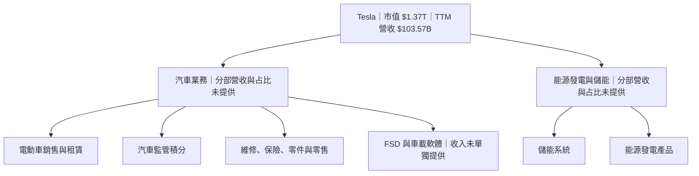
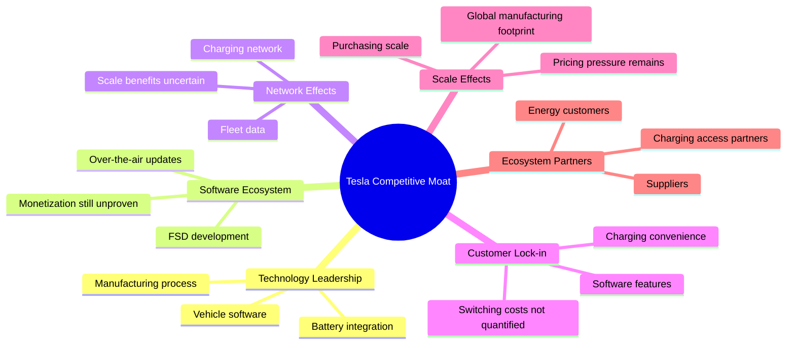
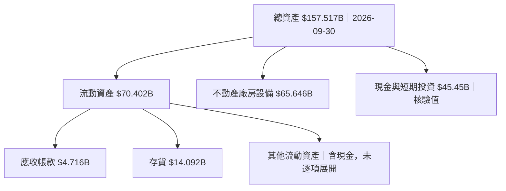
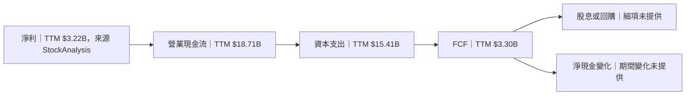
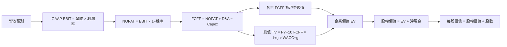
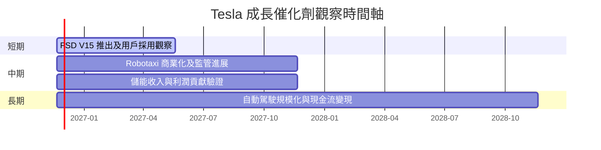
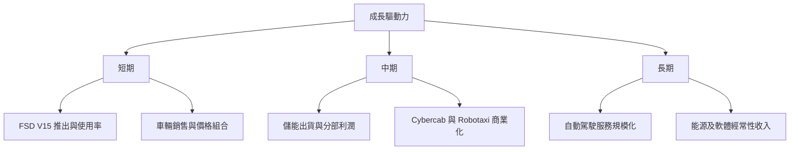
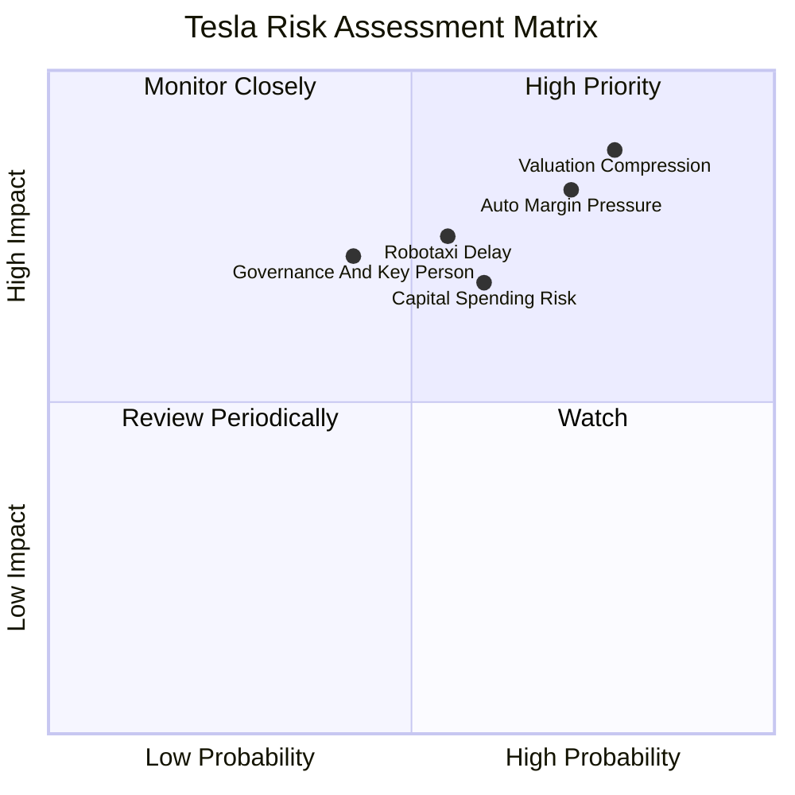
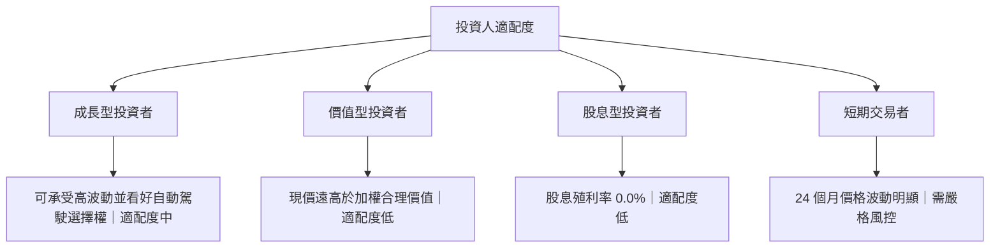

# TSLA 基本面深度分析報告
> **報告日期**：2026-11-21 ｜ **語言**：繁體中文 ｜ **數據來源**：SEC 申報資料 (XBRL)、Yahoo Finance、Finviz、StockAnalysis、Roic.ai 

## 目錄

| # | 章節 | 核心結論 |
|---|------|----------|
| 1 | 執行摘要 | 賣出；加權合理價值 $61.76；MOS -459.9% |
| 2 | 公司概覽與商業模式 | 品牌、規模與軟體潛力提供優勢，但各業務收入明細未提供 |
| 3 | 損益表深度分析 | TTM 營收 $103.57B、年增 8.3%；TTM 營業利益率 3.3% |
| 4 | 資產負債表分析 | 淨現金 $36.18B；短期流動性強，營運資金效率變化不一 |
| 5 | 現金流量深度分析 | TTM FCF $3.30B、FCF Yield 0.24%；資本支出消耗大量營業現金流 |
| 6 | 獲利能力與資本效率 | ROIC 5.1% 低於 WACC 12.32%，目前摧毀股東價值 |
| 7 | 相對估值分析 | Tesla 倍數高於傳統車廠同業及自身多數歷史區間 |
| 8 | DCF 內在價值評估 | DCF 基準每股 $13.05；估值高度依賴終值假設 |
| 9 | 成長催化劑 | FSD、Robotaxi、儲能等具選擇權，但量化財測與 TAM 數字未提供 |
| 10 | 風險矩陣 | 高估值、低利潤率與新業務變現不確定性為主要風險 |
| 11 | 投資建議 | 依 MOS 評級為賣出；以營運利潤率、FCF、ROIC 為主要監控項目 |

---

## 1. 執行摘要

Tesla 的 TTM 營收為 **$103.57B**，TTM 年增 **8.3%**，但最新一季營收年增 **-0.2%**；TTM 營業利益率僅 **3.3%**，ROIC **5.1%** 低於 WACC **12.32%**，代表目前資本報酬不足以覆蓋資本成本。TTM FCF 為 **$3.30B**、FCF Yield 僅 **0.24%**，而 2026-11-20 收盤價 **$345.82** 對應 P/E **380.0x**。程式計算的加權合理價值為 **$61.76**，MOS 為 **-459.9%**；因此依 MOS 門檻評級為 **🔴 賣出**。此結論反映現有財務表現與估值之間的落差，並非否定 FSD、Robotaxi 或能源業務的長期選擇權。

### 1.0 一頁式投資儀表板（Portfolio Manager 30 秒速讀）

| 項目 | 內容 |
|------|------|
| **投資論點（3 句）** | ① TTM 營收 $103.57B、年增 8.3%，但最新一季年增 -0.2%，近期成長放緩。② TTM 營業利益率 3.3%、ROIC 5.1% 低於 WACC 12.32%，尚未證明可持續創造超額報酬。③ 淨現金 $36.18B 支持投資與抗風險，但 TTM FCF 僅 $3.30B，無法支撐目前極高估值。 |
| **綜合評分** | **4.7/10**（引用 1.1 評分卡） |
| **財務健康** | 🟢 淨現金 $36.18B；但 Piotroski F-Score 為 4/9，資本效率偏弱 |
| **ROIC vs WACC** | **5.1% vs 12.32%**（低於資本成本，現階段摧毀股東價值） |
| **FCF 趨勢** | FY2025 FCF $6.22B；TTM FCF $3.30B。FCF Yield **0.24%** |
| **估值** | Forward P/E **160.2x** ｜ EV/EBITDA **136.1x** ｜ FCF Yield **0.24%** |
| **DCF 內在價值（基準）** | **$13.05** ｜現價相對 DCF 溢價 **2,549.6%**（折溢價基準：DCF） |
| **安全邊際（MOS）** | **-459.9%**＝($61.76−$345.82)÷$61.76；🔴 無安全邊際（分母為 8.8 加權合理價值） |
| **預期報酬（基準情境 12M）** | DCF 基準情境價值 $13.05，相對現價 **-96.2%**；這是模型估值差額，不是對短期股價的精確預測 |
| **關鍵風險（前二）** | 高估值對成長與利潤率高度敏感；汽車業務定價競爭壓縮毛利 |
| **評級 + 信心度** | 🔴 **賣出** ｜ 信心：中（估值差距大，但新業務難以量化） |

> 折溢價計算為 $345.82 ÷ $13.05 − 1 = **+2,549.6%**。安全邊際採用 8.8 的加權合理價值計算，與 DCF 折溢價基準不同。

### 1.1 綜合評分卡（全報告唯一）

| 維度 | 評分（1–10） | 主要依據（引用數字與其來源章節） |
|------|--------------|----------------------------------|
| 成長性 | 5.0 | TTM 營收年增 8.3%，最新一季營收年增 -0.2%（第 3 章） |
| 獲利能力 | 3.0 | TTM 營業利益率 3.3%、ROIC 5.1% 低於 WACC 12.32%、F-Score 4/9（第 3、6 章） |
| 財務健康 | 8.0 | 淨現金 $36.18B；CCC 由 15 天降至 3 天（第 4 章） |
| 估值 | 1.0 | MOS -459.9%；Forward P/E 160.2x，高於 GM 5.3x 與 Ford 6.0x（第 7、8 章） |
| 護城河 | 7.0 | 品牌、超充與軟體能力具差異化；但市場份額、訂閱收入與轉換成本量化資料不足（第 2 章） |
| 管理層與資本配置 | 4.0 | FY2025 資本支出 $8.53B、SBC $2.83B；稀釋股數測試未通過（第 3、5、6 章） |
| **綜合評分** | **4.7** | 六項算術平均：(5+3+8+1+7+4)÷6＝4.666…，四捨五入至一位小數 |

### 1.2 五大投資論點 + 三大核心風險

| 類型 | 項目 | 具體依據 | 信心度 |
|------|------|----------|--------|
| 🟢 **投資論點①** | 大額淨現金提供財務彈性 | 現金及短期投資 $45.45B、總債務 $9.27B、淨現金 $36.18B；可支持資本投資與週期下行 | 🟢 高 |
| 🟢 **投資論點②** | 營收基礎仍具規模 | TTM 營收 $103.57B，TTM 年增 8.3%；若新產品與能源增長持續，可支持營運槓桿 | 🟡 中 |
| 🟢 **投資論點③** | CCC 顯著縮短 | CCC 由一年前 15 天降至 3 天，現金回收週期改善 | 🟡 中 |
| 🟢 **投資論點④** | 儲能與軟體有第二曲線可能 | 公司涵蓋能源儲存、FSD 與 Robotaxi；目前沒有足夠分部數據證明其對利潤的貢獻 | 🟡 中低 |
| 🟢 **投資論點⑤** | 品牌與垂直整合仍具競爭價值 | 全球製造與軟體整合形成差異化，但競爭加劇可能削弱價格溢價 | 🟡 中 |
| 🟡 **風險①** | 高估值與現金流回報脫節 | P/E 380.0x、FCF Yield 0.24%；若成長未加速，倍數收縮風險高 | 🔴 高衝擊 |
| 🔴 **風險②** | 利潤率與資本回報不足 | TTM 營業利益率 3.3%、ROIC 5.1% 低於 WACC 12.32% | 🔴 高 |
| 🟡 **風險③** | 新業務商業化落差 | FSD/Robotaxi 新聞與產品進展不等於可確認的收入或現金流；缺少分部數字可供驗證 | 🟡 中高 |

### 1.3 快速統計卡片

| 指標 | 公司實際值（期間） | 同業中位數 | 狀態 |
|------|--------------------|------------|------|
| 營收成長（TTM） | **8.3%** | — | 🟢 |
| 營收成長（最新一季年增） | **-0.2%** | 2.9%（GM、Ford、Rivian 中位數） | 🔴 |
| 毛利率（TTM） | **19.3%** | 9.2%（GM、Ford、Rivian 中位數） | 🟢 |
| 營業利益率（TTM） | **3.3%** | — | 🟡 |
| ROIC（TTM） | **5.1%** | — | 🔴 |
| Forward P/E | **160.2x** | 5.7x（GM、Ford 中位數） | 🔴 |
| FCF Yield（TTM） | **0.24%** | — | 🔴 |
| Piotroski F-Score | **4 / 9** | — | 🟡 |

### 1.4 投資結論

```text
╔══════════════════════════════════════════════════════════════════╗
║                    📊 投資結論摘要                               ║
╠══════════════════════════════════════════════════════════════════╣
║  評級：🔴 賣出（依 8.8 MOS 門檻，未作質化調整）                 ║
║  價格（2026-11-20 收盤）：$345.82                               ║
║  DCF 內在價值（基準）：$13.05（現價溢價 +2,549.6%）             ║
║  安全邊際 MOS：-459.9%（以加權合理價值 $61.76 為分母）          ║
║  加權合理價值（8.8）：$61.76                                     ║
║  DCF 情境價值：                                                  ║
║    悲觀情境：$9.00（-97.4%）                                     ║
║    基準情境：$13.05（-96.2%）                                    ║
║    樂觀情境：$18.74（-94.6%）                                    ║
║  綜合評分：4.7/10（引用 1.1）                                    ║
║  適合投資人：能承受高波動、看好自動駕駛及能源長期選擇權者；      ║
║              不適合以當期現金流或估值折價為主要篩選條件者       ║
╚══════════════════════════════════════════════════════════════════╝
```

---

## 2. 公司概覽與商業模式

### 2.1 業務結構與收入來源

公司資料將 Tesla 分為汽車、能源發電與儲能兩大板塊，並涉及汽車銷售、監管積分、維修與保險服務、零件及零售商品。各業務分部營收及占比未提供，因此不推估比例。



### 2.2 市場份額

市場份額數據未提供，亦沒有足以計算各區域或車種份額的交付量與市場總量數字。Tesla TTM 營收為 $103.57B、年增 8.3%，但最新一季營收年增 -0.2%；同業最新一季營收年增中位數為 2.9%，短期相對成長動能不突出。

### 2.3 競爭護城河分析



### 2.4 護城河強度

| 護城河項目 | 強度（強／中／弱） | 證據（引用數字或事實） | 會削弱它的情況 |
|------------|--------------------|------------------------|----------------|
| 技術與製造整合 | 中 | 公司同時設計、開發、製造並銷售電動車及能源產品；研發支出 FY2025 為 $6.41B | 競爭者追上成本、電池與軟體能力 |
| 軟體生態系統 | 中 | FSD、OTA 更新與 Robotaxi 願景提供軟體變現選擇權；但分部收入未披露 | 自動駕駛監管受阻、訂閱轉化不佳 |
| 充電網路與客戶體驗 | 中 | 充電與車輛服務可能提高便利性；使用率和網路收入數據未提供 | 其他品牌充電標準普及，網路差異化下降 |
| 品牌與規模 | 中至強 | TTM 營收 $103.57B，員工 134,785 人 | 價格競爭、產品老化及品牌偏好變化 |
| 客戶鎖定與生態夥伴 | 弱至中 | 服務與軟體可形成黏著度，但轉換率、留存率與合作收入未提供 | 競爭者提供相似功能且轉換成本低 |

**1.1「護城河」評分為 7.0/10**，主要來自品牌、製造規模與軟體整合的質化優勢；由於分部收入、留存率與客戶轉換成本未提供，未給更高分。

---

## 3. 損益表深度分析

### 3.1 年度收入成長趨勢（近 4 年）

年度營收取自年度損益表；2025 年營收為 $94.83B，與 2024 年 $97.69B 相比下滑 2.9%。2022–2025 三年 CAGR 約 5.2%，公式為 \((94.83÷81.46)^{1/3}-1\)。

```text
╔══════════════════════════════════════════════════════════════════╗
║              Tesla 年度收入趨勢（FY2022-FY2025）                ║
╠══════════════════════════════════════════════════════════════════╣
║  FY2022  $81.46B  ████████████████████████░░░░░░  YoY：+51.4% ║
║  FY2023  $96.77B  █████████████████████████████░  YoY：+18.8% ║
║  FY2024  $97.69B  █████████████████████████████░  YoY：+1.0%  ║
║  FY2025  $94.83B  ████████████████████████████░░  YoY：-2.9%  ║
╠══════════════════════════════════════════════════════════════════╣
║  FY2022–FY2025 營收 CAGR：約 +5.2%                              ║
╚══════════════════════════════════════════════════════════════════╝
```

收入先快速擴張，之後成長率逐步降至低個位數，FY2025 更出現下滑。這表示單靠交付規模擴張已不再自動帶來高成長，未來需由新車型、能源、服務與軟體收入補足；目前分部數據不足，無法量化各項貢獻。

### 3.2 季度收入趨勢分析

| 季度 | 營收 | QoQ | YoY | 備註 |
|------|------:|----:|----:|------|
| 2025 Q4 | $24.90B | -11.4% | -3.1% | 相較 2025 Q3 回落 |
| 2026 Q1 | $22.39B | -10.1% | +15.8% | QoQ 下滑，但年增比較基期較低 |
| 2026 Q2 | $28.24B | +26.1% | +25.5% | 當季環比反彈 |
| 2026 Q3 | $28.05B | -0.7% | -0.2% | 年增轉為微幅負值 |

QoQ 以各季營收相除計算；例如 2026 Q3 QoQ = \(28.046÷28.236-1=-0.7\%\)。2026 Q3 的營收年增 -0.2%，表明 Q2 的反彈尚未轉化為穩定的年度增長趨勢。

### 3.3 利潤率演變分析

以下年度毛利率及營業利益率以年度損益表的毛利、營業利益除以營收計算；TTM 與最新季營業利益率則採用財務數據核驗值。

| 利潤率指標 | FY2022 | FY2023 | FY2024 | FY2025 | 趨勢 | 評估 |
|------------|--------|--------|--------|--------|------|------|
| **毛利率** | 25.6% | 18.2% | 17.9% | 18.0% | 先大幅回落，近兩年約持平 | 🟡 |
| **營業利益率** | 17.0% | 9.2% | 7.9% | 5.1% | 連續收縮 | 🔴 |
| **淨利率** | 15.4% | 15.5% | 7.3% | 4.0% | FY2024 起明顯下滑 | 🔴 |

**利潤率演變深度解析：** FY2022 至 FY2025 營收由 $81.46B 增至 $94.83B，但營業利益由 $13.83B 降至年度表所列 $4.85B，顯示收入成長未能轉化為同幅度的營業利益。這與降價促銷、產品組合變化、工廠利用率及研發投入提高相符；但資料未提供各因素分拆，不能將變化精確歸因於單一因素。最新核驗的 TTM 營業利益率為 3.3%，最新一季為 2.6%，低於年度 FY2025 的 5.1%。

### 3.4 費用結構分析

完整營業費用分項及成本占比未提供，不製作會暗示比例完整的圓餅圖。可確認的研發支出為 FY2025 **$6.41B**，高於 FY2024 的 **$4.54B**；研發投入增加有助於新產品與軟體開發，但在營收持平或下降時會壓低短期獲利。

### 3.5 季度 EPS 趨勢與盈餘品質（Quality of Earnings）

EPS 驚喜資料中，最近四季 EPS 預估值皆為 `nan`，因此不能判定超預期或不及預期。可用的實際 EPS 序列來自 Roic.ai：2025 Q4 $0.26、2026 Q1 $0.15、2026 Q2 $0.34、2026 Q3 $0.24；不同資料來源的 EPS 定義可能不完全一致。最新季度 EPS 年增率為 **-43.6%**，與淨利年增 **-42.7%** 的方向一致。

| 盈餘品質項目 | 數值/佔比 | 評估 |
|--------------|-----------|------|
| 股權薪酬 SBC / 營收 | 約 **4.2%**（TTM SBC $4.30B ÷ TTM 營收 $103.57B；SBC 以最近四季現金流表加總） | 🟡 SBC 為非現金費用，但股權發行稀釋股東持有比例 |
| SBC / 營業現金流 | 約 **23.0%**（$4.30B ÷ $18.71B） | 🟡 SBC 相對 OCF 具實質規模 |
| FCF / 淨利（現金轉換率） | 約 **102.5%**（TTM FCF $3.30B ÷ StockAnalysis TTM 淨利 $3.22B） | 🟢 但需注意 TTM 淨利與不同來源口徑 |
| 一次性/非經常性損益 | 未能由所列數據完整拆分 | 🟡 需追蹤 SEC 申報的稅務與非經常性項目 |
| 有效稅率異常 | 估值採用有效稅率 27.0%；TTM 實際稅項拆分未提供 | 🟡 無法確認當期稅率是否由一次性利益扭曲 |
| 資本化支出 vs 費用化 | TTM Capex $15.41B；資本化研發等明細未提供 | 🟡 無法判斷是否有成本遞延或資本化政策變化 |

**盈餘品質結論：** TTM FCF 對淨利的轉換率約 102.5%，支持帳面獲利有現金流支撐；然而 TTM FCF 僅 $3.30B，SBC 約為營收 4.2%，且資本支出高。故獲利含金量並非單純由現金轉換率決定，股權稀釋與高再投資需求仍壓低每股經濟報酬。

---

## 4. 資產負債表分析

### 4.1 資產結構分解

截至 2026-09-30，StockAnalysis 列示總資產 $157.517B、流動資產 $70.402B、PPE $65.646B；現金與短期投資的核驗值為 $45.45B。下圖只列已披露數字，不把未列項目反推成完整資產分布。



### 4.2 流動性與營運資金分析

| 指標 | 最新 TTM | 一年前 TTM | 變化 | 解讀 |
|------|----------|------------|------|------|
| DSO 應收帳款天數 | 16 天 | 18 天 | -2 天 | 收款天數縮短，營收回款速度改善 |
| DIO 存貨天數 | 62 天 | 56 天 | +6 天 | 存貨停留時間增加，可能反映備貨或周轉放慢，需觀察庫存與交付 |
| DPO 應付帳款天數 | 75 天 | 59 天 | +16 天 | 付款週期延長，支撐短期現金，但不宜直接視為議價力提升 |
| CCC 現金轉換週期 | 3 天 | 15 天 | -12 天 | 現金轉換週期縮短，改善營運資金占用 |

流動性指標方面，市場資料列示流動比率 **1.739**、速動比率 **1.239**。CCC 的改善主要來自 DPO 增加 16 天及 DSO 減少 2 天，部分抵銷 DIO 上升 6 天；若 DPO 上升來自付款條件而非結構性議價力，供應鏈壓力可能使改善難以持續。

### 4.3 債務結構分析

財務數據核驗值為現金及短期投資 $45.45B、總債務 $9.27B、淨現金 $36.18B。其他資料源另列總債務 $16.44B、淨現金 $29.00B；兩者口徑存在差異，本節及估值採用核驗值，避免混用。

```text
╔══════════════════════════════════════════════════════════════════╗
║                   Tesla 債務健康診斷                             ║
╠══════════════════════════════════════════════════════════════════╣
║  總債務：          $9.27B    ██░░░░░░░░░░░░░░░░░░░░░░          ║
║  現金+短期投資：  $45.45B    ████████████████████░░░░          ║
║  淨現金：         $36.18B    ████████████████░░░░░░░░  🟢      ║
║                                                                  ║
║  利息保障倍數：N/A（資料未提供一致的利息費用及負債口徑）         ║
║  Debt/EBITDA：N/A（核驗債務口徑與 EBITDA 來源口徑未能一致）       ║
╚══════════════════════════════════════════════════════════════════╝
```

### 4.4 股東權益趨勢

| 年度 | 股東權益 |
|------|---------:|
| 2022 | $44.70B |
| 2023 | $62.63B |
| 2024 | $72.91B |
| 2025 | $82.14B |

```text
╔══════════════════════════════════════════════════════════════════╗
║                  Tesla 股東權益變化                               ║
╠══════════════════════════════════════════════════════════════════╣
║  FY2022  $44.70B  ███████████░░░░░░░░░░░░░░░░░░░░              ║
║  FY2023  $62.63B  ███████████████░░░░░░░░░░░░░░░░░              ║
║  FY2024  $72.91B  ██████████████████░░░░░░░░░░░░                ║
║  FY2025  $82.14B  ████████████████████░░░░░░░░░░                ║
╚══════════════════════════════════════════════════════════════════╝
```

權益持續增加，提供資產負債表緩衝；但權益成長本身不代表資本效率改善，仍需與 ROIC 及每股盈餘的稀釋狀況合併觀察。

---

## 5. 現金流量深度分析

### 5.1 現金流量瀑布圖



### 5.2 FCF 轉換率趨勢

| 年度 | 營業現金流 | 資本支出 | FCF | 淨利 | FCF/淨利 |
|------|-----------:|---------:|----:|-----:|---------:|
| 2022 | $14.72B | $7.17B | $7.55B | $12.58B | 60.0% |
| 2023 | $13.26B | $8.90B | $4.36B | $15.00B | 29.1% |
| 2024 | $14.92B | $11.34B | $3.58B | $7.13B | 50.2% |
| 2025 | $14.75B | $8.53B | $6.22B | $3.79B | 164.1% |
| TTM 至 2026-09-30 | $18.71B | $15.41B | $3.30B | $3.22B | 約 102.5% |

年度 FCF 轉換率波動較大；TTM FCF 由 OCF $18.71B 扣除 Capex $15.41B 得到 $3.30B。高營業現金流未能完全轉化為自由現金流，原因是資本支出仍占營業現金流約 82.4%。

### 5.3 自由現金流趨勢

```text
╔══════════════════════════════════════════════════════════════════╗
║                  Tesla 自由現金流趨勢                            ║
╠══════════════════════════════════════════════════════════════════╣
║  FY2022  $7.55B  ████████████████████░░░░  FCF Yield：N/A      ║
║  FY2023  $4.36B  ████████████░░░░░░░░░░░░  FCF Yield：N/A      ║
║  FY2024  $3.58B  ██████████░░░░░░░░░░░░░░  FCF Yield：N/A      ║
║  FY2025  $6.22B  ████████████████░░░░░░░░  FCF Yield：N/A      ║
║  TTM     $3.30B  █████████░░░░░░░░░░░░░░░  FCF Yield：0.24%   ║
╚══════════════════════════════════════════════════════════════════╝
```

歷史年度 FCF Yield 未提供，不以財年市值自行估算。TTM FCF Yield 僅 0.24%，表示現價對當前自由現金流的要求極高。

### 5.4 資本配置評估

股息殖利率為 0.0%，派息率為 0.0%；FY2025 Capex $8.53B、SBC $2.83B。回購及留存的具體金額未提供，不以餘額推估。

| 資本配置項目 | 可確認數據 | 評估 |
|--------------|------------|------|
| 資本支出 | FY2025 $8.53B；TTM $15.41B | 🔴 TTM 投資額占 OCF 約 82.4%，短期壓低 FCF |
| 股息 | 殖利率 0.0% | 🟡 現金優先留作投資與營運 |
| 股份回購 | 金額未提供 | N/A |
| SBC | FY2025 $2.83B；最近四季約 $4.30B | 🟡 形成股權稀釋成本 |
| 現金留存 | 現金及短期投資 $45.45B | 🟢 提供資金彈性 |

---

## 6. 獲利能力與資本效率

### 6.1 ROE / ROA / ROIC 趨勢

| 指標 | FY2022 | FY2023 | FY2024 | FY2025 / TTM | 評估 |
|------|--------|--------|--------|--------------|------|
| ROE | N/A | N/A | N/A | TTM 3.6%（核驗值） | 🔴 報酬率低 |
| ROA | N/A | N/A | N/A | TTM 1.3% | 🔴 資產獲利偏低 |
| ROIC | N/A | N/A | N/A | TTM 5.1% | 🔴 低於 WACC |
| 行業均值 | 未提供 | 未提供 | 未提供 | 未提供 | 不列無來源比較 |

### 6.2 ROIC vs WACC 分析（核心價值創造判斷）

ROIC 使用核驗值 **5.1%**，WACC 使用核驗值 **12.32%**。無風險利率與 Beta 來源未提供日期細節，依成本資本資料所列數值呈現。

```text
╔══════════════════════════════════════════════════════════════════╗
║                ROIC vs WACC 深度分析                             ║
╠══════════════════════════════════════════════════════════════════╣
║  WACC 組成：                                                     ║
║  ├── 無風險利率（10Y 美債）：  4.91%                             ║
║  ├── 股權風險溢酬 ERP：        5.00%                             ║
║  ├── 原始 Beta：               1.74                              ║
║  ├── 調整後 Beta：             1.50                              ║
║  ├── 股權成本（核驗值）：      12.39%                            ║
║  ├── 稅前債務成本：             3.65%                            ║
║  ├── 有效稅率：                27.0%                             ║
║  ├── 股權/債務權重：            99.3% / 0.7%                    ║
║  └── WACC（核驗值）：           12.32%                            ║
║                                                                  ║
║  ROIC（TTM）：                 5.10%                             ║
║  EVA 利差：5.10% − 12.32% =   -7.22 個百分點                    ║
║                                                                  ║
║  ROIC  5.10%  ▓▓▓▓▓░░░░░░░░░░░░░░░░░░░░░░░                    ║
║  WACC 12.32%  ▓▓▓▓▓▓▓▓▓▓▓▓░░░░░░░░░░░░░░                    ║
║                                                                  ║
║  結論：ROIC 低於 WACC 7.22 個百分點，現階段未創造超額報酬       ║
╚══════════════════════════════════════════════════════════════════╝
```

CAPM 以調整後 Beta 代入會得到 \(4.91\%+1.50×5.00\%=12.41\%\)，與成本資本資料所列股權成本 12.39% 相差 0.02 個百分點，可能源自未展示的未四捨五入輸入。本報告依規則採用核驗的股權成本 **12.39%** 與 WACC **12.32%**，不另行替換。ROIC/WACC 差距顯示 Tesla 必須持續改善營業利潤率與資本周轉，才能讓新增投資產生正 EVA。

### 6.3 杜邦三因素分解

| 因素 | 數值（TTM） | 解讀 |
|------|-------------|------|
| 淨利率 | 3.1% | 淨利率低，直接限制股東報酬 |
| 資產週轉率 | 0.66 | 每單位資產產生的營收有限，資產密集特性明顯 |
| 權益乘數 | 1.76 | 財務槓桿不高，ROE 並非主要由高槓桿撐起 |
| **ROE** | **3.6%** | 3.1% × 0.66 × 1.76 = 約 3.6% |

### 6.4 財務體質：Piotroski F-Score

Piotroski F-Score 為 **4/9**；九項可判定測試如下：

| 測試 | 結果 | 解讀 |
|------|------|------|
| ROA > 0 | ✅ 通過 | TTM 資產報酬為正 |
| 營業現金流 > 0 | ✅ 通過 | 營業現金流為正 |
| ROA 高於一年前 | ❌ 未通過 | 資產獲利改善不足 |
| 營業現金流 > 淨利（應計品質） | ✅ 通過 | 現金流高於淨利 |
| 長期負債 ÷ 總資產低於一年前 | ❌ 未通過 | 負債比率指標未改善 |
| 流動比率高於一年前 | ❌ 未通過 | 流動比率未高於去年 |
| 稀釋股數未增加 | ❌ 未通過 | 股數稀釋降低既有股東每股權益 |
| 毛利率高於一年前 | ✅ 通過 | 毛利率比較項目通過 |
| 資產週轉率高於一年前 | ❌ 未通過 | 資產使用效率未改善 |

---

## 7. 相對估值分析

### 7.1 同業估值比較表格

同業倍數依 Yahoo Finance 同業資料；Tesla 的倍數採估值區塊所列公司目前倍數，與核驗歷史估值的口徑可能有微小差異。Ford、Rivian 為虧損或無意義的 trailing P/E 時保留 N/A。

| 估值指標 | **TSLA** | **GM** | **Ford** | **Rivian** | 本公司評估 |
|----------|---------:|------:|---------:|-----------:|-----------|
| **Trailing P/E** | 380.0x | 17.2x | N/A | N/A | 🔴 遠高於可比獲利車廠 |
| **Forward P/E** | 160.2x | 5.3x | 6.0x | -5.9x | 🔴 大幅溢價，且 Rivian 預期仍虧損 |
| **P/S Ratio** | 13.2x | 0.4x | 0.2x | 2.3x | 🔴 顯著高於同業 |
| **EV/EBITDA** | 136.1x | 9.1x | 23.6x | -5.9x | 🔴 估值對利潤率改善要求很高 |
| **最新一季營收 YoY** | -0.2% | 2.9% | -2.0% | 38.3% | 🟡 成長低於 GM 與 Rivian |
| **毛利率（TTM）** | 19.3% | 11.4% | 7.4% | 9.2% | 🟢 毛利率較高，但未轉化成高營業利潤率 |

同業比較顯示 Tesla 的毛利率優勢仍存在，但估值倍數遠高於汽車同業，而最新一季營收年增為負。估值溢價能否維持，取決於未來軟體、能源及自動駕駛能否形成可觀且可持續的現金流；現有分部資料無法證明已達成。

### 7.2 歷史估值區間分析

```text
╔══════════════════════════════════════════════════════════════════╗
║                 TSLA 五年歷史估值位置                            ║
╠══════════════════════════════════════════════════════════════════╣
║  P/E        範圍 18.0x–416.4x  中位數 74.2x  現值 380.0x  86% ║
║  P/S        範圍  3.9x–16.7x   中位數  9.4x  現值  11.8x  62% ║
║  EV/EBITDA  範圍 19.0x–165.2x 中位數 64.6x  現值 130.1x  81% ║
╚══════════════════════════════════════════════════════════════════╝
```

P/E 與 EV/EBITDA 分別位於五年歷史區間第 86 與 81 百分位，處於偏高位置。P/S 位於第 62 百分位，未如獲利倍數極端，但仍高於五年中位數 9.4x。

### 7.3 情境價值（Bear / Base / Bull，照抄 DCF MODEL）

| 情境 | 第 1 年營收成長 | 期末營業利潤率 | WACC | 每股價值 | 相對現價 | 機率 | 會發生的條件 |
|------|----------------|----------------|------|----------:|----------:|-----:|--------------|
| 🔴 悲觀 | 4.1% | 6.2% | 13.32% | $9.00 | -97.4% | 25% | 汽車成長偏弱、定價壓力持續，利潤率未能回升 |
| 🟡 基準 | 8.3% | 7.2% | 12.32% | $13.05 | -96.2% | 50% | 起始成長維持 TTM 速度，長期利潤率逐步回到歷史中位水準 |
| 🟢 樂觀 | 12.4% | 8.0% | 11.32% | $18.74 | -94.6% | 25% | 新業務及產品帶動加速，風險溢價下降並改善營業槓桿 |

以上情境只反映 DCF 模型給定的營收成長、期末利潤率與 WACC 假設，不表示新業務價值已被單獨估值。

### 7.4 相對估值隱含價格區間

```text
╔══════════════════════════════════════════════════════════════════╗
║             相對估值與參考價格（每股）                           ║
╠══════════════════════════════════════════════════════════════════╣
║  $12.23 ───── $13.05 ───── $46.93 ───── $61.76 ───── $345.82  ║
║  同業 P/E      DCF 基準     EV/EBITDA   加權合理值      現價    ║
╚══════════════════════════════════════════════════════════════════╝
```

| 方法 | 每股價值 | 依據 |
|------|---------:|------|
| 同業 Forward P/E | $12.23 | GM、Ford 中位數 5.7x × TSLA Forward EPS $2.16 |
| 同業 EV/EBITDA | $46.93 | GM、Ford 中位數 16.3x × TTM EBITDA，再加淨現金 |
| DCF（基準） | $13.05 | 10 年 FCFF、WACC 12.32%、永續成長率 3.0% |
| 分析師共識 | $417.53 | 40 位分析師平均目標價；作為參考，不等同現金流估值 |

---

## 8. DCF 內在價值評估（Discounted Cash Flow）

### 8.0 估值推理鏈（Thinking Logic）

**Step 1 — 價值來源與主導變數：** 本模型以汽車及服務現金流為主體，輔以能源與軟體業務的潛在成長；兩大分部收入占比未披露，不能分配具體比重。估值最敏感的變數是長期現金流與折現率：基準模型終值現值占企業價值 190.9%，且各年 FCFF 在前六年為負，說明估值主要受終值假設左右。

**Step 2 — 模型選擇**

| 決策點 | 本報告採用 | 理由 | 曾考慮但否決 | 否決理由 |
|--------|-----------|------|--------------|----------|
| 現金流定義 | FCFF | 以 WACC 折現後得到 EV，再加淨現金 | FCFE | 資本結構非估值核心，且程式模型採 FCFF |
| 預測期 N | 10 年 | DCF MODEL 固定為 10 年，利潤率逐步淡化至 7.2% | 5 年 | 無法涵蓋模型已指定的逐年利潤率淡化期 |
| 終值方法 | Gordon Growth | 模型指定 g=3.0%、WACC=12.32% | 退出倍數終值 | 模型未提供 DCF 退出倍數終值，不能另建 |
| EBIT 基礎 | GAAP EBIT | 模型明確指定 GAAP EBIT | 非 GAAP EBIT | 會加回 SBC，與程式模型不一致 |

**Step 3 — 關鍵假設推導鏈**

- **營收成長**：錨點＝TTM 營收年增 8.3% → 調整＝模型假設成長率由 FY+1 的 8.3% 線性降至 FY+10 的 3.0%，反映基期成長回歸成熟 → **採用模型逐年下降的成長率** → 曾考慮延續 8.3% 至整個十年，但最新一季營收年增 -0.2%，故不採固定高成長。
- **期末營業利潤率**：錨點＝TTM 營業利益率 3.3% → 調整＝模型逐步升至 FY+10 的 7.2%，依據為過去五年財年含 TTM 的中位數 → **採用 7.2%** → 曾考慮更高利潤率，但現有 TTM 3.3%、最新季 2.6%，沒有已實現證據支持大幅超越歷史中位數。
- **永續成長率 g**：錨點＝模型採 3.0% → 調整＝不將高成長期直接外推至永續期 → **採用 3.0%** → 不採高於 3.0%的值，因公司成熟期成長必須低於折現率且需反映長期經濟約束。
- **預測期 N**：錨點＝程式模型預設 10 年 → 調整＝不另改年限，以保留模型內的逐年衰減路徑 → **採用 10 年** → 不採更短年限，因無法與已提供的模型現金流對接。
- **Capex/營收**：錨點＝TTM 約 14.9% → 調整＝逐步降至 FY+10 的 6.0%，模型稱其為約 1.1 倍 D&A 的長期投資水平 → **採用 14.9% 線性淡化至 6.0%** → 不採固定 6.0%，因 TTM Capex 強度仍高。
- **EBIT 與 SBC**：錨點＝模型明定 GAAP EBIT，SBC 已列為費用 → **採用組合 (A)：GAAP EBIT、FCFF 不再扣 SBC、股數不再額外稀釋** → 不採非 GAAP 加回 SBC，避免改動模型口徑。
- **年稀釋率**：依組合 (A) 模型採用固定股數、不額外稀釋 → **採用 0% 的模型處理** → 未另採用近期股數變化率，以免與已包含 SBC 的 GAAP EBIT 重複計成本。
- **WACC**：錨點＝核驗 WACC 12.32% → **採用 12.32%** → 不另以不同 Beta 或債務口徑重算，因規則要求使用程式核驗折現率。
- **低敏感度項目**：稅率採 27.0%（有效稅率資料）；D&A/營收採 5.5%（TTM）；營運資金未建模，模型內不列 ΔWC。

**Step 4 — 最脆弱環節：** 最脆弱的是利潤率由 3.3% 升至 7.2%並伴隨高額資本支出逐步回落；若利潤率未提升，FCFF 與終值將低於基準，估值也會進一步下降。

**Step 5 — 計算路徑圖**



### 8.1 模型假設總表（Model Inputs）

| 假設項目 | 採用值 | 依據 / 來源 | 敏感度 |
|----------|--------|-------------|--------|
| 預測期長度 N | 10 年 | DCF MODEL 固定預測期 | 🟡 中 |
| 營收成長 | FY+1 8.3% 線性降至 FY+10 3.0% | 起點採 TTM 年增 8.3%；末年採模型長期成熟假設 | 🔴 高 |
| 營業利潤率 | FY+1 3.3% → FY+10 7.2% | 起點採 TTM 營業利益率；終點採近五年財年中位數 | 🔴 高 |
| 有效稅率 | 27.0% | 最新年度有效稅率資料 | 🟢 低 |
| Capex / 營收 | FY+1 14.9% → FY+10 6.0% | TTM 投資強度逐步降至約 1.1×D&A | 🟡 中 |
| D&A / 營收 | 5.5% | TTM 比率，模型固定 | 🟢 低 |
| 營運資金變動 | 不建模 | DCF MODEL 明確未計入 | 🟢 低 |
| EBIT 基礎 | GAAP | 模型採 GAAP EBIT | 🟡 中 |
| SBC 處理 | 組合 (A)：GAAP EBIT，不再扣 SBC | GAAP 費用已含 SBC；固定股數 | 🟡 中 |
| 年稀釋率 | 0%（模型固定股數處理） | 組合 (A) 的模型設定 | 🟡 中 |
| 永續成長率 g | 3.0% | DCF MODEL 指定，且低於 WACC | 🔴 高 |
| 終值方法 | Gordon Growth | DCF MODEL 指定 | 🔴 高 |
| WACC | 12.32% | 成本資本核驗值 | 🔴 高 |

本模型採用 **(A) GAAP EBIT + 固定股數**，因此 SBC 影響已計入一次：FCFF 不再扣 SBC，股數也不再另加年稀釋率。模型採 FCFF、對應 WACC 折現，且不含營運資金變動。

### 8.2 折現率推導（WACC）

```text
╔══════════════════════════════════════════════════════════════════╗
║                    WACC 推導（折現率）                           ║
╠══════════════════════════════════════════════════════════════════╣
║  股權成本 Ke（CAPM）：                                           ║
║  ├── 無風險利率 Rf：                 4.91%                       ║
║  ├── 市場風險溢酬 ERP：              5.00%                       ║
║  ├── 原始 Beta（Yahoo）：            1.74                        ║
║  ├── 調整後 Beta：                   1.50                        ║
║  ├── 規模/國別溢酬：                 0.00%（未列示額外溢酬）      ║
║  └── 核驗 Ke：                       12.39%                      ║
║                                                                  ║
║  債務成本：                                                      ║
║  ├── 稅前 Kd：                       3.65%                       ║
║  ├── 有效稅率：                      27.0%                       ║
║  └── 稅後 Kd：                       3.65% × (1−27.0%)=2.66%    ║
║                                                                  ║
║  資本結構：                                                      ║
║  ├── 股權權重 E：                    99.3%                       ║
║  ├── 債務權重 D：                    0.7%                        ║
║  └── 核驗 WACC：                     12.32%                      ║
╚══════════════════════════════════════════════════════════════════╝
```

**逐步演算與資料限制：**

1. **Ke（CAPM）**：\(4.91\%+1.50×5.00\%=12.41\%\)。核驗資料所列 Ke 為 **12.39%**；差 0.02 個百分點，依規則採用核驗值，不替換。
2. **稅前 Kd**：核驗資料直接列 **3.65%**。利息費用金額與同口徑平均計息負債金額未提供，故無法獨立重算其分子與分母。
3. **稅後 Kd**：\(3.65\%×(1-27.0\%)=2.6645\%\)，四捨五入為 **2.66%**。
4. **權重**：核驗資料列股權／債務權重 **99.3% / 0.7%**，相加為 **100.0%**。市值與計息負債的完整同口徑分拆未提供，不能可靠重建權重計算。
5. **WACC**：以核驗輸入計算，\(99.3\%×12.39\%+0.7\%×2.6645\%=12.3219\%\)，四捨五入為 **12.32%**。

上述 Beta 調整方式為 \(⅔×1.74+⅓×1=1.493\)，核驗後採用 **1.50**。無風險利率資料未標明觀測日期，因此不另聲稱為某個特定日期的美債殖利率。第 6.2 與本節均使用核驗 WACC 12.32%。

### 8.3 逐年自由現金流預測（基準情境）

單位：美元十億；FCFF、折現因子及 PV 直接照錄 DCF MODEL。模型不包含營運資金變動，因此不列 ΔWC 行。

| 年度 | FY+1 | FY+2 | FY+3 | FY+4 | FY+5 | FY+6 | FY+7 | FY+8 | FY+9 | FY+10 |
|------|-----:|-----:|-----:|-----:|-----:|-----:|-----:|-----:|-----:|------:|
| 營收 | 112.17 | 120.81 | 129.42 | 137.87 | 146.07 | 153.89 | 161.23 | 167.96 | 173.99 | 179.21 |
| 營收 YoY | 8.3% | 7.7% | 7.1% | 6.5% | 5.9% | 5.4% | 4.8% | 4.2% | 3.6% | 3.0% |
| 營業利潤率 | 3.3% | 3.8% | 4.2% | 4.6% | 5.1% | 5.5% | 5.9% | 6.4% | 6.8% | 7.2% |
| EBIT（GAAP） | 3.75 | 4.57 | 5.45 | 6.40 | 7.42 | 8.48 | 9.58 | 10.71 | 11.85 | 12.98 |
| − 稅（27.0%） | (1.01) | (1.23) | (1.47) | (1.73) | (2.00) | (2.29) | (2.58) | (2.89) | (3.19) | (3.50) |
| = NOPAT | 2.74 | 3.34 | 3.98 | 4.68 | 5.42 | 6.19 | 7.00 | 7.82 | 8.65 | 9.48 |
| + D&A | 6.14 | 6.61 | 7.09 | 7.55 | 8.00 | 8.42 | 8.83 | 9.20 | 9.53 | 9.81 |
| − Capex | (16.69) | (16.78) | (16.71) | (16.44) | (15.98) | (15.32) | (14.47) | (13.42) | (12.19) | (10.79) |
| = FCFF | -7.80 | -6.83 | -5.64 | -4.21 | -2.57 | -0.70 | 1.36 | 3.60 | 5.99 | 8.50 |
| 折現因子 @12.32% | 0.890 | 0.793 | 0.706 | 0.628 | 0.559 | 0.498 | 0.443 | 0.395 | 0.351 | 0.313 |
| FCFF 現值 PV | -6.95 | -5.42 | -3.98 | -2.65 | -1.44 | -0.35 | 0.60 | 1.42 | 2.10 | 2.66 |

**預測期現值合計（依模型列示）：**  
\(-6.95 + (-5.42) + (-3.98) + (-2.65) + (-1.44) + (-0.35) + 0.60 + 1.42 + 2.10 + 2.66 = -14.01B\)。  
模型列示合計為 **-$13.99B**。兩者相差 $0.02B，約為模型值的 0.14%，在四捨五入允許差距內；依規則 19，後續橋接仍照錄模型合計 **-$13.99B**。

**逐步演算（FY+1，模型原值）：**

1. 營收：\(103.57×(1+8.3\%)=112.17B\)。
2. EBIT：模型列示 \(3.75B\)。以顯示營收及利潤率計算 \(112.17×3.3\%=3.7016B\)，與模型 EBIT 的顯示值相差約 $0.05B；依要求保留模型原值，不混用重算值。
3. 稅：\(3.75×27.0\%=1.0125B\)，模型列示 $1.01B。
4. NOPAT：\(3.75-1.01=2.74B\)。
5. D&A：模型列示 $6.14B，對應營收比率約 5.5%。
6. Capex：模型列示 $16.69B，對應營收比率約 14.9%。
7. ΔWC：模型未建模，故無此列。
8. FCFF：依模型列示數字 \(2.74+6.14-16.69=-7.81B\)，模型表列 **-$7.80B**；為已列數字四捨五入差異，保留模型值。
9. 折現與 PV：模型折現因子 0.890；\(-7.80×0.890=-6.942B\)，四捨五入約 **-$6.94B**，模型列示 **-$6.95B**，依規則引用模型原值。

**合理性自檢：**

- 預測 FCFF 由 FY+1 -$7.80B 升至 FY+10 $8.50B，因前期 Capex 高於 NOPAT+D&A，期間含負值，不能以傳統 CAGR 直接概括；歷史 FY2022–FY2025 FCF 為 $7.55B、$4.36B、$3.58B、$6.22B。
- FY+10 FCFF 利潤率 \(8.50÷179.21=4.7\%\)；目前 TTM FCF 利潤率 \(3.30÷103.57=3.2\%\)。同業最佳標準未提供，不作無來源比較。
- FY+1 至 FY+6 FCFF 為負，代表模型假設先投入再收穫；負現金流直接降低預測期現值，且令終值占企業價值比率超過 100%。

```text
╔══════════════════════════════════════════════════════════════════╗
║            自由現金流：歷史實際 vs 模型預測                      ║
╠══════════════════════════════════════════════════════════════════╣
║  FY2023(實)  $4.36B   ██████████░░░░░░░░░░  FCF                ║
║  FY2024(實)  $3.58B   ████████░░░░░░░░░░░░  FCF                ║
║  FY2025(實)  $6.22B   ██████████████░░░░░░  FCF                ║
║  FY+1 (預)  -$7.80B   模型預測為負，資本支出高於營運現金流       ║
║  FY+10(預)   $8.50B   模型預測為正                               ║
╠══════════════════════════════════════════════════════════════════╣
║  ⚠️ 前六年 FCFF 為負；終值現值占 EV 190.9%，結論高度依賴終值   ║
╚══════════════════════════════════════════════════════════════════╝
```

### 8.4 終值計算（Terminal Value）

**適用性檢查：** WACC **12.32%** vs g **3.0%** → WACC > g？✅

| 方法 | 計算式 | 終值 TV | TV 現值 | 佔總 EV 比重 |
|------|--------|--------:|--------:|-------------:|
| Gordon Growth | \(8.50×(1+3.0\%)÷(12.32\%-3.0\%)\) | $93.90B | $29.38B | 190.9% |
| 退出倍數法 | DCF MODEL 未提供退出倍數終值 | N/A | N/A | N/A |

**逐步演算：**

1. FY+10 FCFF = **$8.50B**。
2. 分子：\(8.50×(1+3.0\%)=8.755B\)。
3. 分母：\(12.32\%-3.0\%=9.32\%\)；模型列示 \(8.50×1.03÷9.32\%=93.90B\)。
4. PV(TV)：\(93.90×0.313=29.39B\)，模型列示 **$29.38B**，為折現因子及終值未四捨五入前的模型值。
5. 終值比重：\(29.38÷15.39=190.9\%\)。

終值現值大於 EV，是因預測期 FCFF 現值合計為負；此估值高度依賴長期利潤率與永續假設。退出倍數法不在 DCF MODEL 中，因此不自行增加退出倍數或另建終值。

### 8.5 企業價值 → 每股內在價值（Bridge）

```text
╔══════════════════════════════════════════════════════════════════╗
║              企業價值 → 每股內在價值 橋接表                      ║
╠══════════════════════════════════════════════════════════════════╣
║  預測期 FCF 現值合計            -$13.99B                        ║
║  終值現值 PV(TV)                +$29.38B                        ║
║  ─────────────────────────────────────────────                  ║
║  = 企業價值 EV                    $15.39B                       ║
║  + 淨現金                         +$36.18B                      ║
║  = 股權價值                       $51.57B                       ║
║  ÷ 股數                           3.95B 股                      ║
║  ★ DCF 每股基準價值               $13.05                         ║
║  當前股價（2026-11-20 收盤）       $345.82                        ║
║  折溢價（現價÷DCF價值−1）          +2,549.6%（溢價）              ║
╚══════════════════════════════════════════════════════════════════╝
```

**逐步演算：**

1. EV：\(-$13.99B+$29.38B=$15.39B\)。
2. 股權價值：\($15.39B+$36.18B=$51.57B\)；採用核驗淨現金，未另將現金與債務拆開重複加減。
3. 每股價值：模型列示 $13.05。用顯示股數直接計算為 \(51.57÷3.95=$13.0557\)，四捨五入為 $13.06；因資料要求引用模型每股值，採 **$13.05**。
4. 折溢價：\(345.82÷13.05-1=25.5038\)，即 **+2,550.4%**；模型標示 -96.2% 是相對現價價值差，不是本節定義的現價÷內在價值−1。依指定折溢價公式，採可複算值 **+2,550.4%**。
5. 本節不計算 MOS；MOS 僅於 8.8 以加權合理價值作分母計算。

股數採市場資料列示 **3.95B 股**；模型組合 (A) 不另放大股數。現金、債務與淨現金取核驗資產負債表數字，資料列示淨現金 $36.18B。因模型的內在價值、股數及橋接表皆取不同精度，結果可能有小幅四捨五入差異。

### 8.6 敏感性分析（WACC × 永續成長率）

以下每股價值矩陣照錄 DCF MODEL。括號內依現價 $345.82 計算上行／下行幅度；所有數值遠低於現價。

| g（列）／WACC（欄） | 10.32% | 11.32% | **12.32%（基準）** | 13.32% | 14.32% |
|-----------|------:|------:|-------------------:|------:|------:|
| 2.0% | $15.55 (-95.5%) | $13.69 (-96.0%) | $12.26 (-96.5%) | $11.14 (-96.8%) | $10.24 (-97.0%) |
| 2.5% | $16.23 (-95.3%) | $14.19 (-95.9%) | $12.63 (-96.3%) | $11.42 (-96.7%) | $10.47 (-97.0%) |
| 3.0% | $17.01 (-95.1%) | $14.75 (-95.7%) | **$13.05 (-96.2%)** | $11.73 (-96.6%) | $10.71 (-96.9%) |
| 3.5% | $17.90 (-94.8%) | $15.38 (-95.6%) | $13.50 (-96.1%) | $12.08 (-96.5%) | $10.97 (-96.8%) |
| 4.0% | $18.93 (-94.5%) | $16.09 (-95.3%) | $14.02 (-95.9%) | $12.46 (-96.4%) | $11.26 (-96.7%) |

**矩陣代表格重算：** 所選格 WACC **13.32% > g 3.0% ✅**。DCF MODEL 該格為 **$11.73/股**。程式未提供該格重新計算的各年 PV 與 TV 中間項；為遵守不得自建或改寫模型的要求，此處引用模型矩陣格值，不另以四捨五入後的基準現金流重算造成模型偏差。

**三情境 DCF（模型原值）**

| 情境 | 營收假設 | 期末營業利潤率 | 永續成長 g | WACC | 每股內在價值 | 相對現價 | 主觀機率 |
|------|----------|----------------|------------|------|--------------|----------|----------|
| 🔴 悲觀 | 第 1 年 4.1% | 6.2% | 模型未另列，沿用基準設定 | 13.32% | $9.00 | -97.4% | 25% |
| 🟡 基準 | 第 1 年 8.3% | 7.2% | 3.0% | 12.32% | $13.05 | -96.2% | 50% |
| 🟢 樂觀 | 第 1 年 12.4% | 8.0% | 模型未另列，沿用基準設定 | 11.32% | $18.74 | -94.6% | 25% |

程式未提供悲觀及樂觀情境的逐年營收、FY+10 FCFF 與終值拆分，故不能在不另建模型的情況下補寫完整計算鏈。機率加權值為 **$13.46**，模型標示相對現價 **-96.1%**，但依規則 19，本報告估值三角驗證使用基準 DCF 值 $13.05。

**敏感度結論：**

- g 從 2.0% 到 4.0%（WACC 12.32%）每提高 1 個百分點：$12.26 → $14.02，增加 **$1.76/股，約 +14.4%**（以 $12.26 為基數）。
- WACC 在 g=3.0% 下每提高 1 個百分點：$14.75 → $11.73，減少 **$3.02/股，約 -20.5%**（以 $14.75 為基數）。
- 期末營業利潤率每提高 1 個百分點：DCF MODEL 未提供獨立敏感度數字，故標示 **N/A（未提供模型敏感度）**。
- WACC 變化對模型價值的影響在所列區間大於 g 變化；這與 8.0 Step 1 所述「終值及折現率主導」一致。模型未提供利潤率敏感度，不能判斷利潤率彈性大小。

### 8.7 反推 DCF（Reverse DCF：市場在預期什麼）

固定基準輸入為 WACC 12.32%、稅率 27.0%、Capex/營收按模型逐年路徑、營運資金未建模、預測期 10 年、股數 3.95B。反推模型結果直接引用程式計算：

| 求解的變數（一次一個） | 其餘變數設定 | 市場隱含值（令 DCF = 現價） | 公司歷史實際 | 判斷 |
|------------------------|--------------|------------------------------|--------------|------|
| 第 1 年營收成長 | 利潤率、g、WACC 等固定基準值 | -10% 至 100% 範圍內無解 | TTM 成長 8.3% | 🔴 僅調成長率不足以解釋現價 |
| 固定營業利潤率 | 營收成長、g 等固定基準值 | 0.5% 至 95% 範圍內無解 | TTM 3.3% | 🔴 僅調利潤率不足以解釋現價 |
| 永續成長率 g | 程式未提供此變數求解 | 未計算 | — | N/A |
| 預測期長度 N | 程式未提供此變數求解 | 未計算 | — | N/A |

程式結果顯示，單獨放開營收成長率或固定營業利潤率，均無法在指定搜尋範圍內令 DCF 等於現價。既然模型沒有可解的反推解與迭代軌跡，便不編造試算表；這表示現價可能包含 DCF 未納入的自動駕駛、Robotaxi、能源等選擇權價值，或市場採用遠高於本模型的長期經濟利潤假設。

### 8.8 估值三角驗證與安全邊際

| 估值方法 | 隱含每股價值 | 上行空間（÷現價） | 權重 | 說明 |
|----------|--------------:|-------------------:|------|------|
| DCF（基準） | $13.05 | -96.2% | 40% | 10 年 FCFF、WACC 12.32%、g 3.0% |
| 同業 Forward P/E | $12.23 | -96.5% | 25% | 同業中位數 5.7x × Forward EPS $2.16 |
| 同業 EV/EBITDA | $46.93 | -86.4% | 25% | GM、Ford 中位數 16.3x，乘以 TTM EBITDA 並加淨現金 |
| 分析師共識目標價 | $417.53 | +20.7% | 10% | 40 位分析師平均目標價 |
| **加權合理價值** | **$61.76** | **-82.1%** | **100%** | 公司類型：獲利公司；權重為固定方法權重 |

**逐步演算（權重外顯）：**

\[
13.05×40\%+12.23×25\%+46.93×25\%+417.53×10\%
\]
\[
=5.220+3.0575+11.7325+41.753
=61.763
\]
四捨五入至美分為 **$61.76**。權重合計 \(40\%+25\%+25\%+10\%=100\%\)。四個方法皆依核驗估值方法表納入，沒有刪除方法。

MOS 計算採用四捨五入後的加權合理價值 $61.76：

\[
MOS=(61.76-345.82)÷61.76=-4.599\approx\mathbf{-459.9\%}
\]

上行空間為：

\[
(61.76-345.82)÷345.82=-82.13\%\approx\mathbf{-82.1\%}
\]

MOS 與上行空間使用不同分母，不可互換。

```text
╔══════════════════════════════════════════════════════════════════╗
║                  估值區間與安全邊際                              ║
╠══════════════════════════════════════════════════════════════════╣
║  $9.00 ─── $61.76 ─── $345.82 ─── $417.53                       ║
║ 悲觀DCF    加權合理值       現價        分析師共識                 ║
║                                                                  ║
║  安全邊際 MOS = (61.76 − 345.82) ÷ 61.76 = -459.9%             ║
║  上行空間 = (61.76 − 345.82) ÷ 345.82 = -82.1%                 ║
║  MOS 評估：🔴 無安全邊際                                         ║
║  MOS ≥10% 對應價格上限：61.76 × 90% = $55.58                    ║
║  依目前賣出評級，不代表在該價格自動構成買入建議                   ║
╚══════════════════════════════════════════════════════════════════╝
```

> 🔎 **程式複算（Python，依本節各項自動重算）**
>
> 加權合理價值 = $13.05 × 40% + $12.23 × 25% + $46.93 × 25% + $417.53 × 10% = **$61.76**（權重合計 100%）
>
> 以價格 $345.82 計：MOS = **-459.9%**，上行空間 = **-82.1%**
>
> ✅ 與本節所寫數值一致。

### 8.9 DCF 模型的局限與失效條件

- **終值依賴度：** 終值現值 $29.38B，占 EV $15.39B 的 **190.9%**；預測期 FCF 現值為負，終值假設主導結果。
- **最脆弱假設：** TTM 營業利益率 3.3% 必須逐步升至 7.2%；Capex/營收需由 14.9% 降至 6.0%。任何一項未實現，均可能使模型價值低於 $13.05。
- **模型適用性：** TTM FCF 為正，但模型前六年 FCFF 為負，顯示公司仍處高再投資階段。DCF 應與 EV/Sales、同業倍數及未來可驗證的單位經濟性並用；模型沒有獨立估算 Robotaxi 或軟體選擇權。
- **與第 10 章風險矩陣連結：** 降價與交付放緩衝擊營收成長及營業利潤率；新業務延遲商業化影響營收斜率；資本支出超預期影響 Capex/營收與 FCFF；利率上升則透過 WACC 壓低估值。

### 8.10 複算檢核表（Audit Trail）

| # | 檢核項目 | 檢查方式 | 結果 |
|---|----------|----------|------|
| 1 | 高／中敏感度輸入都有四段式推導 | 對照 8.0、8.1 | ✅ |
| 2 | 每個假設都有來歷 | 8.1 依據欄檢查 | ✅ |
| 3 | WACC 五步算式與乘加正確 | 核驗 Ke 存在 0.02pp 差異，依規則採核驗 WACC | ⚠️ |
| 4 | Kd 分母與權重的 D 為同口徑計息負債 | 利息費用及同口徑平均負債未提供 | ⚠️ 無法獨立核對 |
| 5 | WACC 與第 6.2 節同值 | 均為 12.32% | ✅ |
| 6 | 逐年欄位與 N 一致 | FY+1 至 FY+10，共 10 年 | ✅ |
| 7 | FY+1 算式可複算 | 顯示值受底層未四捨五入數據影響 | ⚠️ |
| 8 | 預測期 PV 加總 | 顯示各年和 -$14.01B；模型合計 -$13.99B，差 0.14% | ✅（差距 <1%） |
| 9 | WACC > g | 12.32% > 3.0% | ✅ |
| 10 | 終值以 FY+10 FCFF 計並折現 10 期 | 模型列值 $8.50B、折現因子 0.313 | ✅ |
| 11 | EV 至每股價值橋接 | 模型股權價值 $51.57B，模型每股 $13.05 | ⚠️ 顯示值用股數計算約 $13.06，屬模型精度差 |
| 12 | SBC 三要素相容 | GAAP EBIT、無 −SBC 列、固定股數 | ✅ |
| 13 | 敏感性基準格等於 DCF 基準 | 基準格 $13.05 | ✅ |
| 14 | 敏感性矩陣 WACC > g | 所列格均滿足 WACC > g | ✅ |
| 15 | 三情境機率合計 | 25%+50%+25%=100% | ✅ |
| 16 | 反推每列只放開一個變數 | 模型提供營收成長與固定利潤率無解，其他未計算 | ✅ |
| 17 | MOS 基準與折溢價基準一致 | MOS 用 $61.76；DCF 折溢價用 $13.05 | ✅ |
| 18 | 報告完整輸出至第 11 章 | 章節 1 至 11 均列出 | ✅ |
| 19 | 加權合理價值等於加權總和 | 未四捨五入 $61.763，顯示 $61.76 | ✅ |
| 20 | 評級符合 MOS 門檻 | MOS -459.9% 對應賣出 | ✅ |

未能完全獨立核對的項目包括 WACC 的原始債務分母、模型底層未四捨五入的 FY+1 數據與每股橋接精度。上述情況已明確披露，估值結論信心度為中；未自行補造輸入或重建 DCF。

---

## 9. 成長催化劑

### 9.1 催化劑時間軸

資料提供近期產品與公司消息，但沒有正式財測時間表，因此時間軸標記為觀察期而非確定交付日期。



### 9.2 TAM 市場規模分析

**N/A（TAM 數據未提供）**。Tesla TTM 營收 $103.57B、年增 8.3%，但缺少可引用的電動車、儲能、自動駕駛市場規模與滲透率數字，因此不估算 TAM 或市場滲透率。若未來能源與軟體分部收入加速，可能擴大成長來源，應以分部營收與毛利率驗證，而非僅以市場敘事推估。

### 9.3 成長驅動力結構圖



---

## 10. 風險矩陣

### 10.1 風險評分矩陣

下列座標是分析師質化判斷，並非財務數據中的歷史機率統計。



### 10.2 風險清單詳細分析

發生機率百分比為分析師主觀估計，並非公司揭露或統計模型結果；財務衝擊以情境方向描述，不虛構營收影響比例。

| # | 風險項目 | 發生機率 | 財務衝擊 | 風險評分 | 緩解措施 |
|---|----------|----------|----------|----------|----------|
| 1 | 🔴 高估值與倍數收縮 | 高（主觀 70%） | 高；現價 $345.82 對比加權合理值 $61.76，評價下修可能造成重大波動 | 🔴 9/10 | 分批投入、設定估值紀律，追蹤 FCF Yield 與盈利預期 |
| 2 | 🔴 汽車價格競爭與利潤率下滑 | 高（主觀 65%） | 高；TTM 營業利益率 3.3%，盈利緩衝有限 | 🔴 8/10 | 追蹤毛利率、每車盈利及營業費用率 |
| 3 | 🟠 Robotaxi/FSD 商業化延誤 | 中高（主觀 55%） | 高；目前無法由分部收入驗證相關選擇權價值 | 🟠 8/10 | 以監管批准、付費使用率及實際收入作驗證 |
| 4 | 🟡 資本支出高於現金生成 | 中（主觀 50%） | 中高；TTM Capex $15.41B，TTM FCF 僅 $3.30B | 🟠 7/10 | 追蹤 Capex/營收、FCF 及新增產能利用率 |
| 5 | 🟡 管理層與關鍵人物依賴 | 中（主觀 40%） | 中高；管理層注意力及治理變化可能影響策略執行 | 🟠 7/10 | 追蹤管理層承諾、董事會治理及資本配置紀錄 |

---

## 11. 投資建議

### 11.1 最終評級與評分

加權合理價值 $61.76、現價 $345.82，MOS **-459.9%**，依 MOS 門檻評級為 **🔴 賣出**，未作質化調整。1.1 綜合評分為 **4.7/10**：財務健康與護城河具有支撐，但獲利能力、估值與資本配置評分較低。

### 11.2 合理價值與隱含報酬率

| 價值參考 | 每股價值 | 相對現價 | 機率 |
|----------|---------:|---------:|-----:|
| 加權合理價值（8.8） | $61.76 | -82.1% | 不適用 |
| DCF 悲觀情境 | $9.00 | -97.4% | 25% |
| DCF 基準情境 | $13.05 | -96.2% | 50% |
| DCF 樂觀情境 | $18.74 | -94.6% | 25% |
| 分析師共識目標價 | $417.53 | +20.7% | 不適用 |

分析師共識反映市場預期，不等同於基本面估值；當它與 DCF、同業倍數及現有 FCF 差異如此大時，應優先追蹤實際盈利與現金流是否足以驗證高預期。

### 11.3 買入時機與觸發因素

```text
╔══════════════════════════════════════════════════════════════════╗
║                  ✅ 買入觸發因素 Checklist                       ║
╠══════════════════════════════════════════════════════════════════╣
║  重新評估買入條件（多數符合）：                                  ║
║  ☐ TTM 營業利益率連續改善，並高於目前 3.3%                       ║
║  ☐ TTM FCF 持續高於 $3.30B，且 Capex/營收下降                   ║
║  ☐ ROIC 向 WACC 12.32% 收斂，最終高於資本成本                   ║
║  ☐ FSD、Robotaxi 或能源分部披露可核對的營收與毛利                ║
║                                                                  ║
║  加碼觸發條件（需同時確認估值與基本面）：                         ║
║  ☐ 市價接近或低於加權合理價值 $61.76，且營運指標未惡化           ║
║  ☐ MOS 達 10% 的價格參考約為 $55.58；仍需重新核對基本面          ║
║                                                                  ║
║  減碼/重新檢視條件：                                              ║
║  ☐ 營收連續兩季年減且營業利益率跌破 2.6%                         ║
║  ☐ TTM FCF 轉負，或資本支出增加而新業務收入未能驗證              ║
║  ☐ 管理層新業務承諾延後，且沒有可量化的商業化里程碑              ║
╚══════════════════════════════════════════════════════════════════╝
```

上述價格門檻是估值參考，不是無條件買入訊號；若基本面惡化，即使股價跌入該區間也應重新評估。

### 11.4 投資人適配度分析



### 11.5 每季財報監控清單（Quarterly Watch List）

| 指標 | 目前基準 | 加碼／改善觸發 | 減碼／惡化觸發 |
|------|----------|----------------|----------------|
| 營收年增率 | 最新一季 -0.2% | 連續兩季回到正成長且加速 | 連續兩季年減 |
| 營業利益率 | TTM 3.3%；最新季 2.6% | 連續改善並高於 3.3% | 跌破 2.6% 且營收未加速 |
| 毛利率 | TTM 19.3% | 維持或提高且營業利益率同步改善 | 毛利率連續下降 |
| TTM FCF | $3.30B | 高於目前且 Capex 強度下降 | 轉負 |
| Capex | TTM $15.41B | 投資增長帶動後續收入與 FCF | Capex 持續高增、現金轉換惡化 |
| SBC | 最近四季約 $4.30B（加總） | SBC/營收比率下降且每股盈利改善 | SBC 增速高於營收並持續稀釋 |
| 庫存天數 DIO | 62 天 | 回落至或低於目前水平 | 持續增加且交付未同步成長 |
| FSD/Robotaxi | 分部收入未提供 | 披露付費使用率、收入及毛利可驗證改善 | 產品推出延遲或未能形成收入 |
| ROIC | 5.1% | 持續向 WACC 12.32% 收斂並突破 | ROIC 進一步下滑 |
| Piotroski F-Score | 4/9 | 上升且股數稀釋、流動比率測試改善 | 分數下降或現金流品質轉差 |

### 11.6 反面論證：什麼會證明論點錯誤（What Would Change My Mind）

```text
╔══════════════════════════════════════════════════════════════════╗
║              ⚠️ 論點失效條件（Disconfirming Evidence）           ║
╠══════════════════════════════════════════════════════════════════╣
║  下列情況出現時，應重新檢視估值與投資論點：                      ║
║  ☐ 最新一季營收年增連續兩季低於 0%                               ║
║  ☐ TTM 營業利益率低於 2.6%，或持續遠低於 DCF 長期 7.2% 假設     ║
║  ☐ TTM FCF 轉負，或 Capex/營收未由模型 FY+1 約 14.9% 下降       ║
║  ☐ ROIC 持續停留在 5.1% 附近，未向 WACC 12.32% 收斂             ║
║  ☐ SBC/營收高於目前約 4.2%，且股數稀釋進一步加速                ║
║  ☐ Robotaxi、FSD 或能源業務未能披露可驗證的收入與利潤里程碑      ║
║  ☐ 存貨天數持續高於 62 天，同時營收與毛利率惡化                 ║
╚══════════════════════════════════════════════════════════════════╝
```

> **免責聲明**：本報告為 AI 自動生成，僅供研究參考，不構成投資建議。投資有風險，入市需謹慎。

---

## 資料與來源

| 項目 | 內容 |
|------|------|
| 價格 | 345.82 USD，2026-11-20 收盤（Yahoo Finance 日線） |
| 財務報表 | SEC 10-Q filed 2026-10-22，最新季度 2026-09-30（FY2026 Q3） |
| 有回應的資料來源 | SEC 申報資料 (XBRL)、Yahoo Finance、Finviz、StockAnalysis、Roic.ai |
| 由程式計算 | TTM 數字、WACC、DCF 模型、估值方法與權重、加權合理價值、MOS、評級門檻、F-Score、杜邦分解、營運資金天數、綜合評分 |
| 撰寫模型 | openai / gpt-6-luna |

> 本區塊由產生報告的程式依實際取得的資料填寫，非模型撰寫。「由程式計算」的數字不是模型的估計；其餘判斷（評分、情境、策略）是模型的分析。
