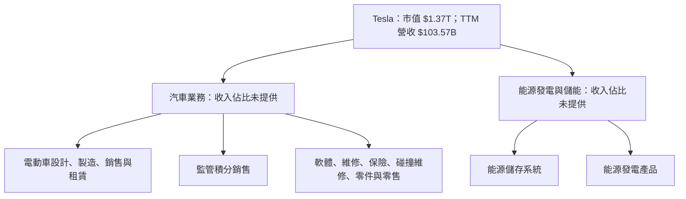
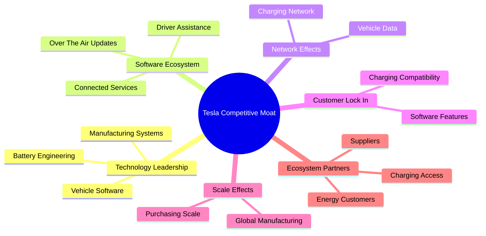
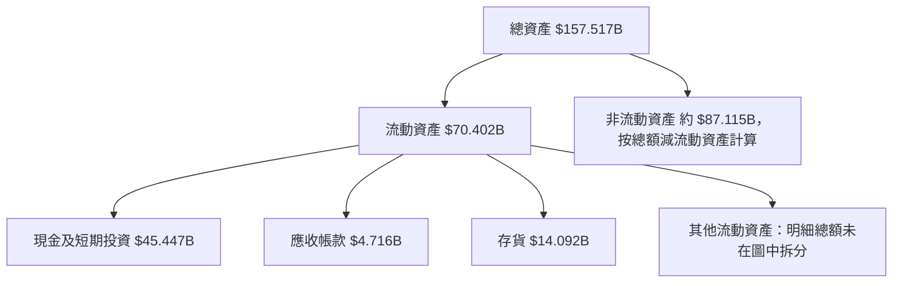
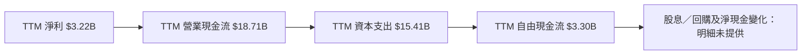
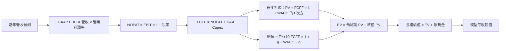
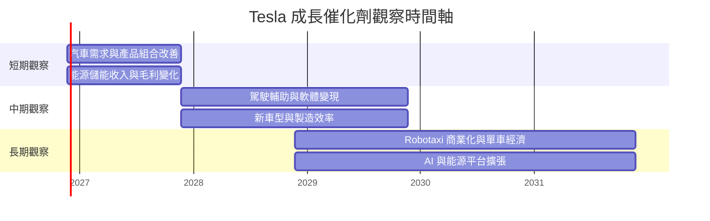
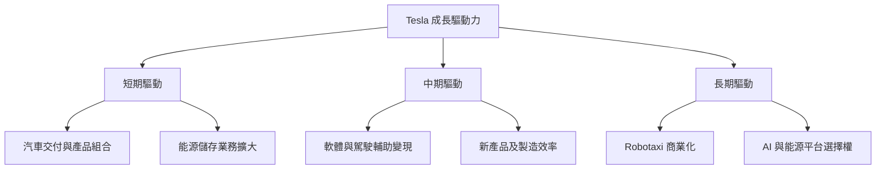
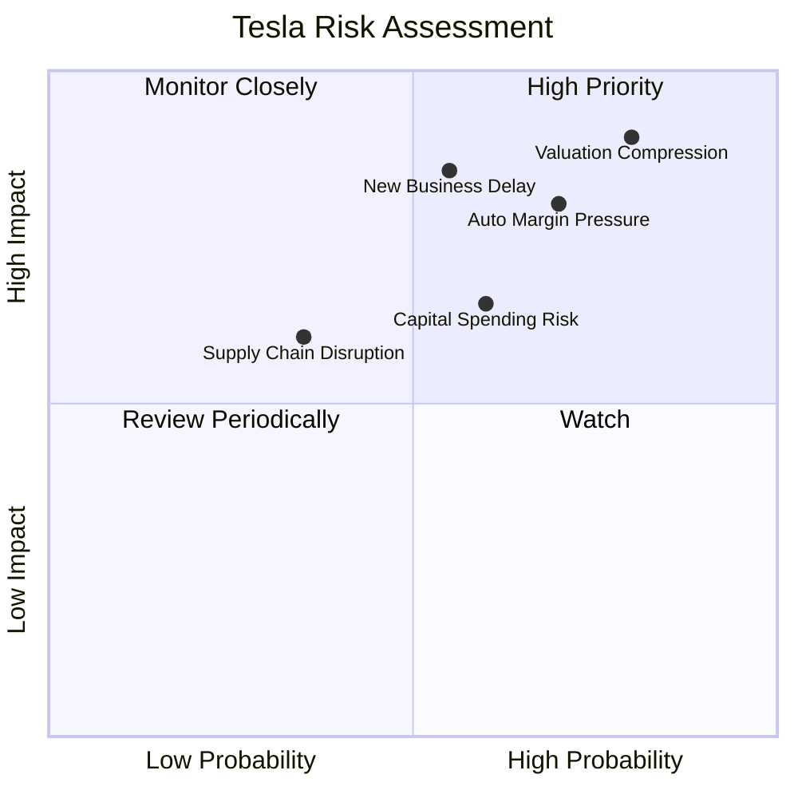
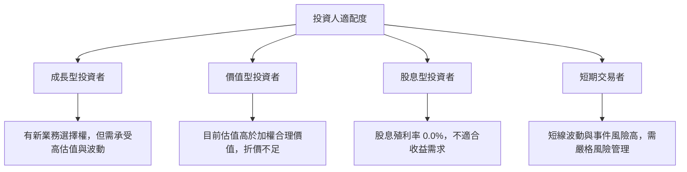

# TSLA 基本面深度分析報告
> **報告日期**：2026-11-22 ｜ **語言**：繁體中文 ｜ **數據來源**：SEC 申報資料 (XBRL)、Yahoo Finance、Finviz、StockAnalysis、Roic.ai ｜ **分析師**：CFA 級機構研究

## 目錄

| # | 章節 | 核心結論 |
|---|------|----------|
| 1 | 執行摘要 | 賣出；加權合理價值 $61.76；MOS -459.9% |
| 2 | 公司概覽與商業模式 | 汽車與能源業務並行，市場份額資料未提供；護城河有品牌與規模優勢，但可量化證據有限 |
| 3 | 損益表深度分析 | TTM 營收 $103.57B、年增 8.3%；最新一季年減 0.2%，利潤率仍低 |
| 4 | 資產負債表分析 | 淨現金 $36.18B；流動性充足，但不同來源的債務口徑不一致 |
| 5 | 現金流量深度分析 | TTM FCF $3.30B，FCF Yield 0.24%；高資本支出壓低自由現金流 |
| 6 | 獲利能力與資本效率 | ROIC 5.1% 低於 WACC 12.32%，目前未創造足夠經濟價值 |
| 7 | 相對估值分析 | P/E、EV/EBITDA 均處自身五年歷史高位區域，較傳統車廠溢價大 |
| 8 | DCF 內在價值評估 | 基準 DCF $13.05；加權合理價值 $61.76；估值高度依賴長期假設 |
| 9 | 成長催化劑 | 自動駕駛、能源儲存與軟體可能帶來選擇權；目前缺乏可量化的 TAM／收入拆分 |
| 10 | 風險矩陣 | 估值回落、汽車利潤率承壓與新業務商業化延遲為主要風險 |
| 11 | 投資建議 | 依 MOS 評級為賣出；以財報改善及估值收斂作為重新評估條件 |

---

## 1. 執行摘要

### 1.0 一頁式投資儀表板（Portfolio Manager 30 秒速讀）

| 項目 | 內容 |
|------|------|
| **投資論點（3 句）** | ① TTM 營收 $103.57B、年增 8.3%，但最新一季營收年減 0.2%，增長趨勢尚未轉成穩定的單季擴張。② TTM 營業利益率 3.3%、ROIC 5.1%，低於 12.32% WACC，現階段資本回報不足以覆蓋資金成本。③ TTM FCF $3.30B、FCF Yield 0.24%，而基準 DCF $13.05、加權合理價值 $61.76，均遠低於 $345.82 現價。 |
| **綜合評分** | **4.7/10**（引用 1.1 六項算術平均） |
| **財務健康** | 🟢 現金及短期投資 $45.45B、淨現金 $36.18B；流動性強，但 Piotroski F-Score 為 4/9 |
| **ROIC vs WACC** | **5.1% vs 12.32%**：ROIC 低於資金成本，當前資本投入未創造足夠股東價值 |
| **FCF 趨勢** | TTM FCF 為正但受高 Capex 壓抑；FCF Yield **0.24%** |
| **估值** | Forward P/E **160.2x** ｜ EV/EBITDA（市場資料）**136.1x** ｜ FCF Yield **0.24%** |
| **DCF 內在價值（基準）** | **$13.05** ｜相對現價折溢價 **+2,550.0%**（現價／DCF 基準價 − 1） |
| **安全邊際（MOS）** | **-459.9%**＝($61.76 − $345.82) ÷ $61.76；🔴低於 10% |
| **預期報酬（基準情境 12M）** | DCF 基準情境 $13.05，相對現價 **-96.2%**；這是模型情境價值，不是分析師 12 個月預測 |
| **關鍵風險（前二）** | 汽車毛利及營業利潤率無法回升；高估值建立在自動駕駛、AI 等未充分反映於當前獲利的預期上 |
| **評級 + 信心度** | 🔴 **賣出** ｜信心：中（評級由 MOS 門檻決定，但 DCF 長期假設及來源口徑差異帶來估值不確定性） |

> **評級推導**：加權合理價值 $61.76，現價 $345.82，MOS = ($61.76 − $345.82) ÷ $61.76 = **-459.9%**，低於 -25% 的賣出門檻。ROIC 5.1% 低於 WACC 12.32%，TTM FCF Yield 僅 0.24%，與遠高於同業的估值倍數相互印證，因此依規則 20 評為賣出，未作質化調整。

### 1.1 綜合評分卡（全報告唯一）

| 維度 | 評分（1–10） | 主要依據（引用數字與其來源章節） |
|------|--------------|----------------------------------|
| 成長性 | 5.0 | TTM 營收年增 8.3%，但最新一季年減 0.2%；詳見第 3 章 |
| 獲利能力 | 3.0 | TTM 營業利益率 3.3%、ROIC 5.1% 低於 WACC 12.32%、F-Score 4/9；詳見第 3、6 章 |
| 財務健康 | 8.0 | 淨現金 $36.18B、現金及短期投資 $45.45B，CCC 由 15 天降至 3 天；詳見第 4 章 |
| 估值 | 1.0 | MOS -459.9%；P/E 380.0x 高於自身五年中位數 74.2x；詳見第 7、8 章 |
| 護城河 | 7.0 | 全球製造與充電／軟體生態有差異化，但市場份額及服務收入拆分未提供；詳見第 2 章 |
| 管理層與資本配置 | 4.0 | 2025 年 SBC $2.83B，FY2026 Q3 股數測試未通過；高投資同時使 TTM Capex 達 $15.41B；詳見第 3、5 章 |
| **綜合評分** | **4.7** | 六項算術平均：(5.0 + 3.0 + 8.0 + 1.0 + 7.0 + 4.0) ÷ 6 = 4.67，四捨五入為 **4.7** |

### 1.2 五大投資論點 + 三大核心風險

| 類型 | 項目 | 具體依據 | 信心度 |
|------|------|----------|--------|
| 🟢 **投資論點①** | 現金緩衝可支撐投資週期 | 現金及短期投資 $45.45B，淨現金 $36.18B，可提供資本投資與景氣下行的緩衝 | 🟢 高 |
| 🟢 **投資論點②** | TTM 營收仍保持增長 | TTM 營收 $103.57B，較前一 TTM 增長 8.3%，但最新一季年增率轉為 -0.2% | 🟡 中 |
| 🟢 **投資論點③** | CCC 顯示現金週轉較快 | CCC 由一年前 15 天降至 3 天；改善主要伴隨 DPO 增加，須留意供應商付款周期變長 | 🟡 中 |
| 🟢 **投資論點④** | 能源與軟體可能成為第二曲線 | 公司經營能源發電／儲能及汽車軟體服務；目前未提供可核實的收入佔比，價值仍屬選擇權 | 🟡 中 |
| 🟢 **投資論點⑤** | 分析師共識仍高於現價 | 40 位分析師平均目標價 $417.53，較現價高 20.7%；此共識與現金流估值存在極大分歧 | 🟡 中 |
| 🟡 **風險①** | 汽車定價與產品組合壓低利潤 | 最新一季收入年減 0.2%，淨利年減 42.7%、EPS 年減 43.6%；短期營運槓桿不利 | 🔴 高衝擊 |
| 🔴 **風險②** | 估值與基本面脫節 | Trailing P/E 380.0x、Forward P/E 160.2x，DCF 基準價 $13.05、加權合理價值 $61.76 | 🔴 高衝擊 |
| 🟡 **風險③** | SBC 與資本支出侵蝕股東回報 | 2025 年 SBC $2.83B；TTM Capex $15.41B，TTM FCF 僅 $3.30B | 🟡 中至高 |

### 1.3 快速統計卡片

| 指標 | 公司實際值（期間） | 同業中位數 | 狀態 |
|------|--------------------|------------|------|
| 營收成長（TTM） | **8.3%** | — | 🟢 |
| 營收成長（最新一季年增） | **-0.2%** | 2.9%（GM、F、RIVN） | 🔴 |
| 毛利率（TTM） | **19.3%** | 9.2%（GM、F、RIVN） | 🟢 |
| 營業利益率（TTM） | **3.3%** | — | 🟡 |
| ROIC（TTM） | **5.1%** | — | 🔴 |
| Forward P/E | **160.2x** | 5.7x（GM、F） | 🔴 |
| FCF Yield（TTM） | **0.24%** | — | 🔴 |
| Piotroski F-Score | **4 / 9** | — | 🟡 |

### 1.4 投資結論

╔══════════════════════════════════════════════════════════════════╗  
║                    📊 投資結論摘要                               ║  
╠══════════════════════════════════════════════════════════════════╣  
║  評級：🔴 賣出（MOS -459.9%，低於 -25% 門檻）                    ║  
║  價格（2026-11-20 收盤）：$345.82                                ║  
║  DCF 內在價值（基準）：$13.05（現價溢價 +2,550.0%）              ║  
║  安全邊際 MOS：-459.9%＝($61.76−$345.82)÷$61.76                 ║  
║  加權合理價值（8.8）：$61.76                                     ║  
║  DCF 情境價值：                                                  ║  
║    悲觀情境：$9.00（-97.4%）                                     ║  
║    基準情境：$13.05（-96.2%）                                    ║  
║    樂觀情境：$18.74（-94.6%）                                    ║  
║  綜合評分：4.7/10（引用 1.1）                                    ║  
║  適合投資人：能承受高波動、以長期新業務選擇權為主的投資人；      ║  
║  不適合重視估值折價或當期股東現金回報的投資人                   ║  
╚══════════════════════════════════════════════════════════════════╝

---

## 2. 公司概覽與商業模式

### 2.1 業務結構與收入來源

資料顯示 Tesla 經營汽車與能源發電／儲能兩個主要業務板塊，另有汽車軟體、服務、保險、零件及監管積分等收入來源；但沒有各板塊的收入金額或佔比，故不繪製比例圖，以免將未披露數據誤作實際收入拆分。

### 2.2 市場份額

市場份額數據未提供，財務資料亦未列出各地區交付量、市場總量或 Tesla 的分部收入，因此不估算市場佔比。以規模衡量，TTM 營收 $103.57B，明顯高於資料所列 Rivian 的相對規模，但缺乏 Rivian 營收金額及一致口徑時，不作精確收入倍數比較。

### 2.3 競爭護城河分析

### 2.4 護城河強度

| 護城河項目 | 強度（強／中／弱） | 證據（引用數字或事實） | 會削弱它的情況 |
|------------|--------------------|------------------------|----------------|
| 技術與產品 | 中 | 汽車及能源產品線、軟體更新與駕駛輔助業務；但技術收入或性能領先幅度未提供 | 競爭者以較低價格提供相近續航、性能或軟體功能 |
| 軟體生態系統 | 中 | 有車載軟體、服務與保險等業務；未披露訂閱收入、活躍用戶及續訂率 | 軟體功能差異縮小、監管限制或用戶付費意願不足 |
| 網路效應 | 中 | 充電網絡和車輛資料可能帶來使用便利與資料累積；可量化網絡規模與利用率未提供 | 充電規格通用化，競爭網絡擴張或車輛資料難以轉化為收益 |
| 客戶鎖定 | 中 | 車輛、充電、軟體服務的整合可提高轉換成本；客戶流失率未提供 | 同級電動車供給增加、轉換成本下降 |
| 規模效應 | 中至強 | TTM 營收 $103.57B，為大規模製造與採購提供基礎；但 TTM 營業利益率僅 3.3% | 產能利用率偏低、價格競爭或固定成本吸收不足 |
| 生態夥伴 | 弱至中 | 有供應商、充電與能源客戶合作；合作夥伴經濟效益未披露 | 供應鏈中斷、合作替代性高或夥伴選擇其他平台 |

1.1 的護城河評分為 **7.0/10**：品牌、製造規模與軟體／充電生態具質化價值，但分部收入、客戶留存、軟體變現及市場份額數據不足以證明所有優勢已轉成持久的超額回報。

---

## 3. 損益表深度分析

### 3.1 年度收入成長趨勢（近 4 年）

年度營收資料顯示 2022 至 2025 年收入曾快速增長，之後趨緩；FY2025 收入低於 FY2024，反映規模增長不能單獨保證收入加速。

╔══════════════════════════════════════════════════════════════════╗  
║              Tesla 年度收入趨勢（FY2022–FY2025）                ║  
╠══════════════════════════════════════════════════════════════════╣  
║ FY2022  $81.46B  ████████████████████░░░░░░░░░░  YoY：+51.35% 🟢║  
║ FY2023  $96.77B  ████████████████████████░░░░░░  YoY：+18.80% 🟢║  
║ FY2024  $97.69B  ████████████████████████░░░░░░  YoY：+0.95%  🟡║  
║ FY2025  $94.83B  ███████████████████████░░░░░░░  YoY：-2.93%  🔴║  
║                                                                  ║  
║ FY2022–FY2025 CAGR：(94.83 ÷ 81.46)^(1/3) − 1 = 約 5.2%          ║  
╚══════════════════════════════════════════════════════════════════╝

FY2025 營收較 FY2024 減少 $2.86B，與價格、交付組合及競爭影響一致；僅憑總收入資料無法分離各因素貢獻。TTM 收入較 FY2025 年度收入高，表示滾動期間有所回升，但最新一季年增率仍為 -0.2%。

### 3.2 季度收入趨勢分析

| 季度 | 營收 | QoQ 成長 | YoY 成長 | 備註 |
|------|------:|---------:|---------:|------|
| 2025 Q4 | $24.90B | — | -3.14% | 與 2024 Q4 比較 |
| 2026 Q1 | $22.39B | -10.1% | +15.78% | 較 2025 Q4 回落，仍高於 2025 Q1 |
| 2026 Q2 | $28.24B | +26.1% | +25.52% | 季度反彈；不代表全年成長已確認 |
| 2026 Q3 | $28.05B | -0.7% | -0.17% | 最新一季年增轉負，單季收入大致持平 |

計算方式：QoQ = 本季收入 ÷ 前季收入 − 1；YoY 依季度收入資料計算。TTM 營收成長 8.3% 與最新一季年減 0.2% 是不同期間指標，不應混用。利潤表資料來源間的單季營業利益存在差異，以下利潤率趨勢採年度財報表列收入及營業利益；最新 TTM 營業利益率採程式計算值 3.3%。

### 3.3 利潤率演變分析

| 利潤率指標 | FY2022 | FY2023 | FY2024 | FY2025 | 趨勢 | 評估 |
|------------|-------:|-------:|-------:|-------:|------|------|
| **毛利率** | 25.6% | 18.3% | 17.9% | 18.0% | 2022 後下降，2025 輕微回升 | 🔴 |
| **營業利益率** | 17.0% | 9.2% | 7.9% | 5.1% | 連續收縮 | 🔴 |
| **淨利率** | 15.4% | 15.5% | 7.3% | 4.0% | 2024–2025 明顯下降 | 🔴 |

> 年度比率按年度損益表金額計算：毛利率＝毛利÷收入，營業利益率＝營業利益÷收入，淨利率＝淨利÷收入。TTM 淨利率為 3.1%，TTM 營業利益率為 3.3%。

FY2022 至 FY2025，營業利益由 $13.83B 降至 $4.85B，而收入從 $81.46B 增至 $94.83B。這種背離表示收入規模增加並未轉為同幅度的營業獲利，價格、成本、產品組合及營運費用可能共同壓縮利潤。R&D 支出由 FY2022 的 $3.08B 升至 FY2025 的 $6.41B，反映公司持續投入新產品與技術；若投入未形成可變現收入，利潤率回升會受限。

### 3.4 費用結構分析

可確認的 FY2025 費用結構只有收入、銷貨成本與毛利，無足夠一致資料拆出銷售管理、研發及其他營業費用，因此不畫完整費用圓餅圖。

FY2025 收入 $94.83B，毛利 $17.09B，故銷貨成本為 **$94.83B − $17.09B = $77.74B**。FY2025 R&D 為 $6.41B；其他費用明細及其與營業利益的逐項調節未提供，不能把差額反推為單一費用類別。

### 3.5 季度 EPS 趨勢與盈餘品質（Quality of Earnings）

| 季度 | EPS 實際值／可用資料 | EPS 年增 | 盈餘超預期／不及預期 |
|------|----------------------|---------|----------------------|
| 2025 Q4 | StockAnalysis 季度 EPS $0.26 | -60.61% | 預期值為 N/A，無法判斷 |
| 2026 Q1 | StockAnalysis 季度 EPS $0.15 | +8.33% | 預期值為 N/A，無法判斷 |
| 2026 Q2 | StockAnalysis 季度 EPS $0.34 | -3.03% | 預期值為 N/A，無法判斷 |
| 2026 Q3 | StockAnalysis 季度 EPS $0.24 | -43.59% | 預期值為 N/A，無法判斷 |

EPS surprise 資料列出的估值與實際值均為 nan，因此不能將任何一季定性為超預期或不及預期。季度 EPS 資料亦與其他來源的季度淨利及 EPS 口徑可能不同，故只按來源標示並避免把它與 GAAP 預期值比較。

| 盈餘品質項目 | 數值／佔比 | 評估 |
|--------------|-----------|------|
| 股權薪酬 SBC / 營收 | 估算 TTM SBC $4.30B ÷ TTM 營收 $103.57B = **4.2%** | 🔴 SBC 顯著稀釋股東經濟權益；估算採最近四季 SBC $1.17B、$1.15B、$1.03B、$0.954B 加總 |
| SBC / 營業現金流 | $4.30B ÷ $18.71B = **23.0%** | 🟡 SBC 是營業現金流調節項目之一，不應忽略其經濟成本 |
| FCF / 淨利（現金轉換率） | 以 TTM 淨利 $3.22B 計：$3.30B ÷ $3.22B = **約 102.5%** | 🟡 TTM 現金轉換尚可，但 FCF 絕對額不高且受 Capex 影響 |
| 一次性／非經常性損益 | 未提供足夠拆分 | 🟡 無法判定本期盈餘是否受重大一次性項目美化 |
| 有效稅率異常 | 最新年度有效稅率 **27.0%** | 🟡 DCF 採用值；缺乏季度稅項明細，不能判定單季稅率異常 |
| 資本化支出 vs 費用化 | TTM Capex $15.41B；TTM D&A/收入 5.5% 為 DCF 假設 | 🟡 資本支出較高會先降低現金流；資本化及費用化明細未提供，不能判定有成本遞延 |

FY2025 年度 SBC 為 $2.83B，相當於當年營收約 3.0%；而最近四季 SBC 約為 TTM 營收的 4.2%。高 SBC 可能使現金流高於扣除稀釋成本後的股東經濟回報。整體而言，淨利並非單憑現有資料可判定為高估或低估，但高 Capex、SBC 與獲利下滑使當前盈利的可持續性仍需驗證。

---

## 4. 資產負債表分析

### 4.1 資產結構分解

最新 TTM 資產負債表資料列示總資產 $157.517B、流動資產 $70.402B；兩者之差為非流動資產約 $87.115B。此處不對缺少明細的非流動資產作比例拆分。

### 4.2 流動性與營運資金分析

| 指標 | 最新 TTM | 一年前 TTM | 變化 | 解讀 |
|------|----------|------------|------|------|
| 流動比率 | 1.739x | N/A | N/A | 流動資產高於流動負債；歷史比較數據未由品質指標列出 |
| 速動比率 | 1.239x | N/A | N/A | 扣除存貨後仍有流動性緩衝 |
| DSO 應收帳款天數 | 16 天 | 18 天 | -2 天 | 收款天數縮短；應收帳款相對收入週轉改善 |
| DIO 存貨天數 | 62 天 | 56 天 | +6 天 | 存貨天數增加，可能代表庫存周轉放慢或備貨增加；需看交付與庫存明細 |
| DPO 應付帳款天數 | 75 天 | 59 天 | +16 天 | 付款週期延長，改善現金佔用，但也可能反映供應鏈付款條件變化 |
| CCC 現金轉換週期 | 3 天 | 15 天 | -12 天 | 現金週期縮短；主要與 DPO 增加有關，不能單獨解讀為需求改善 |

營運資金天數依 SEC 流量及季度資產負債表計算。CCC 由 15 天降至 3 天，顯示營運資金週期更有利，但 DIO 增加 6 天，仍須監控庫存是否持續累積。

### 4.3 債務結構分析

不同資料來源的債務口徑不同：程式計算的財務指標列總債務 $9.27B、淨現金 $36.18B；市場資料區塊另列總債務 $16.44B、淨現金／債務 $29.00B。以下 DCF 橋接與核心指標採用 SEC 計算口徑的 $9.27B 總債務及 $36.18B 淨現金，不混合另一口徑。

╔══════════════════════════════════════════════════════════════════╗  
║                   Tesla 債務健康診斷                             ║  
╠══════════════════════════════════════════════════════════════════╣  
║  總債務（核心口徑）：$9.27B                                      ║  
║  現金及短期投資：  $45.45B                                       ║  
║  淨現金：          $36.18B  🟢                                   ║  
║  市場資料另列總債務 $16.44B、淨現金 $29.00B；口徑未能完全調和    ║  
║  Debt/EBITDA：因債務與 EBITDA 口徑不一致，不提供可比倍數          ║  
║  利息保障倍數：利息費用明細未提供，N/A                           ║  
╚══════════════════════════════════════════════════════════════════╝

淨現金可降低再融資壓力，但不能消除汽車需求、資本支出或估值下跌風險。Debt/Equity 等來源指標可能因債務範圍及權益口徑不同而不一致，不據此推導其他槓桿倍數。

### 4.4 股東權益趨勢

╔══════════════════════════════════════════════════════════════════╗  
║                 Tesla 歷年股東權益                                ║  
╠══════════════════════════════════════════════════════════════════╣  
║ FY2022  $44.70B  ███████████░░░░░░░░░░░░░░░░░░░░░░░░              ║  
║ FY2023  $62.63B  █████████████████░░░░░░░░░░░░░░░                 ║  
║ FY2024  $72.91B  ████████████████████░░░░░░░░░░                   ║  
║ FY2025  $82.14B  ███████████████████████░░░░░░░                  ║  
║                                                                  ║  
║ FY2022–FY2025 權益上升，與留存盈餘及資產規模增加相符；           ║  
║ 但近年淨利與營業利益下降，權益成長不等於資本回報改善。           ║  
╚══════════════════════════════════════════════════════════════════╝

---

## 5. 現金流量深度分析

### 5.1 現金流量瀑布圖

淨利與 TTM 營業現金流、Capex 為不同報表項目；股息與回購的現金流明細未提供，因此不填入假設數字。

### 5.2 FCF 轉換率趨勢

| 財年 | FCF | 淨利 | FCF／淨利 | 解讀 |
|------|----:|-----:|----------:|------|
| 2022 | $7.55B | $12.58B | 60.0% | Capex 吸收部分營業現金 |
| 2023 | $4.36B | $15.00B | 29.1% | 現金轉換下降 |
| 2024 | $3.58B | $7.13B | 50.2% | FCF 仍低於淨利 |
| 2025 | $6.22B | $3.79B | 164.1% | FCF 高於淨利，營運資金及非現金調整可能影響年度差異 |

以上比率依各年度 FCF 與淨利計算。年度波動大，單一年份不能代表常態；TTM FCF $3.30B、相對 TTM 淨利約 $3.22B，轉換率約 102.5%。

### 5.3 自由現金流趨勢

╔══════════════════════════════════════════════════════════════════╗  
║                自由現金流：年度實際與 TTM                        ║  
╠══════════════════════════════════════════════════════════════════╣  
║ FY2022  $7.55B  ████████████████████████░░░░░░  🟢              ║  
║ FY2023  $4.36B  ██████████████░░░░░░░░░░░░░░░░  🟡              ║  
║ FY2024  $3.58B  ███████████░░░░░░░░░░░░░░░░░░░  🟡              ║  
║ FY2025  $6.22B  ████████████████████░░░░░░░░░░  🟢              ║  
║ TTM      $3.30B  ██████████░░░░░░░░░░░░░░░░░░░░  FCF Yield 0.24%║  
║                                                                  ║  
║ TTM FCF = $18.71B − $15.41B = $3.30B                            ║  
╚══════════════════════════════════════════════════════════════════╝

TTM 營業現金流達 $18.71B，但 Capex 為 $15.41B，約佔營業現金流 82.4%。投資支出可能支持產能、產品與新業務，但若資本回報未改善，現金流轉換將繼續偏低。

### 5.4 資本配置評估

各項實際資本配置金額未完整提供，故不繪製比例圓餅圖。

| 項目 | 可用數據 | 評估 |
|------|----------|------|
| 資本支出 | TTM $15.41B | 對 FCF 形成主要扣減；需追蹤新增投資的回報 |
| SBC | FY2025 $2.83B；最近四季估算 $4.30B | 對既有股東具有稀釋成本 |
| 股息 | 殖利率 0.0% | 未以現金股息回饋股東 |
| 回購 | 金額未提供 | N/A；不推定存在或不存在 |
| 留存現金 | 現金及短期投資 $45.45B | 提供投資及週期緩衝，但仍須評估增量資本回報 |

---

## 6. 獲利能力與資本效率

### 6.1 ROE / ROA / ROIC 趨勢

| 指標 | 最新 TTM | 歷史可用資料 | 評估 |
|------|---------:|--------------|------|
| ROE | 3.6%（品質指標口徑） | 其他市場資料列 3.8%，與計算口徑略有差異 | 🔴 回報偏低 |
| ROA | 1.3% | 歷史年度序列未提供一致可比數值 | 🔴 資產獲利率低 |
| ROIC | 5.1% | 歷史序列未提供一致值 | 🔴 低於 WACC 12.32% |
| 行業均值 | 未提供 | 不列 | — |

### 6.2 ROIC vs WACC 分析（核心價值創造判斷）

╔══════════════════════════════════════════════════════════════════╗  
║                ROIC vs WACC 深度分析                             ║  
╠══════════════════════════════════════════════════════════════════╣  
║  WACC 輸入（採程式計算值）：                                      ║  
║  ├── 無風險利率：4.91%                                            ║  
║  ├── 股權風險溢酬 ERP：5.00%                                      ║  
║  ├── 原始 Beta：1.74；調整後 Beta：1.50                           ║  
║  ├── 股權成本：4.91% + 1.50 × 5.00% = 12.41%（輸入列示 12.39%）  ║  
║  ├── 稅前債務成本：3.65%；有效稅率：27.0%                        ║  
║  ├── 股權／債務權重：99.3%／0.7%                                 ║  
║  └── 採用 WACC：12.32%（以成本資本資料列示值為準）                ║  
║                                                                  ║  
║  ROIC：5.1%                                                       ║  
║  WACC：12.32%                                                     ║  
║  ROIC − WACC：5.1% − 12.32% = -7.22 個百分點                     ║  
║                                                                  ║  
║  結論：ROIC 低於 WACC，現階段投資資本回報低於資金成本。           ║  
╚══════════════════════════════════════════════════════════════════╝

成本資本資料列示股權成本 12.39%、WACC 12.32%；由已四捨五入的 Rf、調整後 Beta 與 ERP 直接計算會得到 12.41%，細微差異應來自底層精度。依要求採用程式列示的 **WACC 12.32%**，不另建替代 WACC。稅後 Kd = 3.65% × (1 − 27.0%) = **2.6645%**；以列示權重核算：99.3% × 12.39% + 0.7% × 2.6645% = **12.3219%，四捨五入 12.32%**。

ROIC 5.1% 與 WACC 12.32% 相差 -7.22 個百分點，說明截至目前營運回報尚未覆蓋資本成本。若新增投資能提升獲利率及資產使用效率，價值創造可能改善；現有資料尚未證明改善已發生。

### 6.3 杜邦三因素分解

| 因素 | 數值（TTM） | 解讀 |
|------|-------------|------|
| 淨利率 | 3.1% | 盈利留存率偏低，壓低 ROE |
| 資產週轉率 | 0.66 | 每單位資產產生的收入效率 |
| 權益乘數 | 1.76 | 財務槓桿非極高，ROE 並非主要靠槓桿撐起 |
| **ROE** | **3.6%** | 3.1% × 0.66 × 1.76 = 約 3.6% |

### 6.4 財務體質：Piotroski F-Score

**Piotroski F-Score：4 / 9**。以下九項結果照品質指標列示：

| 測試 | 結果 | 解讀 |
|------|------|------|
| ROA > 0 | ✅ 通過 | 仍有正向資產回報 |
| 營業現金流 > 0 | ✅ 通過 | TTM 營業現金流為正 |
| ROA 高於一年前 | ❌ 未通過 | 資產回報未改善 |
| 營業現金流 > 淨利 | ✅ 通過 | 現金流高於淨利，應計品質測試通過 |
| 長期負債 ÷ 總資產低於一年前 | ❌ 未通過 | 槓桿改善測試未通過 |
| 流動比率高於一年前 | ❌ 未通過 | 流動性比率未提高 |
| 稀釋股數未增加 | ❌ 未通過 | 股數稀釋對每股權益構成壓力 |
| 毛利率高於一年前 | ✅ 通過 | 毛利率比較測試通過 |
| 資產週轉率高於一年前 | ❌ 未通過 | 資產使用效率未改善 |

4/9 顯示財務體質並非全面轉弱，但盈利趨勢、資產效率及股數稀釋均需關注；不能僅因資產負債表淨現金較高而忽略營運品質。

---

## 7. 相對估值分析

### 7.1 同業估值比較表格

| 估值指標 | **TSLA** | **GM** | **F** | **RIVN** | 本公司評估 |
|----------|---------:|-------:|------:|---------:|-----------|
| **Trailing P/E** | 380.0x | 17.2x | N/A | N/A | 🔴 極高；當期盈利支持不足 |
| **Forward P/E** | 160.2x | 5.3x | 6.0x | -5.9x | 🔴 遠高於有正盈利同業；RIVN 為負值，不適合直接解讀為低估 |
| **P/S Ratio** | 13.2x | 0.4x | 0.2x | 2.3x | 🔴 高溢價，需由未來高成長及高利潤率證明 |
| **EV/EBITDA** | 136.1x | 9.1x | 23.6x | -5.9x | 🔴 大幅高於 GM、F；RIVN 倍數為負，無直接意義 |
| **最新一季營收 YoY** | -0.2% | 2.9% | -2.0% | 38.3% | 🟡 成長低於 GM、RIVN，高於 F |
| **毛利率（TTM）** | 19.3% | 11.4% | 7.4% | 9.2% | 🟢 高於所列同業，但不抵銷估值溢價 |

TSLA 市場資料中的倍數與自身歷史估值資料庫數字略有差異，例如 P/S 為 13.2x 對比歷史模組 11.8x、EV/EBITDA 為 136.1x 對比 130.1x。用途不同，前表用於公司間比較，歷史比較採第 7.2 節專用數據。

### 7.2 歷史估值區間分析

╔══════════════════════════════════════════════════════════════════╗  
║                TSLA 自身五年估值區間                             ║  
╠══════════════════════════════════════════════════════════════════╣  
║ P/E：      範圍 18.0x ───── 中位數 74.2x ───────── 現值 380.0x  ║  
║            現值百分位：86%                                       ║  
║ P/S：      範圍 3.9x ────── 中位數 9.4x ───── 現值 11.8x         ║  
║            現值百分位：62%                                       ║  
║ EV/EBITDA：範圍 19.0x ───── 中位數 64.6x ─────── 現值 130.1x     ║  
║            現值百分位：81%                                       ║  
╚══════════════════════════════════════════════════════════════════╝

P/E 與 EV/EBITDA 分別位於自身五年區間第 86 與 81 百分位，反映市場為未來盈利復甦及新業務選擇權支付較高價格。若利潤率無法回升，歷史中位數提供的估值參照顯示下修空間較大。

### 7.3 情境價值（Bear / Base / Bull，照抄 DCF MODEL 的 Scenarios）

| 情境 | 第 1 年營收成長 | 期末營業利潤率 | WACC | 每股價值 | 相對現價 | 機率 | 會發生的條件 |
|------|----------------|----------------|------|----------:|----------:|------:|--------------|
| 🔴 悲觀 | 4.1% | 6.2% | 13.32% | $9.00 | -97.4% | 25% | 需求與定價偏弱、利潤率修復有限、風險溢酬較高 |
| 🟡 基準 | 8.3% | 7.2% | 12.32% | $13.05 | -96.2% | 50% | TTM 成長延續，營業利潤率逐步回歸過去五年中位數 |
| 🟢 樂觀 | 12.4% | 8.0% | 11.32% | $18.74 | -94.6% | 25% | 收入加速、利潤率改善，且折現率下降 |

上述情境每股價值與假設均採程式計算模型，不自行改動。即使樂觀情境，模型價值仍明顯低於現價，代表在此 DCF 框架下，當前市場定價需要模型以外的重大成長選擇權價值。

### 7.4 相對估值隱含價格區間

╔══════════════════════════════════════════════════════════════════╗  
║                  相對估值與參考價值                              ║  
╠══════════════════════════════════════════════════════════════════╣  
║ 同業 Forward P/E：$12.23  ── 現價 $345.82 ── 分析師共識 $417.53  ║  
║ 同業 EV/EBITDA：  $46.93  ── 加權價值 $61.76                    ║  
║ DCF 基準：       $13.05                                         ║  
╚══════════════════════════════════════════════════════════════════╝

| 方法 | 每股價值 | 依據 |
|------|---------:|------|
| 同業 Forward P/E | $12.23 | GM、F 同業中位數 Forward P/E 5.7x × Tesla Forward EPS $2.16 |
| 同業 EV/EBITDA | $46.93 | GM、F 同業中位數 EV/EBITDA 16.3x × TTM EBITDA，加回淨現金；明細倍數由程式計算 |
| 分析師共識 | $417.53 | 40 位分析師平均目標價，僅作市場參考，不是同業估值法 |

---

## 8. DCF 內在價值評估（Discounted Cash Flow）

### 8.0 估值推理鏈（Thinking Logic）

**Step 1 — 價值由哪些變數決定？**  
本 DCF 以現有汽車與能源合併現金流作為估值底盤，並以長期營業利潤率擴張及再投資效率決定終值；汽車／能源分部營收佔比未提供，不能替各板塊指定比例。模型中對價值影響最大的是 WACC、終值成長率及期末現金流，且終值現值佔企業價值 190.9%，顯示短期預測現值為負、模型價值高度依賴遠期假設。

**Step 2 — 模型選擇**

| 決策點 | 本報告採用 | 理由（含數字） | 曾考慮但否決 | 否決理由 |
|--------|-----------|----------------|--------------|----------|
| 現金流定義 | FCFF | 對應 WACC 折現並求企業價值；模型以 FCFF＝NOPAT+D&A−Capex | FCFE | 已指定 WACC 與 EV 橋接，改用 FCFE 會混用資本結構 |
| 預測期 N | 10 年 | DCF 模型固定預測 10 年，讓目前 3.3% TTM 營業利潤率漸進至 7.2% | 5 年 | 無法照抄指定模型，且模型設定為 10 年 |
| 終值方法 | Gordon Growth | 模型採永續成長率 3.0%，WACC 12.32% | 退出倍數 | DCF 模型未提供退出倍數計算結果，不另建模型 |
| EBIT 基礎 | GAAP EBIT | 模型明列 GAAP EBIT；SBC 已列為費用 | 非 GAAP EBIT | 可能加回 SBC 而低估股東經濟成本 |

**Step 3 — 主要假設推導鏈**

- **營收成長**：錨點＝TTM 營收成長 8.3%，FY2025 年增 -2.93%、FY2023 年增 18.8% → 最新 TTM 回升但最新一季年增 -0.2%，故不沿用歷史高增長 → **第 1 年採 8.3%，線性降至第 10 年 3.0%** → 未採用持續高於 8.3% 的成長路徑，因最新季度尚未證明加速已持續。
- **期末營業利潤率**：錨點＝TTM 3.3%；模型以過去五個財年中位數為終點 → 規模和產品組合可能助推利潤率，但競爭、定價與投入仍構成制約 → **第 10 年採 7.2%** → 未採更高利潤率，因現有營業利潤率遠低於該終點，且未提供支撐更高水準的管理層財測。
- **永續成長率 g**：錨點＝長期成熟企業需低於 WACC；本模型 WACC 為 12.32% → 成熟期增長需收斂 → **採用 3.0%** → 不採用接近 WACC 的長期成長，因會使終值對微小假設極敏感。
- **預測期 N**：錨點＝模型指定 10 年 → 利潤率修復需要時間，但十年預測仍有重大不確定性 → **採用 10 年** → 不縮短預測期，因不符合指定模型；也不延長，避免再提高遠期假設權重。
- **Capex／營收**：錨點＝TTM Capex $15.41B ÷ TTM 營收 $103.57B，約 14.9% → 隨投入強度下降並向成熟期收斂 → **FY+1 14.9%，FY+10 6.0%** → 不假設立即降至成熟水平，因投資仍在進行。
- **D&A／營收**：錨點＝模型使用 TTM 比率 → **採 5.5% 並固定**；未另建年度折舊模型。
- **稅率**：錨點＝最新年度有效稅率 **27.0%** → 模型全期使用該值；未採零稅率或稅務利益假設。
- **營運資金變動**：DCF 模型明列未建模，故 **不納入 ΔWC**；實際 CCC 為 3 天，仍不足以從現有資料建出年度 ΔWC 金額。
- **EBIT 與 SBC**：採 **(A) GAAP EBIT + 固定股數**；EBIT 已含 SBC 費用，不再減 SBC，年稀釋率採 0%。模型股數不再額外稀釋；此處的「固定股數」是模型組合設定，不代表 SBC 不會造成實際股東稀釋。
- **WACC**：錨點＝成本資本資料列示 WACC 12.32%；採用該值折現。未自行改用較低 WACC，因未有可支持下調的市場風險或資本結構證據。
- **終值方法**：錨點＝模型列示 Gordon Growth、g 3.0%；採用其基準終值。退出倍數未提供程式計算值，故不自行替換或另造倍數。

**Step 4 — 最脆弱的一環**  
最脆弱的是長期營業利潤率和終值現金流：終值現值佔 EV 190.9%；如果營業利潤率無法由 3.3% 逐步升至 7.2%，估值會低於基準，而不是單靠現金餘額足以支持現價。

**Step 5 — 計算路徑**

### 8.1 模型假設總表（Model Inputs）

| 假設項目 | 採用值 | 依據／來源 | 敏感度 |
|----------|--------|-------------|--------|
| 預測期長度 N | 10 年 | DCF 模型設定；用於收入與利潤率漸進預測 | 🟡 中 |
| 營收成長 | 第 1 年 8.3%，第 10 年 3.0%，線性遞減 | TTM 成長 8.3%；成熟期收斂假設由模型設定 | 🔴 高 |
| 營業利潤率（GAAP EBIT） | 第 1 年 3.3% → 第 10 年 7.2% | TTM 營業利益率及過去五年中位數（含 TTM） | 🔴 高 |
| 有效稅率 | 27.0% | 最新年度有效稅率 | 🟢 低 |
| Capex／營收 | 第 1 年 14.9% → 第 10 年 6.0% | TTM 強度約 14.9%，模型向 1.1×D&A 收斂 | 🟡 中 |
| D&A／營收 | 5.5% | 模型採 TTM 比率並固定 | 🟢 低 |
| 營運資金變動／營收增額 | 未建模 | DCF 模型明列 Working capital is not modelled | 🟢 低 |
| EBIT 基礎 | GAAP | 模型使用 GAAP EBIT | 🟡 中 |
| SBC 處理 | 組合 (A)：GAAP EBIT、不另減 SBC | SBC 已含於 GAAP 費用；固定股數設定與模型一致 | 🟡 中 |
| 年稀釋率 | 0%（模型設定） | 組合 (A) 固定股數；不得再重複扣 SBC | 🟡 中 |
| 永續成長率 g | 3.0% | DCF 模型指定；低於 WACC 12.32% | 🔴 高 |
| 終值方法 | Gordon Growth | 模型提供終值 $93.90B；未提供退出倍數法結果 | 🔴 高 |
| WACC | 12.32% | 成本資本資料列示值 | 🔴 高 |

**FCFF 定義**：使用 FCFF＝NOPAT + D&A − Capex；模型不計 ΔWC。  
**SBC 一致性**：本模型採用 **(A)**，故 GAAP EBIT 已含 SBC 影響，預測 FCFF 不再扣一次 SBC，股數不逐年放大。

### 8.2 折現率推導（WACC）

╔══════════════════════════════════════════════════════════════════╗  
║                    WACC 推導（折現率）                           ║  
╠══════════════════════════════════════════════════════════════════╣  
║ 股權成本 Ke：                                                     ║  
║ ├── 無風險利率 Rf：4.91%（10 年期美債輸入值；觀測日期未提供）     ║  
║ ├── ERP：5.00%（假設值；成本資本資料所採風險溢酬）                ║  
║ ├── 原始 Beta：1.74（Yahoo Finance）                              ║  
║ ├── 調整 Beta：⅔×1.74 + ⅓×1 = 1.493 ≈ 1.50                       ║  
║ ├── Ke 輸入值：12.39%（成本資本資料列示）                         ║  
║ ├── 規模／國別溢酬：未另加                                      ║  
║                                                                  ║  
║ 債務成本與資本結構：                                              ║  
║ ├── 稅前債務成本：3.65%（資料列示；利息費用金額未提供）           ║  
║ ├── 稅率：27.0%                                                   ║  
║ ├── 稅後 Kd：3.65%×(1−27.0%) = 2.6645%                            ║  
║ ├── 權重 E／D：99.3%／0.7%                                        ║  
║ └── 採用 WACC：12.32%                                             ║  
╚══════════════════════════════════════════════════════════════════╝

**逐步演算與可複核性說明：**

1. **Ke（CAPM）**：調整後 Beta = ⅔ × 1.74 + ⅓ × 1 = 1.4933，四捨五入 1.50。以顯示精度代入 CAPM：4.91% + 1.50 × 5.00% = 12.41%。資料列示 Ke 為 **12.39%**，差異來自底層未四捨五入數值；後續依指定採列示 Ke。
2. **稅前 Kd**：利息費用金額及計息負債平均餘額未提供，不能依利息÷平均負債重算；採列示稅前 Kd **3.65%**。
3. **稅後 Kd**：3.65% × (1 − 27.0%) = **2.6645%**。
4. **權重**：成本資本資料列示 E／D 權重 **99.3%／0.7%**，合計 100.0%。底層市場市值與債務取數口徑未提供足夠細節以獨立重建權重，依指定引用原值。
5. **WACC**：99.3% × 12.39% + 0.7% × 2.6645% = 12.30327% + 0.01865% = **12.32192% ≈ 12.32%**。

### 8.3 逐年自由現金流預測（基準情境）

金額單位：美元十億。折現因子保留三位小數；各數值照 DCF 模型列示。表中 ΔWC 未納入，因模型明確未建模。

| 年度 | FY+1 | FY+2 | FY+3 | FY+4 | FY+5 | FY+6 | FY+7 | FY+8 | FY+9 | FY+10 |
|------|-----:|-----:|-----:|-----:|-----:|-----:|-----:|-----:|-----:|------:|
| 營收 | 112.17 | 120.81 | 129.42 | 137.87 | 146.07 | 153.89 | 161.23 | 167.96 | 173.99 | 179.21 |
| 營收 YoY | 8.3% | 7.7% | 7.1% | 6.5% | 5.9% | 5.4% | 4.8% | 4.2% | 3.6% | 3.0% |
| 營業利潤率 | 3.3% | 3.8% | 4.2% | 4.6% | 5.1% | 5.5% | 5.9% | 6.4% | 6.8% | 7.2% |
| EBIT（GAAP） | 3.75 | 4.57 | 5.45 | 6.40 | 7.42 | 8.48 | 9.58 | 10.71 | 11.85 | 12.98 |
| − 稅 | (1.01) | (1.23) | (1.47) | (1.73) | (2.00) | (2.29) | (2.58) | (2.89) | (3.19) | (3.50) |
| NOPAT | 2.74 | 3.34 | 3.98 | 4.68 | 5.42 | 6.19 | 7.00 | 7.82 | 8.65 | 9.48 |
| + D&A | 6.14 | 6.61 | 7.09 | 7.55 | 8.00 | 8.42 | 8.83 | 9.20 | 9.53 | 9.81 |
| − Capex | (16.69) | (16.78) | (16.71) | (16.44) | (15.98) | (15.32) | (14.47) | (13.42) | (12.19) | (10.79) |
| − ΔWC | 未建模 | 未建模 | 未建模 | 未建模 | 未建模 | 未建模 | 未建模 | 未建模 | 未建模 | 未建模 |
| **FCFF** | **-7.80** | **-6.83** | **-5.64** | **-4.21** | **-2.57** | **-0.70** | **1.36** | **3.60** | **5.99** | **8.50** |
| 折現因子 @12.32% | 0.890 | 0.793 | 0.706 | 0.628 | 0.559 | 0.498 | 0.443 | 0.395 | 0.351 | 0.313 |
| **FCFF 現值 PV** | **-6.95** | **-5.42** | **-3.98** | **-2.65** | **-1.44** | **-0.35** | **0.60** | **1.42** | **2.10** | **2.66** |

模型列示預測期 PV 合計 **-$13.99B**。逐項加總顯示值：  
**-$6.95 − $5.42 − $3.98 − $2.65 − $1.44 − $0.35 + $0.60 + $1.42 + $2.10 + $2.66 = -$14.01B**。  
與模型合計差 $0.02B，源於表格逐年數字四捨五入；未四捨五入底層值合計採模型列示 **-$13.99B**。

**FY+1 逐步演算：**

1. 營收＝$103.57B × (1 + 8.3%)＝模型列示 **$112.17B**。
2. EBIT＝$112.17B × 3.3%＝**$3.75B**（使用模型未四捨五入營收與利潤率）。
3. 稅＝$3.75B × 27.0%＝**$1.01B**。
4. NOPAT＝$3.75B − $1.01B＝**$2.74B**。
5. D&A＝$112.17B × 5.5%＝**$6.14B**。
6. Capex＝$112.17B × 14.9%＝**$16.69B**。
7. ΔWC＝**未建模，不扣除**。
8. FCFF＝NOPAT + D&A − Capex；用表列四捨五入值為 $2.74B + $6.14B − $16.69B = -$7.81B，模型以底層精度列示 **-$7.80B**，差 $0.01B 為顯示值四捨五入。
9. 折現因子＝1 ÷ (1 + 12.32%)¹＝**0.890**；PV＝模型底層 FCFF × 折現因子＝**-$6.95B**。

**合理性自檢：**

- 預測期 FCF CAGR：FY+1 至 FY+10 的 FCFF 由 -$7.80B 轉為 $8.50B，起點為負值，傳統 CAGR **不適用**；歷史 FCF 年度值在 $3.58B 至 $7.55B 間波動，不能用單一 CAGR 直接比較。
- FY+10 FCFF 利潤率＝$8.50B ÷ $179.21B＝**約 4.7%**；目前 TTM FCF 利潤率＝$3.30B ÷ $103.57B＝**約 3.2%**。同業最佳 FCF 利潤率數據未提供，不作比較。
- FY+1 至 FY+6 FCFF 為負，因模型假設 Capex 高於 NOPAT 加 D&A；這些負現金流會降低預測期現值，終值則在 FY+10 FCFF 轉正後計算。

╔══════════════════════════════════════════════════════════════════╗  
║            自由現金流：歷史實際 vs 模型預測                      ║  
╠══════════════════════════════════════════════════════════════════╣  
║ FY2023（實） $4.36B  █████████████░░░░░░░░░░░░░░░                ║  
║ FY2024（實） $3.58B  ███████████░░░░░░░░░░░░░░░░░                ║  
║ FY2025（實） $6.22B  ███████████████████░░░░░░░░                ║  
║ FY+1（預）  -$7.80B  負值；Capex 高於 NOPAT + D&A               ║  
║ FY+10（預） $8.50B   ██████████████████████████                  ║  
╠══════════════════════════════════════════════════════════════════╣  
║  預測前六年 FCFF 為負，後四年轉正；估值高度依賴遠期利潤率與 Capex║  
╚══════════════════════════════════════════════════════════════════╝

### 8.4 終值計算（Terminal Value）

**適用性檢查**：WACC **12.32%** vs g **3.0%** → WACC > g？✅

| 方法 | 計算式 | 終值 TV | TV 現值 | 佔總 EV 比重 |
|------|--------|---------|---------|--------------|
| Gordon Growth | $8.50 × (1 + 3.0%) ÷ (12.32% − 3.0%) | $93.90B | $29.38B | 190.9% |
| 退出倍數法 | DCF 模型未提供 EBITDA 退出倍數及計算結果 | N/A | N/A | N/A |

**逐步演算：**

1. FY+N 的 FCFF＝FY+10 FCFF **$8.50B**。
2. 分子＝$8.50B × (1 + 3.0%)＝模型列示終值算式所用分子。
3. 分母＝12.32% − 3.0%＝**9.32%**；TV＝$8.50B × 1.03 ÷ 9.32%＝模型列示 **$93.90B**（底層未四捨五入數值）。
4. PV(TV)＝$93.90B × 第 10 年折現因子 0.313＝模型列示 **$29.38B**（底層未四捨五入折現因子）。
5. 終值佔比＝$29.38B ÷ $15.39B＝**190.9%**。

終值現值大於 EV，原因是預測期現金流現值合計為負。此估值高度依賴終值假設，短期現金流貢獻有限；退出倍數法不自行補算，以免違反模型唯一來源規則。

### 8.5 企業價值 → 每股內在價值（Bridge）

╔══════════════════════════════════════════════════════════════════╗  
║              企業價值 → 每股內在價值 橋接表                      ║  
╠══════════════════════════════════════════════════════════════════╣  
║  預測期 FCF 現值合計             -$13.99B                         ║  
║  終值現值 PV(TV)                 +$29.38B                         ║  
║  = 企業價值 EV                    $15.39B                         ║  
║  + 淨現金                         +$36.18B                         ║  
║  = 股權價值                       $51.57B                         ║  
║  每股內在價值（模型列示）          $13.05                           ║  
║  市價（2026-11-20 收盤）           $345.82                          ║  
║  折溢價：現價／DCF 價值 − 1        +2,550.0%（溢價）               ║  
╚══════════════════════════════════════════════════════════════════╝

**逐步演算與口徑：**

1. EV＝預測期 PV -$13.99B + PV(TV) $29.38B＝**$15.39B**。
2. 股權價值＝EV $15.39B + 淨現金 $36.18B＝**$51.57B**。淨現金為程式列示淨額；模型橋接未單獨列少數股權等其他項目。
3. 每股價值依 DCF 模型指定公式，以財報美元及美元報價，不作匯率換算：**股權價值 × 價格 ÷ 市值 = $13.05**。模型列示價值照抄；不以市場區塊四捨五入後市值自行替換程式的精確市值輸入。
4. 折溢價＝現價 $345.82 ÷ DCF 基準價 $13.05 − 1＝**約 +2,550.0%**。相對現價的上行空間為 $13.05 ÷ $345.82 − 1＝**-96.2%**；兩者分母不同。
5. **本節不計算 MOS**：MOS 一律採第 8.8 節加權合理價值為分母。

股數採 DCF 模型的每股價值橋接公式；模型指定 GAAP EBIT + 固定股數，不另按 SBC 稀釋率放大。市場資料列示流通股數 3.95B，但 DCF 每股公式使用模型內部的價格／市值換算口徑；不以外部四捨五入股數重算，以免偏離指定 DCF 模型。

### 8.6 敏感性分析（WACC × 永續成長率）

下表為 DCF 模型原列每股價值。括號為以現價 $345.82 計算的相對現價變化，百分比四捨五入至一位小數。

| g（列）／WACC（欄） | 10.32% | 11.32% | **12.32%（基準）** | 13.32% | 14.32% |
|-----------|------:|------:|------------------:|------:|------:|
| 2.0% | $15.55 (-95.5%) | $13.69 (-96.0%) | $12.26 (-96.5%) | $11.14 (-96.8%) | $10.24 (-97.0%) |
| 2.5% | $16.23 (-95.3%) | $14.19 (-95.9%) | $12.63 (-96.3%) | $11.42 (-96.7%) | $10.47 (-97.0%) |
| **3.0%（基準）** | $17.01 (-95.1%) | $14.75 (-95.7%) | **$13.05 (-96.2%)** | $11.73 (-96.6%) | $10.71 (-96.9%) |
| 3.5% | $17.90 (-94.8%) | $15.38 (-95.6%) | $13.50 (-96.1%) | $12.08 (-96.5%) | $10.97 (-96.8%) |
| 4.0% | $18.93 (-94.5%) | $16.09 (-95.3%) | $14.02 (-95.9%) | $12.46 (-96.4%) | $11.26 (-96.7%) |

**逐步演算限制**：敏感度矩陣由程式直接計算；由於未提供各格預測期 PV 的未四捨五入明細，不能在不重建模型的情況下完整重算一個非基準格。依規則 19，矩陣數值照抄，不自行建立第二套 DCF。

**DCF 模型三情境（原列數值）**

| 情境 | 營收成長假設 | 期末營業利潤率 | g | WACC | 每股內在價值 | 相對現價 | 機率 |
|------|--------------|----------------|---|------|--------------:|----------:|------:|
| 🔴 悲觀 | 第 1 年 4.1% | 6.2% | 模型未另列 | 13.32% | $9.00 | -97.4% | 25% |
| 🟡 基準 | 第 1 年 8.3% | 7.2% | 3.0% | 12.32% | $13.05 | -96.2% | 50% |
| 🟢 樂觀 | 第 1 年 12.4% | 8.0% | 模型未另列 | 11.32% | $18.74 | -94.6% | 25% |
| **機率加權** | — | — | — | — | **$13.46** | **-96.1%** | **100%** |

悲觀、基準與樂觀情境的 FY+10 營收、FCFF 及終值中間值未列於計算輸出；不以模型外推導補造。可確認的是情境會同時改變成長、利潤率及 WACC，而不只是折現率。機率加權算式：$9.00 × 25% + $13.05 × 50% + $18.74 × 25% = **$13.46**（按未四捨五入模型值計算，四捨五入至美分）。

**敏感度結論：**

- g 由 2.0% 增至 3.0%，WACC 固定 12.32%：$12.26 → $13.05，增加 **$0.79／約 6.4%**。
- WACC 由 11.32% 增至 12.32%，g 固定 3.0%：$14.75 → $13.05，下降 **$1.70／約 11.5%**。
- 期末營業利潤率每 +1pp 的每股彈性未在模型敏感度表提供，故為 **N/A**。
- 已提供的敏感度範圍內，WACC 變動造成的價值差較大；這與 8.0 指出的折現率／終值依賴相符。營業利潤率仍是重要營運假設，但缺少對應敏感度矩陣，不能量化每 +1pp 的價值變化。

### 8.7 反推 DCF（Reverse DCF：市場在預期什麼）

DCF 程式以一次只求解一個變數的方式測試：在其餘基準輸入固定時，年 1 營收成長率在 -10% 至 100% 範圍內無解；固定營業利潤率在 0.5% 至 95% 範圍內亦無解。依規則，不另行改建模型或給出模型未能求出的隱含數值。

| 求解的變數 | 固定設定 | 市場隱含值 | 判斷 |
|------------|----------|------------|------|
| 第 1 年營收成長率 | 其餘輸入固定於基準 | -10% 至 100% 內無解 | 🔴 僅靠此變數無法使 DCF 等於現價 |
| 固定營業利潤率 | 其餘輸入固定於基準 | 0.5% 至 95% 內無解 | 🔴 僅靠此變數無法使 DCF 等於現價 |
| 永續成長率 | 模型未提供解 | N/A | 不推算 |
| 預測期 N | 模型未提供解 | N/A | 不推算 |

反推結果表示，按指定 DCF 基準模型，現價並非只需調整一個營運假設即可解釋；市場價格可能包含模型沒有拆分的自動駕駛、AI 或其他選擇權價值，但現有資料不足以估計其金額。

### 8.8 估值三角驗證與安全邊際

| 估值方法 | 隱含每股價值 | 上行空間（÷現價） | 權重 | 說明 |
|----------|--------------:|------------------:|------:|------|
| DCF（基準） | $13.05 | -96.2% | 40% | 10 年 FCFF、WACC 12.32%、終值成長 3.0% |
| 同業 Forward P/E | $12.23 | -96.5% | 25% | GM、F 同業中位數 5.7x × Forward EPS $2.16 |
| 同業 EV/EBITDA | $46.93 | -86.4% | 25% | GM、F 同業中位數 16.3x × TTM EBITDA，加回淨現金 |
| 分析師共識目標價 | $417.53 | +20.7% | 10% | 40 位分析師平均目標價 |
| **加權合理價值** | **$61.76** | **-82.1%** | **100%** | — |

**加權計算**：  
$13.05 × 40% + $12.23 × 25% + $46.93 × 25% + $417.53 × 10%  
= $5.220 + $3.0575 + $11.7325 + $41.753  
= **$61.763 ≈ $61.76**。

估值權重依公司類型「profitable」固定，未自行調整。分析師共識價值雖顯著高於三項基本面估值方法，但權重僅 10%；因此對加權合理價值的拉升有限。MOS 依規定以加權合理價值為基準：

**MOS = ($61.76 − $345.82) ÷ $61.76 = -459.9%。**  
**上行空間 = ($61.76 − $345.82) ÷ $345.82 = -82.1%。**

╔══════════════════════════════════════════════════════════════════╗  
║                  估值區間與安全邊際                              ║  
╠══════════════════════════════════════════════════════════════════╣  
║ $9.00 ── $13.05 ── $61.76 ── $345.82 ── $417.53                ║  
║ 悲觀DCF   基準DCF    加權合理值    現價       分析師共識          ║  
║                                                                  ║  
║ 安全邊際 MOS = ($61.76 − $345.82) ÷ $61.76 = -459.9%           ║  
║ 上行空間 = ($61.76 − $345.82) ÷ $345.82 = -82.1%               ║  
║ 建議買入區間：依此估值不建議在現價買入；MOS≥10% 的價位須低於     ║  
║ 加權合理價值，且依同一公式約為 $55.58 以下                       ║  
╚══════════════════════════════════════════════════════════════════╝

MOS 為負且遠低於賣出門檻，故不將「建議買入區間」寫成高於現價的區間。$55.58 為按加權合理價值的 90% 計算：$61.76 × (1 − 10%) = $55.584，四捨五入 $55.58；不代表該價位必然具備投資吸引力。

> 🔎 **程式複算（Python，依本節各項自動重算）**
>
> 加權合理價值 = $13.05 × 40% + $12.23 × 25% + $46.93 × 25% + $417.53 × 10% = **$61.76**（權重合計 100%）
>
> 以價格 $345.82 計：MOS = **-459.9%**，上行空間 = **-82.1%**
>
> ✅ 與本節所寫數值一致。

### 8.9 DCF 模型的局限與失效條件

- **終值依賴度**：終值現值 $29.38B ÷ EV $15.39B = **190.9%**。預測期現金流 PV 為負，估值主要依賴第 10 年之後現金流假設。
- **最脆弱假設**：一是營業利潤率由 3.3% 上升至 7.2%；二是 Capex／收入由 14.9% 降至 6.0%。若利潤率改善或 Capex 收斂不發生，基準價值會下降。
- **模型限制**：FY+1 至 FY+6 FCFF 為負，且沒有營運資金變動模型、分部估值或可量化的新業務現金流；因此 DCF 可靠度低於穩定成熟企業。應搭配同業估值、分部資料與單位經濟性評估。
- **風險連結**：汽車定價競爭會壓低營業利潤率；AI／自動駕駛商業化延遲會令終值假設失效；Capex 高於模型收斂路徑則會壓低 FCFF。
- **口徑限制**：DCF 輸入的淨現金、Debt 及每股換算由計算模型採其內部口徑；公開彙總資料存在債務口徑差異，故未自行重建模型。

### 8.10 複算檢核表（Audit Trail）

| # | 檢核項目 | 檢查方式 | 結果 |
|---|----------|----------|------|
| 1 | 所有高／中敏感度輸入有推導 | 已於 8.0 說明主要假設錨點、調整、採用值及替代假設 | ✅ |
| 2 | 每個假設都有來歷 | 8.1 列出模型值與來源；未提供項目標明未建模 | ✅ |
| 3 | WACC 五步算式與計算 | 已核算權重 100%，底層精度算得 12.32%；Ke 顯示精度差異已披露 | ✅（有精度差異註記） |
| 4 | Kd 分母與債務權重口徑一致 | 利息費用及平均計息負債細節未提供，採程式列示成本與權重 | ⚠️（無法獨立重建） |
| 5 | WACC 與第 6.2 節一致 | 均採 12.32% | ✅ |
| 6 | 逐年表格年度數為 N 且無省略 | FY+1 至 FY+10 共 10 年 | ✅ |
| 7 | FY+1 算式複核 | 以顯示值重算與模型值差 $0.01B，已說明四捨五入 | ⚠️ |
| 8 | 預測期 PV 加總 | 顯示值合計 -$14.01B，模型底層合計 -$13.99B，差 $0.02B | ⚠️（逐年四捨五入差） |
| 9 | WACC > g | 12.32% > 3.0% | ✅ |
| 10 | 終值基於 FY+10 並折現 10 期 | 模型終值以 FY+10 FCFF、折現因子 0.313 | ✅ |
| 11 | EV 至每股價值橋接 | EV $15.39B、股權價值 $51.57B、每股模型值 $13.05 | ⚠️（依程式換算公式照抄，精確市值輸入未提供） |
| 12 | SBC 組合相容 | 採 (A)：GAAP EBIT、無額外 SBC 扣除、固定股數 | ✅ |
| 13 | 敏感度基準格與 DCF 基準價 | 矩陣 12.32%／3.0% 格為 $13.05 | ✅ |
| 14 | 敏感度示範格可完整重算 | 程式只提供矩陣，未提供各格未四捨五入現值明細，未另造計算 | ⚠️ |
| 15 | 情境機率及加權值 | 25% + 50% + 25% = 100%；模型列示加權 $13.46 | ✅ |
| 16 | 反推 DCF 一次只求一個變數 | 已列單變數結果；指定範圍內無解，未捏造軌跡 | ✅ |
| 17 | MOS 與折溢價基準 | MOS 以 8.8 $61.76 為基準；折溢價以 8.5 $13.05 為基準 | ✅ |
| 18 | 報告完整至第 11 章 | 本報告含第 1 至第 11 章 | ✅ |
| 19 | 加權合理價值等於各項乘權重加總 | $61.763，四捨五入 $61.76，未作事後調整 | ✅ |
| 20 | MOS 評級一致 | MOS -459.9% < -25%，評級為賣出 | ✅ |

未能獨立重建的部分已明確註記：利息費用與計息負債平均餘額、敏感度格未四捨五入現值、DCF 價格／市值換算的底層精度；此等限制降低模型可稽核性，估值信心不宜視為高。

---

## 9. 成長催化劑

### 9.1 催化劑時間軸

公司未提供各催化劑具體量化目標或確定推出時間；以下按業務性質排列，時間為觀察期間分類，不代表管理層已承諾的日期。

### 9.2 TAM 市場規模分析

**N/A（TAM 數據未提供）**。財務資料與新聞摘要未提供具來源、年份的市場規模金額，故不估算 TAM、滲透率或可服務市場。Tesla TTM 營收為 $103.57B、TTM 年增 8.3%，但最新一季營收年減 0.2%；成長空間能否轉成收入，需由分部營收與新業務商業化數據驗證。

### 9.3 成長驅動力結構圖

這些驅動因素具質化吸引力，但現有資料未提供各項收入、訂閱數、車隊里程、單位經濟性或訂單金額；因此不將其當作已實現的估值貢獻。

---

## 10. 風險矩陣

### 10.1 風險評分矩陣

以下座標為分析師對風險相對機率及影響的定性評估，並非公司公布的財務預測。

### 10.2 風險清單詳細分析

| # | 風險項目 | 發生機率 | 財務衝擊 | 風險評估 | 緩解措施／監控 |
|---|----------|----------|----------|----------|----------------|
| 1 | 🔴 **估值收縮** | 高（分析師評估） | 倍數下修可能大幅降低股價；基準 DCF $13.05、加權價值 $61.76，均低於現價 $345.82 | 🔴 極高 | 以現金流和估值區間控制倉位；監控 P/E、FCF Yield、ROIC |
| 2 | 🔴 **汽車利潤率與需求承壓** | 中高（分析師評估） | 最新一季營收年減 0.2%、淨利年減 42.7%、EPS 年減 43.6%；TTM 營業利益率 3.3% | 🔴 高 | 追蹤單季營收、毛利率、營業利益率及庫存天數 |
| 3 | 🔴 **新業務延遲變現** | 中（分析師評估） | 若軟體、Robotaxi、AI 未產生現金流，估值終值假設可能失效；模型終值佔 EV 190.9% | 🔴 高 | 以可驗證的付費收入、活躍車隊、利用率及單位經濟性作為檢核 |
| 4 | 🟡 **高資本支出回報不足** | 中（分析師評估） | TTM Capex $15.41B，TTM FCF $3.30B；投資回報不足會壓低股東現金流 | 🟡 中高 | 逐季比較 Capex、增量收入、自由現金流及 ROIC |
| 5 | 🟡 **股數稀釋與 SBC** | 中（分析師評估） | FY2025 SBC $2.83B；F-Score 股數測試未通過 | 🟡 中 | 追蹤稀釋股數年增率、SBC／營收與回購抵銷比例 |
| 6 | 🟡 **資料口徑差異** | 中 | 總債務 $9.27B 與 $16.44B 等來源差異可能影響估值橋接 | 🟡 中 | 優先以 SEC 申報資料核實債務定義與租賃負債 |

---

## 11. 投資建議

### 11.1 最終評級與評分

MOS 為 -459.9%，低於賣出門檻 -25%；依規則 20 評級為 **🔴賣出**，未作一級質化調整。1.1 綜合評分為 **4.7/10**，由成長性 5.0、獲利能力 3.0、財務健康 8.0、估值 1.0、護城河 7.0、管理層與資本配置 4.0 六項算術平均而得。

### 11.2 合理價值與隱含報酬率

| 價值依據 | 每股價值 | 相對現價 $345.82 | 機率／權重 |
|----------|---------:|----------------:|-----------:|
| 加權合理價值 | $61.76 | -82.1% | 估值方法加權 100% |
| 悲觀 DCF 情境 | $9.00 | -97.4% | 25% |
| 基準 DCF 情境 | $13.05 | -96.2% | 50% |
| 樂觀 DCF 情境 | $18.74 | -94.6% | 25% |
| 分析師共識目標價 | $417.53 | +20.7% | 40 位分析師平均值 |

加權合理價值是 DCF、同業 Forward P/E、同業 EV/EBITDA 及分析師共識按固定權重計算；DCF 三情境則只反映指定模型假設。兩者回答的問題不同，不應混為同一目標價。

### 11.3 買入時機與觸發因素

╔══════════════════════════════════════════════════════════════════╗  
║                  ✅ 買入觸發因素 Checklist                        ║  
╠══════════════════════════════════════════════════════════════════╣  
║  重新評估買入前，建議多數符合：                                  ║  
║  ☐ 最新一季營收 YoY 由 -0.2% 回到正成長並連續維持                ║  
║  ☐ TTM 營業利益率由 3.3% 回升，且提升不依賴一次性收益            ║  
║  ☐ TTM FCF 持續高於 $3.30B，FCF Yield 明顯高於 0.24%             ║  
║  ☐ ROIC 向 WACC 12.32% 靠近或高於 WACC                           ║  
║                                                                  ║  
║  加碼觸發條件：                                                  ║  
║  ☐ 能源及軟體業務披露可核實的收入、毛利與現金流增長              ║  
║  ☐ Capex／收入下降，同時 FCF 增長而非僅靠延後投資                ║  
║  ☐ 估值回落至更接近 $61.76 加權合理價值，且基本面未惡化           ║  
║                                                                  ║  
║  減碼／退出觸發條件：                                            ║  
║  ☐ 營收連續兩季年減，或營業利益率進一步下降                      ║  
║  ☐ FCF 轉負且無明確、可驗證的高回報投資計畫                      ║  
║  ☐ 股數稀釋加速，SBC／營收持續高於目前約 4.2% 的估算值            ║  
╚══════════════════════════════════════════════════════════════════╝

### 11.4 投資人適配度分析

### 11.5 每季財報監控清單（Quarterly Watch List）

| 指標 | 最新參考值 | 觸發加碼條件 | 觸發減碼／重估條件 |
|------|-----------:|--------------|--------------------|
| 營收年增率 | 最新一季 -0.2%；TTM +8.3% | 最新一季恢復正成長且延續 | 連續兩季年減 |
| 營業利益率 | TTM 3.3%；最新一季官方口徑需核對 | 連續改善且非一次性因素 | 再度收縮或低於 TTM 3.3% |
| 毛利率 | TTM 19.3% | 毛利率改善並轉化為營業利益 | 毛利率持續下降、定價壓力加大 |
| Capex | TTM $15.41B | Capex 投入帶來可辨識增量收入與回報 | Capex 維持高位、FCF 持續受壓 |
| FCF | TTM $3.30B；Yield 0.24% | TTM FCF 高於 $3.30B 且收益率改善 | TTM FCF 轉負或明顯低於基準 |
| 現金與淨現金 | 現金及短期投資 $45.45B；淨現金 $36.18B | 淨現金維持且資本回報提升 | 現金下降並伴隨 FCF 惡化 |
| 庫存天數 | DIO 62 天，一年前 56 天 | DIO 回落且交付與毛利改善 | DIO 持續上升並伴隨降價 |
| SBC／股數稀釋 | SBC 最近四季估算 $4.30B；股數測試未通過 | SBC／營收下降、稀釋放緩 | 稀釋加速或 SBC 佔比上升 |
| 研發支出 | FY2025 $6.41B | 研發轉化為可量化產品收入或服務收入 | 支出增加但收入與利潤未改善 |
| 新業務變現 | 分部資料未提供 | 披露付費收入、毛利與持續性現金流 | 長期沒有可核實商業收入 |
| ROIC | TTM 5.1% | 持續向 WACC 12.32% 靠近或超越 | ROIC 持續低於 WACC |

### 11.6 反面論證：什麼會證明論點錯誤（What Would Change My Mind）

╔══════════════════════════════════════════════════════════════════╗  
║              ⚠️ 論點失效條件（Disconfirming Evidence）           ║  
╠══════════════════════════════════════════════════════════════════╣  
║ 本報告對估值與基本面偏審慎；以下條件出現時應重新檢視：          ║  
║ ☐ 營收最新一季年增連續兩季低於 0%，且 TTM 增長跌破 8.3%          ║  
║ ☐ TTM 營業利益率由 3.3% 進一步收縮，未見後續修復                 ║  
║ ☐ TTM FCF 低於 $3.30B 或轉負，且 Capex 未帶來可量化回報          ║  
║ ☐ ROIC 持續低於 WACC 12.32%，或差距擴大                          ║  
║ ☐ SBC／營收高於目前約 4.2% 的估算值且稀釋股數繼續增加            ║  
║ ☐ 能源、軟體或自動駕駛長期沒有可核實的收入與現金流               ║  
║                                                                  ║  
║ 若上述條件反向改善：營收增長轉穩、利潤率擴張、FCF 上升，且       ║  
║ ROIC 接近或超越 WACC，則本報告的賣出判斷應重新評估。             ║  
╚══════════════════════════════════════════════════════════════════╝

> **免責聲明**：本報告為 AI 自動生成，僅供研究參考，不構成投資建議。投資有風險，入市需謹慎。

---

## 資料與來源

| 項目 | 內容 |
|------|------|
| 價格 | 345.82 USD，2026-11-20 收盤（Yahoo Finance 日線） |
| 財務報表 | SEC 10-Q filed 2026-10-22，最新季度 2026-09-30（FY2026 Q3） |
| 有回應的資料來源 | SEC 申報資料 (XBRL)、Yahoo Finance、Finviz、StockAnalysis、Roic.ai |
| 由程式計算 | TTM 數字、WACC、DCF 模型、估值方法與權重、加權合理價值、MOS、評級門檻、F-Score、杜邦分解、營運資金天數、綜合評分 |
| 撰寫模型 | openai / gpt-6-luna |

> 本區塊由產生報告的程式依實際取得的資料填寫，非模型撰寫。「由程式計算」的數字不是模型的估計；其餘判斷（評分、情境、策略）是模型的分析。
