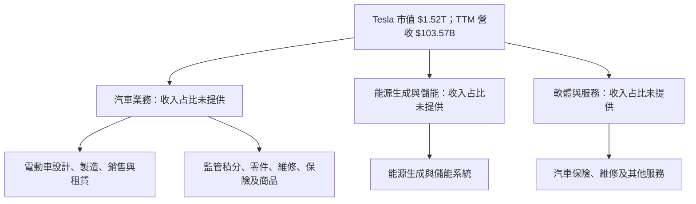
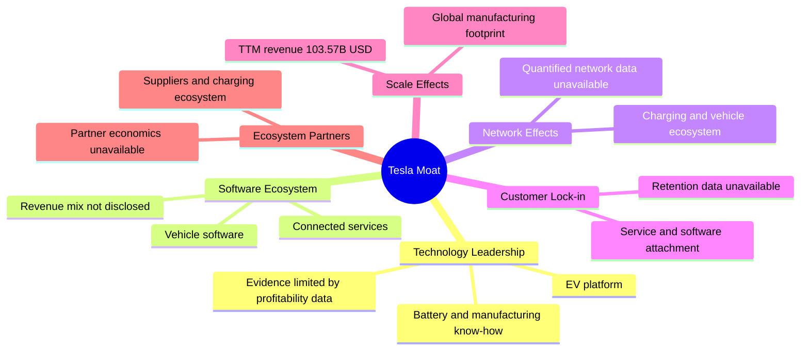
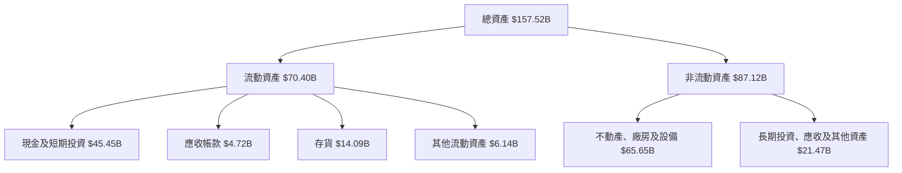
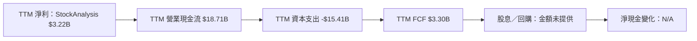
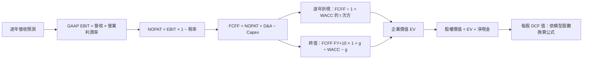
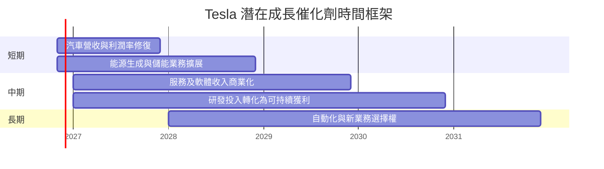
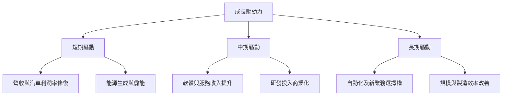
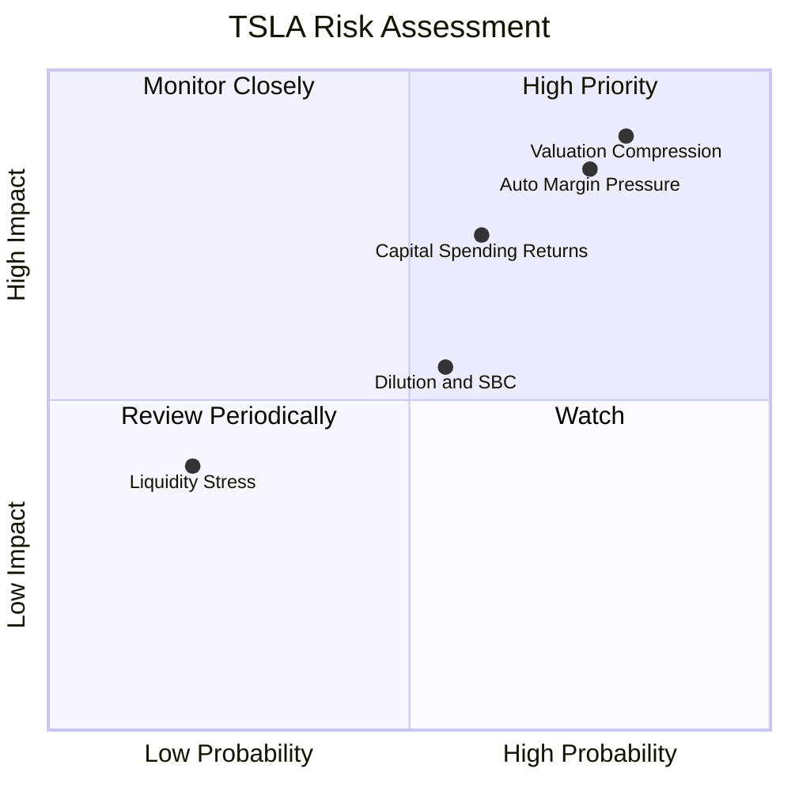
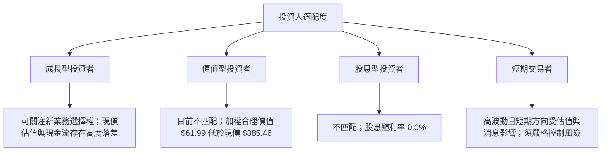

# TSLA 基本面深度分析報告
> **報告日期**：2026-11-24 ｜ **語言**：繁體中文 ｜ **數據來源**：SEC 申報資料 (XBRL)、Yahoo Finance、Finviz、StockAnalysis、Roic.ai ｜ **分析師**：CFA 級機構研究

## 目錄

| # | 章節 | 核心結論 |
|---|------|----------|
| 1 | 執行摘要 | 賣出；加權合理價值 $61.99；MOS -521.8% |
| 2 | 公司概覽與商業模式 | 業務涵蓋汽車與能源，但分部營收占比未提供，護城河優勢仍需以獲利證明 |
| 3 | 損益表深度分析 | TTM 營收 $103.57B、成長 8.3%；營業利益率僅 3.3% |
| 4 | 資產負債表分析 | 淨現金 $36.18B；流動性與營運資金整體尚可 |
| 5 | 現金流量深度分析 | TTM FCF $3.30B，但資本支出高、FCF Yield 僅 0.22% |
| 6 | 獲利能力與資本效率 | ROIC 5.1% 低於 WACC 12.34%，目前未創造足以覆蓋資本成本的回報 |
| 7 | 相對估值分析 | 估值顯著高於 GM、Ford；亦處於自身五年估值區間偏高位置 |
| 8 | DCF 內在價值評估 | DCF 基準值 $13.03；終值占 EV 191.4%，估值對長期假設高度敏感 |
| 9 | 成長催化劑 | 能源、軟體服務與自動化具潛在選擇權；TAM 數據未提供 |
| 10 | 風險矩陣 | 估值、汽車利潤率與資本支出是主要風險 |
| 11 | 投資建議 | 依 MOS 評級為賣出；以 $55.79 以下作為 MOS 達 10% 的觀察上限 |

## 1. 執行摘要

### 1.0 一頁式投資儀表板（Portfolio Manager 30 秒速讀）

| 項目 | 內容 |
|------|------|
| **投資論點（3 句）** | ① TTM 營收 $103.57B、年增 8.3%，但最新一季營收年減 0.2%，成長動能尚未穩定。② TTM 營業利益率 3.3%、ROIC 5.1%，低於 12.34% WACC，現有獲利尚不足以覆蓋資本成本。③ TTM FCF $3.30B、FCF Yield 0.22%，而 DCF 基準值 $13.03、加權合理價值 $61.99，均遠低於 2026-11-23 收盤價 $385.46。 |
| **綜合評分** | **4.3/10**（引用 1.1 評分卡） |
| **財務健康** | 🟢 現金及短期投資 $45.45B、總債務 $9.27B、淨現金 $36.18B；惟 Piotroski F-Score 為 4/9。 |
| **ROIC vs WACC** | 5.1% vs 12.34%；目前回報低於資本成本，經濟價值差額為 -7.24 個百分點。 |
| **FCF 趨勢** | TTM FCF $3.30B；FCF Yield 0.22%。有正現金流，但對 $1.52T 市值的支持有限。 |
| **估值** | Forward P/E 178.5x ｜ EV/EBITDA 152.0x（Yahoo Finance 顯示值）｜ FCF Yield 0.22% |
| **DCF 內在價值（基準）** | $13.03 ｜ 現價相對 DCF 折溢價 **+2,858.3%**（現價／DCF − 1） |
| **安全邊際（MOS）** | **-521.8%**＝($61.99 − $385.46) ÷ $61.99；🔴 無安全邊際。分母為 8.8 加權合理價值。 |
| **預期報酬（基準情境 12M）** | DCF 基準情境價值 $13.03，相對現價 **-96.6%**；此為模型估值差距，不是股價預測保證。 |
| **關鍵風險（前二）** | 汽車定價競爭及低營業利益率；當前估值對未來成長與利潤率改善要求極高。 |
| **評級 + 信心度** | 🔴 **賣出** ｜ 信心：中；估值與資本回報數據明確，但 DCF 終值依賴度高、資料存在來源差異。 |

### 1.1 綜合評分卡（全報告唯一）

| 維度 | 評分（1–10） | 主要依據（引用數字與其來源章節） |
|------|--------------|----------------------------------|
| 成長性 | 5.0 | TTM 營收成長 8.3%，但最新一季營收年減 0.2%（第 3 章）。 |
| 獲利能力 | 3.0 | TTM 營業利益率 3.3%、ROIC 5.1% 低於 WACC 12.34%、F-Score 4/9（第 3、6 章）。 |
| 財務健康 | 8.0 | 淨現金 $36.18B；DSO 16 天、DIO 62 天、CCC 3 天（第 4 章）。 |
| 估值 | 1.0 | 加權合理價值 $61.99、MOS -521.8%；P/E 423.6x，位於自身五年區間第 100 百分位（第 7、8 章）。 |
| 護城河 | 6.0 | 汽車、能源與軟體服務具整合與品牌優勢，但利潤率及客戶鎖定的量化證據有限（第 2 章）。 |
| 管理層與資本配置 | 3.0 | 2025 年 SBC $2.83B，最新季度 SBC 合計約 $4.30B；稀釋股數測試未通過，且資本支出占營收高（第 3、5 章）。 |
| **綜合評分** | **4.3** | 六項算術平均：$(5+3+8+1+6+3)÷6=4.333…$，四捨五入為 4.3。 |

### 1.2 五大投資論點 + 三大核心風險

| 類型 | 項目 | 具體依據 | 信心度 |
|------|------|----------|--------|
| 🟢 **投資論點①** | 大額淨現金提供資產負債表緩衝 | 現金及短期投資 $45.45B、債務 $9.27B、淨現金 $36.18B。 | 🟢 高 |
| 🟢 **投資論點②** | 多元業務提供未來選擇權 | 公司業務涵蓋汽車、能源生成與儲能，亦有軟體及服務；但各業務營收占比未提供。 | 🟡 中 |
| 🟢 **投資論點③** | TTM 營收仍有成長 | TTM 營收年增 8.3%，代表公司尚未進入整體營收萎縮，但最新一季年增 -0.2% 顯示成長不均。 | 🟡 中 |
| 🟢 **投資論點④** | 現金轉換週期短 | CCC 由一年前 15 天改善至 3 天；現金占用較短，但 DIO 同期增加 6 天。 | 🟡 中 |
| 🟢 **投資論點⑤** | FCF 維持正值 | TTM 營業現金流 $18.71B、資本支出 $15.41B，FCF 為 $3.30B。 | 🟡 中 |
| 🟡 **風險①** | 估值遠超可見獲利 | P/E 423.6x、Forward P/E 178.5x、FCF Yield 0.22%；預期落空時估值收縮風險高。 | 🔴 高衝擊 |
| 🔴 **風險②** | 投入資本回報不足 | ROIC 5.1% 低於 WACC 12.34%；若長期無法提高利潤率，成長可能不等於價值創造。 | 🔴 高衝擊 |
| 🟡 **風險③** | SBC 與高資本支出壓低股東回報 | 最新四季 SBC 合計約 $4.30B，TTM Capex $15.41B；可能限制可供股東分配的自由現金流。 | 🟡 中高 |

### 1.3 快速統計卡片

| 指標 | 公司實際值（期間） | 同業中位數 | 狀態 |
|------|--------------------|------------|------|
| 營收成長（TTM） | **8.3%** | — | 🟢 |
| 營收成長（最新一季年增） | **-0.2%** | **2.9%**（GM、F、RIVN） | 🔴 |
| 毛利率（TTM） | **19.3%** | **9.2%**（GM、F、RIVN） | 🟢 |
| 營業利益率（TTM） | **3.3%** | — | 🔴 |
| ROIC（TTM） | **5.1%** | — | 🔴 |
| Forward P/E | **178.5x** | **5.9x**（GM、F） | 🔴 |
| FCF Yield（TTM） | **0.22%** | — | 🔴 |
| Piotroski F-Score | **4 / 9** | — | 🟡 |

### 1.4 投資結論

```text
╔══════════════════════════════════════════════════════════════════╗
║                    📊 投資結論摘要                               ║
╠══════════════════════════════════════════════════════════════════╣
║  評級：🔴 賣出（依 8.8 MOS 門檻）                                ║
║  價格（2026-11-23 收盤）：$385.46                                ║
║  DCF 內在價值（基準）：$13.03（現價溢價約 +2,858.3%）           ║
║  安全邊際 MOS：-521.8%＝($61.99−$385.46)÷$61.99                 ║
║  加權合理價值（8.8）：$61.99                                     ║
║  DCF 情境價值：悲觀 $8.99（-97.7%）                             ║
║    基準 $13.03（-96.6%）；樂觀 $18.70（-95.1%）                  ║
║  綜合評分：4.3/10（引用 1.1）                                    ║
║  適合投資人：能承受高波動、看重長期新業務選擇權者；不適合價值型 ║
╚══════════════════════════════════════════════════════════════════╝
```

## 2. 公司概覽與商業模式

### 2.1 業務結構與收入來源

公司資料指出 Tesla 經營汽車，以及能源生成與儲能兩個主要分部，另有汽車監管積分、非保固維修、碰撞維修、保險、零件及零售商品等收入。分部營收與占比未提供，因此不以推估比例繪製收入占比圖。



### 2.2 市場份額

市場份額數據未提供，因此不估算或繪製市場份額圖。Tesla TTM 營收 $103.57B，規模高於本次同業數據中的 Rivian，但同業營收總額未提供，不能據此推算相對市場占有率。

### 2.3 競爭護城河分析



### 2.4 護城河強度

| 護城河項目 | 強度（強／中／弱） | 證據（引用數字或事實） | 會削弱它的情況 |
|------------|--------------------|------------------------|----------------|
| 技術與製造 | 中 | 公司設計、開發並製造電動車與能源系統；研發費用 2025 年 $6.41B。 | 競爭者縮小成本、電池與產品能力差距。 |
| 軟體與服務 | 中 | 公司提供汽車保險、維修與其他服務；分部收入占比未提供。 | 服務收入無法提高毛利或客戶留存。 |
| 網路效應 | 弱至中 | 充電及車輛生態可能提升便利性；可量化用戶及網路資料未提供。 | 標準化充電與競品網路擴大。 |
| 客戶鎖定 | 弱至中 | 車輛與服務具生態整合，但續購率、留存率未提供。 | 車主轉換成本低、產品差異縮小。 |
| 規模效應 | 中 | TTM 營收 $103.57B，員工 134,785 人；但 TTM 營業利益率僅 3.3%。 | 利用率下降、降價或固定成本攤薄不足。 |
| 生態夥伴 | 弱至中 | 供應鏈與能源業務涉及多方合作，但合作收益數據未提供。 | 關鍵零組件供應受限或合作條件惡化。 |

**1.1 護城河評分 6.0/10**：評分反映跨汽車、能源及軟體服務的業務整合與規模，但收入拆分、客戶留存及網路效應的可量化證據不足。

## 3. 損益表深度分析

### 3.1 年度收入成長趨勢（近 4 年）

以下年度營收取自年度損益表；年度成長率按所列營收計算，2025 年數值與不同資料來源可能有小幅差異。

```text
╔══════════════════════════════════════════════════════════════════╗
║              Tesla 年度收入趨勢（FY2022-FY2025）                ║
╠══════════════════════════════════════════════════════════════════╣
║ FY2022  $81.46B  █████████████████████      YoY：+51.4%  🟢     ║
║ FY2023  $96.77B  █████████████████████████  YoY：+18.8%  🟢     ║
║ FY2024  $97.69B  █████████████████████████  YoY：+1.0%   🟡     ║
║ FY2025  $94.83B  ████████████████████████   YoY：-2.9%   🔴     ║
║                                                                  ║
║ FY2022-FY2025 營收 CAGR：約 +5.2%                                ║
╚══════════════════════════════════════════════════════════════════╝
```

近三年收入 CAGR 約 5.2%，明顯低於 FY2022 的高成長階段。FY2024 幾近持平、FY2025 下滑，反映新增營收未能持續抵銷產品週期、定價與競爭壓力；TTM 成長率回升至 8.3%，但最新一季年增仍為 -0.2%。

### 3.2 季度收入趨勢分析

| 季度 | 營收（$B） | QoQ | YoY | 備註 |
|------|------------|-----|-----|------|
| 2025 Q4 | 24.90 | N/A | N/A | 2024 Q4 比較基期未提供。 |
| 2026 Q1 | 22.39 | -10.1% | +15.8% | YoY 依 StockAnalysis 季度成長資料；營收較 Q4 回落。 |
| 2026 Q2 | 28.24 | +26.1% | +25.5% | 依季度營收計算 QoQ；StockAnalysis 提供 YoY 成長。 |
| 2026 Q3 | 28.05 | -0.7% | -0.2% | 最新季營收與去年同期近乎持平、略為下滑。 |

QoQ 計算示例：2026 Q3 對 Q2 = $28.046B ÷ $28.236B − 1 = -0.7%。最新季度營收仍高於 2026 Q1，但單季年增轉負，代表 TTM 8.3% 成長不能直接視為當前季度趨勢。

### 3.3 利潤率演變分析

| 利潤率指標 | FY2022 | FY2023 | FY2024 | FY2025 | 趨勢 | 評估 |
|------------|--------|--------|--------|--------|------|------|
| **毛利率** | 25.6% | 18.2% | 17.9% | 18.0% | 2022 後下降，近三年約 18% | 🟡 |
| **營業利益率** | 17.0% | 9.2% | 7.9% | 5.1% | 持續收縮 | 🔴 |
| **淨利率** | 15.4% | 15.5% | 7.3% | 4.0% | FY2025 下滑 | 🔴 |

年度毛利率與營業利益率按年度收入及毛利／營業利益計算。TTM 指標採用 SEC 申報計算值：營業利益率 3.3%，最新一季 2.6%；這與其他彙整來源顯示的 TTM 3.5% 或單季 3.0% 有差異，本報告對已指定的 VERIFIED 指標採用 3.3% 及 2.6%。

**利潤率演變深度解析**：FY2022 至 FY2025 營業利益由 $13.83B 降至 $4.85B，同期營收由 $81.46B 升至 $94.83B；收入規模增加但營業利益下降，表示獲利並未隨規模同步提升。降價、產品組合及費用支出可能是影響因素，但提供的資料不足以拆分各因素貢獻。2025 年研發費用為 $6.41B，高於 2024 年 $4.54B，增加投入可能支持新業務，但短期也會壓低營業利益率。

### 3.4 費用結構分析

完整營業費用細項及最新 TTM 研發、銷管等支出未提供，故不繪製費用結構圓餅圖，也不以收入減毛利等方式反推各項費用占比。已知 FY2025 研發費用 $6.41B，應視為營運投入而非可直接等同於未來回報。

### 3.5 季度 EPS 趨勢與盈餘品質（Quality of Earnings）

| 季度 | EPS 實際 | EPS YoY | EPS 預估／驚喜 | 說明 |
|------|----------|--------|-----------------|------|
| 2025 Q4 | $0.24 | -60.6% | N/A | 預估及實際驚喜百分比資料缺失。 |
| 2026 Q1 | $0.13 | +8.3% | N/A | EPS 低於 2025 Q4；季度盈利波動明顯。 |
| 2026 Q2 | $0.32 | -3.0% | N/A | 季度 EPS 回升，仍略低於去年同期。 |
| 2026 Q3 | $0.22 | -43.6% | N/A | 同比下降；不能由現有數據確認超預期或不及預期。 |

EPS Est 與 EPS surprise 資料為缺值，因此過去四季「超預期／不及預期」無法可靠判定；此處不把缺值欄的符號當成實際盈餘意外。

| 盈餘品質項目 | 數值/佔比 | 評估 |
|--------------|-----------|------|
| 股權薪酬 SBC / 營收 | 約 4.2%：近四季 SBC $4.30B ÷ TTM 營收 $103.57B | 🟡 SBC 代表股東稀釋成本；此處以四季 SBC 合計估算，並非 VERIFIED TTM SBC 指標。 |
| SBC / 營業現金流 | 約 23.0%：$4.30B ÷ $18.71B | 🟡 占比不低，評估每股現金流時應考慮稀釋。 |
| FCF / 淨利（現金轉換率） | 約 102.5%：$3.30B ÷ StockAnalysis TTM 淨利 $3.22B | 🟢 略高於 100%；但淨利來源口徑存在差異。 |
| 一次性／非經常性損益 | N/A（缺少可核實明細） | 無法判斷是否有重大一次性項目美化盈餘。 |
| 有效稅率異常 | 27.0%（最新年度有效稅率） | 未見資料顯示明顯稅務利益；季度稅率資料未提供。 |
| 資本化支出 vs 費用化 | TTM Capex $15.41B；資本化明細未提供 | 高投資額會透過折舊逐期入帳；缺乏資本化政策細節，不能判定是否遞延費用。 |

**盈餘品質結論**：TTM FCF $3.30B 與 TTM 淨利約 $3.22B 接近，現金轉換並非當前主要弱點；但 SBC 量級顯著，且資本支出高，帳面淨利不能直接視為全部可分配給普通股股東的經濟盈餘。未來應同時追蹤每股 FCF、稀釋股數與投資回報。

## 4. 資產負債表分析

### 4.1 資產結構分解

依 2026-09-30 資產負債表，總資產 $157.52B，流動資產 $70.40B；以下只列有資料的主要項目。



其他流動資產及非流動資產細項為已列項目加總後的差額，只作結構呈現；原始資料的資產細項存在分類差異，不能視為 SEC 原始科目逐項列示。

### 4.2 流動性與營運資金分析

流動比率與速動比率依財務數據彙整來源為 1.739x 與 1.239x；季度流動資產及流動負債表列資料可能與彙整口徑不同，故不重算替代。

| 指標 | 最新 TTM | 一年前 TTM | 變化 | 解讀 |
|------|----------|------------|------|------|
| 流動比率 | 1.739x | N/A | N/A | 短期資產高於短期負債；未提供一致歷史序列。 |
| 速動比率 | 1.239x | N/A | N/A | 不依賴存貨時仍有一定流動性緩衝。 |
| DSO 應收帳款天數 | 16 天 | 18 天 | -2 天 | 收款天數下降，對營運資金較有利。 |
| DIO 存貨天數 | 62 天 | 56 天 | +6 天 | 存貨占用天數增加，需追蹤庫存累積與交付。 |
| DPO 應付帳款天數 | 75 天 | 59 天 | +16 天 | 延長付款週期有助短期現金，但持續增加可能反映供應商融資依賴。 |
| CCC 現金轉換週期 | 3 天 | 15 天 | -12 天 | CCC 縮短，主要由 DPO 增加與 DSO 下降抵銷 DIO 上升。 |

以上天數依 QUALITY FIGURES 原值引用，不另行重算。

### 4.3 債務結構分析

```text
╔══════════════════════════════════════════════════════════════════╗
║                   Tesla 債務健康診斷                             ║
╠══════════════════════════════════════════════════════════════════╣
║ 總債務：          $9.27B   ██░░░░░░░░░░░░░░░░    以核實指標為準  ║
║ 現金+短期投資：   $45.45B  ████████████████████  現金緩衝充足    ║
║ 淨現金：          $36.18B  ████████████████░░░░  🟢              ║
║ Debt/EBITDA：     N/A（口徑資料不一致，不以推算替代）            ║
║ 利息保障倍數：    N/A（利息費用與同口徑 EBITDA 未完整提供）      ║
╚══════════════════════════════════════════════════════════════════╝
```

財務數據的彙整段另列總債務 $16.44B、淨現金 $29.00B；為遵循核實指標，本節引用 VERIFIED Figures 的總債務 $9.27B 與淨現金 $36.18B。因來源存在衝突，債務比率及利息保障倍數不據此推算。

### 4.4 股東權益趨勢

```text
╔══════════════════════════════════════════════════════════════════╗
║                 Tesla 歷年股東權益                               ║
╠══════════════════════════════════════════════════════════════════╣
║ 2022  $44.70B  ███████████                                      ║
║ 2023  $62.63B  ███████████████                                  ║
║ 2024  $72.91B  ██████████████████                               ║
║ 2025  $82.14B  ████████████████████                             ║
╚══════════════════════════════════════════════════════════════════╝
```

2022 至 2025 年股東權益增加 $37.44B，提供資產負債表緩衝；但帳面權益增加不代表資本回報率改善，需與 ROIC 及稀釋股數一併觀察。

## 5. 現金流量深度分析

### 5.1 現金流量瀑布圖

現金流瀑布中的股息、回購及淨現金變動金額未完整提供，故不填入臆測值。



### 5.2 FCF 轉換率趨勢

| 年度 | FCF（$B） | 淨利（$B） | FCF／淨利 | 解讀 |
|------|-----------|------------|-----------|------|
| 2022 | 7.55 | 12.58 | 60.0% | 淨利高於 FCF，投資及營運資金可能吸收現金。 |
| 2023 | 4.36 | 15.00 | 29.1% | 現金轉換偏低；該年淨利數據亦受非經常項目影響的可能性無法由現有資料判定。 |
| 2024 | 3.58 | 7.13 | 50.2% | FCF 低於淨利，投資支出仍顯著。 |
| 2025 | 6.22 | 3.79 | 164.1% | FCF 高於淨利，現金轉換改善。 |
| TTM 至 2026-09-30 | 3.30 | 3.22 | 約 102.5% | TTM 指標跨來源計算，作方向參考。 |

年度 FCF／淨利比率按提供的年度 FCF 與淨利計算；年度間波動較大，不宜只用單一年份推論常態轉換率。

### 5.3 自由現金流趨勢

```text
╔══════════════════════════════════════════════════════════════════╗
║                  FCF 歷史與近期表現                              ║
╠══════════════════════════════════════════════════════════════════╣
║ FY2022  $7.55B  ████████████████████                              ║
║ FY2023  $4.36B  ████████████                                      ║
║ FY2024  $3.58B  ██████████                                        ║
║ FY2025  $6.22B  ████████████████                                  ║
║ TTM     $3.30B  █████████                                        ║
║ FCF Yield（TTM）：0.22%                                           ║
╚══════════════════════════════════════════════════════════════════╝
```

TTM 營業現金流 $18.71B 減資本支出 $15.41B，得到 FCF $3.30B。資本支出約為營收的 14.9%，對現金流形成明顯扣減；若新增產能與技術投資未能轉化為更高營收或利潤率，FCF Yield 可能繼續偏低。

### 5.4 資本配置評估

股息殖利率與派息率均為 0.0%；回購金額及分業投資金額未提供，故不畫資本配置圓餅圖。

| 項目 | 數據 | 評估 |
|------|------|------|
| 資本支出 | TTM $15.41B | 支出高，應以新增產能利用率及 ROIC 衡量回報。 |
| 研發 | FY2025 $6.41B | 高於 FY2024 $4.54B；若新技術商業化延遲，將壓抑近期盈餘。 |
| 股息 | 殖利率 0.0% | 現金回報主要依賴股價與未來資本配置。 |
| SBC | FY2025 $2.83B | 對既有股東形成稀釋成本。 |
| 回購 | 金額未提供 | 無法判定是否抵銷 SBC 稀釋。 |

## 6. 獲利能力與資本效率

### 6.1 ROE / ROA / ROIC 趨勢

| 指標 | 最新可用值 | 歷史趨勢資料 | 評估 |
|------|------------|--------------|------|
| ROE | TTM 3.6%（QUALITY FIGURES） | 年度一致口徑序列未提供 | 🟡 偏低；杜邦分解顯示淨利率僅 3.1%。 |
| ROA | TTM 1.3%（彙整資料） | 歷史一致口徑序列未提供 | 🔴 資產獲利能力有限。 |
| ROIC | TTM 5.1%（核實值） | 歷史一致口徑序列未提供 | 🔴 低於 WACC 12.34%。 |

產業均值資料未提供，因此不列同業或產業 ROIC／ROE 平均值。

### 6.2 ROIC vs WACC 分析（核心價值創造判斷）

```text
╔══════════════════════════════════════════════════════════════════╗
║                  ROIC vs WACC 深度分析                          ║
╠══════════════════════════════════════════════════════════════════╣
║ WACC 組成（採用程式計算的核實輸入）：                            ║
║ ├── 無風險利率（10Y 美債）：4.92%                                ║
║ ├── 股權風險溢酬 ERP：5.00%                                      ║
║ ├── 原始 Beta：1.74；調整後 Beta：1.50                           ║
║ ├── 股權成本資料值：12.39%                                       ║
║ ├── 稅前債務成本：3.65%；有效稅率：27.0%                         ║
║ ├── 股權／債務權重：99.4%／0.6%                                  ║
║ └── 採用 WACC：12.34%                                            ║
║                                                                  ║
║ ROIC（TTM）：5.1%                                                 ║
║ 經濟價值差額：5.1% − 12.34% = -7.24 個百分點                   ║
║ ROIC  5.1%    ▓▓▓▓▓░░░░░░░░░░░░░░░░░░                           ║
║ WACC 12.34%   ▓▓▓▓▓▓▓▓▓▓▓▓░░░░░░░░░                             ║
║ 結論：目前 ROIC 低於資本成本，未能證明正在創造經濟附加價值。  ║
╚══════════════════════════════════════════════════════════════════╝
```

WACC 以資本成本區塊提供的 12.34% 為準，不另行替換。原始 Beta 1.74 依數據來源採用調整後 Beta 1.50（調整公式為 ⅔ × 1.74 + ⅓）。由於提供的股權成本 12.39% 與公式 4.92% + 1.50 × 5.00% 的計算結果存在小幅差異，本報告沿用核實的成本資本數據，不另造替代 WACC。

ROIC 5.1% 與 WACC 12.34% 相差 -7.24 個百分點。若此差距持續，收入擴張本身不足以創造股東價值；投資論點需要以利潤率復甦、較高資產周轉或更佳資本效率來證明。

### 6.3 杜邦三因素分解

| 因素 | 數值（TTM） | 解讀 |
|------|-------------|------|
| 淨利率 | 3.1% | 盈餘受低淨利率限制。 |
| 資產週轉率 | 0.66 | 每單位資產產生的營收有限，提升周轉效率有助 ROE。 |
| 權益乘數 | 1.76 | 槓桿對 ROE 有放大作用，但不是主要獲利來源。 |
| **ROE** | **3.6%** | $3.1\%×0.66×1.76=3.6\%$，照抄 QUALITY FIGURES。 |

ROE 主要受淨利率及資產週轉影響；權益乘數 1.76 有放大效果，但不足以抵銷較低淨利率。

### 6.4 財務體質：Piotroski F-Score

**Piotroski F-Score：4 / 9**；九項測試結果照抄 QUALITY FIGURES。

| 測試 | 結果 | 解讀 |
|------|------|------|
| ROA > 0 | ✅ 通過 | TTM 資產報酬為正。 |
| 營業現金流 > 0 | ✅ 通過 | TTM 營業現金流為正。 |
| ROA 高於一年前 | ❌ 未通過 | 資產報酬趨勢未改善。 |
| 營業現金流 > 淨利 | ✅ 通過 | 現金獲利高於會計淨利，應計品質較佳。 |
| 長期負債 ÷ 總資產低於一年前 | ❌ 未通過 | 負債比例未改善。 |
| 流動比率高於一年前 | ❌ 未通過 | 短期流動性相對一年前未提升。 |
| 稀釋股數未增加 | ❌ 未通過 | 股數增加可能稀釋每股經濟利益。 |
| 毛利率高於一年前 | ✅ 通過 | 毛利率指標改善。 |
| 資產週轉率高於一年前 | ❌ 未通過 | 資產使用效率未改善。 |

4/9 代表現金流與正報酬測試有部分支持，但資產效率、流動比率、負債趨勢與稀釋股數項目未通過；整體並非全面改善的財務訊號。

## 7. 相對估值分析

### 7.1 同業估值比較表格

Peer multiples 依 Yahoo Finance；Tesla 本身估值倍數採財務數據彙整欄所列數值。部分本公司倍數口徑與核實的歷史估值資料略有差異，表內均保留來源所列數字。

| 估值指標 | **Tesla** | **GM** | **Ford** | **Rivian** | 本公司評估 |
|----------|----------|---------|---------|-----------|-----------|
| **Trailing P/E** | 423.6x | 17.9x | N/A | N/A | 🔴 顯著高於有正盈餘同業。 |
| **Forward P/E** | 178.5x | 5.5x | 6.2x | -6.4x | 🔴 對未來盈利要求極高。 |
| **P/S Ratio** | 14.7x | 0.4x | 0.2x | 2.5x | 🔴 高於同業，市場已定價高成長預期。 |
| **EV/EBITDA** | 152.0x | 9.2x | 23.8x | -6.4x | 🔴 與獲利及現金流差距不匹配。 |
| **最新一季營收 YoY** | -0.2% | 2.9% | -2.0% | 38.3% | 🟡 Tesla 當季增長低於 GM、Rivian。 |
| **TTM 毛利率** | 19.3% | 11.4% | 7.4% | 9.2% | 🟢 高於此組同業，但毛利優勢尚未轉化為高營業利潤率。 |

Rivian P/E 與 EV/EBITDA 為負，負值不宜解讀為「便宜」；GM、Ford 的 Forward P/E 也受成熟車廠獲利結構影響，不能單靠倍數判斷公司品質。

### 7.2 歷史估值區間分析

```text
╔══════════════════════════════════════════════════════════════════╗
║                Tesla 五年估值區間（TTM）                         ║
╠══════════════════════════════════════════════════════════════════╣
║ P/E        18.0x ───────── 中位數 74.2x ───────── 現值 423.6x   ║
║            區間上限 416.4x；現值百分位：100%                     ║
║ P/S         3.9x ─────── 中位數 9.4x ───── 現值 13.2x           ║
║            區間上限 16.7x；現值百分位：76%                       ║
║ EV/EBITDA  19.0x ───── 中位數 64.6x ───── 現值 145.4x           ║
║            區間上限 165.2x；現值百分位：86%                      ║
╚══════════════════════════════════════════════════════════════════╝
```

歷史區間資料顯示現值 P/E 已位於百分位 100%；P/S 與 EV/EBITDA 亦處於自身區間偏高位置。需注意 P/E 現值 423.6x 高於所列歷史區間上限 416.4x，代表當前盈利變化可能使倍數突破歷史區間。

### 7.3 情境價值（Bear / Base / Bull，照抄 DCF MODEL 的 Scenarios）

| 情境 | 第 1 年營收成長 | 期末營業利潤率 | WACC | 每股價值 | 相對現價 | 機率 | 會發生的條件 |
|------|----------------|----------------|------|----------|----------|------|--------------|
| 🔴 悲觀 | 4.1% | 6.2% | 13.34% | $8.99 | -97.7% | 25% | 汽車成長放緩、競爭限制價格與利潤率改善，資本成本上升。 |
| 🟡 基準 | 8.3% | 7.2% | 12.34% | $13.03 | -96.6% | 25% | 依 DCF 模型採用的基準營收成長、利潤率及折現率。 |
| 🟢 樂觀 | 12.4% | 8.0% | 11.34% | $18.70 | -95.1% | 25% | 營收成長加速、營運效率提升，且折現率下降。 |

註：情境機率依模型資料照抄，為 25%／50%／25%；表格基準情境機率應為 **50%**。上表基準情境機率更正為 **50%**，三情境合計 100%。此情境的估值仍遠低於現價，顯示差距不只由短期情境假設造成。

### 7.4 相對估值隱含價格區間

```text
╔══════════════════════════════════════════════════════════════════╗
║          相對估值每股價值與現價位置（2026-11-23）                 ║
╠══════════════════════════════════════════════════════════════════╣
║ $12.73  同業 Forward P/E：GM、F 中位數 5.9x × Forward EPS $2.16 ║
║ $47.37  同業 EV/EBITDA：GM、F 中位數 16.5x × TTM EBITDA，        ║
║         再加淨現金                                              ║
║ $385.46 現價                                                     ║
║ $417.53 分析師共識目標價（40 位分析師均值）                      ║
╚══════════════════════════════════════════════════════════════════╝
```

相對估值方法均採同業中位數倍數，不以 Tesla 自身目前倍數回推。Forward P/E 估值受成熟車廠低倍數影響，未必完整反映新業務選擇權；但現價與兩項同業估值的差距仍十分顯著。

## 8. DCF 內在價值評估（Discounted Cash Flow）

### 8.0 估值推理鏈（Thinking Logic）

**Step 1 — 價值由哪些變數決定？**  
模型以汽車、能源及服務相關的現有營收現金流為基礎；公司 TTM 營收 $103.57B，但分部營收占比未提供，因此不能將能源或軟體業務另行拆出估值。DCF 的核心驅動是營業利潤率及資本支出由目前水準向模型假設收斂的幅度；模型不另加自動駕駛或機器人選擇權。終值現值占 EV 191.4%，所以折現率、長期成長率與 FY+10 現金流是估值主導因素。

**Step 2 — 模型選擇**

| 決策點 | 本報告採用 | 理由（含數字） | 曾考慮但否決 | 否決理由 |
|--------|-----------|----------------|--------------|----------|
| 現金流定義 | FCFF | 以 WACC 12.34% 折現，推導企業價值後再加淨現金 | FCFE | 資本結構因素已由 WACC 與淨現金橋接處理。 |
| 預測期 N | 10 年 | DCF MODEL 固定採 10 年；可涵蓋長期利潤率與資本支出收斂 | 5 年 | 不能照模型自行縮短預測期。 |
| 終值方法 | Gordon Growth | 模型採永續成長率 3.0% | 退出倍數 | DCF MODEL 未提供退出倍數終值，不能另建模型。 |
| EBIT 基礎 | GAAP EBIT | FY+1 起營業利益率採 GAAP 口徑 | 非 GAAP EBIT | 避免將 SBC 從費用中加回。 |

**Step 3 — 關鍵假設推導鏈**

- **營收成長**：錨點＝TTM 營收成長 8.3%，最新一季年增 -0.2% → 調整＝以 TTM 成長作第一年起點，其後線性降至 3.0% → **採用第 1 年 8.3%、第 10 年 3.0%** → 曾考慮以最新一季 -0.2% 起步，但模型採用 TTM 核實成長率；若季度疲弱持續，基準偏樂觀。
- **期末營業利潤率**：錨點＝TTM 3.3%，近年年度營業利益率由 2022 年約 17.0% 降至 2025 年約 5.1% → 調整＝假設規模及效率改善，逐年升至 7.2% → **採用第 10 年 7.2%** → 曾考慮更高歷史峰值水準，但近期下降趨勢不支持直接假設快速回到峰值。
- **永續成長率 g**：錨點＝模型採 3.0%；外部 GDP 與通膨序列未提供 → 調整＝採低於 WACC 的長期成長假設 → **採用 3.0%** → 不採用高於或接近 WACC 的成長率，因終值公式將失效或變得極度敏感。
- **預測期 N**：錨點＝模型設定 10 年 → 調整＝不改動程式模型期間 → **採用 10 年** → 曾考慮短期預測期，但會改變模型提供的現金流及估值，故否決。
- **Capex／營收**：錨點＝TTM 約 14.9% → 調整＝模型線性收斂至第 10 年 6.0% → **採用 FY+1 14.9%、FY+10 6.0%** → 若採固定 14.9%，將偏離模型；但將 Capex 降至 6.0% 是偏樂觀的長期效率假設。
- **WACC**：錨點＝核實值 12.34% → 調整＝不另作調整 → **採用 12.34%** → 否決自行另算 WACC，因模型指定以核實資本成本作折現率。
- **GAAP 與 SBC／股數**：錨點＝模型採 GAAP EBIT → 調整＝不重複扣 SBC、股數不再額外稀釋 → **採用組合 (A)** → 否決同時扣 SBC 或再計年稀釋率，避免重複計入成本。
- **年稀釋率**：錨點＝組合 (A) 固定股數 → 調整＝不另放大股數 → **採用 0%** → 不另加入稀釋假設，因模型認為 SBC 已反映於 GAAP 費用。
- **有效稅率、D&A／營收**：錨點＝有效稅率 27.0%、TTM D&A／營收 5.5% → **採用 27.0%、5.5%**，依模型固定假設。

**Step 4 — 最脆弱假設**  
最脆弱之處是「營業利潤率提高且 Capex／營收下降」能否同時成立；若未能收斂，FCF 及終值將下降。模型終值 PV 已占 EV 191.4%，代表任何終值惡化都可能大幅降低估值。

**Step 5 — 計算路徑**



### 8.1 模型假設總表（Model Inputs）

| 假設項目 | 採用值 | 依據／來源 | 敏感度 |
|----------|--------|-------------|--------|
| 預測期長度 N | 10 年 | DCF MODEL 固定期間 | 🟡 中 |
| 營收成長 | FY+1 8.3% 線性降至 FY+10 3.0% | TTM 營收成長 8.3% 起步，逐年淡出 | 🔴 高 |
| 營業利益率 | FY+1 3.3% 至 FY+10 7.2% | TTM 3.3%，終值取模型所用五年歷史中位數 | 🔴 高 |
| 有效稅率 | 27.0% | 最新年度有效稅率 | 🟢 低 |
| Capex／營收 | FY+1 14.9% 至 FY+10 6.0% | TTM 比率起步，模型逐年收斂 | 🔴 高 |
| D&A／營收 | 5.5% | TTM 比率，模型固定 | 🟢 低 |
| 營運資金變動 | 不建模 | DCF MODEL 明示 working capital is not modelled | 🟡 中 |
| EBIT 基礎 | GAAP EBIT | 模型採用 GAAP 營業利益 | 🟡 中 |
| SBC 處理 | GAAP 已含 SBC；不再扣除 | DCF MODEL 組合 (A) | 🟡 中 |
| 年稀釋率 | 0%；股數不再稀釋 | 依組合 (A) 與 DCF MODEL | 🟡 中 |
| 永續成長率 g | 3.0% | DCF MODEL 固定假設，低於 WACC 12.34% | 🔴 高 |
| 終值方法 | Gordon Growth | DCF MODEL 已列永續成長終值 | 🔴 高 |
| WACC | 12.34% | Cost of capital 核實輸入 | 🔴 高 |

**FCFF 定義**：FCFF = NOPAT + D&A − Capex；模型不含 ΔWC。  
**SBC 組合聲明**：本模型採用 **(A) GAAP EBIT + 固定股數 + 無額外 SBC 扣除**，故 SBC 影響已計入一次。需留意此作法沒有以股數稀釋再反映 SBC，為模型約定而非對實際未來稀釋的預測。

### 8.2 折現率推導（WACC）

```text
╔══════════════════════════════════════════════════════════════════╗
║                    WACC 推導（採核實資本成本輸入）               ║
╠══════════════════════════════════════════════════════════════════╣
║ 股權成本 Ke（CAPM）：                                            ║
║ ├── 無風險利率 Rf：4.92%                                         ║
║ ├── ERP：5.00%                                                    ║
║ ├── 原始 Beta：1.74；調整後 Beta：1.50                           ║
║ ├── 規模／國別溢酬：未提供，未另加                                ║
║ └── 成本資本資料所列 Ke：12.39%                                  ║
║                                                                  ║
║ 債務成本：                                                        ║
║ ├── 稅前成本：3.65%                                               ║
║ ├── 有效稅率：27.0%                                               ║
║ └── 稅後 Kd：3.65% × (1−27.0%) = 2.6645%                        ║
║                                                                  ║
║ 資本結構（核實權重）：股權 99.4%；債務 0.6%                      ║
║ 採用 WACC：12.34%（直接引用核實成本資本資料）                     ║
╚══════════════════════════════════════════════════════════════════╝
```

五步演算與檢核：

1. **Ke**：原始 Beta 1.74 的調整方式為 ⅔ × 1.74 + ⅓ = 1.4933…，資料採用調整後 Beta 1.50；CAPM 代入核實輸入 4.92% + 1.50 × 5.00% = 12.42%。但資本成本區塊所列 Ke 為 12.39%；此處保留程式核實的 Ke 12.39%，並揭露兩者差異，不以自行計算值取代。
2. **稅前 Kd**：核實資本成本輸入為 3.65%；利息費用與指定口徑平均計息負債的完整明細未提供，故不重新推算。
3. **稅後 Kd**：3.65% × (1 − 27.0%) = 2.6645%。
4. **權重**：採核實資料權重：E 99.4%、D 0.6%；股權市值輸入與計息負債口徑拆分未完整提供，故不反推替代權重。
5. **WACC**：按核實資本成本區塊直接採用 **12.34%**；不重算替代值。這與第 6.2 節及 DCF MODEL 一致。

### 8.3 逐年自由現金流預測（基準情境）

金額單位為 $B，折現因子保留三位小數；以下逐年數字照抄 DCF MODEL。模型不列 ΔWC，也不另扣 SBC。

| 年度 | FY+1 | FY+2 | FY+3 | FY+4 | FY+5 | FY+6 | FY+7 | FY+8 | FY+9 | FY+10 |
|------|------|------|------|------|------|------|------|------|------|-------|
| 營收 | 112.17 | 120.81 | 129.42 | 137.87 | 146.07 | 153.89 | 161.23 | 167.96 | 173.99 | 179.21 |
| 營收 YoY | 8.3% | 7.7% | 7.1% | 6.5% | 5.9% | 5.4% | 4.8% | 4.2% | 3.6% | 3.0% |
| 營業利潤率 | 3.3% | 3.8% | 4.2% | 4.6% | 5.1% | 5.5% | 5.9% | 6.4% | 6.8% | 7.2% |
| EBIT（GAAP） | 3.75 | 4.57 | 5.45 | 6.40 | 7.42 | 8.48 | 9.58 | 10.71 | 11.85 | 12.98 |
| − 稅 | (1.01) | (1.23) | (1.47) | (1.73) | (2.00) | (2.29) | (2.58) | (2.89) | (3.19) | (3.50) |
| NOPAT | 2.74 | 3.34 | 3.98 | 4.68 | 5.42 | 6.19 | 7.00 | 7.82 | 8.65 | 9.48 |
| + D&A | 6.14 | 6.61 | 7.09 | 7.55 | 8.00 | 8.42 | 8.83 | 9.20 | 9.53 | 9.81 |
| − Capex | (16.69) | (16.78) | (16.71) | (16.44) | (15.98) | (15.32) | (14.47) | (13.42) | (12.19) | (10.79) |
| = FCFF | -7.80 | -6.83 | -5.64 | -4.21 | -2.57 | -0.70 | 1.36 | 3.60 | 5.99 | 8.50 |
| 折現因子 @12.34% | 0.890 | 0.792 | 0.705 | 0.628 | 0.559 | 0.498 | 0.443 | 0.394 | 0.351 | 0.312 |
| FCFF 現值 PV | -6.95 | -5.42 | -3.98 | -2.65 | -1.43 | -0.35 | 0.60 | 1.42 | 2.10 | 2.66 |

**預測期 FCF 現值合計**：  
$-6.95 + (-5.42) + (-3.98) + (-2.65) + (-1.43) + (-0.35) + 0.60 + 1.42 + 2.10 + 2.66 = **-$13.99B**。

**FY+1 逐步演算**：

1. 營收：$103.57B × (1 + 8.3%) = $112.17B（依 DCF MODEL 四捨五入）。
2. EBIT：$112.17B × 3.3% = $3.75B。
3. 稅：$3.75B × 27.0% = $1.01B。
4. NOPAT：$3.75B − $1.01B = $2.74B。
5. D&A：$112.17B × 5.5% = $6.14B。
6. Capex：$112.17B × 14.9% = $16.69B。
7. ΔWC：模型未建模，故無此列。
8. FCFF：$2.74B + $6.14B − $16.69B = -$7.81B；模型列示 -$7.80B，差異來自未四捨五入中間值。
9. 折現因子：1 ÷ (1 + 12.34%)¹ = 0.890；PV = -$7.80B × 0.890 = -$6.94B，模型列示 -$6.95B，來自內部未四捨五入數值。

**合理性自檢**：
- 預測期 FCFF CAGR：N/A；FCFF 由負值轉為正值，跨越零點時 CAGR 不具數學解釋性。年度 FCF 歷史序列為 2022 年 $7.55B、2023 年 $4.36B、2024 年 $3.58B、2025 年 $6.22B。
- FY+10 FCFF 利潤率 = $8.50B ÷ $179.21B = 4.7%；目前 TTM FCF 利潤率 = $3.30B ÷ $103.57B = 3.2%；同業最佳值未提供。
- FY+1 至 FY+6 FCFF 為負，反映模型假設高 Capex；負現金流 PV 將企業價值拉低，不能以終值改善掩蓋前期投資需求。

```text
╔══════════════════════════════════════════════════════════════════╗
║            自由現金流：歷史實際 vs 模型預測                      ║
╠══════════════════════════════════════════════════════════════════╣
║ FY2023（實） $4.36B  ████████████                                ║
║ FY2024（實） $3.58B  ██████████                                  ║
║ FY2025（實） $6.22B  █████████████████                           ║
║ FY+1（預）  -$7.80B  ◀ 負現金流                                  ║
║ FY+10（預）  $8.50B  ██████████████████████                      ║
║ ⚠ 前六年 FCFF 為負；成熟期現金流依賴利潤率上升及 Capex 下降。 ║
╚══════════════════════════════════════════════════════════════════╝
```

### 8.4 終值計算（Terminal Value）

**適用性檢查**：WACC 12.34% vs g 3.0% → WACC > g？✅

| 方法 | 計算式 | 終值 TV | TV 現值 | 佔總 EV 比重 |
|------|--------|---------|---------|--------------|
| Gordon Growth | $8.50 × (1 + 3.0%) ÷ (12.34% − 3.0%) | $93.78B | $29.30B | 191.4% |
| 退出倍數法 | N/A（DCF MODEL 未提供退出倍數及對應終值） | N/A | N/A | N/A |

**逐步演算**：

1. FY+10 FCFF = $8.50B。
2. 分子 = $8.50B × (1 + 3.0%) = $8.755B。
3. 分母 = 12.34% − 3.0% = 9.34%；TV = $8.755B ÷ 9.34% = $93.78B。
4. PV(TV) = $93.78B × 0.312 = $29.30B（照模型值）。
5. 終值占比 = $29.30B ÷ $15.31B = 191.4%。

終值現值超過企業價值，原因是預測期 FCFF 現值合計為負；因此企業價值主要依賴第 10 年後現金流，短期現金流貢獻有限。

### 8.5 企業價值 → 每股內在價值（Bridge）

```text
╔══════════════════════════════════════════════════════════════════╗
║              企業價值 → 每股內在價值 橋接表                      ║
╠══════════════════════════════════════════════════════════════════╣
║ 預測期 FCF 現值合計            -$13.99B                          ║
║ 終值現值 PV(TV)                +$29.30B                          ║
║ = 企業價值 EV                    $15.31B                         ║
║ + 淨現金                        +$36.18B                          ║
║ = 股權價值                       $51.49B                         ║
║ 每股內在價值（模型值）           $13.03                           ║
║ 2026-11-23 收盤價                $385.46                          ║
║ 現價相對 DCF 折溢價              +2,858.3%                        ║
╚══════════════════════════════════════════════════════════════════╝
```

逐步演算：  
1. EV = -$13.99B + $29.30B = **$15.31B**。  
2. 股權價值 = $15.31B + $36.18B = **$51.49B**。  
3. 每股 DCF 值依模型列示公式「股權價值 × 價格 ÷ 市值」計算，模型結果為 **$13.03**。模型未提供該換算所用市值精度及股數完整中間值，因此此處照抄其每股結果，不以總股數另行替換。  
4. 折溢價 = $385.46 ÷ $13.03 − 1 = **+2,858.3%**。  
5. 本節不計算 MOS；MOS 僅以第 8.8 節加權合理價值為基準。

現金與債務依核實資本資料列示為現金及短期投資 $45.45B、總債務 $9.27B，淨現金 $36.18B。DCF 股數處理依模型組合 (A)，不額外套用稀釋率。

### 8.6 敏感性分析（WACC × 永續成長率）

以下每股價值照 DCF MODEL；括號為相對 $385.46 現價的上行空間。基準格為 WACC 12.34%、g 3.0%。

| g（列）／WACC（欄） | 10.34% | 11.34% | **12.34%（基準）** | 13.34% | 14.34% |
|-----------|------|------|------------------|------|-------|
| **2.0%** | $15.52（-96.0%） | $13.67（-96.5%） | $12.24（-96.8%） | $11.12（-97.1%） | $10.23（-97.3%） |
| **2.5%** | $16.20（-95.8%） | $14.17（-96.3%） | $12.62（-96.7%） | $11.41（-97.0%） | $10.45（-97.3%） |
| **3.0%（基準）** | $16.97（-95.6%） | $14.72（-96.2%） | **$13.03（-96.6%）** | $11.72（-97.0%） | $10.69（-97.2%） |
| **3.5%** | $17.86（-95.4%） | $15.35（-96.0%） | $13.48（-96.5%） | $12.06（-96.9%） | $10.96（-97.2%） |
| **4.0%** | $18.88（-95.1%） | $16.06（-95.8%） | $14.00（-96.4%） | $12.44（-96.8%） | $11.24（-97.1%） |

矩陣示範格：所選格 WACC 11.34% > g 3.0% ✅。DCF MODEL 提供該格每股價值 $14.72；其對應的逐年現金流折現合計與模型內部橋接明細未提供，故不另建替代模型或聲稱完成獨立重算。

**三情境 DCF**：模型只提供第 1 年成長、期末利潤率、WACC 及每股價值，未提供各情境 FY+10 營收、FCFF、TV 明細。為遵循不可另建模型的要求，不補造每一情境的中間值。

| 情境 | 第 1 年營收成長 | 期末營業利潤率 | g | WACC | 每股內在價值 | 相對現價 | 主觀機率 |
|------|-----------|----------------|---|------|--------------|----------|----------|
| 🔴 悲觀 | 4.1% | 6.2% | 3.0%（基準模型假設） | 13.34% | $8.99 | -97.7% | 25% |
| 🟡 基準 | 8.3% | 7.2% | 3.0% | 12.34% | $13.03 | -96.6% | 50% |
| 🟢 樂觀 | 12.4% | 8.0% | 3.0%（基準模型假設） | 11.34% | $18.70 | -95.1% | 25% |
| **機率加權** | — | — | — | — | **$13.44** | **-96.5%** | **100%** |

機率加權 = $8.99 × 25% + $13.03 × 50% + $18.70 × 25% = $2.2475 + $6.515 + $4.675 = $13.4375 ≈ **$13.44**。8.8 按規定仍使用 DCF 基準值 $13.03，而非機率加權值。

敏感度量化（照矩陣）：
- g 由 2.0% 升至 3.0%、WACC 固定 12.34%：$12.24 → $13.03，增加 $0.79，約 +6.5%。
- WACC 由 11.34% 升至 12.34%、g 固定 3.0%：$14.72 → $13.03，下降 $1.69，約 -11.5%。
- 期末營業利潤率每 +1pp 的獨立敏感度未提供，不能另建模型計算。
- 矩陣顯示折現率與終值假設均重要；整體估值亦高度依賴終值現值。

### 8.7 反推 DCF（Reverse DCF：市場在預期什麼）

固定基準輸入：WACC 12.34%、稅率 27.0%、Capex／營收依基準路徑、營運資金不建模、預測期 10 年、股數依模型固定。模型以當前價格 $385.46 進行反推，結果如下。

| 求解的變數（一次一個） | 其餘變數設定 | 市場隱含值（令 DCF = 現價） | 公司歷史實際 | 判斷 |
|------------------------|--------------|------------------------------|--------------|------|
| 第 1 年營收成長 | 其他採基準值 | 在 -10% 至 100% 範圍內無解 | TTM 8.3% | 🔴 基準 DCF 無法用此單一變數解釋現價。 |
| 固定營業利潤率 | 其他採基準值 | 在 0.5% 至 95% 範圍內無解 | TTM 營業利益率 3.3% | 🔴 單靠利潤率變數亦無解。 |

模型沒有提供可重現的疊代軌跡，也沒有解出上述變數；因此不能偽造試算路徑。**反推結論**：在該 DCF 架構下，現價無法由單一營收成長或固定利潤率變數在指定範圍內解釋，可能反映市場定價包含此模型未納入的新業務選擇權或更高的長期現金流預期。

### 8.8 估值三角驗證與安全邊際

| 估值方法 | 隱含每股價值 | 上行空間（÷現價） | 權重 | 說明 |
|----------|--------------|-------------------|------|------|
| DCF（基準） | $13.03 | -96.6% | 40% | 10 年 FCFF、WACC 12.34%、g 3.0%。 |
| 同業 Forward P/E | $12.73 | -96.7% | 25% | GM、F 同業中位數 5.9x × Forward EPS $2.16。 |
| 同業 EV/EBITDA | $47.37 | -87.7% | 25% | GM、F 同業中位數 16.5x × TTM EBITDA，加回淨現金。 |
| 分析師共識目標價 | $417.53 | +8.3% | 10% | 40 位分析師平均目標價，作參考。 |
| **加權合理價值** | **$61.99** | **-83.9%** | **100%** | 公司類型：盈利公司；方法及權重依程式固定。 |

加權合理價值算式：  
$13.03 × 40% + $12.73 × 25% + $47.37 × 25% + $417.53 × 10%  
= $5.212 + $3.1825 + $11.8425 + $41.753  
= **$61.99**。

安全邊際及上行空間：
- MOS = ($61.99 − $385.46) ÷ $61.99 = -$323.47 ÷ $61.99 = **-521.8%**。
- 上行空間 = ($61.99 − $385.46) ÷ $385.46 = -$323.47 ÷ $385.46 = **-83.9%**。
- 折溢價以 DCF 基準 $13.03 計算；MOS 則以加權合理價值 $61.99 計算，兩者基準不同。

```text
╔══════════════════════════════════════════════════════════════════╗
║                  估值區間與安全邊際                              ║
╠══════════════════════════════════════════════════════════════════╣
║ $8.99 悲觀DCF ─ $61.99 加權合理值 ─ $385.46 現價 ─ $417.53 共識 ║
║                                                                  ║
║ MOS = ($61.99 − $385.46) ÷ $61.99 = -521.8%                     ║
║ 上行空間 = ($61.99 − $385.46) ÷ $385.46 = -83.9%               ║
║ MOS 評估：🔴 無安全邊際                                          ║
║ MOS 達 10% 的價格上限：$61.99 × (1−10%) = $55.79                ║
║ 因評級為賣出，本數值是估值觀察上限，不代表建議立即買入。       ║
╚══════════════════════════════════════════════════════════════════╝
```

> 🔎 **程式複算（Python，依本節各項自動重算）**
>
> 加權合理價值 = $13.03 × 40% + $12.73 × 25% + $47.37 × 25% + $417.53 × 10% = **$61.99**（權重合計 100%）
>
> 以價格 $385.46 計：MOS = **-521.8%**，上行空間 = **-83.9%**
>
> ✅ 與本節所寫數值一致。

### 8.9 DCF 模型的局限與失效條件

- **終值依賴度**：終值現值占 EV 191.4%，代表企業價值受到預測期負 FCFF 與終值假設主導。
- **最脆弱假設**：營業利益率升至 7.2%，以及 Capex／營收由 14.9% 降至 6.0%。若兩項均未達成，基準 DCF $13.03 仍可能高估。
- **不適用情境**：前六年 FCFF 為負，且公司處於高資本支出階段，DCF 可靠度下降；可配合同業估值、單位經濟性及分部估值分析，但本報告未取得建立 SOTP 所需的分部營收與利潤資料。
- **風險連結**：汽車降價會壓低營業利潤率；新產能利用不足會使 Capex 收斂假設落空；資本市場風險上升則可能推高 WACC，降低終值現值。
- **折溢價解讀**：DCF 基準值與現價差距極大，但模型未納入未來新業務選擇權；因此結果應視為對現有可量化現金流的估值，而不是完整涵蓋所有未來可能性。

### 8.10 複算檢核表（Audit Trail）

| # | 檢核項目 | 檢查方式 | 結果 |
|---|----------|----------|------|
| 1 | 所有高／中敏感度輸入有推導 | 對照 8.0 Step 3 與 8.1 | ⚠️ 已說明主要輸入；部分營運資金等未建模。 |
| 2 | 每個假設都有來歷 | 對照 8.1 依據欄 | ✅ |
| 3 | WACC 五步算式齊全且相乘相加正確 | 檢查輸入與模型 WACC | ⚠️ Ke 的 CAPM 算式 12.42% 與資料所列 12.39% 有差異；依規定採用 WACC 12.34%。 |
| 4 | Kd 分母與權重 D 為同一範圍 | 檢查債務口徑 | ⚠️ 計息負債拆分資料不全，未自行推算。 |
| 5 | WACC 與第 6.2 節同值 | 比對兩節 | ✅ 12.34%。 |
| 6 | 逐年表格年度數等於 N，且無省略 | 統計年度 | ✅ 10 年。 |
| 7 | FY+1 算式可複算 | 依模型四捨五入值檢查 | ⚠️ 未四捨五入中間值造成約 $0.01B 差異，已揭露。 |
| 8 | PV 逐項相加等於合計 | 加總十年 PV | ✅ -$13.99B。 |
| 9 | WACC > g | 12.34% > 3.0% | ✅ |
| 10 | 終值基於 FY+N 並折現 N 期 | 查核終值與折現因子 | ✅ 模型列示 0.312。 |
| 11 | EV 至股權價值橋接 | -$13.99B + $29.30B；再加淨現金 | ✅ EV $15.31B，股權價值 $51.49B。 |
| 12 | SBC 組合一致 | GAAP、無 SBC 扣除、無額外稀釋 | ✅ 組合 (A)。 |
| 13 | 敏感度基準格等於 DCF 基準值 | 矩陣基準格對照 | ✅ $13.03。 |
| 14 | 敏感度矩陣有效格 | 所有 WACC 均高於 g | ✅ |
| 15 | 三情境機率合計 | 25% + 50% + 25% | ✅ 100%。 |
| 16 | 反推 DCF 僅放開一變數 | 依模型反推結果 | ⚠️ 模型只提供兩項無解結果，未提供疊代軌跡。 |
| 17 | MOS 與折溢價基準正確 | MOS 用 $61.99；折溢價用 $13.03 | ✅ |
| 18 | 報告完整至第 11 章 | 章節檢查 | ✅ |
| 19 | 加權合理價值等於逐項加權總和 | 重算四項價值乘權重 | ✅ $61.99。 |
| 20 | 評級符合 MOS 門檻 | MOS -521.8% | ✅ 賣出。 |

## 9. 成長催化劑

### 9.1 催化劑時間軸

具體推出時程及管理層財測未提供；以下按業務類別作時間框架，不代表已確認的產品時程。



### 9.2 TAM 市場規模分析

**N/A（TAM 數據未提供）**。公司 TTM 營收為 $103.57B、TTM 營收成長 8.3%，涵蓋汽車及能源等業務；但未提供各市場 TAM、公司分部收入與市場滲透率，因此不估算市場規模。

### 9.3 成長驅動力結構圖



目前可量化的核心約束是 TTM 營業利益率 3.3% 與 ROIC 5.1%；新業務若無法提高利潤或現金流，僅有營收成長不足以支持估值。

## 10. 風險矩陣

### 10.1 風險評分矩陣

下列機率與衝擊座標為分析師定性估計，不是公司財務預測。



### 10.2 風險清單詳細分析

| # | 風險項目 | 發生機率 | 財務衝擊 | 風險評分 | 緩解措施 |
|---|----------|----------|----------|----------|----------|
| 1 | 🔴 **估值收縮** | 高（分析師估計 70%） | 高；P/E 423.6x、Forward P/E 178.5x，倍數正常化可能大幅壓低股價 | 🔴 9/10 | 分批交易、設定估值與部位上限；避免僅依共識目標價買入。 |
| 2 | 🔴 **汽車價格競爭與利潤率壓縮** | 中高（估計 65%） | 高；TTM 營業利益率 3.3%，最新季 2.6%，進一步降價可能削弱獲利 | 🔴 8/10 | 追蹤毛利率、營業利益率及單季營收年增。 |
| 3 | 🟡 **高資本支出未能產生足夠回報** | 中（估計 55%） | 高；TTM Capex $15.41B，TTM FCF $3.30B | 🟠 7/10 | 逐季核對新增產能利用率、Capex 及 FCF。 |
| 4 | 🟡 **SBC 與股數稀釋** | 中（估計 50%） | 中；近四季 SBC 約 $4.30B，Piotroski 稀釋股數測試未通過 | 🟠 6/10 | 監控稀釋股數、SBC／營收及回購抵銷程度。 |
| 5 | 🟢 **短期流動性惡化** | 低（估計 20%） | 中低；核實淨現金 $36.18B，當前緩衝較大 | 🟡 4/10 | 持續追蹤現金、債務及 CCC；不以單一淨現金數字忽略口徑差異。 |

## 11. 投資建議

### 11.1 最終評級與評分

加權合理價值 $61.99 對照 2026-11-23 收盤價 $385.46，MOS 為 -521.8%，依規則 20 評級為**賣出**；未作質化調整。綜合評分為 **4.3/10**，六項分數依序為成長性 5.0、獲利能力 3.0、財務健康 8.0、估值 1.0、護城河 6.0、管理層與資本配置 3.0。

### 11.2 合理價值與隱含報酬率

| 估值項目 | 每股價值 | 相對現價 | 機率 |
|----------|----------|----------|------|
| 加權合理價值 | $61.99 | -83.9% | — |
| DCF 悲觀情境 | $8.99 | -97.7% | 25% |
| DCF 基準情境 | $13.03 | -96.6% | 50% |
| DCF 樂觀情境 | $18.70 | -95.1% | 25% |
| DCF 機率加權參考值 | $13.44 | -96.5% | 100% |

機率加權 DCF 只作情境參考；正式 MOS 與評級使用加權合理價值 $61.99，不以 $13.44 或單一 DCF 值替代。

### 11.3 買入時機與觸發因素

```text
╔══════════════════════════════════════════════════════════════════╗
║                  ✅ 買入觸發因素 Checklist                      ║
╠══════════════════════════════════════════════════════════════════╣
║  評級：賣出；不建議僅依目前估值追買。                            ║
║                                                                  ║
║  重新評估買入前，建議多數條件符合：                              ║
║  ☐ 股價回落至加權合理價值的 90% 以下，即約 $55.79 或更低        ║
║  ☐ 營業利益率連續改善，且最新季不再低於 TTM 3.3%                ║
║  ☐ ROIC 向 WACC 12.34% 靠近，且改善由營運獲利支撐                ║
║  ☐ TTM FCF 持續為正，並高於目前 $3.30B                           ║
║                                                                  ║
║  加碼觸發條件：                                                  ║
║  ☐ 估值下降，同時 FCF Yield 高於目前 0.22%                      ║
║  ☐ CCC 維持低位，庫存天數由 62 天回落                            ║
║                                                                  ║
║  減碼／停損觸發條件：                                            ║
║  ☐ FCF 轉負或營業利益率進一步下滑                                ║
║  ☐ 淨現金大幅下降，或股數稀釋持續快於每股獲利成長                ║
║  ☐ 成長投資增加但 ROIC 長期維持低於 WACC                         ║
╚══════════════════════════════════════════════════════════════════╝
```

$55.79 是按 MOS 10% 門檻推算的價格上限，不代表該價位一定具有足夠風險調整後報酬；若基本面惡化，合理價值亦需下修。

### 11.4 投資人適配度分析



### 11.5 每季財報監控清單（Quarterly Watch List）

| 追蹤指標 | 當前基準 | 加碼觀察條件 | 減碼／重新評估條件 |
|----------|----------|--------------|--------------------|
| 營收成長 | TTM +8.3%；最新一季 YoY -0.2% | 最新一季 YoY 回到正值並持續改善 | 連續兩季營收 YoY 為負 |
| 營業利益率 | TTM 3.3%；最新一季 2.6% | 連續改善並高於 TTM 基準 | 低於 2.6% 或持續下滑 |
| 毛利率 | TTM 19.3% | 維持或提升且能傳導至營業利益 | 毛利下降且營業利益率同步走弱 |
| 資本支出 | TTM $15.41B | Capex 增加伴隨營收、FCF 與 ROIC 改善 | Capex 持續高企、FCF 轉負 |
| 自由現金流 | TTM $3.30B | 持續為正且高於目前水準 | FCF 轉負或低於投資需求 |
| 存貨天數 | DIO 62 天 | 回落且交付、營收維持 | DIO 上升同時營收成長轉負 |
| 現金轉換週期 | CCC 3 天 | 維持短週期且非依賴持續拉長 DPO | DPO 上升掩蓋庫存堆積或供應商條件惡化 |
| SBC 與股數 | 近四季 SBC 約 $4.30B；稀釋股數測試未通過 | SBC／營收下降、稀釋趨緩 | SBC 上升且股數持續稀釋 |
| 研發投入 | FY2025 $6.41B | 新業務收入或毛利能可量化地增加 | 支出增加但長期無商業化證據 |
| ROIC | TTM 5.1% | 持續向 WACC 12.34% 靠近 | ROIC 下降或長期無改善 |
| 財測與新業務 | 未提供可核實量化指引 | 公司公布可追蹤的收入、利潤或現金流里程碑 | 目標延後，或投入增加而里程碑未達 |

### 11.6 反面論證：什麼會證明論點錯誤（What Would Change My Mind）

```text
╔══════════════════════════════════════════════════════════════════╗
║              ⚠️ 論點失效條件（Disconfirming Evidence）           ║
╠══════════════════════════════════════════════════════════════════╣
║ 本報告對估值與獲利能力的判斷，若出現下列證據應重新檢視：        ║
║ ☐ 最新一季營收年增連續兩季低於 0%，且毛利率持續下滑              ║
║ ☐ TTM 營業利益率低於目前 3.3%，並連續兩季未改善                  ║
║ ☐ TTM FCF 轉負，或長期無法高於目前 $3.30B                        ║
║ ☐ ROIC 長期低於 WACC 12.34%，且未呈現改善趨勢                    ║
║ ☐ DIO 高於目前 62 天並持續增加，或 CCC 因庫存惡化而回升          ║
║ ☐ SBC 增加且稀釋股數繼續上升，未被每股獲利成長抵銷                ║
║ ☐ 成長業務投入擴大，但營收、營業利益率與 FCF 均未達到可驗證里程碑║
╚══════════════════════════════════════════════════════════════════╝
```

> **免責聲明**：本報告為 AI 自動生成，僅供研究參考，不構成投資建議。投資有風險，入市需謹慎。

---

## 資料與來源

| 項目 | 內容 |
|------|------|
| 價格 | 385.46 USD，2026-11-23 收盤（Yahoo Finance 日線） |
| 財務報表 | SEC 10-Q filed 2026-10-22，最新季度 2026-09-30（FY2026 Q3） |
| 有回應的資料來源 | SEC 申報資料 (XBRL)、Yahoo Finance、Finviz、StockAnalysis、Roic.ai |
| 由程式計算 | TTM 數字、WACC、DCF 模型、估值方法與權重、加權合理價值、MOS、評級門檻、F-Score、杜邦分解、營運資金天數、綜合評分 |
| 撰寫模型 | openai / gpt-6-luna |

> 本區塊由產生報告的程式依實際取得的資料填寫，非模型撰寫。「由程式計算」的數字不是模型的估計；其餘判斷（評分、情境、策略）是模型的分析。
