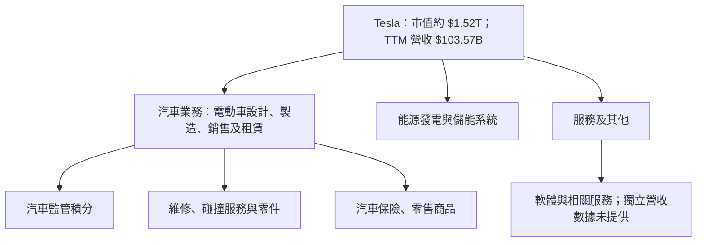
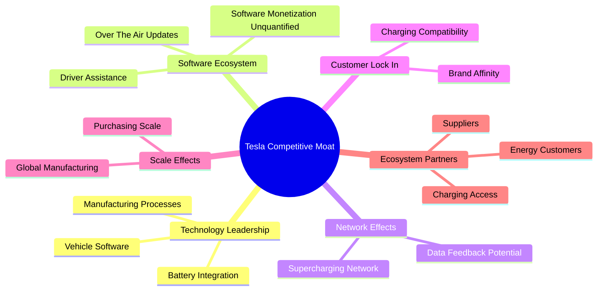
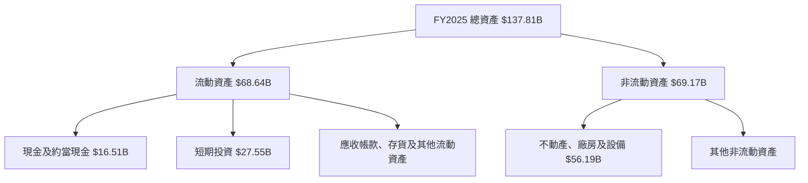
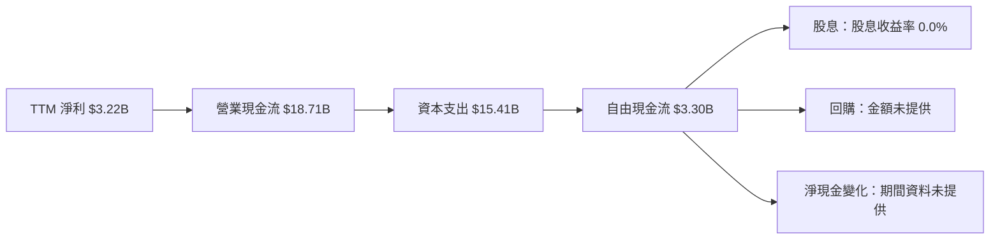
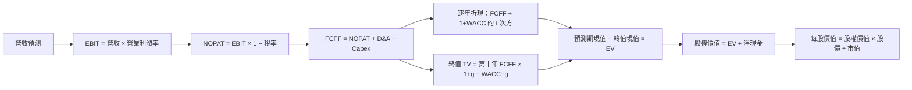
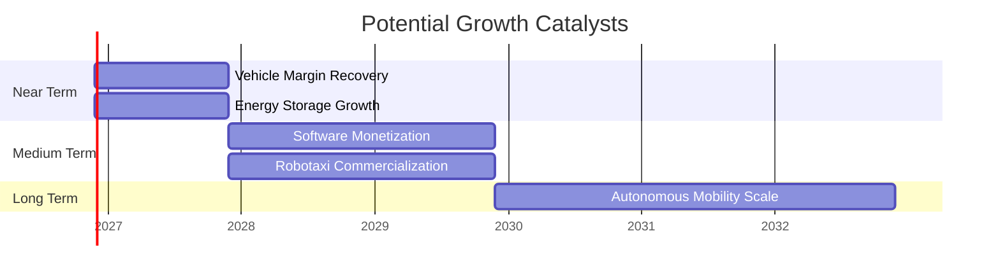
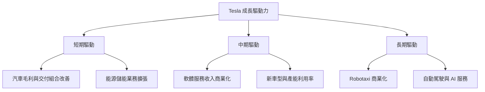
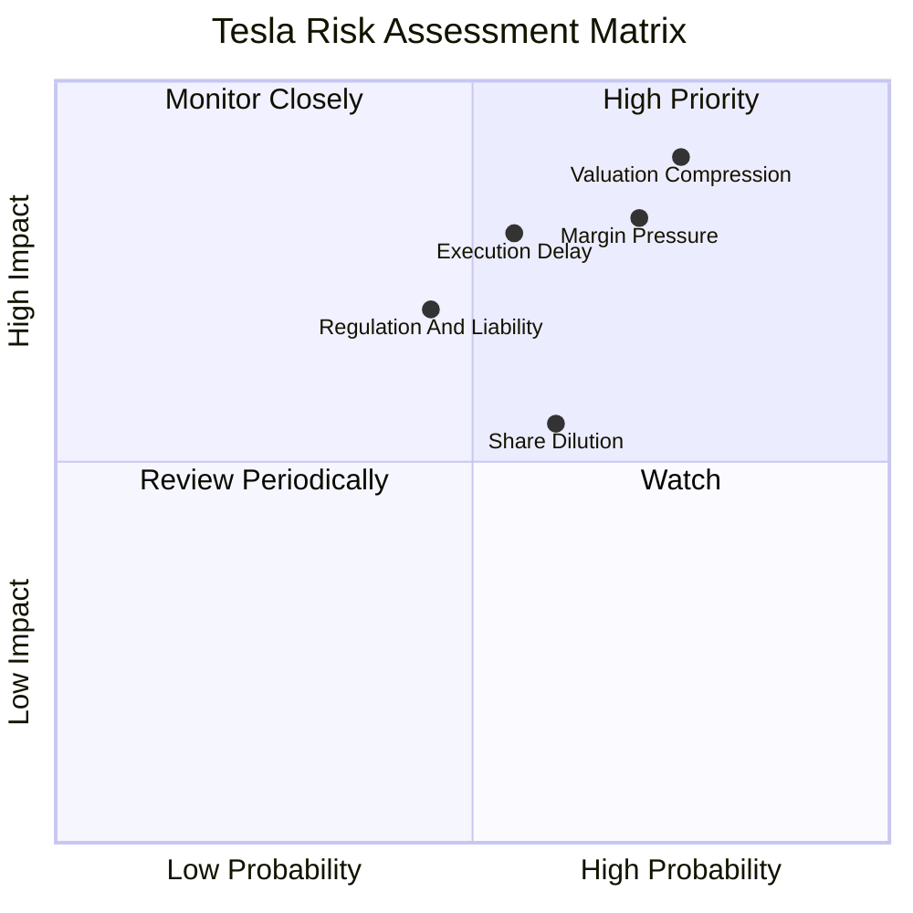
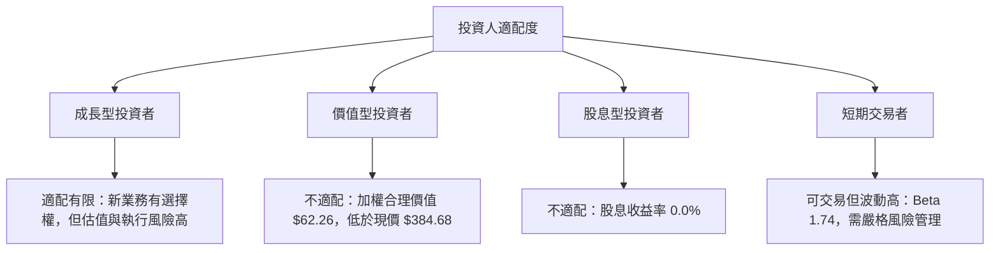

# TSLA 基本面深度分析報告
> **報告日期**：2026-11-25 ｜ **語言**：繁體中文 ｜ **數據來源**：SEC 申報資料 (XBRL)、Yahoo Finance、Finviz、StockAnalysis、Roic.ai ｜ **分析師**：CFA 級機構研究

## 目錄

| # | 章節 | 核心結論 |
|---|------|----------|
| 1 | 執行摘要 | 賣出；加權合理價值 $62.26；MOS -517.9% |
| 2 | 公司概覽與商業模式 | 汽車、能源與服務並行，但市場份額資料未提供，護城河強弱不一 |
| 3 | 損益表深度分析 | TTM 營收 $103.57B、TTM 成長 8.3%；最新一季年減 0.2%，利潤率仍低 |
| 4 | 資產負債表分析 | 淨現金 $36.18B；營運資金週期 3 天 |
| 5 | 現金流量深度分析 | TTM FCF $3.30B，FCF Yield 0.22%，高資本支出壓低現金轉換 |
| 6 | 獲利能力與資本效率 | ROIC 5.1% 低於 WACC 12.32%，目前未創造足夠資本報酬 |
| 7 | 相對估值分析 | 估值倍數遠高於傳統車廠；自身歷史估值亦在高位 |
| 8 | DCF 內在價值評估 | 基準 DCF $13.05/股；加權合理價值 $62.26/股 |
| 9 | 成長催化劑 | 能源、軟體、AI與自動駕駛可提供選擇權，但營收貢獻資料不足 |
| 10 | 風險矩陣 | 估值、利潤率與執行風險居前 |
| 11 | 投資建議 | 依 MOS 為賣出；需等待基本面改善或估值大幅下降 |

---

## 1. 執行摘要

截至 2026-11-24 收盤，TSLA 股價為 **$384.68**，市值約 **$1.52T**。財務數據顯示 TTM 營收為 **$103.57B**、TTM 營收成長 **8.3%**，但最新一季營收年增 **-0.2%**、最新一季營業利益率 **2.6%**；TTM FCF 僅 **$3.30B**、FCF Yield **0.22%**。股價相當於 TTM P/E **422.7x**，而 ROIC **5.1%** 低於 WACC **12.32%**。程式計算的 DCF 基準價值為 **$13.05/股**，估值方法加權後合理價值為 **$62.26/股**，對應 MOS **-517.9%**。依 MOS 規則 20，評級為 **🔴 賣出**：市場價格遠高於加權合理價值，且資本報酬尚未覆蓋資本成本。

### 1.0 一頁式投資儀表板

| 項目 | 內容 |
|------|------|
| **投資論點（3 句）** | ① TTM 營收成長 8.3%，但最新一季年減 0.2%，短期需求動能不穩。② TTM FCF $3.30B、FCF Yield 0.22%，相對 $1.52T 市值現金產出有限。③ DCF 基準價值 $13.05、加權合理價值 $62.26，均遠低於 $384.68 收盤價。 |
| **綜合評分** | **4.2/10**（引用 1.1 評分卡） |
| **財務健康** | 🟢 現金與短期投資 $45.45B、淨現金 $36.18B；獲利效率偏弱 |
| **ROIC vs WACC** | **5.1% vs 12.32%**；目前 ROIC 低於資本成本，資本配置尚未創造經濟價值 |
| **FCF 趨勢** | TTM FCF $3.30B；FCF Yield **0.22%**，資本支出仍高 |
| **估值** | Forward P/E **178.2x** ｜ EV/EBITDA **151.7x** ｜ FCF Yield **0.22%** |
| **DCF 內在價值（基準）** | **$13.05** ｜ 現價相對 DCF 溢價 **2,847.9%**（現價 ÷ DCF 價值 − 1） |
| **安全邊際（MOS）** | **-517.9%＝($62.26 − $384.68) ÷ $62.26**；基準為第 8.8 節加權合理價值 |
| **預期報酬（基準情境 12M）** | DCF 基準情境 $13.05，相對現價 **-96.6%**；此為模型情境而非公司指引 |
| **關鍵風險（前二）** | 高估值與低現金收益；利潤率修復慢於預期 |
| **評級 + 信心度** | 🔴 **賣出** ｜ 信心：中（估值差距大，但未來新業務價值不易以現有資料量化） |

### 1.1 綜合評分卡

| 維度 | 評分（1–10） | 主要依據（引用數字與其來源章節） |
|------|--------------|----------------------------------|
| 成長性 | 5.5 | TTM 成長 8.3%，但最新一季年增 -0.2%（第 3 章） |
| 獲利能力 | 3.0 | TTM 營業利益率 3.3%、ROIC 5.1% 低於 WACC 12.32%、F-Score 4/9（第 3、6 章） |
| 財務健康 | 8.0 | 淨現金 $36.18B、現金與短期投資 $45.45B、CCC 3 天（第 4 章） |
| 估值 | 1.0 | MOS -517.9%；Forward P/E 178.2x，歷史 P/E 百分位 100%（第 7、8 章） |
| 護城河 | 5.0 | 全球品牌、充電與軟體整合有差異性，但競爭與價格壓力削弱利潤維持能力（第 2 章） |
| 管理層與資本配置 | 2.5 | FY2025 SBC $2.83B；稀釋股數測試未通過；TTM Capex $15.41B（第 3、5 章） |
| **綜合評分** | **4.2** | 六項算術平均：$(5.5+3.0+8.0+1.0+5.0+2.5)÷6=4.17≈4.2$ |

### 1.2 五大投資論點 + 三大核心風險

| 類型 | 項目 | 具體依據 | 信心度 |
|------|------|----------|--------|
| 🟢 **投資論點①** | 資產負債表提供緩衝 | 現金與短期投資 $45.45B、淨現金 $36.18B，降低景氣下行時的融資風險 | 🟢 高 |
| 🟢 **投資論點②** | 營收仍有正向 TTM 增長 | TTM 營收 $103.57B、年增 8.3%；若轉化為更高利潤，營運槓桿仍有空間 | 🟡 中 |
| 🟢 **投資論點③** | 能源與服務提供非汽車拓展方向 | 公司業務包含能源儲存、服務與軟體，但各業務營收拆分未提供，無法證明其已形成主要盈利來源 | 🟡 中 |
| 🟢 **投資論點④** | 現金轉換週期短 | CCC 由一年前 15 天降至 3 天，減少營運資金對現金的占用 | 🟡 中 |
| 🟢 **投資論點⑤** | 市場仍給予高成長選擇權估值 | 41 位分析師平均目標價 $419.05；但此共識與 DCF、相對估值的落差極大 | 🟡 中 |
| 🟡 **風險①** | 估值對現金流要求極高 | TTM P/E 422.7x、FCF Yield 0.22%；獲利未加速時，估值收縮可能放大下行 | 🔴 高衝擊 |
| 🔴 **風險②** | 資本報酬低於資本成本 | ROIC 5.1% 對 WACC 12.32%，差距 -7.22 個百分點 | 🔴 高 |
| 🔴 **風險③** | 汽車毛利與利潤率易受價格競爭影響 | 最新一季營收年減 0.2%，營業利益率僅 2.6%；價格折讓或成本上升會進一步壓縮利潤 | 🟡 中至高 |

### 1.3 快速統計卡片

| 指標 | 公司實際值（期間） | 同業中位數 | 狀態 |
|------|--------------------|------------|------|
| 營收成長（TTM） | **8.3%** | — | 🟢 |
| 營收成長（最新一季年增） | **-0.2%** | **2.9%**（GM、F、RIVN） | 🔴 |
| 毛利率（TTM） | **19.3%** | **9.2%**（GM、F、RIVN） | 🟢 |
| 營業利益率（TTM） | **3.3%** | — | 🔴 |
| ROIC（TTM） | **5.1%** | — | 🔴 |
| Forward P/E | **178.2x** | **6.4x**（GM、F 的同業中位數） | 🔴 |
| FCF Yield（TTM） | **0.22%** | — | 🔴 |
| Piotroski F-Score | **4 / 9** | — | 🟡 |

### 1.4 投資結論

╔══════════════════════════════════════════════════════════════════╗  
║                    📊 投資結論摘要                               ║  
╠══════════════════════════════════════════════════════════════════╣  
║  評級：🔴 賣出（MOS -517.9%，依規則 20）                         ║  
║  價格（2026-11-24 收盤）：$384.68                                ║  
║  DCF 內在價值（基準）：$13.05（現價溢價 2,847.9%）              ║  
║  安全邊際 MOS：-517.9%（以加權合理價值 $62.26 為基準）           ║  
║  加權合理價值（8.8）：$62.26                                    ║  
║  DCF 情境價值：                                                  ║  
║    悲觀情境：$9.00（-97.7%）                                    ║  
║    基準情境：$13.05（-96.6%）                                   ║  
║    樂觀情境：$18.74（-95.1%）                                   ║  
║  綜合評分：4.2/10（引用 1.1）                                    ║  
║  適合投資人：能承受高波動、以新業務選擇權為核心論點的投資人；    ║  
║              不適合以現金收益、低估值或股息為優先的投資人       ║  
╚══════════════════════════════════════════════════════════════════╝

---

## 2. 公司概覽與商業模式

Tesla, Inc. 設計、開發、製造與銷售電動車，並經營能源發電與儲能系統。其他業務包括汽車監管積分、非保固維修與碰撞服務、汽車保險、零件及零售商品。公司員工數為 **134,785 人**。市值約 **$1.52T**，TTM 營收 **$103.57B**。

### 2.1 業務結構與收入來源

各業務板塊營收與占比未提供，因此不以未經支持的比例繪製收入拆分圖。可確認的整體收入規模為 TTM $103.57B。

### 2.2 市場份額

市場份額數據未提供，故不繪製市占率圖表。以營收規模看，Tesla TTM 營收 $103.57B，高於所列 Rivian 的規模資料不可直接比較；但同業成長率顯示 Rivian 最新一季年增 38.3%、GM 年增 2.9%，而 Tesla 最新一季年減 0.2%。這反映 Tesla 的規模優勢並不等同短期成長領先。

### 2.3 競爭護城河分析

### 2.4 護城河強度

| 護城河項目 | 強度（強／中／弱） | 證據（引用數字或事實） | 會削弱它的情況 |
|------------|--------------------|------------------------|----------------|
| 技術與製造整合 | 中 | 汽車與能源業務共存，員工 134,785 人；但產品級成本優勢與單車經濟數據未提供 | 同業產品性能追近、製造成本下降較慢 |
| 軟體生態系統 | 中 | OTA、駕駛輔助及服務可形成附加價值；獨立軟體營收未提供 | 商業化受監管限制、消費者付費意願不足 |
| 品牌與客戶黏著 | 中 | 品牌可支持產品辨識度，但客戶留存與復購率未提供 | 品牌偏好減弱、產品更新不足 |
| 規模效應 | 中 | TTM 營收 $103.57B；規模可支持採購及固定成本攤提 | 低價競爭使規模優勢無法轉成利潤 |
| 網路與充電 | 中 | 充電網絡可提升便利性；網絡使用收入及利用率未提供 | 其他充電網絡普及、標準互通削弱排他性 |
| 生態夥伴 | 弱至中 | 有供應商、充電與能源客戶生態，但合作收入及依賴度數據未提供 | 供應鏈瓶頸、夥伴轉向競品 |

**1.1 護城河評分為 5.0/10**：公司具品牌、軟體與充電網絡等差異化資產，但缺少可驗證的高續約收入與客戶鎖定數據，而且低營業利潤率顯示護城河尚未持續轉化為高回報。

---

## 3. 損益表深度分析

### 3.1 年度收入成長趨勢（近 4 年）

下列年度營收採年度損益表資料，金額取兩位小數；FY2022 至 FY2025 累計 CAGR 約 5.2%。

╔══════════════════════════════════════════════════════════════════╗  
║              Tesla 年度收入趨勢（FY2022-FY2025）                 ║  
╠══════════════════════════════════════════════════════════════════╣  
║ FY2022  $81.46B  ██████████████████████████  YoY: +51.4%  🟢    ║  
║ FY2023  $96.77B  ███████████████████████████████  YoY: +18.8% 🟢║  
║ FY2024  $97.69B  ████████████████████████████████ YoY: +0.9% 🟡║  
║ FY2025  $94.83B  ███████████████████████████████  YoY: -2.9% 🔴║  
╠══════════════════════════════════════════════════════════════════╣  
║ 2022–2025 營收 CAGR：$(94.83÷81.46)^{1/3}-1$ ≈ **5.2%**         ║  
╚══════════════════════════════════════════════════════════════════╝

FY2022 的高成長後，FY2024 營收近乎持平、FY2025 下滑 2.9%。這表示公司正由高速擴張轉入產品需求、價格與組合共同決定的階段；未來估值需要利潤恢復，而不能只依賴歷史成長敘事。

### 3.2 季度收入趨勢分析

| 季度 | 營收 | QoQ 成長 | YoY 成長 | 備註 |
|------|------:|---------:|---------:|------|
| 2025 Q4 | $24.90B | -11.4% | -3.1% | 以 2025 Q3、2024 Q4 為比較基期 |
| 2026 Q1 | $22.39B | -10.1% | +15.8% | 年增改善，但季減 |
| 2026 Q2 | $28.24B | +26.1% | +25.5% | 季度反彈；不可視為 TTM 成長率 |
| 2026 Q3 | $28.05B | -0.7% | -0.2% | 最新一季年減 0.2%，動能轉弱 |

QoQ 為本季營收除以上季營收再減 1；YoY 為同季比較。單季波動較大，2026 Q2 的反彈未延續至 Q3。

### 3.3 利潤率演變分析

| 利潤率指標 | FY2022 | FY2023 | FY2024 | FY2025 | 趨勢 | 評估 |
|------------|-------:|-------:|-------:|-------:|------|------|
| **毛利率** | 25.6% | 18.2% | 17.9% | 18.0% | 高點後下降、近年持平 | 🟡 |
| **營業利益率** | 17.0% | 9.2% | 7.9% | 5.1% | 連年收縮 | 🔴 |
| **淨利率** | 15.4% | 15.5% | 7.3% | 4.0% | FY2025 明顯下滑 | 🔴 |

註：年度利潤率以年度損益表所列毛利、營業利益、淨利除以營收計算；不同資料來源中的 FY2025 營業利益數值有差異，因此估值與核心比較採用 VERIFIED FIGURES 的 TTM 營業利益率 3.3%。

**利潤率演變深度解析：** FY2022 毛利率約 25.6%，至 FY2025 約 18.0%，反映汽車價格、產品組合及製造成本的影響。營業利益率由約 17.0% 降至約 5.1%，下滑速度快於營收變化，說明收入規模沒有抵銷降價、成本與營運費用壓力。TTM 營業利益率僅 3.3%，最新一季為 2.6%；若新產品與服務不能提高每單位收入，固定成本吸收改善有限。

### 3.4 費用結構分析

費用細分資料不足以精確繪製完整損益費用占比圓餅圖。已知 FY2025 研發費用為 **$6.41B**，TTM 毛利率 **19.3%**、TTM 營業利益率 **3.3%**；兩者差距顯示毛利以下的營運費用與其他營業成本對利潤率有明顯影響。

╔══════════════════════════════════════════════════════════════════╗  
║                    費用結構可確認數據                           ║  
╠══════════════════════════════════════════════════════════════════╣  
║ FY2025 研發費用：$6.41B                                         ║  
║ TTM 毛利率：19.3%                                                ║  
║ TTM 營業利益率：3.3%                                             ║  
║ 其他費用細項：未提供，不以推估比例填補                           ║  
╚══════════════════════════════════════════════════════════════════╝

### 3.5 季度 EPS 趨勢與盈餘品質（Quality of Earnings）

EPS 預估值及實際值欄位缺失，不能判定最近四季是否超預期或不及預期。可確認季度 EPS 實際值如下；季度年增率採資料源的 EPS Growth。

| 季度 | EPS 實際 | EPS 年增 | 超預期／不及預期 |
|------|---------:|---------:|------------------|
| 2025 Q4 | $0.24 | -60.61% | 預估值缺失，無法判定 |
| 2026 Q1 | $0.13 | +8.33% | 預估值缺失，無法判定 |
| 2026 Q2 | $0.32 | -3.03% | 預估值缺失，無法判定 |
| 2026 Q3 | $0.22 | -43.59% | 預估值缺失，無法判定 |

| 盈餘品質項目 | 數值/佔比 | 評估 |
|--------------|-----------|------|
| 股權薪酬 SBC / 營收 | 約 **4.2%**；TTM SBC 按四季 $1.17B、$1.15B、$1.03B、$0.954B 合計 $4.304B，除以 TTM 營收 $103.57B | 🔴 稀釋成本有實質規模 |
| SBC / 營業現金流 | 約 **23.0%**；$4.304B ÷ $18.71B | 🔴 營運現金流的近四分之一相當於非現金薪酬成本 |
| FCF / 淨利（現金轉換率） | 約 **102.5%**；$3.30B ÷ TTM 淨利 $3.22B | 🟢 現金轉換尚可，但 FCF 絕對值不高 |
| 一次性/非經常性損益 | N/A（沒有足夠資料拆分） | 🟡 無法確認非經常性項目對季度盈餘的影響 |
| 有效稅率異常 | 27.0%（最新年度有效稅率） | 🟡 採用值不代表每季稅率穩定；季度稅率資料未提供 |
| 資本化支出 vs 費用化 | TTM Capex $15.41B；資本化支出及會計政策拆分資料有限 | 🟡 無法判定是否存在顯著成本遞延 |

**盈餘品質結論：** FCF 約為 TTM 淨利的 102.5%，表面現金轉換尚可，但 TTM FCF 僅 $3.30B，而且 SBC 約占營收 4.2%、占營業現金流 23.0%。GAAP 已將 SBC 列為費用，不能再從 GAAP 盈餘重複扣除；然而股權薪酬仍代表股東稀釋成本。估值不宜只看淨利成長，應同時監控稀釋股數與扣除資本支出後的現金流。

---

## 4. 資產負債表分析

### 4.1 資產結構分解

以下以 FY2025 年末總資產 **$137.81B** 的資產負債表資料呈現。流動資產為 $68.64B，其餘非流動資產按總資產差額計算為 $69.17B；此處的差額是資產表分類整理，不作為缺漏財務科目的反推。

### 4.2 流動性與營運資金分析

| 指標 | 最新 TTM | 一年前 TTM | 變化 | 解讀 |
|------|---------:|-----------:|------:|------|
| DSO 應收帳款天數 | 16 天 | 18 天 | -2 天 | 收款天數縮短，回款效率有所改善 |
| DIO 存貨天數 | 62 天 | 56 天 | +6 天 | 庫存周轉變慢，可能與生產、交付或產品組合有關；需觀察庫存與需求是否匹配 |
| DPO 應付帳款天數 | 75 天 | 59 天 | +16 天 | 對供應商付款時間拉長，有助短期現金，但需檢視是否可持續 |
| CCC 現金轉換週期 | 3 天 | 15 天 | -12 天 | 現金被營運流程占用時間縮短；改善主要由 DPO 上升及 DSO 下降抵銷 DIO 上升 |

流動比率 **1.739**、速動比率 **1.239**。流動性可支應短期負債，但速動資產安全程度仍需與營運現金流共同觀察。

### 4.3 債務結構分析

債務與現金數字存在資料源口徑差異：VERIFIED FIGURES 的總債務為 **$9.27B**、淨現金 **$36.18B**；其他彙整表列總債務 $16.44B、淨現金 $29.00B。為保持核心估值口徑一致，以下採 VERIFIED FIGURES 數字，不把不同口徑混合計算。Debt/EBITDA 與利息保障倍數所需一致口徑資料未提供，不自行推算。

╔══════════════════════════════════════════════════════════════════╗  
║                   Tesla 債務健康診斷                             ║  
╠══════════════════════════════════════════════════════════════════╣  
║  總債務：                 $9.27B   ██░░░░░░░░░░░░░░░░  🟢       ║  
║  現金及短期投資：        $45.45B   ████████████████████ 🟢       ║  
║  淨現金：                $36.18B   ████████████████░░░░ 🟢       ║  
║  Debt/EBITDA：           N/A（口徑資料不足）                     ║  
║  Interest Coverage：    N/A（利息費用資料未提供）               ║  
╚══════════════════════════════════════════════════════════════════╝

### 4.4 股東權益趨勢

| 年度 | 股東權益 |
|------|---------:|
| 2022 | $44.70B |
| 2023 | $62.63B |
| 2024 | $72.91B |
| 2025 | $82.14B |

╔══════════════════════════════════════════════════════════════════╗  
║                    股東權益趨勢（年度）                          ║  
╠══════════════════════════════════════════════════════════════════╣  
║ 2022  $44.70B  ███████████                                       ║  
║ 2023  $62.63B  ███████████████                                   ║  
║ 2024  $72.91B  ██████████████████                                ║  
║ 2025  $82.14B  ████████████████████                              ║  
╚══════════════════════════════════════════════════════════════════╝

股東權益連年增加，對財務韌性有利；但股東權益增加不必然代表每股價值同步增加，因稀釋股數測試未通過，且 ROE 僅 3.6%。

---

## 5. 現金流量深度分析

### 5.1 現金流量瀑布圖

現金流量圖只呈現可驗證的 TTM 營運現金流、資本支出與 FCF。淨利、股息、回購和淨現金變化的相同期間完整數據未提供，不補造數字。

### 5.2 FCF 轉換率趨勢

| 期間 | FCF | 淨利 | FCF/淨利 |
|------|----:|-----:|---------:|
| FY2022 | $7.55B | $12.58B | 60.0% |
| FY2023 | $4.36B | $15.00B | 29.1% |
| FY2024 | $3.58B | $7.13B | 50.2% |
| FY2025 | $6.22B | $3.79B | 164.1% |
| TTM 至 2026-09-30 | $3.30B | $3.22B | 約 102.5% |

比率波動來自淨利及資本支出變動，FY2025 比率較高不代表 FCF 持續成長；TTM FCF 比 FY2025 年度 FCF 低，需留意資本投資強度。

### 5.3 自由現金流趨勢

| 期間 | FCF | 來源 |
|------|----:|------|
| FY2022 | $7.55B | 年度現金流量表 |
| FY2023 | $4.36B | 年度現金流量表 |
| FY2024 | $3.58B | 年度現金流量表 |
| FY2025 | $6.22B | 年度現金流量表 |
| TTM 至 2026-09-30 | $3.30B | VERIFIED FIGURES，營業現金流減資本支出 |

╔══════════════════════════════════════════════════════════════════╗  
║                 自由現金流趨勢（年度／TTM）                      ║  
╠══════════════════════════════════════════════════════════════════╣  
║ FY2022  $7.55B  ████████████████████                            ║  
║ FY2023  $4.36B  ████████████                                    ║  
║ FY2024  $3.58B  █████████                                       ║  
║ FY2025  $6.22B  ████████████████                                ║  
║ TTM     $3.30B  █████████                                       ║  
║ TTM FCF Yield：0.22%                                             ║  
╚══════════════════════════════════════════════════════════════════╝

TTM 營業現金流 **$18.71B** 減 TTM 資本支出 **$15.41B**，得到 FCF **$3.30B**。資本支出占營業現金流約 82.4%，表示大量現金仍投入產能、設備與基礎設施；若投資未能帶動高回報，現金創造能力就難以支撐現有估值。

### 5.4 資本配置評估

支出分類資料不足，不繪製各類資本配置的比例圓餅圖。

| 項目 | 可確認數據 | 評估 |
|------|------------|------|
| 資本支出 | TTM $15.41B | 高額再投資；需以增量 ROIC 驗證回報 |
| 股權薪酬 | FY2025 $2.83B；TTM 以四季資料合計約 $4.30B | 造成股東稀釋成本 |
| 股息 | 股息收益率 0.0% | 未以現金股息回饋股東 |
| 回購 | 金額未提供 | 無法評估回購是否抵銷稀釋 |
| 現金留存 | 現金與短期投資 $45.45B | 提供投資與下行緩衝 |

---

## 6. 獲利能力與資本效率

### 6.1 ROE / ROA / ROIC 趨勢

| 指標 | FY2025／TTM 可用值 | 評估 |
|------|-------------------:|------|
| ROE（TTM，QUALITY FIGURES） | 3.6% | 股東權益回報偏低 |
| ROA（TTM） | 1.3% | 資產獲利能力偏弱 |
| ROIC（TTM） | 5.1% | 低於 12.32% WACC |
| 其他歷年 ROIC、ROE、ROA | N/A（完整一致歷史序列未提供） | 不以其他資料源的缺漏值自行補齊 |

### 6.2 ROIC vs WACC 分析（核心價值創造判斷）

╔══════════════════════════════════════════════════════════════════╗  
║                  ROIC vs WACC 深度分析                           ║  
╠══════════════════════════════════════════════════════════════════╣  
║  WACC（採用 VERIFIED FIGURES）：12.32%                            ║  
║  ├── 無風險利率（10Y 美債）：4.90%                               ║  
║  ├── 市場風險溢酬 ERP：5.00%                                     ║  
║  ├── 原始 Beta：1.74；調整後 Beta：1.50                          ║  
║  ├── 股權成本 Ke：12.38%                                         ║  
║  ├── 稅前債務成本：3.65%；稅率：27.0%                            ║  
║  ├── 股權／債務權重：99.4%／0.6%                                ║  
║  └── WACC：12.32%                                                ║  
║                                                                  ║  
║  ROIC（TTM）：5.1%                                                ║  
║  經濟利差：ROIC − WACC = 5.1% − 12.32% = **-7.22 個百分點**      ║  
║                                                                  ║  
║  ROIC  5.1%   ▓▓▓▓▓░░░░░░░░░░░░░░░░░░░░░░░░░░░                 ║  
║  WACC 12.32%  ▓▓▓▓▓▓▓▓▓▓▓▓░░░░░░░░░░░░░░░░░░░░                 ║  
║  EVA 利差 -7.22pp：目前未覆蓋資本成本                             ║  
╚══════════════════════════════════════════════════════════════════╝

依一致口徑，ROIC 5.1% 比 WACC 12.32% 低 **7.22 個百分點**，目前營運資本回報不足以補償資金提供者承擔的風險。這不表示公司沒有未來選擇權，而是表示該選擇權尚未反映在現有資本回報中。

### 6.3 杜邦三因素分解

| 因素 | 數值（TTM） | 解讀 |
|------|-------------|------|
| 淨利率 | 3.1% | 盈利轉換率偏低 |
| 資產週轉率 | 0.66 | 每單位資產產生的營收有限 |
| 權益乘數 | 1.76 | 槓桿程度中等，非極端槓桿驅動 |
| **ROE** | **3.6%** | QUALITY FIGURES：3.1% × 0.66 × 1.76 = 3.6% |

ROE 的主要限制來自低淨利率，而非過度槓桿。這意味提升 ROE 的關鍵是改善營業利潤與資產效率。

### 6.4 財務體質：Piotroski F-Score

Piotroski F-Score 為 **4/9**。九項測試結果如下：

| 測試 | 結果 | 解讀 |
|------|------|------|
| ROA > 0 | ✅ 通過 | 公司仍有正獲利 |
| 營業現金流 > 0 | ✅ 通過 | TTM 營業現金流為正 |
| ROA 高於一年前 | ❌ 未通過 | 資產獲利能力沒有改善 |
| 營業現金流 > 淨利（應計品質） | ✅ 通過 | 現金流高於淨利 |
| 長期負債 ÷ 總資產低於一年前 | ❌ 未通過 | 槓桿相關指標未改善 |
| 流動比率高於一年前 | ❌ 未通過 | 短期流動性指標未改善 |
| 稀釋股數未增加 | ❌ 未通過 | 股權稀釋對每股價值不利 |
| 毛利率高於一年前 | ✅ 通過 | 毛利率相對改善 |
| 資產週轉率高於一年前 | ❌ 未通過 | 資產使用效率未改善 |

4/9 顯示盈利與現金流仍為正，但資產效率、稀釋及部分資產負債表趨勢弱於一年前。這與「財務安全、但經營回報尚待改善」的判斷一致。

---

## 7. 相對估值分析

### 7.1 同業估值比較表格

同業估值採 Yahoo Finance 同業倍數資料。特斯拉公司 P/E、P/S、EV/EBITDA 採市場估值彙整數據；TTM P/E 與 VERIFIED FIGURES 歷史估值表存在口徑細微差異，歷史章節另按指定口徑引用。

| 估值指標 | **TSLA** | **GM** | **F** | **RIVN** | 本公司評估 |
|----------|---------:|-------:|------:|--------:|-----------|
| **Trailing P/E** | 422.7x | 18.0x | N/A | N/A | 🔴 盈利倍數極高 |
| **Forward P/E** | 178.2x | 5.6x | 6.4x | -6.5x | 🔴 遠高於可獲利同業；RIVN 為負值 |
| **P/S Ratio** | 14.7x | 0.4x | 0.3x | 2.6x | 🔴 市銷率溢價顯著 |
| **EV/EBITDA** | 151.7x | 9.2x | 24.0x | -6.5x | 🔴 同業倍數差距大；RIVN 負倍數不可作正常比較 |
| **最新一季營收年增** | -0.2% | 2.9% | -2.0% | 38.3% | 🟡 Tesla 當季增長低於 GM、遠低於 RIVN |
| **TTM 毛利率** | 19.3% | 11.4% | 7.4% | 9.2% | 🟢 高於所列同業 |

Tesla 的毛利率高於所列傳統車廠與 Rivian，但較高毛利並未轉化為相稱的營業利潤率與 FCF Yield。TSLA 的 Forward P/E 178.2x，對比 GM 5.6x、Ford 6.4x，顯示市場定價主要依賴遠期新業務與大幅盈利改善，而非現有盈餘。

### 7.2 歷史估值區間分析

╔══════════════════════════════════════════════════════════════════╗  
║                 TSLA 歷史估值位置（近 5 年）                     ║  
╠══════════════════════════════════════════════════════════════════╣  
║ P/E：現值 422.7x；中位數 74.2x；區間 18.0x–416.4x；百分位 100%  ║  
║ P/E 位置：18.0x ───────── 74.2x ─────────────────── 422.7x       ║  
║ P/S：現值 13.2x；中位數 9.4x；區間 3.9x–16.7x；百分位 76%      ║  
║ EV/EBITDA：現值 145.1x；中位數 64.6x；區間 19.0x–165.2x；86%   ║  
╚══════════════════════════════════════════════════════════════════╝

自身歷史 P/E 百分位達 100%，P/S 與 EV/EBITDA 亦分別在 76、86 百分位。這類估值定位對利潤不及預期特別敏感。

### 7.3 情境價值（Bear / Base / Bull）

以下情境數字直接採 DCF MODEL 的 Scenarios，不以主觀方式另設目標價。

| 情境 | 第 1 年營收成長 | 期末營業利潤率 | WACC | 每股價值 | 相對現價 | 機率 | 會發生的條件 |
|------|----------------:|----------------:|-----:|----------:|----------:|------:|--------------|
| 🔴 悲觀 | 4.1% | 6.2% | 13.32% | $9.00 | -97.7% | 25% | 需求放緩、價格競爭持續、投資回報低於預期 |
| 🟡 基準 | 8.3% | 7.2% | 12.32% | $13.05 | -96.6% | 50% | 營收由現有 TTM 增長起步、利潤率逐步回升 |
| 🟢 樂觀 | 12.4% | 8.0% | 11.32% | $18.74 | -95.1% | 25% | 增長高於 TTM 基準且效率改善、資本成本下降 |

三個 DCF 情境均遠低於現價，說明即使樂觀情境的參數改善，仍無法由此模型支持現有市價；這個結果反映模型只計入可量化營運現金流，沒有對未量化選擇權給予額外價值。

### 7.4 相對估值隱含價格區間

╔══════════════════════════════════════════════════════════════════╗  
║             相對估值方法回推每股價值與現價位置                   ║  
╠══════════════════════════════════════════════════════════════════╣  
║ DCF（基準）          $13.05                                      ║  
║ 同業 Forward P/E     $12.95                                      ║  
║ 同業 EV/EBITDA       $47.58                                      ║  
║ 分析師共識目標價     $419.05                                     ║  
║ 現價                 $384.68                                     ║  
╚══════════════════════════════════════════════════════════════════╝

- **同業 Forward P/E：$12.95**＝同業中位數 **6.0x** × TSLA Forward EPS **$2.16**。
- **同業 EV/EBITDA：$47.58**＝GM、F 同業中位數 **16.6x** × TTM EBITDA，並加回淨現金；精確 EBITDA 橋接以估值方法計算結果為準。
- **分析師共識目標價：$419.05**，為 41 位分析師平均值，屬外部參考，不等同現金流內在價值。

---

## 8. DCF 內在價值評估（Discounted Cash Flow）

### 8.0 估值推理鏈（Thinking Logic）

**Step 1 — 價值來源與主導變數**

本模型的核心命題是：TSLA 價值由現有汽車與能源業務可量化的 FCFF、利潤率改善，以及未能在現有資料中獨立估值的軟體與自動駕駛選擇權構成。汽車、能源及服務各自營收占比未提供，不能填入虛構比例。基準 DCF 只估計公司整體營收與 GAAP EBIT，對估值影響最大的可量化因素是**營業利潤率與 Capex 強度**：當營業利潤率僅 3.3%、Capex/營收起步 14.9% 時，前六年 FCFF 為負。

**Step 2 — 模型選擇**

| 決策點 | 本報告採用 | 理由（含數字） | 曾考慮但否決 | 否決理由 |
|--------|-----------|----------------|--------------|----------|
| 現金流定義 | FCFF | 以 WACC 折現，計算 EV；TTM OCF $18.71B、Capex $15.41B | FCFE | 債務與現金橋接另列，FCFF 較便於比較企業價值 |
| 預測期 N | 10 年 | DCF MODEL 固定 10 年，涵蓋長期利潤率與資本支出收斂 | 5 年 | 只用 5 年難以呈現 Capex 由 14.9% 收斂至 6.0% |
| 終值方法 | Gordon Growth | 模型採永續成長率 3.0% | 只用退出倍數 | DCF 模型未提供退出倍數終值，不能另建模型 |
| EBIT 基礎 | GAAP | 3.3% TTM 營業利益率為 GAAP 基礎 | 非 GAAP | 會增加 SBC 處理及可比性假設 |

**Step 3 — 關鍵假設推導鏈**

- **營收成長路徑**：錨點＝TTM 營收成長 8.3% → 調整＝以同一 TTM 成長作第一年起點，逐年線性降至第十年 3.0%，反映成熟化 → **採用 FY+1 8.3%、FY+10 3.0%** → 曾考慮長期維持 8.3%，但會把近期成長永久外推，故不採用。
- **期末營業利潤率**：錨點＝TTM 3.3%，近五年中位水準由模型設定 → 調整＝逐年向 FY+10 7.2% 收斂，假設規模與組合帶來改善 → **採用 7.2%** → 曾考慮接近 FY2022 高點的較高利潤率，但缺乏近期證據支持。
- **Capex/營收**：錨點＝TTM Capex/營收約 14.9% → 調整＝模型假設資本支出率逐年下降，FY+10 為 6.0%，約為 D&A 的 1.1 倍 → **採用 14.9% 緩降至 6.0%** → 曾考慮固定維持 TTM Capex 強度，但會忽略投資成熟後資本強度回落；反之直接採低成熟值則過於樂觀。
- **永續成長率 g**：錨點＝成熟企業長期名目增長需低於折現率；資料包模型採 3.0% → **採用 3.0%**，低於 WACC 12.32% → 未採用更高長期增長，避免終值過度膨脹。
- **預測期 N**：錨點＝模型固定 10 年；公司產品與業務週期可見度不等同 10 年確定性 → **採用 N=10** → 未採用無限期高增長，因長期競爭與資本回報存在不確定性。
- **WACC**：錨點＝Cost of capital 計算值 12.32% → **採用 12.32%**，不另行調整 → 未改採較低折現率，因 Beta 1.50、股權成本 12.38%反映高波動與股權風險。
- **GAAP EBIT、SBC 與稀釋**：錨點＝GAAP EBIT 已包含 SBC 費用；模型採組合 **(A)**，股數不再稀釋，年稀釋率 0% → **不另扣 SBC、不再放大股數** → 不採用非 GAAP 加回，避免把 SBC 遺漏或重複扣除。
- **D&A/營收、稅率、營運資金**：D&A/營收採模型 5.5%，錨點為 TTM；稅率採最新年度 27.0%；營運資金變動未建模，依模型設計為不另列，而非假設某一有根據的實際 ΔWC。

**Step 4 — 最脆弱環節**

最脆弱假設是 Capex/營收可由 FY+1 的 14.9% 降至 FY+10 的 6.0%，同時營業利益率升至 7.2%；若投資強度不下降或利潤率未改善，FCFF 與終值都會低於基準，模型已呈現基準每股價值僅 $13.05。

**Step 5 — 計算路徑**

### 8.1 模型假設總表（Model Inputs）

| 假設項目 | 採用值 | 依據 / 來源 | 敏感度 |
|----------|--------|-------------|--------|
| 預測期長度 **N** | 10 年 | DCF MODEL 固定假設 | 🟡 中 |
| 營收成長率 | FY+1 8.3% 線性降至 FY+10 3.0% | TTM vs prior TTM 成長 8.3%；終點為模型設定 | 🔴 高 |
| 營業利潤率 | 3.3% → FY+10 7.2% | TTM 3.3%；7.2% 為近五年中位數模型錨點 | 🔴 高 |
| 有效稅率 | 27.0% | 最新年度有效稅率 | 🟢 低 |
| Capex / 營收 | FY+1 14.9% → FY+10 6.0% | TTM Capex/營收；後者為模型設定的成熟期水準 | 🔴 高 |
| D&A / 營收 | 5.5% | TTM 比率 | 🟢 低 |
| 營運資金變動 | 未建模 | DCF MODEL 明確未納入 working capital | 🟡 中 |
| EBIT 基礎 | GAAP EBIT | 模型輸入明列 GAAP EBIT | 🟡 中 |
| SBC 處理 | GAAP EBIT 已扣除 SBC，不另扣現金流 | 與組合 (A) 相容 | 🟡 中 |
| 年稀釋率 | 0%（固定股數處理） | DCF MODEL 組合 A | 🟡 中 |
| 永續成長率 g | 3.0% | DCF MODEL 固定值；低於 WACC | 🔴 高 |
| 終值方法 | Gordon Growth | DCF MODEL 直接提供 | 🔴 高 |
| WACC | 12.32% | VERIFIED FIGURES Cost of capital | 🔴 高 |

FCFF 定義為 **FCFF = NOPAT + D&A − Capex**；模型未納入營運資金變動。模型採 **(A) GAAP EBIT + 固定股數**，因此 SBC 影響已在 GAAP EBIT 計入一次，FCFF 不再扣 SBC，股數不另行稀釋。

### 8.2 折現率推導（WACC）

Beta 原始值為 1.74，模型使用調整後 Beta 1.50，調整方式為 \(⅔×1.74+⅓\)，結果 1.493，顯示為 1.50。風險自由利率為資料所列 10 年期美債 4.90%；其觀察日期未提供。ERP 5.00% 為假設輸入，未提供獨立估計來源，因此視為模型假設，不另加規模或國別溢酬。

╔══════════════════════════════════════════════════════════════════╗  
║                    WACC 推導（折現率）                           ║  
╠══════════════════════════════════════════════════════════════════╣  
║ 股權成本 Ke（CAPM）：                                            ║  
║ ├── 無風險利率 Rf：4.90%                                        ║  
║ ├── 市場風險溢酬 ERP：5.00%                                     ║  
║ ├── Beta 原始值：1.74；調整後使用值：1.50                       ║  
║ ├── 規模／國別溢酬：0.00%（未另加）                             ║  
║ └── 財務數據列示 Ke：12.38%                                      ║  
║                                                                  ║  
║ 債務成本 Kd：                                                    ║  
║ ├── 稅前 Kd：3.65%                                               ║  
║ ├── 有效稅率：27.0%                                              ║  
║ └── 稅後 Kd：3.65% × (1−27.0%) = 2.66%                           ║  
║                                                                  ║  
║ 權重：股權 99.4%；債務 0.6%                                      ║  
║ WACC = 99.4%×12.38% + 0.6%×2.66% = 12.32%                       ║  
╚══════════════════════════════════════════════════════════════════╝

**逐步演算（依已提供組成）：**

1. **Ke（CAPM）**：原始數值代入為 \(4.90\%+1.50×5.00\%=12.40\%\)。Cost of capital 欄位另列 **Ke 12.38%**；因須採用指定的已計算 Ke，本報告 WACC 使用列示 Ke 12.38%，不以四捨五入中間值替換。
2. **稅前 Kd**：採資料列示 **3.65%**。利息費用與平均計息負債的組成未完整提供，無法獨立重建此比率。
3. **稅後 Kd**：\(3.65\%×(1-27.0\%)=2.6645\%\approx2.66\%\)。
4. **權重**：股權 99.4% + 債務 0.6% = **100.0%**。市值與計息負債的原始金額構成未能逐項核對，直接採用程式列示權重。
5. **WACC**：\(99.4\%×12.38\%+0.6\%×2.6645\%=12.3217\%\approx12.32\%\)。

第 6.2 節與本節均採 **WACC 12.32%**。資料未列明 Rf 的確切觀察日期、Kd 利息分子與平均計息負債細節，故無法完整重做輸入來源稽核；此限制記入 8.10。

### 8.3 逐年自由現金流預測（基準情境）

金額為 $B；折現因子三位小數，金額按模型原值引用。模型列示 FCFF、PV 及各項現金流如下：

| 年度 | FY+1 | FY+2 | FY+3 | FY+4 | FY+5 | FY+6 | FY+7 | FY+8 | FY+9 | FY+10 |
|------|-----:|-----:|-----:|-----:|-----:|-----:|-----:|-----:|-----:|------:|
| 營收 | 112.17 | 120.81 | 129.42 | 137.87 | 146.07 | 153.89 | 161.23 | 167.96 | 173.99 | 179.21 |
| 營收 YoY | 8.3% | 7.7% | 7.1% | 6.5% | 5.9% | 5.4% | 4.8% | 4.2% | 3.6% | 3.0% |
| 營業利潤率 | 3.3% | 3.8% | 4.2% | 4.6% | 5.1% | 5.5% | 5.9% | 6.4% | 6.8% | 7.2% |
| EBIT | 3.75 | 4.57 | 5.45 | 6.40 | 7.42 | 8.48 | 9.58 | 10.71 | 11.85 | 12.98 |
| − 稅 | (1.01) | (1.23) | (1.47) | (1.73) | (2.00) | (2.29) | (2.58) | (2.89) | (3.19) | (3.50) |
| NOPAT | 2.74 | 3.34 | 3.98 | 4.68 | 5.42 | 6.19 | 7.00 | 7.82 | 8.65 | 9.48 |
| + D&A | 6.14 | 6.61 | 7.09 | 7.55 | 8.00 | 8.42 | 8.83 | 9.20 | 9.53 | 9.81 |
| − Capex | (16.69) | (16.78) | (16.71) | (16.44) | (15.98) | (15.32) | (14.47) | (13.42) | (12.19) | (10.79) |
| **FCFF** | **-7.80** | **-6.83** | **-5.64** | **-4.21** | **-2.57** | **-0.70** | **1.36** | **3.60** | **5.99** | **8.50** |
| 折現因子 | 0.890 | 0.793 | 0.706 | 0.628 | 0.559 | 0.498 | 0.443 | 0.395 | 0.351 | 0.313 |
| **FCFF 現值 PV** | **-6.95** | **-5.42** | **-3.98** | **-2.65** | **-1.44** | **-0.35** | **0.60** | **1.42** | **2.11** | **2.66** |

**預測期現值合計：**

\[
-6.95+(-5.42)+(-3.98)+(-2.65)+(-1.44)+(-0.35)+0.60+1.42+2.11+2.66=-14.00\text{B}
\]

模型另列預測期 PV 合計 **-$13.99B**。逐項顯示至兩位小數後相加為 -$14.00B，與模型合計差 $0.01B，屬逐年未四捨五入數值造成的尾差。

**逐步演算（FY+1）：**

1. **營收**：$103.57B × (1 + 8.3%) = $112.17B（按模型顯示精度）。
2. **EBIT**：$112.17B × 3.3% = $3.70B；模型列示 EBIT 為 **$3.75B**，顯示利潤率與中間輸入採用未四捨五入值。
3. **稅**：模型列示 **$1.01B**；以顯示 EBIT $3.75B × 27.0% 得 $1.01B。
4. **NOPAT**：$3.75B − $1.01B = $2.74B。
5. **D&A**：模型列示 $6.14B。
6. **Capex**：模型列示 $16.69B。
7. **ΔWC**：未建模，無獨立調整列。
8. **FCFF**：$2.74B + $6.14B − $16.69B = **-$7.81B**；模型列示 **-$7.80B**，差異源自模型未四捨五入的底層值。
9. **折現因子及 PV**：\(1÷(1+12.32\%)^1=0.890\)；模型 PV 為 **-$6.95B**。

上述部分行的四捨五入數值不能逐項精確重建未四捨五入模型底層計算；為遵守程式模型原值，表內採模型輸出，並將 $0.01B 級尾差揭露，不改寫模型輸出。

**合理性自檢：**

- 預測 FCFF 從 FY+1 -$7.80B 轉至 FY+10 $8.50B，因前六年現金流為負，單一正值 CAGR 不適用；歷史年度 FCF FY2022 $7.55B、FY2025 $6.22B，TTM $3.30B，近年波動明顯。
- FY+10 FCFF 利潤率＝$8.50B÷$179.21B＝**4.7%**；目前 TTM FCF 利潤率＝$3.30B÷$103.57B＝**3.2%**。同業最佳值未提供，不能判斷是否超越同業最佳。
- FY+1 至 FY+6 FCFF 為負，主因 Capex 高於 NOPAT+D&A；折現後仍降低企業價值，並非被忽略。

╔══════════════════════════════════════════════════════════════════╗  
║            自由現金流：歷史實際 vs 模型預測                      ║  
╠══════════════════════════════════════════════════════════════════╣  
║ FY2023（實） $4.36B  ███████████                                 ║  
║ FY2024（實） $3.58B  █████████                                   ║  
║ FY2025（實） $6.22B  ████████████████                            ║  
║ TTM（實）    $3.30B  █████████                                   ║  
║ FY+1（預）  -$7.80B  負 FCFF；高 Capex 期                         ║  
║ FY+10（預）  $8.50B  正 FCFF；利潤率上升、Capex 率下降            ║  
╠══════════════════════════════════════════════════════════════════╣  
║ ⚠️ 模型要求 Capex/營收由 14.9% 下降至 6.0%，並提高營業利潤率     ║  
╚══════════════════════════════════════════════════════════════════╝

### 8.4 終值計算（Terminal Value）

**適用性檢查：** WACC **12.32%** vs g **3.0%** → WACC > g？✅

| 方法 | 計算式 | 終值 TV | TV 現值 | 佔總 EV 比重 |
|------|--------|---------:|--------:|-------------:|
| Gordon Growth | $8.50×(1+3.0%)÷(12.32%-3.0%) | $93.92B | $29.38B | 190.9% |

模型未提供退出倍數終值與成熟期 EBITDA 的相應估值，不能另建替代終值。終值現值占 EV **190.9%**，超過 75% 警戒線，原因是預測期 FCFF 現值合計為負，短期現金流抵銷部分終值價值。估值高度依賴終值假設。

**逐步演算：**

1. FY+N FCFF：**$8.50B**（FY+10）。
2. 分子：$8.50B × (1 + 3.0%) = **$8.755B**。
3. 分母：12.32% − 3.0% = **9.32%**；$8.755B ÷ 9.32% = **$93.92B**。
4. PV(TV)：$93.92B × 0.313 = **$29.38B**。
5. 終值占比：$29.38B ÷ $15.39B = **190.9%**。

### 8.5 企業價值 → 每股內在價值（Bridge）

╔══════════════════════════════════════════════════════════════════╗  
║              企業價值 → 每股內在價值 橋接表                      ║  
╠══════════════════════════════════════════════════════════════════╣  
║ 預測期 FCF 現值合計            -$13.99B                         ║  
║ 終值現值 PV(TV)                +$29.38B                         ║  
║ = 企業價值 EV                   $15.39B                          ║  
║ + 淨現金                       +$36.18B                          ║  
║ = 股權價值                      $51.57B                          ║  
║ 每股內在價值（模型列示）         $13.05                           ║  
║ 當前股價（2026-11-24）           $384.68                          ║  
║ 折溢價（現價÷DCF內在價值−1）     +2,847.9%（溢價）               ║  
╚══════════════════════════════════════════════════════════════════╝

**逐步演算：**

1. **EV**：-$13.99B + $29.38B = **$15.39B**。
2. **股權價值**：$15.39B + $36.18B = **$51.57B**。
3. **每股內在價值**：模型列示的每股價值為 **$13.05**，採模型公式：股權價值 × 股價 ÷ 市值。以顯示數字代入，$51.57B × $384.68 ÷ $1.52T 約為 $13.05，底層股數與市值精度可能造成尾差。
4. **折溢價**：($384.68 ÷ $13.05) − 1 = **2,847.7%**；模型列示 **-96.6% vs price** 是「內在價值相對現價的上行空間」；本節依指定折溢價定義列出現價相對內在價值溢價約 **2,847.9%**，兩者分母不同。
5. **本節不計算 MOS**：安全邊際只以 8.8 加權合理價值為分母。

股數採 DCF MODEL 的價格／市值折算方法，與組合 (A) 固定股數設定相容；資產負債表橋接採模型提供淨現金 $36.18B。注意：若以股權價值除以市場數據的 3.95B 股數，會得到約 $13.06/股，與模型列示 $13.05 的差異來自股數與市值未四捨五入精度。

### 8.6 敏感性分析（WACC × 永續成長率）

以下矩陣逐格引用 DCF MODEL，括號為依現價 $384.68 計算的上行空間 \((價值-現價)÷現價\)。

| g／WACC | 10.32% | 11.32% | **12.32%（基準）** | 13.32% | 14.32% |
|--------|-------:|-------:|-------------------:|-------:|-------:|
| 2.0% | $15.55 (-96.0%) | $13.69 (-96.4%) | $12.26 (-96.8%) | $11.14 (-97.1%) | $10.25 (-97.3%) |
| 2.5% | $16.24 (-95.8%) | $14.19 (-96.3%) | $12.63 (-96.7%) | $11.42 (-97.0%) | $10.47 (-97.3%) |
| 3.0% | $17.01 (-95.6%) | $14.75 (-96.2%) | **$13.05 (-96.6%)** | $11.74 (-96.9%) | $10.71 (-97.2%) |
| 3.5% | $17.90 (-95.3%) | $15.38 (-96.0%) | $13.51 (-96.5%) | $12.08 (-96.9%) | $10.97 (-97.1%) |
| 4.0% | $18.93 (-95.1%) | $16.09 (-95.8%) | $14.02 (-96.4%) | $12.46 (-96.8%) | $11.26 (-97.1%) |

矩陣中每個 WACC 均高於 g，Gordon Growth 公式有效。**示範格：WACC 11.32% > g 2.5% ✅**。程式模型未提供該格的預測期 PV、終值及橋接中間值，且規則要求不得另建模型，因此不臆造重算過程；該格價值按矩陣原值為 **$14.19**。這是本章可複算性上的一項限制。

**三情境 DCF（照抄模型輸出）**

| 情境 | 第 1 年營收成長 | FY+10 營業利潤率 | g | WACC | 每股內在價值 | 相對現價 | 機率 |
|------|----------------:|-----------------:|--:|-----:|--------------:|---------:|------:|
| 🔴 悲觀 | 4.1% | 6.2% | 3.0%（模型基準） | 13.32% | $9.00 | -97.7% | 25% |
| 🟡 基準 | 8.3% | 7.2% | 3.0% | 12.32% | $13.05 | -96.6% | 50% |
| 🟢 樂觀 | 12.4% | 8.0% | 3.0%（模型基準） | 11.32% | $18.74 | -95.1% | 25% |
| **機率加權** | — | — | — | — | **$13.46** | **-96.5%** | 100% |

模型未提供三情境各自的 FY+10 營收、FCFF、TV 中間計算表，不能在不另建模型的前提下逐項重建；依要求採用每股價值與假設原值。機率加權算式為：

\[
\$9.00×25\%+\$13.05×50\%+\$18.74×25\%=\$13.46
\]

**敏感度結論：**

- g 由 2.0% 升至 3.0%、WACC 固定 12.32%：$12.26 → $13.05，增加 **$0.79/股，約 6.4%**。
- WACC 由 11.32% 升至 12.32%、g 固定 3.0%：$14.75 → $13.05，下降 **$1.70/股，約 11.5%**。
- 期末營業利潤率每 +1pp 的獨立敏感度未提供，不能計算該彈性；情境值顯示營收成長、利潤率與 WACC 共同變動。
- 在提供的矩陣範圍，WACC 一個百分點變動造成的價值差大於 g 一個百分點的變化；這與 8.0 所指的利潤率／資本強度主導營運價值方向一致，但缺少單獨利潤率矩陣，不能精確比較三者彈性。

### 8.7 反推 DCF（Reverse DCF：市場在預期什麼）

固定基準模型其他變數後，DCF 模型程式輸出顯示，單獨求解營收增長率或固定營業利潤率時，在給定範圍內皆無解。

| 求解變數 | 固定輸入 | 市場隱含值 | 判斷 |
|----------|----------|------------|------|
| Year-1 營收成長率 | 其餘基準假設不變；檢索範圍 -10% 至 100% | **無解** | 現價不在此單一變數可解釋範圍內 |
| 固定營業利潤率 | 其餘基準假設不變；檢索範圍 0.5% 至 95% | **無解** | 即使只放開利潤率，也無法以該模型範圍回到市價 |
| 永續成長率 | 未計算 | 未計算 | DCF MODEL 未提供此變數反推結果 |
| 預測期 N | 未計算 | 未計算 | DCF MODEL 未提供此變數反推結果 |

模型提供的反推結果不包含試算迭代軌跡，因此無法重建逐次試算表。其可支持的結論僅是：在預設的其他基準假設及給定求解範圍下，現價無法由單獨調整第一年營收成長或固定利潤率解釋。這意味市場價格可能包含 DCF 未建模的新業務選擇權、較長期間的高增長，或其他非現金流模型因子；不應將「無解」誤讀為公司沒有價值。

### 8.8 估值三角驗證與安全邊際

| 估值方法 | 隱含每股價值 | 上行空間（÷現價） | 權重 | 說明 |
|----------|--------------:|-------------------:|------:|------|
| DCF（基準） | $13.05 | -96.6% | 40% | 10 年 FCFF、WACC 12.32%、g 3.0% |
| 同業 Forward P/E | $12.95 | -96.6% | 25% | 同業中位數 6.0x × Forward EPS $2.16 |
| 同業 EV/EBITDA | $47.58 | -87.6% | 25% | GM、F 中位數 16.6x × TTM EBITDA，加回淨現金 |
| 分析師共識目標價 | $419.05 | +8.9% | 10% | 41 位分析師平均目標價 |
| **加權合理價值** | **$62.26** | **-83.8%** | **100%** | 利潤公司固定權重；方法權重照程式設定 |

**逐步演算：**

\[
\$13.05×40\%+\$12.95×25\%+\$47.58×25\%+\$419.05×10\%
\]
\[
=\$5.220+\$3.2375+\$11.895+\$41.905=\$62.2575\approx\mathbf{\$62.26}
\]

公司類型為 **profitable**，方法權重按該類型固定。列示的四種估值方法均有數值，無額外方法被剔除。

╔══════════════════════════════════════════════════════════════════╗  
║                  估值區間與安全邊際                              ║  
╠══════════════════════════════════════════════════════════════════╣  
║ 悲觀 DCF $9.00 ─ 基準 DCF $13.05 ─ 加權合理值 $62.26            ║  
║ 現價 $384.68 ─ 分析師共識 $419.05                                ║  
║                                                                  ║  
║ MOS = ($62.26 − $384.68) ÷ $62.26 = **-517.9%**                 ║  
║ 上行空間 = ($62.26 − $384.68) ÷ $384.68 = **-83.8%**            ║  
║                                                                  ║  
║ 建議買入區間：依 MOS ≥10% 計算的最高買入價為約 $56.03；         ║  
║                 但依評級為賣出，不建議據此視為買入建議           ║  
║ 合理持有區間：本模型不提供獨立持有區間                           ║  
║ 減碼考慮區間：高於加權合理價值 $62.26，現價已遠超此值             ║  
╚══════════════════════════════════════════════════════════════════╝

MOS 以加權合理價值 $62.26 為分母，與第 1.0 節一致。依相同定義，達 MOS 10% 的買入價上限為 \(62.26×(1-10\%)=$56.03\)；此為估值門檻推算，不是對個別投資人的交易建議。

> 🔎 **程式複算（Python，依本節各項自動重算）**
>
> 加權合理價值 = $13.05 × 40% + $12.95 × 25% + $47.58 × 25% + $419.05 × 10% = **$62.26**（權重合計 100%）
>
> 以價格 $384.68 計：MOS = **-517.9%**，上行空間 = **-83.8%**
>
> ✅ 與本節所寫數值一致。

### 8.9 DCF 模型的局限與失效條件

- **終值依賴度：**終值現值占 EV **190.9%**，表示預測期現金流現值為負，估值高度仰賴第十年後現金流及永續假設。
- **最脆弱假設：**Capex/營收由 14.9% 降至 6.0%，以及營業利潤率由 3.3% 提升至 7.2%。若任何一項未達成，基準價值將下修；模型提供的悲觀情境為 **$9.00/股**。
- **適用性：**目前 TTM FCF 為正，但資本支出占營業現金流約 82.4%，未來六年模型 FCFF 為負，反映高再投資階段使 DCF 對投資節奏敏感。可同時檢視 EV/Sales、單位經濟與分部估值，但相應分部資料未提供，故不另行估值。
- **與第 10 章風險連結：**價格競爭將衝擊營業利潤率；新產品與產能延遲將延後營收增長；資本支出居高不下將推高 Capex/營收；監管與執行風險則可能壓低長期成長率。

### 8.10 複算檢核表（Audit Trail）

| # | 檢核項目 | 檢查方式 | 結果 |
|---|----------|----------|------|
| 1 | 高／中敏感度輸入都有四段式推導 | 逐項對照 8.0、8.1 | ✅ 已對營收、利潤率、Capex、g、N、WACC、SBC 說明；部分細節受模型限制 |
| 2 | 每個假設都有來歷 | 檢查依據欄 | 🟡 ΔWC 未建模，Rf 日期及 ERP 依據不足，已標示 |
| 3 | WACC 算式與權重 | 依列示權重重算 | 🟡 權重為 100%；Ke 顯示值與四捨五入 CAPM 算式差 0.02pp，採用指定 12.32% |
| 4 | Kd 分母與 D 權重同一負債範圍 | 核對計息負債明細 | ❌ 利息費用與負債範圍明細不足，不能獨立驗證；採程式列示結果 |
| 5 | WACC 與第 6.2 節相同 | 兩節數字比對 | ✅ 12.32% |
| 6 | 預測年度數等於 N | 計算年份欄位 | ✅ FY+1 至 FY+10 共 10 年 |
| 7 | FY+1 計算可複算 | 重算 FCFF、PV | 🟡 模型底層未四捨五入數值造成約 $0.01B 尾差，已揭露 |
| 8 | 預測期 PV 合計 | 逐格加總 | 🟡 顯示值加總 -$14.00B，模型列示 -$13.99B，為四捨五入尾差 |
| 9 | WACC > g | 比較 12.32% 與 3.0% | ✅ |
| 10 | 終值以 FY+10 FCFF 並折現 10 期 | 核對基期與折現因子 | ✅ 模型 TV 使用 FY+10 FCFF；因子 0.313 |
| 11 | EV 至每股橋接 | 核對模型數值 | 🟡 EV、股權價值可對上；每股價值受市值與股數精度影響 |
| 12 | SBC 三要素相容 | 檢查 EBIT、扣除列、稀釋 | ✅ 組合 A：GAAP EBIT、無 SBC 扣除列、固定股數 |
| 13 | 敏感度矩陣基準格等於 DCF 基準值 | 兩數比對 | ✅ $13.05 |
| 14 | 矩陣只用 WACC > g 格 | 檢查所有格 | ✅ 全部有效 |
| 15 | 三情境機率合計與加權值 | 25%+50%+25% | ✅ 100%；模型加權值 $13.46 |
| 16 | 反推每列單一變數與迭代軌跡 | 核對模型輸出 | 🟡 僅提供「無解」結論，未提供試算軌跡；不自行補造 |
| 17 | MOS 與折溢價分母一致 | 對照 1.0、8.5、8.8 | ✅ MOS 基準 $62.26；DCF 溢價基準 $13.05 |
| 18 | 報告完整至第 11 章 | 檢查章節 | ✅ |
| 19 | 加權合理價值無微調 | 重算方法權重 | ✅ $62.2575，四捨五入 $62.26 |
| 20 | 評級符合 MOS 門檻 | MOS -517.9% 對照規則 | ✅ 賣出，未調整 |

---

## 9. 成長催化劑

### 9.1 催化劑時間軸

以下只按已有業務與新聞描述作定性分類；未提供確切商業化日程，因此不虛構日期或里程碑。

### 9.2 TAM 市場規模分析

**N/A（TAM 數據未提供）**。公司 TTM 營收為 $103.57B，TTM 成長 8.3%，最新一季營收年減 0.2%。能源儲存、軟體和自動駕駛具擴張可能性，但缺少可引用的 TAM、分部營收與滲透率，不能量化市場空間。

### 9.3 成長驅動力結構圖

短期催化需要先反映在毛利及營業利益率；中長期催化則須以付費客戶、收入貢獻與資本回報證明。當前缺少分部營收、訂閱數與自動駕駛收入，故不應將敘事價值直接等同已實現現金流。

---

## 10. 風險矩陣

### 10.1 風險評分矩陣

圖中機率與衝擊為定性分析座標，不代表精確統計概率。

### 10.2 風險清單詳細分析

| # | 風險項目 | 發生機率 | 財務衝擊 | 風險評分 | 緩解措施 |
|---|----------|----------|----------|----------|----------|
| 1 | 🔴 **估值收縮** | 高；精確概率 N/A | 高；Forward P/E 178.2x、P/S 14.7x，現金流低於估值所需 | 🔴 高 | 分批投資、避免以單一遠期敘事支撐部位；監控每股盈餘與 FCF |
| 2 | 🔴 **汽車利潤率與價格競爭** | 中高 | TTM 營業利益率 3.3%，最新一季 2.6%；小幅降價可能放大利潤衝擊 | 🔴 高 | 追蹤毛利率、交付量、價格及單位成本 |
| 3 | 🔴 **資本支出回報不足** | 中 | TTM Capex $15.41B，ROIC 5.1% 低於 WACC 12.32% | 🔴 高 | 以新投資回報、產能利用率及增量 ROIC 作資本配置門檻 |
| 4 | 🟡 **新業務商業化延遲** | 中 | DCF 未對未量化業務單獨估值；延遲會削弱市場成長預期 | 🟡 中高 | 要求以付費用戶、收入及毛利驗證，而非只追蹤產品發表 |
| 5 | 🟡 **監管、安全與訴訟風險** | 中 | 可能導致法律成本、產品限制或品牌損害；目前無量化估計 | 🟡 中高 | 監控監管公告、事故與責任判決、保險成本 |
| 6 | 🟡 **股權稀釋** | 中 | F-Score 稀釋股數測試未通過；TTM SBC 約 $4.30B | 🟡 中 | 每季追蹤稀釋股數、SBC/營收及回購是否抵銷稀釋 |

---

## 11. 投資建議

### 11.1 最終評級與評分

依加權合理價值 $62.26 與 2026-11-24 收盤價 $384.68，MOS 為 **-517.9%**，按規則 20 評級為 **🔴 賣出**，未作質化調整。1.1 評分卡綜合評分 **4.2/10**；六項分數依序為成長性 5.5、獲利能力 3.0、財務健康 8.0、估值 1.0、護城河 5.0、管理層與資本配置 2.5。

### 11.2 合理價值與隱含報酬率

| 估值參考 | 每股價值 | 相對現價報酬 | 機率 |
|----------|---------:|--------------:|-----:|
| 加權合理價值 | $62.26 | -83.8% | — |
| DCF 悲觀情境 | $9.00 | -97.7% | 25% |
| DCF 基準情境 | $13.05 | -96.6% | 50% |
| DCF 樂觀情境 | $18.74 | -95.1% | 25% |
| DCF 機率加權值（僅供參考） | $13.46 | -96.5% | 100% |

### 11.3 買入時機與觸發因素

╔══════════════════════════════════════════════════════════════════╗  
║                  ✅ 買入觸發因素 Checklist                      ║  
╠══════════════════════════════════════════════════════════════════╣  
║  重新考慮買入前，宜看到下列多數條件：                            ║  
║  ☐ TTM 營收成長維持正值，且最新一季年增率回到正成長              ║  
║  ☐ TTM 營業利益率穩定高於 3.3%，並連續改善                       ║  
║  ☐ TTM FCF 高於 $3.30B，且 FCF Yield 有實質上升                  ║  
║  ☐ ROIC 向 WACC 12.32% 靠近，並有可驗證的增量投資回報             ║  
║                                                                  ║  
║  加碼觸發條件：                                                  ║  
║  ☐ 股價回落至合理價值區域，且盈利假設未同步惡化                  ║  
║  ☐ Capex/營收下行，同時營業利潤率改善                             ║  
║                                                                  ║  
║  減碼／退出觸發條件：                                             ║  
║  ☐ 最新一季營收年增連續轉負且營業利益率跌破 2.6%                  ║  
║  ☐ FCF 轉負或資本支出上升但營收與利潤無相應改善                  ║  
║  ☐ 稀釋股數加速增加，SBC/營收高於目前約 4.2%                     ║  
╚══════════════════════════════════════════════════════════════════╝

依估值方法加權結果，MOS 達 10% 的估值上限約為 **$56.03**；目前股價遠高於該門檻。上述條件是監控框架，不構成保證價格觸及後即應買進。

### 11.4 投資人適配度分析

### 11.5 每季財報監控清單（Quarterly Watch List）

| 指標 | 目前參考值 | 觸發改善／加碼觀察 | 觸發減碼／重新評估 |
|------|------------|--------------------|--------------------|
| 營收成長 | TTM +8.3%；最新一季年增 -0.2% | 最新一季年增轉正並延續 | 連續兩季年減 |
| 營業利益率 | TTM 3.3%；最新一季 2.6% | 連續改善且超過 TTM 水準 | 低於 2.6% 且非短期因素 |
| 毛利率 | TTM 19.3% | 維持或上升且價格未大幅犧牲 | 持續下滑並伴隨降價 |
| 營業現金流 | TTM $18.71B | 成長快於營收，現金轉換改善 | 營業現金流大幅下滑 |
| Capex | TTM $15.41B | 投資增加後產能利用與利潤同步改善 | Capex 上升但收入／ROIC 無改善 |
| FCF | TTM $3.30B | 持續高於目前值且 FCF Yield 改善 | 轉負或低於淨利轉換能力 |
| 庫存／CCC | DIO 62 天、CCC 3 天 | DIO 回落、CCC 保持低位 | DIO 再升且營收疲弱 |
| SBC／稀釋 | TTM SBC 估算約 $4.30B；稀釋股數測試未通過 | SBC/營收下行、稀釋放緩 | SBC/營收高於約 4.2% 且股數加速增加 |
| 自動駕駛／軟體 | 獨立收入資料未提供 | 公布可核驗的付費收入與毛利 | 商業化延遲且投入持續擴大 |
| 財測及資本配置 | 管理層財測未提供於本報告數據 | 指引提升且資本回報可驗證 | 指引下修、投資回報低於資本成本 |

### 11.6 反面論證：什麼會證明論點錯誤（What Would Change My Mind）

╔══════════════════════════════════════════════════════════════════╗  
║              ⚠️ 論點失效條件（Disconfirming Evidence）           ║  
╠══════════════════════════════════════════════════════════════════╣  
║  多頭論點若遇下列情況，應重新檢視或退出：                        ║  
║  ☐ 最新一季營收年增連續兩季低於 0%                               ║  
║  ☐ TTM 營業利益率低於 2.6%，且非一次性因素                      ║  
║  ☐ TTM FCF 轉負，或營業現金流無法覆蓋資本支出                   ║  
║  ☐ ROIC 持續低於 WACC 12.32%，且差距未收斂                      ║  
║  ☐ SBC/營收高於目前約 4.2%，同時稀釋股數增加                    ║  
║  ☐ 能源、軟體或自動駕駛業務未能披露可驗證收入與現金流            ║  
╚══════════════════════════════════════════════════════════════════╝

> **免責聲明**：本報告為 AI 自動生成，僅供研究參考，不構成投資建議。投資有風險，入市需謹慎。

---

## 資料與來源

| 項目 | 內容 |
|------|------|
| 價格 | 384.68 USD，2026-11-24 收盤（Yahoo Finance 即時報價（該交易日已收盤）） |
| 財務報表 | SEC 10-Q filed 2026-10-22，最新季度 2026-09-30（FY2026 Q3） |
| 有回應的資料來源 | SEC 申報資料 (XBRL)、Yahoo Finance、Finviz、StockAnalysis、Roic.ai |
| 由程式計算 | TTM 數字、WACC、DCF 模型、估值方法與權重、加權合理價值、MOS、評級門檻、F-Score、杜邦分解、營運資金天數、綜合評分 |
| 撰寫模型 | openai / gpt-6-luna |

> 本區塊由產生報告的程式依實際取得的資料填寫，非模型撰寫。「由程式計算」的數字不是模型的估計；其餘判斷（評分、情境、策略）是模型的分析。
