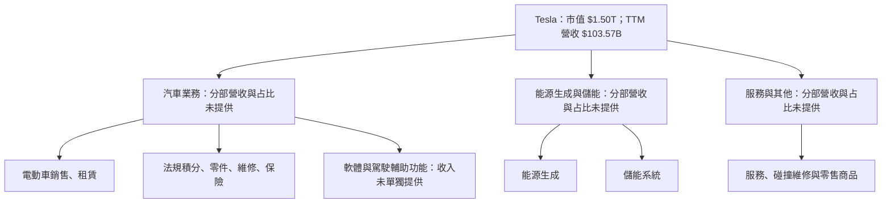
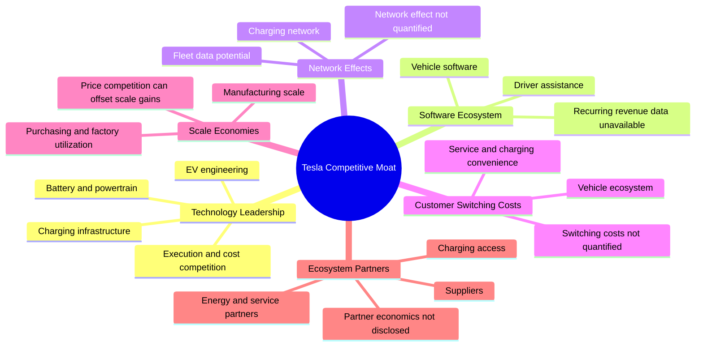
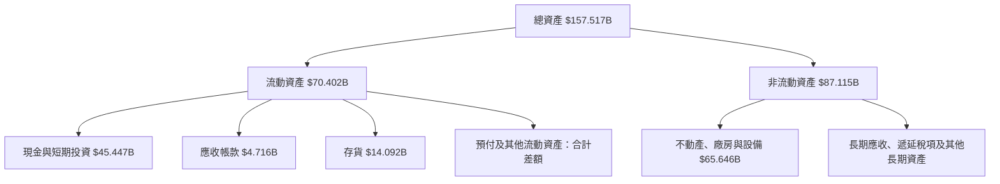
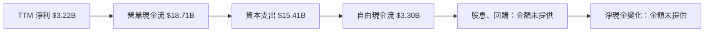
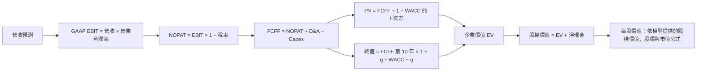
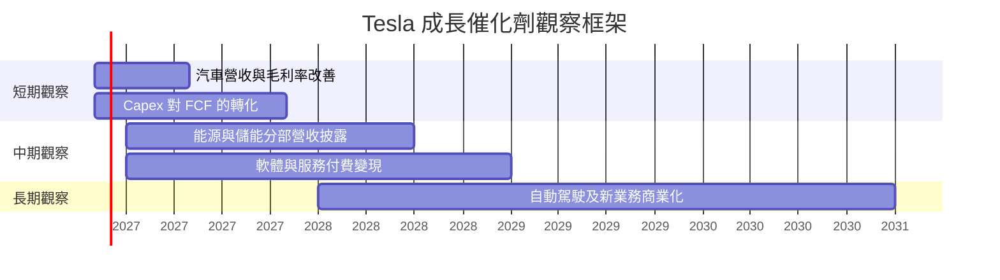
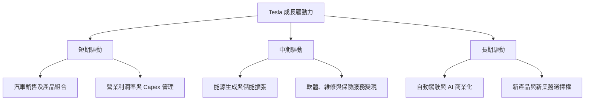
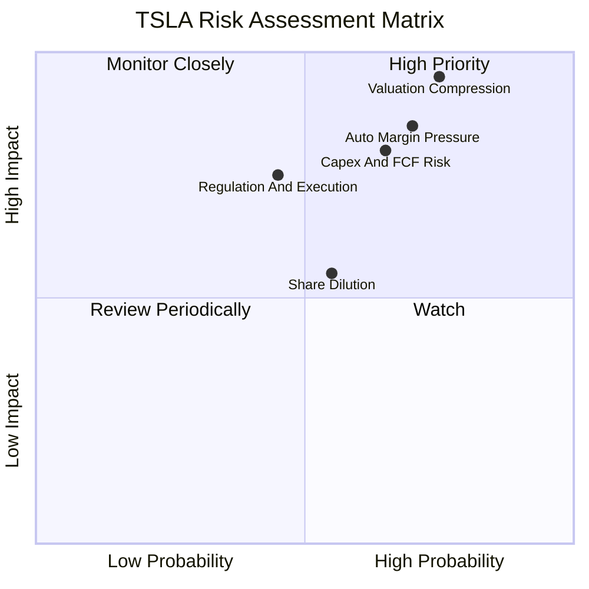
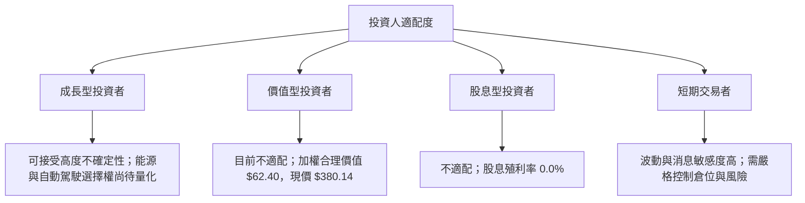

# TSLA 基本面深度分析報告
> **報告日期**：2026-11-26 ｜ **語言**：繁體中文 ｜ **數據來源**：SEC 申報資料 (XBRL)、Yahoo Finance、Finviz、StockAnalysis、Roic.ai ｜ **分析師**：CFA 級機構研究

---

## 目錄

| # | 章節 | 核心結論 |
|---|------|----------|
| 1 | 執行摘要 | 🟠賣出；加權合理價值 $62.40；MOS -509.2% |
| 2 | 公司概覽與商業模式 | 汽車製造仍是核心；能源、軟體與服務有成長選擇權，但分部收入未提供 |
| 3 | 損益表深度分析 | TTM 營收 $103.57B、年增 8.3%；最新一季年減 0.2%，利潤率仍低 |
| 4 | 資產負債表分析 | 按核實口徑淨現金 $36.18B；流動性充足，數據來源間負債口徑不一致 |
| 5 | 現金流量深度分析 | TTM FCF $3.30B、FCF Yield 0.22%；高資本支出壓低現金轉換 |
| 6 | 獲利能力與資本效率 | ROIC 5.1% 低於 WACC 12.27%，目前未創造足夠資本報酬 |
| 7 | 相對估值分析 | 相對傳統車廠溢價顯著，估值亦處自身五年區間高位 |
| 8 | DCF 內在價值評估 | 基準 DCF 每股 $13.13；加權合理價值 $62.40，均遠低於現價 |
| 9 | 成長催化劑 | 能源、軟體、自動駕駛與新產品可能提供選擇權；TAM 與分部財務數據未提供 |
| 10 | 風險矩陣 | 估值回落、汽車利潤率與資本支出是主要風險 |
| 11 | 投資建議 | 🟠賣出；以 $62.40 加權合理價值與營運里程碑作為重新評估依據 |

---

## 1. 執行摘要

TSLA 的 2026-11-25 收盤價為 **$380.14**。核實數據顯示，TTM 營收 **$103.57B、年增 8.3%**，但最新一季營收年減 **0.2%**；TTM 營業利益率僅 **3.3%**、ROIC **5.1%**，低於 **12.27% WACC**，TTM FCF 為 **$3.30B**、FCF Yield 僅 **0.22%**。基準 DCF 每股價值為 **$13.13**，估值方法加權後合理價值為 **$62.40**，相對現價的安全邊際 MOS 為 **-509.2%**。因此，依 MOS 評級門檻為 **🔴賣出**；目前營運改善尚不足以支持現價所包含的高成長與高利潤預期。

### 1.0 一頁式投資儀表板（Portfolio Manager 30 秒速讀）

| 項目 | 內容 |
|------|------|
| **投資論點（3 句）** | ① TTM 營收年增 **8.3%**，但最新一季年減 **0.2%**，成長動能尚未連續確認。② TTM FCF **$3.30B**、FCF Yield **0.22%**，相較 **$1.50T** 市值，現金收益率很低。③ ROIC **5.1%** 低於 WACC **12.27%**，目前資本報酬未覆蓋資本成本。 |
| **綜合評分** | **4.5/10**（引用 1.1 評分卡） |
| **財務健康** | 🟢 核實口徑淨現金 **$36.18B**、現金與短期投資 **$45.45B**；但來源間總債務數字有差異 |
| **ROIC vs WACC** | **5.1% vs 12.27%**；負利差 **7.17 個百分點**，目前摧毀而非創造經濟價值 |
| **FCF 趨勢** | FY2025 FCF **$6.22B**；TTM FCF **$3.30B**，現金流受高 Capex 壓抑；FCF Yield **0.22%** |
| **估值** | Forward P/E **176.1x** ｜ EV/EBITDA **149.8x** ｜ FCF Yield **0.22%** |
| **DCF 內在價值（基準）** | **$13.13** ｜ 現價相對 DCF 溢價 **2,794.9%**（以 DCF 基準價值計算） |
| **安全邊際（MOS）** | **-509.2%＝($62.40 − $380.14) ÷ $62.40**；🔴 <10% 無（分母為第 8.8 節加權合理價值） |
| **預期報酬（基準情境 12M）** | 基準 DCF 情境 **$13.13**；相對現價 **-96.5%**。這是模型情境價值，不是保證的 12 個月報酬 |
| **關鍵風險（前二）** | 汽車利潤率恢復不及預期；現價估值要求遠高於傳統汽車同業 |
| **評級 + 信心度** | 🔴 **賣出** ｜ 信心：中（估值結論明確，營運分部資料及估值模型輸入仍有缺口） |

> 現價相對 DCF 基準價值溢價的算式為：`$380.14 ÷ $13.13 − 1 = 2,794.9%`。此處是折溢價，不是 MOS，也不以加權合理價值為分母。

### 1.1 綜合評分卡（全報告唯一）

| 維度 | 評分（1–10） | 主要依據（引用數字與其來源章節） |
|------|--------------|----------------------------------|
| 成長性 | 5.0 | TTM 營收年增 8.3%，但最新一季年減 0.2%；見第 3 章 |
| 獲利能力 | 3.0 | TTM 營業利益率 3.3%、ROIC 5.1% 低於 WACC 12.27%，F-Score 4/9；見第 3、6 章 |
| 財務健康 | 8.0 | 核實淨現金 $36.18B，營運資金 CCC 由 15 天降至 3 天；見第 4 章 |
| 估值 | 1.0 | MOS -509.2%，Forward P/E 176.1x；見第 7、8 章 |
| 護城河 | 6.0 | 規模、充電網路與軟體服務有差異化，但同業競爭與定價壓力削弱其持續性；見第 2 章 |
| 管理層與資本配置 | 4.0 | FY2025 SBC $2.83B，TTM SBC 估算約 $4.30B；淨股數未通過 F-Score 測試，且資本支出高；見第 3、5、6 章 |
| **綜合評分** | **4.5** | 六項算術平均：`(5.0 + 3.0 + 8.0 + 1.0 + 6.0 + 4.0) ÷ 6 = 4.5` |

### 1.2 五大投資論點 + 三大核心風險

| 類型 | 項目 | 具體依據 | 信心度 |
|------|------|----------|--------|
| 🟢 **投資論點①** | 資產負債表提供緩衝 | 現金與短期投資 $45.45B、核實總債務 $9.27B，淨現金 $36.18B | 🟢 高 |
| 🟢 **投資論點②** | TTM 營收仍在成長 | TTM 營收 $103.57B，年增 8.3%；FY2021 至 FY2025 年營收由 $53.82B 增至 $94.83B | 🟡 中 |
| 🟢 **投資論點③** | 現金轉換週期改善 | CCC 由一年前 15 天降至 3 天，DSO 18 天降至 16 天 | 🟡 中 |
| 🟢 **投資論點④** | 能源與服務可形成第二曲線 | 公司業務包含能源生成與儲能、軟體與維修服務；但分部營收及利潤數據未提供 | 🟡 中低 |
| 🟢 **投資論點⑤** | 研發投入支持產品與技術更新 | FY2025 研發費用 $6.41B，較 FY2024 $4.54B 上升；投入能否轉成可持續營收仍待證明 | 🟡 中 |
| 🟡 **風險①** | 估值與現金收益脫節 | 市值 $1.50T、FCF Yield 0.22%、TTM P/E 417.7x；估值對成長預期極敏感 | 🔴 高衝擊 |
| 🔴 **風險②** | 利潤率與資本效率不足 | ROIC 5.1% 低於 WACC 12.27%；最新一季營收年減 0.2%，TTM 營業利益率 3.3% | 🔴 高 |
| 🟡 **風險③** | 投資需求高、SBC 稀釋股東 | TTM Capex $15.41B；TTM SBC 估算約 $4.30B，約為營收 4.2% | 🟡 中高 |

### 1.3 快速統計卡片

| 指標 | 公司實際值（期間） | 同業中位數 | 狀態 |
|------|--------------------|------------|------|
| 營收成長（TTM） | **8.3%** | — | 🟡 |
| 營收成長（最新一季年增） | **-0.2%** | **2.9%**（GM、F、RIVN 中位數） | 🔴 |
| 毛利率（TTM） | **19.3%** | **9.2%**（GM、F、RIVN 中位數） | 🟢 |
| 營業利益率（TTM） | **3.3%** | — | 🔴 |
| ROIC（TTM） | **5.1%** | — | 🔴 |
| Forward P/E | **176.1x** | **6.1x**（GM、F 中位數） | 🔴 |
| FCF Yield（TTM） | **0.22%** | — | 🔴 |
| Piotroski F-Score | **4 / 9** | — | 🟡 |

### 1.4 投資結論

```text
╔══════════════════════════════════════════════════════════════════╗
║                    📊 投資結論摘要                               ║
╠══════════════════════════════════════════════════════════════════╣
║  評級：🔴 賣出（依第 8.8 節 MOS 門檻，未作質化調整）              ║
║  價格（2026-11-25 收盤）：$380.14                                 ║
║  DCF 內在價值（基準）：$13.13（現價溢價 2,794.9%）               ║
║  安全邊際 MOS：-509.2%（以加權合理價值為分母）                   ║
║  加權合理價值（8.8）：$62.40                                     ║
║  DCF 情境價值：                                                    ║
║    悲觀情境：$9.05（-97.6%）                                     ║
║    基準情境：$13.13（-96.5%）                                    ║
║    樂觀情境：$18.89（-95.0%）                                    ║
║  綜合評分：4.5/10（引用 1.1）                                    ║
║  適合投資人：可承受高波動並以新業務選擇權為核心論點者；           ║
║              不適合重視現金收益、低估值或低波動的投資人           ║
╚══════════════════════════════════════════════════════════════════╝
```

---

## 2. 公司概覽與商業模式

### 2.1 業務結構與收入來源

Tesla 設計、開發、製造、租賃與銷售電動車，並經營能源生成與儲能業務；亦有汽車法規積分、維修、保險、零件、零售商品及相關服務。分部營收、各子業務金額與占比未提供，因此不製作分部占比圖，也不將公司總營收任意分配至業務板塊。



### 2.2 市場份額

市場份額的數值、地區及年份未提供，因此不填造百分比。以營收規模觀察，Tesla TTM 營收為 $103.57B，規模遠大於所列 RIVN 資料所能直接比較的口徑；但最新一季營收年減 0.2%，而 GM 同業數據為年增 2.9%、RIVN 為年增 38.3%，成長動能並非在所有直接競爭對手中領先。

### 2.3 競爭護城河分析



### 2.4 護城河強度

| 護城河項目 | 強度（強／中／弱） | 證據（引用數字或事實） | 會削弱它的情況 |
|------------|--------------------|------------------------|----------------|
| 技術與製造 | 中 | 汽車、能源及軟體整合；FY2025 研發費用 $6.41B | 技術被同業追近、產品更新未能轉成銷量或利潤 |
| 軟體生態系統 | 中 | 公司提供車載軟體與駕駛輔助服務，但相關收入未單獨披露 | 功能可靠性、監管核准或使用者付費率不及預期 |
| 網路效應 | 中 | 充電網路與車隊資料可能提高便利性；網路收入及使用率未提供 | 充電標準普及、競爭網路擴張或利用率偏低 |
| 客戶鎖定 | 中偏弱 | 維修、保險、軟體及充電服務提供生態系統黏著機會；續約／流失數字未提供 | 車主轉換品牌成本低、競品價格或產品吸引力提升 |
| 規模效應 | 中 | TTM 營收 $103.57B；但 TTM 營業利益率僅 3.3% | 價格競爭侵蝕規模效益，產能利用率不足 |
| 生態夥伴 | 弱至中 | 有供應商、充電與能源合作，但財務貢獻未披露 | 供應鏈集中、合作條件改變或垂直整合成本過高 |

護城河評分 **6.0/10**：Tesla 具品牌、規模與生態系統優勢，但缺乏可量化的分部利潤、軟體收入及留存指標，且 3.3% TTM 營業利益率顯示優勢尚未穩定轉化為高獲利。

---

## 3. 損益表深度分析

### 3.1 年度收入成長趨勢（近 4 年）

下列年度營收取自年度損益表；圖內 YoY 依相鄰年度營收計算，金額取兩位小數。

```text
╔══════════════════════════════════════════════════════════════════╗
║                  Tesla 年度收入趨勢（FY2022-FY2025）             ║
╠══════════════════════════════════════════════════════════════════╣
║  FY2022  $81.46B  ██████████████████████████░░░░  基期          ║
║  FY2023  $96.77B  ███████████████████████████████  YoY +18.8%  ║
║  FY2024  $97.69B  ███████████████████████████████  YoY +1.0%   ║
║  FY2025  $94.83B  ██████████████████████████████░  YoY -2.9%   ║
║                                                                  ║
║  FY2022–FY2025 CAGR：($94.83B ÷ $81.46B)^(1/3) − 1 ≈ 5.2%       ║
╚══════════════════════════════════════════════════════════════════╝
```

FY2023 成長 18.8% 後，FY2024 僅成長約 1.0%，FY2025 回落 2.9%。這表示長期收入規模仍高於 FY2022，但近年成長由快速擴張轉為停滯；TTM 年增 8.3% 高於 FY2025 年度表現，需觀察是否能延續，而非僅由季度基期或交付節奏造成。

### 3.2 季度收入趨勢分析

| 季度 | 營收 | QoQ 成長 | YoY 成長 | 備註 |
|------|------|----------|----------|------|
| 2025 Q4 | $24.90B | +28.8% | -3.1% | QoQ 以 2025 Q3 $19.34B 計算；季節性與交付節奏可能影響 |
| 2026 Q1 | $22.39B | -10.1% | +15.8% | YoY 使用提供的單季成長率 |
| 2026 Q2 | $28.24B | +26.1% | +25.5% | QoQ 反彈，但不能單憑一季判定趨勢 |
| 2026 Q3 | $28.05B | -0.7% | -0.2% | 最新一季收入近乎持平，年增率按季度口徑引用 |

QoQ 算式示例：`($28.05B ÷ $28.24B) − 1 = -0.7%`。2026 Q2 的成長在 Q3 未進一步加速，且最新一季年減 0.2%；若要確認 TTM 成長轉為結構性加速，需連續追蹤收入與毛利率，而不能只看單季反彈。

### 3.3 利潤率演變分析

年度毛利率、營業利益率與淨利率依年度損益表金額計算。不同資料源對 FY2025 營業利益及 TTM 營業利益率存在口徑差異；年度表格以該年度損益表所列營業利益計算，TTM 採核實數字 3.3%。

| 利潤率指標 | FY2022 | FY2023 | FY2024 | FY2025 | 趨勢 | 評估 |
|------------|--------|--------|--------|--------|------|------|
| **毛利率** | 25.6% | 18.2% | 17.9% | 18.0% | 高位回落後大致持平 | 🟡 |
| **營業利益率** | 17.0% | 9.2% | 7.9% | 5.1% | 連續收縮 | 🔴 |
| **淨利率** | 15.4% | 15.5% | 7.3% | 4.0% | FY2024–25 明顯下滑 | 🔴 |

FY2022 至 FY2025 毛利率由約 25.6% 降至 18.0%，可能反映產品定價、組合與製造成本因素；資料未提供足以分辨各因素的具體貢獻。營業利益率下降幅度更大，表示營收規模並未抵銷成本、研發及其他營業費用。FY2025 研發費用 $6.41B，較 FY2024 $4.54B 上升，投入有助於產品及技術開發，但短期會壓低營業利潤；未來若未帶動新收入或效率提升，利潤率恢復仍有難度。

### 3.4 費用結構分析

無完整 TTM 營業費用分項、銷售管理費及研發費用結構，故不繪製費用占比圓餅圖。可確認 FY2025 研發費用為 **$6.41B**，FY2024 為 **$4.54B**；單一費用項目不足以代表完整費用結構。

### 3.5 季度 EPS 趨勢與盈餘品質（Quality of Earnings）

最近四季 EPS 預估值與實際值資料為 nan，無法可靠判斷「超預期／不及預期」。下表採可取得的季度 EPS 實際值及成長資料呈現趨勢，不把缺失的預估值補造為驚喜率。

| 季度 | EPS 實際 | EPS YoY 成長 | 超預期／不及預期 |
|------|----------|--------------|-------------------|
| 2025 Q4 | $0.26 | -60.6% | N/A（預估及 surprise 資料缺失） |
| 2026 Q1 | $0.15 | +8.3% | N/A（預估及 surprise 資料缺失） |
| 2026 Q2 | $0.34 | -3.0% | N/A（預估及 surprise 資料缺失） |
| 2026 Q3 | $0.24 | -43.6% | N/A（預估及 surprise 資料缺失） |

| 盈餘品質項目 | 數值/佔比 | 評估 |
|--------------|-----------|------|
| 股權薪酬 SBC / 營收 | TTM SBC 約 $4.30B ÷ $103.57B = **4.2%** | 🔴 股權成本具實質稀釋效果；SBC 是非現金費用，不代表股東沒有經濟成本 |
| SBC / 營業現金流 | 約 $4.30B ÷ $18.71B = **23.0%** | 🟡 SBC 相對現金流不小，現金流指標需與稀釋一併看 |
| FCF / 淨利（現金轉換率） | $3.30B ÷ TTM 淨利 $3.22B = **102.5%** | 🟢 TTM FCF 約等於會計淨利；但 Capex 高、年度波動大 |
| 一次性／非經常性損益 | N/A（未提供可核實的明細） | 無法判斷是否有一次性項目顯著美化或壓低本期盈餘 |
| 有效稅率異常 | WACC 模型採用最新年度有效稅率 **27.0%**；TTM 實際有效稅率 N/A | 27.0% 為模型輸入，不能視為已核實的 TTM 實際稅率 |
| 資本化支出 vs 費用化 | TTM Capex $15.41B；資本化政策細節 N/A | 支出規模高，可能為擴產及設備投資；缺少資本化明細，不推定存在盈餘高估 |

**盈餘品質結論**：TTM FCF/淨利約 102.5%，顯示近期現金轉換大致跟得上淨利，但 TTM Capex 高達 $15.41B，FCF 僅 $3.30B。SBC 約占營收 4.2%，且 F-Score 未通過「稀釋股數未增加」測試，股東回報需以稀釋後價值衡量。整體盈餘有現金支撐，但成長品質受投資強度、利潤率下降及股權稀釋限制。

---

## 4. 資產負債表分析

### 4.1 資產結構分解

下圖使用 2026-09-30 資產負債表項目。流動資產與總資產直接引用；非流動資產以總資產減流動資產推得。



### 4.2 流動性與營運資金分析

| 指標 | 最新 TTM | 一年前 TTM | 變化 | 解讀 |
|------|----------|------------|------|------|
| DSO 應收帳款天數 | 16 天 | 18 天 | -2 天 | 收款天數縮短，短期營運資金占用下降 |
| DIO 存貨天數 | 62 天 | 56 天 | +6 天 | 存貨天數增加，可能反映備貨或銷售速度變化；須檢視庫齡與交付 |
| DPO 應付帳款天數 | 75 天 | 59 天 | +16 天 | 付款週期拉長，為 CCC 改善的重要來源；亦需監控供應商付款條件 |
| CCC 現金轉換週期 | 3 天 | 15 天 | -12 天 | 現金轉換週期顯著縮短，主要由 DPO 延長抵銷 DIO 上升 |

流動性比率（Yahoo Finance 合併數據）為流動比率 **1.739x**、速動比率 **1.239x**。現金和短期投資達 $45.45B，提供充足短期緩衝；但存貨增加與應付天數上升應分開解讀，CCC 改善不必然代表需求或庫存品質全面改善。

### 4.3 債務結構分析

不同資料表列示總債務 **$9.27B** 與 **$16.44B**，以及淨現金 **$36.18B** 與 **$29.00B**。本報告涉及債務淨額、DCF 橋接與資本成本時，依核實財務數據採用 **$9.27B** 總債務與 **$36.18B** 淨現金；差異可能涉及租賃或負債定義，需回查 SEC 同期科目明細。

```text
╔══════════════════════════════════════════════════════════════════╗
║                   Tesla 債務健康診斷                             ║
╠══════════════════════════════════════════════════════════════════╣
║  總債務（核實口徑）：       $9.27B                                ║
║  現金 + 短期投資：          $45.45B                               ║
║  淨現金（核實口徑）：       $36.18B  🟢                           ║
║  總債務 / 現金及短投：      20.4%（$9.27B ÷ $45.45B）             ║
║  Debt/EBITDA：              不列；債務口徑與 EBITDA 口徑不一致    ║
║  Interest Coverage：       N/A（利息支出明細未提供）             ║
║  風險提示：另一來源列總債務 $16.44B、淨現金 $29.00B               ║
╚══════════════════════════════════════════════════════════════════╝
```

### 4.4 股東權益趨勢

| 年度 | 股東權益 |
|------|----------|
| FY2022 | $44.70B |
| FY2023 | $62.63B |
| FY2024 | $72.91B |
| FY2025 | $82.14B |

```text
╔══════════════════════════════════════════════════════════════════╗
║                   股東權益變化（年度）                           ║
╠══════════════════════════════════════════════════════════════════╣
║  FY2022  $44.70B  ███████████                                    ║
║  FY2023  $62.63B  ███████████████                                ║
║  FY2024  $72.91B  ██████████████████                             ║
║  FY2025  $82.14B  ████████████████████                           ║
╚══════════════════════════════════════════════════════════════════╝
```

FY2022 至 FY2025 股東權益增加，但權益增加本身不等於每股價值上升；期間稀釋股數未通過 Piotroski 測試，需同步考慮股份數與每股盈餘。

---

## 5. 現金流量深度分析

### 5.1 現金流量瀑布圖

TTM 淨利與股息、回購及淨現金變化的完整金額未提供，因此只呈現可核實的現金流環節，不填造缺失數字。



### 5.2 FCF 轉換率趨勢

| 年度 | FCF | 淨利 | FCF / 淨利 | 解讀 |
|------|-----|------|------------|------|
| FY2022 | $7.55B | $12.58B | 60.0% | 淨利高於現金流，可能反映資本與營運資金需求 |
| FY2023 | $4.36B | $15.00B | 29.1% | 現金轉換偏低 |
| FY2024 | $3.58B | $7.13B | 50.2% | FCF 低於淨利 |
| FY2025 | $6.22B | $3.79B | 164.1% | 現金流高於淨利，須注意年度營運資金波動 |
| TTM | $3.30B | $3.22B | 102.5% | 近 TTM 現金轉換約為一比一 |

### 5.3 自由現金流趨勢

```text
╔══════════════════════════════════════════════════════════════════╗
║                  自由現金流（歷史實際）                          ║
╠══════════════════════════════════════════════════════════════════╣
║  FY2022  $7.55B  ████████████████████                            ║
║  FY2023  $4.36B  ████████████                                    ║
║  FY2024  $3.58B  █████████                                       ║
║  FY2025  $6.22B  ████████████████                                ║
║  TTM     $3.30B  █████████                                        ║
║                                                                  ║
║  TTM FCF Yield：0.22%（核實數據；市值 $1.50T）                   ║
╚══════════════════════════════════════════════════════════════════╝
```

TTM 營業現金流 $18.71B 看似充足，但 Capex $15.41B 吸收大部分現金，導致 FCF 僅 $3.30B。季度 FCF 也有波動：2026 Q2 為 **-$1.10B**，2026 Q3 回升至 **$1.53B**；單季反彈未必足以證明年度 FCF 已恢復上行。

### 5.4 資本配置評估

資本配置的完整金額拆分（回購、股息、收購、投資及留存）未提供，故不製作資本配置圓餅圖。已知 FY2025 資本支出 $8.53B、SBC $2.83B，TTM 資本支出 $15.41B；股息殖利率為 0%。高 Capex 可支持長期產能、產品與能源投資，但若投資回報未推升 ROIC 至 WACC 以上，則可能造成資本效率惡化。

---

## 6. 獲利能力與資本效率

### 6.1 ROE / ROA / ROIC 趨勢

| 指標 | 可取得數據 | 評估 |
|------|------------|------|
| ROE（TTM） | 核實值 3.6%；其他彙整欄位列 3.8% | 以核實值 3.6% 為主，低於足以支持高估值的獲利水準 |
| ROA（TTM） | 1.3% | 資產產生盈餘能力偏低 |
| ROIC（TTM） | 5.1% | 明顯低於 WACC 12.27% |
| 歷年 ROIC／ROA／ROE 完整可比序列 | N/A（缺少一致口徑歷史序列） | 不補造歷史趨勢或同業均值 |

### 6.2 ROIC vs WACC 分析（核心價值創造判斷）

```text
╔══════════════════════════════════════════════════════════════════╗
║                ROIC vs WACC 深度分析                             ║
╠══════════════════════════════════════════════════════════════════╣
║  WACC（核實採用值）：12.27%                                      ║
║  ├── 無風險利率（10Y 美債）：4.85%                               ║
║  ├── ERP：5.00%                                                  ║
║  ├── 原始 Beta：1.74；採用調整後 Beta：1.50                      ║
║  ├── 股權成本：12.32%（核實值）                                  ║
║  ├── 稅前債務成本：3.65%                                         ║
║  ├── 有效稅率：27.0%                                             ║
║  ├── 股權／債務權重：99.4%／0.6%                                 ║
║  └── WACC：12.27%（直接採用成本資本資料所列數值）                 ║
║                                                                  ║
║  ROIC（TTM）：5.1%                                               ║
║  ROIC − WACC = 5.1% − 12.27% = -7.17 個百分點                    ║
║                                                                  ║
║  ROIC  5.10%  ▓▓▓▓▓▓▓▓▓▓░░░░░░░░░░░░░░░░                         ║
║  WACC 12.27%  ▓▓▓▓▓▓▓▓▓▓▓▓▓▓▓▓▓▓▓▓▓▓                             ║
║                                                                  ║
║  結論：ROIC 約為 WACC 的 0.42 倍，現階段未覆蓋資本成本。         ║
╚══════════════════════════════════════════════════════════════════╝
```

WACC 各輸入按核實數據引用。若使用已列示的四捨五入權重與成本率重算，結果可能與核實 WACC 相差約 0.01 個百分點；本報告依要求直接採用 **12.27%**，不另以重算值替換。ROIC 低於 WACC 的含義是，新增投資必須改善營運利潤率或資本周轉，否則增加營收與資產規模未必創造股東價值。

### 6.3 杜邦三因素分解

| 因素 | 數值（TTM） | 解讀 |
|------|-------------|------|
| 淨利率 | 3.1% | 淨利潤空間偏薄，是 ROE 的主要限制 |
| 資產週轉率 | 0.66 | 每單位資產產生的營收有限，資產密集特性明顯 |
| 權益乘數 | 1.76 | 槓桿並非極高，ROE 並非主要靠財務槓桿撐起 |
| **ROE** | **3.6%** | `3.1% × 0.66 × 1.76 ≈ 3.6%`（核實 DuPont 數據） |

### 6.4 財務體質：Piotroski F-Score

Piotroski F-Score **4/9**。下列九項測試結果照核實品質指標引用。

| 測試 | 結果 | 解讀 |
|------|------|------|
| ROA > 0 | ✅ 通過 | 獲利為正 |
| 營業現金流 > 0 | ✅ 通過 | TTM 營業現金流為正 |
| ROA 高於一年前 | ❌ 未通過 | 資產報酬未改善 |
| 營業現金流 > 淨利（應計品質） | ✅ 通過 | 現金流高於淨利 |
| 長期負債 ÷ 總資產低於一年前 | ❌ 未通過 | 負債指標未改善 |
| 流動比率高於一年前 | ❌ 未通過 | 流動性比率相對一年前下降 |
| 稀釋股數未增加 | ❌ 未通過 | 股東持股比例面臨稀釋 |
| 毛利率高於一年前 | ✅ 通過 | 毛利率同比測試通過 |
| 資產週轉率高於一年前 | ❌ 未通過 | 資產使用效率未改善 |

4/9 顯示部分財務品質項目合格，但盈利改善、槓桿、流動性、稀釋及資產效率仍有不足；不宜只以正營業現金流推論整體財務趨勢強健。

---

## 7. 相對估值分析

### 7.1 同業估值比較表格

| 估值指標 | **TSLA** | **GM** | **F** | **RIVN** | 本公司評估 |
|----------|----------|--------|------|---------|-----------|
| **Trailing P/E** | 417.7x | 18.4x | N/A | N/A | 🔴 高；盈餘倍數遠高於有正盈餘的 GM |
| **Forward P/E** | 176.1x | 5.7x | 6.5x | -6.7x | 🔴 高；對未來盈餘大幅依賴 |
| **P/S Ratio** | 14.5x | 0.4x | 0.3x | 2.6x | 🔴 高；相對全部列示同業均有大幅溢價 |
| **EV/EBITDA** | 149.8x | 9.3x | 24.1x | -6.7x | 🔴 高；RIVN 負值倍數不具一般正向比較意義 |
| **最新一季營收 YoY** | -0.2% | 2.9% | -2.0% | 38.3% | 🟡 成長並非同業最高 |
| **毛利率（TTM）** | 19.3% | 11.4% | 7.4% | 9.2% | 🟢 高於列示同業，但未反映在低估值 |

TSLA 相較 GM、F、RIVN 的估值溢價，只有在長期營收成長、利潤率與新業務現金流顯著改善時才可能有基本面支撐。以目前 ROIC 5.1%、TTM FCF Yield 0.22% 觀察，市場估值遠高於當前可觀察的現金收益。

### 7.2 歷史估值區間分析

```text
╔══════════════════════════════════════════════════════════════════╗
║             TSLA 五年歷史估值位置（TTM 倍數）                    ║
╠══════════════════════════════════════════════════════════════════╣
║  P/E：        18.0x ───────── 中位 74.2x ───────── 416.4x        ║
║  現值：417.7x；百分位：100%（高於歷史區間上緣）                 ║
║                                                                  ║
║  P/S：         3.9x ───────── 中位  9.4x ─────────  16.7x        ║
║  現值：13.0x；百分位：76%                                        ║
║                                                                  ║
║  EV/EBITDA：  19.0x ───────── 中位 64.6x ───────── 165.2x        ║
║  現值：143.4x；百分位：86%                                       ║
╚══════════════════════════════════════════════════════════════════╝
```

現行 P/E 417.7x 已略高於提供的五年歷史範圍上緣 416.4x；P/S 與 EV/EBITDA 亦分別位於 76 與 86 百分位。歷史估值本身不是合理價值錨，但目前倍數確實處於自身歷史高位區。

### 7.3 情境價值（Bear / Base / Bull，照抄 DCF MODEL）

| 情境 | 第 1 年營收成長 | 期末營業利潤率 | WACC | 每股價值 | 相對現價 | 機率 | 會發生的條件 |
|------|----------------|----------------|------|----------|----------|------|--------------|
| 🔴 悲觀 | 4.1% | 6.2% | 13.27% | $9.05 | -97.6% | 25% | 成長低於基準、利潤率改善較弱，且資本成本上升 |
| 🟡 基準 | 8.3% | 7.2% | 12.27% | $13.13 | -96.5% | 50% | TTM 成長延續，利潤率逐步回升至模型終年假設 |
| 🟢 樂觀 | 12.4% | 8.0% | 11.27% | $18.89 | -95.0% | 25% | 營收成長回升、利潤率提高且折現率下降 |

### 7.4 相對估值隱含價格區間

```text
╔══════════════════════════════════════════════════════════════════╗
║         估值方法回推價格與現價位置（美元／股）                   ║
╠══════════════════════════════════════════════════════════════════╣
║ DCF 基準          $13.13  ────────────────────────────────────── ║
║ 同業 Forward P/E  $13.19  ────────────────────────────────────── ║
║ 同業 EV/EBITDA    $47.80  ────────────────────────────────────── ║
║ 加權合理價值      $62.40  ────────────────────────────────────── ║
║ 現價              $380.14 ────────────────────────────────────── ║
║ 分析師共識目標    $419.05 ────────────────────────────────────── ║
╚══════════════════════════════════════════════════════════════════╝
```

- 同業 Forward P/E：**GM、F 中位數 6.1x × Forward EPS $2.16 = $13.19**。
- 同業 EV/EBITDA：**GM、F 中位數 16.7x**，套用 TTM EBITDA 並加回核實淨現金，模型回推 **$47.80**。
- DCF 基準：10 年 FCFF、WACC 12.27%、永續成長率 3.0%，每股 **$13.13**。
- 分析師共識：41 位分析師平均目標價 **$419.05**；此值是市場共識參照，不是同業估值方法。

---

## 8. DCF 內在價值評估（Discounted Cash Flow）

> DCF 表格與情境數值依程式提供的模型原值列示，不另建模型。模型採 FCFF 與 GAAP EBIT，並不另行扣除 SBC 或另加股數稀釋。逐年表格的金額因原始值已四捨五入，手算可能產生數個百分點以下的尾差；模型總值一律以其列示的原始結果為準。

### 8.0 估值推理鏈（Thinking Logic：在算之前先想清楚）

**Step 1 — 價值由哪些變數決定？**  
本模型可觀察的收入底盤為 TTM $103.57B，TTM 營業利益率 3.3%；能源、軟體與服務是可能的第二成長曲線，但分部營收占比未提供，因此模型未把它們單獨拆成額外價值。估值主要由**長期營業利潤率與終值**驅動；基準模型 PV 終值為 $29.71B，達 EV 的 188.9%，且預測期現金流現值為負，故長期假設尤其關鍵。

**Step 2 — 模型選擇**

| 決策點 | 本報告採用 | 理由（含數字） | 曾考慮但否決 | 否決理由 |
|--------|-----------|----------------|--------------|----------|
| 現金流定義 | FCFF | 以 WACC 12.27% 折現並得到企業價值 | FCFE | 債務與資本結構納入企業價值橋接較一致 |
| 預測期 N | 10 年 | DCF 模型固定採用 10 年；用於逐步反映成長率與 Capex 收斂 | 5 年 | 不是本模型輸入，且不得自行替換程式模型 |
| 終值方法 | Gordon Growth | 模型採永續成長率 3.0% | 退出倍數 | DCF 模型未提供可直接採用的退出倍數；不自行補造 |
| EBIT 基礎 | GAAP EBIT | TTM 營業利益率 3.3%，模型明示 GAAP EBIT | 非 GAAP EBIT | 會改變 SBC 成本處理，非模型所採基礎 |

**Step 3 — 關鍵假設四段式推導**

- **營收成長**：錨點＝TTM 營收年增 8.3% → 模型讓成長率由第 1 年 8.3% 線性降至第 10 年 3.0%，反映成長成熟化 → **採用 FY+1 8.3%、FY+10 3.0%** → 曾可採 FY2025 年度收入年減 2.9% 作更保守起點，但模型採 TTM 成長率；不能把該替代值混入模型。
- **期末營業利潤率**：錨點＝TTM 3.3% → 模型逐步提升至近五財年中位數 7.2% → **採用 3.3% 漸升至 7.2%** → 更高成熟期利潤率未有同一模型輸入支持，故不用更樂觀值。
- **永續成長率 g**：錨點＝模型固定 3.0%，且低於 WACC 12.27% → 可在數學上形成正分母 → **採用 3.0%** → 不採高於或接近 WACC 的成長率，因會放大終值且降低模型穩定性。
- **預測期 N**：錨點＝模型設定 10 年 → 讓營收成長、營業利潤率及 Capex 逐步轉向成熟態 → **採用 10 年** → 不改為較短期數，以免與程式模型輸出不一致。
- **Capex／營收**：錨點＝TTM 14.9% → 模型逐年下降至 6.0%，代表投資強度正常化 → **採用第 1 年 14.9%、第 10 年 6.0%** → 不維持 TTM 14.9% 十年，因會忽略模型所假設的成熟化。
- **EBIT 基礎與 SBC**：錨點＝模型明示 GAAP EBIT → SBC 已在 GAAP 費用中 → **採用 GAAP EBIT** → 不採非 GAAP 加回，避免漏計薪酬成本。
- **年稀釋率**：模型採股數不再稀釋，等同此 DCF 中不額外逐年增加股數 → SBC 已包含在 GAAP EBIT 中 → **採用固定股數處理** → 不另加稀釋率，以免重複計入同一項股權薪酬成本。
- **WACC**：錨點＝成本資本核實值 12.27% → 直接用於模型折現 → **採用 12.27%** → 不用另行重算的近似值替換。
- **D&A／營收**：錨點＝TTM 5.5% → **採用 5.5% 並維持固定**，由模型設定；不使用缺乏同口徑歷史平均值的其他估計。
- **稅率**：錨點＝最新年度有效稅率 27.0% → **採用 27.0%**；不是已核實的 TTM 實際稅率。
- **營運資金**：模型未建模 ΔWC，故 FCFF 不另列營運資金變動。不能用缺失數據假設一個比例再加入。

**Step 4 — 最脆弱的一環**  
模型最大弱點是終值依賴度高：PV(TV) $29.71B 高於 EV $15.73B，因預測期負現值抵銷終值；若利潤率未能由 3.3% 提升至 7.2%，合理價值會進一步下降，敏感性方向與 8.6 相符。

**Step 5 — 計算路徑圖**



### 8.1 模型假設總表（Model Inputs）

| 假設項目 | 採用值 | 依據／來源 | 敏感度 |
|----------|--------|-------------|--------|
| 預測期長度 N | 10 年 | DCF 模型設定 | 🟡 中 |
| 營收成長 | FY+1 8.3%，FY+10 3.0%，線性遞減 | TTM 成長 8.3%；終年模型設定 3.0% | 🔴 高 |
| 營業利潤率 | 3.3% 漸升至 7.2% | TTM 3.3%；模型稱終值為近五財年中位數 | 🔴 高 |
| 有效稅率 | 27.0% | 最新年度有效稅率 | 🟢 低 |
| Capex／營收 | FY+1 14.9% 漸降至 FY+10 6.0% | TTM 14.9%；終值模型約為 1.1×D&A | 🔴 高 |
| D&A／營收 | 5.5% | TTM 比率，模型固定 | 🟢 低 |
| 營運資金變動 | 未建模 | DCF 模型說明 | 🟢 低 |
| EBIT 基礎 | GAAP | DCF 模型明示 | 🟡 中 |
| SBC 處理 | GAAP 費用已含 SBC；FCFF 不再扣 SBC | 模型組合 A | 🟡 中 |
| 年稀釋率 | 0% 額外稀釋 | 固定股數處理，模型組合 A | 🟡 中 |
| 永續成長率 g | 3.0% | 模型設定；低於 WACC | 🔴 高 |
| 終值方法 | Gordon Growth | 模型直接使用；退出倍數輸入未提供 | 🔴 高 |
| WACC | 12.27% | 成本資本核實值 | 🔴 高 |

**FCFF 定義**：`FCFF = NOPAT + D&A − Capex`。模型未建模 ΔWC，且不另扣 SBC。  
**SBC 防重複規則**：本模型採用 **(A) GAAP EBIT + 固定股數**，SBC 影響已透過 GAAP 費用計入一次，不另扣 SBC，也不另加股數稀釋。

### 8.2 折現率推導（WACC）

```text
╔══════════════════════════════════════════════════════════════════╗
║                    WACC 推導（折現率）                           ║
╠══════════════════════════════════════════════════════════════════╣
║  股權成本 Ke（CAPM，採核實值）：12.32%                           ║
║  ├── 無風險利率 Rf（10Y 美債）：4.85%                            ║
║  ├── ERP：5.00%                                                   ║
║  ├── 原始 Beta：1.74；調整後 Beta：1.50                           ║
║  ├── 額外規模／國別溢酬：未列；不另加                             ║
║  └── 4.85% + 1.50 × 5.00% = 12.35%（按已四捨五入輸入重算）       ║
║      核實股權成本列示為 12.32%，依要求採用核實值                  ║
║                                                                  ║
║  稅前債務成本：3.65% ｜ 稅率：27.0%                              ║
║  稅後 Kd 算術近似：3.65% × (1 − 27.0%) = 2.6645%                 ║
║  股權／債務權重：99.4%／0.6%                                     ║
║  核實 WACC：12.27%（本報告與第 6.2、DCF 全章一致）                ║
╚══════════════════════════════════════════════════════════════════╝
```

**逐步演算與資料限制：**

1. **Ke（CAPM）**：`4.85% + 1.50 × 5.00% = 12.35%`；但核實欄列 Ke **12.32%**。原始 Beta 1.74，調整方式為 `⅔ × 1.74 + ⅓ = 1.49`，核實區塊列採用調整 Beta 1.50。由於各輸入已四捨五入，報告以列示的 Ke 12.32% 為準。
2. **稅前 Kd**：核實資料直接列 **3.65%**；利息費用及平均計息負債的可複算金額未提供，因此不能反推金額。
3. **稅後 Kd**：`3.65% × (1 − 27.0%) = 2.6645%`，四捨五入為 2.66%。
4. **權重**：核實資料列股權／債務權重 **99.4%／0.6%**。市值、債務口徑與未四捨五入數值未同時提供，無法以同一精度完整重算。
5. **WACC**：依要求直接採用核實值 **12.27%**。用已四捨五入的權重與成本率代入僅能得到近似值，不能替換模型 WACC。

### 8.3 逐年自由現金流預測（基準情境）

金額單位：$B；折現因子照模型列示。表中預測數字全部照抄模型。

| 年度 | FY+1 | FY+2 | FY+3 | FY+4 | FY+5 | FY+6 | FY+7 | FY+8 | FY+9 | FY+10 |
|------|------|------|------|------|------|------|------|------|------|-------|
| 營收 | 112.17 | 120.81 | 129.42 | 137.87 | 146.07 | 153.89 | 161.23 | 167.96 | 173.99 | 179.21 |
| 營收 YoY | 8.3% | 7.7% | 7.1% | 6.5% | 5.9% | 5.4% | 4.8% | 4.2% | 3.6% | 3.0% |
| 營業利潤率 | 3.3% | 3.8% | 4.2% | 4.6% | 5.1% | 5.5% | 5.9% | 6.4% | 6.8% | 7.2% |
| EBIT（GAAP） | 3.75 | 4.57 | 5.45 | 6.40 | 7.42 | 8.48 | 9.58 | 10.71 | 11.85 | 12.98 |
| − 稅 | (1.01) | (1.23) | (1.47) | (1.73) | (2.00) | (2.29) | (2.58) | (2.89) | (3.19) | (3.50) |
| NOPAT | 2.74 | 3.34 | 3.98 | 4.68 | 5.42 | 6.19 | 7.00 | 7.82 | 8.65 | 9.48 |
| + D&A | 6.14 | 6.61 | 7.09 | 7.55 | 8.00 | 8.42 | 8.83 | 9.20 | 9.53 | 9.81 |
| − Capex | (16.69) | (16.78) | (16.71) | (16.44) | (15.98) | (15.32) | (14.47) | (13.42) | (12.19) | (10.79) |
| − ΔWC | 未建模 | 未建模 | 未建模 | 未建模 | 未建模 | 未建模 | 未建模 | 未建模 | 未建模 | 未建模 |
| **FCFF** | **-7.80** | **-6.83** | **-5.64** | **-4.21** | **-2.57** | **-0.70** | **1.36** | **3.60** | **5.99** | **8.50** |
| 折現因子 | 0.891 | 0.793 | 0.707 | 0.630 | 0.561 | 0.499 | 0.445 | 0.396 | 0.353 | 0.314 |
| **FCFF 現值 PV** | **-6.95** | **-5.42** | **-3.99** | **-2.65** | **-1.44** | **-0.35** | **0.60** | **1.43** | **2.11** | **2.67** |

**預測期現值加總**：  
`-6.95 + (-5.42) + (-3.99) + (-2.65) + (-1.44) + (-0.35) + 0.60 + 1.43 + 2.11 + 2.67 = -13.99B`。  
模型列示總和為 **-$13.98B**；差異 **$0.01B**，來自逐年數值四捨五入，低於 1%。

**FY+1 逐步演算示例：**

1. 營收：`$103.57B × (1 + 8.3%) = $112.17B`。
2. EBIT：`$112.17B × 3.3% = $3.70B`，模型列示 **$3.75B**；差異來自未四捨五入的內部利潤率或數值口徑，依規則保留模型原值。
3. 稅：模型列示 **$1.01B**。
4. NOPAT：`$3.75B − $1.01B = $2.74B`。
5. D&A：`$112.17B × 5.5% = $6.17B`，模型列示 **$6.14B**，依模型原值。
6. Capex：模型列示 **$16.69B**。
7. ΔWC：未建模。
8. FCFF：依模型列示 **-$7.80B**。用表內已四捨五入數字計算為 `$2.74B + $6.14B − $16.69B = -$7.81B`，尾差 $0.01B。
9. 折現：`1 ÷ (1 + 12.27%)^1 = 0.891`；`-$7.80B × 0.891 ≈ -$6.95B`。

> 以上逐年輸入表依模型原值列示；模型未提供未四捨五入底層輸入，故個別行以表格的 rounded numbers 重算時會有小幅差異，不能用手算近似值覆蓋原模型輸出。

**合理性自檢**：

- 預測 FCF CAGR：FY+1 FCF 為負、FY+10 為正，負值起點不能用通常 CAGR 定義；FY2022–FY2025 歷史 FCF 由 $7.55B 降至 $6.22B，中間曾低至 $3.58B，顯示預測復甦幅度須謹慎看待。
- FY+10 FCFF 利潤率：`$8.50B ÷ $179.21B = 4.7%`；目前 TTM FCF 利潤率：`$3.30B ÷ $103.57B = 3.2%`。同業最佳值未提供，不能作數值比較。
- FY+1 至 FY+6 FCFF 為負，反映模型假設 Capex 高於 NOPAT+D&A；折現後形成負預測期現值，令終值成為估值主體。

```text
╔══════════════════════════════════════════════════════════════════╗
║            自由現金流：歷史實際 vs 模型預測                      ║
╠══════════════════════════════════════════════════════════════════╣
║  FY2024（實）  $3.58B   ███████                                  ║
║  FY2025（實）  $6.22B   █████████████                            ║
║  FY+1（預）   -$7.80B   負值：Capex 高於 NOPAT + D&A             ║
║  FY+6（預）   -$0.70B   接近損益兩平                             ║
║  FY+10（預）   $8.50B   模型預測轉正                             ║
║  ⚠️ 歷史 FCF 波動，預測復甦主要依賴 Capex 收斂及利潤率提高       ║
╚══════════════════════════════════════════════════════════════════╝
```

### 8.4 終值計算（Terminal Value）

**適用性檢查**：`WACC 12.27% vs g 3.0% → WACC > g？✅`

| 方法 | 計算式 | 終值 TV | TV 現值 | 佔總 EV 比重 |
|------|--------|---------|---------|--------------|
| Gordon Growth | $8.50 × (1 + 3.0%) ÷ (12.27% − 3.0%) | $94.49B | $29.71B | 188.9% |
| 退出倍數法 | N/A（模型未提供退出倍數） | N/A | N/A | N/A |

**逐步演算：**

1. FY+N FCFF：**$8.50B**（FY+10）。
2. 分子：`$8.50B × (1 + 3.0%) = $8.755B`。
3. 分母：`12.27% − 3.0% = 9.27%`；`$8.755B ÷ 9.27% ≈ $94.49B`。
4. PV(TV)：`$94.49B × 0.314 = $29.71B`。
5. 終值占比：`$29.71B ÷ $15.73B = 188.9%`。

終值現值超過 EV，是因預測期 PV 為負。此估值高度依賴終值假設，短期現金流貢獻有限；退出倍數法的輸入未提供，故不另行編造倍數。

### 8.5 企業價值 → 每股內在價值（Bridge）

```text
╔══════════════════════════════════════════════════════════════════╗
║              企業價值 → 每股內在價值 橋接表                      ║
╠══════════════════════════════════════════════════════════════════╣
║  預測期 FCF 現值合計              -$13.98B                       ║
║  終值現值 PV(TV)                  +$29.71B                       ║
║  ─────────────────────────────────────────────                  ║
║  = 企業價值 EV                     $15.73B                        ║
║  + 現金及短期投資                 +$45.45B                        ║
║  − 總債務                         -$9.27B                         ║
║  = 股權價值                       $51.91B                         ║
║  每股內在價值（模型原值）         $13.13                          ║
║  當前股價                         $380.14                         ║
║  折溢價：$380.14 ÷ $13.13 − 1     +2,794.9% 溢價                  ║
║  本節不計算 MOS；MOS 僅於 8.8 以加權合理價值計算                 ║
╚══════════════════════════════════════════════════════════════════╝
```

**逐步演算：**

1. `EV = -$13.98B + $29.71B = $15.73B`。
2. `股權價值 = $15.73B + $45.45B − $9.27B = $51.91B`。
3. 模型每股價值照抄：`股權價值 × 股價 ÷ 市值 = $13.13`。此公式所用未四捨五入市值未提供；以展示出的 $1.50T 市值無法完全複算至 $13.13，因此保留模型原值並將其列為稽核限制。
4. `折溢價 = $380.14 ÷ $13.13 − 1 = 2,794.9%`。
5. 本節不計算 MOS；安全邊際只在 8.8 以加權合理價值作分母。

現金與債務採 2026-09-30 核實口徑。模型按 GAAP EBIT 已含 SBC、股數不再另稀釋；市場資料列 3.95B 股，但模型換算每股使用股價與市值比例，底層未四捨五入市值及模型所採精確股數未提供。

### 8.6 敏感性分析（WACC × 永續成長率）

以下數值照 DCF 模型矩陣列示。括號內上行空間以現價 $380.14 計算；均為負值。

| g／WACC | 10.27% | 11.27% | **12.27%（基準）** | 13.27% | 14.27% |
|-----------|--------|--------|--------------------|--------|--------|
| 2.0% | $15.67（-95.9%） | $13.79（-96.4%） | $12.33（-96.8%） | $11.20（-97.1%） | $10.29（-97.3%） |
| 2.5% | $16.37（-95.7%） | $14.29（-96.2%） | $12.71（-96.7%） | $11.48（-97.0%） | $10.51（-97.2%） |
| 3.0% | $17.16（-95.5%） | $14.86（-96.1%） | **$13.13（-96.5%）** | $11.80（-96.9%） | $10.76（-97.2%） |
| 3.5% | $18.07（-95.2%） | $15.50（-95.9%） | $13.60（-96.4%） | $12.15（-96.8%） | $11.03（-97.1%） |
| 4.0% | $19.12（-95.0%） | $16.23（-95.7%） | $14.12（-96.3%） | $12.54（-96.7%） | $11.32（-97.0%） |

**逐步演算的可得性**：矩陣格值由程式模型提供，但未提供各替代 WACC 下的逐年 PV、終值 PV 與橋接明細。依規則不得另建模型補算，因此本節直接照抄矩陣；不聲稱可由公開表格中的四捨五入年度數值完整重建非基準格。

**三情境 DCF（程式模型輸出）**

| 情境 | 第 1 年營收成長 | 期末營業利潤率 | g | WACC | 每股內在價值 | 相對現價 | 主觀機率 |
|------|----------------|----------------|---|------|--------------|----------|----------|
| 🔴 悲觀 | 4.1% | 6.2% | 模型情境未單獨列示 | 13.27% | $9.05 | -97.6% | 25% |
| 🟡 基準 | 8.3% | 7.2% | 3.0% | 12.27% | $13.13 | -96.5% | 50% |
| 🟢 樂觀 | 12.4% | 8.0% | 模型情境未單獨列示 | 11.27% | $18.89 | -95.0% | 25% |
| **機率加權** | — | — | — | — | **$13.55** | **-96.4%** | **100%** |

模型沒有提供悲觀及樂觀情境完整逐年營收、FCFF、終值及加權推導細節，因此不補造「FY+10 營收 → FCFF → TV」中間步驟。已提供的加權算式為：`$9.05 × 25% + $13.13 × 50% + $18.89 × 25% = $13.55`（按未四捨五入的底層模型結果計，展示值重算可能有尾差）。

**敏感度方向**：在 WACC 12.27% 下，g 由 2.0% 上升至 3.0%，每股價值由 $12.33 升至 $13.13，增加 **$0.80**；WACC 由 12.27% 升至 13.27%、g 維持 3.0%，價值由 $13.13 降至 $11.80，減少 **$1.33**。期末利潤率敏感度矩陣未提供，不能量化每 +1 個百分點的價值變動。終值高度依賴是 8.0 Step 1 所指出的主導估值因素。

### 8.7 反推 DCF（Reverse DCF：市場在預期什麼）

| 求解的變數 | 其餘變數設定 | 市場隱含值 | 公司歷史實際 | 判斷 |
|------------------------|--------------|--------------|--------------|------|
| 第 1 年營收成長率 | 其餘輸入固定於基準 | 在 -10% 至 100% 範圍內無解 | TTM 營收成長 8.3% | 以本模型設定無法單靠該變數解釋現價 |
| 固定營業利潤率 | 其餘輸入固定於基準 | 在 0.5% 至 95% 範圍內無解 | TTM 營業利益率 3.3% | 以本模型設定無法單靠該變數解釋現價 |
| 永續成長率 | N/A | 未計算 | — | 程式未提供該變數求解結果 |
| 預測期 N | N/A | 未計算 | — | 程式未提供該變數求解結果 |

模型只提供兩項反推結果，且均為指定範圍內無解。反推疊代軌跡亦未提供，故不自行試算假造收斂值。其含義是：在基準模型其餘假設不變時，單獨調高營收成長或利潤率仍不能於指定區間內重現現價，市場價格可能包含本模型未納入的新業務選擇權或更長期的成長假設。

### 8.8 估值三角驗證與安全邊際

| 估值方法 | 隱含每股價值 | 上行空間（÷現價） | 權重 | 說明 |
|----------|--------------|-------------------|------|------|
| DCF（基準） | $13.13 | -96.5% | 40% | 10 年 FCFF、WACC 12.27%、g 3.0% |
| 同業 Forward P/E | $13.19 | -96.5% | 25% | GM、F 同業中位數 6.1x × Forward EPS $2.16 |
| 同業 EV/EBITDA | $47.80 | -87.4% | 25% | GM、F 同業中位數 16.7x，並加回淨現金 |
| 分析師共識目標價 | $419.05 | +10.2% | 10% | 41 位分析師平均目標價 |
| **加權合理價值** | **$62.40** | **-83.6%** | **100%** | 公司類型：獲利公司；方法權重依固定類型權重 |

**逐步演算**：  
`$13.13 × 40% + $13.19 × 25% + $47.80 × 25% + $419.05 × 10%`  
`= $5.252 + $3.2975 + $11.950 + $41.905`  
`= $62.4045 ≈ $62.40`。  
權重：`40% + 25% + 25% + 10% = 100%`。四個方法均保留；沒有方法被剔除。

```text
╔══════════════════════════════════════════════════════════════════╗
║                  估值區間與安全邊際                              ║
╠══════════════════════════════════════════════════════════════════╣
║  $9.05 ───── $13.13 ───── $62.40 ───── $380.14 ───── $419.05    ║
║  悲觀DCF      基準DCF      加權合理值       現價       分析師共識 ║
║                                                                  ║
║  MOS = ($62.40 − $380.14) ÷ $62.40 = -509.2%                    ║
║  MOS 評估：🔴 <10% 無                                            ║
║  上行空間 = ($62.40 − $380.14) ÷ $380.14 = -83.6%                ║
║                                                                  ║
║  MOS ≥ 10% 的價格門檻：$62.40 × (1 − 10%) = $56.16              ║
║  現價遠高於此門檻；該門檻是公式推得的估值參考，非預測價格。      ║
╚══════════════════════════════════════════════════════════════════╝
```

依核實數據，MOS 為 **-509.2%**，規則 20 對應 **賣出**；沒有作質化上調或下調。MOS 數值以程式列出的加權合理價值及其底層未四捨五入值為準，直接使用表面四捨五入的 $62.40 可能出現 0.1 個百分點內尾差。

> 🔎 **程式複算（Python，依本節各項自動重算）**
>
> 加權合理價值 = $13.13 × 40% + $13.19 × 25% + $47.80 × 25% + $419.05 × 10% = **$62.40**（權重合計 100%）
>
> 以價格 $380.14 計：MOS = **-509.2%**，上行空間 = **-83.6%**
>
> ✅ 與本節所寫數值一致。

### 8.9 DCF 模型的局限與失效條件

- **終值依賴度**：PV(TV) 佔 EV **188.9%**，大於 100% 是因預測期 FCF 現值為負；模型高度依賴 FY+10 後的現金流假設。
- **最脆弱假設**：一是營業利益率由 TTM 3.3% 提升至 7.2%；二是 Capex／營收由 14.9% 降至 6.0%。若利潤率未改善、投資強度維持高位，價值將低於基準 DCF $13.13；矩陣基準附近的已列示值範圍約 $10.29–$19.12，但該區間只反映 WACC 與 g 變化，不等同所有營運風險情境。
- **適用性**：模型 FY+1 至 FY+6 FCFF 為負，且 TTM FCF Yield 只有 0.22%。因此 DCF 對短期 FCF 的解讀力有限，宜與同業估值、單位經濟性與分部估值交叉檢驗；分部資料未提供，不能做有數據支撐的 SOTP。
- **與風險矩陣連結**：價格戰、需求放緩影響營收成長及營業利潤率；擴產、AI 或能源投資高於預期影響 Capex；利率及風險溢酬變化影響 WACC；監管及產品商業化速度會影響終值成長預期。

### 8.10 複算檢核表（Audit Trail）

| # | 檢核項目 | 檢查方式 | 結果 |
|---|----------|----------|------|
| 1 | 所有 🔴高／🟡中敏感度輸入均有推導 | 對照 8.0 與 8.1；部分替代假設缺乏歷史數據支撐 | ⚠️ 有說明，惟底層佐證有限 |
| 2 | 每項假設有來歷 | 8.1 依模型、TTM 與最新年度數據列示 | ✅ |
| 3 | WACC 五步與算式相容 | 4.85% + 1.50×5.00% 得 12.35%，與列示 Ke 12.32% 不一致 | ⚠️ 四捨五入輸入無法完整重建，採用核實 WACC |
| 4 | Kd 分母與債務權重範圍一致 | 利息金額、平均計息債務與精確權重底數未提供 | ⚠️ 無法獨立複核 |
| 5 | WACC 與第 6.2 節一致 | 兩處均採 12.27% | ✅ |
| 6 | 逐年表格年數等於 N | FY+1 至 FY+10 共 10 年 | ✅ |
| 7 | FY+1 九步算式可複算 | 輸入值四捨五入後 EBIT、D&A、FCFF 有小額尾差 | ⚠️ 原模型列值照抄 |
| 8 | 預測期 PV 加總 | 展示值相加 -$13.99B；模型列示 -$13.98B | ✅ 尾差 $0.01B，低於 1% |
| 9 | WACC > g | 12.27% > 3.0% | ✅ |
| 10 | 終值取 FY+N 並折現 N 期 | 使用 FY+10 FCFF $8.50B、折現因子 0.314 | ✅ |
| 11 | 橋接 EV 至每股價值 | EV 與股權價值可復算；每股轉換缺未四捨五入市值 | ⚠️ 每股模型原值照抄 |
| 12 | SBC 組合合法 | GAAP EBIT、無 −SBC 列、無額外稀釋 | ✅ 組合 A |
| 13 | 敏感性矩陣基準格一致 | g 3.0%、WACC 12.27% 為 $13.13 | ✅ |
| 14 | 敏感性矩陣有效性 | 模型所列全部格子 WACC > g | ✅ |
| 15 | 情境機率與加權 | 25% + 50% + 25% = 100%；展示值加權有尾差 | ⚠️ 使用底層未四捨五入模型值，列值照抄 |
| 16 | 反推每列只解一個變數 | 只引用程式提供的兩個變數結果；無疊代軌跡 | ⚠️ 不自行補造 |
| 17 | MOS 與折溢價基準正確 | MOS 使用第 8.8 加權價值；折溢價使用第 8.5 DCF 價值 | ✅ |
| 18 | 報告完成至第 11 章 | 全章節列出 | ✅ |
| 19 | 加權合理價值等於方法加權和 | 展示值計算 $62.4045，四捨五入 $62.40 | ✅ |
| 20 | 評級符合 MOS 門檻 | MOS -509.2%，評級賣出 | ✅ |

未能完全複算的項目主要是模型底層未四捨五入輸入、利息及平均計息債務明細、以及非基準敏感度格的逐年折現資料；因此 DCF 具方向性參考價值，但單一每股點估值的可稽核程度受限。

---

## 9. 成長催化劑

### 9.1 催化劑時間軸

財務數據沒有提供產品上市、監管審批或商業化確切時間表，故以下呈現可觀察的催化方向，不將未知日期假裝成已確認行程。



### 9.2 TAM 市場規模分析

**N/A（TAM 數據未提供）**。Tesla TTM 營收為 $103.57B、TTM 年增 8.3%，可確認公司仍具相當收入規模，但最新一季年減 0.2%。沒有可引用的 TAM 金額、年份及來源，故不計算市場滲透率。

### 9.3 成長驅動力結構圖



---

## 10. 風險矩陣

### 10.1 風險評分矩陣

機率與衝擊座標為分析師定性評估，並非財報披露的統計機率；財務影響未有可核實金額時，不把估計百分比偽裝成財務數據。



### 10.2 風險清單詳細分析

| # | 風險項目 | 發生機率 | 財務衝擊 | 風險評分 | 緩解措施 |
|---|----------|----------|----------|----------|----------|
| 1 | 🔴 **估值壓縮** | 高（質化） | 高；TTM P/E 417.7x、Forward P/E 176.1x，市場若下修成長假設，估值敏感 | 🔴 9/10 | 以分批、估值紀律與持倉上限控制風險；追蹤 FCF Yield 與 ROIC |
| 2 | 🔴 **汽車利潤率與需求** | 中高（質化） | TTM 營業利益率 3.3%；最新一季營收年減 0.2%，價格競爭可能進一步壓利潤 | 🔴 8/10 | 追蹤季度毛利率、營業利益率、營收與庫存天數 |
| 3 | 🟠 **Capex／FCF 轉換** | 中高（質化） | TTM Capex $15.41B、FCF $3.30B、FCF Yield 0.22% | 🟠 8/10 | 要求新增投資帶來可衡量產能利用率、現金流或 ROIC 改善 |
| 4 | 🟡 **監管與執行風險** | 中（質化） | 自動駕駛與軟體商業化受監管和產品可靠性影響；收入貢獻未單獨披露 | 🟡 7/10 | 追蹤各地監管進度、安全事件與付費服務收入 |
| 5 | 🟡 **股權薪酬與稀釋** | 中（質化） | TTM SBC 估算約 $4.30B，占營收約 4.2%；F-Score 稀釋測試未通過 | 🟡 6/10 | 監控稀釋股數與 SBC／營收比，不只看 GAAP 利潤 |

---

## 11. 投資建議

### 11.1 最終評級與評分

MOS 為 **-509.2%**，依規則 20 的評級是 **🔴賣出**，本報告未作一級質化調整。公司六項評分依序為成長性 **5.0**、獲利能力 **3.0**、財務健康 **8.0**、估值 **1.0**、護城河 **6.0**、管理層與資本配置 **4.0**，綜合評分 **4.5/10**；評分描述公司品質，不取代由 MOS 決定的評級。

### 11.2 合理價值與隱含報酬率

| 價值參考 | 每股價值 | 相對現價 | 機率／權重 |
|----------|----------|----------|------------|
| 加權合理價值 | $62.40 | -83.6% | 方法權重合計 100% |
| 悲觀 DCF 情境 | $9.05 | -97.6% | 25% |
| 基準 DCF 情境 | $13.13 | -96.5% | 50% |
| 樂觀 DCF 情境 | $18.89 | -95.0% | 25% |
| DCF 情境機率加權值 | $13.55 | -96.4% | 100% |

### 11.3 買入時機與觸發因素

```text
╔══════════════════════════════════════════════════════════════════╗
║                  ✅ 買入觸發因素 Checklist                       ║
╠══════════════════════════════════════════════════════════════════╣
║  重新評估買入前，建議多數條件成立：                               ║
║  ☐ 最新一季營收年增恢復正成長，並連續兩季維持                    ║
║  ☐ TTM 營業利益率由 3.3% 明確回升，且毛利率同步改善              ║
║  ☐ TTM FCF 高於 $3.30B，且 FCF Yield 不再僅 0.22%                ║
║  ☐ ROIC 向 WACC 12.27% 收斂，並有改善路徑                        ║
║                                                                  ║
║  加碼觸發條件：                                                   ║
║  ☐ Capex 增長低於營業現金流增長，FCF 持續擴張                    ║
║  ☐ 能源、軟體或服務開始披露可驗證的收入與利潤                    ║
║                                                                  ║
║  減碼／停損觸發條件：                                             ║
║  ☐ 營收再度連續兩季年減，且營業利益率持續收縮                    ║
║  ☐ FCF 轉負並非短期季節性，或 ROIC 長期低於 WACC                  ║
║  ☐ 持倉理由只依賴遠期新業務想像，沒有實際營收與現金流證據        ║
╚══════════════════════════════════════════════════════════════════╝
```

依第 8.8 節加權合理價值計算，MOS 至少 10% 的價格上限為 **$56.16**（`$62.40 × 90%`）。這是按指定 MOS 定義導出的估值門檻，不代表股價必然回落至該位置；現價 $380.14 與該門檻差距很大。

### 11.4 投資人適配度分析



### 11.5 每季財報監控清單（Quarterly Watch List）

| 監控指標 | 目前基準 | 觸發加碼／正面訊號 | 觸發減碼／負面訊號 |
|----------|----------|--------------------|--------------------|
| 營收成長 | TTM +8.3%；最新一季 YoY -0.2% | 最新一季年增轉正並連續兩季改善 | 連續兩季年減 |
| 營業利益率 | TTM 3.3%；最新季核實值 2.6% | 高於 TTM 基準並逐季擴張 | 低於 2.6% 或進一步收縮 |
| 毛利率 | TTM 19.3% | 持續改善且不依賴一次性項目 | 明顯下降並伴隨降價 |
| 營業現金流 | TTM $18.71B | 增長快於 Capex | 連續季度下降 |
| Capex | TTM $15.41B | Capex 轉為營收及 FCF 增長 | Capex 上升而收入、利潤率無改善 |
| FCF | TTM $3.30B；Yield 0.22% | TTM FCF 穩定增加 | TTM FCF 轉負或長期低於基準 |
| 存貨天數 DIO | 62 天 | 存貨天數回落且收入維持 | DIO 持續上升、營收走弱 |
| 現金轉換週期 CCC | 3 天 | CCC 維持低位且供應商關係穩定 | CCC 上升並伴隨應付延遲或庫存積壓 |
| SBC／稀釋股數 | TTM SBC 估算 $4.30B；F-Score 股數測試未通過 | SBC／營收下降、稀釋放緩 | SBC 占比上升、每股盈餘進一步被稀釋 |
| 能源、軟體與 AI 變現 | 分部數據未提供 | 財報開始披露收入、毛利與現金流貢獻 | 長期投入增加但沒有可驗證商業收入 |
| ROIC 與 WACC | 5.1% vs 12.27% | ROIC 持續接近或高於 WACC | ROIC 下滑或長期無收斂跡象 |

### 11.6 反面論證：什麼會證明論點錯誤（What Would Change My Mind）

```text
╔══════════════════════════════════════════════════════════════════╗
║              ⚠️ 論點失效條件（Disconfirming Evidence）           ║
╠══════════════════════════════════════════════════════════════════╣
║  若以下條件持續出現，應重新檢視或退出投資論點：                  ║
║  ☐ 最新一季營收年增連續兩季低於 0%                               ║
║  ☐ TTM 營業利益率低於 2.6%，或連續兩季惡化                      ║
║  ☐ TTM FCF 轉負，且不是可解釋的短期季節性投資                    ║
║  ☐ ROIC 長期維持在 5.1% 附近或更低，與 WACC 12.27% 差距未收斂   ║
║  ☐ Capex 持續高於營業現金流改善幅度，FCF Yield 仍接近 0.22%     ║
║  ☐ SBC／營收高於目前約 4.2%，且稀釋股數持續增加                 ║
║  ☐ 能源、軟體或自動駕駛長期沒有披露可驗證的收入及利潤貢獻       ║
╚══════════════════════════════════════════════════════════════════╝
```

> **免責聲明**：本報告為 AI 自動生成，僅供研究參考，不構成投資建議。投資有風險，入市需謹慎。

---

## 資料與來源

| 項目 | 內容 |
|------|------|
| 價格 | 380.14 USD，2026-11-25 收盤（Yahoo Finance 日線） |
| 財務報表 | SEC 10-Q filed 2026-10-22，最新季度 2026-09-30（FY2026 Q3） |
| 有回應的資料來源 | SEC 申報資料 (XBRL)、Yahoo Finance、Finviz、StockAnalysis、Roic.ai |
| 由程式計算 | TTM 數字、WACC、DCF 模型、估值方法與權重、加權合理價值、MOS、評級門檻、F-Score、杜邦分解、營運資金天數、綜合評分 |
| 撰寫模型 | openai / gpt-6-luna |

> 本區塊由產生報告的程式依實際取得的資料填寫，非模型撰寫。「由程式計算」的數字不是模型的估計；其餘判斷（評分、情境、策略）是模型的分析。
