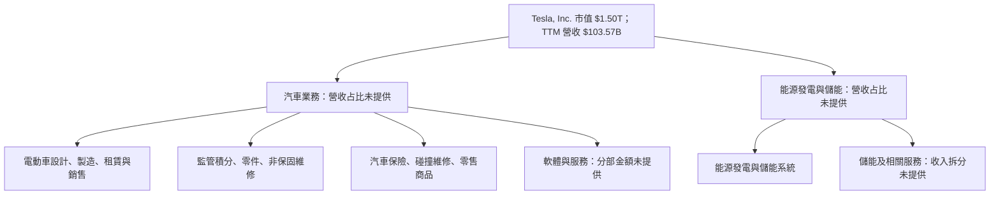
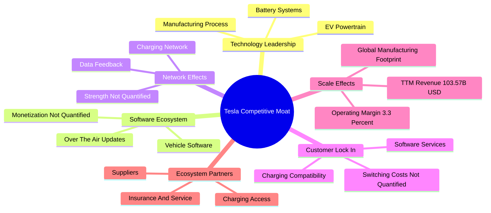
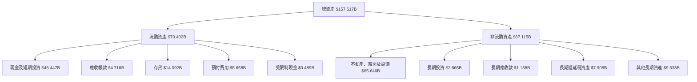
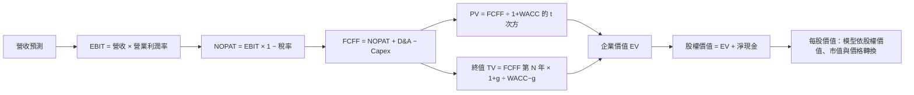
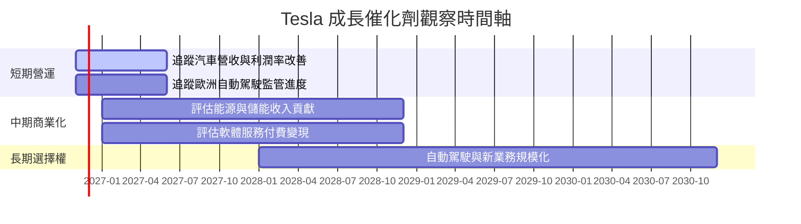
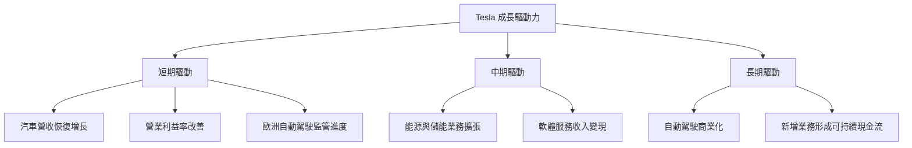
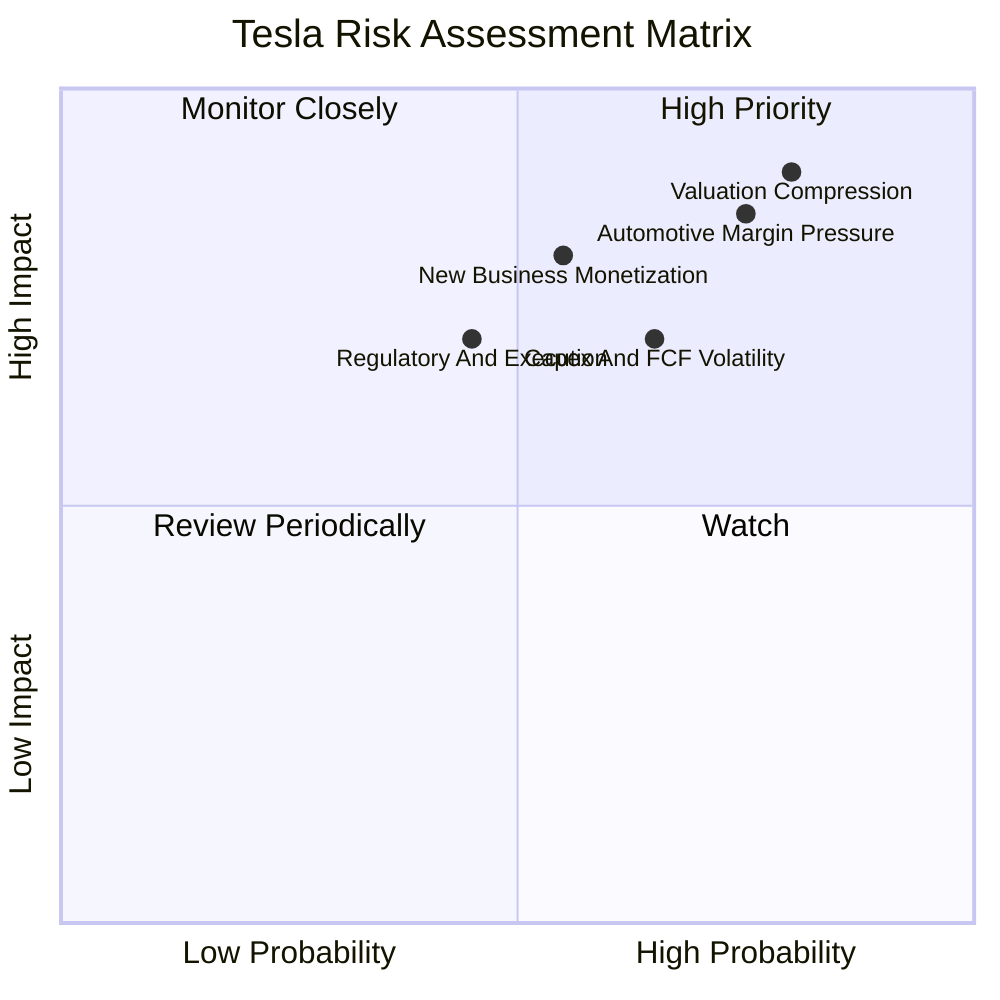
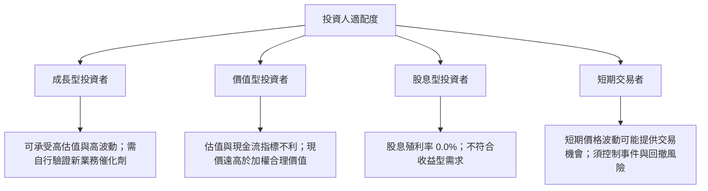

# TSLA 基本面深度分析報告

> **報告日期**：2026-11-27 ｜ **語言**：繁體中文 ｜ **數據來源**：SEC 申報資料 (XBRL)、Yahoo Finance、Finviz、StockAnalysis、Roic.ai ｜ **分析師**：CFA 級機構研究  
> **價格基準**：2026-11-25 收盤價 **$380.14**。除特別註明外，財務金額為美元。

## 目錄

| # | 章節 | 核心結論 |
|---|------|----------|
| 1 | 執行摘要 | 規則 20 評級為賣出；加權合理價值 $62.41，MOS -509.1% |
| 2 | 公司概覽與商業模式 | 汽車與能源業務兼具規模與品牌優勢，但軟體變現及網路效應仍需業績驗證 |
| 3 | 損益表深度分析 | TTM 營收 $103.57B、TTM 成長 8.3%；營業利益率僅 3.3% |
| 4 | 資產負債表分析 | 淨現金 $36.18B；營運資金週期為 3 天 |
| 5 | 現金流量深度分析 | TTM FCF $3.30B，FCF Yield 0.22%；資本支出吸收大部分營運現金流 |
| 6 | 獲利能力與資本效率 | ROIC 5.1% 低於 WACC 12.27%，目前未覆蓋資本成本 |
| 7 | 相對估值分析 | 估值倍數遠高於 GM、Ford；自身 P/E 位於五年區間高端 |
| 8 | DCF 內在價值評估 | 基準 DCF $13.13／股；模型終值佔 EV 188.9%，估值高度依賴終值及未來轉型 |
| 9 | 成長催化劑 | 能源、軟體與自動駕駛有上行選擇權，但營收與 TAM 數據不足以量化 |
| 10 | 風險矩陣 | 估值、利潤率及新業務變現是主要風險 |
| 11 | 投資建議 | 賣出；關注利潤率、FCF、ROIC 及可驗證的新業務收入 |

---

## 1. 執行摘要

TSLA 的 TTM 營收為 **$103.57B**，TTM 年增 **8.3%**，但最新一季營收年增為 **-0.2%**；TTM 營業利益率為 **3.3%**、ROIC 為 **5.1%**，低於 **12.27% WACC**。TTM FCF 為 **$3.30B**，FCF Yield 僅 **0.22%**。另一方面，2026-11-25 收盤價 **$380.14** 對應 P/E **417.7x**，而 DCF 基準值為 **$13.13／股**、加權合理價值為 **$62.41／股**。依加權合理價值計算，MOS 為 **-509.1%**，依規則 20 評級為 **賣出**；該結論主要由估值與資本回報不足所驅動，而非短期流動性問題。

### 1.0 一頁式投資儀表板（Portfolio Manager 30 秒速讀）

| 項目 | 內容 |
|------|------|
| **投資論點（3 句）** | ① TTM 營收年增 8.3%，但最新一季年增 -0.2%，短期成長動能不均。② TTM 營業利益率 3.3%、ROIC 5.1% 低於 WACC 12.27%，現有資本回報尚未覆蓋資本成本。③ 現金與短期投資 $45.45B、淨現金 $36.18B，提供財務緩衝，但 TTM FCF Yield 僅 0.22%。 |
| **綜合評分** | **4.7/10**（引用 1.1 評分卡） |
| **財務健康** | 🟢 現金及短期投資 $45.45B，淨現金 $36.18B；但 Piotroski F-Score 為 4/9 |
| **ROIC vs WACC** | **5.1% vs 12.27%**；目前未覆蓋資本成本 |
| **FCF 趨勢** | TTM FCF $3.30B；FCF Yield **0.22%**。2025 財年 FCF $6.22B，而最新 TTM 較低，需留意資本支出增加及週期性 |
| **估值** | Forward P/E **175.7x** ｜ EV/EBITDA **144.1x** ｜ FCF Yield **0.22%** |
| **DCF 內在價值（基準）** | **$13.13** ｜ 現價相對 DCF 溢價 **+2,794.9%** |
| **安全邊際（MOS）** | **-509.1%**＝($62.41 加權合理價值 − $380.14 現價) ÷ $62.41 ｜ 🔴 無 |
| **預期報酬（基準情境 12M）** | DCF 基準情境相對現價 **-96.5%**；此為模型情境值，不等同分析師共識 |
| **關鍵風險（前二）** | ① 高估值對未來成長與利潤率要求過高；② 汽車定價競爭與新業務變現不確定 |
| **評級 + 信心度** | 🔴 **賣出** ｜ 信心：中；財務指標及估值差距明確，但長期新業務選擇權難由現有 DCF 完整反映 |

### 1.1 綜合評分卡（全報告唯一）

| 維度 | 評分（1–10） | 主要依據（引用數字與其來源章節） |
|------|--------------|----------------------------------|
| 成長性 | 5.0 | TTM 營收年增 8.3%，但最新一季年增 -0.2%；見第 3 章 |
| 獲利能力 | 3.0 | TTM 營業利益率 3.3%、ROIC 5.1% 低於 WACC 12.27%，F-Score 4/9；見第 3、6 章 |
| 財務健康 | 8.0 | 淨現金 $36.18B、流動比率 1.739、CCC 3 天；見第 4 章 |
| 估值 | 1.0 | MOS -509.1%、P/E 417.7x、P/S 13.0x；見第 7、8 章 |
| 護城河 | 6.0 | 品牌、充電網路與規模是優勢；但 Peer 資料顯示 GM TTM 毛利率 11.4%，Tesla TTM 毛利率 19.3%，不能據此推定 Tesla 長期能維持現有優勢；見第 2 章 |
| 管理層與資本配置 | 5.0 | TTM 資本支出 $15.41B，年化 SBC 約 $4.30B；股數測試未通過；資本投入的回報尚未透過 ROIC 證明；見第 3、5、6 章 |
| **綜合評分** | **4.7** | 六項算術平均：$(5+3+8+1+6+5)÷6=4.6667$，四捨五入至一位小數 |

### 1.2 五大投資論點 + 三大核心風險

| 類型 | 項目 | 具體依據 | 信心度 |
|------|------|----------|--------|
| 🟢 **投資論點①** | 大型現金緩衝 | 現金與短期投資 $45.45B、總債務 $9.27B，資料區塊計算淨現金 $36.18B，可支應投資與營運波動 | 🟢 高 |
| 🟢 **投資論點②** | TTM 營收仍增長 | TTM 營收 $103.57B，年增 8.3%；但最新一季年增 -0.2%，需觀察是否恢復 | 🟡 中 |
| 🟢 **投資論點③** | 毛利率仍高於傳統車廠同業 | TTM 毛利率 19.3%，高於 GM 11.4%、Ford 7.4%；但業務組合與會計口徑未必完全可比 | 🟡 中 |
| 🟢 **投資論點④** | 現金轉換週期短 | CCC 由一年前 15 天降至 3 天，主要是 DPO 延長；營運資金效率有改善，但不能單獨視為結構性議價力提升 | 🟡 中 |
| 🟢 **投資論點⑤** | 能源、軟體、自動駕駛提供選擇權 | 公司同時經營能源與車輛相關服務；但未提供可核實分部營收比例，暫不將其計入額外估值 | 🟡 中 |
| 🟡 **風險①** | 汽車價格競爭與利潤率波動 | 最新一季營收年增 -0.2%；TTM 營業利益率僅 3.3%，營運槓桿對降價及成本變化敏感 | 🔴 高 |
| 🔴 **風險②** | 估值對成長預期要求極高 | P/E 417.7x、Forward P/E 175.7x；加權合理價值 $62.41，低於現價 $380.14 | 🔴 高 |
| 🔴 **風險③** | 研發、資本支出與稀釋未必轉化為足夠回報 | TTM Capex $15.41B、TTM SBC 約 $4.30B，ROIC 5.1% 低於 WACC 12.27% | 🔴 高 |

### 1.3 快速統計卡片

| 指標 | 公司實際值（期間） | 同業中位數 | 狀態 |
|------|--------------------|------------|------|
| 營收成長（TTM） | **8.3%** | — | 🟡 |
| 營收成長（最新一季年增） | **-0.2%** | GM、F、RIVN 中位數 2.9% | 🔴 |
| 毛利率（TTM） | **19.3%** | GM、F、RIVN 中位數 9.2% | 🟢 |
| 營業利益率（TTM） | **3.3%** | — | 🔴 |
| ROIC（TTM） | **5.1%** | — | 🔴 |
| Forward P/E | **175.7x** | GM、F 中位數 6.1x | 🔴 |
| FCF Yield（TTM） | **0.22%** | — | 🔴 |
| Piotroski F-Score | **4 / 9** | — | 🟡 |

### 1.4 投資結論

```text
╔══════════════════════════════════════════════════════════════════╗
║                    📊 投資結論摘要                               ║
╠══════════════════════════════════════════════════════════════════╣
║  評級：🔴 賣出（依規則 20；未作質化調整）                         ║
║  價格（2026-11-25 收盤）：$380.14                                ║
║  DCF 內在價值（基準）：$13.13（相對現價溢價 +2,794.9%）          ║
║  安全邊際 MOS：-509.1%（＝($62.41−$380.14)÷$62.41）             ║
║  加權合理價值（8.8）：$62.41                                    ║
║  DCF 情境價值：                                                  ║
║    悲觀情境：$9.05（相對現價 -97.6%）                           ║
║    基準情境：$13.13（相對現價 -96.5%）                          ║
║    樂觀情境：$18.89（相對現價 -95.0%）                          ║
║  綜合評分：4.7/10（引用 1.1）                                    ║
║  適合投資人：能承受高波動、並能獨立驗證新業務進展的成長型投資人    ║
╚══════════════════════════════════════════════════════════════════╝
```

---

## 2. 公司概覽與商業模式

### 2.1 業務結構與收入來源

公司資料描述 Tesla 經營汽車、能源發電與儲能兩大分部，另有監管積分、非保固維修、碰撞維修、保險、零件及零售商品等服務。**沒有各分部營收金額及占比**，因此不以估計比例製作收入拆分圖。



公司營收規模提供規模效應的可能性，但 TTM 營業利益率 3.3% 顯示規模尚未穩定轉化為高營業回報。能源、軟體及服務的獨立營收與毛利數據缺漏，估值時不宜將未證實的高毛利業務視為已實現價值。

### 2.2 市場份額

市場份額數據未提供，因此不繪製市場份額圖、不填入推估比例。Tesla TTM 營收 $103.57B，Peer multiples 中 GM、Ford、Rivian 的營收成長率分別為 2.9%、-2.0%、38.3%；但缺少同一市場、同一期間的全球交付量與市場份額口徑，不能只憑營收直接判定份額變化。

### 2.3 競爭護城河分析



### 2.4 護城河強度

| 護城河項目 | 強度（強／中／弱） | 證據（引用數字或事實） | 會削弱它的情況 |
|------------|--------------------|------------------------|----------------|
| 技術與製造 | 中 | TTM 營收 $103.57B、TTM 毛利率 19.3%；但 TTM 營業利益率 3.3% | 競爭者縮短產品差距、製造成本下降更快 |
| 軟體生態系統 | 中 | 公司有車輛軟體與服務，但軟體收入占比、訂閱數與續約數未提供 | 無法形成持續付費、功能差異縮小 |
| 充電與網路效應 | 中 | 公司業務涵蓋充電相關生態，但網路使用率及外部收入未提供 | 競品網路互通、標準開放或使用者轉換成本下降 |
| 客戶鎖定 | 弱至中 | 購車、軟體及服務可增加黏著度，但留存率與轉換成本數據缺漏 | 產品同質化、服務體驗下降或價格競爭 |
| 規模效應 | 中 | TTM 營收 $103.57B；但 ROIC 5.1% 低於 WACC 12.27% | 產能利用不足、固定成本與資本投入無法提升回報 |
| 生態夥伴 | 中 | 涉及供應、充電、保險與維修等業務；量化夥伴貢獻未提供 | 供應商替代性上升、合作方形成競爭服務 |

**1.1「護城河」評分為 6.0/10**：規模、品牌與充電生態提供差異化，但可量化的軟體收入、客戶留存和網路效應證據不足，且低 ROIC 尚未證明護城河能穩定產生超額回報。

---

## 3. 損益表深度分析

### 3.1 年度收入成長趨勢（近 4 年）

下列年度營收取自年度損益表，YoY 由相鄰財年營收計算。4 年資料顯示 2022–2025 營收整體增加，但 2024、2025 年均未呈現強勁增長。

```text
╔══════════════════════════════════════════════════════════════════╗
║              Tesla 年度收入趨勢（FY2022–FY2025）                 ║
╠══════════════════════════════════════════════════════════════════╣
║  FY2022  $81.46B  ████████████████████░░░░░░░░  YoY：+51.4% 🟢  ║
║  FY2023  $96.77B  ████████████████████████░░░░  YoY：+18.8% 🟢  ║
║  FY2024  $97.69B  ████████████████████████░░░░  YoY： +1.0% 🟡  ║
║  FY2025  $94.83B  ███████████████████████░░░░░  YoY： -2.9% 🔴  ║
║                                                                  ║
║  2022–2025 營收 CAGR：[(94.83 ÷ 81.46)^(1/3) − 1] = 約 5.2%     ║
╚══════════════════════════════════════════════════════════════════╝
```

2022 至 2023 的增長明顯高於其後兩年；2024 年營收約持平，2025 年減少 2.9%。這表示過去高速擴張的基期效應已減弱，若無新車型、價格改善或能源與服務收入加速，單靠既有汽車業務難以維持此前增長率。

### 3.2 季度收入趨勢分析

| 季度 | 營收 | QoQ 成長 | YoY 成長 | 備註 |
|------|------:|---------:|---------:|------|
| 2025 Q4 | $24.901B | -11.4% | -3.14% | QoQ 以 2025 Q3 $28.095B 計算；年增資料取季度財務表 |
| 2026 Q1 | $22.387B | -10.1% | 15.78% | YoY 以 2025 Q1 $19.335B 計算 |
| 2026 Q2 | $28.236B | 26.1% | 25.52% | 季度環比反彈，但需分辨交付時點與產品組合 |
| 2026 Q3 | $28.046B | -0.7% | -0.17% | 最新一季營收年增約 -0.2%，與 TTM 8.3% 不可混用 |

QoQ 公式為本季營收 ÷ 前季營收 − 1。季度變化幅度大，可能受交付節奏、季節性及促銷安排影響；2026 Q3 年增轉負，與 TTM 成長 8.3% 形成差異，表示近期趨勢弱於過去四季累計數字。

### 3.3 利潤率演變分析

| 利潤率指標 | FY2022 | FY2023 | FY2024 | FY2025 | 趨勢 | 評估 |
|------------|-------:|-------:|-------:|-------:|------|------|
| **毛利率** | 25.6% | 18.2% | 17.9% | 18.0% | 2022 後下移，近兩年大致持平 | 🟡 |
| **營業利益率** | 17.0% | 9.2% | 7.9% | 5.1% | 連續下降 | 🔴 |
| **淨利率** | 15.4% | 15.5% | 7.3% | 4.0% | 2024 起明顯收縮 | 🔴 |

年度毛利率、營業利益率及淨利率由年度毛利／營收、營業利益／營收與淨利／營收計算，數字可能受來源四捨五入影響。TTM 淨利率為 3.1%，TTM 營業利益率的核定數值為 3.3%。

利潤率下行可能反映汽車價格與產品組合壓力、成本投入、研發支出增加及固定資產使用效率變化。R&D 從 2022 財年的 $3.08B 增至 2025 財年的 $6.41B；這些投入若沒有帶來可量化的新增收入或生產率提升，會壓縮當期營業回報。2025 年毛利率較 2024 年略回升，但營業利益率仍降至 5.1%，顯示毛利改善尚未充分傳遞至營業層級。

### 3.4 費用結構分析

依 2025 財年已提供數字，毛利 $17.09B、營業利益 $4.85B、R&D $6.41B。以下只呈現這些數字所支持的費用與利潤項目；銷管費等完整拆分未提供，故不畫比例圓餅圖。

```text
╔══════════════════════════════════════════════════════════════════╗
║                 FY2025 損益結構（已提供項目）                    ║
╠══════════════════════════════════════════════════════════════════╣
║  營收             $94.83B  ██████████████████████████████        ║
║  毛利             $17.09B  █████                                 ║
║  R&D               $6.41B  ██                                    ║
║  營業利益          $4.85B  ██                                    ║
║  營業利益率          5.1%  營業利益 ÷ 營收                        ║
╚══════════════════════════════════════════════════════════════════╝
```

### 3.5 季度 EPS 趨勢與盈餘品質（Quality of Earnings）

| 季度 | EPS 實際值 | EPS 年增 | EPS 預估／超預期資料 |
|------|-----------:|---------:|----------------------|
| 2025 Q4 | $0.24 | -60.61% | 預估值 N/A，無法判定是否超預期 |
| 2026 Q1 | $0.13 | 8.33% | 預估值 N/A，無法判定是否超預期 |
| 2026 Q2 | $0.32 | -3.03% | 預估值 N/A，無法判定是否超預期 |
| 2026 Q3 | $0.24 | -43.59% | 預估值 N/A，無法判定是否超預期 |

財報 EPS beat/miss 資料中的預估 EPS 為空值，因此不能把季度 EPS 表現標為超預期或不及預期。上述 EPS 取 StockAnalysis 季度歷史；季度淨利數字亦顯示 2026 Q3 淨利 $0.787B，較 2025 Q3 的 $1.373B 低，與年減幅方向一致。

| 盈餘品質項目 | 數值／佔比 | 評估 |
|--------------|-----------|------|
| 股權薪酬 SBC / 營收 | 約 $4.30B ÷ $103.57B = **4.2%** | 🟡 SBC 為非現金會計費用，但其經濟成本體現在股權稀釋；比例不可忽略 |
| SBC / 營業現金流 | 約 $4.30B ÷ $18.71B = **23.0%** | 🟡 顯示 SBC 對經營現金流與股東稀釋的評估有實質影響 |
| FCF / 淨利（現金轉換率） | $3.30B ÷ 約 $3.22B = **約 102.5%** | 🟢 TTM FCF 約等於 TTM 淨利；但資本支出波動可能改變轉換率 |
| 一次性／非經常性損益 | 具體拆分 **N/A** | 🟡 未提供足夠資料判斷非經常性項目是否抬高或壓低盈餘 |
| 有效稅率異常 | **27.0%**（最新年度有效稅率） | 🟡 稅率影響稅後利潤，無法僅憑該數字識別一次性稅務利益 |
| 資本化支出 vs 費用化 | TTM Capex **$15.41B**；資本化與費用化拆分 N/A | 🟡 資本支出形成資產並於未來折舊；缺少資產新增、折舊與費用化逐項調節表 |

TTM FCF 對淨利轉換率約 102.5%，表面上現金盈餘與會計淨利大致一致；但 SBC 約占營收 4.2%，且稀釋股數未通過 Piotroski 測試，代表完全忽略 SBC 會高估既有股東的每股經濟回報。綜合而言，盈餘品質中等：營運現金流為正且大於 FCF，但需要持續扣除資本支出並追蹤稀釋，不宜把 SBC 當作無成本資金。

---

## 4. 資產負債表分析

### 4.1 資產結構分解

以 2026-09-30 的 StockAnalysis 資產表為參考：總資產 $157.517B、流動資產 $70.402B、非流動資產為兩者差額 $87.115B。細項採已列示的賬面數字，並非比例估計。



### 4.2 流動性與營運資金分析

| 指標 | 最新值 | 一年前值 | 評估 |
|------|-------:|---------:|------|
| 現金與短期投資 | $45.45B | $36.56B（FY2024 年底） | 🟢 流動性資源充足；時點並非完全相同季度 |
| 流動比率 | 1.739 | N/A | 🟢 流動資產高於流動負債；歷史同比值未提供 |
| 速動比率 | 1.239 | N/A | 🟢 排除存貨後仍有流動資產覆蓋 |
| 淨現金 | $36.18B | N/A | 🟢 依 VERIFIED 財務數據所列口徑 |
| DSO 應收帳款天數 | 16 天 | 18 天 | -2 天；收款週期縮短 |
| DIO 存貨天數 | 62 天 | 56 天 | +6 天；存貨佔用增加，需留意銷售與生產匹配 |
| DPO 應付帳款天數 | 75 天 | 59 天 | +16 天；供應商付款週期延長 |
| CCC 現金轉換週期 | 3 天 | 15 天 | -12 天；主要由 DPO 增幅抵銷 DIO 上升 |

營運資金天數照抄 QUALITY FIGURES。CCC 由 15 天降至 3 天，代表現金從投入營運到收回所需時間縮短；但 DIO 同時增加 6 天，DPO 增加 16 天，改善主要來自應付帳款週期延長，不能單憑 CCC 就確認存貨效率或供應商議價力持續改善。

### 4.3 債務結構分析

```text
╔══════════════════════════════════════════════════════════════════╗
║                    Tesla 債務健康診斷                            ║
╠══════════════════════════════════════════════════════════════════╣
║  總債務（核定口徑）：       $9.27B   ██░░░░░░░░░░░░░░░░░░        ║
║  現金 + 短期投資：         $45.45B   ████████████████████        ║
║  淨現金：                  $36.18B   ████████████████░░░░  🟢    ║
║                                                                  ║
║  流動比率：                  1.739x   🟢                         ║
║  速動比率：                  1.239x   🟢                         ║
║  Debt/EBITDA：               N/A      核定債務口徑與 EBITDA 欄位 ║
║  利息保障倍數：              N/A      利息費用及一致口徑未提供     ║
║                                                                  ║
║  注意：其他財務來源列示總債務 $16.44B、淨現金 $29.00B；與核定    ║
║  數字口徑不同，本報告依指定核定值採 $9.27B、$36.18B。            ║
╚══════════════════════════════════════════════════════════════════╝
```

由於資料來源對總債務和淨現金出現不同口徑，本報告按 SEC 核定指標使用總債務 $9.27B、淨現金 $36.18B；不能將另一來源的 $16.44B 債務與核定淨現金混合計算。

### 4.4 股東權益趨勢

| 財年 | 股東權益 | YoY 變化 |
|------|---------:|---------:|
| 2022 | $44.70B | — |
| 2023 | $62.63B | +40.1% |
| 2024 | $72.91B | +16.4% |
| 2025 | $82.14B | +12.7% |

```text
╔══════════════════════════════════════════════════════════════════╗
║                  Tesla 歷年股東權益                              ║
╠══════════════════════════════════════════════════════════════════╣
║  FY2022  $44.70B  ███████████                                    ║
║  FY2023  $62.63B  ████████████████                               ║
║  FY2024  $72.91B  ██████████████████                             ║
║  FY2025  $82.14B  ████████████████████                           ║
╚══════════════════════════════════════════════════════════════════╝
```

股東權益逐年上升，反映留存盈餘及資本基礎擴大；但權益增長本身不代表資本效率改善，仍需與 ROIC 比較。TTM ROIC 5.1% 低於資本成本，是檢驗新增資本是否創造價值的重要約束。

---

## 5. 現金流量深度分析

### 5.1 現金流量瀑布圖

現金流資料可確認營業現金流、資本支出及 FCF；股息、回購及現金變動的同期間完整拆解未提供，圖中不臆造金額。


### 5.2 FCF 轉換率趨勢

| 財年／期間 | FCF | 淨利 | FCF／淨利 | 解讀 |
|------------|----:|----:|----------:|------|
| FY2022 | $7.55B | $12.58B | 60.0% | 資本支出後現金低於淨利 |
| FY2023 | $4.36B | $15.00B | 29.1% | 淨利包含現金轉換較弱的部分，需看現金流品質 |
| FY2024 | $3.58B | $7.13B | 50.2% | FCF 及淨利均較前期低 |
| FY2025 | $6.22B | $3.79B | 164.1% | FCF 高於淨利，受現金流時點及資本支出影響 |
| TTM 至 2026-09-30 | $3.30B | 約 $3.22B | 約 102.5% | FCF 大致覆蓋淨利，但遠低於 OCF |

年度 FCF 與淨利取年度財務表；TTM 淨利採 StockAnalysis TTM 數字。不同資料表期間與口徑可能存在小幅差異，轉換率僅作趨勢觀察。

### 5.3 自由現金流趨勢

```text
╔══════════════════════════════════════════════════════════════════╗
║              自由現金流：歷史實際與最新 TTM                      ║
╠══════════════════════════════════════════════════════════════════╣
║  FY2022  $7.55B  ████████████████████  FCF Yield：N/A            ║
║  FY2023  $4.36B  ████████████          FCF Yield：N/A            ║
║  FY2024  $3.58B  ██████████            FCF Yield：N/A            ║
║  FY2025  $6.22B  █████████████████     FCF Yield：N/A            ║
║  TTM     $3.30B  █████████             FCF Yield：0.22%          ║
╠══════════════════════════════════════════════════════════════════╣
║  TTM FCF = 營業現金流 $18.71B − 資本支出 $15.41B = $3.30B       ║
╚══════════════════════════════════════════════════════════════════╝
```

歷史年度 FCF 有明顯波動，2025 年回升至 $6.22B，但最新 TTM 為 $3.30B。資本支出占營業現金流約 82.4%（$15.41B ÷ $18.71B），因此新產能與技術投資的回報速度，將主導未來自由現金流。

### 5.4 資本配置評估

回購、股息與留存盈餘的金額拆分未提供，不繪製比例圓餅圖。

| 配置項目 | 可核實數據 | 評估 |
|----------|------------|------|
| 資本支出 | TTM $15.41B | 投資額大；需由未來增量收入、利潤率與 ROIC 證明回報 |
| 研發 | FY2025 $6.41B | 高於 FY2022 的 $3.08B；需追蹤新產品及軟體商業化 |
| 股息 | 股息殖利率 0.0% | 未以現金股息回饋股東 |
| SBC | FY2025 $2.83B；最近四季合計約 $4.30B | 有稀釋成本，需觀察股數及員工激勵效果 |
| 回購 | N/A | 缺少完整回購金額，不能判斷是否抵銷 SBC 稀釋 |
| 留存現金 | 現金及短期投資 $45.45B | 具備資金彈性，但現金堆積本身不保證資本回報 |

---

## 6. 獲利能力與資本效率

### 6.1 ROE / ROA / ROIC 趨勢

| 指標 | FY2025／最新可用值 | TTM | 評估 |
|------|-------------------:|----:|------|
| ROE | 3.8%（市場資料） | 3.6%（QUALITY FIGURES） | 🔴 回報偏低；來源口徑略有差異 |
| ROA | 1.5% | N/A | 🔴 資產獲利能力有限 |
| ROIC | N/A | 5.1% | 🔴 低於 WACC 12.27% |
| 行業均值 | N/A | N/A | 未提供可比口徑，故不列行業均值 |

### 6.2 ROIC vs WACC 分析（核心價值創造判斷）

```text
╔══════════════════════════════════════════════════════════════════╗
║                 ROIC vs WACC 深度分析                            ║
╠══════════════════════════════════════════════════════════════════╣
║  資本成本輸入（按 Cost of Capital 數據）：                       ║
║  ├── 無風險利率 Rf：              4.85%                          ║
║  ├── 股票風險溢酬 ERP：           5.00%                          ║
║  ├── 原始 Beta：                  1.74                           ║
║  ├── 調整後 Beta：                1.50                           ║
║  ├── 股權成本 Ke：               12.32%                          ║
║  ├── 稅前債務成本 Kd：             3.65%                          ║
║  ├── 資本權重 E / D：             99.4% / 0.6%                    ║
║  └── 採用 WACC：                 12.27%                          ║
║                                                                  ║
║  ROIC（TTM）：                   5.10%                           ║
║  EVA Spread = ROIC − WACC：     5.10% − 12.27% = -7.17pp         ║
║                                                                  ║
║  ROIC  5.10%  ▓▓▓▓▓▓▓▓░░░░░░░░░░░░░░░░░░░░░░░░  🔴              ║
║  WACC 12.27%  ▓▓▓▓▓▓▓▓▓▓▓▓▓▓▓▓▓▓▓▓▓▓▓▓▓▓▓▓▓▓  ──              ║
║                                                                  ║
║  結論：目前 ROIC 低於 WACC 7.17 個百分點，尚未覆蓋資本成本。    ║
╚══════════════════════════════════════════════════════════════════╝
```

ROIC 與 WACC 採用核定值，並與 DCF 折現率一致。這表示在目前 TTM 獲利及投入資本口徑下，公司尚未創造正的資本利差；未來若利潤率回升、資本周轉加快，ROIC 才可能收斂至 WACC 以上。此處不另用缺漏的利息費用、資產負債表數字重建 WACC。

### 6.3 杜邦三因素分解

| 因素 | 數值（TTM） | 解讀 |
|------|-------------|------|
| 淨利率 | 3.1% | 利潤率是 ROE 的主要限制 |
| 資產週轉率 | 0.66x | 每單位資產產生的營收有限，需配合高利潤率才可支撐較高 ROE |
| 權益乘數 | 1.76x | 槓桿程度非極端，但沒有靠高槓桿把 ROE 大幅放大 |
| **ROE** | **3.6%** | 3.1% × 0.66 × 1.76 = 約 3.6% |

### 6.4 財務體質：Piotroski F-Score

**Piotroski F-Score：4 / 9**。此分數與九項測試結果依 QUALITY FIGURES 照錄。

| 測試 | 結果 | 解讀 |
|------|------|------|
| ROA > 0 | ✅ 通過 | 盈利能力為正 |
| 營業現金流 > 0 | ✅ 通過 | TTM 營業現金流為正 |
| ROA 高於一年前 | ❌ 未通過 | 資產回報沒有改善 |
| 營業現金流 > 淨利（應計品質） | ✅ 通過 | 現金流高於淨利，支持盈餘現金轉換 |
| 長期負債 ÷ 總資產低於一年前 | ❌ 未通過 | 槓桿相對資產的變化未改善 |
| 流動比率高於一年前 | ❌ 未通過 | 流動性比率沒有同比改善 |
| 稀釋股數未增加 | ❌ 未通過 | 股數稀釋可能降低每股盈餘增長 |
| 毛利率高於一年前 | ✅ 通過 | 毛利率測試通過，但不等同營業利益率改善 |
| 資產週轉率高於一年前 | ❌ 未通過 | 資產使用效率未改善 |

四項通過反映正營業現金流與毛利率改善等優點；五項未通過則指出 ROA、資產週轉率、流動性同比改善及股數控制仍有不足。F-Score 是財務趨勢檢查，不是公司品質或估值的單一判斷。

---

## 7. 相對估值分析

### 7.1 同業估值比較表格

Peer multiples 依 Yahoo Finance 指標列示。GM、Ford 為傳統車廠，Rivian 為電動車製造商；三者業務模式與獲利階段不同，估值比較僅供參考。負值或 N/A 的倍數不宜直接當作可比估值。

| 估值指標 | **TSLA** | **GM** | **F** | **RIVN** | TSLA 評估 |
|----------|---------:|-------:|------:|--------:|-----------|
| **Trailing P/E** | 417.7x | 18.4x | N/A | N/A | 🔴 顯著高於獲利型車廠 |
| **Forward P/E** | 175.7x | 5.7x | 6.5x | -6.7x | 🔴 估值要求高；RIVN 為負值，不適合直接比較 |
| **P/S Ratio** | 14.5x（估值資料）／13.0x（歷史估值核定口徑） | 0.4x | 0.3x | 2.6x | 🔴 顯著高於同業；不同來源口徑不可混算 |
| **EV/EBITDA** | 144.1x（估值資料）／143.4x（歷史估值核定口徑） | 9.3x | 24.1x | -6.7x | 🔴 遠高於 GM、F；RIVN 倍數為負 |
| **最新一季營收年增** | -0.2% | 2.9% | -2.0% | 38.3% | 🟡 TSLA 成長低於 GM、RIVN，高於 F |
| **毛利率（TTM）** | 19.3% | 11.4% | 7.4% | 9.2% | 🟢 高於同業，但差異需考慮業務組合 |

Forward P/E 的差距意味著市場價格包含遠高於傳統汽車公司的未來盈利預期；若未來盈利未能迅速增加，目前倍數可能收縮。高毛利率是相對優勢，但低 TTM 營業利益率及 ROIC 顯示毛利優勢尚未完全轉化為資本回報。

### 7.2 歷史估值區間分析

```text
╔══════════════════════════════════════════════════════════════════╗
║          Tesla 五年 TTM P/E 區間與目前位置                       ║
╠══════════════════════════════════════════════════════════════════╣
║  五年區間：18.0x ───────────────────────────── 416.4x            ║
║  五年中位數：74.2x                                                ║
║  目前：417.7x  ────────────────────────────────────────►         ║
║  目前百分位：100%                                                 ║
║                                                                  ║
║  P/S：目前 13.0x；中位數 9.4x；五年百分位 76%                    ║
║  EV/EBITDA：目前 143.4x；中位數 64.6x；五年百分位 86%            ║
╚══════════════════════════════════════════════════════════════════╝
```

P/E 目前值高於所列五年區間上限 416.4x 的微小差異，應視為數據時點及四捨五入差異；核定目前百分位為 100%。三項估值指標均高於自身歷史中位數，代表市場定價已處於相對昂貴位置。

### 7.3 情境價值（Bear / Base / Bull，照抄 DCF MODEL）

| 情境 | 第 1 年營收成長 | 期末營業利潤率 | WACC | 每股價值 | 相對現價 | 機率 | 會發生的條件 |
|------|----------------:|----------------:|-----:|---------:|---------:|-----:|--------------|
| 🔴 悲觀 | 4.1% | 6.2% | 13.27% | $9.05 | -97.6% | 25% | 成長低於基準、利潤率提升有限，風險溢價較高 |
| 🟡 基準 | 8.3% | 7.2% | 12.27% | $13.13 | -96.5% | 50% | 成長由 8.3% 線性減速至 3.0%，利潤率提高至歷史五年中位數 |
| 🟢 樂觀 | 12.4% | 8.0% | 11.27% | $18.89 | -95.0% | 25% | 成長高於基準、利潤率提升較多且折現率下降 |

三情境反映模型假設變化下的每股價值；即使樂觀情境，仍明顯低於現價。情境不等同分析師目標價，也不代表未納入 DCF 的軟體及自動駕駛選擇權不存在。

### 7.4 相對估值隱含價格區間

```text
╔══════════════════════════════════════════════════════════════════╗
║                 相對估值回推每股價值                              ║
╠══════════════════════════════════════════════════════════════════╣
║  DCF 基準             $13.13                                     ║
║  同業 Forward P/E     $13.22                                     ║
║  同業 EV/EBITDA       $47.80                                     ║
║  分析師共識目標價     $419.05                                    ║
║                                                                  ║
║  低價區 $13.13 ── $13.22 ───── $47.80 ───────────── $419.05     ║
║  現價 $380.14 位於前三種模型區間上方，低於分析師共識目標價。      ║
╚══════════════════════════════════════════════════════════════════╝
```

| 方法 | 每股價值 | 依據 |
|------|---------:|------|
| 同業 Forward P/E | $13.22 | GM、F 同業中位數 6.1x × TSLA Forward EPS $2.16 |
| 同業 EV/EBITDA | $47.80 | GM、F 同業中位數 16.7x × TTM EBITDA，再加回淨現金 |
| 分析師共識 | $419.05 | 41 位分析師平均目標價；屬外部參考，不是內在價值公式 |

---

## 8. DCF 內在價值評估（Discounted Cash Flow）

> 本章採用程式計算的 DCF MODEL。財務輸入、逐年預測、敏感度矩陣、三情境及橋接均依模型輸出照錄；來源數字已四捨五入，個別行列相加可能有 $0.01B 尾差。金額取至小數兩位、折現因子取至三位、比率取至一位小數，尾差不代表另行調整模型。

### 8.0 估值推理鏈（Thinking Logic）

**Step 1 — 價值來源與主導變數**

模型僅能以目前可核實的收入基礎及 GAAP 營業利潤率估算企業現金流；公司 TTM 營收為 $103.57B，能源、軟體及汽車業務分部占比未提供，無法把第二成長曲線獨立拆分。模型價值主要受**長期營業利潤率與終值現金流**主導；這與敏感度矩陣中 g、WACC 對終值折現價值的影響一致。

**Step 2 — 模型選擇**

| 決策點 | 本報告採用 | 理由（含數字） | 曾考慮但否決 | 否決理由 |
|--------|-----------|----------------|--------------|----------|
| 現金流定義 | FCFF | 以企業現金流折現至 EV，再加淨現金；TTM 淨現金 $36.18B | FCFE | DCF 模型已採 WACC 與 EV 橋接 |
| 預測期 N | 10 年 | 模型規定 10 年；需要讓營收增速由 8.3% 淡化至 3.0%、利潤率由 3.3% 提至 7.2% | 5 年 | 不符合既定模型的長期淡化路徑 |
| 終值方法 | Gordon Growth | 終值增長率 3.0% 低於 WACC 12.27% | 單一退出倍數 | DCF MODEL 使用 Gordon Growth，未提供可替換的退出倍數模型結果 |
| EBIT 基礎 | GAAP EBIT | 模型明確採 GAAP，FY+1 營業利潤率 3.3% | 非 GAAP EBIT | 會改變 SBC 處理及既定 FCFF 表 |

**Step 3 — 關鍵假設推導鏈**

- **營收成長**：錨點＝TTM 營收年增 8.3%；調整＝將成長率逐年線性淡化至第 10 年 3.0%，反映成長率隨基期增加而收斂；**採用 FY+1 8.3%、FY+10 3.0%**；曾考慮永久維持 8.3%，但缺乏十年持續的分部成長或市場份額數據支持，故不採用。
- **期末營業利益率**：錨點＝TTM 3.3%；調整＝以最近五個財年的中位數作為模型期末目標；**採用 FY+10 7.2%**；曾考慮回到 FY2022 的 17.0%，但近年營業利益率持續收縮，且該高點不代表可持續成熟利潤率，故否決。
- **永續成長率 g**：錨點＝模型指定 3.0%；調整＝保持在長期名目經濟成長合理範圍內並低於 WACC；**採用 3.0%**；曾考慮 4.0%，但在終值佔比已高的模型中會進一步放大終值，故基準不採。
- **預測期 N**：錨點＝模型設定 10 年；調整＝以十年反映成長與利潤率收斂；**採用 10 年**；曾考慮短期 5 年，但無法呈現模型設定的長期淡化路徑。
- **Capex／營收**：錨點＝TTM Capex／TTM 營收為模型輸入 14.9%；調整＝逐年淡化至 6.0%，並遵循模型假設；**採用 FY+1 14.9%、FY+10 6.0%**；曾考慮固定在 6.0%，但與目前資本支出強度差距過大，不符合起始年度錨點。
- **EBIT 基礎及 SBC**：錨點＝TTM GAAP 營業利益率 3.3%；**採用 GAAP EBIT**。GAAP EBIT 已含 SBC 費用；**本模型採用 (A)，故 SBC 影響已計入一次**：不另扣 SBC、不額外提高股數，年稀釋率按模型組合設定為 0%。曾考慮非 GAAP EBIT 加回 SBC，但模型並未使用該口徑，故否決。
- **WACC**：錨點＝資本成本輸入所列 WACC 12.27%；調整＝不另行更改，直接作為折現率；**採用 12.27%**；曾考慮以較低 WACC 抬高估值，但股票 Beta 1.50、股權成本 12.32%，沒有足夠依據另降折現率。
- **稅率**：錨點及採用值均為最新年度有效稅率 27.0%；因與錨點相同，按模型假設使用。
- **D&A／營收**：錨點＝TTM 5.5%；採用 5.5% 固定值。
- **營運資金**：模型明確不建模 ΔWC；採用 0／不列入 FCFF，而非假設歷史 WC 比率。
- **終值方法**：採 Gordon Growth；以第 10 年 FCFF 為基礎並按 3.0% 永續成長，避免自行增加未提供的退出倍數。

**Step 4 — 最脆弱假設**

最脆弱的一環是長期營業利潤率由 3.3% 上升至 7.2%、同時 Capex／營收由 14.9% 降至 6.0%；若成本改善或投資強度下降未實現，FCFF 會低於模型，DCF 價值將向下修正；模型終值現值已達 EV 的 188.9%，顯示短期現金流不足以支撐估值。

**Step 5 — 計算路徑圖**



### 8.1 模型假設總表（Model Inputs）

| 假設項目 | 採用值 | 依據／來源 | 敏感度 |
|----------|--------|-------------|--------|
| 預測期長度 **N** | 10 年 | DCF MODEL 固定預測期 | 🟡 中 |
| 營收成長路徑 | FY+1 8.3% → FY+10 3.0% | TTM 營收年增 8.3%，線性淡化 | 🔴 高 |
| 營業利益率 | FY+1 3.3% → FY+10 7.2% | TTM 3.3% 淡化至近五個財年中位數 | 🔴 高 |
| 有效稅率 | 27.0% | 最新年度有效稅率 | 🟢 低 |
| Capex／營收 | FY+1 14.9% → FY+10 6.0% | TTM 起始值，逐年淡化至模型指定值 | 🔴 高 |
| D&A／營收 | 5.5% | TTM 比率，模型固定 | 🟢 低 |
| ΔWC／營收增額 | 未建模 | DCF MODEL 明確註明 Working capital is not modelled | 🟢 低 |
| EBIT 基礎 | GAAP EBIT | DCF MODEL 明確採 GAAP EBIT | 🟡 中 |
| SBC 處理 | 組合 A：GAAP EBIT、無額外 SBC 扣減、固定股數 | GAAP EBIT 已含 SBC；依模型設定不再稀釋 | 🟡 中 |
| 年稀釋率 | 0%（模型組合 A） | DCF MODEL 註明股數不再稀釋 | 🟡 中 |
| 永續成長率 g | 3.0% | 模型指定；低於 WACC 12.27% | 🔴 高 |
| 終值方法 | Gordon Growth | DCF MODEL 指定 | 🔴 高 |
| WACC | 12.27% | Cost of capital 區塊指定 | 🔴 高 |
| 股數／換算 | 模型公式：股權價值 × 價格 ÷ 市值 | DCF MODEL Per share 指定公式 | 🟡 中 |

模型使用 FCFF，且按 DCF MODEL 規定不列 ΔWC 項。SBC 只計一次：採 GAAP EBIT、沒有額外扣 SBC，也不再稀釋股數。

### 8.2 折現率推導（WACC）

```text
╔══════════════════════════════════════════════════════════════════╗
║                    WACC 推導（折現率）                           ║
╠══════════════════════════════════════════════════════════════════╣
║  股權成本 Ke（CAPM，直接採資本成本輸入）：                       ║
║  ├── 無風險利率 Rf：                 4.85%                       ║
║  ├── 市場風險溢酬 ERP：              5.00%                       ║
║  ├── Beta 原始值：                   1.74                        ║
║  ├── Beta 採用值：                   1.50                        ║
║  └── Ke = 4.85% + 1.50 × 5.00% = 12.35%；核定 Ke 採 12.32%       ║
║                                                                  ║
║  債務成本：                                                     ║
║  ├── 稅前 Kd：                       3.65%                       ║
║  ├── 有效稅率：                     27.0%                       ║
║  └── 稅後 Kd = 3.65% × (1−27.0%) = 2.6645%                      ║
║                                                                  ║
║  資本結構：                                                     ║
║  ├── 股權權重 E：                   99.4%                       ║
║  ├── 債務權重 D：                    0.6%                       ║
║  └── 核定 WACC：                   12.27%                       ║
╚══════════════════════════════════════════════════════════════════╝
```

資本成本區塊採用 Beta 調整公式 **⅔ × 原始 Beta 1.74 + ⅓ × 1 = 1.4933**，四捨五入為調整後 Beta 1.50。無風險利率為數據區塊列示的 10 年期美債 4.85%，日期細節未提供；ERP 5.00% 為假設值，依據為資本成本輸入。無規模或國別溢酬資料，因此不另加計。

**逐步演算（WACC）**

1. **Ke（CAPM）**：核定組成採用值為 **12.32%**。以列示的四捨五入輸入直接乘算，$4.85\%+1.50×5.00\%=12.35\%$；與資本成本區塊核定 Ke 12.32% 相差 0.03 個百分點，後續依強制規則採用區塊核定 WACC，不自行替換模型輸入。
2. **稅前 Kd**：資本成本區塊列示為 **3.65%**；利息費用及一致範圍計息負債的原始金額未提供，不能另行回推。
3. **稅後 Kd**：$3.65\%×(1−27.0\%)=2.6645\%$。
4. **權重**：股權 99.4%、債務 0.6%，兩者合計 $99.4\%+0.6\%=100.0\%$；股權市值及計息債務的詳細權重底稿未提供，故不自行重算。
5. **WACC**：依資本成本區塊核定值採用 **12.27%**。按已四捨五入輸入重算，$99.4\%×12.32\%+0.6\%×2.6645\%=12.2621\%$，與核定 12.27% 差 0.0079 個百分點，屬輸入取位差異；DCF 與第 6.2 節均採核定 12.27%。

### 8.3 逐年自由現金流預測（基準情境）

單位：$B。逐年數據依 DCF MODEL 照錄；不列 ΔWC，模型不扣 SBC。

| 年度 | FY+1 | FY+2 | FY+3 | FY+4 | FY+5 | FY+6 | FY+7 | FY+8 | FY+9 | FY+10 |
|------|-----:|-----:|-----:|-----:|-----:|-----:|-----:|-----:|-----:|------:|
| 營收 | 112.17 | 120.81 | 129.42 | 137.87 | 146.07 | 153.89 | 161.23 | 167.96 | 173.99 | 179.21 |
| 營收 YoY | 8.3% | 7.7% | 7.1% | 6.5% | 5.9% | 5.4% | 4.8% | 4.2% | 3.6% | 3.0% |
| 營業利潤率 | 3.3% | 3.8% | 4.2% | 4.6% | 5.1% | 5.5% | 5.9% | 6.4% | 6.8% | 7.2% |
| EBIT（GAAP） | 3.75 | 4.57 | 5.45 | 6.40 | 7.42 | 8.48 | 9.58 | 10.71 | 11.85 | 12.98 |
| − 稅 | (1.01) | (1.23) | (1.47) | (1.73) | (2.00) | (2.29) | (2.58) | (2.89) | (3.19) | (3.50) |
| = NOPAT | 2.74 | 3.34 | 3.98 | 4.68 | 5.42 | 6.19 | 7.00 | 7.82 | 8.65 | 9.48 |
| + D&A | 6.14 | 6.61 | 7.09 | 7.55 | 8.00 | 8.42 | 8.83 | 9.20 | 9.53 | 9.81 |
| − Capex | (16.69) | (16.78) | (16.71) | (16.44) | (15.98) | (15.32) | (14.47) | (13.42) | (12.19) | (10.79) |
| **= FCFF** | **-7.80** | **-6.83** | **-5.64** | **-4.21** | **-2.57** | **-0.70** | **1.36** | **3.60** | **5.99** | **8.50** |
| 折現因子 @12.27% | 0.891 | 0.793 | 0.707 | 0.630 | 0.561 | 0.499 | 0.445 | 0.396 | 0.353 | 0.314 |
| FCFF 現值 PV | -6.95 | -5.42 | -3.99 | -2.65 | -1.44 | -0.35 | 0.60 | 1.43 | 2.11 | 2.67 |

**預測期 PV 加總**：  
$-6.95+(-5.42)+(-3.99)+(-2.65)+(-1.44)+(-0.35)+0.60+1.43+2.11+2.67=-13.99B$。  
DCF MODEL 使用未四捨五入數值的核定合計為 **-$13.98B**；兩者相差 $0.01B，屬逐年金額四捨五入尾差，後續採用核定合計。

**逐步演算（FY+1；模型輸出取位下可能有 $0.01B 尾差）**

1. **營收**：$103.57B×(1+8.3\%)=約 $112.17B。
2. **EBIT**：$112.17B×3.3\%=約 $3.70B；模型使用未取位的利潤率及營收，核定 EBIT 為 $3.75B。
3. **稅**：$3.75B×27.0\%=約 $1.01B。
4. **NOPAT**：$3.75B−$1.01B=$2.74B。
5. **D&A**：$112.17B×5.5\%=約 $6.17B；模型核定列示 $6.14B，使用未取位輸入。
6. **Capex**：模型核定值 $16.69B。
7. **ΔWC**：未建模，不列入 FCFF。
8. **FCFF**：按模型核定的未取位組成計算為 **-$7.80B**；以表中已四捨五入列示的 $2.74+$6.14-$16.69=-$7.81B，差 $0.01B 為取位尾差。
9. **折現因子與 PV**：$1÷(1+12.27\%)^1=0.891$；$-7.80B×0.891≈-$6.95B$。

**合理性自檢**

- 模型 FCF 從 FY+1 -$7.80B 轉為 FY+10 $8.50B；起始 FCFF 為負，無法用一般 CAGR 與歷史 FCF CAGR 作有意義的直接比較。歷史 FY2022–FY2025 FCF 分別為 $7.55B、$4.36B、$3.58B、$6.22B，波動大，並非線性增長。
- FY+10 FCFF 利潤率 = $8.50B ÷ $179.21B = **4.7%**；目前 TTM FCFF 利潤率 = $3.30B ÷ $103.57B = **3.2%**。同業最佳值未提供，不能判定是否超越同業最佳水準。
- FY+1 至 FY+6 FCFF 為負，代表模型假設前期 Capex 高於 NOPAT 加折舊；折現值為負，會直接壓低預測期 PV，不能忽略。

```text
╔══════════════════════════════════════════════════════════════════╗
║            自由現金流：歷史實際 vs 模型預測                      ║
╠══════════════════════════════════════════════════════════════════╣
║  FY2024(實)  $3.58B  ████████░░░░░░░░░░░░  歷史                 ║
║  FY2025(實)  $6.22B  ██████████████░░░░░░  歷史                 ║
║  TTM(實)     $3.30B  ███████░░░░░░░░░░░░░  FCF Yield 0.22%      ║
║  FY+1 (預)  -$7.80B  ◄ 負值                                      ║
║  FY+10(預)   $8.50B  ████████████████████  FCFF Margin 4.7%     ║
╠══════════════════════════════════════════════════════════════════╣
║  模型前六年 FCFF 為負；逐步轉正依賴 Capex／營收下降及利潤率提升。║
╚══════════════════════════════════════════════════════════════════╝
```

### 8.4 終值計算（Terminal Value）

**適用性檢查**：WACC **12.27%** vs g **3.0%** → WACC > g？✅

| 方法 | 計算式 | 終值 TV | TV 現值 | 佔總 EV 比重 |
|------|--------|---------:|--------:|-------------:|
| Gordon Growth | $8.50×(1+3.0\%)÷(12.27\%-3.0\%)$ | $94.49B | $29.71B | 188.9% |
| 退出倍數法 | N/A | N/A | N/A | N/A |

退出倍數法的年度 EBITDA 及核定退出倍數未列入 DCF MODEL 的終值計算表，依「不得自行另建模型」要求不新增該方法。終值現值大於 EV，因預測期 FCFF 現值合計為負值，故終值佔比超過 100%。

**逐步演算**

1. **FY+N FCFF**：FY+10 FCFF = **$8.50B**。
2. **分子**：$8.50B×(1+3.0\%)=$8.755B，四捨五入為 **$8.76B**。
3. **分母與 TV**：$12.27\%-3.0\%=9.27\%；$8.50B×(1+3.0\%)÷9.27\%=$94.49B。
4. **PV(TV)**：$94.49B×0.314=$29.67B（按顯示取位）；模型未取位結果為 **$29.71B**，後續採核定值。
5. **終值佔比**：$29.71B÷$15.73B=**188.9%**。

**估值高度依賴終值假設，短期現金流貢獻有限**；原因是預測期前段 FCFF 為負。終值對 WACC、g 及第十年 FCFF 的變化非常敏感。

### 8.5 企業價值 → 每股內在價值（Bridge）

```text
╔══════════════════════════════════════════════════════════════════╗
║              企業價值 → 每股內在價值 橋接表                      ║
╠══════════════════════════════════════════════════════════════════╣
║  預測期 FCF 現值合計             -$13.98B                        ║
║  終值現值 PV(TV)                 +$29.71B                        ║
║  ─────────────────────────────────────────────                  ║
║  = 企業價值 EV                    $15.73B                         ║
║  + 淨現金                         +$36.18B                        ║
║  ─────────────────────────────────────────────                  ║
║  = 股權價值                       $51.91B                         ║
║  每股價值：模型指定換算公式得      $13.13                          ║
║  當前股價                         $380.14                         ║
║  折溢價（現價÷DCF價值−1）         +2,794.9% 溢價                  ║
╚══════════════════════════════════════════════════════════════════╝
```

**逐步演算（橋接）**

1. **EV**：$-13.98B+$29.71B=$15.73B。
2. **股權價值**：$15.73B+$36.18B=$51.91B。
3. **每股內在價值**：依 DCF MODEL 指定公式「股權價值 × 價格 ÷ 市值」，核定結果為 **$13.13**。本計算方式相當於按模型中的市值與股價反映股數；模型未提供另一個獨立稀釋股數輸入，不另行替代。
4. **折溢價**：$(380.14÷13.13)-1=+27.9486$，即 **+2,794.9% 溢價**。
5. **本節不計算 MOS**：MOS 僅於 8.8 以加權合理價值為分母計算。

現金與債務橋接使用核定淨現金 $36.18B；此值對應財務數據列示的現金及短期投資 $45.45B、總債務 $9.27B。DCF 的 SBC 採用組合 A，股數不額外稀釋。

### 8.6 敏感性分析（WACC × 永續成長率）

下表每股價值照 DCF MODEL；括號內上行空間為「矩陣值 ÷ $380.14 − 1」，僅作對照。基準格 **$13.13**。

| g（列）／WACC（欄） | 10.27% | 11.27% | **12.27%（基準）** | 13.27% | 14.27% |
|-----------|------:|------:|------------------:|------:|------:|
| 2.0% | $15.67（-95.9%） | $13.79（-96.4%） | $12.33（-96.8%） | $11.20（-97.1%） | $10.29（-97.3%） |
| 2.5% | $16.37（-95.7%） | $14.29（-96.2%） | $12.71（-96.7%） | $11.48（-97.0%） | $10.51（-97.2%） |
| 3.0% | $17.16（-95.5%） | $14.86（-96.1%） | **$13.13（-96.5%）** | $11.80（-96.9%） | $10.76（-97.2%） |
| 3.5% | $18.07（-95.2%） | $15.50（-95.9%） | $13.60（-96.4%） | $12.15（-96.8%） | $11.03（-97.1%） |
| 4.0% | $19.12（-95.0%） | $16.23（-95.7%） | $14.12（-96.3%） | $12.54（-96.7%） | $11.32（-97.0%） |

**逐步演算（非基準格，WACC 11.27%、g 3.0%）**

所選格 **WACC 11.27% > g 3.0% ✅**。

1. 新 WACC 下預測期 PV 合計：DCF MODEL 未提供每年重折現後的完整數列；依其敏感度矩陣只可引用終值每股結果，無法在不重建模型的情況下列出可稽核的新 PV 合計。
2. 新 TV：終值 FCFF 及表列現金流保持基準假設；但敏感度模型各輸入未列出未取位底稿，故不另造一組 TV／PV(TV)。
3. DCF MODEL 矩陣直接列示該格每股值 **$14.86**；不得以缺少的中間底稿逆造橋接值。

上述為資料限制：矩陣結果可照錄，但不能完整展示該非基準格的中間 EV 算式而不自行重建模型。

**三情境 DCF（按 DCF MODEL 照錄）**

| 情境 | 第 1 年營收成長 | 期末營業利潤率 | 永續成長 g | WACC | 每股內在價值 | 相對現價 | 主觀機率 |
|------|----------------:|----------------:|------------:|-----:|--------------:|---------:|---------:|
| 🔴 悲觀 | 4.1% | 6.2% | DCF MODEL 未另列，沿用情境模型設定 | 13.27% | $9.05 | -97.6% | 25% |
| 🟡 基準 | 8.3% | 7.2% | 3.0% | 12.27% | $13.13 | -96.5% | 50% |
| 🟢 樂觀 | 12.4% | 8.0% | DCF MODEL 未另列，沿用情境模型設定 | 11.27% | $18.89 | -95.0% | 25% |
| **機率加權** | — | — | — | — | **$13.55** | **-96.4%** | **100%** |

情境模型中每股價值、假設和機率均依 DCF MODEL；資料未提供悲觀與樂觀情境各自的 g 以及逐年 FCFF／TV／股數完整底稿，故不補造。機率加權可複算：$9.05×25\%+$13.13×50\%+$18.89×25\%=$2.2625+$6.565+$4.7225=$13.55。

**敏感度結論**

- g 由 2.0% 升至 3.0%，基準 WACC 下：$13.13-$12.33=$0.80，約 **+6.5%**（相對 $12.33）。
- WACC 由 12.27% 升至 13.27%，基準 g 下：$11.80-$13.13=-$1.33，約 **-10.1%**（相對 $13.13）。
- 期末營業利潤率每 +1pp 的每股價值敏感度：DCF MODEL 未提供該單變數敏感度，**N/A**，不另行重算。
- 已提供矩陣顯示 WACC 變動 1pp 對基準每股值影響約 -10.1%，但不能與缺失的利潤率單變數敏感度直接比較。終值佔比 188.9% 表示 g 與終值現金流仍是關鍵估值驅動。

### 8.7 反推 DCF（Reverse DCF：市場在預期什麼）

基準輸入為 WACC 12.27%、稅率 27.0%、Capex 路徑 14.9% 至 6.0%、營運資金不建模、N=10 年、GAAP EBIT 與固定股數。現價 $380.14 對應的反推結果依 DCF MODEL：以單一變數求解時，營收成長在 -10% 至 100% 範圍內無解，固定營業利潤率在 0.5% 至 95% 範圍內亦無解。

| 求解的變數（一次一個） | 其餘變數設定 | 市場隱含值（令 DCF = 現價） | 公司歷史實際 | 判斷 |
|------------------------|--------------|------------------------------|--------------|------|
| 年 1 營收成長 | 其餘基準輸入固定 | -10% 至 100% 範圍內無解 | TTM 成長 8.3%；FY2022–FY2025 CAGR 約 5.2% | 模型無法以此單變數解釋現價 |
| 固定營業利潤率 | 其餘基準輸入固定 | 0.5% 至 95% 範圍內無解 | TTM 3.3%；FY2022 年度約 17.0% | 模型無法以此單變數解釋現價 |
| 永續成長率 g | 基準其餘輸入固定 | 未提供求解結果 | — | 未計算 |
| 預測期長度 N | 基準其餘輸入固定 | 未提供求解結果 | — | 未計算 |

DCF MODEL 未提供反推疊代軌跡與逐次試算數列；依禁止另建模型規則，不杜撰收斂表。可得的結果是，現價在該 DCF 模型的單變數設定下無法由指定範圍內的營收增長或固定營業利潤率解釋；這表示定價很可能包含模型未納入的長期選擇權，或反映市場採取遠高於此模型的成長／利潤假設。

### 8.8 估值三角驗證與安全邊際

| 估值方法 | 隱含每股價值 | 上行空間（÷現價） | 權重 | 說明 |
|----------|--------------:|-------------------:|-----:|------|
| DCF（基準） | $13.13 | -96.5% | 40% | 10 年 FCFF、WACC 12.27%、終值成長 3.0% |
| 同業 Forward P/E | $13.22 | -96.5% | 25% | GM、F 同業中位數 6.1x × TSLA Forward EPS 2.16 |
| 同業 EV/EBITDA | $47.80 | -87.4% | 25% | GM、F 同業中位數 16.7x × TTM EBITDA，加回淨現金 |
| 分析師共識目標價 | $419.05 | +10.2% | 10% | 41 位分析師平均目標價 |
| **加權合理價值** | **$62.41** | **-83.6%** | **100%** | 公司類型：profitable；權重依模型固定 |

**逐步演算（權重與加權值）**

$13.13×40\%+$13.22×25\%+$47.80×25\%+$419.05×10\%  
$=5.252+3.305+11.950+41.905=62.412$，四捨五入為 **$62.41**。  
權重合計：$40\%+25\%+25\%+10\%=100\%$。

同業 Forward P/E 與 EV/EBITDA 均採同業中位數倍數，不以 TSLA 自身目前倍數回推。沒有方法被自行刪除或增添。

MOS = $(62.41-380.14)÷62.41=-509.1\%$；上行空間 = $(62.41-380.14)÷380.14=-83.6\%$。兩者分母不同，不能互換。

```text
╔══════════════════════════════════════════════════════════════════╗
║                  估值區間與安全邊際                              ║
╠══════════════════════════════════════════════════════════════════╣
║  $9.05 ─── $62.41 ───────────── $380.14 ────────── $419.05      ║
║  悲觀DCF   加權合理價值         現價                分析師共識     ║
║                                                                  ║
║  安全邊際 MOS = ($62.41−$380.14) ÷ $62.41 = -509.1%             ║
║  MOS 評估：🔴 <10% 無                                             ║
║  上行空間 = ($62.41−$380.14) ÷ $380.14 = -83.6%                  ║
║                                                                  ║
║  建議買入區間：本規則評級為賣出；不設定低於估值模型的買入承諾。  ║
║  合理持有區間：未能依資料推導可靠區間，N/A。                    ║
║  減碼考慮：現價 $380.14 已高於 DCF、同業 P/E 與 EV/EBITDA 回推值。║
╚══════════════════════════════════════════════════════════════════╝
```

MOS 依要求以加權合理價值 $62.41 為分母；DCF 折溢價則固定以第 8.5 節 DCF 基準值 $13.13 為分母。

> 🔎 **程式複算（Python，依本節各項自動重算）**
>
> 加權合理價值 = $13.13 × 40% + $13.22 × 25% + $47.80 × 25% + $419.05 × 10% = **$62.41**（權重合計 100%）
>
> 以價格 $380.14 計：MOS = **-509.1%**，上行空間 = **-83.6%**
>
> ✅ 與本節所寫數值一致。

### 8.9 DCF 模型的局限與失效條件

- **終值依賴度**：終值現值佔 EV **188.9%**。由於預測期 PV 合計為負，EV 低於終值現值；估值實際由第 10 年以後的假設主導。
- **最脆弱假設**：FY+10 營業利益率 7.2% 及 Capex／營收降至 6.0%。若未能達成，FCFF 會下修；可參照基準 DCF $13.13 與悲觀情境 $9.05 的差異，但兩者包含不只一項變數變化。
- **可靠度限制**：前六年 FCFF 為負，且終值比重極高，DCF 對高再投資與成長轉型階段公司的可靠度有限。補充分析宜觀察單位經濟性、EV/Sales、分部估值或能源與服務業務的 SOTP，但本報告不另行建立數字模型。
- **風險連結**：價格戰會衝擊營業利益率；資本支出高於預期會衝擊 Capex／營收；軟體、自動駕駛或能源變現不如預期，會降低營收成長及終值現金流；利率上升則透過 WACC 壓低現值。

### 8.10 複算檢核表（Audit Trail）

| # | 檢核項目 | 檢查方式 | 結果 |
|---|----------|----------|------|
| 1 | 所有高／中敏感度輸入均有推導 | 對照 8.0 Step 3 與 8.1 | ✅ 已列主要高／中敏感度輸入；資料不支持的替代值明確標示未提供 |
| 2 | 每個假設都有來歷 | 檢查 8.1 依據欄 | ✅ 已列模型、TTM 或核定輸入來源 |
| 3 | WACC 五步與算術 | 對照核定輸入、權重與稅後 Kd | ⚠️ 核定 WACC 12.27% 依資料採用；四捨五入輸入重算為 12.2621% |
| 4 | Kd 分母與權重 D 範圍一致 | 原始債務權重底稿未提供 | ⚠️ 無法獨立驗證債務範圍 |
| 5 | WACC 與第 6.2 節一致 | 兩處比對 | ✅ 均為 12.27% |
| 6 | 預測年度數等於 N，無省略 | FY+1 至 FY+10 共 10 年 | ✅ |
| 7 | FY+1 FCFF 與 PV | 逐步算式並說明取位尾差 | ⚠️ 列示值存在 $0.01B 取位尾差 |
| 8 | 預測期 PV 加總 | 顯示年度 PV 加總與核定合計 | ⚠️ 顯示值加總 -$13.99B，模型未取位合計 -$13.98B |
| 9 | WACC > g | 12.27% > 3.0% | ✅ |
| 10 | 終值取 FY+10 並折現 10 期 | 依模型終值與折現因子 | ✅ |
| 11 | EV 至每股價值橋接 | EV、淨現金、股權價值及模型每股值 | ✅；每股轉換採模型指定公式 |
| 12 | SBC 三要素相容 | GAAP EBIT、無 −SBC 列、無額外稀釋 | ✅ 組合 A |
| 13 | 敏感性基準格等於 DCF 基準值 | 12.27%、3.0% 格為 $13.13 | ✅ |
| 14 | 矩陣有效性 | 所列 WACC 均大於 g | ✅ |
| 15 | 三情境機率合計 | 25%+50%+25% | ✅ |
| 16 | 反推每列一次一變數及疊代軌跡 | 核定資料列結果，但沒有試算軌跡 | ⚠️ 軌跡未提供，不自行補造 |
| 17 | MOS 與折溢價分母一致 | MOS 用 $62.41；折溢價用 $13.13 | ✅ |
| 18 | 報告完整至第 11 章 | 檢查章節 | ✅ |
| 19 | 加權價值等於加權總和 | 逐項乘權重並相加 | ✅ $62.412，四捨五入 $62.41 |
| 20 | 評級符合 MOS 門檻 | MOS -509.1% | ✅ 賣出 |

---

## 9. 成長催化劑

### 9.1 催化劑時間軸

具體項目時間點多未由財務數據或新聞資料明確提供，以下以營運觀察期而非公司承諾日期呈現。



### 9.2 TAM 市場規模分析

N/A（TAM 數據未提供）。公司 TTM 營收為 $103.57B、TTM 成長 8.3%，但最新一季營收年增 -0.2%。由於沒有可引用的市場規模、年份及公司滲透率，不能量化汽車、能源、儲能或自動駕駛的 TAM。

### 9.3 成長驅動力結構圖



---

## 10. 風險矩陣

### 10.1 風險評分矩陣

機率與衝擊分數為研究者的質化相對排序，不是財報數字或公司指引；財務影響幅度未能從已提供資料精確估算。



### 10.2 風險清單詳細分析

| # | 風險項目 | 發生機率 | 財務衝擊 | 風險評分 | 緩解措施 |
|---|----------|----------|----------|----------|----------|
| 1 | 🔴 **估值倍數收縮** | 高（質化判斷） | P/E 417.7x；估值跌幅無法線性預測 | 🔴 高衝擊 | 以加權合理價值及 DCF 情境分批控制部位；每季追蹤 EPS 與 FCFF |
| 2 | 🔴 **汽車定價與營業利潤率壓力** | 高（質化判斷） | 最新一季營收年增 -0.2%；TTM 營業利益率 3.3% | 🔴 高衝擊 | 追蹤交付、平均售價、汽車毛利及營業費用率；未達改善門檻則降低預期 |
| 3 | 🔴 **資本支出高而現金回報延後** | 中高（質化判斷） | TTM Capex $15.41B，TTM FCF $3.30B | 🔴 高衝擊 | 追蹤新增產能利用率、Capex／營收及項目回收 |
| 4 | 🟡 **新業務未能及時變現** | 中（質化判斷） | 軟體、能源及自動駕駛獨立營收未提供 | 🟡 高衝擊 | 要求分部收入、付費用戶、訂閱留存或服務毛利的可驗證指標 |
| 5 | 🟡 **股權薪酬稀釋** | 中（質化判斷） | SBC 約 $4.30B，約為營收 4.2%；稀釋股數測試未通過 | 🟡 中高 | 追蹤年度稀釋股數、SBC／營收及回購抵銷比例 |
| 6 | 🟡 **法規與自動駕駛執行風險** | 中（質化判斷） | 監管時間表及商業化收入未提供；可能延後新業務估值 | 🟡 高衝擊 | 以正式監管批准及實際付費收入作為催化劑，不以新聞標題代替業績 |

---

## 11. 投資建議

### 11.1 最終評級與評分

按加權合理價值 $62.41 與 2026-11-25 收盤價 $380.14 計算，MOS 為 -509.1%，規則 20 評級為 **🔴 賣出**，未作一級質化調整。1.1 綜合評分為 **4.7/10**，六項分數依序為成長性 5.0、獲利能力 3.0、財務健康 8.0、估值 1.0、護城河 6.0、管理層與資本配置 5.0。

### 11.2 合理價值與隱含報酬率

| 估值依據 | 每股價值 | 相對現價報酬 | 機率／權重 |
|----------|---------:|--------------:|-----------:|
| 加權合理價值 | $62.41 | -83.6% | 方法權重合計 100% |
| 悲觀 DCF 情境 | $9.05 | -97.6% | 25% |
| 基準 DCF 情境 | $13.13 | -96.5% | 50% |
| 樂觀 DCF 情境 | $18.89 | -95.0% | 25% |
| 機率加權 DCF 情境 | $13.55 | -96.4% | 情境加權 100% |

### 11.3 買入時機與觸發因素

```text
╔══════════════════════════════════════════════════════════════════╗
║                  ✅ 買入觸發因素 Checklist                       ║
╠══════════════════════════════════════════════════════════════════╣
║  目前評級為賣出，以下是重新評估條件而非立即買進指令：            ║
║                                                                  ║
║  重新評估條件（應同時觀察）：                                    ║
║  ☐ 最新一季營收年增恢復至正值，並連續兩季改善                    ║
║  ☐ TTM 營業利益率由 3.3% 持續回升，而非單季波動                  ║
║  ☐ TTM FCF 持續高於 $3.30B，且 Capex／營收下降後仍能維持增長     ║
║  ☐ ROIC 向 WACC 12.27% 收斂，最終高於資本成本                   ║
║                                                                  ║
║  加碼觸發條件（應有可核實業績支持）：                            ║
║  ☐ 新業務收入、毛利或付費用戶數在 SEC 申報中可量化               ║
║  ☐ 股數稀釋減速，SBC／營收低於目前約 4.2%                        ║
║                                                                  ║
║  減碼／退出觸發條件：                                            ║
║  ☐ TTM FCF 轉負或連續兩季下滑                                    ║
║  ☐ 營業利益率跌破 TTM 3.3% 且持續惡化                            ║
║  ☐ 淨現金明顯下降並伴隨 ROIC 進一步低於 WACC                     ║
║  ☐ 新業務持續無法提供可核實的商業化收入                          ║
╚══════════════════════════════════════════════════════════════════╝
```

### 11.4 投資人適配度分析



### 11.5 每季財報監控清單（Quarterly Watch List）

| 監控指標 | 目前基準 | 觸發加碼／重新評估 | 觸發減碼／風險升高 |
|----------|---------:|------------------|------------------|
| 營收成長 | TTM +8.3%；最新一季 YoY -0.2% | 最新一季 YoY 轉正並連續改善 | 連續兩季負成長 |
| 營業利益率 | TTM 3.3%；最新一季核定 2.6% | TTM 持續高於 3.3% 並上升 | TTM 低於 3.3% 且再收縮 |
| 毛利率 | TTM 19.3% | 穩定或上升，並傳導至營業利益 | 毛利率下滑且營業利益率同步惡化 |
| 營業現金流 | TTM $18.71B | 保持正值並支持必要投資 | 營業現金流轉負或大幅走弱 |
| Capex | TTM $15.41B | Capex 帶來收入與產能利用率提升 | Capex 上升但營收、FCF 未跟進 |
| FCF | TTM $3.30B；Yield 0.22% | FCF 持續增長且轉換率穩定 | FCF 轉負或連續兩季下降 |
| 存貨與 CCC | DIO 62 天；CCC 3 天 | DIO 回落且 CCC 維持低位 | DIO 繼續上升、CCC 反轉拉長 |
| SBC／股數 | SBC 約 $4.30B；測試顯示股數增加 | SBC／營收下降、稀釋速度放慢 | SBC 上升且稀釋持續加快 |
| ROIC | 5.1% | 向 WACC 12.27% 收斂並超越 | ROIC 進一步下滑 |
| 新業務變現 | 分部營收未提供 | SEC 申報呈現可核實收入、毛利或用戶 | 連續多季仍無可量化收入進展 |

### 11.6 反面論證：什麼會證明論點錯誤（What Would Change My Mind）

```text
╔══════════════════════════════════════════════════════════════════╗
║              ⚠️ 論點失效條件（Disconfirming Evidence）            ║
╠══════════════════════════════════════════════════════════════════╣
║  本報告的高估值／低資本回報判斷，若出現以下可量化證據，應重新檢視：║
║                                                                  ║
║  ☐ 最新一季營收年增連續兩季高於 TTM 8.3%，並由實際收入支持       ║
║  ☐ TTM 營業利益率由 3.3% 穩定擴張至更高水準                     ║
║  ☐ TTM FCF 持續顯著高於 $3.30B，且非僅由延後支付供應商款項造成  ║
║  ☐ ROIC 高於 WACC 12.27%，且並非一次性稅益或資產處分帶動        ║
║  ☐ 新業務在 SEC 申報中形成可核實的收入、毛利及現金流             ║
║  ☐ 稀釋股數增長停止，SBC／營收低於目前約 4.2%                    ║
║                                                                  ║
║  若上述改善持續出現，現有 DCF 假設可能偏保守；反之，若營收再度     ║
║  收縮、FCF 轉負或 ROIC 持續低於 WACC，估值與資本回報論點將進一步   ║
║  惡化。                                                          ║
╚══════════════════════════════════════════════════════════════════╝
```

> **免責聲明**：本報告為 AI 自動生成，僅供研究參考，不構成投資建議。投資有風險，入市需謹慎。

---

## 資料與來源

| 項目 | 內容 |
|------|------|
| 價格 | 380.14 USD，2026-11-25 收盤（Yahoo Finance 日線） |
| 財務報表 | SEC 10-Q filed 2026-10-22，最新季度 2026-09-30（FY2026 Q3） |
| 有回應的資料來源 | SEC 申報資料 (XBRL)、Yahoo Finance、Finviz、StockAnalysis、Roic.ai |
| 由程式計算 | TTM 數字、WACC、DCF 模型、估值方法與權重、加權合理價值、MOS、評級門檻、F-Score、杜邦分解、營運資金天數、綜合評分 |
| 撰寫模型 | openai / gpt-6-luna |

> 本區塊由產生報告的程式依實際取得的資料填寫，非模型撰寫。「由程式計算」的數字不是模型的估計；其餘判斷（評分、情境、策略）是模型的分析。
