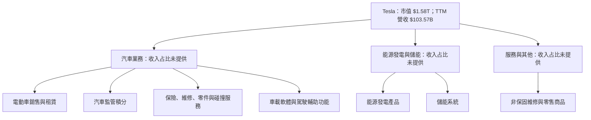
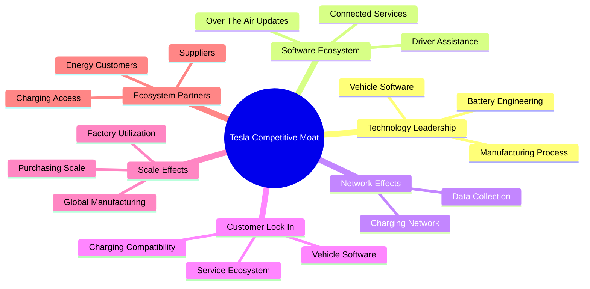
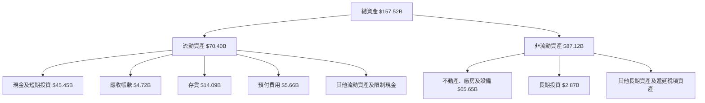
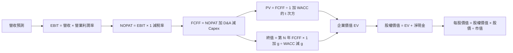
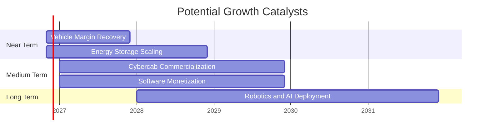
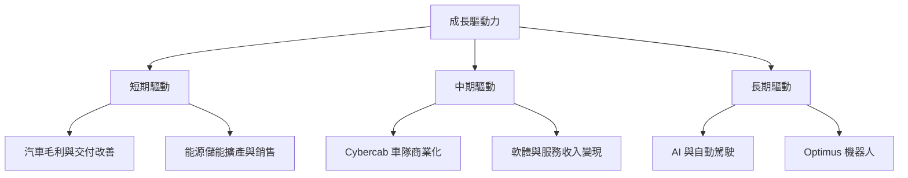
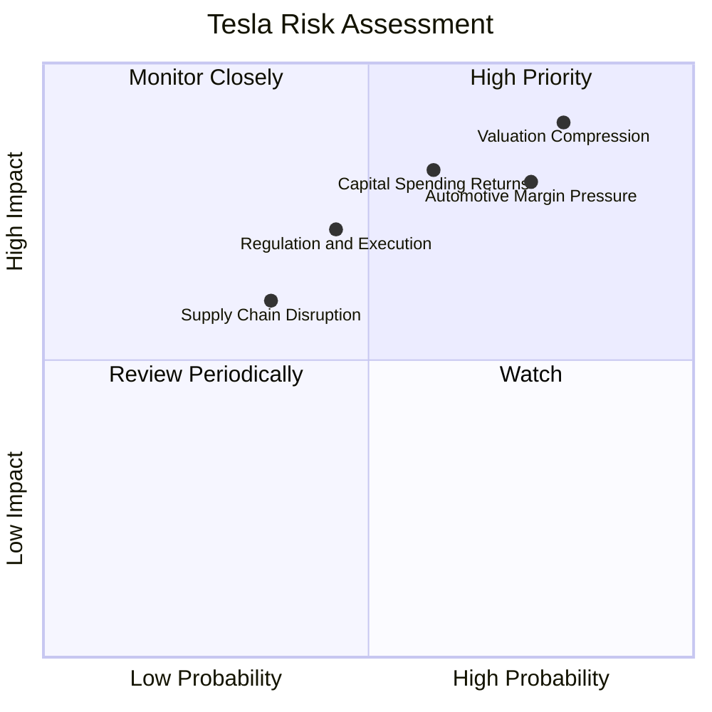
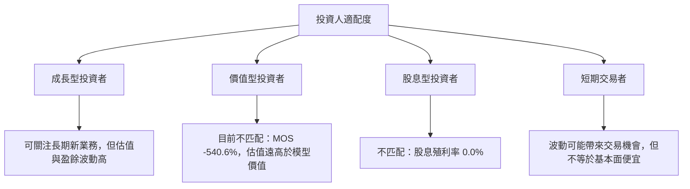

# TSLA 基本面深度分析報告
> **報告日期**：2026-11-28 ｜ **語言**：繁體中文 ｜ **數據來源**：SEC 申報資料 (XBRL)、Yahoo Finance、Finviz、StockAnalysis、Roic.ai ｜ **分析師**：CFA 級機構研究

## 目錄

| # | 章節 | 核心結論 |
|---|------|----------|
| 1 | 執行摘要 | 評級：賣出；加權合理價值 $62.44；MOS -540.6% |
| 2 | 公司概覽與商業模式 | 車輛、能源與服務構成業務；市場份額數據未提供，護城河仍需由利潤與留存證明 |
| 3 | 損益表深度分析 | TTM 營收 $103.57B、TTM 成長 8.3%；最新單季年增 -0.2%，利潤率承壓 |
| 4 | 資產負債表分析 | 依程式口徑淨現金 $36.18B；營運資金數據顯示 CCC 由 15 天降至 3 天 |
| 5 | 現金流量深度分析 | TTM FCF $3.30B、FCF Yield 0.21%；高資本支出限制現金轉換 |
| 6 | 獲利能力與資本效率 | ROIC 5.1% 低於 WACC 12.36%，目前資本回報低於資本成本 |
| 7 | 相對估值分析 | TSLA 倍數遠高於 GM、Ford 與 Rivian；自有歷史估值亦處高位 |
| 8 | DCF 內在價值評估 | 基準 DCF 每股 $13.00；加權合理價值 $62.44，兩者皆顯著低於現價 |
| 9 | 成長催化劑 | Cybercab、能源儲能、AI/機器人提供選擇權，但收入與獲利數據尚不足以定價 |
| 10 | 風險矩陣 | 估值、汽車利潤率與執行風險是主要風險 |
| 11 | 投資建議 | 依 MOS 評級為賣出；持續追蹤利潤率、FCF、資本支出與新業務變現 |

---

## 1. 執行摘要

### 1.0 一頁式投資儀表板（Portfolio Manager 30 秒速讀）

| 項目 | 內容 |
|------|------|
| **投資論點（3 句）** | ① TTM 營收 $103.57B、TTM 成長 8.3%，但最新一季營收年增為 **-0.2%**，成長動能尚未形成加速證據。② TTM 營業利益率 3.3%、ROIC 5.1%，低於 12.36% WACC，當前資本回報尚未覆蓋資本成本。③ TTM FCF $3.30B、FCF Yield 0.21%，以 2026-11-27 收盤價 $400 交易，現價遠高於 DCF 與同業估值所支持的價值。 |
| **綜合評分** | **4.7/10**（引用 1.1；六項平均） |
| **財務健康** | 🟢 程式口徑淨現金 $36.18B、現金與短期投資 $45.45B；但數據源另列不同債務與淨現金口徑，見第 4 章 |
| **ROIC vs WACC** | **5.1% vs 12.36%**；ROIC 低於 WACC，現階段未創造正經濟利潤 |
| **FCF 趨勢** | TTM FCF $3.30B，較 FY2025 全年 $6.22B 低；FCF Yield **0.21%** |
| **估值** | Forward P/E **185.3x** ｜ EV/EBITDA **151.1x**（歷史比較口徑）｜ FCF Yield **0.21%** |
| **DCF 內在價值（基準）** | **$13.00** ｜現價相對 DCF 溢價 **2,976.9%** |
| **安全邊際（MOS）** | **-540.6%**＝（加權合理價值 $62.44 − 現價 $400）÷ $62.44；🔴 <10% 無 |
| **預期報酬（基準情境 12M）** | DCF 基準情境相對現價 **-96.8%**；此為模型情境估值，不代表可精確預測 12 個月價格 |
| **關鍵風險（前二）** | 汽車業務利潤率低且競爭加劇；估值要求遠高於當前基本面所能支持 |
| **評級 + 信心度** | 🔴 **賣出** ｜信心：中（估值訊號明確，但新業務與長期商業化仍具不確定性） |

### 1.1 綜合評分卡（全報告唯一）

| 維度 | 評分（1–10） | 主要依據（引用數字與其來源章節） |
|------|--------------|----------------------------------|
| 成長性 | 5.0 | TTM 營收成長 8.3%，但最新一季年增 -0.2%；詳見第 3 章 |
| 獲利能力 | 3.0 | TTM 營業利益率 3.3%、ROIC 5.1% 低於 WACC 12.36%，F-Score 4/9；詳見第 3、6 章 |
| 財務健康 | 8.0 | 淨現金 $36.18B、現金及短期投資 $45.45B；CCC 3 天；詳見第 4 章 |
| 估值 | 1.0 | MOS -540.6%；Trailing P/E 439.6x、自有歷史 P/E 百分位 100%；詳見第 7、8 章 |
| 護城河 | 7.0 | 品牌、充電網絡、製造規模與軟體能力具差異化，但定價競爭和低利潤率限制護城河變現；詳見第 2 章 |
| 管理層與資本配置 | 4.0 | FY2025 Capex $8.53B、SBC $2.83B；稀釋股數測試未通過，且新業務投資的回報尚未由現有數據證實 |
| **綜合評分** | **4.7** | 六項算術平均：（5.0 + 3.0 + 8.0 + 1.0 + 7.0 + 4.0）÷ 6 = **4.5** |

### 1.2 五大投資論點 + 三大核心風險

| 類型 | 項目 | 具體依據 | 信心度 |
|------|------|----------|--------|
| 🟢 **投資論點①** | 資產負債表有緩衝 | 現金及短期投資 $45.45B；程式口徑總債務 $9.27B、淨現金 $36.18B | 🟢 高 |
| 🟢 **投資論點②** | TTM 營收仍成長 | TTM 營收 $103.57B，TTM 年增 8.3%；提供營運轉型的收入基礎 | 🟡 中 |
| 🟢 **投資論點③** | 能源、軟體與自動駕駛具選擇權 | 公司經營能源發電與儲能、車輛軟體及服務；但各業務收入占比未提供，估值不宜先行計入未證實的高利潤 |
| 🟢 **投資論點④** | 現金轉換仍為正 | TTM OCF $18.71B、Capex $15.41B、FCF $3.30B；即使投資密集，仍有正 FCF |
| 🟢 **投資論點⑤** | 營運資金週期改善 | CCC 由一年前 15 天降至 3 天，對短期現金週轉有利；其持續性需觀察存貨與供應商付款條件 |
| 🟡 **風險①** | 汽車獲利率低 | TTM 營業利益率 3.3%，最新季度 2.6%；定價、產品組合或成本波動可能迅速侵蝕獲利 |
| 🔴 **風險②** | 估值與現金流脫節 | FCF Yield 0.21%、Forward P/E 185.3x；DCF 基準每股 $13.00，遠低於 $400 |
| 🔴 **風險③** | 執行與資本投入風險 | TTM Capex $15.41B，遠高於 TTM FCF $3.30B；若新產能、AI 或新車型回報不及預期，現金流與估值可能同時承壓 |

### 1.3 快速統計卡片

| 指標 | 公司實際值（期間） | 同業中位數 | 狀態 |
|------|--------------------|------------|------|
| 營收成長（TTM） | **8.3%** | — | 🟡 |
| 營收成長（最新一季年增） | **-0.2%** | **2.9%**（GM、Ford、Rivian） | 🔴 |
| 毛利率（TTM） | **19.3%** | **9.2%**（GM、Ford、Rivian） | 🟢 |
| 營業利益率（TTM） | **3.3%** | — | 🟡 |
| ROIC（TTM） | **5.1%** | — | 🔴 |
| Forward P/E | **185.3x** | **6.2x**（GM、Ford） | 🔴 |
| FCF Yield（TTM） | **0.21%** | — | 🔴 |
| Piotroski F-Score | **4 / 9** | — | 🟡 |

### 1.4 投資結論

```text
╔══════════════════════════════════════════════════════════════════╗
║                       投資結論摘要                               ║
╠══════════════════════════════════════════════════════════════════╣
║  評級：賣出（依 MOS 評級門檻；未作一級調整）                    ║
║  價格（2026-11-27 收盤）：$400.00                                ║
║  DCF 內在價值（基準）：$13.00（現價溢價 2,976.9%）               ║
║  安全邊際 MOS：-540.6%（以加權合理價值為分母）                  ║
║  加權合理價值（8.8）：$62.44                                     ║
║  DCF 情境價值：                                                   ║
║    悲觀情境：$8.98（相對現價 -97.8%）                            ║
║    基準情境：$13.00（相對現價 -96.8%）                           ║
║    樂觀情境：$18.65（相對現價 -95.3%）                           ║
║  綜合評分：4.7/10（引用 1.1）                                    ║
║  適合投資人：能承受高波動、且願意以小倉位押注長期新業務的人      ║
╚══════════════════════════════════════════════════════════════════╝
```

---

## 2. 公司概覽與商業模式

### 2.1 業務結構與收入來源

公司資料描述 Tesla 經營汽車、能源發電與儲能兩大分部，並提供汽車積分、維修、保險、零件與零售等服務。但各分部收入金額與占比未提供，故不以推估比例繪圖。



### 2.2 市場份額

市場份額數據未提供，無法引用具明確年份與來源的公司市占率。以收入規模而言，Tesla TTM 營收 $103.57B，高於資料中 Ford、GM、Rivian 的單一公司市值資訊所能直接比較的範圍；但市值並非收入，不能據此推導市場份額。最新單季 Tesla 營收年增 -0.2%，低於 GM 的 2.9% 與 Rivian 的 38.3%，但 Rivian 的增長基數與盈利結構不同。

### 2.3 競爭護城河分析



### 2.4 護城河強度

| 護城河項目 | 強度（強／中／弱） | 證據（引用數字或事實） | 會削弱它的情況 |
|------------|--------------------|------------------------|----------------|
| 技術與產品 | 中 | 車輛、能源、軟體均屬公司業務；但目前 TTM 營業利益率只有 3.3%，技術優勢尚未轉化成高利潤 | 競爭者產品性能追近、價格競爭、研發投入無法形成付費收入 |
| 軟體生態系統 | 中 | 公司提供車載軟體及相關服務；可提高使用體驗與服務收入，但收入拆分未提供 | 用戶付費率或續訂率低於預期，監管限制功能商業化 |
| 網路效應 | 中 | 充電與車輛資料有助於服務體驗；量化網絡效應指標未提供 | 充電標準開放後差異化下降，或其他網絡覆蓋更廣 |
| 客戶鎖定 | 中 | 車輛軟體、維修與充電形成一定整合；但客戶留存率未提供 | 品牌偏好轉弱、維修與保險服務差異化縮小 |
| 規模效應 | 中至強 | TTM 營收 $103.57B，具規模基礎；但最新季度營業利益率 2.6%，顯示規模並未保證穩定高利潤 | 產能利用率下降、產品降價或工廠固定成本吸收不足 |
| 生態夥伴 | 中 | 公司有供應鏈與充電合作關係；合作收入與夥伴依賴度未提供 | 供應中斷、合作條件惡化或夥伴轉向競爭平台 |

護城河評分 **7.0/10** 的理由：業務整合、品牌與規模可形成差異化，但 3.3% TTM 營業利益率與最新單季營收年減顯示護城河仍需經營成果驗證。

---

## 3. 損益表深度分析

### 3.1 年度收入成長趨勢（近 4 年）

以下依年度損益表收入計算 YoY；2025 年數據與其他資料源有小幅差異時，保留原年度表所列數字。

```text
╔══════════════════════════════════════════════════════════════════╗
║             Tesla 年度收入趨勢（FY2022–FY2025）                  ║
╠══════════════════════════════════════════════════════════════════╣
║  FY2022  $81.46B  ██████████████████████████░░  YoY: +51.4% 🟢 ║
║  FY2023  $96.77B  ███████████████████████████████░ YoY: +18.8% 🟢║
║  FY2024  $97.69B  ███████████████████████████████░ YoY: +1.0% 🟡║
║  FY2025  $94.83B  ██████████████████████████████░ YoY: -2.9% 🔴║
║                                                                  ║
║  FY2022–FY2025 收入 CAGR：約 +5.2%                                ║
╚══════════════════════════════════════════════════════════════════╝
```

計算：收入 CAGR = \((94.83 ÷ 81.46)^{1/3} - 1\) ≈ **5.2%**。2022–2023 增長較快，之後收入停滯並在 2025 年回落；這表示單靠歷史產能擴張不再足以支撐高成長預期，未來需由新車型、能源或服務收入補足。

### 3.2 季度收入趨勢分析

| 季度 | 營收 | QoQ 成長 | YoY 成長 | 備註 |
|------|------|----------|----------|------|
| 2025 Q4 | $24.90B | -11.4% | -3.1% | QoQ 比較 2025 Q3；YoY 採 StockAnalysis 季度列示 |
| 2026 Q1 | $22.39B | -10.1% | +15.8% | 季節性及比較基期可能影響 |
| 2026 Q2 | $28.24B | +26.1% | +25.5% | QoQ 回升；YoY 採 StockAnalysis 季度列示 |
| 2026 Q3 | $28.05B | -0.7% | **-0.2%** | 最新單季年增率以程式計算的季度數字為準 |

QoQ 公式示例：2026 Q3 QoQ = \((28.05 ÷ 28.24)-1\) ≈ **-0.7%**。最新季度年增 -0.2% 與 TTM 成長 8.3% 反映不同期間，不可混稱；TTM 成長仍為正，但最新單季已接近持平。

### 3.3 利潤率演變分析

| 利潤率指標 | FY2022 | FY2023 | FY2024 | FY2025 | 趨勢 | 評估 |
|------------|--------|--------|--------|--------|------|------|
| **毛利率** | 25.6% | 18.2% | 17.9% | 18.0% | 2022 後下滑，近兩年大致持平 | 🔴 |
| **營業利益率** | 17.0% | 9.2% | 7.9% | 5.1% | 連續收縮 | 🔴 |
| **淨利率** | 15.4% | 15.5% | 7.3% | 4.0% | 2024–2025 明顯下降 | 🔴 |

年度毛利率以毛利 ÷ 營收計算；年度營業利益率以年度營業利益 ÷ 營收計算。財務數據另有 TTM 營業利益率 3.3%，年度表與 TTM 期間不可互換。

**利潤率演變深度解析：**FY2022–FY2025 營業利益率由約 17.0% 降至約 5.1%，顯示收入擴張沒有同步帶來利潤擴張。可能的經營解釋包括車價與產品組合調整、產能利用率與固定成本吸收、研發與營運費用增加；但提供的財務數據不足以把各因素分別量化。FY2025 研發費用 $6.41B，高於 FY2022 的 $3.08B，投資增加可能支撐未來產品與技術，但短期也壓低營業槓桿。

### 3.4 費用結構分析

營業成本、銷售管理費用、研發費用等完整 TTM 費用拆分沒有一致口徑數據，不能畫費用比例圓餅圖。可確認 FY2025 研發支出為 **$6.41B**；這是年度費用數據，不應與 TTM 收入直接拼成費用占比圖。

### 3.5 季度 EPS 趨勢與盈餘品質（Quality of Earnings）

| 季度 | EPS 實際值 | EPS 預估 | 超預期／不及預期 |
|------|------------|----------|-------------------|
| 2025 Q4 | $0.24 | N/A | N/A（估值預期數據缺漏） |
| 2026 Q1 | $0.13 | N/A | N/A（估值預期數據缺漏） |
| 2026 Q2 | $0.32 | N/A | N/A（估值預期數據缺漏） |
| 2026 Q3 | $0.22 | N/A | N/A（估值預期數據缺漏） |

EPS 估計值欄位為 nan，故無法可靠判斷過去四季超預期或不及預期；這不是「未達預期」，而是估計值未提供。單季 EPS 同比資料顯示最新季度 EPS 成長 **-43.6%**，淨利成長 **-42.7%**，反映近期盈餘承壓。

| 盈餘品質項目 | 數值／佔比 | 評估 |
|--------------|------------|------|
| 股權薪酬 SBC / 營收 | 約 **4.2%**；TTM SBC 依最近四季列示加總約 $4.30B ÷ TTM 營收 $103.57B | 🟡 SBC 對股東經濟利益有稀釋；年度 SBC 由 FY2022 $1.56B 升至 FY2025 $2.83B |
| SBC / 營業現金流 | 約 **23.0%**；$4.30B ÷ $18.71B | 🟡 金額不小；但 SBC 是非現金費用，經營現金流會受其加回影響，不能視為沒有股東成本 |
| FCF / 淨利（現金轉換率） | 約 **102.5%**；TTM FCF $3.30B ÷ TTM 淨利 $3.22B | 🟢 現金轉換高於 100%，但分母與 FCF 仍受資本開支波動影響 |
| 一次性／非經常性損益 | N/A（未提供可核實拆分） | 無法判斷單次項目是否美化盈餘 |
| 有效稅率異常 | 27.0%（最新年度有效稅率） | 未見足夠資料判斷是否異常；DCF 依模型採用 27.0% |
| 資本化支出 vs 費用化 | TTM Capex $15.41B；資本化與費用化細項 N/A | 大額資本支出形成固定資產並非自動表示盈餘高估；需追蹤折舊、產能利用與資產回報 |

**盈餘品質結論：**TTM FCF $3.30B 與 TTM 淨利 $3.22B 大致相符，現金轉換尚可；但 SBC 約占 TTM OCF 23.0%，且 Capex $15.41B 使可分配自由現金流僅 $3.30B。GAAP 淨利不是完全沒有現金支持，但股東報酬仍需扣慮 SBC 稀釋及高再投資需求。

---

## 4. 資產負債表分析

### 4.1 資產結構分解

最近季度總資產 $157.52B、流動資產 $70.40B。下圖只展示有明確數字的總額與已提供的流動資產；非流動資產總額以總資產減流動資產計算。



### 4.2 流動性與營運資金分析

| 指標 | 最新 TTM | 一年前 TTM | 變化 | 解讀 |
|------|----------|------------|------|------|
| DSO 應收帳款天數 | 16 天 | 18 天 | -2 天 | 收款天數下降，短期周轉略有改善；不能單憑天數確認信用條件變化 |
| DIO 存貨天數 | 62 天 | 56 天 | +6 天 | 存貨週轉變慢可能反映備貨增加或銷售去化速度放緩，需配合交付與庫存金額觀察 |
| DPO 應付帳款天數 | 75 天 | 59 天 | +16 天 | 延長供應商付款期可改善現金占用，但需監測是否來自付款條件變化 |
| CCC 現金轉換週期 | 3 天 | 15 天 | -12 天 | 現金轉換週期縮短，主要由 DPO 增加抵銷 DIO 上升 |

程式定義為期末餘額除以 TTM 流量再乘 365；以上天數直接引用計算結果，不重新推算。

流動比率於市場資料列為 **1.739**、速動比率 **1.239**。同一資料包另列現金與總債務的不同口徑，流動性判斷以現金及短期投資 $45.45B 與程式計算淨現金 $36.18B 為主。

### 4.3 債務結構分析

```text
╔══════════════════════════════════════════════════════════════════╗
║                    Tesla 債務健康診斷                            ║
╠══════════════════════════════════════════════════════════════════╣
║  總債務（程式估值口徑）：  $9.27B       ▌░░░░░░░░░░░░░░░░░░░░  ║
║  現金及短期投資：          $45.45B      ████████████████████  ║
║  淨現金（程式口徑）：      $36.18B      ████████████████░░░░  🟢║
║                                                                  ║
║  Debt/EBITDA：N/A（債務口徑與 EBITDA 期間口徑無法一致確認）     ║
║  Interest Coverage：N/A（利息支出與可比口徑資料未提供）         ║
║                                                                  ║
║  注意：另有市場資料列總債務 $16.44B、淨現金 $29.00B；            ║
║  本報告涉及 DCF 與 ROIC 的淨現金採程式口徑 $36.18B。             ║
╚══════════════════════════════════════════════════════════════════╝
```

債務資料存在口徑差異：程式計算口徑為總債務 $9.27B、淨現金 $36.18B；市場資料另一處列總債務 $16.44B、淨現金 $29.00B。為避免混用，DCF 橋接採其指定的淨現金 $36.18B；投資人應回到同一期間 SEC 資產負債表核對債務定義。

### 4.4 股東權益趨勢

```text
╔══════════════════════════════════════════════════════════════════╗
║                 Tesla 歷年股東權益變化                            ║
╠══════════════════════════════════════════════════════════════════╣
║  FY2022  $44.70B  ███████████░░░░░░░░░░░░░░░░░                 ║
║  FY2023  $62.63B  ████████████████░░░░░░░░░░░░                 ║
║  FY2024  $72.91B  ███████████████████░░░░░░░░░                 ║
║  FY2025  $82.14B  █████████████████████░░░░░░                  ║
╚══════════════════════════════════════════════════════════════════╝
```

股東權益由 FY2022 $44.70B 增至 FY2025 $82.14B，提供資產負債表緩衝；但權益增加不代表每股價值同步上升，仍需考慮股數稀釋與投入資本回報。

---

## 5. 現金流量深度分析

### 5.1 現金流量瀑布圖

資料中未提供同期間可一致對應的淨利、股息／回購現金流及淨現金變化明細；因此僅呈現有可靠數字的現金流步驟。


### 5.2 FCF 轉換率趨勢

| 年度 | FCF | 淨利 | FCF / 淨利 |
|------|-----|------|------------|
| FY2022 | $7.55B | $12.58B | 60.0% |
| FY2023 | $4.36B | $15.00B | 29.1% |
| FY2024 | $3.58B | $7.13B | 50.2% |
| FY2025 | $6.22B | $3.79B | 164.1% |
| TTM 至 2026-09-30 | $3.30B | $3.22B | 102.5% |

FY2025 FCF 高於淨利，並不代表未來現金轉換率必然維持；TTM FCF 已低於 FY2025 全年，主要需關注 Capex 增長對自由現金流的扣減。

### 5.3 自由現金流趨勢

```text
╔══════════════════════════════════════════════════════════════════╗
║                   Tesla 自由現金流趨勢                           ║
╠══════════════════════════════════════════════════════════════════╣
║  FY2022  $7.55B  ████████████████████░░░░░░░░  FCF Yield：N/A   ║
║  FY2023  $4.36B  ████████████░░░░░░░░░░░░░░░  FCF Yield：N/A   ║
║  FY2024  $3.58B  ██████████░░░░░░░░░░░░░░░░░  FCF Yield：N/A   ║
║  FY2025  $6.22B  █████████████████░░░░░░░░░░  FCF Yield：N/A   ║
║  TTM     $3.30B  █████████░░░░░░░░░░░░░░░░░░  FCF Yield：0.21% ║
╚══════════════════════════════════════════════════════════════════╝
```

歷年市值對應資料未提供，故不反推歷年 FCF Yield。TTM FCF Yield 0.21% 表示按當前市值計算，現金流收益率很低；即使 FCF 維持正值，現價仍要求未來現金流大幅增長。

### 5.4 資本配置評估

股息殖利率與派息率均為 0.0%；資本配置中回購、研發、其他投資的完整金額拆分未提供，故不畫比例圓餅圖。

| 資本配置項目 | 可得數據 | 評估 |
|--------------|----------|------|
| 資本支出 | TTM $15.41B；FY2025 $8.53B | 投資密集；需以新增產能與現金流回報驗證 |
| 研發費用 | FY2025 $6.41B | 可能支撐新產品與軟體，但回報周期長 |
| 股息 | 殖利率 0.0%、派息率 0.0% | 無現金股息回報 |
| 回購 | N/A（現金回購金額未提供） | 不據此推定回購是否抵銷 SBC |
| SBC | FY2025 $2.83B | 構成股東稀釋成本 |

---

## 6. 獲利能力與資本效率

### 6.1 ROE / ROA / ROIC 趨勢

| 指標 | 可得數據 | 評估 |
|------|----------|------|
| ROE | TTM **3.6%**（品質數據）；另有市場資料列 3.8% | 以品質數據 3.6% 為一致口徑；回報偏低 |
| ROA | TTM **1.5%** | 資產產生淨利的能力有限 |
| ROIC | TTM **5.1%** | 低於 WACC 12.36% |
| 歷年可比 ROIC | N/A（同口徑歷史序列未提供） | 不補造歷史值 |
| 行業均值對比 | N/A（無可核實同口徑資料） | 不作空泛比較 |

### 6.2 ROIC vs WACC 分析（核心價值創造判斷）

以下 WACC 採成本資本資料所列 **12.36%**，ROIC 採 TTM **5.1%**；不另行重估替代 WACC。

```text
╔══════════════════════════════════════════════════════════════════╗
║                  ROIC vs WACC 深度分析                           ║
╠══════════════════════════════════════════════════════════════════╣
║  WACC 輸入（程式計算口徑）：                                      ║
║  ├── 無風險利率（10Y 美債）：       4.94%                        ║
║  ├── 市場風險溢酬 ERP：             5.00%                        ║
║  ├── 原始 Beta：                    1.74                         ║
║  ├── 調整後 Beta：                  1.50                         ║
║  ├── 股權成本（資料列示）：         12.41%                       ║
║  ├── 稅前債務成本：                 3.65%                        ║
║  ├── 有效稅率：                     27.0%                        ║
║  ├── 股權／債務權重：               99.4%／0.6%                  ║
║  └── ✅ 採用 WACC：                 12.36%                       ║
║                                                                  ║
║  ROIC 與資本成本：                                                ║
║  ├── ROIC（TTM）：                  5.1%                         ║
║  ├── WACC：                         12.36%                       ║
║  └── ROIC - WACC：                  -7.26 個百分點               ║
║                                                                  ║
║  ROIC  5.1%   ▓▓▓▓▓░░░░░░░░░░░░░░░░░░░░░░░░░░░░░░░░░░░         ║
║  WACC 12.36%  ▓▓▓▓▓▓▓▓▓▓▓▓░░░░░░░░░░░░░░░░░░░░░░░░░░           ║
║                                                                  ║
║  結論：ROIC 低於 WACC；目前資本回報低於資本成本，摧毀經濟價值。║
╚══════════════════════════════════════════════════════════════════╝
```

計算：ROIC − WACC = **5.1% − 12.36% = -7.26 個百分點**。成本資本資料列示的股權成本、Beta 與 WACC 是模型採用值；展示數字因四捨五入可能不完全重建 WACC，因此估值與本節均以原列 WACC 12.36% 為準。

### 6.3 杜邦三因素分解

| 因素 | 數值（TTM） | 解讀 |
|------|-------------|------|
| 淨利率 | 3.1% | 利潤率偏低，限制 ROE |
| 資產週轉率 | 0.66 | 每單位資產產生的收入有限 |
| 權益乘數 | 1.76 | 槓桿程度不是主要 ROE 來源 |
| **ROE** | **3.6%** | 3.1% × 0.66 × 1.76 = 3.6%（依品質數據列示） |

杜邦結果顯示 ROE 主要受低淨利率與資產周轉限制，並非依賴高槓桿撐高回報。

### 6.4 財務體質：Piotroski F-Score

Piotroski F-Score **4 / 9**。

| 測試 | 結果 | 解讀 |
|------|------|------|
| ROA > 0 | ✅ 通過 | 公司仍為正 ROA |
| 營業現金流 > 0 | ✅ 通過 | TTM 營業現金流為正 |
| ROA 高於一年前 | ❌ 未通過 | 資產回報未改善 |
| 營業現金流 > 淨利 | ✅ 通過 | 現金流高於淨利，應計品質測試通過 |
| 長期負債 ÷ 總資產低於一年前 | ❌ 未通過 | 槓桿相對改善測試未通過 |
| 流動比率高於一年前 | ❌ 未通過 | 短期流動性相對前期未改善 |
| 稀釋股數未增加 | ❌ 未通過 | 股數增加對每股價值有稀釋 |
| 毛利率高於一年前 | ✅ 通過 | 毛利率比較測試通過 |
| 資產週轉率高於一年前 | ❌ 未通過 | 資產效率未改善 |

4/9 顯示營運現金流、正 ROA 與毛利率比較仍是支撐項目；資產效率、流動性改善、稀釋與 ROA 趨勢則是弱項。

---

## 7. 相對估值分析

### 7.1 同業估值比較表格

公司估值採市場資料所列數值；同業倍數依 Yahoo Finance 同業資料。Rivian 負盈餘，故 P/E 不適用；Ford EV/EBITDA 與 GM 同業中位數依估值方法區塊列示。

| 估值指標 | **TSLA** | **GM** | **Ford** | **Rivian** | TSLA 評估 |
|----------|---------:|-------:|--------:|----------:|-----------|
| **Trailing P/E** | 439.6x | 18.6x | N/A | N/A | 🔴 極高，盈餘基礎薄 |
| **Forward P/E** | 185.3x | 5.8x | 6.6x | -6.9x | 🔴 遠高於可盈利同業；Rivian 負值不可直接比較 |
| **P/S Ratio** | 13.7x | 0.4x | 0.3x | 2.7x | 🔴 顯著溢價 |
| **EV/EBITDA** | 151.1x | 9.4x | 24.2x | -7.0x | 🔴 高倍數；Rivian EBITDA 為負，倍數失去正常解讀 |
| **最新單季營收年增** | -0.2% | 2.9% | -2.0% | 38.3% | 🟡 成長落後 GM、Rivian；但 Rivian 基數較小 |
| **毛利率（TTM）** | 19.3% | 11.4% | 7.4% | 9.2% | 🟢 毛利率高於同列同業 |

同業表顯示 Tesla 毛利率高於比較公司，但估值倍數遠高於同業；如果高倍數需要更快的收入與利潤增長支撐，最新季度營收年減 -0.2% 與低 FCF Yield 並未提供足夠確認。

### 7.2 歷史估值區間分析

```text
╔══════════════════════════════════════════════════════════════════╗
║             Tesla 自身 5 年估值區間（TTM）                       ║
╠══════════════════════════════════════════════════════════════════╣
║  P/E：18.0x ───── 中位數 74.2x ───────────────── 現值 439.6x    ║
║       歷史百分位：100%                                           ║
║  P/S：3.9x ─────── 中位數 9.4x ──────────────── 現值 13.7x      ║
║       歷史百分位：81%                                            ║
║  EV/EBITDA：19.0x ─ 中位數 64.6x ───────────── 現值 151.1x      ║
║       歷史百分位：90%                                            ║
╚══════════════════════════════════════════════════════════════════╝
```

依 5 年歷史資料，P/E 在百分位 100%、EV/EBITDA 在 90%；即使 Tesla 長期有新業務選擇權，當前估值也已處於自身歷史高位。

### 7.3 情境價值（Bear / Base / Bull，照抄 DCF MODEL 的 Scenarios）

| 情境 | 第 1 年營收成長 | 期末營業利潤率 | WACC | 每股價值 | 相對現價 | 機率 | 會發生的條件 |
|------|----------------|----------------|------|----------|----------|------|--------------|
| 🔴 悲觀 | 4.1% | 6.2% | 13.36% | $8.98 | -97.8% | 25% | 汽車業務增長低於基準、價格競爭延續、資本成本偏高 |
| 🟡 基準 | 8.3% | 7.2% | 12.36% | $13.00 | -96.8% | 50% | TTM 成長可延續但逐步放緩，利潤率回升至模型長期假設 |
| 🟢 樂觀 | 12.4% | 8.0% | 11.36% | $18.65 | -95.3% | 25% | 交付增長加速、能源或軟體放大收入，成本資本下降 |

這些是 DCF MODEL 的每股價值與假設，並非由分析師另行設定的目標價。即使樂觀情境，模型價值仍顯著低於現價。

### 7.4 相對估值隱含價格區間

```text
╔══════════════════════════════════════════════════════════════════╗
║                相對估值回推每股價值                               ║
╠══════════════════════════════════════════════════════════════════╣
║  $13.38 ── $47.96 ── $400.00 ───────────── $419.05              ║
║  Forward P/E  EV/EBITDA   現價               分析師共識          ║
║                                                                  ║
║  同業 Forward P/E：$13.38                                         ║
║  同業 EV/EBITDA： $47.96                                         ║
║  分析師共識：     $419.05                                         ║
╚══════════════════════════════════════════════════════════════════╝
```

- 同業 Forward P/E：GM、Ford 中位數 **6.2x** × TSLA Forward EPS **$2.16** = 約 **$13.38**。
- 同業 EV/EBITDA：GM、Ford 中位數 **16.8x** × TTM EBITDA，再加回淨現金，模型回推 **$47.96**。
- 分析師共識目標價 **$419.05**，來自 41 位分析師平均值；共識是市場預期參考，不等於現金流內在價值。

---

## 8. DCF 內在價值評估（Discounted Cash Flow）

### 8.0 估值推理鏈（Thinking Logic：在算之前先想清楚）

**Step 1 — 價值由哪些變數決定？**  
模型將價值視為現有汽車及服務現金流底盤、能源儲能的成長貢獻，以及軟體／自動駕駛等長期選擇權。各分部收入占比未提供，因此不能替能源或軟體任意賦予收入份額；模型主要由未來 EBIT 利潤率、Capex 路徑與 WACC 決定。基準模型中終值現值占企業價值 **192.1%**，因預測期前段 FCFF 為負，故終值與後期現金流是主要估值驅動。

**Step 2 — 模型選擇**

| 決策點 | 本報告採用 | 理由（含數字） | 曾考慮但否決 | 否決理由 |
|--------|-----------|----------------|--------------|----------|
| 現金流定義 | FCFF | 以 WACC 折現，求 EV 後加淨現金 | FCFE | 資本結構與利息融資不直接進入營運現金流模型 |
| 預測期 N | 10 年 | DCF 模型固定為 10 年；長週期使利潤率與 Capex 有漸進回歸空間 | 5 年 | 無法涵蓋模型中的投資回收與利潤率收斂 |
| 終值方法 | Gordon Growth | 模型採永續成長率 3.0% | 僅退出倍數 | DCF 模型未提供退出倍數終值作替代主值 |
| EBIT 基礎 | GAAP EBIT | 模型已明確採 GAAP EBIT | 非 GAAP EBIT | 避免加回 SBC 後遺漏股東稀釋成本 |

**Step 3 — 關鍵假設推導鏈**

- **營收成長**：錨點＝TTM 對前一 TTM 成長 8.3%，最新單季年增 -0.2%；調整＝模型將增速由 8.3% 線性降至 3.0%，反映成熟化；**採用模型逐年 8.3% 至 3.0%**；曾考慮長期維持 8.3%，但在最新單季接近持平下不採用。
- **期末營業利潤率**：錨點＝TTM 營業利益率 3.3%；調整＝模型逐步回升至近五個財年中位數 7.2%；**採用 FY+10 7.2%**；曾考慮較高的樂觀值，模型情境上限為 8.0%，基準不採用，因尚無當前高利潤率證據。
- **終值成長率 g**：錨點＝模型採用長期 3.0%，低於 WACC 12.36%；**採用 3.0%**；曾考慮更高成長，但高於 3.0% 會增加終值占比且缺少長期市場增長數據支撐。
- **預測期 N**：錨點＝DCF 模型明列 10 年；**採用 10 年**；曾考慮較短期間，但依規則 19 直接採用程式模型，不改期數。
- **Capex／營收**：錨點＝TTM Capex／營收約 14.9%；調整＝模型逐步降至 FY+10 的 6.0%，約為 D&A 的 1.1 倍；**採用模型逐年路徑**；若長期維持 TTM 14.9%，模型價值會更低，故不採高投資比率永久延續。
- **EBIT 基礎與 SBC**：錨點＝模型採 GAAP EBIT，SBC 已列為費用；**採組合 A**，FCFF 不再減 SBC、股數不另稀釋；否決「再扣 SBC」以免重複計成本。
- **年稀釋率**：錨點＝採當期股數、不額外稀釋；**採 0% 額外年稀釋率**，與組合 A 一致；否決在 GAAP EBIT 外再放大股數，避免同一 SBC 成本被計兩次。
- **終值方法**：錨點＝模型給定 Gordon Growth；**採 Gordon Growth**；否決自行選取退出倍數，因程式模型未提供可更動的替代退出倍數。
- **WACC**：錨點＝成本資本資料列示 WACC 12.36%；**採 12.36%**；不改採較低折現率，因市場風險 Beta 使用調整後 1.50，且模型要求固定引用。
- **稅率**：錨點＝最新年度有效稅率 27.0%；**採 27.0%**。
- **D&A／營收**：錨點＝TTM 5.5%；**採 5.5%**。
- **營運資金**：模型未建模 Working Capital；故 ΔWC 不列入 FCFF，不另外估數。

**Step 4 — 最脆弱的一環**  
最脆弱的是 Capex 由營收 14.9% 降至 6.0% 且 EBIT 利潤率由 3.3% 升至 7.2%；若投資強度不能下降或利潤率未回升，終值及每股價值將低於基準，方向與第 8.9 節風險一致。

**Step 5 — 計算路徑圖**



### 8.1 模型假設總表（Model Inputs）

| 假設項目 | 採用值 | 依據／來源 | 敏感度 |
|----------|--------|-------------|--------|
| 預測期長度 **N** | **10 年** | DCF MODEL 明列；覆蓋利潤率與 Capex 漸進變化 | 🟡 中 |
| 營收成長 | FY+1 8.3% 線性降至 FY+10 3.0% | 起點為 TTM 成長 8.3%；終點為模型設定 | 🔴 高 |
| 營業利潤率（GAAP EBIT） | FY+1 3.3% → FY+10 7.2% | 起點為 TTM 3.3%；終點為近五財年中位數 | 🔴 高 |
| 有效稅率 | 27.0% | 最新年度有效稅率 | 🟢 低 |
| Capex／營收 | FY+1 14.9% → FY+10 6.0% | TTM 起點；模型逐步降至 1.1×D&A 水準 | 🟡 中 |
| D&A／營收 | 5.5% | TTM 比率 | 🟢 低 |
| 營運資金變動 | 不建模 | DCF MODEL 明列 Working Capital is not modelled | 🟢 低 |
| EBIT 基礎 | GAAP | 模型使用 GAAP EBIT | 🟡 中 |
| SBC 處理 | GAAP EBIT 已含 SBC，不再扣除 | 模型組合 A；股數不額外稀釋 | 🟡 中 |
| 年稀釋率 | 0% 額外稀釋 | 與 GAAP EBIT＋固定股數組合一致 | 🟡 中 |
| 永續成長率 g | 3.0% | DCF MODEL | 🔴 高 |
| 終值方法 | Gordon Growth | DCF MODEL 計算終值 | 🔴 高 |
| WACC | 12.36% | Cost of capital 資料列示 | 🔴 高 |

本模型使用 FCFF = NOPAT + D&A − Capex，並且**不含**營運資金變動。模型採用 **(A) GAAP EBIT + 固定股數**，所以 SBC 影響已計入一次，不再加回或重複扣除。

### 8.2 折現率推導（WACC）

```text
╔══════════════════════════════════════════════════════════════════╗
║                    WACC 推導（折現率）                           ║
╠══════════════════════════════════════════════════════════════════╣
║  股權成本 Ke（CAPM，資料列示值）：                               ║
║  ├── 無風險利率 Rf（10Y 美債）：      4.94%                     ║
║  ├── 市場風險溢酬 ERP：               5.00%                     ║
║  ├── 原始 Beta（Yahoo）：              1.74                      ║
║  ├── 調整後 Beta：                    1.50                      ║
║  ├── Beta 調整方式： 2/3×1.74 + 1/3×1 = 1.49，資料列示為 1.50   ║
║  └── Ke（資料列示）：                 12.41%                    ║
║                                                                  ║
║  債務成本：                                                      ║
║  ├── 稅前 Kd：                        3.65%                     ║
║  ├── 有效稅率：                       27.0%                     ║
║  └── 稅後 Kd 算式：3.65%×(1−27.0%) = 2.6645%                    ║
║                                                                  ║
║  資本權重：                                                      ║
║  ├── 股權權重 E：                     99.4%                     ║
║  ├── 債務權重 D：                     0.6%                      ║
║  └── ✅ 採用 WACC：                   12.36%                    ║
╚══════════════════════════════════════════════════════════════════╝
```

逐步演算：

1. **Ke（CAPM）**：輸入資料列示 Ke = **12.41%**。用列示後四捨五入的 Rf 4.94%、調整 Beta 1.50、ERP 5.00% 計算，會得到 4.94% + 1.50×5.00% = 12.44%；與資料列示 Ke 相差 0.03 個百分點，屬輸入精度或來源計算差異。依規則採用資料列示 Ke **12.41%**，不替換。
2. **稅前 Kd**：資料列示 **3.65%**；利息費用與平均計息負債的同口徑細項未提供，故不另行反推。
3. **稅後 Kd**：3.65% × (1 − 27.0%) = **2.6645%**。
4. **權重**：股權／債務權重直接採資料列示 **99.4%／0.6%**，合計 **100.0%**；市值權重所依市值為 $1.58T，最新收盤日期為 2026-11-27。
5. **WACC**：採成本資本資料列示 **12.36%**。由於組成項經四捨五入且債務資料口徑不完全一致，不用展示的四捨五入輸入重新計算並取代程式 WACC。

### 8.3 逐年自由現金流預測（基準情境）

金額單位：$B；折現因子保留三位小數，其他金額依模型列示。每格均照 DCF MODEL 原值引用。

| 年度 | FY+1 | FY+2 | FY+3 | FY+4 | FY+5 | FY+6 | FY+7 | FY+8 | FY+9 | FY+10 |
|------|------:|------:|------:|------:|------:|------:|------:|------:|------:|-------:|
| 營收 | 112.17 | 120.81 | 129.42 | 137.87 | 146.07 | 153.89 | 161.23 | 167.96 | 173.99 | 179.21 |
| 營收 YoY | 8.3% | 7.7% | 7.1% | 6.5% | 5.9% | 5.4% | 4.8% | 4.2% | 3.6% | 3.0% |
| 營業利潤率 | 3.3% | 3.8% | 4.2% | 4.6% | 5.1% | 5.5% | 5.9% | 6.4% | 6.8% | 7.2% |
| EBIT（GAAP） | 3.75 | 4.57 | 5.45 | 6.40 | 7.42 | 8.48 | 9.58 | 10.71 | 11.85 | 12.98 |
| − 稅 | (1.01) | (1.23) | (1.47) | (1.73) | (2.00) | (2.29) | (2.58) | (2.89) | (3.19) | (3.50) |
| = NOPAT | 2.74 | 3.34 | 3.98 | 4.68 | 5.42 | 6.19 | 7.00 | 7.82 | 8.65 | 9.48 |
| + D&A | 6.14 | 6.61 | 7.09 | 7.55 | 8.00 | 8.42 | 8.83 | 9.20 | 9.53 | 9.81 |
| − Capex | (16.69) | (16.78) | (16.71) | (16.44) | (15.98) | (15.32) | (14.47) | (13.42) | (12.19) | (10.79) |
| **= FCFF** | **-7.80** | **-6.83** | **-5.64** | **-4.21** | **-2.57** | **-0.70** | **1.36** | **3.60** | **5.99** | **8.50** |
| 折現因子 @12.36% | 0.890 | 0.792 | 0.705 | 0.628 | 0.558 | 0.497 | 0.442 | 0.394 | 0.350 | 0.312 |
| **FCFF 現值 PV** | **-6.95** | **-5.41** | **-3.98** | **-2.64** | **-1.43** | **-0.35** | **0.60** | **1.42** | **2.10** | **2.65** |

**預測期 FCF 現值合計：**  
\(-6.95 - 5.41 - 3.98 - 2.64 - 1.43 - 0.35 + 0.60 + 1.42 + 2.10 + 2.65 = -13.99B\)。

**逐步演算（FY+1，模型數字依原表列示）：**

1. 營收 = $103.57B × (1 + 8.3%) = **$112.17B**（依模型列示，未以四捨五入的基數改寫模型值）。
2. EBIT = $112.17B × 3.3% ≈ **$3.75B**。
3. 稅 = $3.75B × 27.0% ≈ **$1.01B**。
4. NOPAT = $3.75B − $1.01B = **$2.74B**。
5. D&A = $112.17B × 5.5% ≈ **$6.14B**。
6. Capex = $112.17B × 14.9% ≈ **$16.69B**。
7. ΔWC = **不建模**，因此不列數字。
8. FCFF = $2.74B + $6.14B − $16.69B = **-$7.81B**；模型按未四捨五入中間值列示 **-$7.80B**，差異來自表格小數位。
9. 折現因子 = 1 ÷ (1 + 12.36%)¹ = **0.890**；PV = 模型 FCFF × 折現因子，模型列示 **-$6.95B**。

> 模型採用未四捨五入的內部中間值，表格顯示到兩位小數，故使用展示值重算可能出現小幅尾差；本報告不改動模型輸出。

**合理性自檢：**

- 預測期 FCFF 從 FY+1 **-$7.80B** 改善至 FY+10 **$8.50B**；由於早期現金流為負，未提供單一可比 FCF CAGR，故不以 CAGR 掩蓋負值轉正的過程。
- FY+10 FCFF 利潤率 = $8.50B ÷ $179.21B ≈ **4.7%**；目前 TTM FCF 利潤率 = $3.30B ÷ $103.57B ≈ **3.2%**；同業最佳數據未提供，無法宣稱超越產業最佳。
- FY+1 至 FY+6 FCFF 為負，因 Capex 高於 NOPAT 加 D&A；負現金流會拉低預測期現值，且提高估值對終值的依賴。

```text
╔══════════════════════════════════════════════════════════════════╗
║            自由現金流：歷史實際 vs 模型預測                      ║
╠══════════════════════════════════════════════════════════════════╣
║  FY2023(實)  $4.36B   ███████████░░░░░░░░░░░░                    ║
║  FY2024(實)  $3.58B   █████████░░░░░░░░░░░░░░                    ║
║  FY2025(實)  $6.22B   ████████████████░░░░░░░                    ║
║  FY+1 (預)  -$7.80B   負值：Capex 高於 NOPAT + D&A              ║
║  FY+10(預)   $8.50B   ██████████████████████                     ║
╠══════════════════════════════════════════════════════════════════╣
║  預測依賴 Capex 率由 14.9% 降至 6.0%，以及營業利潤率升至 7.2%。 ║
╚══════════════════════════════════════════════════════════════════╝
```

### 8.4 終值計算（Terminal Value）

適用性檢查：**WACC 12.36% vs g 3.0% → WACC > g？✅**

| 方法 | 計算式 | 終值 TV | TV 現值 | 佔總 EV 比重 |
|------|--------|---------|---------|--------------|
| Gordon Growth | FCFF(FY+10) × (1+g) ÷ (WACC−g) | $93.58B | $29.19B | 192.1% |
| 退出倍數法 | N/A（DCF MODEL 未提供退出倍數法終值） | N/A | N/A | N/A |

逐步演算：

1. FY+10 FCFF = **$8.50B**。
2. 分子 = $8.50B × (1 + 3.0%) = **$8.755B**。
3. 分母 = 12.36% − 3.0% = **9.36%**；終值 = 模型列示 **$93.58B**。
4. PV(TV) = $93.58B × 0.312 = **$29.19B**。
5. 終值現值占比 = $29.19B ÷ $15.19B = **192.1%**。

**重要警示：**終值現值占企業價值 192.1%，高於 75% 警戒門檻；預測期 PV 為負，使終值超過企業價值總額，故估值高度依賴 FY+10 後的假設。退出倍數法缺少模型輸入，不能另行編造或計算。

### 8.5 企業價值 → 每股內在價值（Bridge）

```text
╔══════════════════════════════════════════════════════════════════╗
║              企業價值 → 每股內在價值 橋接表                      ║
╠══════════════════════════════════════════════════════════════════╣
║  預測期 FCF 現值合計            -$13.99B                         ║
║  終值現值 PV(TV)                +$29.19B                         ║
║  ─────────────────────────────────────────────                  ║
║  = 企業價值 EV                    $15.19B                        ║
║  + 淨現金                         +$36.18B                       ║
║  = 股權價值                       $51.37B                        ║
║  每股換算：股權價值×股價÷市值                                    ║
║  ★ 每股內在價值                  $13.00                          ║
║    當前股價                      $400.00                         ║
║    折溢價（現價÷DCF內在價值−1） +2,976.9%（溢價）                ║
╚══════════════════════════════════════════════════════════════════╝
```

逐步演算：

1. EV = 預測期 PV **-$13.99B** + PV(TV) **$29.19B** = **$15.19B**（模型列示值；展示數值相加有 $0.01B 四捨五入尾差）。
2. 股權價值 = EV $15.19B + 淨現金 $36.18B = **$51.37B**（依模型列示，採未四捨五入 EV 中間值）。
3. 每股內在價值 = 股權價值 × 價格 ÷ 市值；模型列示 **$13.00**。等價的近似檢核為 $51.37B ÷ 約 3.95B 股 ≈ $13.00，因模型指定用「股權價值 × 價格 ÷ 市值」公式而非另換股數口徑，採模型結果。
4. 折溢價 = 現價 $400.00 ÷ DCF 基準價值 $13.00 − 1 = **2,976.9%**。
5. **本節不計算 MOS**；MOS 僅於 8.8 使用加權合理價值作分母。

股數口徑：模型指定由價格與市值換算每股價值；市場資料列流通股數約 3.95B。現金與債務橋接依 DCF MODEL 的淨現金 $36.18B，非其他市場區塊所列淨現金數字。

### 8.6 敏感性分析（WACC × 永續成長率）

以下矩陣直接引用 DCF MODEL。括號上行空間按現價 $400 計；基準值以粗體標示。

| g（列）／WACC（欄） | 10.36% | 11.36% | **12.36%（基準）** | 13.36% | 14.36% |
|-----------|------:|------:|------------------:|------:|------:|
| **2.0%** | $15.48（-96.1%） | $13.64（-96.6%） | $12.22（-96.9%） | $11.10（-97.2%） | $10.22（-97.4%） |
| **2.5%** | $16.16（-96.0%） | $14.13（-96.5%） | $12.59（-96.9%） | $11.39（-97.2%） | $10.44（-97.4%） |
| **3.0%（基準）** | $16.92（-95.8%） | $14.68（-96.3%） | **$13.00（-96.8%）** | $11.70（-97.1%） | $10.68（-97.3%） |
| **3.5%** | $17.80（-95.6%） | $15.31（-96.2%） | $13.45（-96.6%） | $12.04（-97.0%） | $10.94（-97.3%） |
| **4.0%** | $18.82（-95.3%） | $16.01（-96.0%） | $13.96（-96.5%） | $12.41（-96.9%） | $11.22（-97.2%） |

敏感度矩陣完整照抄模型輸出；因規則要求不得另建模型，矩陣示範格的重新折現中間值不自行重算。可直接查核的非基準格為 g=3.0%、WACC=11.36%，模型列示每股 **$14.68**；其 WACC 高於 g，屬有效格。

**三情境 DCF（模型輸出）**

| 情境 | 營收成長假設 | 期末營業利潤率 | WACC | 每股內在價值 | 相對現價 | 機率 |
|------|------------|----------------|------|--------------|----------|------|
| 🔴 悲觀 | 第 1 年 4.1% | 6.2% | 13.36% | $8.98 | -97.8% | 25% |
| 🟡 基準 | 第 1 年 8.3% | 7.2% | 12.36% | $13.00 | -96.8% | 50% |
| 🟢 樂觀 | 第 1 年 12.4% | 8.0% | 11.36% | $18.65 | -95.3% | 25% |
| **機率加權** | — | — | — | **$13.41** | **-96.6%** | **100%** |

模型只提供情境假設與價值，沒有提供每種情境的逐年營收、FCFF 與終值分項；因此不虛構未提供的完整情境推導鏈。機率加權檢核：$8.98×25% + $13.00×50% + $18.65×25% = **$13.41**（四捨五入）。

**敏感度方向：**矩陣顯示 g 上升提高價值、WACC 上升降低價值。基準 WACC 下 g 由 2.0% 升至 3.0%，價值由 $12.22 升至 $13.00，增加 **$0.78**；WACC 由 11.36% 升至 12.36%（g=3.0%），價值由 $14.68 降至 $13.00，減少 **$1.68**。營業利潤率每增加 1 個百分點的獨立矩陣未提供，不能另行估算。模型價值對折現率及終值假設敏感，與 8.0 Step 1 所述終值依賴一致。

### 8.7 反推 DCF（Reverse DCF：市場在預期什麼）

| 求解的變數 | 其餘變數設定 | 市場隱含值 | 歷史實際 | 判斷 |
|------------------------|--------------|--------------|--------------|------|
| 未來營收成長 | 模型只提供一次放開一項的反推 | **在 -10% 至 100% 範圍無解** | TTM 成長 8.3%；FY2022–FY2025 CAGR 約 5.2% | 現價超出此基準模型的單一變數解釋範圍 |
| 固定營業利潤率 | 其餘基準假設固定 | **在 0.5% 至 95% 範圍無解** | TTM 3.3% | 單靠利潤率不能解釋現價 |
| 永續成長率 | N/A | N/A（反推結果未提供） | — | 不自行求解 |
| 高成長持續年數 N | N/A | N/A（反推結果未提供） | DCF 預測期 10 年 | 不自行求解 |

反推 DCF 原始結果指出：在單次放開年 1 成長率或固定營業利潤率時，模型合理搜尋範圍內沒有解；因此不能虛構迭代軌跡或聲稱某一營運變數即可支持 $400。這意味現價需要 DCF 基準模型以外的高價值選擇權，或極端長期現金流假設。

### 8.8 估值三角驗證與安全邊際

| 估值方法 | 隱含每股價值 | 上行空間（÷現價） | 權重 | 說明 |
|----------|--------------|-------------------|------|------|
| DCF（基準） | $13.00 | -96.8% | 40% | 10 年 FCFF、WACC 12.36%、g 3.0% |
| 同業 Forward P/E | $13.38 | -96.7% | 25% | GM、Ford 同業中位數 6.2x × Forward EPS $2.16 |
| 同業 EV/EBITDA | $47.96 | -88.0% | 25% | GM、Ford 中位數 16.8x × TTM EBITDA，加回淨現金 |
| 分析師共識目標價 | $419.05 | +4.8% | 10% | 41 位分析師平均目標價 |
| **加權合理價值** | **$62.44** | **-84.4%** | **100%** | — |

加權合理價值 = $13.00×40% + $13.38×25% + $47.96×25% + $419.05×10%  
= $5.20 + $3.345 + $11.99 + $41.905 = **$62.44**（權重合計 100%）。

MOS =（加權合理價值 − 現價）÷ 加權合理價值  
= \((\$62.44-\$400.00)÷\$62.44\) = **-540.6%**。

上行空間 =（加權合理價值 − 現價）÷ 現價  
= \((\$62.44-\$400.00)÷\$400.00\) = **-84.4%**。

```text
╔══════════════════════════════════════════════════════════════════╗
║                  估值區間與安全邊際                              ║
╠══════════════════════════════════════════════════════════════════╣
║  $8.98 ── $13.00 ── $62.44 ───────────────────── $400.00         ║
║  悲觀DCF   基準DCF   加權合理價值                  現價           ║
║                                                                  ║
║  安全邊際 MOS = (加權合理價值 − 現價) ÷ 加權合理價值             ║
║               = ($62.44 − $400.00) ÷ $62.44 = -540.6%           ║
║  MOS 評估：🔴 <10% 無                                            ║
║  上行空間 = ($62.44 − $400.00) ÷ $400.00 = -84.4%               ║
║                                                                  ║
║  依加權價值計算，MOS≥10%對應價格不高於約 $56.20；                ║
║  但此為估值參考，不改變當前「賣出」評級。                        ║
╚══════════════════════════════════════════════════════════════════╝
```

> 🔎 **程式複算（Python，依本節各項自動重算）**
>
> 加權合理價值 = $13.00 × 40% + $13.38 × 25% + $47.96 × 25% + $419.05 × 10% = **$62.44**（權重合計 100%）
>
> 以價格 $400.00 計：MOS = **-540.6%**，上行空間 = **-84.4%**
>
> ✅ 與本節所寫數值一致。

### 8.9 DCF 模型的局限與失效條件

- **終值依賴度：**終值現值占 EV **192.1%**，反映預測期早年 FCFF 為負、終值超過企業價值淨額；估值對長期利潤率與資本支出假設高度敏感。
- **最脆弱假設：**營業利潤率由 3.3% 升至 7.2%、Capex／營收由 14.9% 降至 6.0%。若營業利潤率不能回升或 Capex 比率不下降，價值將低於 $13.00 基準 DCF。
- **適用性：**前六年 FCFF 為負，且企業正在高資本投入階段，DCF 可用但可靠性低於穩態成熟公司。應搭配同業 EV/EBITDA、EV/Sales、單位經濟性及分部估值檢查；後兩者需要目前缺少的分部收入與成本資料。
- **與第 10 章連結：**汽車價格競爭直接影響營業利潤率；產能與 AI 投資超支影響 Capex；監管與商業化延遲影響終值成長率；資本市場風險溢酬變化影響 WACC。

### 8.10 複算檢核表（Audit Trail）

| # | 檢核項目 | 檢查方式 | 結果 |
|---|----------|----------|------|
| 1 | 所有高／中敏感度輸入有推導 | 對照 8.0 與 8.1；模型未提供替代值的細項已明示不自行推算 | ✅ |
| 2 | 每個假設都有來歷 | 8.1 逐項列出模型輸入或財務錨點 | ✅ |
| 3 | WACC 五步算式與權重 | WACC 使用程式列示 12.36%；Ke 顯示值存在 0.03pp rounding 差異，已揭露 | ⚠️ |
| 4 | Kd 分母與 D 權重負債範圍一致 | 利息費用與同口徑計息負債明細未提供；不自行反推 | ⚠️ |
| 5 | WACC 與第 6.2 節同值 | 兩處均採 12.36% | ✅ |
| 6 | 逐年表格年度數等於 N | 10 年，FY+1 至 FY+10 全列 | ✅ |
| 7 | 代表年度算式 | FY+1 按模型輸出示範；展示值有四捨五入尾差 | ⚠️ |
| 8 | 預測期 PV 加總 | 十年 PV 展開相加為 -$13.99B | ✅ |
| 9 | WACC > g | 12.36% > 3.0% | ✅ |
| 10 | 終值基期與折現期 | 取 FY+10 FCFF，折現因子 0.312 | ✅ |
| 11 | EV 至每股橋接 | 模型橋接值引用；表格四捨五入 EV 有 $0.01B 尾差 | ⚠️ |
| 12 | SBC 組合相容 | 採 (A)：GAAP EBIT、無 −SBC 列、無額外稀釋 | ✅ |
| 13 | 敏感性基準格與 DCF | 矩陣基準格 $13.00，與 8.5 相同 | ✅ |
| 14 | 敏感性格有效性 | 引用模型原矩陣；示範的 11.36% WACC > 3.0% g | ✅ |
| 15 | 三情境機率 | 25% + 50% + 25% = 100%；加權值 $13.41 | ✅ |
| 16 | Reverse DCF 一次放開一項 | 只引用模型提供的兩項無解結果；未編造迭代軌跡 | ✅ |
| 17 | MOS 分母與折溢價分母 | MOS 用 $62.44；折溢價用 DCF $13.00 | ✅ |
| 18 | 完整到第 11 章 | 本報告包含第 1 至第 11 章 | ✅ |
| 19 | 加權價值無事後微調 | 加權合計 $62.44，未調整 | ✅ |
| 20 | 評級符合 MOS 門檻 | MOS -540.6% < -25%，評級賣出 | ✅ |

⚠️ 項目 3、4、7、11 的限制來自來源列示精度、缺少同口徑債務細項或模型中間值四捨五入；已保留程式原始 DCF、WACC 與估值方法輸出，未擅自改動模型。

---

## 9. 成長催化劑

### 9.1 催化劑時間軸

精確商業化日期與管理層財測未提供，時間軸僅表示可能的觀察區間，不表示公司已承諾的交付時點。



### 9.2 TAM 市場規模分析

**N/A（TAM 數據未提供）**。目前可核實的是 TTM 營收 $103.57B、TTM 成長 8.3%，但最新單季年增 -0.2%。因此可以確認 Tesla 有汽車、能源與服務等多條業務線，不能據此自行填入市場規模或滲透率。

### 9.3 成長驅動力結構圖



各項收入貢獻、訂閱數、車隊規模與管理層財測未提供，故上述為業務方向而非已量化財務預測。估值上應以實際收入、毛利與現金流里程碑確認催化劑，而不是提前視為確定盈利。

---

## 10. 風險矩陣

### 10.1 風險評分矩陣

以下機率與衝擊位置為質化研究判斷，不是公司或程式提供的財務數字。



### 10.2 風險清單詳細分析

| # | 風險項目 | 發生機率 | 財務衝擊 | 風險評分 | 緩解措施 |
|---|----------|----------|----------|----------|----------|
| 1 | 🔴 **估值倍數收縮** | 高（質化） | 高；Forward P/E 185.3x、FCF Yield 0.21%，倍數下降可造成大幅股價重估 | 🔴 高衝擊 | 分批建倉或控制倉位；以 FCF、EPS 與估值區間而非單一題材追價 |
| 2 | 🔴 **汽車業務利潤率與價格壓力** | 高（質化） | TTM 營業利益率 3.3%、最新季度 2.6%；利潤率再降會削弱 DCF 的 7.2% 長期假設 | 🔴 高衝擊 | 追蹤季度營業利益率、ASP、毛利率與產能利用；確認降價後有銷量與成本補償 |
| 3 | 🔴 **資本支出回報不足** | 中高（質化） | TTM Capex $15.41B、FCF $3.30B；若投資回報延遲，早期負 FCFF 可能延長 | 🔴 高衝擊 | 對新增產能、AI 與能源投資逐項監控資本回報及現金流 |
| 4 | 🟡 **自動駕駛／新業務商業化延遲** | 中（質化） | 市場可能已把未來選擇權納入高估值；延遲將削弱成長預期 | 🟡 中高 | 追蹤付費用戶、商業部署規模與收入披露；沒有量化進展不提前上調估值 |
| 5 | 🟡 **供應鏈與監管風險** | 中（質化） | 可能影響交付、成本或自動駕駛功能的可用範圍 | 🟡 中 | 觀察區域交付、產品合規、零件供應與保固成本 |

---

## 11. 投資建議

### 11.1 最終評級與評分

依 8.8 加權合理價值 $62.44 與 2026-11-27 收盤價 $400 計算，MOS 為 -540.6%，按規則 20 評級為 **賣出**；未作質化一級調整。公司綜合評分為 **4.7/10**，六項分數依序為成長性 5.0、獲利能力 3.0、財務健康 8.0、估值 1.0、護城河 7.0、管理層與資本配置 4.0。

### 11.2 合理價值與隱含報酬率

| 估值 | 每股價值 | 相對現價 $400 | 機率／權重 |
|------|---------:|--------------:|-----------:|
| 加權合理價值 | $62.44 | -84.4% | 估值權重合計 100% |
| 悲觀 DCF 情境 | $8.98 | -97.8% | 25% |
| 基準 DCF 情境 | $13.00 | -96.8% | 50% |
| 樂觀 DCF 情境 | $18.65 | -95.3% | 25% |
| DCF 機率加權參考值 | $13.41 | -96.6% | 100% |

加權合理價值是跨估值方法結果；DCF 情境是現金流模型結果，兩者口徑不同，不互相替代。

### 11.3 買入時機與觸發因素

```text
╔══════════════════════════════════════════════════════════════════╗
║                  買入觸發因素 Checklist                          ║
╠══════════════════════════════════════════════════════════════════╣
║  目前評級為賣出；不建議因題材而在 $400 追價。                    ║
║                                                                  ║
║  重新評估買入的觸發條件：                                        ║
║  ☐ 現價回落至加權合理價值 MOS≥10% 的參考區間，約 $56.20 以下   ║
║  ☐ TTM 營業利益率較 3.3% 持續改善，且不是單季一次性波動         ║
║  ☐ TTM FCF 高於 $3.30B 並同步提升 FCF Yield                     ║
║  ☐ Capex 增長能帶動新增收入與現金流，而非只增加固定成本         ║
║                                                                  ║
║  加碼觸發條件：                                                  ║
║  ☐ 最新單季營收年增持續高於 8.3% TTM 成長率                     ║
║  ☐ ROIC 向 WACC 12.36% 收斂，並最終高於 WACC                    ║
║  ☐ 新業務披露可核實收入、毛利與現金流                           ║
║                                                                  ║
║  減碼／退出觸發條件：                                            ║
║  ☐ TTM FCF 轉負或連續兩季下滑                                    ║
║  ☐ TTM 營業利益率低於 3.3% 且收入成長持續停滯                   ║
║  ☐ 新增資本支出沒有對應產能利用、收入或單位經濟改善             ║
╚══════════════════════════════════════════════════════════════════╝
```

買入參考價格約 $56.20 來自加權合理價值 $62.44 的 MOS 10% 門檻；它是估值推導出的參考，不代表價格必然觸及，也不構成單獨的交易指令。

### 11.4 投資人適配度分析



### 11.5 每季財報監控清單（Quarterly Watch List）

| 指標 | 最新基準 | 加碼觀察門檻 | 減碼／重新評估門檻 |
|------|----------|--------------|--------------------|
| 單季營收年增 | -0.2% | 連續兩季高於 TTM 成長 8.3% | 連續兩季負成長 |
| TTM 營業利益率 | 3.3%；最新季 2.6% | 持續高於 3.3%，且收入同步成長 | 低於 2.6% 且延續一季以上 |
| TTM FCF | $3.30B | 高於 $3.30B 且 FCF Yield 改善 | 轉負或明顯低於基準 |
| TTM Capex | $15.41B | Capex 對應收入、產能利用率或能源業務改善 | Capex 上升而 FCF 持續下降 |
| DIO 存貨天數 | 62 天 | 由 62 天下降且收入不受損 | 繼續上升並伴隨降價或毛利下滑 |
| CCC | 3 天 | 維持低位且 DPO 不依賴不持續延付 | CCC 回升並伴隨 DSO 上升 |
| SBC | 最近四季加總約 $4.30B | SBC 占營收下降且每股盈餘改善 | SBC 占營收上升、稀釋持續 |
| ROIC | 5.1% | 向 WACC 12.36% 收斂 | ROIC 長期低於 WACC 且擴大差距 |
| 新業務收入 | 分部明細未提供 | 公司披露可核實收入、毛利與現金流 | 長期只有投入，沒有商業化數據 |

### 11.6 反面論證：什麼會證明論點錯誤（What Would Change My Mind）

```text
╔══════════════════════════════════════════════════════════════════╗
║              論點失效條件（Disconfirming Evidence）               ║
╠══════════════════════════════════════════════════════════════════╣
║  若以下條件持續發生，應重新檢視風險與持倉：                      ║
║  ☐ 最新單季營收年增連續兩季低於 0%                               ║
║  ☐ TTM 營業利益率持續低於目前 3.3%                               ║
║  ☐ TTM FCF 低於 $3.30B 並轉為負值                               ║
║  ☐ ROIC 長期維持低於 WACC 12.36%                                ║
║  ☐ Capex／營收未能由 TTM 約 14.9% 向模型 6.0% 長期假設收斂      ║
║  ☐ SBC 占營收高於目前約 4.2%，且稀釋股數持續增加                ║
║  ☐ Cybercab、能源或軟體業務未披露可核實收入與現金流             ║
╚══════════════════════════════════════════════════════════════════╝
```

> **免責聲明**：本報告為 AI 自動生成，僅供研究參考，不構成投資建議。投資有風險，入市需謹慎。

---

## 資料與來源

| 項目 | 內容 |
|------|------|
| 價格 | 400.00 USD，2026-11-27 收盤（Yahoo Finance 日線） |
| 財務報表 | SEC 10-Q filed 2026-10-22，最新季度 2026-09-30（FY2026 Q3） |
| 有回應的資料來源 | SEC 申報資料 (XBRL)、Yahoo Finance、Finviz、StockAnalysis、Roic.ai |
| 由程式計算 | TTM 數字、WACC、DCF 模型、估值方法與權重、加權合理價值、MOS、評級門檻、F-Score、杜邦分解、營運資金天數、綜合評分 |
| 撰寫模型 | openai / gpt-6-luna |

> 本區塊由產生報告的程式依實際取得的資料填寫，非模型撰寫。「由程式計算」的數字不是模型的估計；其餘判斷（評分、情境、策略）是模型的分析。
