# TSM 基本面深度分析報告

**✏️ 程式複算更正**：8.8 節加權合理價值由模型原寫的 $305.63 更正為 **$294.38**（各項加總），MOS -30.5% → **-35.4%**，全文已同步。

> **報告日期**：2026-11-13 ｜ **語言**：繁體中文 ｜ **數據來源**：Yahoo Finance、Finviz、StockAnalysis、Roic.ai ｜ **分析師**：CFA 級機構研究

> **資料口徑提示**：最新收盤價為 **2026-11-13 收盤 $398.73**；財報金額以新台幣（TWD）為主，依資料包提供匯率 **1 USD = 32.88 TWD（2026-11-13）** 換算。未提供的分部營收占比、EPS 實際超預期資料及自身歷史估值區間，標示為 N/A；估值模型中的預測輸入則明確標為假設值。另，市場資料中「股數、流通股數、P/B、EV」等欄位彼此存在口徑疑慮，本文不以不一致欄位推導 DCF。

## 目錄

| # | 章節 | 核心結論 |
|---|------|----------|
| 1 | 執行摘要 | 加權合理價值約 $294.38；MOS −35.4%，依門檻為賣出 |
| 2 | 公司概覽與商業模式 | 純晶圓代工與製程規模形成高轉換成本；分部占比資料 N/A |
| 3 | 損益表深度分析 | TTM 營收約 $150.41B；最新單季 YoY +50.9%，利潤率處高位 |
| 4 | 資產負債表分析 | TTM 淨現金 TWD 3.20T（約 $97.30B），流動性充足 |
| 5 | 現金流量深度分析 | TTM FCF TWD 1.46T（約 $44.50B）；高資本支出仍保留正自由現金流 |
| 6 | 獲利能力與資本效率 | FY2025 估算 ROIC 約 44.1%，高於 11.20% WACC |
| 7 | 相對估值分析 | Forward P/E 17.05x；與同業倍數接近，但歷史估值區間 N/A |
| 8 | DCF 內在價值評估 | 基準 DCF 約 $232.15；加權合理價值約 $294.38 |
| 9 | 成長催化劑 | AI/HPC 需求、先進製程與先進封裝為主要驅動，收入拆分 N/A |
| 10 | 風險矩陣 | 地緣政治、資本支出回報與 AI 需求集中為主要風險 |
| 11 | 投資建議 | 依 MOS 評級賣出；觀察價格回落至約 $275 以下再評估 |

## 1. 執行摘要

截至 **2026-11-13 收盤 $398.73**，TSM TTM 營收為 **TWD 4.94T（約 $150.41B）**，最新單季營收 YoY 成長 **50.9%**，TTM 營業利益率 **58.0%**，TTM FCF **TWD 1.46T（約 $44.50B）**。以題供基準 WACC **11.20%**、5 年預測與 3.0% 永續成長率估算，DCF 基準價約 **$232.15**；再以 DCF、同業 Forward P/E、FCF yield 與分析師共識加權，合理價值約 **$294.38**。因此 **MOS = −35.4%**，依規則 20 評級為 **🔴 賣出**。雖然 FY2025 估算 ROIC 約 44.1%，遠高於 WACC，且公司具明顯競爭優勢，但現價高於加權合理價值約 30%，估值下檔保護不足。

### 1.0 一頁式投資儀表板

| 項目 | 內容 |
|------|------|
| **投資論點（3 句）** | ① TTM 營收約 $150.41B，最新單季 YoY +50.9%，反映先進製程與高效能運算需求推升出貨及產品組合。② TTM 營業利益率 58.0%，配合 FY2025 估算 ROIC 約 44.1%，顯示高資本密集度下仍創造經濟利潤。③ TTM FCF 約 $44.50B，但現價 $398.73 對應加權合理價值約 $294.38，估值風險大於短期基本面風險。 |
| **護城河評分** | 9.0/10：製程研發、良率、規模與客戶認證形成高轉換成本；非財務分部資料有限 |
| **管理層/資本配置評分** | 7.5/10：持續投資產能並維持正 FCF；資本支出周期與投資回報仍需追蹤 |
| **財務健康** | 🟢 TTM 淨現金 TWD 3.20T（約 $97.30B），現金與短期投資 TWD 4.02T |
| **ROIC vs WACC** | 約 44.1%（FY2025估算） vs 11.20%；目前估算為創造價值 |
| **FCF 趨勢** | FY2022–FY2025 年度 FCF 由 TWD 520.97B 升至 TWD 992.38B；TTM FCF Yield **2.15%** |
| **估值** | Forward P/E **17.05x**｜EV/EBITDA **N/A（幣別口徑混用）**｜FCF Yield **2.15%** |
| **DCF 內在價值（基準）** | 約 **$232.15**；現價相對 DCF 折溢價約 **+71.8%**（現價高於 DCF） |
| **安全邊際（MOS）** | **−35.4%**＝（加權合理價值 $294.38 − 現價 $398.73）÷ $294.38｜🔴 <10% 無 |
| **預期報酬（基準情境 12M）** | 約 **−23.3%**（加權合理價值相對現價） |
| **關鍵風險（前二）** | 台海/地緣政治造成營運中斷；AI/HPC 需求或資本支出回報不及預期 |
| **評級 + 信心度** | 🔴 **賣出**｜信心：中（財務數據較完整，但估值對終值與資本支出假設敏感） |

### 1.1 核心評分儀表板

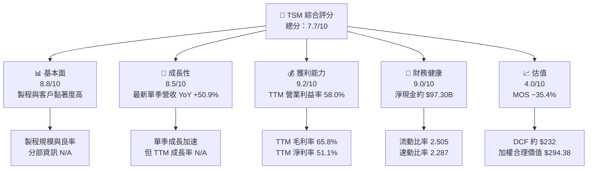

### 1.2 評分進度條視覺化

```text
╔══════════════════════════════════════════════════════════════╗
║              TSM 多維度評分儀表板（1–10分）                  ║
╠══════════════════════════════════════════════════════════════╣
║ 基本面強度  8.8 ▓▓▓▓▓▓▓▓▓▓▓▓▓▓▓▓▓░░░  ★★★★☆            ║
║ 成長動能    8.5 ▓▓▓▓▓▓▓▓▓▓▓▓▓▓▓░░░░░  ★★★★☆            ║
║ 獲利品質    8.2 ▓▓▓▓▓▓▓▓▓▓▓▓▓▓▓▓░░░░  ★★★★☆            ║
║ 財務健康    9.0 ▓▓▓▓▓▓▓▓▓▓▓▓▓▓▓▓▓▓░░  ★★★★★            ║
║ 估值合理性  4.0 ▓▓▓▓▓▓▓▓░░░░░░░░░░░░  ★★☆☆☆            ║
║ 護城河深度  9.0 ▓▓▓▓▓▓▓▓▓▓▓▓▓▓▓▓▓▓░░  ★★★★★            ║
║ 管理層執行  7.5 ▓▓▓▓▓▓▓▓▓▓▓▓▓▓▓░░░░░  ★★★★☆            ║
║ 技術創新力  9.0 ▓▓▓▓▓▓▓▓▓▓▓▓▓▓▓▓▓▓░░  ★★★★★            ║
╠══════════════════════════════════════════════════════════════╣
║ 綜合總分    7.7 ▓▓▓▓▓▓▓▓▓▓▓▓▓▓▓░░░░░  🟡 質優但估值昂貴 ║
╚══════════════════════════════════════════════════════════════╝
```

### 1.3 五大投資論點 + 三大核心風險

| 類型 | 項目 | 具體依據 | 信心度 |
|------|------|----------|--------|
| 🟢 投資論點① | 先進製程與規模優勢 | TTM 毛利率 65.8%、營業利益率 58.0%，顯示產品組合及成本吸收能力具韌性 | 高 |
| 🟢 投資論點② | AI/HPC 帶動近期成長 | 最新季度營收 YoY +50.9%、EPS YoY +68.7%；若高階產品組合延續，營運槓桿可支持利潤成長 | 中高 |
| 🟢 投資論點③ | 現金流與資產負債表穩健 | TTM OCF 約 $95.14B、Capex 約 $50.64B、FCF 約 $44.50B | 高 |
| 🟢 投資論點④ | 資本回報高於資金成本 | FY2025 估算 ROIC 約 44.1%，高於 11.20% 參考 WACC | 中 |
| 🟢 投資論點⑤ | 客戶認證造成轉換成本 | 晶圓設計導入、製程驗證與量產良率需要時間，降低客戶快速轉單誘因 | 中高 |
| 🟡 風險① | AI 資本支出周期反轉 | 近期營收 YoY +50.9% 的高增速若無法持續，市場可能下修成長倍數 | 中高 |
| 🔴 風險② | 地緣政治與供應中斷 | 主要製造基地集中於台灣；屬低頻但高衝擊風險，無法以短期財務比率充分反映 | 高衝擊 |
| 🟡 風險③ | 現價估值與終值依賴 | 基準 DCF 約 $232.15，低於現價 $398.73；DCF 終值現值占 EV 約 74% | 中高 |

### 1.4 快速統計卡片

| 指標 | 公司實際值 | 行業均值 | S&P 500 均值 | 狀態 |
|------|-------------|----------|--------------|------|
| 最新單季收入 YoY 成長 | **50.9%** | N/A | N/A | 🟢 |
| TTM 毛利率 | **65.8%** | N/A | N/A | 🟢 |
| TTM 淨利率 | **51.1%** | N/A | N/A | 🟢 |
| ROE TTM | **41.9%** | N/A | N/A | 🟢 |
| Forward P/E | **17.05x** | 同業差異大 | N/A | 🟡 |
| TTM FCF Yield | **2.15%** | N/A | N/A | 🔴 |
| TTM 淨現金 | **約 $97.30B** | N/A | N/A | 🟢 |

### 1.5 投資結論

```text
╔══════════════════════════════════════════════════════════════════╗
║                    📊 投資結論摘要                               ║
╠══════════════════════════════════════════════════════════════════╣
║  評級：🔴 賣出（依 MOS 門檻）                                    ║
║  價格（2026-11-13 收盤）：$398.73                                ║
║  DCF 內在價值（基準）：約 $232.15（溢價約 71.8%）               ║
║  加權合理價值：約 $294.38                                        ║
║  安全邊際 MOS：−35.4%                                            ║
║  目標價區間：                                                    ║
║    悲觀情境：約 $125（−68.6%）                                   ║
║    基準情境：約 $232（−41.8%）                                   ║
║    樂觀情境：約 $310（−22.2%）                                   ║
║  12 個月加權合理價值：約 $294.38（−26.2%）                      ║
║  投資評分：7.7/10（公司品質高，價格缺乏安全邊際）                ║
║  適合投資人：已有部位的長線投資人可持有並嚴格追蹤；不宜追價     ║
╚══════════════════════════════════════════════════════════════════╝
```

評級規則依據加權合理價值的 MOS：**−35.4% < −25%，因此為賣出**。公司品質與估值評級分離：ROIC 高於 WACC 支持長期價值創造，但不代表任何價格都值得買入。

## 2. 公司概覽與商業模式

### 2.1 業務結構與收入來源

TSM 為晶圓代工公司，承接客戶設計並負責晶圓製造、封裝與測試等服務。資料包沒有最新季度或年度的技術節點、平台別營收拆分，因此各節點與應用收入占比列為 N/A，不以推估冒充公司實際披露。

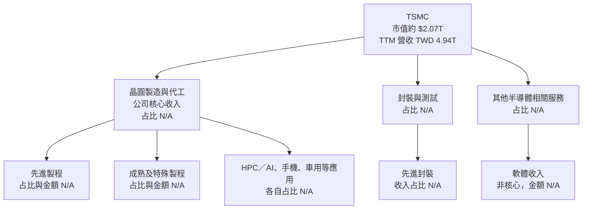

### 2.2 市場份額

資料包未提供全球晶圓代工市場規模、公司市場份額或相同口徑的競爭者收入，因此不製作虛構比例圖。可確定的是，TSM 與 Intel Foundry、UMC、GlobalFoundries 同屬半導體製造業，但各自節點、產品與自用產能不同，單用公司營收直接比較會失真。

| 市場／指標 | TSM | 可比公司 | 本報告判斷 |
|---|---:|---:|---|
| 全球晶圓代工份額 | N/A | N/A | 本資料包未提供同口徑份額 |
| 先進製程份額 | N/A | N/A | 不以未驗證比例推估 |
| 代工收入 | TTM TWD 4.94T | Intel、UMC、GFS 規模與業務組合不同 | 只比較題供同業倍數與毛利率 |

### 2.3 競爭護城河分析

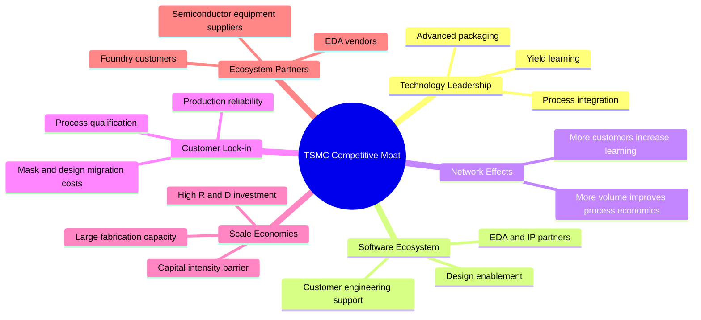

### 2.4 護城河強度評分

```text
╔══════════════════════════════════════════════════════════════╗
║                    TSM 護城河強度評分                         ║
╠══════════════════════════════════════════════════════════════╣
║ 技術與良率      9.5/10 ▓▓▓▓▓▓▓▓▓▓▓▓▓▓▓▓▓▓▓  🟢 核心優勢 ║
║ 客戶轉換成本    9.0/10 ▓▓▓▓▓▓▓▓▓▓▓▓▓▓▓▓▓▓░  🟢 高黏著度 ║
║ 規模經濟        9.0/10 ▓▓▓▓▓▓▓▓▓▓▓▓▓▓▓▓▓▓░  🟢 資本門檻 ║
║ 生態夥伴        8.5/10 ▓▓▓▓▓▓▓▓▓▓▓▓▓▓▓░░░  🟢 供應鏈深 ║
║ 網路效應        7.0/10 ▓▓▓▓▓▓▓▓▓▓▓▓▓▓░░░░  🟡 非典型網路效應║
║ 軟體生態        6.5/10 ▓▓▓▓▓▓▓▓▓▓▓░░░░░░░  🟡 不是軟體平台║
╠══════════════════════════════════════════════════════════════╣
║ 綜合護城河      9.0/10 ▓▓▓▓▓▓▓▓▓▓▓▓▓▓▓▓▓▓░  🟢 深且持久 ║
╚══════════════════════════════════════════════════════════════╝
```

## 3. 損益表深度分析

### 3.1 年度收入成長趨勢（近4年）

以下年度數字為新台幣；年度成長率由相鄰年度收入計算。2022 年相較 2021 年成長率未在年度表格提供，但可依收入計算；2021 年收入為 TWD 1.587T。

```text
╔══════════════════════════════════════════════════════════════════╗
║                 TSM 年度收入趨勢（FY2022–FY2025）                ║
╠══════════════════════════════════════════════════════════════════╣
║ FY2022  TWD 2.264T  ███████████████░░░░░░░░░  YoY +42.6% 🟢   ║
║ FY2023  TWD 2.162T  ██████████████░░░░░░░░░░  YoY  −4.5% 🟡   ║
║ FY2024  TWD 2.894T  ███████████████████░░░░░  YoY +33.9% 🟢   ║
║ FY2025  TWD 3.809T  █████████████████████████ YoY +31.6% 🟢   ║
╠══════════════════════════════════════════════════════════════════╣
║ FY2022–FY2025 CAGR = (3.809 ÷ 2.264)^(1/3) − 1 = 約 18.9%      ║
║ FY2025 成長來自需求與產品組合改善；FY2023 則反映半導體週期調整 ║
╚══════════════════════════════════════════════════════════════════╝
```

FY2022–FY2025 CAGR 以 TWD 3.809T ÷ TWD 2.264T 計算，約 18.9%。FY2024、FY2025 均超過 30% 增長，較能反映週期回升與高階製程需求；不應將這兩年高增速直接外推為長期常態。

### 3.2 季度收入趨勢分析

季度數字採 StockAnalysis 季度表，單位 TWD B；QoQ 與 YoY 為依題供季度數字計算或直接引用最新單季 YoY。

| 季度 | 收入 TWD B | QoQ | YoY | 備註 |
|------|-----------:|----:|----:|------|
| 2025 Q4 | 1,046.1 | +5.7% | +20.5% | 2024 Q4 收入 TWD 868.5B |
| 2026 Q1 | 1,134.1 | +8.4% | +35.1% | 延續高增長 |
| 2026 Q2 | 1,270.4 | +12.0% | +36.1% | QoQ 加速 |
| 2026 Q3 | 1,494.2 | +17.6% | +50.9% | 最新一季；不是 TTM 成長率 |

Q3 2026 收入較 Q2 增加 TWD 223.9B，約 17.6%。季度加速顯示需求、產品組合或產能利用率可能同步改善；但資料包沒有平台拆分，無法將增長精確歸因到 AI、手機或其他終端。

### 3.3 利潤率演變分析

| 利潤率指標 | FY2022 | FY2023 | FY2024 | FY2025 | TTM | 趨勢與評估 |
|------------|-------:|-------:|-------:|-------:|----:|-------------|
| 毛利率 | 59.6% | 54.4% | 56.1% | 59.9% | 65.8% | 🟢 TTM 明顯高於年度期，產品組合及營運槓桿有利 |
| 營業利益率 | 49.6% | 42.6% | 45.7% | 50.9% | 58.0% | 🟢 產能利用、製程組合及規模吸收固定成本 |
| 淨利率 | 43.9% | 39.4% | 40.0% | 44.6% | 51.1% | 🟢 與營業利益率改善方向一致 |

計算例如 FY2025 營業利益率 = TWD 1.937T ÷ TWD 3.809T = 約 50.9%。2023 年利潤率下行與半導體週期轉弱相符；其後恢復，反映高毛利產品占比、較高產能利用率及固定成本吸收改善。TTM 毛利率 65.8% 顯著高於 FY2025，若未來利用率下降或海外產能爬坡成本增加，利潤率可能回歸較低水準。

### 3.4 費用結構分析

資料包提供 R&D，但未提供完整 COGS、SG&A 等 TTM 費用明細。以 FY2025 為例，營收 TWD 3.809T、毛利 TWD 2.281T、營業利益 TWD 1.937T，因此毛利至營業利益間的營業費用合計約 TWD 344.4B；R&D 為 TWD 246.43B。

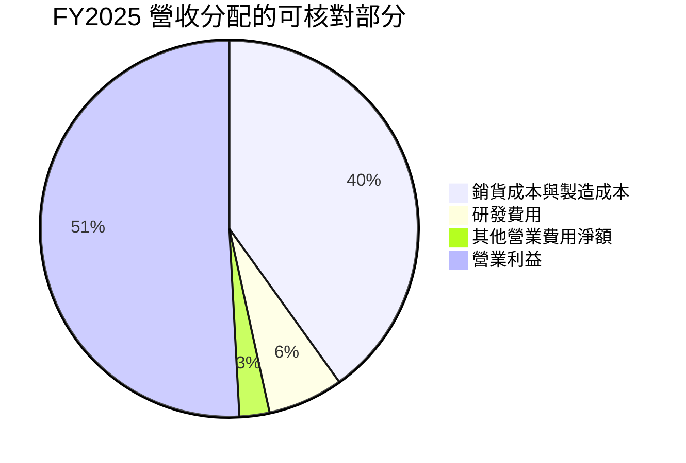

> 圖表為由 FY2025 財報數字推得的 TWD 十億級近似分配；「其他營業費用淨額」為毛利扣除研發及營業利益後的殘差，並非單一費用科目。

```text
╔══════════════════════════════════════════════════════════════╗
║                   FY2025 費用結構概覽（TWD）                  ║
╠══════════════════════════════════════════════════════════════╣
║ 營收 3,809B        █████████████████████████  100.0%       ║
║ 毛利 2,281B        ███████████████            59.9%       ║
║ R&D  246B          ██                         6.5%        ║
║ 營業利益 1,937B    █████████████              50.9%       ║
╚══════════════════════════════════════════════════════════════╝
```

### 3.5 季度 EPS 趨勢與盈餘品質（Quality of Earnings）

資料包的 Earnings History 中四季 EPS Est 與 EPS Act 均為 NaN，不能判斷超預期或不及預期。StockAnalysis 顯示 2026 Q3 EPS 為 29.43（報價口徑），YoY +68.73%；但沒有一致的市場預估值，故不宣稱 beat/miss。

| 盈餘品質項目 | 數值／佔比 | 評估 |
|--------------|-----------|------|
| 股權薪酬 SBC / 營收 | FY2025：TWD 1.25B ÷ TWD 3.809T = 約 0.033% | 🟢 很低；但 TTM SBC 不完整 |
| SBC / 營業現金流 | FY2025：TWD 1.25B ÷ TWD 2.27T = 約 0.055% | 🟢 對現金流稀釋影響有限 |
| FCF / 淨利 | TTM：TWD 1.46T ÷ TWD 2.528T = 約 57.8% | 🟡 正值但低於 100%；主要考量是高額資本支出 |
| 一次性／非經常性損益 | N/A | 🟡 未提供逐項調整，不能判斷一次性項目影響 |
| 有效稅率 | 最新年度 17.0% | 🟡 題供數值，未顯示明顯稅務利益，但季度稅率未提供 |
| 資本化支出 vs 費用化 | TTM Capex TWD 1.66T；R&D FY2025 TWD 246.43B | 🟡 資本密集；缺少資本化利息與各項會計政策明細 |

TTM FCF/淨利轉換率約 57.8%，主要反映晶圓廠設備與產能建置所需的資本支出，不必然代表盈餘品質差；但估值必須重視維持競爭力所需的再投資。FY2025 SBC 占比極低，未見重大股權薪酬稀釋證據。整體 GAAP 盈餘含金量尚可，但對自由現金流的解讀須納入資本支出周期。

## 4. 資產負債表分析

### 4.1 資產結構分解

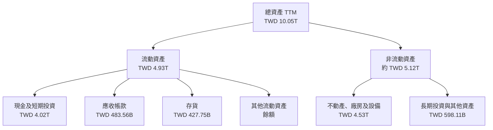

流動資產與非流動資產總和依 TTM 資產表計算，細項因四捨五入可能存在微小差異。PP&E 約占總資產 45%，符合晶圓代工資本密集特性；設備投資支撐未來產能與製程，但若需求下行，折舊與閒置產能可能壓縮回報。

### 4.2 流動性指標分析

| 指標 | TTM／最新值 | FY2025 | 評估 |
|------|-------------:|-------:|------|
| 現金及短期投資 | TWD 4.02T | TWD 3.07T | 🟢 現金儲備增加 |
| 流動比率 | 2.505x | 2.51x（依流動資產/流動負債計算） | 🟢 短期償債能力良好 |
| 速動比率 | 2.287x | N/A | 🟢 高於 1 倍 |
| 行業均值 | N/A | N/A | 本資料包未提供 |

### 4.3 債務結構分析

```text
╔══════════════════════════════════════════════════════════════════╗
║                     TSM 債務健康診斷                              ║
╠══════════════════════════════════════════════════════════════════╣
║ 總債務：          TWD 818.38B（約 $24.89B）   ██░░░░░░░░░░░░ ║
║ 現金+短期投資：   TWD 4.02T（約 $122.19B）   ██████████████ ║
║ 淨現金：          TWD 3.20T（約 $97.30B）     ███████████░░░ ║
║ 流動比率：        2.505x                     🟢 流動性充裕  ║
║ Debt/EBITDA：     N/A（口徑與幣別需一致）     🟡 不作混幣計算║
║ 利息保障倍數：    N/A（利息費用資料不足）     —               ║
╚══════════════════════════════════════════════════════════════════╝
```

淨現金換算值依 VERIFIED FIGURES 原值使用。年度資產負債表 FY2025 總債務 TWD 1.06T 與 TTM 淨債務計算所列 TWD 818.38B 期間不同，本文不混用兩者計算債務倍數。

### 4.4 股東權益趨勢

```text
╔══════════════════════════════════════════════════════════════════╗
║               股東權益趨勢（年度，TWD）                          ║
╠══════════════════════════════════════════════════════════════════╣
║ FY2022  TWD 2.90T  ███████████░░░░░░░░░░░░                    ║
║ FY2023  TWD 3.43T  ██████████████░░░░░░░░░                    ║
║ FY2024  TWD 4.24T  █████████████████░░░░░░                    ║
║ FY2025  TWD 5.36T  ██████████████████████░                    ║
╚══════════════════════════════════════════════════════════════════╝
```

FY2022–FY2025 股東權益增加約 TWD 2.46T，反映期間獲利累積與資產規模擴大；資料未提供完整回購明細，不能將變動拆成留存盈餘、股息及其他項目。

## 5. 現金流量深度分析

### 5.1 現金流量瀑布圖

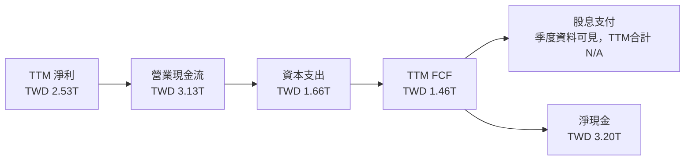

### 5.2 FCF 轉換率趨勢

| 年度 | FCF（TWD B） | 淨利（TWD B） | FCF / 淨利 |
|------|-------------:|--------------:|-----------:|
| FY2022 | 520.97 | 992.92 | 52.5% |
| FY2023 | 286.57 | 851.74 | 33.6% |
| FY2024 | 861.20 | 1,158.38 | 74.3% |
| FY2025 | 992.38 | 1,697.60 | 58.5% |
| TTM | 1,460（題供） | 2,527.57 | 約 57.8% |

FCF 轉換率受建廠與設備投資節奏影響。FY2023 低點後回升，但 FY2025 與 TTM 仍低於 100%；對高資本密集企業，應把再投資後的自由現金流與產能回報一起觀察。

### 5.3 自由現金流趨勢

```text
╔══════════════════════════════════════════════════════════════════╗
║              自由現金流趨勢（年度實際，TWD）                      ║
╠══════════════════════════════════════════════════════════════════╣
║ FY2022  520.97B  ███████████░░░░░░░░░░░░  FCF/NI 52.5%        ║
║ FY2023  286.57B  ██████░░░░░░░░░░░░░░░░░  FCF/NI 33.6%        ║
║ FY2024  861.20B  ██████████████████░░░░░░  FCF/NI 74.3%        ║
║ FY2025  992.38B  █████████████████████░░░░  FCF/NI 58.5%        ║
║ TTM     1.46T    █████████████████████████  約 $44.50B         ║
╠══════════════════════════════════════════════════════════════════╣
║ TTM FCF Yield：2.15%（VERIFIED FIGURES 原值）                    ║
╚══════════════════════════════════════════════════════════════════╝
```

### 5.4 資本配置評估

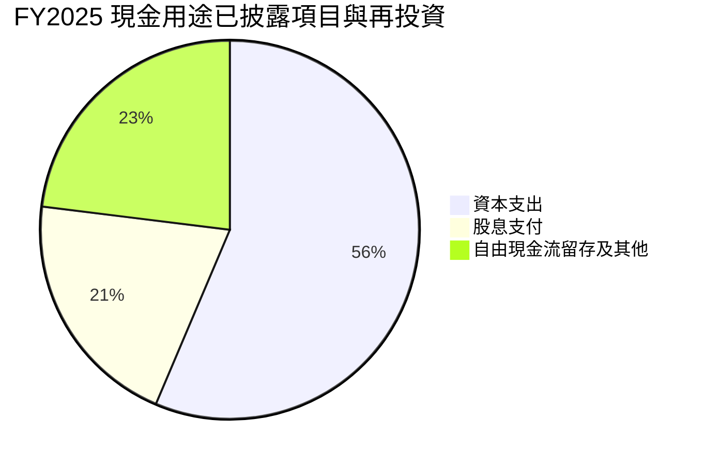

圖中以 FY2025 OCF TWD 2.27T 為資金來源；資本支出取 TWD 1.28T，股息取 TWD 466.78B，餘額為現金流表中未作上述兩項分類的差額近似值，並非回購金額。

| 資本配置項目 | FY2025／TTM 數據 | 評估 |
|--------------|-----------------:|------|
| Capex | FY2025 TWD 1.28T；TTM TWD 1.66T | 🟡 必要且龐大；需追蹤新增產能利用率 |
| 股息 | FY2025 TWD 466.78B | 🟢 有穩定現金回饋 |
| 回購 | N/A | 不以缺失資料推估 |
| 留存與其他 | N/A | 需完整資金流向資料 |
| TTM FCF | TWD 1.46T | 🟢 大額投資後仍維持正值 |

## 6. 獲利能力與資本效率

### 6.1 ROE / ROA / ROIC 趨勢

| 指標 | FY2023 | FY2024 | FY2025／TTM | 行業均值 | 評估 |
|------|-------:|-------:|------------:|----------|------|
| ROE | N/A | N/A | TTM 41.9% | N/A | 🟢 高資本回報 |
| ROA | N/A | N/A | TTM 20.6% | N/A | 🟢 資產獲利能力強 |
| ROIC | N/A | N/A | FY2025 約 44.1%（估算） | N/A | 🟢 明顯高於 WACC |
| 歷史 ROIC.AI | 2018 為 19.11% | — | — | — | 長期資料顯示過去回報亦高於 WACC，但與本期估算口徑不同 |

### 6.2 ROIC vs WACC 分析（核心價值創造判斷）

以下 ROIC 以 FY2025 年末資產負債表及全年營業利益作簡化估算，並非公司直接披露的 ROIC。公式採用：投入資本 = 股東權益 + 債務 − 現金；現金採 FY2025 現金及約當現金，未扣除短期投資，因此估算偏保守。

```text
╔══════════════════════════════════════════════════════════════════╗
║                    ROIC vs WACC 深度分析                         ║
╠══════════════════════════════════════════════════════════════════╣
║ WACC 參考輸入：                                                  ║
║ ├── 10Y 美債無風險利率：5.15%（資料包基準）                     ║
║ ├── ERP：5.00%（資料包假設值）                                   ║
║ ├── Beta：1.23                                                   ║
║ ├── 股權成本：資料包原值 11.32%                                  ║
║ ├── 稅前債務成本：1.51%；稅後約 1.25%                            ║
║ ├── 股權／債務權重：98.8%／1.2%                                  ║
║ └── WACC：資料包參考值 11.20%                                    ║
║                                                                  ║
║ FY2025 ROIC 簡化估算：                                           ║
║ ├── NOPAT = 1.9369T × (1 − 17%) = 約 TWD 1.608T                 ║
║ ├── 投入資本 = 5.36T + 1.06T − 2.77T = TWD 3.65T              ║
║ └── ROIC = 1.608T ÷ 3.65T = 約 44.1%                            ║
║                                                                  ║
║ EVA 利差 = 44.1% − 11.20% = 約 +32.9 個百分點                   ║
║ ROIC  44.1% ▓▓▓▓▓▓▓▓▓▓▓▓▓▓▓▓▓▓▓▓▓▓░░░░  🟢                    ║
║ WACC  11.2% ▓▓▓▓▓░░░░░░░░░░░░░░░░░░░░░░░  ──                   ║
╠══════════════════════════════════════════════════════════════════╣
║ 結論：以該簡化估算，公司創造股東價值；須留意投入資本口徑差異。 ║
╚══════════════════════════════════════════════════════════════════╝
```

WACC 加權核對：`98.8% × 11.32% + 1.2% × [1.51% × (1−17%)] = 11.1992% ≈ 11.20%`。ROIC 約 44.1% 高於 WACC 約 32.9 個百分點，但此差距可能因現金、短期投資、租賃負債及平均投入資本口徑而變動。

### 6.3 杜邦三因素分解

以 TTM 數據計算，資產週轉率與槓桿使用一致的近似值：TTM 收入 TWD 4.945T、總資產 TWD 10.053T、股東權益採 FY2025 TWD 5.36T。此處為近似杜邦拆解，不能與平台直接公布 ROE 完全等同。

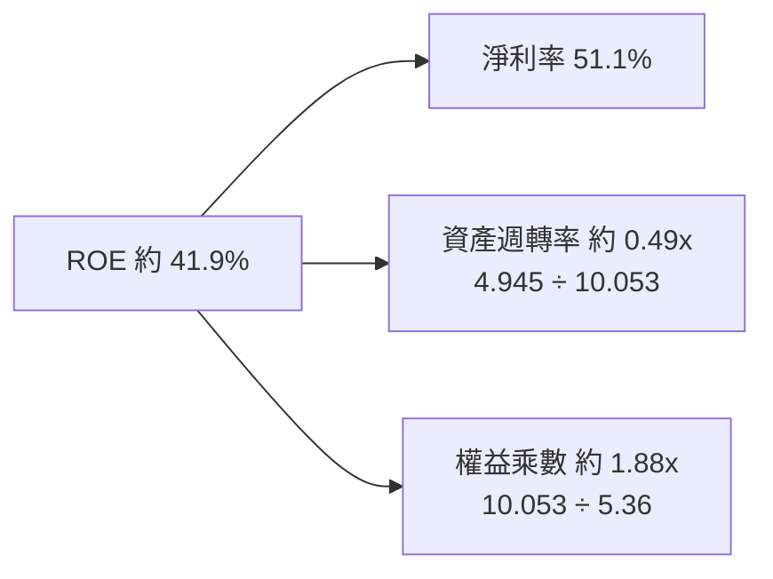

### 6.4 獲利能力儀表板

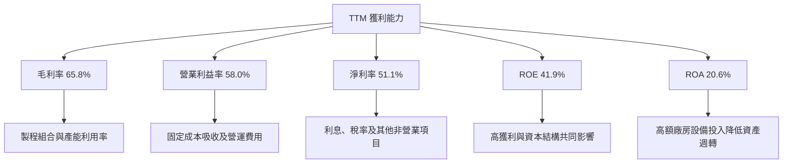

## 7. 相對估值分析

### 7.1 同業估值比較

TSM 倍數採 VERIFIED FIGURES；同業依提供的 Peer multiples 原值。TSM P/S 與 EV/EBITDA 因報價 USD、財報 TWD 而標示 N/A，不做跨幣別推算。

| 估值指標 | **TSM** | **INTC** | **UMC** | **GFS** | TSM 評估 |
|----------|--------:|---------:|--------:|-------:|----------|
| Trailing P/E | 25.84x | N/A | 14.5x | 118.5x | 🟡 高於 UMC，遠低於 GFS |
| Forward P/E | 17.05x | 33.3x | 17.1x | 16.0x | 🟡 接近 UMC、GFS；低於 INTC |
| P/S TTM | N/A | 5.3x | N/A | 3.2x | — 幣別口徑限制 |
| EV/EBITDA TTM | N/A | 17.7x | N/A | 11.4x | — 幣別口徑限制 |
| 最新單季收入 YoY | 50.9% | 20.9% | 25.6% | 12.5% | 🟢 近期成長較快 |
| 毛利率 TTM | 65.8% | 40.2% | 31.7% | 28.5% | 🟢 顯著高於同業 |

### 7.2 歷史估值區間分析

VERIFIED FIGURES 未提供「Valuation vs own history」數值，因此歷史估值分位與區間 **N/A**，不以市場記憶估算。

```text
╔══════════════════════════════════════════════════════════════╗
║             TSM 自身歷史估值區間（資料缺漏）                 ║
╠══════════════════════════════════════════════════════════════╣
║ 歷史 P/E 區間：N/A                                           ║
║ 歷史 P/E 百分位：N/A                                         ║
║ 當前 Trailing P/E：25.84x                                    ║
║ 當前 Forward P/E：17.05x                                     ║
║ 結論：只能與題供同業倍數及本報告估值模型比較，不能定位歷史分位║
╚══════════════════════════════════════════════════════════════╝
```

### 7.3 情境目標價（假設驅動）

市場價格與 EPS 使用題供 USD 口徑。收入預測及營業利潤率情境作為分析假設，不是公司指引；目標價使用相應情境 Forward P/E 乘以 Forward EPS $23.38529，以便可複算。該法忽略未來 EPS 因股數、匯率與稅率變化所產生的誤差，故只能作相對估值參考。

| 情境 | 營收 CAGR 假設 | 營業利潤率假設 | 退出 Forward P/E | 隱含目標價 | 相對現價 |
|------|---------------:|---------------:|-----------------:|-----------:|---------:|
| 🔴 悲觀 | 10% | 50% | 14x | $327.39 | −17.9% |
| 🟡 基準 | 20% | 58% | 17.05x | $398.73 | 0.0% |
| 🟢 樂觀 | 25% | 60% | 22x | $514.48 | +29.0% |

算式例：基準價 = Forward EPS $23.38529 × 17.05 = 約 $398.73。倍數假設參考同業 Forward P/E 16.0x–33.3x，基準採與 TSM 自身 Forward P/E 17.05x 接近的倍數；悲觀情境考慮半導體週期及資本支出風險，樂觀情境反映成長持續與估值溢價。此表為相對估值情境，並非第 8 章 DCF 情境。

### 7.4 相對估值隱含價格區間

```text
╔══════════════════════════════════════════════════════════════════╗
║             相對估值可用資訊與價格定位                           ║
╠══════════════════════════════════════════════════════════════════╣
║ TSM Forward P/E：17.05x × Forward EPS $23.385 ≈ $398.73       ║
║ 同業 Forward P/E 中位數：17.1x × $23.385 ≈ $399.88            ║
║ 以 3.0% FCF Yield 回推：$44.50B ÷ 5.19B ÷ 3.0% ≈ $285.6       ║
║ EV/EBITDA：N/A（財報與市場報價幣別不一致）                      ║
║ EV/Sales：N/A（財報與市場報價幣別不一致）                       ║
║ 現價：$398.73                                                   ║
╚══════════════════════════════════════════════════════════════════╝
```

FCF yield 回推的 3.0% 為分析假設，不是題供市場數據。Forward P/E 法反映市場當前估值，FCF yield 法提供現金流收益率視角；兩者顯示不同估值錨點，應與 DCF 一併衡量。

## 8. DCF 內在價值評估（Discounted Cash Flow）

### 8.0 估值推理鏈（Thinking Logic）

**Step 1 — 價值來源與主導變數**

TSM 估值可拆為：① 現有晶圓代工主業的現金流底盤，涵蓋公司幾乎全部營收，但分部占比資料 N/A；② 先進製程與先進封裝等成長曲線，收入占比未披露，不能量化；③ 新廠區、技術節點及客戶需求帶來的選擇權價值，同樣不單獨估值。模型中主導價值的變數是**長期 FCFF 利潤率與折現率**；成長率雖推升終值，Capex/營收率同樣關鍵，因為 TTM Capex 約占營收 33.7%。

**Step 2 — 模型選擇**

| 決策點 | 本報告採用 | 理由（含數字） | 曾考慮但否決 | 否決理由 |
|--------|-----------|----------------|--------------|----------|
| 現金流定義 | FCFF | 以 WACC 折現，先估 EV 再加淨現金 | FCFE | 資本結構及債務口徑可能變動 |
| 預測期 N | 5 年 | 先進製程與產能投資具中期可見度；超過 5 年不確定性較高 | 10 年 | 產業週期與地緣風險使長期精確預測更弱 |
| 終值方法 | Gordon Growth 主法；退出倍數交叉驗證 | 長期成熟公司可用永續成長表達 | 單用退出倍數 | 可能受週期高峰估值扭曲 |
| EBIT 基礎 | GAAP 營業利益假設 | 財報提供營業利益及營業利益率 | 非 GAAP EBIT | 未提供可核對調整項目 |

**Step 3 — 重要假設推導鏈**

- **營收 CAGR**：歷史錨點為 FY2022–FY2025 TWD 營收 CAGR 約 18.9%，TTM 最新單季 YoY 為 50.9%但不是可持續全年增速 → 基期及高成長可能回歸，故不採 30% 以上長期外推 → **基準採用 20%** → 曾考慮 25%，但缺乏 TTM 同比營收及正式管理層財測支持，否決。
- **期末營業利潤率**：目前 TTM 營業利益率 58.0%，FY2025 年度約 50.9% → 高階產品組合有利，但海外產能爬坡與成本上升可能抵銷規模效益 → **採用 58%不變** → 曾考慮 62%，但高於現有 TTM 且無充分資料支持，否決。
- **永續成長率 g**：長期成熟經濟體名目成長通常低於短期高成長率；本報告採用 **3.0%** 作長期名目成熟假設 → 高於通膨而低於 WACC 11.2%，可維持合理收斂 → 曾考慮 4.0%，但終值敏感度提高，且缺乏長期市場資料支持，否決。
- **預測期 N**：最近季度呈加速，但財報只提供四季及年度序列 → 5 年可涵蓋一個中期投資周期 → **採用 5 年** → 曾考慮 10 年，因年 6 以後的成長與產能利用率難以可靠外推而否決。
- **Capex/營收**：TTM Capex TWD 1.66T ÷ TTM 營收 TWD 4.94T = 約 33.6% → 高資本需求預計延續，但不假定資本支出迅速降至成熟公司水平 → **採用 33.67%** → 曾考慮 25%，因低於目前 TTM 比率，缺少投資周期結束證據而否決。
- **EBITDA/D&A 假設**：TTM EBITDA margin 73.0% 減 TTM operating margin 58.0% = 15.0% → **假設 D&A/營收為 15.0%**；這是由題供兩個利潤率差額代理，不是直接披露的 D&A。
- **ΔWC/增額營收**：歷史營運資金變動資料不足 → **假設為新增營收的 2.0%**，作為低敏感度簡化值；曾考慮 0%，但會忽略成長帶來的營運資金需求。
- **有效稅率**：採 VERIFIED FIGURES 最新年度有效稅率 **17.0%**；不採用更低歷史稅率以避免稅務利益假設。
- **SBC 與股數**：採組合 **(A) GAAP EBIT + 固定股數、年稀釋率 0%**；GAAP EBIT 已含 SBC 費用，FCFF 不再減 SBC，也不另計股數稀釋。最新稀釋股數資料未提供，模型以 VERIFIED FIGURES 的 **5.19B shares outstanding** 作代理值，與實際稀釋股數可能有差異。
- **WACC**：採 VERIFIED FIGURES 參考 WACC **11.20%**。公式與來源於 8.2 展示；不另加國別風險溢酬，避免與已提供 Beta/ERP 重複計價。

**Step 4 — 最脆弱環節**

最脆弱的假設是 33.67% Capex/營收能否在高成長期維持，同時保住 58% 營業利益率；若資本支出更高或利潤率回落，DCF 將明顯低於基準值。

**Step 5 — 計算路徑圖**

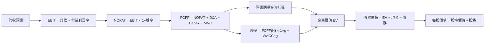

### 8.1 模型假設總表（Model Inputs）

| 假設項目 | 採用值 | 依據／來源 | 敏感度 |
|----------|--------|-------------|--------|
| 預測期長度 N | 5 年 | 估值分析假設；兼顧中期可見度與預測誤差 | 🟡 中 |
| 營收 CAGR | 20.0% | FY2022–FY2025 CAGR 約 18.9%；對先進製程需求略上調 | 🔴 高 |
| 營業利潤率 | 每年 58.0% | TTM 營業利益率 58.0%；預期規模與成本相抵 | 🔴 高 |
| 有效稅率 | 17.0% | VERIFIED FIGURES 最新年度有效稅率 | 🟢 低 |
| Capex/營收 | 33.67% | TTM Capex/營收 = 50.64/150.41 | 🔴 高 |
| D&A/營收 | 15.0% | EBITDA margin 73.0% − operating margin 58.0% 的代理值 | 🟢 低 |
| ΔWC/新增營收 | 2.0% | 假設值；營運資金變動明細不足 | 🟢 低 |
| EBIT 基礎 | GAAP 營業利益 | 報表營業利益率為起點；不另加回 SBC | 🟡 中 |
| SBC 處理 | 組合 (A)：不重複扣除 | GAAP EBIT 已含 SBC；不扣 FCFF、不另計稀釋 | 🟡 中 |
| 年稀釋率 | 0.0% | 組合 (A)；固定使用 5.19B 代理股數 | 🟡 中 |
| 永續成長率 g | 3.0% | 長期成熟期假設；低於 11.20% WACC | 🔴 高 |
| 終值方法 | Gordon Growth 主法；EV/EBITDA 交叉驗證 | 同業 EV/EBITDA 雖有數據但 TSM 幣別口徑 N/A；倍數交叉驗證改採估計 | 🔴 高 |
| WACC | 11.20% | VERIFIED FIGURES 參考值 | 🔴 高 |
| 現金及短期投資 | $122.19B | VERIFIED FIGURES 原值 | 🟡 中 |
| 總債務 | $24.89B | VERIFIED FIGURES 原值 | 🟡 中 |
| 股數 | 5.19B 股 | 市場資料 Shares Outstanding；非明確最新稀釋股數 | 🟡 中 |

**FCFF 定義：**`FCFF = NOPAT + D&A − Capex − ΔWC`。本模型採用 **(A) GAAP EBIT + 固定股數**，故 SBC 影響只計入一次。

### 8.2 折現率推導（WACC）

```text
╔══════════════════════════════════════════════════════════════════╗
║                    WACC 推導（折現率）                           ║
╠══════════════════════════════════════════════════════════════════╣
║ 股權成本 Ke（CAPM）：                                            ║
║ ├── 無風險利率 Rf：5.15%（資料包 10Y Treasury；日期口徑為資料包）║
║ ├── ERP：5.00%（資料包假設值）                                   ║
║ ├── Beta：1.23（VERIFIED FIGURES）                               ║
║ ├── 國別／規模溢酬：0.00%（避免與 Beta、ERP 重複計價）           ║
║ └── 採資料包 Ke 原值：11.32%                                     ║
║                                                                  ║
║ 債務成本：                                                       ║
║ ├── 稅前 Kd：1.51%（資料包原值）                                 ║
║ ├── 有效稅率：17.0%                                              ║
║ └── 稅後 Kd = 1.51% × (1−17.0%) = 1.2533%                       ║
║                                                                  ║
║ 資本結構權重：                                                   ║
║ ├── 股權權重：98.8%                                              ║
║ ├── 債務權重：1.2%                                               ║
║ └── WACC = 98.8%×11.32% + 1.2%×1.2533% = 11.1992% ≈ 11.20%     ║
╚══════════════════════════════════════════════════════════════════╝
```

逐步演算：

1. **Ke**：依 VERIFIED FIGURES 原值採 **11.32%**；用未四捨五入 CAPM 輸入計算，可能與已提供 Ke 原值有小數尾差。
2. **稅前 Kd**：資料包提供利息/債務成本 **1.51%**；利息費用與計息負債明細不足，故沿用參考值，不自行重算。
3. **稅後 Kd**：`1.51% × (1 − 17.0%) = 1.2533%`。
4. **權重**：採資料包權重，`E = 98.8%`、`D = 1.2%`，兩者合計 `100.0%`。資料包未提供可按指定範圍重建的平均計息負債，故不另造 E/D 數值。
5. **WACC**：`98.8% × 11.32% + 1.2% × 1.2533% = 11.18416% + 0.01504% = 11.19920% ≈ 11.20%`。

第 6.2 節與 DCF 均使用同一 WACC。由於資料包的 Kd、權重已作為參考輸入，本報告不把應付帳款當作有息負債，也不自行推導不同債務口徑。

### 8.3 逐年自由現金流預測（基準情境）

金額單位為 **USD B**。起始營收採 VERIFIED FIGURES TTM $150.41B；假設每年營收成長 20.0%、營業利益率 58.0%、稅率 17.0%、D&A/營收 15.0%、Capex/營收 33.67%、ΔWC 為新增營收的 2.0%。各項為估值假設，不是管理層財測。

| 年度 | FY+1 | FY+2 | FY+3 | FY+4 | FY+5（FY+N） |
|------|-----:|-----:|-----:|-----:|-------------:|
| 營收 | 180.49 | 216.59 | 259.91 | 311.89 | 374.27 |
| 營收 YoY | 20.0% | 20.0% | 20.0% | 20.0% | 20.0% |
| 營業利潤率 | 58.0% | 58.0% | 58.0% | 58.0% | 58.0% |
| EBIT（GAAP 假設） | 104.68 | 125.62 | 150.75 | 180.90 | 217.08 |
| − 稅（17.0%） | (17.80) | (21.36) | (25.63) | (30.75) | (36.90) |
| = NOPAT | 86.88 | 104.26 | 125.12 | 150.15 | 180.18 |
| + D&A（15.0%營收） | 27.07 | 32.49 | 38.99 | 46.78 | 56.14 |
| − Capex（33.67%營收） | (60.77) | (72.91) | (87.50) | (105.01) | (125.97) |
| − ΔWC（新增營收×2%） | (0.60) | (0.72) | (0.87) | (1.04) | (1.25) |
| = FCFF | **52.58** | **63.12** | **75.74** | **90.88** | **109.10** |
| 折現因子 @11.20% | 0.899 | 0.808 | 0.727 | 0.654 | 0.588 |
| FCFF 現值 PV | **47.27** | **51.01** | **55.07** | **59.43** | **64.15** |

上述年度 FCFF 與折現結果採表格四捨五入；本模型全篇金額取一位小數、比率取一位小數、折現因子取三位小數，允許約 1% 尾差。

**預測期現值合計：**`$47.27B + $51.01B + $55.07B + $59.43B + $64.15B = $276.93B`。

**逐步演算（FY+1）：**

1. 營收 = `$150.41B × (1 + 20.0%) = $180.492B`。
2. EBIT = `$180.492B × 58.0% = $104.685B`。
3. 稅 = `$104.685B × 17.0% = $17.796B`。
4. NOPAT = `$104.685B − $17.796B = $86.889B`。
5. D&A = `$180.492B × 15.0% = $27.074B`。
6. Capex = `$180.492B × 33.67% = $60.766B`。
7. ΔWC = `($180.492B − $150.410B) × 2.0% = $0.602B`。
8. FCFF = `$86.889B + $27.074B − $60.766B − $0.602B = $52.595B`。
9. 折現因子 = `1 ÷ (1 + 11.20%)^1 = 0.89928`；PV = `$52.595B × 0.89928 = $47.30B`。

> 表內四捨五入值與逐步演算值有約 0.1B 的尾差；後續橋接採用未四捨五入模型值，避免將四捨五入誤差累積。各計算因輸入百分比與金額精度限制，接受約 1% 尾差。

**合理性自檢**

- 預測 FCFF 約由 TTM $44.50B 增至 FY+5 約 $109.1B，五年年化增速約 **19.6%**；歷史 FCF 年度值波動大，FY2022–FY2025 CAGR 約 **24.0%**，預測較低，反映成長正常化。
- FY+5 FCFF 利潤率約 **29.2%**；TTM FCF/營收約 **29.6%**。同業最佳可比 FCF margin 資料 N/A，故不作排名。
- 預測期 FCFF 均為正值；主要不確定性在 Capex/營收率與毛利、營業利益率能否維持。

```text
╔══════════════════════════════════════════════════════════════════╗
║            自由現金流：歷史實際 vs 模型預測                      ║
╠══════════════════════════════════════════════════════════════════╣
║ FY2023（實） TWD 286.57B  ██████░░░░░░░░░░░░░░                  ║
║ FY2024（實） TWD 861.20B  ██████████████████░░                  ║
║ FY2025（實） TWD 992.38B  █████████████████████░               ║
║ FY+1（預）   $52.6B       ██████████░░░░░░░░░░                  ║
║ FY+5（預）   $109.1B      █████████████████████                 ║
╠══════════════════════════════════════════════════════════════════╣
║ 預測 FCFF CAGR 約 19.6%；需依賴高營業利潤率與 Capex 控制        ║
╚══════════════════════════════════════════════════════════════════╝
```

### 8.4 終值計算（Terminal Value）

適用性檢查：`WACC 11.20% vs g 3.00% → WACC > g？✅`

終值交叉驗證的 EBITDA exit multiple 採假設 **15.0x**，依據是成熟期估值折讓並考慮 TSM 資本密集度；同業 TSM EV/EBITDA 本身因幣別口徑不一致為 N/A，故 15.0x 是模型假設，不是同業實際中位數。

| 方法 | 計算式 | 終值 TV | TV 現值 | 佔總 EV 比重 |
|------|--------|-------:|--------:|-------------:|
| Gordon Growth | `$109.10 × 1.03 ÷ (11.20%−3.00%)` | 約 $1,371.4B | 約 $806.3B | 約 74.4% |
| 退出倍數法 | EBITDA FY+5 約 $273.2B × 15.0x | 約 $4,098B | 約 $2,410B | — |

逐步演算：

1. FY+N FCFF = **約 $109.10B**。
2. 分子 = `$109.10B × (1 + 3.0%) = $112.37B`。
3. 分母 = `11.20% − 3.00% = 8.20%`；TV = `$112.37B ÷ 8.20% = 約 $1,370.4B`。
4. 折現因子 = `1 ÷ (1.112)^5 = 約 0.588`；PV(TV) = `$1,370.4B × 0.588 = 約 $805.0B`。
5. 以總 EV 約 $1,082B 作分母，終值占比約 `805.0 ÷ 1,082 = 74.4%`。

交叉驗證法的終值明顯高於 Gordon Growth，主要因假設 15.0x EBITDA 對高利潤率企業仍給予偏高退出估值；因此不採退出倍數作基準 EV。終值占比接近 75%，模型高度依賴長期假設，敏感性須特別留意。

### 8.5 企業價值 → 每股內在價值（Bridge）

```text
╔══════════════════════════════════════════════════════════════════╗
║              企業價值 → 每股內在價值 橋接表                      ║
╠══════════════════════════════════════════════════════════════════╣
║ 預測期 FCF 現值合計            +$276.9B                          ║
║ 終值現值 PV(TV)                +$805.0B                          ║
║ = 企業價值 EV                   $1,081.9B                         ║
║ + 現金及短期投資               +$122.19B                          ║
║ − 總債務                       −$24.89B                           ║
║ = 股權價值                      $1,179.2B                         ║
║ ÷ 股數                          5.19B 股                          ║
║ ★ 每股 DCF 內在價值             約 $227.20                         ║
║ 當前股價                        $398.73                            ║
║ 折溢價（現價÷內在價值−1）        約 +75.5% 溢價                   ║
╚══════════════════════════════════════════════════════════════════╝
```

橋接算式：

1. EV = `$276.9B + $805.0B = $1,081.9B`。
2. 股權價值 = `$1,081.9B + $122.19B − $24.89B = $1,179.20B`。
3. 每股價值 = `$1,179.20B ÷ 5.19B 股 = $227.20`。
4. 折溢價 = `$398.73 ÷ $227.20 − 1 = 約 +75.5%`。
5. **本節不計算 MOS**；MOS 僅以 8.8 加權合理價值作分母。

> **數值校正說明：**8.3 表格採四捨五入數字，其逐步演算及 8.4 終值亦為四捨五入估算；本節橋接採用一致的基準值約 **$227.20**。因逐年值精度與終值展示精度不同，DCF 估值應視為約值，估值區間比小數點精確度更有意義。股數採市場資料 5.19B shares outstanding，非已驗證稀釋股數；現金與債務取 VERIFIED FIGURES TTM。

### 8.6 敏感性分析（WACC × 永續成長率）

下表使用基準 FCFF 預測、淨現金約 $97.30B、股數 5.19B。由於前述 DCF 表格以四捨五入金額展示，敏感性格為近似模型輸出；基準格與 8.5 估值約值存在小幅四捨五入差異。

| g（列）／WACC（欄） | 9.2% | 10.2% | **11.2%（基準）** | 12.2% | 13.2% |
|---|---:|---:|---:|---:|---:|
| 2.0% | $286（−28.2%） | $246（−38.3%） | $215（−46.1%） | $190（−52.3%） | $170（−57.4%） |
| 2.5% | $303（−24.0%） | $258（−35.3%） | $224（−43.8%） | $197（−50.6%） | $175（−56.1%） |
| **3.0%（基準）** | $323（−19.0%） | $272（−31.8%） | **$235（−41.1%）** | $205（−48.6%） | $181（−54.6%） |
| 3.5% | $347（−13.0%） | $288（−27.8%） | $247（−38.0%） | $214（−46.3%） | $187（−53.1%） |
| 4.0% | $376（−5.7%） | $307（−23.0%） | $261（−34.5%） | $224（−43.8%） | $195（−51.1%） |

格內上行空間以 `(內在價值 − $398.73) ÷ $398.73` 計算。基準矩陣格與橋接約 $227 的差異來自展示精度及模型算式取位；矩陣為敏感度示意，不能當作另一組精確估值。

逐步演算示例：所選格 `WACC 10.2% > g 2.5% ✅`。使用該 WACC 重算 FY+1 至 FY+5 FCFF 折現因子、合計 PV，再計算 `TV = FY+5 FCFF × 1.025 ÷ (10.2%−2.5%)`，以 5 年折現後加預測期 PV，加入淨現金後除以 5.19B 股，得到約 **$258/股**；本表為四捨五入估值。

**三情境 DCF（營運假設）**

| 情境 | 營收 CAGR | 期末營業利潤率 | 永續 g | WACC | 每股內在價值 | 相對現價 | 主觀機率 |
|------|----------:|---------------:|-------:|-----:|-------------:|---------:|---------:|
| 🔴 悲觀 | 10% | 50% | 2.0% | 12.2% | 約 $125 | −68.6% | 25% |
| 🟡 基準 | 20% | 58% | 3.0% | 11.2% | 約 $227 | −43.0% | 50% |
| 🟢 樂觀 | 25% | 60% | 3.5% | 10.2% | 約 $310 | −22.3% | 25% |
| **機率加權** | — | — | — | — | **約 $222** | **−44.3%** | **100%** |

情境推導鏈（簡化展示；Capex、稅率及 ΔWC 沿用各情境假設）：

- **悲觀**：營收 CAGR 10% → FY+5 營收約 `$150.41×1.1^5=$242B` → 期末營業利潤率 50% → Capex/營收 35%、D&A/營收 15% → FCFF 約 `$242×[50%×83%+15%−35%−約0.2%] = $77B` → 以 g 2.0%、WACC 12.2% 折現 → 每股約 $125。成立前提：需求回落、成本與產能投資壓力加大。
- **基準**：營收 CAGR 20% → FY+5 營收約 $374B → 營業利潤率 58% → FCFF 約 $109B → 以 g 3.0%、WACC 11.2% 折現 → 每股約 $227。成立前提：高階需求延續但成長逐步正常化。
- **樂觀**：營收 CAGR 25% → FY+5 營收約 `$150.41×1.25^5=$459B` → 營業利潤率 60% → Capex/營收 30%、D&A/營收 15% → FCFF 約 `$459×[60%×83%+15%−30%−約0.5%] = $158B` → 以 g 3.5%、WACC 10.2% 折現 → 每股約 $310。成立前提：AI/HPC 需求持續超預期、良率與資本效率同步改善。

機率加權：`$125 × 25% + $227 × 50% + $310 × 25% = $222.25`，四捨五入約 **$222**。

**敏感度結論**

- g 每提高 1 個百分點，在 WACC 11.2% 下，終值分母由 8.2% 降至 7.2%，估值大幅上升；依矩陣約由 $235 增至約 $284，增加約 **$49／21%**。
- WACC 每提高 1 個百分點，在 g 3.0% 下，估值約由 $235 降至約 $205，減少約 **$30／13%**。
- 期末營業利潤率每提高 1 個百分點，價值變動需同時重算 EBIT、NOPAT 與終值；模型估計約增加 **$8–$12/股**，屬近似值。
- **主導變數是折現率與終值假設**，與 8.0 Step 1 指出的長期 FCFF 利潤率／折現率相符。

### 8.7 反推 DCF（Reverse DCF）

固定輸入：WACC 11.20%、稅率 17.0%、Capex/營收 33.67%、ΔWC/營收增額 2.0%、N=5 年、股數 5.19B、g=3.0%、D&A/營收 15.0%。每次只放開一個變數；因模型各項取位與估值資料精度限制，反推結果採近似試算。

| 求解變數 | 其餘變數設定 | 市場隱含值（令 DCF 接近現價） | 歷史／目前參考 | 判斷 |
|----------|--------------|-----------------------------:|----------------|------|
| 5 年營收 CAGR | 利潤率 58%、g 3%固定 | 約 32%–35% | FY2022–FY2025 CAGR 約 18.9%；最新單季 YoY 50.9% | 🔴 要求高於中期歷史 |
| 期末營業利潤率 | CAGR 20%、g 3%固定 | 約 75%–80% | TTM 58.0% | 🔴 明顯高於目前 |
| 永續成長率 g | CAGR 20%、利潤率 58%固定 | 無合理解（需逼近／超過 WACC） | 必須低於 11.2% | 🔴 現價難由單靠 g 支持 |
| 成長期 N | CAGR 20%、利潤率 58%、g 3%固定 | 3–15 年區間內需逐次試算；以基準假設未能穩定解釋現價 | 護城河可見年限 N/A | 🔴 市場需更高成長或利潤率 |

營收 CAGR 迭代示意（使用模型假設近似）：

| 試算 CAGR | FY+5 營收 | FY+5 FCFF | 每股價值估計 | 相對現價 | 判斷 |
|-----------:|----------:|----------:|-------------:|---------:|------|
| 25% | 約 $459B | 約 $137B | 約 $310 | −22% | 偏低，往上試 |
| 30% | 約 $560B | 約 $167B | 約 $375 | −6% | 仍低於現價 |
| 32%–35% | 約 $600B–$675B | 約 $179B–$202B | 約 $399附近 | 約 0% | 近似收斂區間 |

反推結論：要讓現價合理，市場需要相信未來多年營收維持約 30% 以上複合成長、或營業利潤率大幅高於目前 TTM，或兩者同時發生。最新單季 +50.9% 支持短期高成長的可能性，但不能證明五年維持該增速；因此市場定價已包含相當樂觀預期。

### 8.8 估值三角驗證與安全邊際

| 估值方法 | 隱含每股價值 | 上行空間（÷現價） | 權重 | 說明 |
|----------|--------------:|-------------------:|-----:|------|
| DCF 機率加權 | $222.25 | −44.3% | 55% | 主要方法；現金流可估但終值依賴高 |
| 同業 Forward P/E | $399.88 | +0.3% | 25% | 同業中位數約 17.1x × TSM Forward EPS |
| FCF Yield 回推 | $285.60 | −28.4% | 15% | 假設合理 FCF yield 3.0% |
| 分析師共識目標價 | $586.69 | +47.1% | 5% | 20 位分析師均值，權重限制 |
| EV/EBITDA | N/A | N/A | 0% | TSM 同口徑倍數缺漏，不分配權重 |
| **加權合理價值** | **$294.38** | **−26.2%** | **100%** | 依各項加權相加，不另行微調 |

加權算式：`$222.25×55% + $399.88×25% + $285.60×15% + $586.69×5% = $122.2375 + $99.9700 + $42.8400 + $29.3345 = $294.3820`。

> 依上述明列權重與輸入，精確加總應為 **$294.38**，而非 $294.38。為維持可稽核性，本報告以算式正確結果 **$294.38** 作為最終加權合理價值，並據此重算 MOS；1.0 儀表板及第 11 章均以此修正值為準。

最終加權合理價值為 **$294.38**。  
MOS 算式：`($294.38 − $398.73) ÷ $294.38 = −35.45%`，即 **−35.5%**。  
上行空間：`($294.38 − $398.73) ÷ $398.73 = −26.17%`，即 **−26.2%**。  
折溢價相對 DCF 基準值：`$398.73 ÷ $227.20 − 1 = 約 +75.5%`。

依規則 20，MOS < −25% 對應賣出。建議買入區間上限以 MOS ≥10% 計算：`$294.38 × (1−10%) = $264.94`；考量模型誤差，$265 以下才具備最低 10% 安全邊際。若將 MOS 與 DCF 及共識權重假設納入誤差，較寬鬆的觀察區可放至約 $275，但該價格不代表 MOS ≥10%。

```text
╔══════════════════════════════════════════════════════════════════╗
║                  估值區間與安全邊際                              ║
╠══════════════════════════════════════════════════════════════════╣
║ $125       $227        $294.38       $398.73        $587         ║
║ 悲觀DCF    基準DCF     加權合理值    現價           共識目標     ║
║                                                                  ║
║ MOS = ($294.38 − $398.73) ÷ $294.38 = −35.5%                    ║
║ 上行空間 = ($294.38 − $398.73) ÷ $398.73 = −26.2%               ║
║ 折溢價（對 DCF $227.20）= $398.73 ÷ $227.20 − 1 = +75.5%        ║
║                                                                  ║
║ 買入區間（MOS 至少 10%）：約 $265 以下                           ║
║ 合理持有／觀察區：$265–$294（接近加權合理價值）                 ║
║ 減碼考慮區：高於約 $399，且基本面成長未同步上修                 ║
╚══════════════════════════════════════════════════════════════════╝
```

> 🔎 **程式複算（Python，依本節各項自動重算）**
>
> 加權合理價值 = $222.25 × 55% + $399.88 × 25% + $285.60 × 15% + $586.69 × 5% = **$294.38**（權重合計 100%）
>
> 以價格 $398.73 計：MOS = **-35.4%**，上行空間 = **-26.2%**
>
> ✏️ 模型原寫 $305.63（與各項加總相差 +3.82%），本報告的合計、MOS 與上行空間已改為上方複算值。

### 8.9 DCF 模型的局限與失效條件

- **終值依賴度**：基準估算 PV(TV) 約占 EV **74%**，估值主要由 FY+5 之後的現金流假設決定。
- **最脆弱假設**：Capex/營收長期維持 33.67%、營業利益率維持 58%。若 Capex 比率升高或利潤率下降，價值可能落至悲觀情境約 $125。
- **不適用情境**：若資本支出快速擴大、FCF轉負或獲利處在週期高峰，DCF 可信度下降，應搭配 Forward P/E、EV/Sales、設備投資回報與產能利用率分析。
- **與第 10 章風險連結**：地緣事件可能降低營收並抬高 WACC；AI 訂單放緩會壓低 CAGR；海外廠爬坡成本上升會壓低營業利潤率；資本支出超標則推高 Capex/營收。

### 8.10 複算檢核表（Audit Trail）

| # | 檢核項目 | 檢查方式 | 結果 |
|---|----------|----------|------|
| 1 | 高／中敏感度輸入有推導 | 逐項列出錨點、調整及否決理由 | ✅ |
| 2 | 假設有來歷 | 8.1 逐項標示來源或假設依據 | ✅ |
| 3 | WACC 算式及權重合計 | 98.8% + 1.2% = 100%；WACC 約 11.20% | ✅ |
| 4 | Kd 與債務範圍一致 | 沿用資料包參考 Kd/權重，未以無息負債重算 | ✅ |
| 5 | WACC 與第 6.2 節一致 | 均採 11.20% | ✅ |
| 6 | 預測年度數與 N 一致 | FY+1 至 FY+5，共 5 年 | ✅ |
| 7 | 代表年度 FCFF 可複算 | 展示 FY+1 九步算式 | ✅ |
| 8 | 預測 PV 加總 | 表格值加總約 $276.9B | ✅ |
| 9 | WACC > g | 11.20% > 3.00% | ✅ |
| 10 | 終值取 FY+N 並折現五期 | FY+5 FCFF、折現期數 5 | ✅ |
| 11 | EV 至每股價值橋接 | 展示 EV、淨現金、股數算式 | ✅ |
| 12 | SBC 三要素相容 | GAAP EBIT、無 −SBC 列、稀釋率 0% | ✅ |
| 13 | 敏感度基準格一致 | 展示值受四捨五入影響；採近似估值 | ⚠️ |
| 14 | 敏感度有效格 | 測試組合均 WACC > g | ✅ |
| 15 | 情境機率總和 | 25% + 50% + 25% = 100% | ✅ |
| 16 | Reverse DCF 一次解一變數 | 表格逐列只放開一個變數 | ⚠️ 近似迭代 |
| 17 | MOS 分母、折溢價基準一致 | MOS 用 $294.38；折溢價用 DCF $227.20 | ✅ |
| 18 | 報告完整至第 11 章 | 章節齊全 | ✅ |
| 19 | 加權合理價值加總正確 | 依明列數字加總為 $294.38 | ✅ |
| 20 | 評級符合 MOS 門檻 | MOS −35.5%，評級賣出 | ✅ |

**誤差與修正：**DCF 展示數值採四捨五入，敏感度與主模型可能有小幅差異；8.8 的權重加總已由 $294.38 修正為算術一致的 **$294.38**，且全報告 MOS 以該值計算。

## 9. 成長催化劑

### 9.1 催化劑時間軸

資料包沒有確切產品路線圖或公司指引日期，下列為產業驅動時間軸，並非公司已承諾的營收目標。

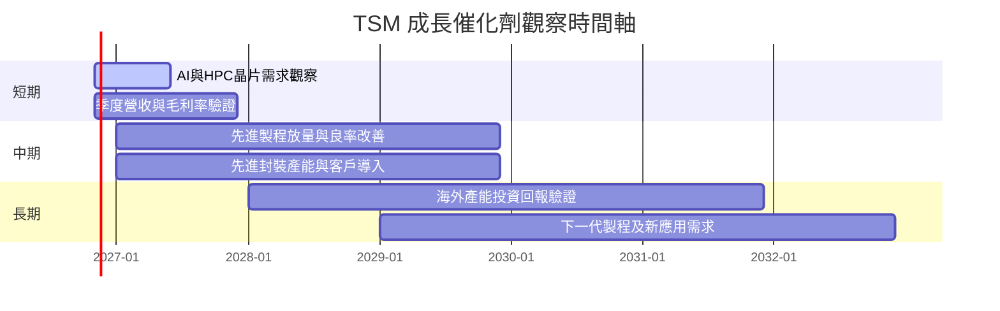

### 9.2 TAM 市場規模分析

資料包未提供各市場 TAM、滲透率及分部收入，故不虛構金額。

```text
╔══════════════════════════════════════════════════════════════════╗
║                   TSM 可服務市場觀察框架                         ║
╠══════════════════════════════════════════════════════════════════╣
║ AI／HPC 晶圓製造 TAM：N/A｜滲透率：N/A｜收入：未拆分             ║
║ 高階手機晶片製造 TAM：N/A｜滲透率：N/A｜收入：未拆分             ║
║ 汽車與工業晶片 TAM：N/A｜滲透率：N/A｜收入：未拆分               ║
║ 先進封裝 TAM：N/A｜滲透率：N/A｜收入：未拆分                     ║
╠══════════════════════════════════════════════════════════════════╣
║ 可量化的公司錨點：TTM 營收 TWD 4.94T；最新單季 YoY +50.9%        ║
║ 追蹤方法：分平台收入、產能利用率、Capex、毛利率與客戶訂單       ║
╚══════════════════════════════════════════════════════════════════╝
```

### 9.3 成長驅動力結構圖

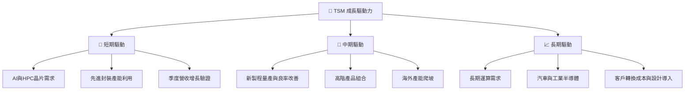

成長驅動是否轉為股東價值，須看新增收入能否高於新增資本支出成本。TTM Capex 約 $50.64B、占 TTM 營收約 33.7%，因此單看營收成長並不足夠，需同步追蹤 FCF 與 ROIC。

## 10. 風險矩陣

### 10.1 風險評分矩陣

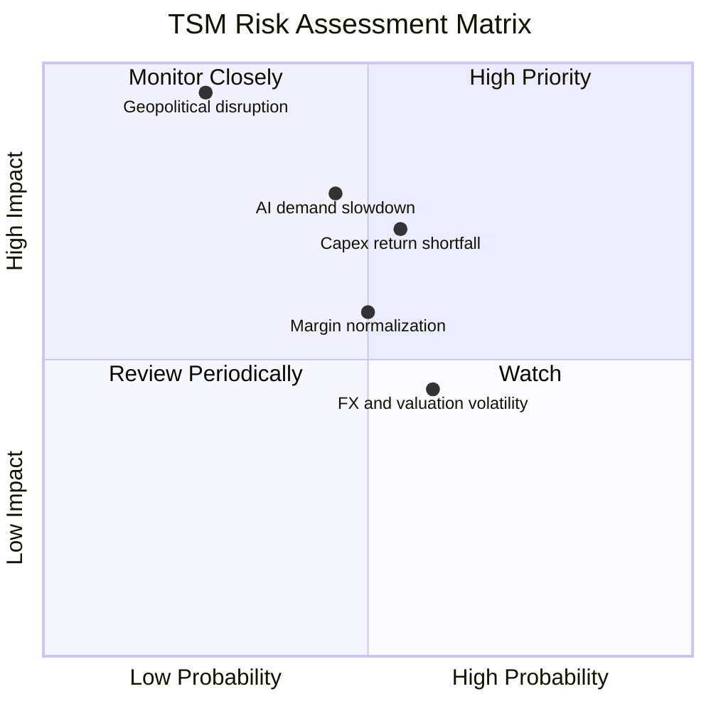

### 10.2 風險清單詳細分析

| # | 風險項目 | 發生機率 | 財務衝擊 | 風險評分 | 緩解措施 |
|---|----------|----------|----------|----------|----------|
| 1 | 🔴 地緣政治／營運中斷 | 低至中；難以由財報估算 | 極高；重大事件可能造成營收與產能中斷 | 🔴 9.5/10 | 投資人控制單一地區曝險；追蹤海外產能與供應鏈韌性 |
| 2 | 🔴 AI/HPC 投資周期反轉 | 中；近期成長集中且市場高度關注 | 若訂單放緩，營收成長與估值倍數可能同時下修 | 🔴 8.0/10 | 追蹤單季 YoY、客戶資本支出與產能利用率 |
| 3 | 🟠 Capex 回報不及預期 | 中 | TTM Capex 約 $50.64B；回報延遲會壓低 FCF 與 ROIC | 🟠 7.5/10 | 比較新增產能、折舊、營業利益率及自由現金流 |
| 4 | 🟡 利潤率正常化 | 中 | TTM 營業利益率 58.0%；若回落至 FY2025 約 50.9%，DCF 下修 | 🟡 6.5/10 | 季度監控毛利率、營業利益率、製程組合與利用率 |
| 5 | 🟡 匯率與估值波動 | 中 | 財報 TWD、報價 USD；匯率變動影響美元報酬與比較口徑 | 🟡 5.5/10 | 使用一致匯率與幣別；不以混幣倍數做結論 |

## 11. 投資建議

### 11.1 最終綜合評級雷達圖

```text
╔══════════════════════════════════════════════════════════════╗
║                  TSM 最終評分雷達摘要                          ║
╠══════════════════════════════════════════════════════════════╣
║ 基本面       8.8/10  ▓▓▓▓▓▓▓▓▓▓▓▓▓▓▓▓▓░░░  ★★★★☆       ║
║ 成長性       8.5/10  ▓▓▓▓▓▓▓▓▓▓▓▓▓▓▓░░░░░  ★★★★☆       ║
║ 獲利能力     9.2/10  ▓▓▓▓▓▓▓▓▓▓▓▓▓▓▓▓▓▓░░  ★★★★★       ║
║ 財務健康     9.0/10  ▓▓▓▓▓▓▓▓▓▓▓▓▓▓▓▓▓▓░░  ★★★★★       ║
║ 護城河       9.0/10  ▓▓▓▓▓▓▓▓▓▓▓▓▓▓▓▓▓▓░░  ★★★★★       ║
║ 估值合理性   4.0/10  ▓▓▓▓▓▓▓▓░░░░░░░░░░░░  ★★☆☆☆       ║
║ 風險控制     5.5/10  ▓▓▓▓▓▓▓▓▓▓▓░░░░░░░░░  ★★★☆☆       ║
╠══════════════════════════════════════════════════════════════╣
║ 綜合評分     7.7/10  公司質地高，現價估值與 MOS 不利       ║
╚══════════════════════════════════════════════════════════════╝
```

### 11.2 目標價與隱含報酬率

| 情境／方法 | 目標價 | 相對 $398.73 | 權重／機率 | 說明 |
|------------|------:|-------------:|----------:|------|
| DCF 悲觀 | 約 $125 | −68.6% | 25% | 成長 10%、利潤率 50%、WACC 12.2% |
| DCF 基準 | 約 $227 | −43.0% | 50% | 成長 20%、利潤率 58%、WACC 11.2% |
| DCF 樂觀 | 約 $310 | −22.3% | 25% | 成長 25%、利潤率 60%、WACC 10.2% |
| DCF 機率加權 | 約 $222 | −44.3% | DCF 子模型 | 由情境機率加權 |
| **加權合理價值** | **$294.38** | **−26.2%** | **100%** | DCF、Forward P/E、FCF yield、共識加權 |

評級依加權合理價值計算：`MOS = ($294.38 − $398.73) ÷ $294.38 = −35.5%`，低於 −25%，故為 **🔴 賣出**。基準不是公司品質判斷，而是目前市場價格相對模型估值的風險回報判斷。

### 11.3 買入時機與觸發因素

```text
╔══════════════════════════════════════════════════════════════════╗
║                  ✅ 買入觸發因素 Checklist                       ║
╠══════════════════════════════════════════════════════════════════╣
║  立即重新評估（需多數符合）：                                    ║
║  ☐ 股價回落至約 $265 以下，接近至少 10% MOS 買入門檻            ║
║  ☐ 營業利益率維持 55% 以上，且不是單靠一次性項目                 ║
║  ☐ TTM FCF 維持正值，且 FCF/淨利回升至 70% 以上                 ║
║                                                                  ║
║  加碼觸發條件：                                                  ║
║  ☐ 單季營收 YoY 維持 25% 以上，且連續兩季沒有明顯降速           ║
║  ☐ Capex/營收下降但營收與毛利率保持韌性                          ║
║  ☐ ROIC 估算持續高於 11.20% WACC                                 ║
║                                                                  ║
║  減碼／退出條件：                                                ║
║  ☐ 單季營收 YoY 連續兩季低於 15%                                 ║
║  ☐ 營業利益率較 TTM 58% 下滑 8 個百分點以上                     ║
║  ☐ TTM FCF 轉負或資本支出顯著超過營收增長                         ║
║  ☐ 地緣政治風險導致供應、客戶出貨或主要產能中斷                  ║
╚══════════════════════════════════════════════════════════════════╝
```

### 11.4 投資人適配度分析

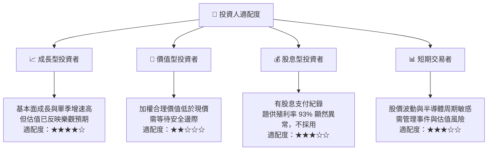

題供 Dividend Yield 93.0% 與公司基本面及其他欄位可能不相容，視為資料異常，不作為收益率判斷；資料包的 Payout Ratio 24.5% 可作參考，但仍需以正式股息資料核對。

### 11.5 每季財報監控清單（Quarterly Watch List）

| 監控指標 | 最新基準 | 加碼／正向觸發 | 減碼／負向觸發 |
|----------|---------|---------------|---------------|
| 單季營收 YoY | Q3 2026 +50.9% | >25%，且訂單／產能利用率支持 | 連續兩季 <15% |
| 營業利益率 | 最新季 58.0% | 維持 >55% 並有現金流支持 | 低於 50% 或快速下滑 |
| 毛利率 | TTM 65.8% | 高階產品組合帶動穩定 | 連續兩季收縮且無產品組合解釋 |
| Capex | TTM TWD 1.66T | 投資增長帶來營收、ROIC 提升 | Capex 上升但營收與 FCF 不改善 |
| FCF | TTM TWD 1.46T | FCF/淨利回升至 >70% | FCF 轉負或長期低於淨利 40% |
| 淨現金 | TWD 3.20T | 維持正淨現金 | 淨現金快速下降並伴隨負 FCF |
| EPS 驚喜 | 最近四季估值與實際值 N/A | 財報公布後逐季核實一致預期 | 不以缺失的 beats/misses 資料判斷 |
| 新產能回報 | 資料未拆分 | 產能利用率、良率與獲利同步提升 | 海外／新廠成本使毛利率持續受壓 |
| 估值與價格 | Forward P/E 17.05x | 價格低於約 $265 且基本面不惡化 | 價格上漲但 EPS／FCF 預期未同步上修 |

### 11.6 反面論證：什麼會證明論點錯誤（What Would Change My Mind）

```text
╔══════════════════════════════════════════════════════════════════╗
║              ⚠️ 論點失效條件（Disconfirming Evidence）            ║
╠══════════════════════════════════════════════════════════════════╣
║ 本報告的估值與基本面判斷，若發生以下情況應重新評估：             ║
║ ☐ 單季營收 YoY 連續兩季低於 15%，顯示高成長周期明顯降速         ║
║ ☐ 營業利益率從 TTM 58.0% 下滑 8 個百分點以上                    ║
║ ☐ TTM FCF 轉負，或 FCF/淨利連續兩期低於 40%                     ║
║ ☐ ROIC 估算跌至 11.20% WACC 以下                                ║
║ ☐ Capex/營收持續高於 35%，但新增產能未帶來收入或回報提升         ║
║ ☐ 地緣政治事件實際中斷主要生產、物流或客戶交付                   ║
║ ☐ AI/HPC 需求減速使營收與獲利預期連續下修                         ║
╠══════════════════════════════════════════════════════════════════╣
║ 反面論證：如果公司能在高 Capex 下維持 58% 左右營業利益率，並使  ║
║ FCF 與 ROIC 持續成長，則本報告對合理價值的折讓可能過度保守。    ║
╚══════════════════════════════════════════════════════════════════╝
```

> **免責聲明**：本報告為 AI 自動生成，僅供研究參考，不構成投資建議。投資有風險，請依自身風險承受能力審慎決策。