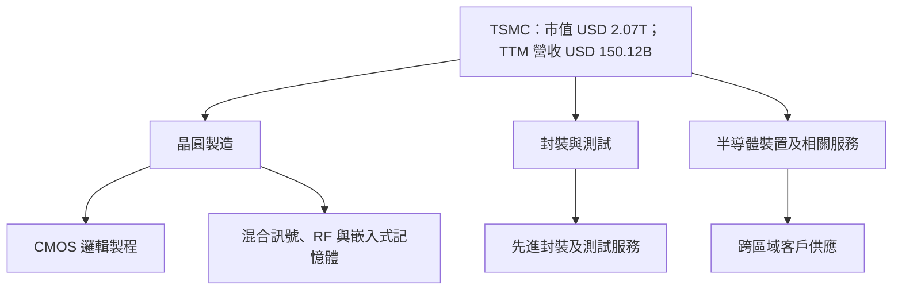
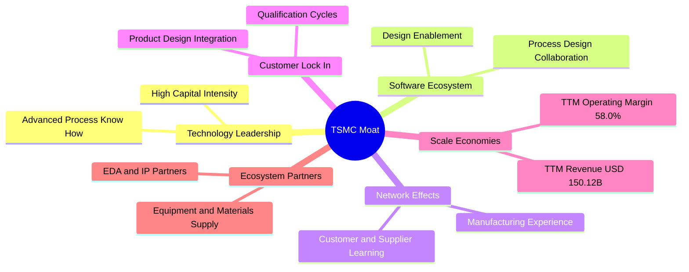
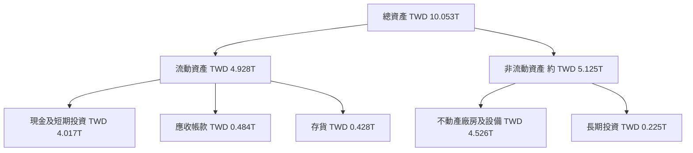
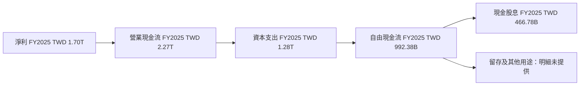
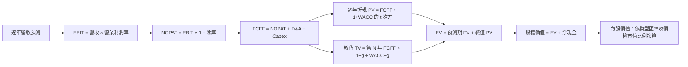
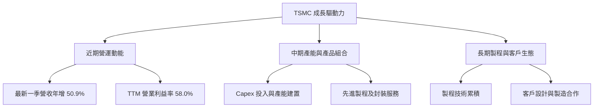
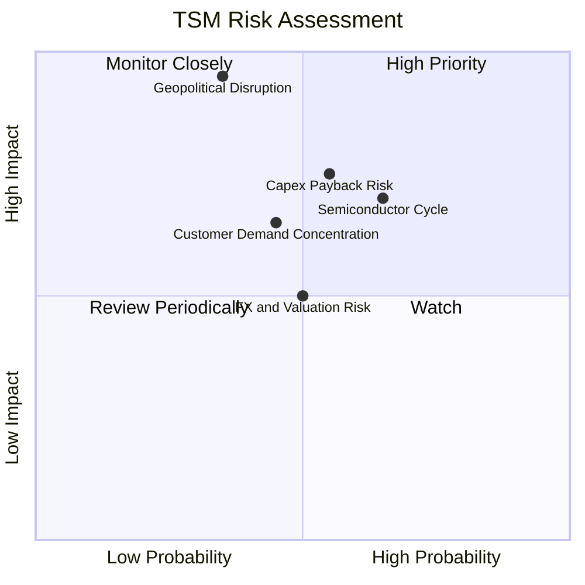
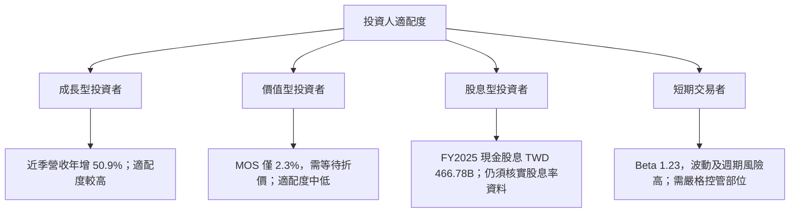

# TSM 基本面深度分析報告
> **報告日期**：2026-11-14 ｜ **語言**：繁體中文 ｜ **數據來源**：Yahoo Finance、Finviz、StockAnalysis、Roic.ai ｜ **分析師**：CFA 級機構研究

## 目錄

| # | 章節 | 核心結論 |
|---|------|----------|
| 1 | 執行摘要 | 持有；加權合理價值 $408.32，MOS +2.3% |
| 2 | 公司概覽與商業模式 | 製程、規模與客戶關係構成主要護城河；分部營收占比未提供 |
| 3 | 損益表深度分析 | TTM 營收 TWD 4.94T；最新一季年增 50.9%，營業利益率 TTM 58.0% |
| 4 | 資產負債表分析 | 淨現金 TWD 3.20T，流動比率 2.505；現金轉換週期 37 天 |
| 5 | 現金流量深度分析 | TTM FCF TWD 1.46T，FCF Yield 2.15%；高資本支出仍是重要約束 |
| 6 | 獲利能力與資本效率 | ROIC 當期 N/A，無法量化與 WACC 10.82% 的利差 |
| 7 | 相對估值分析 | Forward P/E 17.05x；同業 Forward P/E 中位數 17.1x |
| 8 | DCF 內在價值評估 | 基準 DCF 每股 $424.70；終值占 EV 59.7% |
| 9 | 成長催化劑 | AI 相關晶片需求、先進製程與封裝是主要質化催化劑；TAM 數據未提供 |
| 10 | 風險矩陣 | 地緣政治、資本支出回報及需求集中度是主要風險 |
| 11 | 投資建議 | 評級持有；現價接近加權合理價值，買入需等待安全邊際 |

---

## 1. 執行摘要

TSM 的 TTM 營收為 **TWD 4.94T（約 USD 150.12B）**，最新一季營收年增 **50.9%**，TTM 營業利益率 **58.0%**，而 TTM FCF 為 **TWD 1.46T（約 USD 44.41B）**、FCF Yield **2.15%**。不過，最新收盤價 **$398.73（2026-11-13）** 相對 DCF 基準價值 $424.70 僅有有限折價；估值方法加權後合理價值 $408.32，MOS 為 **+2.3%**，依 MOS 門檻為 **持有**。當期 ROIC 缺少可核實數字，因此不以歷史 ROIC 代替當期數據，也不調整評級。

### 1.0 一頁式投資儀表板（Portfolio Manager 30 秒速讀）

| 項目 | 內容 |
|------|------|
| **投資論點（3 句）** | ① TTM 營收 TWD 4.94T，最新一季年增 50.9%，反映近季需求動能提高。② TTM 營業利益率 58.0%，顯示高附加價值晶圓製造的獲利能力。③ TTM FCF TWD 1.46T，但 FCF Yield 僅 2.15%，現價已反映相當部分成長預期。 |
| **綜合評分** | **8.0/10**（引用 1.1 評分卡） |
| **財務健康** | 🟢 現金與短期投資 TWD 4.02T、淨現金 TWD 3.20T，流動比率 2.505。 |
| **ROIC vs WACC** | **ROIC：N/A vs WACC：10.82%**；當期 ROIC 缺資料，不能直接判定當期價值利差。 |
| **FCF 趨勢** | TTM FCF TWD 1.46T；年度 FCF 由 FY2023 TWD 286.57B 增至 FY2025 TWD 992.38B；最新 FCF Yield **2.15%**。 |
| **估值** | Forward P/E **17.05x** ｜ EV/EBITDA：N/A（幣別不一致）｜ FCF Yield **2.15%** |
| **DCF 內在價值（基準）** | **$424.70** ｜ 現價相對 DCF 折價 **6.1%**（折溢價以 DCF 基準價值計算） |
| **安全邊際（MOS）** | **+2.3%＝($408.32 − $398.73) ÷ $408.32**（加權合理價值）｜ 🔴 <10%：無明顯安全邊際 |
| **預期報酬（基準情境 12M）** | DCF 基準情境 **+6.5%**；相對加權合理價值上行空間 **+2.4%**。 |
| **關鍵風險（前二）** | 台海及地緣政治中斷；高資本支出能否持續帶來相稱現金回報。 |
| **評級 + 信心度** | 🟡 **持有** ｜ 信心：中（公司營運數據充分，但市場估值、ROIC 與 EPS 預期資料有缺口） |

### 1.1 綜合評分卡（全報告唯一）

| 維度 | 評分（1–10） | 主要依據（引用數字與其來源章節） |
|------|--------------|----------------------------------|
| 成長性 | 9.0 | 最新一季營收年增 50.9%，FY2025 營收年增 31.61%；TTM 對前一 TTM 成長率 N/A（第 3 章）。 |
| 獲利能力 | 9.0 | TTM 營業利益率 58.0%、毛利率 65.8%；當期 ROIC 與 Piotroski F-Score 為 N/A（第 3、6 章）。 |
| 財務健康 | 9.0 | 淨現金 TWD 3.20T、流動比率 2.505、CCC 37 天（第 4 章）。 |
| 估值 | 5.0 | MOS +2.3%，Forward P/E 17.05x；同業 Forward P/E 中位數 17.1x（第 7、8 章）。 |
| 護城河 | 9.0 | TTM 營收約 USD 150.12B、TTM 營業利益率 58.0%；先進製程與製造規模形成進入障礙，但分部資料未提供（第 2 章）。 |
| 管理層與資本配置 | 7.0 | FY2025 FCF TWD 992.38B、資本支出 TWD 1.28T、股利支付 TWD 466.78B；回購與資本投資報酬細節不足（第 5 章）。 |
| **綜合評分** | **8.0** | 六項算術平均：`(9 + 9 + 9 + 5 + 9 + 7) ÷ 6 = 8.0`。 |

### 1.2 五大投資論點 + 三大核心風險

| 類型 | 項目 | 具體依據 | 信心度 |
|------|------|----------|--------|
| 🟢 **投資論點①** | 近季營收成長加速 | 2026 Q3 營收 TWD 1.494T，年增 50.9%、季增約 17.6%；若需求延續，產能利用及產品組合可支持利潤。 | 🟢 高 |
| 🟢 **投資論點②** | 營業獲利能力強 | TTM 營業利益率 58.0%、毛利率 65.8%；顯示高階製程與規模效益能轉化為高獲利。 | 🟢 高 |
| 🟢 **投資論點③** | 現金流與資產負債表提供緩衝 | TTM 營業現金流 TWD 3.13T、FCF TWD 1.46T，淨現金 TWD 3.20T。 | 🟢 高 |
| 🟢 **投資論點④** | 先進製造能力具稀缺性 | 公司提供晶圓製造、封裝與測試服務；營收規模與 58.0% 營業利益率支持其供應鏈地位。 | 🟡 中高 |
| 🟡 **投資論點⑤** | 股權薪酬稀釋有限 | FY2025 SBC TWD 1.25B，相對營收 TWD 3,809.05B 約 0.03%；但最新 TTM SBC 數據缺漏。 | 🟡 中 |
| 🟡 **風險①** | 地緣政治與供應中斷 | 台灣製造集中度為結構性風險；若關鍵產能停擺，營收與資本資產均可能受到重大衝擊。 | 🔴 高衝擊 |
| 🔴 **風險②** | 高資本支出回收期及產能週期 | TTM Capex TWD 1.66T，約占 TTM 營收 33.7%；需求回落可能令利用率及現金回收下滑。 | 🔴 高衝擊 |
| 🟡 **風險③** | 市場已預期高成長 | 加權合理價值 $408.32 僅高於現價 $398.73 約 2.4%；MOS 只有 2.3%。 | 🟡 中高 |

### 1.3 快速統計卡片

| 指標 | 公司實際值（期間） | 同業中位數 | 狀態 |
|------|--------------------|------------|------|
| 營收成長（TTM） | **N/A** | — | 🟡 標準化 TTM 對比數據未提供 |
| 營收成長（最新一季年增） | **50.9%** | 20.9% | 🟢 高於同業資料中位數 |
| 毛利率（TTM） | **65.8%** | 31.7% | 🟢 高於同業資料中位數 |
| 營業利益率（TTM） | **58.0%** | — | 🟢 |
| ROIC（TTM） | **N/A** | — | 🟡 當期數據未提供 |
| Forward P/E | **17.05x** | 17.1x | 🟡 接近同業中位數 |
| FCF Yield（TTM） | **2.15%** | — | 🟡 絕對估值緩衝有限 |
| Piotroski F-Score | **N/A / 9** | — | 🟡 缺少相隔一年的 SEC 申報資料 |

### 1.4 投資結論

```text
╔══════════════════════════════════════════════════════════════════╗
║                    📊 投資結論摘要                               ║
╠══════════════════════════════════════════════════════════════════╣
║  評級：持有（MOS +2.3%，依規則 20）                               ║
║  價格（2026-11-13 收盤）：$398.73                                ║
║  DCF 內在價值（基準）：$424.70（現價折價約 6.1%）                ║
║  安全邊際 MOS：+2.3%（＝(加權合理價值−現價)÷加權合理價值）       ║
║  加權合理價值（8.8）：$408.32                                    ║
║  DCF 情境價值：                                                    ║
║    悲觀情境：$182.70（-54.2%）                                   ║
║    基準情境：$424.70（+6.5%）                                    ║
║    樂觀情境：$937.18（+135.0%）                                  ║
║  綜合評分：8.0/10（引用 1.1）                                    ║
║  適合投資人：能承受半導體週期與地緣政治波動的長線成長型投資人    ║
╚══════════════════════════════════════════════════════════════════╝
```

---

## 2. 公司概覽與商業模式

### 2.1 業務結構與收入來源

TSMC 主要從事積體電路及半導體裝置的製造、封裝、測試與銷售。最新 TTM 營收為 **TWD 4.94T，約 USD 150.12B**，市值為 **USD 2.07T**。公司未提供可用的各製程、應用市場或封裝服務營收占比，因此下圖呈現業務關係而不虛構收入百分比。



### 2.2 市場份額

市場份額數據未提供，故不估算市占率。以規模與獲利能力衡量，TSM TTM 營收約 USD 150.12B、營業利益率 58.0%；Peer 資料中的 UMC、GFS、INTC 最新一季營收年增率分別為 25.6%、12.5%、20.9%，低於 TSM 最新一季 50.9%。

### 2.3 競爭護城河分析



### 2.4 護城河強度

| 護城河項目 | 強度（強／中／弱） | 證據（引用數字或事實） | 會削弱它的情況 |
|------------|--------------------|------------------------|----------------|
| 技術與製程能力 | 強 | TTM 營業利益率 58.0%、毛利率 65.8%；公司涵蓋邏輯、混合訊號、RF 等製程。 | 製程良率或性能落後、客戶轉向競爭製程。 |
| 規模效應 | 強 | TTM 營收 TWD 4.94T；FY2025 資本支出 TWD 1.28T。 | 產能閒置令折舊及固定成本吸收惡化。 |
| 客戶鎖定 | 中至強 | 半導體製程導入涉及設計、驗證與製造流程；但客戶集中度與轉換週期資料未提供。 | 客戶自建產能或將產品分配給多家代工廠。 |
| 軟體與設計生態 | 中 | 與設計工具、IP 及客戶設計流程互相配合；可量化軟體收入未提供。 | 開放標準改善替代製程導入，或競爭者建立相近生態。 |
| 網路效應 | 中 | 量產經驗可累積製程及良率知識；無法由現有數據量化網路效應。 | 客戶與供應鏈轉移、製程經驗優勢縮小。 |
| 生態夥伴 | 中至強 | 業務涉及全球設備、材料、設計與客戶供應鏈；合作夥伴收入占比未提供。 | 關鍵設備、材料、能源或物流供應中斷。 |

1.1「護城河」評分為 **9.0/10**，主要依據為 TTM 營收規模與 58.0% 營業利益率；客戶集中度與分部收入資料不足，故評分不採滿分。

---

## 3. 損益表深度分析

### 3.1 年度收入成長趨勢（近 4 年）

```text
╔══════════════════════════════════════════════════════════════════╗
║       TSMC 年度收入趨勢（FY2022–FY2025，TWD）                   ║
╠══════════════════════════════════════════════════════════════════╣
║ FY2022  TWD 2.264T  ███████████████████       YoY +42.61% 🟢   ║
║ FY2023  TWD 2.162T  ██████████████████        YoY  -4.51% 🔴   ║
║ FY2024  TWD 2.894T  ████████████████████████  YoY +33.89% 🟢   ║
║ FY2025  TWD 3.809T  ████████████████████████████████ YoY +31.61%║
╠══════════════════════════════════════════════════════════════════╣
║ FY2022–FY2025 三年 CAGR：約 18.9%                               ║
╚══════════════════════════════════════════════════════════════════╝
```

FY2023 營收回落 4.51%，之後 FY2024、FY2025 分別增長 33.89% 與 31.61%。以三年複合計算，`(3.809 ÷ 2.264)^(1/3) − 1 ≈ 18.9%`。這顯示年度成長並非線性，景氣回升與高階晶片需求使近兩年成長重新加速；但不能把單季 50.9% 年增率直接視為長期 TTM 成長率。

### 3.2 季度收入趨勢分析

| 季度 | 營收（TWD B） | QoQ | YoY | 備註 |
|------|---------------:|----:|----:|------|
| 2025 Q4 | 1,046.09 | 約 +5.7% | +20.45% | QoQ 相對 2025 Q3；YoY 採 StockAnalysis 季度數據 |
| 2026 Q1 | 1,134.10 | 約 +8.4% | +35.13% | 成長加速 |
| 2026 Q2 | 1,270.38 | 約 +12.0% | +36.05% | 季增幅擴大 |
| 2026 Q3 | 1,494.24 | 約 +17.6% | **+50.9%** | 最新一季年增；不是 TTM 成長率 |

QoQ 按相鄰季度營收計算。例如 2026 Q3：`(1,494.243 ÷ 1,270.380) − 1 ≈ 17.6%`。最新一季的年增 50.9% 高於前三季，顯示近季出貨與需求增速提升；但季度成長可能受到產品週期與產能出貨節奏影響。

### 3.3 利潤率演變分析

以下年度比率以年度財報收入、毛利及營業利益計算；TTM 比率則引用 Yahoo Finance 標準化數據。

| 利潤率指標 | FY2022 | FY2023 | FY2024 | FY2025 | 趨勢 | 評估 |
|------------|-------:|-------:|-------:|-------:|------|------|
| **毛利率** | 約 59.6% | 約 54.4% | 約 56.1% | 約 59.9% | 2023 下滑後回升 | 🟢 |
| **營業利益率** | 約 49.6% | 約 42.6% | 約 45.7% | 約 50.8% | 2023 下滑後改善 | 🟢 |
| **淨利率** | 約 43.9% | 約 39.4% | 約 40.0% | 約 44.6% | 近年回升 | 🟢 |
| **TTM 營業利益率** | — | — | — | **58.0%** | 近季高檔 | 🟢 |

毛利與營業利潤率在 FY2023 下滑、之後改善，方向與營收年度回升一致。可能的經濟機制包括產能利用率改善、高附加價值產品組合及規模吸收固定成本；但產品組合、利用率和折舊明細在此數據中未提供，不能將單一因素定量歸因。TTM 營業利益率 58.0% 是近四季指標，不應與年度歷史比率混為一談。

### 3.4 費用結構分析

精確的營業費用分項、研發費用 TTM 數字及營業成本拆分資料不足，故不以未核實比例繪製費用圓餅圖。可確認 FY2025 研發費用為 **TWD 246.43B**，相當於年度營收 TWD 3,809.05B 的約 6.5%；研發投入支援製程更新，但資本支出與折舊亦是半導體代工模式的重要成本。

### 3.5 季度 EPS 趨勢與盈餘品質（Quality of Earnings）

| 盈餘品質項目 | 數值／佔比 | 評估 |
|--------------|------------|------|
| 股權薪酬 SBC / 營收 | FY2025：TWD 1.25B ÷ TWD 3,809.05B ≈ **0.03%** | 🟢 低；FY2026 Q3 SBC 缺漏，不能用 FY2025 代替 TTM。 |
| SBC / 營業現金流 | FY2025：TWD 1.25B ÷ TWD 2.27T ≈ **0.06%** | 🟢 FY2025 基準下稀釋成本相對小。 |
| FCF / 淨利（現金轉換率） | TTM：TWD 1.46T ÷ TWD 2.528T ≈ **57.8%** | 🟡 利潤轉為自由現金流仍受高資本支出影響。 |
| 一次性／非經常性損益 | N/A（分項未提供） | 無足夠資料判斷當期盈餘是否由一次性項目推升。 |
| 有效稅率異常 | **17.0%**（最新年度有效稅率） | 未見足夠歷史可比明細判斷是否異常。 |
| 資本化支出 vs 費用化 | TTM Capex TWD 1.66T；資本化支出比例高 | 半導體廠房及設備形成長期資產；需以折舊與未來利用率衡量回報，不能單看當期淨利。 |

過去四季 EPS 預估值均為 **N/A**，因此無法可靠判斷超預期或不及預期。StockAnalysis 列出的 EPS 年增率為 2026 Q3 **68.73%**、Q2 **77.40%**、Q1 **58.38%**、2025 Q4 **34.97%**；這表示盈餘增長加速，但不是 EPS surprise。股權薪酬以 FY2025 年度資料計算，最新季度有缺漏，不能推定 TTM SBC。整體而言，FY2025 SBC 佔比低；另一方面，FCF/淨利約 57.8%，顯示資本支出對現金盈餘的扣減不可忽略。

---

## 4. 資產負債表分析

### 4.1 資產結構分解

截至 2026-09-30，總資產約 **TWD 10.05T**，流動資產約 **TWD 4.93T**。以下使用 StockAnalysis 資產負債表數據；子項目僅列有數字的項目，未列出者不代表為零。



### 4.2 流動性與營運資金分析

| 指標 | 最新值 | 歷史對照 | 評估 |
|------|-------:|----------|------|
| 流動比率 | **2.505** | 2025 年末：流動資產 TWD 3.82T、流動負債 TWD 1.52T | 🟢 短期資產對流動負債有緩衝 |
| 速動比率 | **2.287** | N/A（同口徑歷史序列未提供） | 🟢 |
| 現金及短期投資 | **TWD 4.02T** | FY2025 TWD 3.07T | 🟢 |
| 淨現金 | **TWD 3.20T** | FY2025 年底現金與債務口徑不同，不直接混算 | 🟢 |

| 指標 | 最新 TTM | 一年前 TTM | 變化 | 解讀 |
|------|----------:|------------:|------:|------|
| DSO 應收帳款天數 | 36 天 | N/A | N/A | 應收帳款天數為 36 天；同口徑一年前數據未提供。 |
| DIO 存貨天數 | 92 天 | N/A | N/A | 存貨占用週期可反映備貨與生產節奏；同比變化無法量化。 |
| DPO 應付帳款天數 | 91 天 | N/A | N/A | 供應商付款天數為 91 天；沒有歷史序列可判斷議價變化。 |
| CCC 現金轉換週期 | 37 天 | N/A | N/A | 現金轉換週期 = 36 + 92 − 91 = 37 天；同比方向未提供。 |

營運資金數字由程式依期末餘額與 TTM 流量計算；一年前指標未提供，因此不反推、不補值。CCC 37 天代表現金在應收與存貨中占用的淨週期有限，但沒有歷史可比數據，不能據此斷言營運效率正在改善。

### 4.3 債務結構分析

```text
╔══════════════════════════════════════════════════════════════════╗
║                   TSMC 債務健康診斷                              ║
╠══════════════════════════════════════════════════════════════════╣
║  總債務：        TWD 818.38B（約 USD 24.85B）                  ║
║  現金＋短期投資：TWD 4.02T（約 USD 121.95B）                   ║
║  淨現金：        TWD 3.20T（約 USD 97.11B） 🟢                 ║
║  流動比率：      2.505                                      🟢  ║
║  速動比率：      2.287                                      🟢  ║
║  Debt/EBITDA：   N/A（跨幣別口徑不宜直接混算）                 ║
║  利息保障倍數：  N/A（利息費用及一致口徑 EBIT 未提供）         ║
╚══════════════════════════════════════════════════════════════════╝
```

債務與現金的匯率換算統一使用 **2026-11-13 的 1 USD = TWD 32.94**。資料包中同時存在 FY2025 年底總債務 TWD 1.06T 與最新口徑 TWD 818.38B；本報告採用 VERIFIED FIGURES 的最新總債務與淨現金，不將不同日期的現金、負債混算。

### 4.4 股東權益趨勢

```text
╔══════════════════════════════════════════════════════════════════╗
║                 TSMC 年末股東權益（TWD）                         ║
╠══════════════════════════════════════════════════════════════════╣
║ FY2022  TWD 2.90T  ████████████████                             ║
║ FY2023  TWD 3.43T  ███████████████████                          ║
║ FY2024  TWD 4.24T  ████████████████████████                     ║
║ FY2025  TWD 5.36T  ██████████████████████████████               ║
╚══════════════════════════════════════════════════════════════════╝
```

股東權益由 FY2022 的 TWD 2.90T 增至 FY2025 的 TWD 5.36T，與期間獲利累積及資產擴張一致；但年度數字不能直接替代最新季度權益或作為市值估值分母。

---

## 5. 現金流量深度分析

### 5.1 現金流量瀑布圖

現有年度資料提供淨利、營業現金流、資本支出與股息，但未提供最新季度的回購及完整淨現金變動拆分；因此圖中只呈現可確認的現金流關係。



### 5.2 FCF 轉換率趨勢

| 財年 | FCF（TWD B） | 淨利（TWD B） | FCF / 淨利 |
|------|-------------:|--------------:|-----------:|
| FY2022 | 520.97 | 992.92 | 約 52.5% |
| FY2023 | 286.57 | 851.74 | 約 33.6% |
| FY2024 | 861.20 | 1,158.38 | 約 74.3% |
| FY2025 | 992.38 | 1,697.60 | 約 58.5% |
| TTM 至 2026-09-30 | 1,460B | 2,527.57B | 約 57.8% |

FY2023 現金轉換率下降、FY2024 回升，FY2025 又回落，反映資本支出與現金流時間差會令淨利和 FCF 不同步。TTM FCF 採用固定定義 **營業現金流減資本支出**。

### 5.3 自由現金流趨勢

```text
╔══════════════════════════════════════════════════════════════════╗
║             TSMC 年度 FCF（營業現金流－資本支出）                ║
╠══════════════════════════════════════════════════════════════════╣
║ FY2022  TWD 520.97B  ████████████████                           ║
║ FY2023  TWD 286.57B  █████████                                  ║
║ FY2024  TWD 861.20B  ██████████████████████████                 ║
║ FY2025  TWD 992.38B  ██████████████████████████████             ║
║ TTM     TWD 1.46T    N/A（未以相同尺度標示年度 FCF Yield）       ║
╠══════════════════════════════════════════════════════════════════╣
║ TTM FCF Yield：2.15%（程式計算；流通股價值基礎）                 ║
╚══════════════════════════════════════════════════════════════════╝
```

TTM FCF 為 TWD 1.46T，約 USD 44.41B；與市值相比的 FCF Yield 為 2.15%。FCF 金額增長有助於支持擴產與股東回報，但低 FCF Yield 表明現價對現有現金流的估值並不便宜。

### 5.4 資本配置評估

各項用途並非同一期間或可加總的資本配置比例，因此不以資料缺漏項目繪製比例圓餅圖。

| 項目 | FY2025 數值 | 評估 |
|------|-----------:|------|
| 資本支出 | TWD 1.28T | 支持新增及升級產能，亦提升折舊與投資回收風險。 |
| 現金股息 | TWD 466.78B | 約為 FY2025 FCF 的 47.0%；年度股利支付具資料支持。 |
| 股票回購 | N/A | 回購金額資料未提供。 |
| FY2025 FCF | TWD 992.38B | 資本支出後仍有正 FCF。 |
| FY2025 SBC | TWD 1.25B | 相對營收低，但最新 TTM SBC 缺漏。 |

---

## 6. 獲利能力與資本效率

### 6.1 ROE / ROA / ROIC 趨勢

| 指標 | 最新可用值 | 歷史／補充資料 | 評估 |
|------|------------:|----------------|------|
| ROE（TTM） | **41.9%** | DuPont 三因素拆解 N/A | 🟢 高回報，但無法以指定品質區塊拆分來源 |
| ROA（TTM） | **20.6%** | 最新 TTM 資產約 TWD 10.05T | 🟢 |
| ROIC（TTM） | **N/A** | Roic.ai 顯示 2013–2018 ROIC 約 18.31%–20.55%，為較早歷史資料 | 🟡 不以舊數據冒充當期 ROIC |
| 行業均值比較 | N/A | 同口徑行業 ROIC／ROE 數據未提供 | — |

### 6.2 ROIC vs WACC 分析（核心價值創造判斷）

```text
╔══════════════════════════════════════════════════════════════════╗
║                   ROIC vs WACC 分析                              ║
╠══════════════════════════════════════════════════════════════════╣
║  WACC（程式計算輸入）：10.82%                                    ║
║  ├── 無風險利率（10Y 美債）：5.15%                               ║
║  ├── 股權風險溢酬 ERP：5.00%                                     ║
║  ├── 原始 Beta：1.23；調整後 Beta：1.16                          ║
║  ├── 股權成本 Ke（已列示）：10.93%                               ║
║  ├── 稅前債務成本：1.51%；有效稅率：17.0%                        ║
║  ├── 股權／債務權重：98.8%／1.2%                                 ║
║  └── 採用 WACC：10.82%                                           ║
║                                                                  ║
║  最新 ROIC：N/A（缺少當期一致口徑投入資本及營業稅後淨利資料）     ║
║  EVA = ROIC − WACC：N/A                                          ║
║                                                                  ║
║  結論：不能可靠量化當期 ROIC 是否高於 WACC；                     ║
║        2013–2018 歷史 ROIC 僅作背景，不替代當期判斷。             ║
╚══════════════════════════════════════════════════════════════════╝
```

WACC 直接採用程式計算的 **10.82%**。所列 Ke、Kd、權重均為已提供的四捨五入輸入值；由於未提供底層未四捨五入參數與完整利息、債務明細，不能用顯示值重新推導一個不同 WACC。ROIC 當期為 N/A，因此不宣稱已證明當期在創造或摧毀經濟價值。

### 6.3 杜邦三因素分解

DuPont 數據為 **N/A**：缺少可按規定同一口徑使用的淨利、營收、總資產或正股東權益品質指標輸入，依品質指標規則不自行重算。

| 因素 | 數值（TTM） | 解讀 |
|------|-------------|------|
| 淨利率 | N/A | QUALITY FIGURES 指定 DuPont 為 N/A。 |
| 資產週轉率 | N/A | 同上。 |
| 權益乘數 | N/A | 同上。 |
| **ROE** | **N/A（DuPont 拆解）** | 雖另有 Yahoo ROE 41.9%，但不得將缺漏的品質指標自行補算。 |

### 6.4 財務體質：Piotroski F-Score

Piotroski F-Score 為 **N/A**，原因是計算需要相隔一年的兩個 TTM 期間及 SEC 申報資料；目前資料為 Yahoo 季度財報，未提供符合要求的完整測試結果。

| 測試 | 結果 | 解讀 |
|------|------|------|
| 九項 Piotroski 測試 | N/A | 個別九項測試結果未提供，不補值、不推定。 |

---

## 7. 相對估值分析

### 7.1 同業估值比較

公司自身部分倍數因報價 USD、財報 TWD 而缺少同幣別換算，不以混合幣別計算。Peer 倍數採 Yahoo Finance 提供值；同業中位數只使用可計算項目。

| 估值指標 | **TSM** | **INTC** | **UMC** | **GFS** | TSM 評估 |
|----------|--------:|---------:|--------:|-------:|-----------|
| **Trailing P/E** | 25.84x | N/A | 14.5x | 118.5x | 🟡 同業差距大；GFS TTM 倍數偏高 |
| **Forward P/E** | **17.05x** | 33.3x | 17.1x | 16.0x | 🟡 接近同業中位數 17.1x |
| **P/S Ratio** | N/A | 5.3x | N/A | 3.2x | 🟡 TSM 無同幣別可比倍數；同業有效中位數 4.25x |
| **EV/EBITDA** | N/A | 17.2x | N/A | 11.1x | 🟡 同業有效中位數約 14.2x；TSM 因幣別口徑不列值 |
| **最新一季營收年增** | 50.9% | 20.9% | 25.6% | 12.5% | 🟢 TSM 高於三家比較公司 |
| **毛利率（TTM）** | 65.8% | 40.2% | 31.7% | 28.5% | 🟢 高於比較公司 |

### 7.2 歷史估值區間分析

```text
╔══════════════════════════════════════════════════════════════════╗
║                 TSM 歷史估值區間                                 ║
╠══════════════════════════════════════════════════════════════════╣
║ 歷史 P/E 高低區間：N/A（歷史估值區間資料未提供）                 ║
║ 當前歷史百分位：N/A（Valuation vs own history 未提供）            ║
║                                                                  ║
║ 不能用 24 個月股價走勢推定歷史 P/E 區間或估值百分位。             ║
╚══════════════════════════════════════════════════════════════════╝
```

### 7.3 情境價值（Bear / Base / Bull）

以下每股價值、假設與機率照 DCF 模型情境列示，數值為模型情境結果而非另行設定的目標價。

| 情境 | 第 1 年營收成長 | 期末營業利潤率 | WACC | 每股價值 | 相對現價 | 機率 | 會發生的條件 |
|------|----------------:|---------------:|-----:|---------:|---------:|-----:|--------------|
| 🔴 悲觀 | 15.0% | 42.1% | 11.82% | $182.70 | -54.2% | 25% | 成長顯著放緩、成熟期利潤率下降且風險溢酬上升。 |
| 🟡 基準 | 30.0% | 49.5% | 10.82% | $424.70 | +6.5% | 50% | 需求成長逐步降速，利潤率向長期基準收斂。 |
| 🟢 樂觀 | 45.0% | 54.5% | 9.82% | $937.18 | +135.0% | 25% | 高成長延續、期末利潤率維持高位且折現率下降。 |

### 7.4 相對估值隱含價格區間

```text
╔══════════════════════════════════════════════════════════════════╗
║              相對估值與其他方法隱含每股價值                      ║
╠══════════════════════════════════════════════════════════════════╣
║ $318.77 ─── $398.73 ─── $400.31 ─── $424.70 ─── $586.69        ║
║ EV/EBITDA      現價       Forward P/E     DCF       分析師共識   ║
╚══════════════════════════════════════════════════════════════════╝
```

- **同業 Forward P/E：$400.31**，以 INTC、UMC、GFS 同業中位數 **17.1x** 乘上 TSM Forward EPS **$23.39**。
- **同業 EV/EBITDA：$318.77**，以 INTC、GFS 可用倍數中位數 **14.2x** 乘上 TTM EBITDA 並加回淨現金。
- 分析師共識平均目標價 **$586.69**，共 20 位分析師；它是參考值，不代表獨立現金流模型結論。

---

## 8. DCF 內在價值評估（Discounted Cash Flow）

### 8.0 估值推理鏈（Thinking Logic）

#### Step 1 — 價值由哪些變數決定？

模型將價值拆為現有晶圓製造及相關服務的現金流底盤，以及成長、利潤率和再投資轉換形成的未來現金流；各業務分部營收占比未提供，故不能分拆量化。估值最敏感的變數是 **WACC、永續成長率與長期利潤率**：基準 DCF 終值現值占 EV 59.7%，且敏感度矩陣顯示 WACC、g 變動會明顯改變每股價值。

#### Step 2 — 模型選擇

| 決策點 | 本報告採用 | 理由（含數字） | 曾考慮但否決 | 否決理由 |
|--------|-----------|----------------|--------------|----------|
| 現金流定義 | FCFF | 折現率使用 WACC，先估 EV 再加淨現金。 | FCFE | 需要利息及股權融資流量預測，資料不足。 |
| 預測期 N | 10 年 | 模型已採 10 年，將高成長與成熟期利潤率收斂納入同一預測。 | 5 年 | 會更依賴終值，不符合已提供模型設定。 |
| 終值方法 | Gordon Growth | 基準 WACC 10.82% 高於 g 3.0%。 | 退出倍數 | DCF 模型未提供退出倍數估算值，不能自行增加方法。 |
| EBIT 基礎 | GAAP EBIT | 模型標明 GAAP EBIT；SBC 已作費用處理。 | 非 GAAP EBIT | 會改變模型既有假設並產生 SBC 重複或漏計風險。 |

#### Step 3 — 關鍵假設推導鏈

- **營收成長**：錨點＝最新一季營收年增 50.9%，但 TTM 對前一 TTM 成長率 N/A → 調整＝季度成長不能直接延伸十年，且以模型上限規則將第 1 年成長封頂 → **採用第 1 年 30.0%，線性降至第 10 年 3.0%** → 曾考慮維持 50.9%，但否決，因它是單季年增率而非可支持十年外推的 TTM 增長率。
- **期末營業利益率**：錨點＝TTM 58.0%，模型以近五個財年中位數作長期收斂基準 → 調整＝成熟期競爭、折舊及產能配置可能令利潤率低於當前高檔 → **採用第 10 年 49.5%** → 曾考慮維持 58.0%，但否決，因會忽略成熟期回歸與成本波動。
- **永續成長率 g**：錨點＝模型採 3.0%，且低於 WACC 10.82% → 調整＝長期需回歸成熟經濟成長，而不是延續高成長階段 → **採用 3.0%** → 曾考慮高於 3.0%，但不採用，因會抬高終值且需要更強長期名目成長依據。
- **預測期 N**：錨點＝公司近年收入成長高、但年度營收曾於 FY2023 下滑 4.51% → 調整＝10 年用於涵蓋成長與利潤率收斂，而非假定 10 年維持同一高增速 → **採用 10 年** → 曾考慮較短期間，但未採用，因模型已提供完整十年年度現金流且更短期會增加終值占比。
- **Capex/營收**：錨點＝TTM 33.7% → 調整＝模型假設資本支出比率逐步降至 D&A 的 1.1 倍所對應的長期 16.6% → **採用 FY+1 33.7% 線性收斂至 FY+10 16.6%** → 曾考慮維持 33.7%，但否決，因模型假設成熟後再投資強度下降；若需求迫使擴產，這個假設偏樂觀。
- **EBIT 基礎與 SBC**：錨點＝GAAP EBIT 已將 SBC 作為費用列入；FY2025 SBC 約營收 0.03% → 調整＝依模型規定不再扣一次 SBC，也不在股數上另加稀釋 → **採用 GAAP EBIT、固定股數、年稀釋率 0%** → 否決非 GAAP EBIT，因模型沒有配套 SBC 扣回與股數稀釋參數。
- **年稀釋率**：錨點＝模型指定固定股數處理；FY2025 SBC 佔營收約 0.03% → 調整＝不再增加股數，避免重複計入成本 → **採用 0%** → 曾考慮另加稀釋率，但否決，因會與 GAAP EBIT 已含 SBC 的處理不一致。
- **終值方法**：錨點＝FCFF Gordon Growth；WACC 10.82%、g 3.0% → 調整＝可用持續經營價值補足十年後現金流 → **採用 Gordon Growth** → 曾考慮退出倍數交叉驗證，但模型未提供可複核的退出倍數，不自行建模。
- **WACC**：錨點＝程式計算 WACC 10.82%，CAPM Ke 10.93%、調整 Beta 1.16 → 調整＝不另加國別或規模溢酬，遵守程式提供的資本成本 → **採用 10.82%** → 曾考慮自行調整 WACC，但否決，因會改動指定折現率並造成模型不可比。
- **低敏感度輸入**：稅率採 17.0%（最新年度有效稅率）；D&A/營收採 TTM 15.1%；ΔWC 不建模，依模型設定固定忽略，未另填零以外的假設值。

#### Step 4 — 最脆弱一環

最脆弱的假設是高成長期與長期利潤率能否同時實現；若資本支出需求長期維持高檔或營業利潤率收斂快於假設，價值將向悲觀情境 **$182.70** 靠攏。

#### Step 5 — 計算路徑圖



### 8.1 模型假設總表（Model Inputs）

| 假設項目 | 採用值 | 依據／來源 | 敏感度 |
|----------|--------|-------------|--------|
| 預測期長度 **N** | **10 年** | DCF 模型設定；覆蓋成長到成熟期收斂。 | 🟡 中 |
| 營收成長 | FY+1 30.0% → FY+10 3.0% | FY+1 以最新一季年增 50.9% 為錨並封頂 30%；之後線性遞減。 | 🔴 高 |
| 營業利潤率 | FY+1 58.0% → FY+10 49.5% | 起點採 TTM 58.0%；終點採近五財年中位數假設。 | 🔴 高 |
| 有效稅率 | 17.0% | 最新年度有效稅率。 | 🟢 低 |
| Capex / 營收 | FY+1 33.7% → FY+10 16.6% | TTM 33.7%，模型逐步下降至約 1.1 倍 D&A。 | 🟡 中 |
| D&A / 營收 | 15.1% | TTM 比率，模型固定。 | 🟢 低 |
| 營運資金變動 | 不建模 | DCF 模型明確未建模 ΔWC，不自行補估。 | 🟢 低 |
| EBIT 基礎 | GAAP | 模型提供 GAAP EBIT。 | 🟡 中 |
| SBC 處理 | GAAP EBIT 已含 SBC；不再扣 SBC | 模型採用組合 (A)，股數不另稀釋。 | 🟡 中 |
| 年稀釋率 | 0% | 固定股數處理；不另加稀釋。 | 🟡 中 |
| 永續成長率 g | 3.0% | DCF 模型假設；低於 WACC 10.82%。 | 🔴 高 |
| 終值方法 | Gordon Growth | 模型提供 Gordon Growth 終值。 | 🔴 高 |
| WACC | **10.82%** | 程式計算資本成本，見 8.2。 | 🔴 高 |

**FCFF 定義**：`FCFF = NOPAT + D&A − Capex`；本模型沒有營運資金變動列。  
**SBC 相容性**：本模型採用 **(A) GAAP EBIT + 固定股數**，故 SBC 影響已計入一次；FCFF 不再減 SBC，股數不再增加。

### 8.2 折現率推導（WACC）

```text
╔══════════════════════════════════════════════════════════════════╗
║                    WACC 推導（折現率）                           ║
╠══════════════════════════════════════════════════════════════════╣
║ 股權成本 Ke（CAPM，採程式列示值）：                              ║
║ ├── 無風險利率 Rf：5.15%                                         ║
║ ├── 市場風險溢酬 ERP：5.00%（假設值，採用資本成本輸入）          ║
║ ├── 原始 Beta：1.23；調整 Beta：1.16                             ║
║ ├── Beta 調整：⅔×1.23 + ⅓×1 = 1.1533，四捨五入為 1.16           ║
║ ├── 規模／國別溢酬：0.00%（未另加，依指定成本資本模型）          ║
║ └── Ke（列示值）：10.93%                                         ║
║                                                                  ║
║ 債務成本 Kd：                                                     ║
║ ├── 稅前 Kd：1.51%（程式列示；底層利息及平均計息負債未提供）     ║
║ ├── 有效稅率：17.0%                                              ║
║ └── 稅後 Kd：1.51% × (1−17.0%) = 1.2533%（約 1.25%）            ║
║                                                                  ║
║ 資本結構：                                                        ║
║ ├── 股權權重：98.8%                                               ║
║ ├── 債務權重：1.2%                                                ║
║ └── 採用 WACC：10.82%（直接引用程式計算值）                      ║
╚══════════════════════════════════════════════════════════════════╝
```

五步推導與資料限制如下：

1. **Ke（CAPM）**：`Rf + β × ERP`；將顯示值代入為 `5.15% + 1.16 × 5.00% = 10.95%`，而資本成本資料列示 **Ke = 10.93%**。兩者差異可能來自未四捨五入的 Beta 或底層輸入；本報告不以顯示值自行替換程式列示 Ke。
2. **稅前 Kd**：程式列示 **1.51%**；利息費用及平均計息負債細項未提供，故不能獨立重算其比率。
3. **稅後 Kd**：`1.51% × (1 − 17.0%) = 1.2533% ≈ 1.25%`。
4. **權重**：直接採用程式列示 E/D 權重 **98.8% / 1.2%**；權重合計 `98.8% + 1.2% = 100.0%`。完整市值及同一期計息負債餘額不足以重做未四捨五入權重。
5. **WACC**：程式列示 **10.82%**。顯示的 Ke、Kd 和權重均已四捨五入，代入顯示值所得小幅差異不取代程式計算的 WACC。

10Y 美債殖利率數值為 **5.15%**；可用資料未列明該殖利率觀測日期，因此不補寫日期。第 6.2 節採用同一 WACC **10.82%**。

### 8.3 逐年自由現金流預測（基準情境）

金額單位：**TWD 十億元**；折現因子顯示至三位小數。模型未納入 ΔWC，也未單列 SBC。

| 年度 | FY+1 | FY+2 | FY+3 | FY+4 | FY+5 | FY+6 | FY+7 | FY+8 | FY+9 | FY+10 |
|------|-----:|-----:|-----:|-----:|-----:|-----:|-----:|-----:|-----:|------:|
| 營收 | 6,428.26 | 8,163.89 | 10,123.23 | 12,249.11 | 14,453.94 | 16,622.04 | 18,616.68 | 20,292.18 | 21,509.71 | 22,155.00 |
| 營收 YoY | 30.0% | 27.0% | 24.0% | 21.0% | 18.0% | 15.0% | 12.0% | 9.0% | 6.0% | 3.0% |
| 營業利潤率 | 58.0% | 57.0% | 56.1% | 55.2% | 54.2% | 53.3% | 52.3% | 51.4% | 50.5% | 49.5% |
| 營業利益 EBIT（GAAP） | 3,726.96 | 4,656.58 | 5,679.10 | 6,756.69 | 7,837.17 | 8,856.66 | 9,744.64 | 10,431.11 | 10,854.99 | 10,972.60 |
| − 稅（17.0%） | (632.58) | (790.36) | (963.91) | (1,146.81) | (1,330.20) | (1,503.24) | (1,653.96) | (1,770.47) | (1,842.42) | (1,862.38) |
| = NOPAT | 3,094.39 | 3,866.22 | 4,715.19 | 5,609.88 | 6,506.97 | 7,353.42 | 8,090.68 | 8,660.64 | 9,012.58 | 9,110.22 |
| + D&A | 970.20 | 1,232.15 | 1,527.86 | 1,848.72 | 2,181.49 | 2,508.71 | 2,809.75 | 3,062.63 | 3,246.39 | 3,343.78 |
| − Capex | (2,164.21) | (2,593.75) | (3,024.30) | (3,427.14) | (3,769.96) | (4,020.28) | (4,149.72) | (4,138.42) | (3,978.88) | (3,678.16) |
| **= FCFF** | **1,900.38** | **2,504.62** | **3,218.76** | **4,031.46** | **4,918.49** | **5,841.85** | **6,750.72** | **7,584.85** | **8,280.09** | **8,775.85** |
| 折現因子 @10.82% | 0.902 | 0.814 | 0.735 | 0.663 | 0.598 | 0.540 | 0.487 | 0.440 | 0.397 | 0.358 |
| **FCFF 現值 PV** | **1,714.90** | **2,039.57** | **2,365.28** | **2,673.35** | **2,943.23** | **3,154.57** | **3,289.56** | **3,335.29** | **3,285.64** | **3,142.48** |

預測期 PV 合計：  
`1,714.90 + 2,039.57 + 2,365.28 + 2,673.35 + 2,943.23 + 3,154.57 + 3,289.56 + 3,335.29 + 3,285.64 + 3,142.48 = 27,943.87`。  
模型列示合計為 **TWD 27,943.86B**，差異約 0.01B，來自表內四捨五入。

**FY+1 逐步演算**（沿用模型列示數字；折現因子實際計算使用未四捨五入精度）：

1. 營收：`4,944.82 × (1 + 30.0%) = 6,428.266 ≈ 6,428.26` TWD B。
2. EBIT：`6,428.26 × 58.0% ≈ 3,726.96` TWD B。
3. 稅：`3,726.96 × 17.0% ≈ 632.58` TWD B。
4. NOPAT：`3,726.96 − 632.58 = 3,094.38` TWD B，模型列示 3,094.39，為中間值精度差異。
5. D&A：`6,428.26 × 15.1% ≈ 970.20` TWD B。
6. Capex：模型採 FY+1 Capex/營收 33.7%，列示 Capex **2,164.21** TWD B。
7. ΔWC：DCF 模型不建模。
8. FCFF：`3,094.39 + 970.20 − 2,164.21 = 1,900.38` TWD B。
9. 折現：`1 ÷ (1 + 10.82%)^1 ≈ 0.902`；按未四捨五入折現因子計算，模型列示 PV **1,714.90** TWD B。

**合理性自檢**

- 預測 FCF CAGR：`(8,775.85 ÷ 1,900.38)^(1/9) − 1 ≈ 18.5%`；FY2022–FY2025 實際 FCF CAGR 約 24.0%，模型預測低約 5.5 個百分點，反映模型中後期成長放緩。
- FY+10 FCFF 利潤率：`8,775.85 ÷ 22,155.00 ≈ 39.6%`；目前 TTM FCF/營收約 `44.41 ÷ 150.12 ≈ 29.6%`。同業最佳 FCFF 利潤率未提供，不作比較。
- 所有預測年度 FCFF 為正；但模型沒有營運資金變動，若成長需要更多應收、存貨或其他營運資金，實際 FCF 會低於表列預測。

```text
╔══════════════════════════════════════════════════════════════════╗
║            自由現金流：歷史實際 vs 模型預測                      ║
╠══════════════════════════════════════════════════════════════════╣
║ FY2023(實)  TWD 286.57B  ████████                               ║
║ FY2024(實)  TWD 861.20B  ████████████████████████               ║
║ FY2025(實)  TWD 992.38B  ████████████████████████████           ║
║ FY+1 (預)   TWD 1,900.38B ████████████████████████████████████  ║
║ FY+10(預)   TWD 8,775.85B ██████████████████████████████████████║
╠══════════════════════════════════════════════════════════════════╣
║ 預測 FCFF CAGR 約 18.5%；低於 FY2022–FY2025 歷史 CAGR 約 24.0%。 ║
╚══════════════════════════════════════════════════════════════════╝
```

### 8.4 終值計算（Terminal Value）

**適用性檢查**：`WACC 10.82% vs g 3.0% → WACC > g？✅`

| 方法 | 計算式 | 終值 TV | TV 現值 | 佔總 EV 比重 |
|------|--------|---------:|--------:|-------------:|
| Gordon Growth | FY+10 FCFF × (1+g) ÷ (WACC−g) | TWD 115,651.87B（模型列示） | TWD 41,412.91B | 59.7% |
| 退出倍數法 | N/A | N/A（模型未提供退出倍數輸入） | N/A | N/A |

逐步演算：

1. **FY+N FCFF**：FY+10 FCFF = **TWD 8,775.85B**。
2. **分子**：`8,775.85 × (1 + 3.0%) = 9,039.13` TWD B。
3. **分母**：`10.82% − 3.0% = 7.82%`；以顯示值計算終值約 TWD 115,590B。模型列示終值為 **TWD 115,651.87B**；差異約 0.05%，屬表格假設與模型底層未四捨五入輸入的精度差異。
4. **PV(TV)**：模型列示 `115,651.87 × 第 10 年未四捨五入折現因子 ≈ 41,412.91` TWD B；顯示因子為 0.358。
5. **終值佔比**：`41,412.91 ÷ 69,356.77 ≈ 59.7%`。

模型沒有提供退出倍數法的倍數與終值，故不自行創建交叉驗證估值。

### 8.5 企業價值 → 每股內在價值（Bridge）

```text
╔══════════════════════════════════════════════════════════════════╗
║              企業價值 → 每股內在價值 橋接表                      ║
╠══════════════════════════════════════════════════════════════════╣
║  預測期 FCF 現值合計            +TWD 27,943.86B                  ║
║  終值現值 PV(TV)                +TWD 41,412.91B                  ║
║  = 企業價值 EV                   TWD 69,356.77B                  ║
║  + 淨現金                       +TWD 3,198.60B                   ║
║  = 股權價值                      TWD 72,555.37B                  ║
║                                                                  ║
║  每股換算：股權價值 × 0.0303591 USD/TWD × 價格 ÷ USD 市值       ║
║  ★ DCF 基準每股價值              USD 424.70                      ║
║    現價（2026-11-13 收盤）       USD 398.73                      ║
║    折溢價（現價÷DCF價值−1）      -6.1%（折價）                   ║
╚══════════════════════════════════════════════════════════════════╝
```

逐步演算：

1. **EV**：`27,943.86 + 41,412.91 = 69,356.77` TWD B。
2. **股權價值**：`69,356.77 + 3,198.60 = 72,555.37` TWD B；淨現金即現金減債務，避免重複加現金、扣債務。
3. **每股內在價值**：按模型列示的匯率及價格／市值換算：`72,555.37 × 0.0303591 × 398.73 ÷ 市值（USD） = $424.70`。模型使用匯率、價格與市值比例計算，非直接以資料表內股數重新建立模型。
4. **折溢價**：`398.73 ÷ 424.70 − 1 ≈ -6.1%`。
5. **本節不計算 MOS**：MOS 只在 8.8 以加權合理價值為分母計算。

股數資料列示為 5.19B 股，但 DCF 模型每股換算使用其指定的匯率及價格／市值比例，故本節不以近似股數替代模型公式。淨現金採用最新 TTM 數字 TWD 3,198.60B。

### 8.6 敏感性分析（WACC × 永續成長率）

下表每股價值照 DCF 模型輸出；括號為以現價 $398.73 計算的上行空間，括號數值為四捨五入值。基準格為 **WACC 10.82%、g 3.0%**。

| g（列）／WACC（欄） | 8.82% | 9.82% | **10.82%（基準）** | 11.82% | 12.82% |
|-----------|------:|------:|------------------:|-------:|-------:|
| 2.0% | $531.71（+33.3%） | $454.34（+14.0%） | $395.12（-0.9%） | $348.47（-12.6%） | $310.86（-22.0%） |
| 2.5% | $559.60（+40.3%） | $473.68（+18.8%） | $409.02（+2.6%） | $358.75（-10.0%） | $318.63（-20.1%） |
| **3.0%（基準）** | $592.29（+48.5%） | $495.86（+24.4%） | **$424.70（+6.5%）** | $370.19（-7.2%） | $327.20（-17.9%） |
| 3.5% | $631.13（+58.3%） | $521.55（+30.8%） | $442.53（+11.0%） | $383.01（-3.9%） | $336.69（-15.6%） |
| 4.0% | $678.03（+70.1%） | $551.65（+38.4%） | $462.97（+16.1%） | $397.48（-0.3%） | $347.26（-12.9%） |

敏感度示例：選取非基準格 **WACC 9.82% > g 3.0% ✅**。該格模型輸出每股 **$495.86**，相對現價的上行空間為 `(495.86 ÷ 398.73) − 1 ≈ 24.4%`。完整替代 WACC 下各年度 PV 中間值未在模型資料列出；依規則不另建或改寫模型，故以預計算矩陣值為準。

**三情境 DCF**

| 情境 | 營收假設 | 期末營業利潤率 | 永續成長 g | WACC | 每股內在價值 | 相對現價 | 主觀機率 |
|------|----------|----------------:|-----------:|-----:|--------------:|---------:|---------:|
| 🔴 悲觀 | 第 1 年成長 15.0% | 42.1% | N/A（未另列） | 11.82% | $182.70 | -54.2% | 25% |
| 🟡 基準 | 第 1 年成長 30.0% | 49.5% | 3.0% | 10.82% | $424.70 | +6.5% | 50% |
| 🟢 樂觀 | 第 1 年成長 45.0% | 54.5% | N/A（未另列） | 9.82% | $937.18 | +135.0% | 25% |
| **機率加權** | — | — | — | — | **$492.32** | **+23.5%** | 100% |

情境模型沒有提供悲觀與樂觀情境的逐年營收、FY+10 FCFF、g 及終值明細，因此不能可靠重建每個中間節點；上表照抄模型情境結果，不另行推算。機率加權檢核：`$182.70 × 25% + $424.70 × 50% + $937.18 × 25% = $492.32`（依模型顯示值四捨五入）。

**敏感度方向與幅度**

- 基準 WACC 下，g 由 2.0% 升至 3.0%：`$424.70 − $395.12 = +$29.58`，約 +7.5%（相對 $395.12）。
- g 3.0% 下，WACC 由 9.82% 升至 10.82%：`$424.70 − $495.86 = -$71.16`，相對低 WACC 價值約 -14.3%。
- **營業利潤率每 +1 個百分點的價值變化：N/A**（敏感度矩陣只改變 WACC、g，沒有提供利潤率單變量敏感度）。
- 在已提供的矩陣中，WACC 1 個百分點變化的價格影響大於 g 1 個百分點的影響；這與 8.0 指出的終值與折現率敏感度一致，但無法量化利潤率單變量彈性。

### 8.7 反推 DCF（Reverse DCF）

反推結果採用模型已解出的單變數結果；其他反推變數或試算軌跡未提供，不自行補造。

| 求解的變數（一次一個） | 其餘變數設定 | 市場隱含值（令 DCF = 現價） | 公司歷史實際 | 判斷 |
|------------------------|--------------|------------------------------:|--------------|------|
| 年 1 營收成長率 | 其他採基準設定 | **28.2%**（基準 30.0%） | 最新一季 YoY 50.9%；FY2023–FY2025 年營收成長率變化大 | 🟡 市場要求略低於模型基準年成長 |
| 固定營業利潤率 | 其他採基準設定 | **48.4%** | TTM 營業利益率 58.0%；FY2025 約 50.8% | 🟡 低於 TTM，接近成熟期利潤率設定 |
| 永續成長率 g | 未計算 | N/A | — | 模型未提供 |
| 高成長持續年數 N | 未計算 | N/A | — | 模型未提供 |

收斂軌跡：模型只列出市場隱含年 1 成長 **28.2%** 與基準 **30.0%**，沒有試算點、FY+N 營收及每股價值逐步表，因此不能聲稱某個插值過程或誤差門檻。就已提供反推值而言，若其他假設不變，現價要求第一年成長約 28.2%，或固定營業利潤率約 48.4%；兩者均不能單獨視為市場預期，因一次只能解一個未知數。

### 8.8 估值三角驗證與安全邊際

| 估值方法 | 隱含每股價值 | 上行空間（÷現價） | 權重 | 說明 |
|----------|--------------:|-------------------:|-----:|------|
| DCF（基準） | $424.70 | +6.5% | 40% | 10 年 FCFF、WACC 10.82%、終值成長 3.0%。 |
| 同業 Forward P/E | $400.31 | +0.4% | 25% | 同業中位數 17.1x × Forward EPS $23.39。 |
| 同業 EV/EBITDA | $318.77 | -20.1% | 25% | 同業中位數 14.2x × TTM EBITDA，加回淨現金。 |
| 分析師共識目標價 | $586.69 | +47.1% | 10% | 20 位分析師平均目標價；參考權重。 |
| **加權合理價值** | **$408.32** | **+2.4%** | **100%** | 盈利公司類型固定權重；無其他估值方法可加入。 |

逐步演算：  
`$424.70 × 40% + $400.31 × 25% + $318.77 × 25% + $586.69 × 10%`  
`= $169.88 + $100.0775 + $79.6925 + $58.669`  
`= $408.319 ≈ $408.32`。  
固定權重合計為 `40% + 25% + 25% + 10% = 100%`。本公司類型為盈利公司；以上列示方法均保留，沒有另加或剔除方法。

```text
╔══════════════════════════════════════════════════════════════════╗
║                  估值區間與安全邊際                              ║
╠══════════════════════════════════════════════════════════════════╣
║ $182.70 ───── $398.73 ───── [$408.32] ───── $424.70 ───── $937.18║
║ 悲觀 DCF       現價          加權合理值       基準 DCF       樂觀 DCF║
║                                                                  ║
║ MOS = (408.32 − 398.73) ÷ 408.32 = +2.3%                        ║
║ MOS 評估：🔴 <10%：安全邊際有限                                 ║
║ 上行空間 = (408.32 − 398.73) ÷ 398.73 = +2.4%                   ║
║                                                                  ║
║ 建議買入區間：$0–$367.49（以 MOS ≥10% 的價格上限計）            ║
║ 合理持有區間：$367.49–$449.15（MOS 約 -10% 至 +10%）             ║
║ 減碼考慮區間：高於 $449.15（現價高於加權合理價值約 10%）         ║
╚══════════════════════════════════════════════════════════════════╝
```

MOS 計算基準固定為 8.8 加權合理價值：`(408.32 − 398.73) ÷ 408.32 = +2.3%`。評級門檻因此為 **持有**。$367.49 為 `408.32 × (1−10%)`，符合 MOS 至少 10% 的買入價格上限；現價不在買入區間。

> 🔎 **程式複算（Python，依本節各項自動重算）**
>
> 加權合理價值 = $424.70 × 40% + $400.31 × 25% + $318.77 × 25% + $586.69 × 10% = **$408.32**（權重合計 100%）
>
> 以價格 $398.73 計：MOS = **+2.3%**，上行空間 = **+2.4%**
>
> ✅ 與本節所寫數值一致。

### 8.9 DCF 模型的局限與失效條件

- **終值依賴度**：終值 PV 占 EV **59.7%**，代表價值有過半依賴第 10 年以後的假設，但未超過 75% 警示門檻。
- **最脆弱假設**：高成長期營收曲線及長期營業利潤率。悲觀情境價值為 **$182.70**；若需求增速低於基準且期末營業利潤率降至 42.1%，現價的估值支撐顯著轉弱。
- **再投資限制**：半導體產業資本密集。模型假設 Capex/營收由 33.7% 降至 16.6%，若為保持技術領先而需維持較高資本支出，FCFF 會低於模型預測。
- **ΔWC 未建模**：成長可能需要更多應收與存貨資金，忽略營運資金占用可能高估 FCFF。
- **估值方法局限**：資料提供的同業 P/S、EV/EBITDA 無法對 TSM 以同一幣別直接比較；缺少分部數據，不能建立 SOTP。
- **與第 10 章連結**：地緣政治風險會衝擊營收成長、Capex 回收與 WACC；需求或供應鏈變化會影響產能利用、利潤率及終值假設。

### 8.10 複算檢核表（Audit Trail）

| # | 檢核項目 | 檢查方式 | 結果 |
|---|----------|----------|------|
| 1 | 所有 🔴高／🟡中敏感度輸入都有完整推導 | 對照 8.0 Step 3；模型未提供的分項明示未提供。 | ⚠️ 多數已交代；情境完整試算鏈資料不足 |
| 2 | 每個假設都有來歷 | 對照 8.1 依據欄。 | ✅ |
| 3 | WACC 推導與輸入 | Ke 顯示輸入與 CAPM 代入有 0.02 個百分點差異；採用程式 WACC 10.82%。 | ⚠️ 依指定採用值，未以四捨五入輸入替代 |
| 4 | Kd 分母與權重 D 同一計息負債範圍 | 未提供平均計息負債與完整期末同口徑明細。 | ⚠️ 不可獨立驗算 |
| 5 | WACC 與第 6.2 節同值 | 兩處均為 10.82%。 | ✅ |
| 6 | 逐年年度數 = N，無省略 | FY+1 至 FY+10 共 10 年。 | ✅ |
| 7 | FY+1 FCFF 與 PV | 使用模型列示中間數；折現因子採未四捨五入精度。 | ✅（允許中間值四捨五入差異） |
| 8 | 預測期 PV 加總 | 表列加總 27,943.87B；模型合計 27,943.86B。 | ✅（差異約 0.01B） |
| 9 | WACC > g | 10.82% > 3.0%。 | ✅ |
| 10 | 終值基期及折現期 | 採 FY+10 FCFF、折現 10 期；模型數字與顯示輸入存在小幅四捨五入差異。 | ✅（差異約 0.05%） |
| 11 | EV 至每股價值橋接 | EV、淨現金、股權價值相加一致；每股使用模型指定匯率與價格／市值比例。 | ✅ |
| 12 | SBC 三要素相容性 | GAAP EBIT、無 −SBC 列、固定股數且年稀釋率 0%。 | ✅ |
| 13 | 敏感性矩陣基準格 | WACC 10.82%、g 3.0% 為 $424.70，與 DCF 基準一致。 | ✅ |
| 14 | 敏感性格有效性 | 所列矩陣格皆 WACC > g。 | ✅ |
| 15 | 三情境機率加總 | 25% + 50% + 25% = 100%；加權價值 $492.32。 | ✅ |
| 16 | 反推 DCF 每列只解一個變數 | 僅列模型提供的 28.2% 與 48.4%；未提供試算軌跡。 | ⚠️ 未虛構試算點 |
| 17 | MOS、折溢價基準 | MOS 以 $408.32 加權合理價值為分母；折溢價以 $424.70 DCF 為基準。 | ✅ |
| 18 | 報告完整至第 11 章 | 全部 11 章列出。 | ✅ |
| 19 | 加權合理價值加總 | 四種方法按固定權重計算為 $408.319，四捨五入 $408.32。 | ✅ |
| 20 | 評級符合 MOS 門檻 | MOS +2.3%，落在 -10% 至 +10% 的持有區間。 | ✅ |

---

## 9. 成長催化劑

### 9.1 催化劑時間軸

具體產品量產時程與管理層財測未提供，因此不虛構年份或 gantt 日期。可監控的時間尺度如下：

| 時間尺度 | 催化劑 | 可追蹤數據 |
|----------|--------|------------|
| 近期：未來數季 | 最新一季營收成長能否延續 | 最新基準：2026 Q3 營收年增 50.9%、季增約 17.6%。 |
| 中期：未來 1–3 年 | 高階製程、封裝及客戶產品週期轉化為量產 | 季營收、營業利益率、Capex 及 FCF。 |
| 長期：3 年以上 | 規模、製程能力與客戶設計導入能否保持競爭力 | 長期利潤率、資本支出回報、ROIC 對 WACC。 |

### 9.2 TAM 市場規模分析

**N/A（TAM 數據未提供）**。公司 TTM 營收約 USD 150.12B，最新一季營收年增 50.9%，可證明近期業務擴張，但不能由營收增長反推市場規模或滲透率。

### 9.3 成長驅動力結構圖



---

## 10. 風險矩陣

### 10.1 風險評分矩陣

機率與衝擊座標為定性分析位置，不代表財務數據計算結果。



### 10.2 風險清單詳細分析

| # | 風險項目 | 發生機率 | 財務衝擊 | 風險評分 | 緩解措施 |
|---|----------|----------|----------|----------|----------|
| 1 | 🔴 **地緣政治與生產中斷** | 中（定性；無可靠機率資料） | 極高：產能中斷可能影響全球出貨；無法由現有數據量化收入損失 | 🔴 10/10（定性風險排序，不是公司評分卡） | 追蹤海外產能進度、供應鏈備援及保險安排；避免單一標的過度集中。 |
| 2 | 🔴 **高 Capex 的回收與利用率風險** | 中高 | TTM Capex TWD 1.66T，若需求不足，可能壓低 FCF 與資本回報 | 🔴 8/10（定性） | 每季同時監控營收、營業利益率、Capex 及 FCF，不只看營收增長。 |
| 3 | 🟠 **半導體週期反轉** | 中高 | FY2023 營收年減 4.51% 顯示年度波動可能性；若需求轉弱，高固定成本會放大獲利變化 | 🟠 7/10（定性） | 追蹤季營收年增、毛利率與存貨天數。 |
| 4 | 🟡 **客戶／終端需求集中** | 中 | 客戶集中度與分部數據未提供，無法量化個別客戶貢獻 | 🟡 6/10（定性） | 觀察各季需求來源、客戶產能安排及產品組合。 |
| 5 | 🟡 **估值與折現率敏感性** | 中 | 加權合理價值僅 $408.32；MOS +2.3%，基準 DCF 對 WACC、g 敏感 | 🟡 6/10（定性） | 分批投入，只有價格折價擴大或基本面上修時才提高風險預算。 |

---

## 11. 投資建議

### 11.1 最終評級與評分

MOS 為 **+2.3%**，落在規則 20 的持有區間，因此評級為 **持有**；未做質化調級。1.1 綜合評分為 **8.0/10**，六項分數依序為成長性 9.0、獲利能力 9.0、財務健康 9.0、估值 5.0、護城河 9.0、管理層與資本配置 7.0。當期 ROIC 未提供，不能將公司品質評分解讀為已驗證當期 ROIC 高於 WACC。

### 11.2 合理價值與隱含報酬率

| 估值情境 | 每股價值 | 相對現價 | 機率 | 解讀 |
|----------|---------:|---------:|-----:|------|
| 加權合理價值 | **$408.32** | **+2.4%** | — | MOS +2.3%，與現價接近。 |
| 🔴 悲觀 DCF | $182.70 | -54.2% | 25% | 低成長、低期末利潤率及較高 WACC。 |
| 🟡 基準 DCF | $424.70 | +6.5% | 50% | 第 1 年成長 30.0%、期末利潤率 49.5%、WACC 10.82%。 |
| 🟢 樂觀 DCF | $937.18 | +135.0% | 25% | 高成長、高期末利潤率與較低 WACC 同時成立。 |

### 11.3 買入時機與觸發因素

```text
╔══════════════════════════════════════════════════════════════════╗
║                  ✅ 買入觸發因素 Checklist                      ║
╠══════════════════════════════════════════════════════════════════╣
║  目前動作：持有；現價 $398.73 高於 MOS ≥10% 的買入上限 $367.49   ║
║                                                                  ║
║  加碼／建立新部位條件（多數符合）：                              ║
║  ☐ 股價回落至 $367.49 以下，對 $408.32 加權價值達 MOS ≥10%       ║
║  ☐ 營收年增仍正向，且營業利益率維持接近或高於 58.0%              ║
║  ☐ FCF 維持正值，且 Capex 未使 TTM FCF 明顯低於 TWD 1.46T        ║
║                                                                  ║
║  減碼／重新評估條件（任一出現即檢視）：                          ║
║  ☐ 連續兩季營收年增低於 20%                                     ║
║  ☐ TTM 營業利益率較 58.0% 收縮超過 5 個百分點                   ║
║  ☐ TTM FCF 轉負，或 FCF/淨利低於 40%                             ║
║  ☐ ROIC 有可靠數據後低於 WACC 10.82%                            ║
║  ☐ 地緣政治或供應中斷令主要產能無法正常營運                     ║
╚══════════════════════════════════════════════════════════════════╝
```

### 11.4 投資人適配度分析



### 11.5 每季財報監控清單（Quarterly Watch List）

| 監控指標 | 最新基準 | 加碼觀察條件 | 減碼／重新評估條件 |
|----------|---------|--------------|--------------------|
| 營收年增 | 2026 Q3 **50.9%** | 維持正成長且訂單與出貨支持增長 | 連續兩季低於 20% |
| 營業利益率 | TTM **58.0%**；最新季度 **58.0%** | 維持在 55% 以上 | 低於 53%，或較 58.0% 收縮超過 5pp |
| 毛利率 | TTM **65.8%** | 維持高檔、未見持續下滑 | 連續兩季明顯收縮 |
| Capex | TTM **TWD 1.66T** | 投資後營收與 FCF 同步提升 | Capex 增加但 FCF 連續走低 |
| FCF | TTM **TWD 1.46T** | 維持正值並改善 | 轉負，或 FCF/淨利低於 40% |
| 庫存天數 DIO | **92 天** | 需求增加時庫存天數穩定 | DIO 上升且營收成長放緩 |
| 現金轉換週期 CCC | **37 天** | 維持穩定或縮短 | 持續拉長並伴隨應收款增加 |
| AI／先進製程與封裝 | 分部收入未提供 | 後續財報提供可核實需求及營收指標 | 相關投資增長但無法轉化為營收或獲利 |
| ROIC 對 WACC | ROIC N/A；WACC **10.82%** | 確認 ROIC 高於 10.82% | 可靠數據顯示 ROIC 低於 10.82% |
| 管理層財測 | N/A | 實際營收及利潤率達到公司財測 | 連續下修財測或未達自身指引 |

### 11.6 反面論證：什麼會證明論點錯誤（What Would Change My Mind）

```text
╔══════════════════════════════════════════════════════════════════╗
║              ⚠️ 論點失效條件（Disconfirming Evidence）           ║
╠══════════════════════════════════════════════════════════════════╣
║ 本投資論點在下列情況出現時應重新檢視或降低曝險：                 ║
║                                                                  ║
║ ☐ 核心營收年增連續兩季低於 20%                                   ║
║ ☐ TTM 營業利益率較 58.0% 收縮超過 5 個百分點                    ║
║ ☐ TTM FCF 轉負，或 FCF／淨利轉換率低於 40%                      ║
║ ☐ 可靠的當期 ROIC 資料顯示 ROIC 低於 WACC 10.82%                ║
║ ☐ Capex/營收長期無法由模型假設的 33.7% 向 16.6% 收斂             ║
║ ☐ 地緣政治或供應中斷造成關鍵產能無法正常交付                    ║
║ ☐ 即使基本面未惡化，股價高於加權合理價值 $408.32 約 10%           ║
╚══════════════════════════════════════════════════════════════════╝
```

> **免責聲明**：本報告為 AI 自動生成，僅供研究參考，不構成投資建議。投資有風險，入市需謹慎。

---

## 資料與來源

| 項目 | 內容 |
|------|------|
| 價格 | 398.73 USD，2026-11-13 收盤（Yahoo Finance 日線） |
| 財務報表 | Yahoo quarterly statements (no SEC filing data)，最新季度 2026-09-30（TTM = four quarters to this date） |
| 有回應的資料來源 | Yahoo Finance、Finviz、StockAnalysis、Roic.ai |
| 未回應的資料來源 | SEC 申報資料 (XBRL) |
| 由程式計算 | TTM 數字、WACC、DCF 模型、估值方法與權重、加權合理價值、MOS、評級門檻、F-Score、杜邦分解、營運資金天數、綜合評分 |
| 撰寫模型 | openai / gpt-6-luna |

> 本區塊由產生報告的程式依實際取得的資料填寫，非模型撰寫。「由程式計算」的數字不是模型的估計；其餘判斷（評分、情境、策略）是模型的分析。
