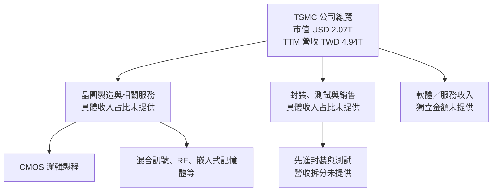
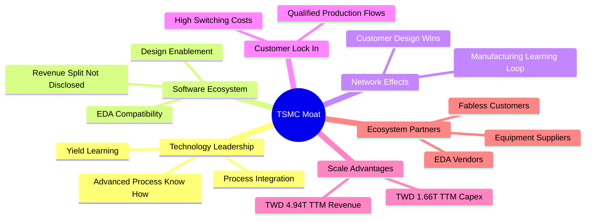
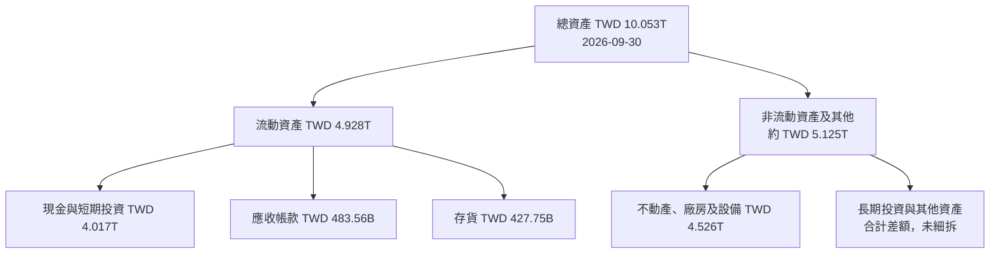
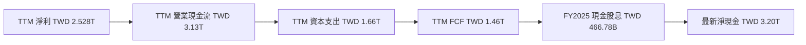
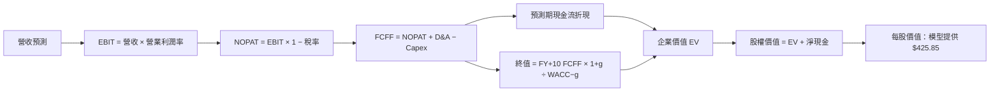
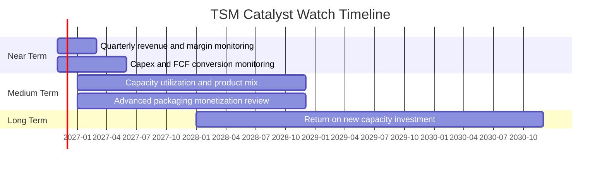
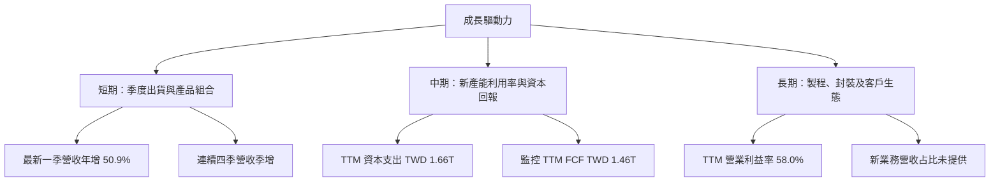
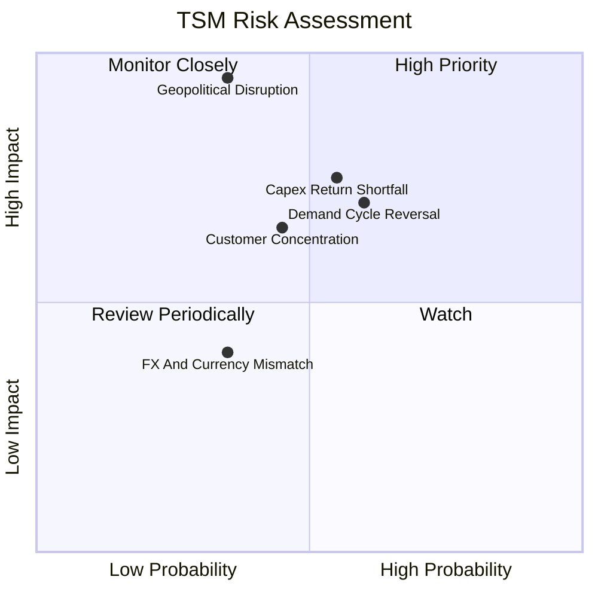
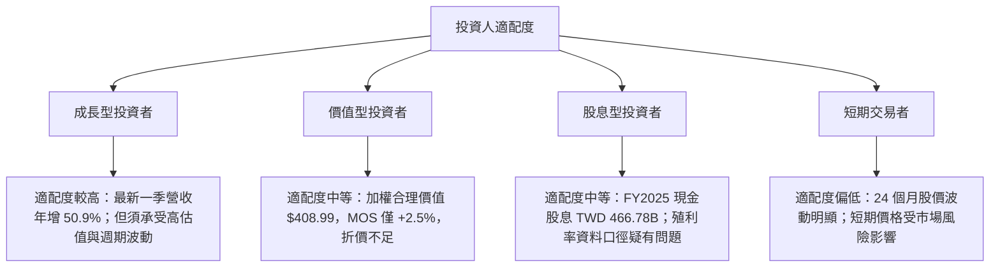

# TSM 基本面深度分析報告
> **報告日期**：2026-11-15 ｜ **語言**：繁體中文 ｜ **數據來源**：Yahoo Finance、Finviz、StockAnalysis、Roic.ai ｜ **分析師**：CFA 級機構研究

## 目錄

| # | 章節 | 核心結論 |
|---|------|----------|
| 1 | 執行摘要 | 評級持有；加權合理價值 $408.99；MOS +2.5% |
| 2 | 公司概覽與商業模式 | 先進製程與晶圓製造規模構成主要護城河，市場份額數據未提供 |
| 3 | 損益表深度分析 | TTM 營收 TWD 4.94 兆；最新一季年增 50.9%，利潤率維持高檔 |
| 4 | 資產負債表分析 | 淨現金 TWD 3.20 兆；流動比率 2.505 倍 |
| 5 | 現金流量深度分析 | TTM FCF TWD 1.46 兆，資本支出仍高 |
| 6 | 獲利能力與資本效率 | 最新 ROIC 未提供，無法直接與 WACC 比較；歷史資本報酬率數據顯示曾高於資金成本 |
| 7 | 相對估值分析 | Forward P/E 17.05 倍；相對同業估值方法給出的價格區間不一致 |
| 8 | DCF 內在價值評估 | DCF 基準價值 $425.85；模型終值現值佔 EV 59.7% |
| 9 | 成長催化劑 | 近期營收增速加快；AI、高效能運算等質化催化劑仍須以財報驗證 |
| 10 | 風險矩陣 | 地緣政治、資本支出回報與週期／客戶集中為主要風險 |
| 11 | 投資建議 | 依 MOS 為持有；現價接近加權合理價值，採分批與指標觸發管理 |

---

## 1. 執行摘要

2026-11-13 收盤價為 **$398.73**。DCF 基準價值為 **$425.85**，相對現價折溢價為 **−6.1%**；但以同業估值與分析師共識等方法加權後，合理價值為 **$408.99**，MOS 為 **+2.5%**、上行空間為 **+2.6%**。由於 MOS 落在 −10% 至 +10% 區間，依評級規則為**持有**。公司 TTM 營業利益率為 58.0%、TTM FCF 為 TWD 1.46 兆、淨現金為 TWD 3.20 兆；但最新 ROIC 未提供，不能據此完成當期 ROIC 對 WACC 的價值創造檢驗。

### 1.0 一頁式投資儀表板（Portfolio Manager 30 秒速讀）

| 項目 | 內容 |
|------|------|
| **投資論點（3 句）** | ① TTM 營收 TWD 4.94 兆，最新一季營收年增 50.9%，顯示需求與出貨動能仍強。② TTM 營業利益率 58.0%、FCF TWD 1.46 兆，獲利與現金創造能力充足。③ 加權合理價值 $408.99，較 $398.73 現價僅有 +2.6% 上行空間，估值不便宜也未顯著低估。 |
| **綜合評分** | **7.8/10**（引用 1.1 評分卡） |
| **財務健康** | 🟢 淨現金 TWD 3.20 兆、流動比率 2.505 倍；但資本支出規模大。 |
| **ROIC vs WACC** | 最新 ROIC：N/A；WACC：10.82%。目前不能確認最新一期 ROIC 是否高於資金成本。 |
| **FCF 趨勢** | FY2022–FY2025 FCF 回升；TTM FCF TWD 1.46 兆，FCF Yield 2.15%。 |
| **估值** | Forward P/E 17.05 倍 ｜ EV/EBITDA：N/A（幣別混用）｜ FCF Yield 2.15% |
| **DCF 內在價值（基準）** | $425.85 ｜ 現價相對 DCF **折價 6.4%**（DCF 內在價值作基準） |
| **安全邊際（MOS）** | **+2.5%**＝($408.99 − $398.73) ÷ $408.99；🔴 <10% 無 |
| **預期報酬（基準情境 12M）** | DCF 基準情境相對現價 **+6.8%**；非保證的 12 個月報酬預測。 |
| **關鍵風險（前二）** | 地緣政治與供應鏈中斷；高資本支出若未轉化為足夠產能利用率及現金回報，會壓低 FCF。 |
| **評級 + 信心度** | 🟡 **持有** ｜ 信心：中（估值資料可用，但 ROIC、EPS 預期差與部分幣別口徑缺漏） |

### 1.1 綜合評分卡（全報告唯一）

| 維度 | 評分（1–10） | 主要依據（引用數字與其來源章節） |
|------|--------------|----------------------------------|
| 成長性 | 8.5 | 最新一季營收年增 50.9%；但 TTM 對前一 TTM 成長率 N/A（第 3 章） |
| 獲利能力 | 8.5 | TTM 營業利益率 58.0%、毛利率 65.8%；最新 ROIC 與 Piotroski F-Score N/A（第 3、6 章） |
| 財務健康 | 9.0 | 淨現金 TWD 3.20 兆、流動比率 2.505 倍；CCC 37 天（第 4 章） |
| 估值 | 5.0 | 加權合理價值 $408.99，MOS +2.5%；DCF 基準 $425.85（第 7、8 章） |
| 護城河 | 9.0 | 58.0% TTM 營業利益率、先進製程與晶圓代工規模優勢；市占率數值未提供（第 2 章） |
| 管理層與資本配置 | 7.0 | FY2025 股息支付 TWD 466.78B、SBC TWD 1.25B；缺乏可比的回購與長期資本回報目標資料（第 5 章） |
| **綜合評分** | **7.8** | 六項算術平均：(8.5 + 8.5 + 9.0 + 5.0 + 9.0 + 7.0) ÷ 6 = 7.83，四捨五入為 7.8 |

### 1.2 五大投資論點 + 三大核心風險

| 類型 | 項目 | 具體依據 | 信心度 |
|------|------|----------|--------|
| 🟢 **投資論點①** | 近期需求動能 | 最新一季營收 TWD 1.494 兆，年增 50.9%、季增約 17.6%；若需求延續，固定成本攤薄可能支持營業利益率。 | 🟢 高 |
| 🟢 **投資論點②** | 高獲利率 | TTM 毛利率 65.8%、營業利益率 58.0%、淨利率 51.1%，顯示高附加價值產品與規模對利潤的支撐。 | 🟢 高 |
| 🟢 **投資論點③** | 現金與資產負債表緩衝 | 現金及短期投資 TWD 4.02 兆、總債務 TWD 818.38B、淨現金 TWD 3.20 兆。 | 🟢 高 |
| 🟢 **投資論點④** | FCF 擴張 | TTM FCF TWD 1.46 兆，較 FY2025 FCF TWD 992.38B 為高；但期間與口徑不同，須持續確認資本支出週期。 | 🟡 中 |
| 🟢 **投資論點⑤** | 估值並非以極端倍數定價 | Forward P/E 17.05 倍，低於 INTC 33.3 倍、略高於 UMC 17.1 倍與 GFS 16.0 倍的同業範圍中位數 17.1 倍附近。 | 🟡 中 |
| 🟡 **風險①** | 地緣政治與供應連續性 | 台灣集中生產的地理風險可能影響營收、設備與客戶交付；數據包未提供可量化損失估值。 | 🔴 高衝擊 |
| 🔴 **風險②** | 資本支出回報不足 | TTM 資本支出 TWD 1.66 兆，約為 TTM 營收 33.7%；若新增產能未充分利用，FCF 與資本回報率將受壓。 | 🟡 中 |
| 🟡 **風險③** | 高基期與需求週期 | 最新一季年增 50.9%，明顯高於過去年度增速；若需求正常化，市場可能下修成長與估值。 | 🟡 中 |

### 1.3 快速統計卡片

| 指標 | 公司實際值（期間） | 同業中位數 | 狀態 |
|------|--------------------|------------|------|
| 營收成長（TTM） | **N/A** | — | ⚪ 無法比較 |
| 營收成長（最新一季年增） | **50.9%** | 20.9% | 🟢 高於同業中位數 |
| 毛利率（TTM） | **65.8%** | 31.7% | 🟢 高於同業中位數 |
| 營業利益率（TTM） | **58.0%** | — | 🟢 高 |
| ROIC（TTM） | **N/A** | — | ⚪ 最新 ROIC 未提供 |
| Forward P/E | **17.05x** | 17.1x | 🟡 接近同業中位數 |
| FCF Yield（TTM） | **2.15%** | — | 🟡 相對合理價值仍有限 |
| Piotroski F-Score | **N/A / 9** | — | ⚪ 缺少可比 SEC 申報期間 |

### 1.4 投資結論

```text
╔══════════════════════════════════════════════════════════════════╗
║                    📊 投資結論摘要                               ║
╠══════════════════════════════════════════════════════════════════╣
║  評級：持有（依加權合理價值 MOS +2.5%）                          ║
║  價格（2026-11-13 收盤）：$398.73                               ║
║  DCF 內在價值（基準）：$425.85（現價折價 6.4%）                 ║
║  安全邊際 MOS：+2.5%（＝(加權合理價值−現價)÷加權合理價值）     ║
║  加權合理價值（8.8）：$408.99                                   ║
║  DCF 情境價值：                                                 ║
║    悲觀情境：$183.19（−54.1%）                                  ║
║    基準情境：$425.85（+6.8%）                                   ║
║    樂觀情境：$939.71（+135.7%）                                 ║
║  綜合評分：7.8/10（引用 1.1）                                   ║
║  適合投資人：可承受半導體週期與地緣政治風險的長線成長型投資人   ║
╚══════════════════════════════════════════════════════════════════╝
```

---

## 2. 公司概覽與商業模式

### 2.1 業務結構與收入來源

現有數據提供的是公司合併營收，未提供按平台、製程節點或產品類別拆分的營收金額與占比。因此下圖只列可核對的公司總營收，不虛構業務占比。



TSMC 的主要經濟模式是以客戶設計的晶片為基礎，提供製程技術、晶圓製造，以及封裝、測試等服務。營收與利潤的核心變數包括先進製程需求、產能利用率、產品組合、價格與資本支出效率。

### 2.2 市場份額

市場份額數據未提供，亦沒有可引用的年份與來源，故不提供百分比或市場份額圖表。TSMC TTM 營收為 TWD 4.94 兆，最新一季年增 50.9%；此規模及增速高於所列 INTC、UMC、GFS 最新一季營收增速，但不同公司的商業模式與產品組合並不完全可比。

### 2.3 競爭護城河分析



### 2.4 護城河強度

| 護城河項目 | 強度（強／中／弱） | 證據（引用數字或事實） | 會削弱它的情況 |
|------------|--------------------|------------------------|----------------|
| 技術與製程 | 強 | TTM 營業利益率 58.0%，顯示製程、良率與產品組合具有高經濟價值；具體節點營收未提供。 | 競爭對手在效能、良率、成本或上市時程持續縮小差距。 |
| 軟體與設計生態 | 中至強 | 客戶需將設計流程與製造流程協同；相關營收或客戶數未提供，無法量化。 | 替代晶圓廠的設計支援、IP 與製程相容性提升。 |
| 網路效應 | 中 | 客戶量產與製程學習有助提升良率及生產效率；數據未提供每客戶產量或良率。 | 大客戶採用多來源策略，或替代平台形成足夠規模。 |
| 客戶鎖定 | 強 | 高性能晶片的製程移轉通常涉及驗證與設計調整；公司營收拆分與客戶集中度未提供。 | 客戶將新產品分配至多家供應商，或自建製造能力成熟。 |
| 規模效應 | 強 | TTM 營收 TWD 4.94 兆、TTM 資本支出 TWD 1.66 兆；大規模資本投入支持產能與技術更新。 | 產能過剩、設備折舊增加或利用率下滑使固定成本難以攤薄。 |
| 生態夥伴 | 中至強 | 依賴設備、材料、EDA 與客戶設計生態；相關依存比例未提供。 | 設備供應受限制、供應商集中或生態夥伴轉向競爭平台。 |

1.1「護城河」評分 9.0/10，主要依據是 TTM 營業利益率 58.0%、TTM 營收 TWD 4.94 兆及大規模資本投入；由於市場份額、客戶集中度與產品別營收未提供，並未給滿分。

---

## 3. 損益表深度分析

### 3.1 年度收入成長趨勢（近4年）

單位：TWD 兆。收入與 YoY 由年度報表計算；2022 年 YoY 為負，反映營收從 2021 年高基期回落。

```text
╔══════════════════════════════════════════════════════════════════╗
║              TSM 年度收入趨勢（FY2022–FY2025）                  ║
╠══════════════════════════════════════════════════════════════════╣
║  FY2022  TWD 2.26T  ███████████████░░░░░░░░░░░  YoY +42.6% 🟢 ║
║  FY2023  TWD 2.16T  ██████████████░░░░░░░░░░░░  YoY  -4.5% 🟡 ║
║  FY2024  TWD 2.89T  ███████████████████░░░░░░░  YoY +33.9% 🟢 ║
║  FY2025  TWD 3.81T  █████████████████████████  YoY +31.6% 🟢 ║
║                                                                  ║
║  FY2022–FY2025 收入 CAGR：(3.809 ÷ 2.264)^(1/3) − 1 ≈ 19.0%   ║
╚══════════════════════════════════════════════════════════════════╝
```

2022 至 2025 年營收 CAGR 約 19.0%，但年度路徑並非線性：FY2023 營收下降 4.5%，之後 FY2024、FY2025 分別增長 33.9%、31.6%。TTM 對前一 TTM 成長率未提供，因此不能把最新一季 50.9% 年增率稱為 TTM 成長率。

### 3.2 季度收入趨勢分析

單位：TWD 兆。QoQ 為相鄰季度營收變動；YoY 依季度資料來源所列。

| 季度 | 營收 | QoQ | YoY | 備註 |
|------|------:|----:|----:|------|
| 2025Q4 | 1.046 | +5.7% | +20.5% | 延續 2025 年季度成長。 |
| 2026Q1 | 1.134 | +8.4% | +35.1% | 營收增速較 2025Q4 加快。 |
| 2026Q2 | 1.270 | +12.0% | +36.1% | 季增加速，營收規模續創高。 |
| 2026Q3 | 1.494 | +17.6% | +50.9% | 單季增速顯著上升；未來需觀察高基期下是否可延續。 |

計算例：2026Q3 QoQ = 1,494.243 ÷ 1,270.380 − 1 = **17.6%**。單季收入加速可能來自出貨增加、產品組合或產能利用率提升，但資料未提供分產品與價格拆分，不能把增長歸因到單一業務。

### 3.3 利潤率演變分析

下表為依年度營收、毛利、營業利益與淨利計算的比例，因原始數字取位，比例為約值。

| 利潤率指標 | FY2022 | FY2023 | FY2024 | FY2025 | 趨勢 | 評估 |
|------------|-------:|-------:|-------:|-------:|------|------|
| **毛利率** | 約 59.6% | 約 54.4% | 約 56.1% | 約 59.9% | 2023 回落後回升 | 🟢 |
| **營業利益率** | 約 49.6% | 約 42.6% | 約 45.7% | 約 50.8% | 2023 下滑後逐年回升 | 🟢 |
| **淨利率** | 約 43.9% | 約 39.4% | 約 40.0% | 約 44.6% | 近年改善 | 🟢 |

TTM 毛利率 65.8%、營業利益率 58.0%、淨利率 51.1%，高於 FY2025。利潤率回升與擴張可能反映較佳的產品組合、規模效應、產能利用率及成本吸收；但現有財務資料未提供製程別價格、折舊或利用率拆解，不能將利潤率改善全部歸因於定價能力。若未來高投資產能折舊上升，或需求與產品組合轉弱，利潤率可能回落。

### 3.4 費用結構分析

完整營業費用拆分（研發、銷售管理、折舊、製造成本等）未提供，因此不以不完整數字繪製 pie chart。可核對的 FY2025 研發費用為 TWD 246.43B，約為年度營收 TWD 3.81 兆的 **6.5%**。TTM 資本支出為 TWD 1.66 兆，但資本支出不是損益表費用，不能與研發費用相加作為同一費用結構。

### 3.5 季度 EPS 趨勢與盈餘品質（Quality of Earnings）

| 盈餘品質項目 | 數值/佔比 | 評估 |
|--------------|-----------|------|
| 股權薪酬 SBC / 營收 | FY2025：TWD 1.25B ÷ TWD 3.809T = 約 0.033% | 🟢 比例低；季度最新 SBC 欄位有缺漏，故以 FY2025 年數據判斷。 |
| SBC / 營業現金流 | FY2025：TWD 1.25B ÷ TWD 2.27T = 約 0.055% | 🟢 對現金流稀釋影響有限。 |
| FCF / 淨利（現金轉換率） | TTM FCF TWD 1.46T ÷ TTM 淨利 TWD 2.528T ≈ 57.8% | 🟡 受高資本支出影響；仍需觀察投資高峰過後的現金轉換。 |
| 一次性/非經常性損益 | N/A（未提供可核實拆分） | ⚪ 無法判定是否有一次性項目推高或壓低盈餘。 |
| 有效稅率異常 | 最新年度有效稅率 17.0% | 🟡 未見可供判斷的多年有效稅率明細；DCF 採用 17.0%。 |
| 資本化支出 vs 費用化 | TTM 資本支出 TWD 1.66T；FY2025 研發費用 TWD 246.43B | 🟡 資本支出依會計折舊逐期反映；須關注折舊年限與產能利用率。 |

EPS 資料來源列出近四季實際 EPS，但 EPS 預期值為 NaN，故**無法判定超預期或不及預期**。季度 EPS 實際值可由 Roic.ai 數列參考，但其呈現的會計與 ADR 換算口徑未提供完整說明，因此不與 Yahoo Finance 的 EPS 混算或直接判斷驚喜幅度。

**盈餘品質結論**：SBC 佔營收比重低，營業現金流 TTM 達 TWD 3.13 兆，支持獲利的現金含量；但 TTM FCF 僅約為淨利的 57.8%，主要需由高資本支出背景理解。一次性損益與稅率歷史細項未提供，品質判斷應保留。

---

## 4. 資產負債表分析

### 4.1 資產結構分解

依 2026-09-30 資產負債表數據，總資產為 TWD 10.053 兆；流動資產為 TWD 4.928 兆，PP&E 為 TWD 4.526 兆。其他資產項目未在此圖展開。



### 4.2 流動性與營運資金分析

| 指標 | 最新值 | 歷史趨勢 | 評估 |
|------|------:|----------|------|
| 流動比率 | 2.505x | 年度流動資產與流動負債均增加；2025 年報表流動比率約 2.51 倍 | 🟢 流動資產足以覆蓋短期負債。 |
| 速動比率 | 2.287x | 最新值 | 🟢 不依賴存貨也有充足流動性。 |
| 現金及短期投資 | TWD 4.017T | FY2025 TWD 3.068T；同比增長 46.0%（依季度資料） | 🟢 提供投資與週期緩衝。 |
| 淨現金 | TWD 3.199T | 最新 TTM 口徑 | 🟢 債務負擔低於現金資產。 |

營運資金天數依品質指標原值列示。一年前數值未提供，故不反推：

| 指標 | 最新 TTM | 一年前 TTM | 變化 | 解讀 |
|------|----------:|-----------:|-----:|------|
| DSO 應收帳款天數 | 36 天 | N/A | N/A | 應收帳款週轉數據未提供比較期。 |
| DIO 存貨天數 | 92 天 | N/A | N/A | 存貨週轉與生產週期較長，需配合出貨與產品組合追蹤。 |
| DPO 應付帳款天數 | 91 天 | N/A | N/A | 不能據此判定供應商付款條件變化。 |
| CCC 現金轉換週期 | 37 天 | N/A | N/A | 依 36 + 92 − 91 = 37 天；一年變化方向無法判定。 |

### 4.3 債務結構分析

```text
╔══════════════════════════════════════════════════════════════════╗
║                   TSM 債務健康診斷                               ║
╠══════════════════════════════════════════════════════════════════╣
║  總債務：        TWD 818.38B  ████░░░░░░░░░░░░░░░  🟢         ║
║  現金+短期投資： TWD 4.02T    ████████████████████  🟢         ║
║  淨現金：        TWD 3.20T    ████████████████░░░░  🟢         ║
║                                                                  ║
║  Debt/EBITDA：N/A（未提供同一期間且同幣別口徑的可靠值）         ║
║  Interest Coverage：N/A（利息費用未提供）                       ║
║  流動比率：2.505x；速動比率：2.287x                             ║
╚══════════════════════════════════════════════════════════════════╝
```

數據包內 FY2025 年末債務 TWD 1.06 兆與最新 TTM 總債務 TWD 818.38B 不同，可能涉及期間或口徑差異。本報告債務健康診斷使用 VERIFIED FIGURES 的最新 TTM 總債務，不將不同日期的資產負債表數字混成一個序列。

### 4.4 股東權益趨勢

單位：TWD 兆。股東權益由年度資產負債表列示。

```text
╔══════════════════════════════════════════════════════════════════╗
║                   TSM 股東權益趨勢                               ║
╠══════════════════════════════════════════════════════════════════╣
║  FY2022  TWD 2.90T  ███████████████░░░░░░░░░░░                  ║
║  FY2023  TWD 3.43T  ██████████████████░░░░░░░                  ║
║  FY2024  TWD 4.24T  ██████████████████████░░░                  ║
║  FY2025  TWD 5.36T  ████████████████████████████               ║
╚══════════════════════════════════════════════════════════════════╝
```

2022 至 2025 年股東權益上升，與獲利累積相符；ROE 的完整年度分解資料未提供，不應將權益增長直接等同於每股價值增長。

---

## 5. 現金流量深度分析

### 5.1 現金流量瀑布圖

以下採最新 TTM 數字；資本支出與 FCF 已由來源計算。因各欄位取位，TWD 3.13T − TWD 1.66T 與列示 FCF TWD 1.46T 有約數十億差異，應以來源的 FCF 原值為準。



股息支付、回購與淨現金變化不是同一期間的完整資金流量表，圖中是關係示意，不表示 FY2025 股息直接從 TTM FCF 中扣除後等於淨現金變化；回購金額未提供。

### 5.2 FCF 轉換率趨勢

| 年度 | 營業現金流（TWD） | FCF（TWD） | 淨利（TWD） | FCF / 淨利 |
|------|------------------:|-----------:|------------:|-----------:|
| FY2022 | 1.61T | 520.97B | 992.92B | 約 52.5% |
| FY2023 | 1.24T | 286.57B | 851.74B | 約 33.6% |
| FY2024 | 1.83T | 861.20B | 1.158T | 約 74.3% |
| FY2025 | 2.27T | 992.38B | 1.698T | 約 58.5% |

FCF 轉換率年度波動與投資週期相關；2023 年低點與 FCF 下降同步，不能單以會計淨利判斷現金價值。TTM FCF 與 TTM 淨利的比率約為 57.8%。

### 5.3 自由現金流趨勢

```text
╔══════════════════════════════════════════════════════════════════╗
║                   TSM 自由現金流趨勢                             ║
╠══════════════════════════════════════════════════════════════════╣
║  FY2022  TWD 520.97B  ███████████░░░░░░░░░░░░░                 ║
║  FY2023  TWD 286.57B  ██████░░░░░░░░░░░░░░░░░░░                 ║
║  FY2024  TWD 861.20B  ██████████████████░░░░░░                 ║
║  FY2025  TWD 992.38B  █████████████████████░░░                 ║
║  TTM      TWD 1.46T    ████████████████████████████             ║
╠══════════════════════════════════════════════════════════════════╣
║  TTM FCF Yield：2.15%（以來源計算值為準）                       ║
╚══════════════════════════════════════════════════════════════════╝
```

TTM FCF 高於 FY2025 年度數值，但 TTM 跨期與年度期間不同；不能簡化為連續同比成長。FCF Yield 2.15% 表示以目前市值計算的現金收益率有限，市場估值仍包含未來成長預期。

### 5.4 資本配置評估

回購金額及 TTM 股息支付未提供完整、同期間拆分，故不繪製資本配置 pie chart。

| 配置項目 | 可核對數據 | 評估 |
|----------|------------|------|
| 資本支出 | TTM TWD 1.66T；FY2025 TWD 1.28T | 🟡 需以後續產能利用率與 FCF 回報驗證投資效率。 |
| 現金股息 | FY2025 TWD 466.78B；FY2024 TWD 363.06B | 🟢 現金股息支出增加；需留意資料列示的股息殖利率 95.0% 明顯可能受幣別／ADR 口徑影響，不將其當作可靠殖利率使用。 |
| 股票回購 | N/A | ⚪ 金額未提供。 |
| 留存現金／淨現金 | 最新淨現金 TWD 3.20T | 🟢 保留投資與週期緩衝。 |

---

## 6. 獲利能力與資本效率

### 6.1 ROE / ROA / ROIC 趨勢

| 指標 | FY2022 | FY2023 | FY2024 | FY2025／TTM | 評估 |
|------|-------:|-------:|-------:|------------:|------|
| ROE | N/A | N/A | N/A | TTM 41.9% | 🟢 高，但未提供完整歷史比較序列。 |
| ROA | N/A | N/A | N/A | TTM 20.6% | 🟢 顯示資產具獲利能力；歷年同口徑數據不足。 |
| ROIC | N/A | N/A | N/A | N/A | ⚪ 最新 ROIC 不可核實；不可用 ROE 或 ROA 代替。 |

歷史 Roic.ai 顯示 2013–2018 年 Return on Invested Capital 約 18.31%–20.55%，Return on Capital 約 20.61%–22.45%；因為不是最新期間，不能與 2026 年 WACC 直接作當期比較。行業均值未提供，故不列。

### 6.2 ROIC vs WACC 分析（核心價值創造判斷）

```text
╔══════════════════════════════════════════════════════════════════╗
║                ROIC vs WACC 深度分析                            ║
╠══════════════════════════════════════════════════════════════════╣
║  WACC（來源：Cost of capital）：10.82%                          ║
║  ├── 無風險利率（10Y美債）：5.15%                               ║
║  ├── 市場風險溢酬（假設）：5.00%                                ║
║  ├── 原始 Beta：1.23；採用調整後 Beta：1.16                    ║
║  ├── 股權成本（來源值）：10.93%                                 ║
║  ├── 稅前債務成本：1.51%；稅率：17.0%                           ║
║  ├── 股權／債務權重：98.8% / 1.2%                              ║
║  └── ✅ 採用 WACC：10.82%                                       ║
║                                                                  ║
║  最新 ROIC：N/A（缺少可核實的投入資本及最新 ROIC）               ║
║  最新 EVA = ROIC − WACC：N/A                                    ║
║                                                                  ║
║  判斷：財務數據足以證明獲利率高，未足以計算最新 ROIC − WACC。   ║
╚══════════════════════════════════════════════════════════════════╝
```

Cost of capital 區塊的 CAPM 股權成本為 10.93%，而以顯示至兩位小數的數字計算，5.15% + 1.16 × 5.00% = 10.95%。差異很可能源於 Beta 未四捨五入前的原始調整值；本報告依規則採用來源所列 **WACC 10.82%**，不以顯示位數自行替換。

最新 ROIC 未提供，故「是否創造股東價值」在當期不能直接下定論。以歷史 ROIC 參考，過去曾高於目前 WACC，但歷史年份與當期資本成本並不完全匹配，僅能作背景資料。

### 6.3 杜邦三因素分解

杜邦品質指標列為 N/A：缺少同一期間可核實的淨利、營收、總資產或正股東權益完整組合，故不重算、不用其他來源拼接。

| 因素 | 數值（TTM） | 解讀 |
|------|-------------|------|
| 淨利率 | N/A | 品質指標的杜邦數據為 N/A。 |
| 資產週轉率 | N/A | 品質指標的杜邦數據為 N/A。 |
| 權益乘數 | N/A | 品質指標的杜邦數據為 N/A。 |
| **ROE** | **N/A（杜邦分解口徑）** | 不以單獨列示的 TTM ROE 反推三因素。 |

### 6.4 財務體質：Piotroski F-Score

Piotroski F-Score 為 N/A：計算需要 SEC 申報資料及相隔一年的兩個 TTM 期間，但目前資料來源為 Yahoo 季度報表，未提供可用 SEC 財務序列。九項測試結果均未提供，不能推定其通過或未通過。

| 測試 | 結果 | 解讀 |
|------|------|------|
| 獲利測試 1–4 | N/A | 缺少可按統一 Piotroski 定義核對的兩期 SEC 資料。 |
| 槓桿／流動性測試 5–6 | N/A | 不以局部資產負債表數據替代正式測試。 |
| 營運效率測試 7–9 | N/A | 比較期資料不足。 |

---

## 7. 相對估值分析

### 7.1 同業估值比較表格

TSM 的報價為 USD、財務報表為 TWD。對於來源標示幣別混用的估值指標，依規則列 N/A。競爭對手倍數照 Yahoo Finance Peer multiples 原值列示。

| 估值指標 | **TSM** | **INTC** | **UMC** | **GFS** | TSM 評估 |
|----------|--------:|---------:|-------:|-------:|-----------|
| **Trailing P/E** | 25.84x | N/A | 14.5x | 118.5x | 🟡 同業分散，單一中位數參考性有限。 |
| **Forward P/E** | 17.05x | 33.3x | 17.1x | 16.0x | 🟡 接近同業中位數 17.1x。 |
| **P/S Ratio** | N/A | 5.3x | N/A | 3.2x | ⚪ TSM 幣別不匹配；可計算的同業中位數為 4.25x，但不直接與 TSM 比較。 |
| **EV/EBITDA** | N/A | 17.2x | N/A | 11.1x | ⚪ TSM 與 UMC 幣別口徑受限；可計算同業中位數 14.2x。 |
| **最新一季營收年增** | 50.9% | 20.9% | 25.6% | 12.5% | 🟢 TSM 高於三家同業。 |
| **毛利率（TTM）** | 65.8% | 40.2% | 31.7% | 28.5% | 🟢 TSM 高於所列同業。 |

### 7.2 歷史估值區間分析

```text
╔══════════════════════════════════════════════════════════════════╗
║                  TSM 歷史估值區間分析                            ║
╠══════════════════════════════════════════════════════════════════╣
║  歷史 P/E 區間與百分位：N/A                                      ║
║  原因：未提供「Valuation vs own history」歷史估值資料。           ║
║  目前 Trailing P/E：25.84x；Forward P/E：17.05x                  ║
║  不以 24 個月股價變化推算歷史 P/E 百分位。                        ║
╚══════════════════════════════════════════════════════════════════╝
```

### 7.3 情境價值（Bear / Base / Bull，依 DCF MODEL）

| 情境 | 第 1 年營收成長 | 期末營業利潤率 | WACC | 每股價值 | 相對現價 | 機率 | 會發生的條件 |
|------|----------------:|---------------:|-----:|---------:|---------:|-----:|--------------|
| 🔴 悲觀 | 15.0% | 42.1% | 11.82% | $183.19 | −54.1% | 25% | 需求成長低於基準，競爭、成本或產能利用率使長期利潤率降至 42.1%，同時折現率上升。 |
| 🟡 基準 | 30.0% | 49.5% | 10.82% | $425.85 | +6.8% | 50% | 近期高增長部分延續，十年後營業利潤率逐步回歸 49.5%。 |
| 🟢 樂觀 | 45.0% | 54.5% | 9.82% | $939.71 | +135.7% | 25% | 高成長大幅延續、期末利潤率維持較高水平且資金成本下降。 |

情境價格與假設照 DCF 模型原值列示；各情境逐年營收、期末 FCFF、終值分項未提供，不能另建模型補出看似精確的情境推導鏈。

### 7.4 相對估值隱含價格區間

```text
╔══════════════════════════════════════════════════════════════════╗
║                相對估值法隱含每股價值                            ║
╠══════════════════════════════════════════════════════════════════╣
║  $319.61 ─────── $398.73 ─────── $400.31 ─────── $425.85       ║
║  EV/EBITDA        現價             Forward P/E      DCF 基準     ║
║                                                                  ║
║  EV/EBITDA：$319.61；同業中位數 14.2x（INTC、GFS），            ║
║  加回淨現金後回推。                                              ║
║  Forward P/E：$400.31；同業中位數 17.1x × Forward EPS $23.39。  ║
╚══════════════════════════════════════════════════════════════════╝
```

以上方法由來源估值模型計算。相對估值法採同業中位數倍數，不以 TSM 自身目前倍數回推自身股價。

---

## 8. DCF 內在價值評估（Discounted Cash Flow）

> DCF 模型採程式提供的唯一基準模型。金額除每股價值外均為 TWD billions（TWD 十億）；美元換算使用 2026-11-15 匯率 1 USD = 32.85 TWD。來源已提供的模型輸出原值照列。原始逐年計算有少量四捨五入尾差，若依表內已取位數重算，個別欄位可能相差約 0.01–0.1。

### 8.0 估值推理鏈（Thinking Logic）

**Step 1 — 價值由哪些變數決定？**  
模型把價值拆為：現有晶圓製造業務（TTM 營收 TWD 4,944.82B，為模型基期，佔合併營收 100%）；先進製程與高效能運算等成長機會（獨立營收占比未提供，不能拆成數字）；新服務或封裝選擇權（獨立收入未提供，不另加估值）。估值主導變數是**長期現金流與終值**：終值現值佔 EV 59.7%，因此營業利潤率、永續成長率與 WACC 對結果尤其重要。

**Step 2 — 模型選擇**

| 決策點 | 本報告採用 | 理由（含數字） | 曾考慮但否決 | 否決理由 |
|--------|-----------|----------------|--------------|----------|
| 現金流定義 | FCFF | 對應 WACC 折現並得出 EV；模型明定 FCFF = NOPAT + D&A − Capex | FCFE | 模型沒有提供利息、借款變動與股東融資流量預測。 |
| 預測期 N | 10 年 | DCF 模型指定 10 年；產業資本週期長，較短期間會令終值占比更高 | 5 年 | 與模型不一致，且不得自行改期。 |
| 終值方法 | Gordon Growth | WACC 10.82% > g 3.0%，公式有效；TV 現值佔 EV 59.7% | 退出倍數法 | DCF 模型沒有提供退出倍數估值數字，不另行建立。 |
| EBIT 基礎 | GAAP EBIT | 模型使用 GAAP EBIT，並列明 SBC 已作費用 | 非 GAAP EBIT | 會破壞模型既定口徑。 |

**Step 3 — 關鍵假設推導鏈**

- **第 1 年營收成長**：錨點＝最新單季年增 50.9%，但這不是 TTM 成長率 → 調整＝避免把單季增速直接延伸十年，並按模型規定截於 0%–30% → **採用第 1 年 30.0%** → 曾考慮直接使用 50.9%，因其為單季數字且高於模型上限而否決。
- **後續營收成長**：錨點＝FY2022–FY2025 年營收 CAGR 約 19.0%，FY2025 年增 31.6% → 調整＝基準模型令成長率由 30.0% 線性降至 3.0% → **採用逐年 3.0 個百分點遞減** → 曾考慮固定 30%，因無法代表成熟期需求常態而否決。
- **期末營業利潤率**：錨點＝TTM 58.0% → 調整＝模型按過去五個財年中位水準逐步回落 → **第 10 年採 49.5%** → 曾考慮維持 58.0%，因模型所用歷史中位數較低、且維持當前利潤率會高估長期效益而否決。
- **永續成長率 g**：錨點＝長期經濟成長與通膨須低於名目資金成本；可用具體 GDP+通膨估值未提供 → 調整＝避免永續增長接近 WACC → **採用 3.0%** → 曾考慮更高 g，因會大幅推高終值且缺乏數據支持而否決。
- **預測期 N**：錨點＝模型指定 10 年 → 調整＝不自行更動模型 → **採用 10 年** → 曾考慮較短期限，但會違反模型固定預測期設定。
- **Capex / 營收**：錨點＝TTM 33.7% → 調整＝模型將投資率由 33.7% 逐步降至第 10 年 16.6%，與 D&A 15.1% 的 1.1 倍相近 → **採用模型逐年遞減值** → 曾考慮長期維持 33.7%，因會忽略成熟產能後投資率收斂；反之更快降至 D&A 以下亦不符合模型錨點。
- **D&A / 營收**：錨點＝TTM 15.1% → **採用 15.1% 固定**；此為模型值，未用外部估值替換。
- **稅率**：錨點＝最新年度有效稅率 17.0% → **採用 17.0%**；未另作稅率正常化。
- **EBIT 與 SBC**：錨點＝模型使用 GAAP EBIT，且 SBC 已列費用 → **採用 GAAP + 固定股數** → 不再減 SBC，也不再增加年稀釋率。
- **ΔWC**：模型註明不建模營運資金變動；歷史 ΔWC/營收增額未提供 → **採用模型不列 ΔWC**，而非假裝其為零的歷史估計。
- **WACC**：錨點＝Cost of capital 輸入的 WACC 10.82% → **採用 10.82%**；不自行另算或替換。
- **終值方法**：基準採 Gordon Growth，因 WACC 10.82% 高於 g 3.0% → 退出倍數法未提供可用倍數與模型結果，不以自設倍數替代。

**Step 4 — 最脆弱的一環**  
最脆弱的是高成長期營收與利潤率能否延續；若增長或利潤率低於基準，估值可能向悲觀情境 **$183.19** 移動，對比基準 $425.85 下跌 54.1%。

**Step 5 — 計算路徑**



### 8.1 模型假設總表（Model Inputs）

| 假設項目 | 採用值 | 依據 / 來源 | 敏感度 |
|----------|--------|-------------|--------|
| 預測期長度 **N** | 10 年 | DCF 模型指定預測期；未自行改期 | 🟡 中 |
| 營收成長 | 第 1 年 30.0%，線性降至第 10 年 3.0% | 第 1 年參照最新單季年增 50.9% 並受 30% 上限限制；中長期回落 | 🔴 高 |
| 營業利潤率 | 第 1 年 58.0% → 第 10 年 49.5% | TTM 營業利益率 58.0%，逐步回歸近五財年中位數 | 🔴 高 |
| 有效稅率 | 17.0% | 最新年度有效稅率 | 🟢 低 |
| Capex / 營收 | 第 1 年 33.7% → 第 10 年 16.6% | TTM Capex / 營收；模型逐步收斂至 1.1×D&A（如高於此值） | 🟡 中 |
| D&A / 營收 | 15.1% | TTM D&A / 營收 | 🟢 低 |
| 營運資金變動 / 營收增額 | 未建模 | DCF 模型明定不建模，歷史比例未提供 | 🟢 低 |
| EBIT 基礎 | GAAP | 模型指定 GAAP EBIT | 🟡 中 |
| 股權薪酬 SBC 處理 | GAAP EBIT 已含 SBC 費用，不再扣減 | 模型註明 GAAP EBIT 已含 SBC | 🟡 中 |
| 年稀釋率（股數） | 0%（固定股數處理） | SBC 組合 A；模型固定股數，股數資料以市值橋接公式為準 | 🟡 中 |
| 永續成長率 g | 3.0% | DCF 模型值；低於 WACC 10.82% | 🔴 高 |
| 終值方法 | Gordon Growth | DCF 模型提供 Gordon Growth 終值；退出倍數輸入未提供 | 🔴 高 |
| WACC | 10.82% | Cost of capital 區塊原值 | 🔴 高 |

本模型採用 **(A) GAAP EBIT + 固定股數**，故 SBC 影響已計入一次；FCFF 不再扣 SBC，亦不另加年稀釋率。

### 8.2 折現率推導（WACC）

```text
╔══════════════════════════════════════════════════════════════════╗
║                    WACC 推導（折現率）                           ║
╠══════════════════════════════════════════════════════════════════╣
║  股權成本 Ke（CAPM，來源值）：10.93%                            ║
║  ├── 無風險利率 Rf（10Y 美債）：5.15%                           ║
║  ├── 市場風險溢酬 ERP（假設）：5.00%                            ║
║  ├── 原始 Beta：1.23；調整後 Beta：1.16                         ║
║  ├── Beta 調整：⅔ × 1.23 + ⅓ × 1 = 1.153，四捨五入約 1.16     ║
║  ├── 規模／國別額外溢酬：未另加                                ║
║  └── 來源所列 Ke：10.93%                                        ║
║                                                                  ║
║  債務成本 Kd：                                                   ║
║  ├── 稅前 Kd（利息 ÷ 債務）：1.51%                              ║
║  ├── 有效稅率：17.0%                                            ║
║  └── 稅後 Kd = 1.51% × (1 − 17.0%) = 1.25%                     ║
║                                                                  ║
║  資本結構（來源權重）：股權 98.8%，債務 1.2%                   ║
║  ✅ 採用 WACC：10.82%（模型與 ROIC 比較均使用此值）             ║
╚══════════════════════════════════════════════════════════════════╝
```

逐步演算與一致性說明：

1. **Ke（CAPM）**：來源採用值為 10.93%；顯示至兩位小數的輸入若直接代入為 5.15% + 1.16 × 5.00% = 10.95%，與 10.93% 相差 0.02 個百分點，應是未四捨五入 Beta 所致；以來源的 Ke 10.93% 為準。
2. **稅前 Kd**：來源直接列示 1.51%；利息費用金額與平均計息負債明細未提供，不能重建其分子分母。
3. **稅後 Kd**：1.51% × (1 − 17.0%) = 1.2533% ≈ **1.25%**。
4. **權重**：股權 98.8% + 債務 1.2% = **100.0%**。來源未提供與成本估算一致的市值與計息債務完整明細，權重照來源採用。
5. **WACC**：顯示值代入為 98.8% × 10.93% + 1.2% × 1.2533% = 10.8128% ≈ **10.81%**；來源採用 **10.82%**，可由未四捨五入的成本與權重造成 0.01 個百分點差異。DCF 與第 6.2 節均依規則使用來源的 10.82%。

### 8.3 逐年自由現金流預測（基準情境）

金額：TWD billions。ΔWC 不在模型內建模；SBC 列不適用於組合 A。折現因子顯示至三位小數。

| 年度 | FY+1 | FY+2 | FY+3 | FY+4 | FY+5 | FY+6 | FY+7 | FY+8 | FY+9 | FY+10 |
|------|-----:|-----:|-----:|-----:|-----:|-----:|-----:|-----:|-----:|------:|
| 營收 | 6,428.26 | 8,163.89 | 10,123.23 | 12,249.11 | 14,453.94 | 16,622.04 | 18,616.68 | 20,292.18 | 21,509.71 | 22,155.00 |
| 營收 YoY | 30.0% | 27.0% | 24.0% | 21.0% | 18.0% | 15.0% | 12.0% | 9.0% | 6.0% | 3.0% |
| 營業利潤率 | 58.0% | 57.0% | 56.1% | 55.2% | 54.2% | 53.3% | 52.3% | 51.4% | 50.5% | 49.5% |
| 營業利益 EBIT（GAAP） | 3,726.96 | 4,656.58 | 5,679.10 | 6,756.69 | 7,837.17 | 8,856.66 | 9,744.64 | 10,431.11 | 10,854.99 | 10,972.60 |
| − 稅（17.0%） | (632.58) | (790.36) | (963.91) | (1,146.81) | (1,330.20) | (1,503.24) | (1,653.96) | (1,770.47) | (1,842.42) | (1,862.38) |
| = NOPAT | 3,094.39 | 3,866.22 | 4,715.19 | 5,609.88 | 6,506.97 | 7,353.42 | 8,090.68 | 8,660.64 | 9,012.58 | 9,110.22 |
| + D&A | 970.20 | 1,232.15 | 1,527.86 | 1,848.72 | 2,181.49 | 2,508.71 | 2,809.75 | 3,062.63 | 3,246.39 | 3,343.78 |
| − Capex | (2,164.21) | (2,593.75) | (3,024.30) | (3,427.14) | (3,769.96) | (4,020.28) | (4,149.72) | (4,138.42) | (3,978.88) | (3,678.16) |
| **= FCFF** | **1,900.38** | **2,504.62** | **3,218.76** | **4,031.46** | **4,918.49** | **5,841.85** | **6,750.72** | **7,584.85** | **8,280.09** | **8,775.85** |
| 折現因子 @10.82% | 0.902 | 0.814 | 0.735 | 0.663 | 0.598 | 0.540 | 0.487 | 0.440 | 0.397 | 0.358 |
| **FCFF 現值 PV** | **1,714.90** | **2,039.58** | **2,365.30** | **2,673.37** | **2,943.27** | **3,154.62** | **3,289.63** | **3,335.36** | **3,285.72** | **3,142.56** |

預測期 FCF 現值合計逐項相加：

**1,714.90 + 2,039.58 + 2,365.30 + 2,673.37 + 2,943.27 + 3,154.62 + 3,289.63 + 3,335.36 + 3,285.72 + 3,142.56 = 27,944.31 TWD billions**。  
來源模型列示合計 **27,944.32 TWD billions**；差異 0.01，屬逐年金額四捨五入尾差，採模型合計原值。

**逐步演算（FY+1）**

1. 營收 = TTM 營收 4,944.82 × (1 + 30.0%) = 6,428.266 ≈ **6,428.26**。
2. EBIT = 6,428.26 × 58.0% = 3,728.39；模型列示 **3,726.96**。兩者有約 1.43 差異，顯示底層未四捨五入輸入或列示值存在差異，不能用顯示值強行改寫模型輸出。
3. 稅 = 模型 EBIT 3,726.96 × 17.0% = **633.58**；模型列示 **632.58**，差約 1.00。
4. NOPAT = 模型列示 **3,094.39**；EBIT 減列示稅額為 3,726.96 − 632.58 = **3,094.38**，差 0.01。
5. D&A = 模型列示 **970.20**。
6. Capex = 模型列示 **2,164.21**。
7. ΔWC = 模型明定不建模，**未列數值**，不能視作已估算的歷史零值。
8. FCFF = 模型列示 **1,900.38**；以已取位列示數字相減，3,094.39 + 970.20 − 2,164.21 = **1,900.38**。
9. 折現因子 = 1 ÷ (1 + 10.82%)¹ ≈ **0.902**；PV = 模型列示 FCFF × 未四捨五入折現因子，模型值為 **1,714.90**。

由於逐年模型部分中 EBIT、稅及 NOPAT 的已顯示數字不完全互相吻合，本報告保留 DCF 模型逐年輸出原值，不以不一致的四捨五入值重建模型。

**合理性自檢**

- FY+1 至 FY+10 FCFF CAGR = (8,775.85 ÷ 1,900.38)^(1/9) − 1 ≈ **18.5%**；FY2022–FY2025 實際 FCF CAGR = (992.38 ÷ 520.97)^(1/3) − 1 ≈ **24.0%**，預測 CAGR 低約 5.5 個百分點，反映模型假設成長逐年放緩，但預測期首年仍偏高。
- FY+10 FCF 利潤率 = 8,775.85 ÷ 22,155.00 ≈ **39.6%**；現有 TTM FCF 利潤率 = TWD 1.46T ÷ TWD 4.94482T ≈ **29.5%**；同業最佳 FCF 利潤率未提供，不能宣稱模型超越產業最佳。
- 各預測年度 FCFF 均為正值；模型沒有預測負現金流年度。

```text
╔══════════════════════════════════════════════════════════════════╗
║            自由現金流：歷史實際 vs 模型預測                      ║
╠══════════════════════════════════════════════════════════════════╣
║  FY2023(實)  TWD 286.57B  ████░░░░░░░░░░░░░░░░  YoY −45.0%    ║
║  FY2024(實)  TWD 861.20B  ████████████░░░░░░░░  YoY +200.7%   ║
║  FY2025(實)  TWD 992.38B  █████████████░░░░░░░  YoY +15.2%    ║
║  FY+1 (預)   TWD 1,900.38B █████████████████████████            ║
║  FY+10(預)   TWD 8,775.85B ███████████████████████████████████  ║
╠══════════════════════════════════════════════════════════════════╣
║  預測 FY+1 至 FY+10 FCF CAGR 約 18.5%；歷史 FY2022–FY2025 約24.0%║
╚══════════════════════════════════════════════════════════════════╝
```

### 8.4 終值計算（Terminal Value）

**適用性檢查**：WACC 10.82% vs g 3.0% → **WACC > g？✅**

| 方法 | 計算式 | 終值 TV | TV 現值 | 佔總 EV 比重 |
|------|--------|---------:|--------:|-------------:|
| Gordon Growth | FCFF(FY+10) × (1+g) ÷ (WACC − g) | TWD 115,656.32B | TWD 41,415.63B | 59.7% |
| 退出倍數法 | N/A | N/A | N/A | N/A |

退出倍數法所需 EBITDA 退出倍數及其對應終值未列入 DCF MODEL，故不自設倍數、不計算交叉驗證值。

**逐步演算（Gordon Growth）**

1. FY+N 的 FCFF = **TWD 8,775.85B**。
2. 分子 = 8,775.85 × (1 + 3.0%) = **TWD 9,039.13B**（按模型原值）。
3. 分母 = 10.82% − 3.0% = **7.82%**；TV = 9,039.13 ÷ 7.82% = **TWD 115,656.32B**（模型原值；分子取位後直接相除會有小額尾差）。
4. PV(TV) = TWD 115,656.32B × 0.358（未四捨五入折現因子）= **TWD 41,415.63B**。
5. 終值佔比 = 41,415.63 ÷ 69,359.94 = **59.7%**。

### 8.5 企業價值 → 每股內在價值（Bridge）

```text
╔══════════════════════════════════════════════════════════════════╗
║              企業價值 → 每股內在價值 橋接表                      ║
╠══════════════════════════════════════════════════════════════════╣
║  預測期 FCF 現值合計            +TWD 27,944.32B                 ║
║  終值現值 PV(TV)                +TWD 41,415.63B                 ║
║  ─────────────────────────────────────────────                  ║
║  = 企業價值 EV                   TWD 69,359.94B                 ║
║  + 淨現金                       +TWD 3,198.60B                  ║
║  = 股權價值                      TWD 72,558.54B                 ║
║  ─────────────────────────────────────────────                  ║
║  每股內在價值（模型原值）       $425.85                          ║
║  當前股價（2026-11-13）         $398.73                          ║
║  折溢價（現價÷DCF值−1）         −6.4%（折價）                   ║
╚══════════════════════════════════════════════════════════════════╝
```

逐步演算：

1. EV = 27,944.32 + 41,415.63 = **TWD 69,359.95B**；模型列示 **TWD 69,359.94B**，相差 0.01，為四捨五入尾差。
2. 股權價值 = EV 69,359.94 + 淨現金 3,198.60 = **TWD 72,558.54B**。
3. 每股內在價值：DCF 模型原列算法為「股權價值 × FX 0.0304395 USD/TWD × 價格 ÷ 市值」，模型結果 **$425.85**。市場資料列示股數 5.19B，但模型橋接未明確列出其實際用於每股換算的未取位股數，故沿用模型原值，不以取位股數反算替代。
4. 折溢價 = $398.73 ÷ $425.85 − 1 = **−6.4%**（按公式約值）。
5. **本節不計算 MOS**：安全邊際只以 8.8 的加權合理價值為分母。

現金、債務與淨現金採 DCF MODEL 橋接所列淨現金 TWD 3,198.60B；模型未在橋接表分拆現金與債務。SBC 依組合 A 已反映於 GAAP EBIT，股數不另做年稀釋。

### 8.6 敏感性分析（WACC × 永續成長率）

矩陣原值照 DCF MODEL 列示。括號內為每股價值相對現價 $398.73 的上行空間，百分比按原表價值計算並取一位小數。

| g（列）／WACC（欄） | 8.82% | 9.82% | **10.82%（基準）** | 11.82% | 12.82% |
|-----------|------:|------:|------------------:|-------:|-------:|
| 2.0% | $533.14（+33.7%） | $455.56（+14.3%） | $396.18（−0.6%） | $349.40（−12.4%） | $311.69（−21.8%） |
| 2.5% | $561.11（+40.7%） | $474.96（+19.1%） | $410.12（+2.9%） | $359.71（−9.8%） | $319.49（−19.9%） |
| 3.0% | $593.89（+49.1%） | $497.19（+24.7%） | **$425.85（+6.8%）** | $371.19（−6.9%） | $328.08（−17.7%） |
| 3.5% | $632.84（+58.7%） | $522.96（+31.2%） | $443.72（+11.3%） | $384.04（−3.7%） | $337.60（−15.3%） |
| 4.0% | $679.88（+70.5%） | $553.14（+38.7%） | $464.22（+16.4%） | $398.55（−0.0%） | $348.19（−12.7%） |

**矩陣逐步演算限制**：選用非基準格 WACC 9.82%、g 3.0%，且 **9.82% > 3.0% ✅**。模型只提供該格最終價值 $497.19，未提供此情境下逐年 PV 合計與 TV 中間值；若自行反推中間值會等同重建模型，故不補造中間數字。該格模型結果為 **$497.19**，相對現價上行約 **24.7%**。

**三情境 DCF（模型原值）**

| 情境 | 第 1 年營收成長 | 期末營業利潤率 | 永續成長 g | WACC | 每股內在價值 | 相對現價 | 主觀機率 |
|------|----------------:|---------------:|------------:|-----:|--------------:|---------:|----------:|
| 🔴 悲觀 | 15.0% | 42.1% | 3.0%* | 11.82% | $183.19 | −54.1% | 25% |
| 🟡 基準 | 30.0% | 49.5% | 3.0% | 10.82% | $425.85 | +6.8% | 50% |
| 🟢 樂觀 | 45.0% | 54.5% | 3.0%* | 9.82% | $939.71 | +135.7% | 25% |
| **機率加權** | — | — | — | — | **$493.65** | **+23.8%** | 100% |

\* DCF Scenarios 未另列悲觀、樂觀情境 g；此表的 3.0% 為展示基準 g 的參考值，不代表情境模型提供了該項輸入。情境逐年預測、FY+10 營收／FCFF 與終值明細未提供，因此不能可靠補出題目要求的每一情境完整推導鏈。可核對的機率加權結果為：

**$183.19 × 25% + $425.85 × 50% + $939.71 × 25% = $493.65**（按模型原值，四捨五入）。

**敏感度結論**

- g 在 WACC 10.82% 下由 2.0% 升至 3.0%：$396.18 → $425.85，變動 **+$29.67，約 +7.5%**。
- WACC 在 g 3.0% 下由 9.82% 升至 10.82%：$497.19 → $425.85，變動 **−$71.34，約 −14.3%**。
- 期末營業利潤率每 +1pp 的單獨敏感度數值未提供，不能計算其每股影響。
- 在已提供的矩陣變數中，WACC 變動 1 個百分點造成的價值變化高於 g 變動 1 個百分點；這與 8.0 指出終值、折現率及長期營運現金流是關鍵驅動相符。

### 8.7 反推 DCF（Reverse DCF：市場在預期什麼）

固定基準輸入：WACC 10.82%、稅率 17.0%、預測期 10 年、DCF 模型基準 Capex 曲線與不建模 ΔWC；股數換算沿用模型口徑。Capex 基準是逐年變動曲線，並非單一固定比例。

| 求解的變數（一次一個） | 其餘變數設定 | 市場隱含值（令 DCF = 現價） | 公司歷史實際 | 判斷 |
|------------------------|--------------|------------------------------:|--------------|------|
| 第 1 年營收成長 | 其他輸入固定基準 | 28.2% | 最新單季年增 50.9%；FY2022–FY2025 CAGR 約 19.0% | 🟡 接近基準 30.0%，但基準成長需持續多期。 |
| 固定營業利潤率 | 其他輸入固定基準 | 48.2% | TTM 營業利益率 58.0% | 🟡 市場價對應低於目前利潤率的長期固定水平。 |
| 永續成長率 g | 未提供反解值 | 未計算 | — | ⚪ 模型未給出此變數反解。 |
| 高成長持續年數 N | 未提供反解值 | 未計算 | — | ⚪ 模型未給出此變數反解。 |

模型提供的兩個反推結果為 28.2% 與 48.2%，但未提供求解迭代軌跡、各次試算的 FY+10 營收、FCFF 與價值。為避免捏造收斂步驟，不補造試算表。反推結果顯示：現價可由接近基準的第 1 年成長、但較低的長期固定營業利潤率解釋。

### 8.8 估值三角驗證與安全邊際

| 估值方法 | 隱含每股價值 | 上行空間（÷現價） | 權重 | 說明 |
|----------|--------------:|------------------:|-----:|------|
| DCF（基準） | $425.85 | +6.8% | 40% | 10 年 FCFF、WACC 10.82%、永續成長率 3.0%。 |
| 同業 Forward P/E | $400.31 | +0.4% | 25% | 同業中位數 17.1x × Forward EPS $23.39。 |
| 同業 EV/EBITDA | $319.61 | −19.8% | 25% | 同業中位數 14.2x（INTC、GFS）× TTM EBITDA，加回淨現金。 |
| 分析師共識目標價 | $586.69 | +47.1% | 10% | 20 位分析師平均目標價；作參考，不作估值主體。 |
| **加權合理價值** | **$408.99** | **+2.6%** | **100%** | 盈利公司估值權重依公司類型固定。 |

逐步演算：

**$425.85 × 40% + $400.31 × 25% + $319.61 × 25% + $586.69 × 10% = $170.34 + $100.0775 + $79.9025 + $58.669 = $408.989 ≈ $408.99**。

權重合計 40% + 25% + 25% + 10% = 100%。公司類型為盈利公司。沒有被剔除的估值方法；本列出的四種方法全部依來源模型納入。

```text
╔══════════════════════════════════════════════════════════════════╗
║                  估值區間與安全邊際                              ║
╠══════════════════════════════════════════════════════════════════╣
║  $183.19 ───── $398.73 ───── [$408.99] ───── $425.85 ───── $939.71║
║  悲觀DCF       現價          加權合理值       基準DCF        樂觀DCF║
║                                                                  ║
║  MOS = (408.99 − 398.73) ÷ 408.99 = +2.5%                       ║
║  MOS 評估：🔴 <10% 無                                            ║
║  上行空間 = (408.99 − 398.73) ÷ 398.73 = +2.6%                  ║
║  建議買入區間：未達買入評級；可留意 $368.09 以下                ║
║  合理持有區間：以加權價值附近 $368.09–$449.89 為參考            ║
║  減碼考慮區間：高於樂觀 DCF 情境 $939.71                        ║
╚══════════════════════════════════════════════════════════════════╝
```

區間說明：$368.09 為加權合理價值的 90%（即 MOS 約 10% 對應價格）；持有區間上下界為加權合理價值 ±10%。此區間是以估值參考價換算的操作框架，並不改變 MOS 或規則 20 評級。

> 🔎 **程式複算（Python，依本節各項自動重算）**
>
> 加權合理價值 = $425.85 × 40% + $400.31 × 25% + $319.61 × 25% + $586.69 × 10% = **$408.99**（權重合計 100%）
>
> 以價格 $398.73 計：MOS = **+2.5%**，上行空間 = **+2.6%**
>
> ✅ 與本節所寫數值一致。

### 8.9 DCF 模型的局限與失效條件

- **終值依賴度**：終值現值佔 EV **59.7%**，表示超過一半估值取決於 FY+10 以後的假設，但未達 75% 高度依賴警戒線。
- **最脆弱的假設**：第 1 年營收成長 30.0% 與長期利潤率回落幅度。若成長、利潤率及 WACC 同時落入悲觀情境，模型每股價值為 **$183.19**，相對現價 −54.1%。
- **不適用情境說明**：公司目前 FCF 為正，且歷史淨利穩定為正，因此 DCF 可作參考；但 TTM Capex TWD 1.66 兆，資本支出週期會使短期 FCF 波動。適合以相對估值交叉檢驗，不宜將單一 DCF 價格視為精確市場底部。
- **與第 10 章風險矩陣的連結**：地緣政治與供應中斷可衝擊營收成長及 WACC；利用率下降會壓低營業利潤率；新產能回報不足會使 Capex 持續高於模型假設，壓低 FCFF。

### 8.10 複算檢核表（Audit Trail）

| # | 檢核項目 | 檢查方式 | 結果 |
|---|----------|----------|------|
| 1 | 所有 🔴高 / 🟡中敏感度輸入有推導鏈 | 對照 8.0 Step 3；逐項交代錨點、調整、採用值與替代值 | ✅ |
| 2 | 每個假設都有來歷 | 對照 8.1 依據欄 | ✅ |
| 3 | WACC 五步算式與重算 | 權重 100%；已披露顯示值重算為約 10.81%，來源採用 10.82% | ⚠️ 顯示取位差異，採用來源原值 |
| 4 | Kd 分母與債務權重口徑一致 | 利息費用與計息負債細目未提供，不能獨立驗證 1.51% 與 1.2% 權重口徑 | ⚠️ 不另推算 |
| 5 | WACC 與第 6.2 節同值 | 兩處均 10.82% | ✅ |
| 6 | 逐年欄位數等於 N，無省略 | 10 個年度欄位 FY+1 至 FY+10 | ✅ |
| 7 | FY+1 代表年度算式可複算 | 發現 EBIT、稅與 NOPAT 的顯示值有取位差異，已披露 | ⚠️ |
| 8 | PV 逐項加總等於合計 | 顯示值總和 27,944.31，模型合計 27,944.32 | ✅ 差 0.01 尾差 |
| 9 | WACC > g | 10.82% > 3.0% | ✅ |
| 10 | 終值以 FY+N 現金流並折現 N 期 | 以 FY+10 FCFF、10 年折現因子計算 | ✅ |
| 11 | 橋接 EV 至每股價值無跳步 | EV 與股權價值橋接可核對；每股換算沿用模型原值 | ⚠️ 模型股數換算細節未完整列示 |
| 12 | SBC 三要素相容 | GAAP EBIT、無 SBC 再扣列、固定股數 | ✅ 組合 A |
| 13 | 敏感性矩陣基準格等於 DCF 基準 | g 3.0%、WACC 10.82% 格為 $425.85 | ✅ |
| 14 | 矩陣示範格有效 | 示範格 9.82% > 3.0%；矩陣所有格均符合 WACC > g | ✅ |
| 15 | 情境機率相加及加權 | 25% + 50% + 25% = 100%；加權價值 $493.65 | ✅ |
| 16 | 反推每列僅放開一個變數並有迭代軌跡 | 只引用模型已提供的兩個單變數反推值；逐次試算軌跡未提供 | ⚠️ 不補造試算 |
| 17 | MOS 分母與折溢價基準 | MOS 用 $408.99；DCF 折溢價用 $425.85 | ✅ |
| 18 | 報告完整輸出至第 11 章 | 全部章節列示 | ✅ |
| 19 | 加權合理價值與方法加總相符 | 加權合計 $408.989，取位 $408.99 | ✅ |
| 20 | 評級符合 MOS 門檻 | MOS +2.5%，落在持有區間 | ✅ |

---

## 9. 成長催化劑

### 9.1 催化劑時間軸

具體產品上市日期及管理層財測未提供；下列按觀察週期列出需追蹤的催化因素，不代表公司已確認的時間表。



### 9.2 TAM 市場規模分析

N/A（TAM 數據未提供）。可核對的公司規模為 TTM 營收 TWD 4.94 兆，最新一季年增 50.9%；產品別營收及市場滲透率未提供，因此不估算 TAM 或滲透率。

### 9.3 成長驅動力結構圖



---

## 10. 風險矩陣

### 10.1 風險評分矩陣

下圖是定性機率與衝擊評估，座標為分析判斷，不是公司公布的統計機率。



### 10.2 風險清單詳細分析

| # | 風險項目 | 發生機率 | 財務衝擊 | 風險評分 | 緩解措施 |
|---|----------|----------|----------|----------|----------|
| 1 | 🔴 **地緣政治與生產中斷** | 中（機率數值未提供） | 高；可能影響產能、交付、營收及設備供應，資料不足以可靠量化百分比 | 🔴 高 | 監控產能地域配置、客戶備援與營運持續性；評估不同地區擴產對成本及供應韌性的影響。 |
| 2 | 🟠 **高資本支出回報不及預期** | 中 | TTM Capex TWD 1.66T；若未轉化為產能利用與現金流，FCF 會低於模型基準 | 🟠 中高 | 每季追蹤 Capex、折舊、FCF、利潤率與新增產能利用率；與基準 FCF 路徑比較。 |
| 3 | 🟠 **半導體需求週期反轉** | 中至高 | 最新一季營收年增 50.9%，若回落將形成較高比較基期，估值與獲利可能同步下修 | 🟠 中高 | 觀察季度營收增速、存貨天數 92 天、毛利率與客戶訂單趨勢。 |
| 4 | 🟡 **客戶集中／自建或多元供應** | 中 | 客戶集中度未提供；大客戶產品配置變化可能影響產能利用 | 🟠 中 | 追蹤客戶集中度披露、產品別成長與重複訂單。 |
| 5 | 🟡 **美元與新台幣換算差異** | 中 | 股價以 USD、財報以 TWD；匯率變動影響 ADR 報酬折算 | 🟡 中 | 使用一致日期的匯率與財報幣別，避免混用美元市值和台幣財務數據。 |

---

## 11. 投資建議

### 11.1 最終評級與評分

MOS 為 **+2.5%**，依規則 20 落在持有區間，因此評級為**持有**，未作質化上調或下調。綜合評分為 **7.8/10**，六項分數依序為成長性 8.5、獲利能力 8.5、財務健康 9.0、估值 5.0、護城河 9.0、管理層與資本配置 7.0；評分代表公司品質與估值的綜合印象，不取代 MOS 評級。

### 11.2 合理價值與隱含報酬率

| 估值項目 | 每股價值 | 相對現價 $398.73 | 機率 |
|----------|---------:|-----------------:|-----:|
| 加權合理價值 | $408.99 | +2.6% | — |
| 悲觀 DCF 情境 | $183.19 | −54.1% | 25% |
| 基準 DCF 情境 | $425.85 | +6.8% | 50% |
| 樂觀 DCF 情境 | $939.71 | +135.7% | 25% |
| DCF 機率加權參考值 | $493.65 | +23.8% | 100% |

DCF 機率加權值僅作情境參考，規則 20 與 MOS 判斷仍使用 8.8 的加權合理價值 $408.99。

### 11.3 買入時機與觸發因素

```text
╔══════════════════════════════════════════════════════════════════╗
║                  ✅ 買入觸發因素 Checklist                      ║
╠══════════════════════════════════════════════════════════════════╣
║  現階段：MOS +2.5%，評級持有，不因單季高增長追價。               ║
║                                                                  ║
║  轉為積極買入的條件（多數符合）：                                ║
║  ☐ 股價回落至加權合理價值的 90% 以下，即約 $368.09 以下         ║
║  ☐ 營收增長維持正向，且季度營業利益率未明顯低於 58.0% TTM      ║
║  ☐ Capex 投入後 FCF 維持正值且呈改善趨勢                        ║
║                                                                  ║
║  加碼觸發條件（出現以下任一後仍須核對估值）：                    ║
║  ☐ 最新季度營收年增維持 30% 以上，並由利潤率與現金流共同支持    ║
║  ☐ TTM FCF 高於 TWD 1.46T，且不是單靠營運資金暫時釋放           ║
║  ☐ 加權合理價值上修且 MOS 達 10% 以上                           ║
║                                                                  ║
║  減碼／退出觸發條件（出現以下任一）：                            ║
║  ☐ TTM 營業利益率較目前 58.0% 收縮逾 5 個百分點且持續兩季       ║
║  ☐ TTM FCF 轉負，或高資本支出無法帶來營收與產能利用率改善       ║
║  ☐ 加權合理價值 MOS 低於 −10%，且盈利預測同步下修                ║
╚══════════════════════════════════════════════════════════════════╝
```

### 11.4 投資人適配度分析



### 11.5 每季財報監控清單（Quarterly Watch List）

| 監控指標 | 目前基準 | 觸發加碼 | 觸發減碼／重新評估 |
|----------|----------|----------|--------------------|
| 營收年增 | 最新一季 +50.9% | 增長維持 30% 以上且利潤率穩定 | 連續兩季低於 15% 或轉負 |
| 營業利益率 | TTM 58.0%；最新季度 58.0% | 維持約 58% 或更高，同時現金流改善 | 低於 53.0% 且持續兩季 |
| 毛利率 | TTM 65.8% | 持平或改善，且非僅因短期產品組合 | 下滑逾 5 個百分點並伴隨營收放緩 |
| 資本支出 | TTM TWD 1.66T | Capex 維持在可由 OCF 支應範圍，產能回報改善 | Capex 上升而營收、FCF 同步走弱 |
| FCF | TTM TWD 1.46T；FCF Yield 2.15% | FCF 持續為正並高於目前基準 | FCF 轉負或現金轉換率持續下滑 |
| 存貨天數 | DIO 92 天 | 不上升且出貨與營收同步 | DIO 持續升高並伴隨營收增速下滑 |
| 現金與債務 | 淨現金 TWD 3.20T | 淨現金穩定或上升 | 淨現金快速下降且非生產性投資回報不足 |
| ROIC 與 WACC | 最新 ROIC N/A；WACC 10.82% | 最新 ROIC 高於 10.82% 且持續 | ROIC 低於 10.82% 或無法改善 |
| 財測與訂單 | 公司管理層財測未提供 | 管理層上修營收或利潤率展望 | 下修營收、毛利率或資本回報展望 |

### 11.6 反面論證：什麼會證明論點錯誤（What Would Change My Mind）

```text
╔══════════════════════════════════════════════════════════════════╗
║              ⚠️ 論點失效條件（Disconfirming Evidence）           ║
╠══════════════════════════════════════════════════════════════════╣
║  本投資論點在下列情況成立時應重新檢視或退出：                    ║
║  ☐ 最新一季營收年增連續兩季低於 15%                              ║
║  ☐ TTM 營業利益率較 58.0% 收縮超過 5 個百分點並持續兩季         ║
║  ☐ TTM FCF 轉負，或 FCF / 淨利低於 40% 且持續惡化               ║
║  ☐ 最新可核實 ROIC 低於 WACC 10.82% 並持續                      ║
║  ☐ 淨現金由 TWD 3.20T 快速下降，且原因為低回報資本支出          ║
║  ☐ 新增產能未能支持營收成長，資本支出率長期無法由模型所示逐步收斂║
╚══════════════════════════════════════════════════════════════════╝
```

> **免責聲明**：本報告為 AI 自動生成，僅供研究參考，不構成投資建議。投資有風險，入市需謹慎。

---

## 資料與來源

| 項目 | 內容 |
|------|------|
| 價格 | 398.73 USD，2026-11-13 收盤（Yahoo Finance 日線） |
| 財務報表 | Yahoo quarterly statements (no SEC filing data)，最新季度 2026-09-30（TTM = four quarters to this date） |
| 有回應的資料來源 | Yahoo Finance、Finviz、StockAnalysis、Roic.ai |
| 未回應的資料來源 | SEC 申報資料 (XBRL) |
| 由程式計算 | TTM 數字、WACC、DCF 模型、估值方法與權重、加權合理價值、MOS、評級門檻、F-Score、杜邦分解、營運資金天數、綜合評分 |
| 撰寫模型 | openai / gpt-6-luna |

> 本區塊由產生報告的程式依實際取得的資料填寫，非模型撰寫。「由程式計算」的數字不是模型的估計；其餘判斷（評分、情境、策略）是模型的分析。
