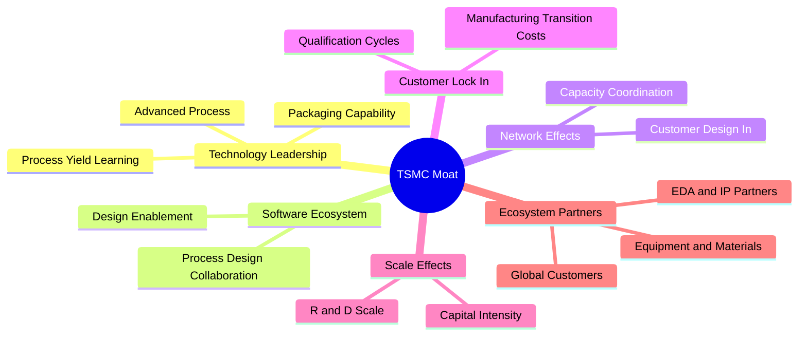
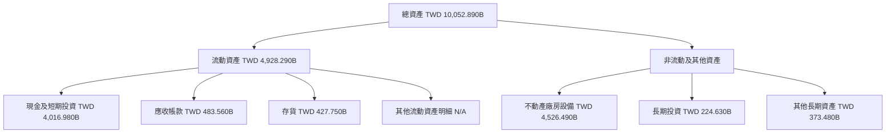
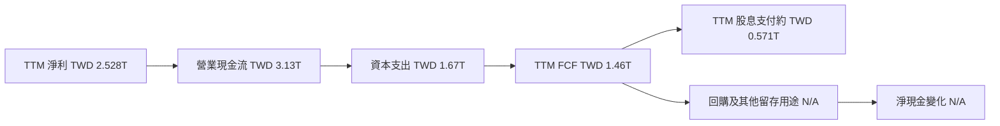
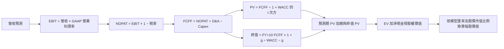
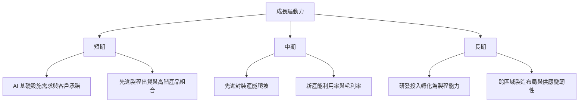
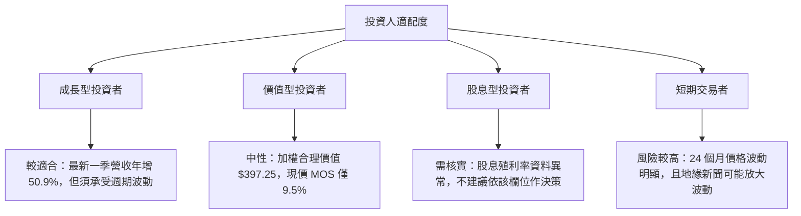

# TSM 基本面深度分析報告
> **報告日期**：2026-11-17 ｜ **語言**：繁體中文 ｜ **數據來源**：Yahoo Finance、Finviz、StockAnalysis、Roic.ai ｜ **分析師**：CFA 級機構研究

> **資料口徑提醒**：TSM 財務報表以 TWD 列示，股價以 USD 報價；本文換算統一採 2026-11-17 匯率 **1 USD = 32.92 TWD**。Yahoo Finance 與其他資料源個別欄位存在缺漏或口徑不一致，尤其是股數、股息殖利率、EV 及 EPS 預期值；涉及核心估值時優先採用程式計算的估值方法及 DCF 模型數字，不能核實之處明確標為 N/A。

## 目錄

| # | 章節 | 核心結論 |
|---|------|----------|
| 1 | 執行摘要 | 持有；加權合理價值 $397.25，MOS +9.5% |
| 2 | 公司概覽與商業模式 | 無晶圓廠代工模式具高技術、規模與客戶協作壁壘；市場份額數據未提供 |
| 3 | 損益表深度分析 | TTM 營收 TWD 4.94T；最新一季營收年增 50.9%，營業利益率 58.0% |
| 4 | 資產負債表分析 | 淨現金 TWD 2.95T；流動比率 2.584 |
| 5 | 現金流量深度分析 | TTM FCF TWD 1.46T；大型資本支出仍消耗大量營業現金流 |
| 6 | 獲利能力與資本效率 | WACC 10.71%；最新 ROIC 缺資料，無法量化當期 ROIC-WACC 利差 |
| 7 | 相對估值分析 | 同業估值法回推 $298.86–$367.56；DCF 基準值高於現價 |
| 8 | DCF 內在價值評估 | DCF 基準每股 $429.95；終值佔 EV 60.2%，估值對長期假設敏感 |
| 9 | 成長催化劑 | AI、先進製程及先進封裝可能支撐需求；TAM 與業務別收入數字未提供 |
| 10 | 風險矩陣 | 地緣政治、資本密集與估值假設為主要風險 |
| 11 | 投資建議 | 現價 $359.69 接近加權合理價值；等待 MOS 達 10% 以上再提高配置 |

## 1. 執行摘要

### 1.0 一頁式投資儀表板（Portfolio Manager 30 秒速讀）

| 項目 | 內容 |
|------|------|
| **投資論點（3 句）** | ① TTM 營收 TWD 4.94T，最新一季營收年增 50.9%，反映需求與出貨動能加速。② TTM 營業利益率 58.0%、FCF TWD 1.46T，獲利規模足以支應高額資本支出。③ 2026-11-17 收盤價 $359.69 對應加權合理價值 $397.25，MOS 僅 +9.5%，估值保護有限。 |
| **綜合評分** | **7.7/10**（引用 1.1 評分卡） |
| **財務健康** | 🟢 淨現金 TWD 2.95T、流動比率 2.584；高資本支出仍是主要現金用途 |
| **ROIC vs WACC** | 最新 ROIC：N/A；WACC：10.71%。缺乏同期 ROIC，無法確認當期價值創造利差 |
| **FCF 趨勢** | TTM FCF TWD 1.46T；FCF Yield **2.37%**。歷史年度 FCF 波動，受資本支出週期影響 |
| **估值** | Forward P/E **15.381x** ｜ EV/EBITDA：N/A（跨幣別口徑不可比）｜ FCF Yield **2.37%** |
| **DCF 內在價值（基準）** | **$429.95** ｜ 現價相對 DCF 折價 **16.3%**（折溢價定義以 DCF 為基準） |
| **安全邊際（MOS）** | **+9.5%**＝($397.25 − $359.69) ÷ $397.25；🔴 <10%，以加權合理價值為基準 |
| **預期報酬（基準情境 12M）** | **+19.5%**（DCF 基準情境每股價值相對現價；非獨立的 12 個月股價預測） |
| **關鍵風險（前二）** | 地緣政治及供應鏈中斷；資本支出高、終值佔 DCF EV 60.2% |
| **評級 + 信心度** | 🟡 **持有** ｜ 信心：中 |

**評級推導**：加權合理價值 $397.25、現價 $359.69，依 MOS 定義為 +9.5%，落在 −10% 至 +10% 的持有區間；FCF Yield 為 2.37%，而最新 ROIC 缺資料，無法用 ROIC 是否高於 WACC 佐證上調評級。**未作質化調整**。

### 1.1 綜合評分卡（全報告唯一）

| 維度 | 評分（1–10） | 主要依據（引用數字與其來源章節） |
|------|--------------|----------------------------------|
| 成長性 | 8.5 | 最新一季營收年增 50.9%；TTM 營收年增率 N/A（第 3 章） |
| 獲利能力 | 9.0 | TTM 營業利益率 58.0%、毛利率 65.8%；當期 ROIC、F-Score N/A（第 3、6 章） |
| 財務健康 | 8.5 | 淨現金 TWD 2.95T、流動比率 2.584、CCC 2 天（第 4 章） |
| 估值 | 5.0 | 加權合理價值 $397.25、MOS +9.5%；同業 EV/EBITDA 法回推 $298.86（第 7、8 章） |
| 護城河 | 9.0 | 先進製程製造、規模與客戶協作構成壁壘；市場份額數字未提供（第 2 章） |
| 管理層與資本配置 | 7.0 | FY2025 資本支出 TWD 1.28T、股息支付 TWD 466.78B；回購數據未提供（第 5 章） |
| **綜合評分** | **7.8** | 六項算術平均： (8.5 + 9.0 + 8.5 + 5.0 + 9.0 + 7.0) ÷ 6 = 7.833，四捨五入至一位小數為 **7.8** |

### 1.2 五大投資論點 + 三大核心風險

| 類型 | 項目 | 具體依據 | 信心度 |
|------|------|----------|--------|
| 🟢 **投資論點①** | 營收動能加速 | 2026Q3 營收 TWD 1.494T，年增 50.95%、季增 17.62%；高成長若延續，可提高固定成本吸收率 | 🟢 高 |
| 🟢 **投資論點②** | 獲利率高 | TTM 毛利率 65.8%、營業利益率 58.0%；若高階製程與封裝需求維持，營業槓桿可支持現金流 | 🟢 高 |
| 🟢 **投資論點③** | 現金流與資產負債表有韌性 | TTM OCF TWD 3.13T、FCF TWD 1.46T，淨現金 TWD 2.95T，可吸收投資波動 | 🟢 高 |
| 🟢 **投資論點④** | 客戶與製程協作壁壘 | 公司從事晶圓製造、封裝與測試；製程資格驗證與製造規模增加客戶轉換成本 | 🟡 中 |
| 🟢 **投資論點⑤** | 基準 DCF 尚高於市價 | 基準 DCF $429.95，較 $359.69 高 19.5%；但終值佔 EV 60.2%，須審慎看待 | 🟡 中 |
| 🟡 **風險①** | 地緣政治與供應鏈集中 | 公司營運與製造資產位於多個地區，但台灣相關地緣風險可能影響生產及出貨；衝擊幅度無資料可量化 | 🔴 高衝擊 |
| 🔴 **風險②** | 高資本支出與產能利用率 | TTM Capex TWD 1.67T，約為 TTM FCF 的 1.14 倍；若需求低於預期，折舊與閒置產能可能壓縮報酬 | 🔴 高衝擊 |
| 🟡 **風險③** | 估值對長期假設敏感 | DCF 終值佔 EV 60.2%；WACC 由 10.71% 升至 11.71%、g 維持 3.0% 時，每股估值由 $429.95 降至 $373.93 | 🟡 中高 |

### 1.3 快速統計卡片

| 指標 | 公司實際值（期間） | 同業中位數 | 狀態 |
|------|--------------------|------------|------|
| 營收成長（TTM） | **N/A**（資料缺漏） | — | 🟡 |
| 營收成長（最新一季年增） | **50.9%** | 20.9%（INTC、UMC、GFS 中位數） | 🟢 |
| 毛利率（TTM） | **65.8%** | 31.7%（三家同業中位數） | 🟢 |
| 營業利益率（TTM） | **58.0%** | — | 🟢 |
| ROIC（TTM） | **N/A** | — | 🟡 |
| Forward P/E | **15.381x** | 15.7x（INTC、UMC、GFS 中位數） | 🟢 |
| FCF Yield（TTM） | **2.37%** | — | 🟡 |
| Piotroski F-Score | **N/A / 9** | — | 🟡 |

### 1.4 投資結論

```text
╔══════════════════════════════════════════════════════════════════╗
║                    📊 投資結論摘要                               ║
╠══════════════════════════════════════════════════════════════════╣
║  評級：持有（MOS +9.5%，符合規則 20 的持有區間）                  ║
║  價格（2026-11-17 收盤）：$359.69                                ║
║  DCF 內在價值（基準）：$429.95（相對 DCF 折價 16.3%）             ║
║  安全邊際 MOS：+9.5%（＝(加權合理價值−現價)÷加權合理價值）       ║
║  加權合理價值（8.8）：$397.25                                    ║
║  DCF 情境價值：                                                   ║
║    悲觀情境：$183.51（-49.0%）                                   ║
║    基準情境：$429.95（+19.5%）                                   ║
║    樂觀情境：$953.56（+165.1%）                                  ║
║  綜合評分：7.8/10（引用 1.1）                                    ║
║  適合投資人：能承受半導體週期與地緣政治風險的長期成長型投資人    ║
╚══════════════════════════════════════════════════════════════════╝
```

## 2. 公司概覽與商業模式

### 2.1 業務結構與收入來源

公司提供晶圓製造、封裝、測試及積體電路等服務，但目前資料沒有提供各業務板塊營收金額或營收佔比；不能據此製作業務佔比圖或推算軟體、服務收入。公司 TTM 營收為 **TWD 4.94T（約 USD 150.23B）**，員工 76,907 人。

### 2.2 市場份額

市場份額數據未提供，因此不以臆測數字製作圖表。就已提供資料而言，TSM TTM 營收 TWD 4.94T，最新一季營收年增 50.9%，高於 INTC 20.9%、UMC 25.6% 與 GFS 12.5%；但三家公司業務結構不同，營收成長差異不能直接視為市佔率變化。

### 2.3 競爭護城河分析



### 2.4 護城河強度

| 護城河項目 | 強度（強／中／弱） | 證據（引用數字或事實） | 會削弱它的情況 |
|------------|--------------------|------------------------|----------------|
| 技術與製程 | 強 | TTM 營業利益率 58.0%、毛利率 65.8%，顯示高附加價值製造與成本吸收能力；細分製程市佔資料未提供 | 競爭者縮小製程、良率或效能差距 |
| 規模效應 | 強 | TTM 營收 TWD 4.94T、TTM Capex TWD 1.67T；規模使研發與設備投資得以分攤 | 產能利用率下滑，或投資超前需求 |
| 客戶鎖定 | 中至強 | 客戶需將設計、製程與量產流程適配晶圓廠；客戶轉換成本屬質化判斷，無財務數據量化 | 客戶多源採購增加、產品設計轉移 |
| 軟體生態系統 | 中 | 公司業務包含製程與製造服務；合作工具與生態收入未提供 | 設計工具或製程支援無法跟上客戶需求 |
| 網路效應 | 中 | 客戶與製程協作有互補性，但未提供可量化網路效應指標 | 替代供應商形成同等規模及協作網絡 |
| 生態夥伴 | 中 | 公司跨區域提供製造、封裝及測試服務；供應商與夥伴集中度未提供 | 設備、材料、能源或跨境物流中斷 |

1.1「護城河」評分 **9.0/10**，依據是高營業利益率、巨額研發與資本投入及製程協作壁壘；扣分原因是缺少市佔、製程節點營收與客戶集中度等可量化佐證。

## 3. 損益表深度分析

### 3.1 年度收入成長趨勢（近4年）

下表以 TWD 計，避免跨幣別混用。年度收入資料來自 Yahoo Finance / StockAnalysis.com。

```text
╔══════════════════════════════════════════════════════════════════╗
║                 TSM 年度收入趨勢（FY2022–FY2025）               ║
╠══════════════════════════════════════════════════════════════════╣
║  FY2022  TWD 2.264T  ███████████████░░░░░░░░░░░  YoY +42.61% 🟢 ║
║  FY2023  TWD 2.162T  ██████████████░░░░░░░░░░░░  YoY  -4.51% 🔴 ║
║  FY2024  TWD 2.894T  ███████████████████░░░░░░░  YoY +33.89% 🟢 ║
║  FY2025  TWD 3.809T  █████████████████████████░  YoY +31.61% 🟢 ║
╠══════════════════════════════════════════════════════════════════╣
║  FY2022–FY2025 CAGR = (3.809 ÷ 2.263891)^(1/3) − 1 ≈ 19.0%      ║
╚══════════════════════════════════════════════════════════════════╝
```

FY2023 收入下滑 4.51%，其後 FY2024、FY2025 連續反彈；兩年增幅均超過 30%。這顯示收入高度受半導體需求週期影響，近期成長改善明顯，但不應把復甦期增長直接外推為長期常態。

### 3.2 季度收入趨勢分析

| 季度 | 營收（TWD B） | QoQ 成長 | YoY 成長 | 備註 |
|------|---------------:|---------:|---------:|------|
| 2025Q4 | 1,046.090 | — | 20.45% | 去年第四季基期 |
| 2026Q1 | 1,134.103 | +8.41% | 35.13% | 以 2025Q4 比較 QoQ |
| 2026Q2 | 1,270.380 | +12.02% | 36.05% | 季度出貨與組合改善 |
| 2026Q3 | 1,494.243 | +17.62% | 50.95% | 成長進一步加速 |

QoQ 按連續季度營收計算：2026Q3 成長率 = (1,494.243 ÷ 1,270.380) − 1 = **17.62%**。2026Q3 的高年增與季增代表當期出貨動能強，但不能替代官方前瞻指引；TTM 營收成長率在指定資料中為 **N/A**。

### 3.3 利潤率演變分析

| 利潤率指標 | FY2022 | FY2023 | FY2024 | FY2025 | 趨勢 | 評估 |
|------------|-------:|-------:|-------:|-------:|------|------|
| **毛利率** | 59.6% | 54.4% | 56.1% | 59.9% | FY2023 下滑後回升 | 🟢 |
| **營業利益率** | 49.6% | 42.6% | 45.7% | 50.8% | FY2025 高於 FY2022 | 🟢 |
| **淨利率** | 43.9% | 39.4% | 40.0% | 44.6% | 近兩年回升 | 🟢 |

年度比率以各年度毛利、營業利益或淨利除以同年度收入計算，與 TTM 口徑不同。利潤率在 FY2023 下滑後回升，與營收復甦及產品組合、產能利用等因素相符；但資料未提供各製程節點佔比與單位成本，不能把改善精確拆分至單一因素。最新 TTM 毛利率 65.8%、營業利益率 58.0%，不宜與年度欄位直接視為同一期間比較。

### 3.4 費用結構分析

費用結構明細不完整：有研發費用歷史數據，但未提供 TTM 銷貨成本、研發、管理與銷售費用的完整拆分。為避免把缺項當作零或製造比例，**不繪製費用結構圓餅圖**。FY2025 研發費用為 TWD 246.43B，約佔該年收入 TWD 3.809T 的 6.47%；研發投入增加有助製程與產品能力，但也代表公司持續承擔高固定投入。

### 3.5 季度 EPS 趨勢與盈餘品質（Quality of Earnings）

過去四季 EPS 預期值與實際值均為 NaN，無法判定超預期或不及預期。可觀察到的單季 EPS 為 2025Q4 TWD 27.79、2026Q1 TWD 27.79、2026Q2 TWD 33.35、2026Q3 TWD 33.35；EPS 成長率分別為 34.97%、58.38%、77.40%、68.73%。

| 盈餘品質項目 | 數值/佔比 | 評估 |
|--------------|-----------|------|
| 股權薪酬 SBC / 營收 | TTM SBC 約 TWD 0.513B ÷ TWD 4,944.817B = **0.010%** | 🟢 目前比例很低；不代表未來 SBC 必然維持此水平 |
| SBC / 營業現金流 | TWD 0.513B ÷ TWD 3,130B ≈ **0.016%** | 🟢 相對 OCF 不重大 |
| FCF / 淨利（現金轉換率） | TWD 1.46T ÷ TWD 2.528T ≈ **57.8%** | 🟡 淨利大於 FCF，主要需結合高 Capex 評估 |
| 一次性/非經常性損益 | N/A（資料未提供可核實拆分） | 🟡 無法確認單次項目對淨利影響 |
| 有效稅率異常 | DCF 採用 17.0%（最新年度有效稅率） | 🟢 模型以所列稅率為基準；逐季稅率明細未提供 |
| 資本化支出 vs 費用化 | TTM Capex TWD 1.67T；資本化與費用化的會計細節 N/A | 🟡 資本投入龐大，折舊與未來產能利用率影響經濟盈餘 |

**盈餘品質結論**：SBC 比例很低，暫未顯示顯著稀釋問題；但 FCF 僅約為 TTM 淨利的 57.8%，核心原因是資本密集與 TTM Capex 高達 TWD 1.67T。GAAP 獲利具有現金流支撐，但評估股東可得現金時，應把維持與擴張性資本支出納入，而不能僅以淨利或 EPS 判斷。

## 4. 資產負債表分析

### 4.1 資產結構分解

以下使用 2026-09-30 StockAnalysis 資產負債表資料，金額 TWD B；列出已披露項目，不把未列細項反推成殘值。



### 4.2 流動性與營運資金分析

| 指標 | 最新值 | FY2025 值 | 評估 |
|------|-------:|----------:|------|
| Current Ratio | 2.584 | 3.817T ÷ 1.517T ≈ 2.52 | 🟢 短期流動資產覆蓋流動負債 |
| Quick Ratio | 2.287 | N/A（歷史值未提供） | 🟢 不含存貨後仍高於 1 |
| 現金及短期投資 | TWD 4.017T | TWD 3.068T | 🟢 現金緩衝充足 |

| 指標 | 最新 TTM | 一年前 TTM | 變化 | 解讀 |
|------|----------:|-----------:|------:|------|
| DSO 應收帳款天數 | 1 天 | N/A | N/A | 應收天數依指定資料口徑列示；一年以前數值未提供 |
| DIO 存貨天數 | 92 天 | N/A | N/A | 庫存週轉情況需與需求及產品組合共同判斷；無前年基準 |
| DPO 應付帳款天數 | 91 天 | N/A | N/A | 付款週期與供應商條件資料不足，不能判定議價力變化 |
| CCC 現金轉換週期 | 2 天 | N/A | N/A | 近零現金轉換週期支持營運資金效率；缺少一年前數值，無法判斷方向 |

### 4.3 債務結構分析

```text
╔══════════════════════════════════════════════════════════════════╗
║                   TSM 債務健康診斷                               ║
╠══════════════════════════════════════════════════════════════════╣
║  總債務：             TWD 1.07T  ██░░░░░░░░░░░░░░░░░░░░        ║
║  現金及短期投資：     TWD 4.02T  ████████████████████░░        ║
║  淨現金：             TWD 2.95T  ██████████████░░░░░░░░  🟢    ║
║                                                                  ║
║  Current Ratio：2.584x  🟢                                       ║
║  Quick Ratio：2.287x    🟢                                       ║
║  Debt/EBITDA：N/A（所列股價與財報幣別不同；未提供一致口徑）       ║
║  Interest Coverage：N/A（利息費用資料未提供）                    ║
╚══════════════════════════════════════════════════════════════════╝
```

淨現金 = TWD 4.02T − TWD 1.07T = TWD 2.95T（來源列示值）。這降低融資及利率風險，但不能消除產能投資風險：TTM Capex 為 TWD 1.67T，現金支出規模仍大。

### 4.4 股東權益趨勢

```text
╔══════════════════════════════════════════════════════════════════╗
║            TSM 股東權益變化（年度，TWD T）                       ║
╠══════════════════════════════════════════════════════════════════╣
║  FY2022  2.90  ████████████░░░░░░░░░░░░                          ║
║  FY2023  3.43  ██████████████░░░░░░░░░░                          ║
║  FY2024  4.24  █████████████████░░░░░░░                          ║
║  FY2025  5.36  ██████████████████████░░                          ║
╚══════════════════════════════════════════════════════════════════╝
```

FY2022 至 FY2025 股東權益由 TWD 2.90T 增至 TWD 5.36T，反映累積獲利與資本留存；權益增加可支持投資，但未提供股數回購與完整資本配置政策資料，不能單憑帳面權益增長判定每股價值創造程度。

## 5. 現金流量深度分析

### 5.1 現金流量瀑布圖

TTM 淨利採 StockAnalysis TTM 數據；OCF、Capex、FCF 採指定 TTM 數據。股息支付為季度資料加總；回購及淨現金變化未提供。



### 5.2 FCF 轉換率趨勢

| 財年 | OCF（TWD B） | Capex（TWD B） | FCF（TWD B） | 淨利（TWD B） | FCF / 淨利 |
|------|-------------:|---------------:|-------------:|--------------:|-----------:|
| FY2022 | 1,610 | 1,090 | 520.97 | 992.92 | 52.5% |
| FY2023 | 1,240 | 955.40 | 286.57 | 851.74 | 33.6% |
| FY2024 | 1,830 | 964.98 | 861.20 | 1,158.38 | 74.3% |
| FY2025 | 2,270 | 1,280 | 992.38 | 1,697.60 | 58.5% |

現金轉換率在 33.6%–74.3% 間波動，反映資本支出週期及營運現金流不同步。FY2025 淨利增加，但 Capex 亦升至 TWD 1.28T，令 FCF 增幅低於淨利增幅。

### 5.3 自由現金流趨勢

```text
╔══════════════════════════════════════════════════════════════════╗
║                 自由現金流：歷史實際值（TWD B）                   ║
╠══════════════════════════════════════════════════════════════════╣
║  FY2022  520.97  ███████████░░░░░░░░░░░░  FCF Yield：N/A        ║
║  FY2023  286.57  ██████░░░░░░░░░░░░░░░░░░  FCF Yield：N/A        ║
║  FY2024  861.20  ██████████████████░░░░░░  FCF Yield：N/A        ║
║  FY2025  992.38  █████████████████████░░░  FCF Yield：N/A        ║
║  TTM    1,460.00 ████████████████████████  FCF Yield：2.37%      ║
╚══════════════════════════════════════════════════════════════════╝
```

歷史年度 FCF Yield 未提供可比的市值日期，故不填；TTM FCF Yield 直接引用 **2.37%**。近年 FCF 上升，但季度 Capex 不均，單季 FCF 不能直接年化。

### 5.4 資本配置評估

資本配置的已知數字為 FY2025 Capex TWD 1.28T、現金股息支付 TWD 466.78B，以及年度 FCF TWD 992.38B；沒有回購金額與完整留存現金用途。由於各項口徑並非完整且不構成互斥資金分配，**不以不完整數字繪製圓餅圖**。

| 項目 | 已知數值 | 評估 |
|------|---------:|------|
| FY2025 Capex | TWD 1.28T | 用於產能與技術投資；需持續檢驗新增產能回報 |
| FY2025 現金股息支付 | TWD 466.78B | 股東現金回饋增加，但不代表未來股息固定 |
| FY2025 FCF | TWD 992.38B | 扣除投資後仍為正值 |
| 回購、併購及留存現金用途 | N/A | 缺資料，無法完整比較資本配置優先順序 |

## 6. 獲利能力與資本效率

### 6.1 ROE / ROA / ROIC 趨勢

| 指標 | 可得數據 | 評估 |
|------|----------|------|
| ROE | TTM 41.9% | 🟢 股東權益報酬高；杜邦分解依 QUALITY FIGURES 為 N/A |
| ROA | TTM 20.6% | 🟢 資產報酬表現高，但應考慮大型在建及新建產能 |
| ROIC | 最新 TTM N/A | 🟡 缺少可按一致口徑計算的投入資本與 NOPAT |
| 歷史 Return on Capital | Roic.ai 2018 年 20.61% | 僅歷史參考，不可代替 2026 TTM ROIC |
| WACC | 10.71% | 直接採用資本成本區塊數值 |

同業 ROIC 均值未提供，不作無來源比較。

### 6.2 ROIC vs WACC 分析（核心價值創造判斷）

```text
╔══════════════════════════════════════════════════════════════════╗
║                ROIC vs WACC 深度分析                            ║
╠══════════════════════════════════════════════════════════════════╣
║  WACC（直接採用資本成本資料）：10.71%                            ║
║  ├── 無風險利率：5.10%                                           ║
║  ├── ERP：5.00%                                                  ║
║  ├── 原始 Beta：1.23；調整後 Beta：1.16                          ║
║  ├── 所列股權成本 Ke：10.88%                                     ║
║  ├── 稅前債務成本：1.16%；有效稅率：17.0%                        ║
║  ├── 股權／債務權重：98.3%／1.7%                                 ║
║  └── WACC：10.71%                                                ║
║                                                                  ║
║  最新 ROIC：N/A（未提供可核實的同期數值）                         ║
║  EVA = ROIC − WACC：N/A                                          ║
║                                                                  ║
║  結論：獲利率高，但缺少最新 ROIC，無法量化當期是否超額創造價值   ║
╚══════════════════════════════════════════════════════════════════╝
```

所列 CAPM 數據存在小幅算式差異：使用展示值計算，`5.10% + 1.16 × 5.00% = 10.90%`，與資料所列股權成本 **10.88%** 不同。因規定採用資本成本資料中的 WACC，本報告沿用 **10.71%**，不另行重算或替換。債務利息費用與平均計息負債金額未提供，無法獨立重建債務成本及資本權重。最新 ROIC 為 N/A，因此不能直接判定目前 ROIC 是否高於 WACC；Roic.ai 2018 年 Return on Capital 20.61% 只是歷史資料，不能與最新 WACC 當作同期比較。

### 6.3 杜邦三因素分解

| 因素 | 數值（TTM） | 解讀 |
|------|-------------|------|
| 淨利率 | N/A | QUALITY FIGURES 缺少可核實的杜邦三因素輸入 |
| 資產週轉率 | N/A | 同上 |
| 權益乘數 | N/A | 同上 |
| **ROE** | **N/A（杜邦分解）** | QUALITY FIGURES 註明淨利、營收、總資產或正權益條件不足，未提供可照抄的分解結果 |

雖另有 TTM ROE 41.9%，但不能用缺少口徑的資料自行拼出杜邦分解。

### 6.4 財務體質：Piotroski F-Score

**Piotroski F-Score：N/A**，因所需的一年前 SEC 申報資料比較期不足，九項測試結果均未提供，不能逐項補判。

| 測試 | 結果 | 解讀 |
|------|------|------|
| 九項 Piotroski 測試 | N/A | 缺少可照抄的逐項結果；不把缺資料視為通過或未通過 |

## 7. 相對估值分析

### 7.1 同業估值比較表格

同業倍數採 Yahoo Finance 同業數據。TSM 與同業財報幣別不同，故不填未能核實的 TSM P/S、EV/EBITDA 比率。

| 估值指標 | **TSM** | **INTC** | **UMC** | **GFS** | TSM 評估 |
|----------|--------:|---------:|--------:|-------:|-----------|
| **Trailing P/E** | 23.311x | N/A | 13.3x | 113.1x | 🟡 公司 TTM P/E 位於已提供同業區間內；盈利結構差異大 |
| **Forward P/E** | 15.381x | 30.8x | 15.7x | 15.2x | 🟢 低於 INTC，接近 UMC、GFS |
| **P/S Ratio** | N/A | 4.9x | N/A（混合幣別） | 3.1x | 🟡 TSM 跨幣別不能直接比較 |
| **EV/EBITDA** | N/A | 16.0x | N/A（混合幣別） | 10.6x | 🟡 TSM 跨幣別不能直接比較 |
| **最新一季營收年增** | 50.9% | 20.9% | 25.6% | 12.5% | 🟢 TSM 高於三家同業 |
| **毛利率（TTM）** | 65.8% | 40.2% | 31.7% | 28.5% | 🟢 高於三家同業 |

Forward P/E 的同業中位數為 **15.7x**；三家同業最新一季營收年增中位數為 **20.9%**，TTM 毛利率中位數為 **31.7%**。同業倍數反映不同製程、業務組成與獲利週期，不能單獨視為精確公允價值。

### 7.2 歷史估值區間分析

N/A（數據未提供：缺少「Valuation vs own history」估值區間與百分位數據）。24 個月價格歷史本身不能替代歷史 P/E 或估值百分位，故不推算當前估值所處分位。

### 7.3 情境價值（Bear / Base / Bull，照抄 DCF MODEL 的 Scenarios）

| 情境 | 第 1 年營收成長 | 期末營業利潤率 | WACC | 每股價值 | 相對現價 | 機率 | 會發生的條件 |
|------|----------------:|----------------:|-----:|---------:|---------:|-----:|--------------|
| 🔴 悲觀 | 15.0% | 42.1% | 11.71% | $183.51 | -49.0% | 25% | 需求放緩、競爭或成本壓力使長期利潤率明顯下滑，折現率上升 |
| 🟡 基準 | 30.0% | 49.5% | 10.71% | $429.95 | +19.5% | 50% | 高成長逐步放緩，營業利潤率從 58.0% 漸降至 49.5% |
| 🟢 樂觀 | 45.0% | 54.5% | 9.71% | $953.56 | +165.1% | 25% | 高需求持續、獲利率維持較高水準，資本成本下降 |

### 7.4 相對估值隱含價格區間

```text
╔══════════════════════════════════════════════════════════════════╗
║               相對估值回推每股價值（USD）                       ║
╠══════════════════════════════════════════════════════════════════╣
║  $298.86 ─────── $359.69 ─────── $367.56                         ║
║  EV/EBITDA法       現價            Forward P/E法                  ║
╚══════════════════════════════════════════════════════════════════╝
```

| 方法 | 每股價值 | 相對現價 | 依據 |
|------|---------:|---------:|------|
| 同業 Forward P/E | $367.56 | +2.2% | 同業中位數 15.7x × Forward EPS 23.39 |
| 同業 EV/EBITDA | $298.86 | -16.9% | INTC、GFS 中位數 13.3x × TTM EBITDA，再加淨現金 |

同業估值法顯示 $298.86–$367.56 的回推區間；其結果明顯依賴所選同業與各自週期，適合作為交叉檢驗，而非唯一價值錨。

## 8. DCF 內在價值評估（Discounted Cash Flow）

### 8.0 估值推理鏈（Thinking Logic）

**Step 1 — 價值來源與主導變數**

本模型以晶圓製造、封裝與測試所產生的整體 FCFF 作估值，業務別營收佔比未提供，不能把「AI」、「先進製程」或其他產品線拆為獨立營收曲線。估值主導變數是 **WACC、終值成長率 g 與逐年 FCFF**：基準模型終值現值佔企業價值 60.2%，因此長期現金流假設對價值影響重大。

**Step 2 — 模型選擇**

| 決策點 | 本報告採用 | 理由（含數字） | 曾考慮但否決 | 否決理由 |
|--------|-----------|----------------|--------------|----------|
| 現金流定義 | FCFF | 以 WACC 折現並估算企業價值；模型定義 FCFF = NOPAT + D&A − Capex | FCFE | 模型已指定 FCFF，且資本結構權重提供 |
| 預測期 N | 10 年 | DCF MODEL 固定採 10 年逐年預測 | 5 年 | 不符合指定模型，且不自行改建模型 |
| 終值方法 | Gordon Growth | 模型提供永續成長率 3.0% 與終值數值 | 退出倍數 | 終值倍數未提供，不自行另建 |
| EBIT 基礎 | GAAP EBIT | 模型指明採 GAAP EBIT | 非 GAAP EBIT | 可能造成 SBC 重複或漏扣 |

**Step 3 — 高／中敏感度假設推導**

- **營收路徑**：錨點＝最新一季營收年增 50.9%，不是 TTM 成長率；TTM 成長率 N/A。調整＝避免單季高增直接外推，模型將 FY+1 增長限制在 30.0%，再線性降至 FY+10 的 3.0%。**採用：30.0% 至 3.0% 的逐年遞減路徑**。曾考慮把 50.9% 作為第一年成長率，因其為單季而非 TTM 且模型已限定最高 30%，故不採用。
- **營業利潤率**：錨點＝TTM 58.0%；模型終點取最近五個財年的中位數並包含 TTM。**採用 FY+1 58.0% 逐步降至 FY+10 49.5%**。曾考慮全期維持 58.0%，但這會忽略模型所採歷史中位數收斂。
- **永續成長率 g**：錨點＝模型採 3.0%；長期成長須低於 WACC 10.71%。**採用 3.0%**。不採用高於或接近 WACC 的成長率，因會造成終值不穩定；其他替代值不由本報告自建。
- **預測期 N**：錨點＝指定 DCF MODEL 為 10 年。**採用 10 年**。未改用較短期間，以避免違反唯一模型數字口徑。
- **Capex / 營收**：錨點＝TTM 33.8%；模型自 FY+1 的 33.8% 降至 FY+10 的 16.6%，並依模型規則在高於 D&A 的情況下逐步收斂。**採用模型既定逐年值**。不採用固定低 Capex 比率，因公司目前仍處於資本密集階段。
- **WACC**：錨點＝資本成本資料給定 10.71%。**採用 10.71%**；不另行自建 WACC。其 CAPM 展示值有 0.02 個百分點的算式差異，詳見 8.2。
- **EBIT 與 SBC**：採用 GAAP EBIT，SBC 已在費用中；**年稀釋率 0%**，固定股數，不再額外扣 SBC。資料未提供逐年稀釋率，本模型組合 (A) 不另加稀釋。
- **有效稅率**：錨點＝所列最新年度有效稅率 17.0%；模型採 17.0%。
- **D&A / 營收**：錨點＝TTM 15.1%；模型維持 15.1%。
- **營運資金變動**：指定模型不建模；不是設定為零後另計，而是直接不納入 FCFF。
- **終值方法**：採 Gordon Growth，終值以 FY+10 FCFF 計算；退出倍數未提供，故不補入。

**Step 4 — 最脆弱環節**

最脆弱的一環是高成長期轉入成熟期的營收與 Capex 路徑；若成長或利潤率低於基準，價值可能向悲觀情境 **$183.51** 靠攏；WACC、g 的具體敏感性見 8.6。

**Step 5 — 計算路徑圖**



### 8.1 模型假設總表（Model Inputs）

| 假設項目 | 採用值 | 依據 / 來源 | 敏感度 |
|----------|--------|-------------|--------|
| 預測期長度 N | 10 年 | DCF MODEL 指定預測期 | 🟡 中 |
| 營收成長 | FY+1 30.0% 線性降至 FY+10 3.0% | 最新一季 YoY 50.9%；TTM 成長 N/A；模型把第一年限制在 30% | 🔴 高 |
| 營業利潤率 | FY+1 58.0% → FY+10 49.5% | TTM 58.0%；終點取最近五財年中位數，含 TTM | 🔴 高 |
| 有效稅率 | 17.0% | 最新年度有效稅率及 DCF MODEL | 🟢 低 |
| Capex / 營收 | FY+1 33.8% → FY+10 16.6% | TTM 33.8%；模型逐步向 1.1 × D&A 收斂 | 🔴 高 |
| D&A / 營收 | 15.1% | TTM 比率，模型維持固定 | 🟢 低 |
| ΔWC / 營收增額 | 未建模 | DCF MODEL 明確不建模營運資金變動 | 🟢 低 |
| EBIT 基礎 | GAAP EBIT | 模型指定 GAAP EBIT | 🟡 中 |
| SBC 處理 | 組合 (A)：不另扣 SBC | GAAP EBIT 已含 SBC 費用 | 🟡 中 |
| 年稀釋率 | 0%（模型固定股數） | 與組合 (A) 一致；DCF MODEL 指定不再稀釋 | 🟡 中 |
| 永續成長率 g | 3.0% | DCF MODEL 指定；低於 WACC | 🔴 高 |
| 終值方法 | Gordon Growth | DCF MODEL 已提供公式與終值 | 🔴 高 |
| WACC | 10.71% | 資本成本資料直接給定；詳見 8.2 | 🔴 高 |

FCFF 定義為 **FCFF = NOPAT + D&A − Capex**；營運資金變動不建模。**本模型採用 (A)，故 SBC 影響已計入一次：GAAP EBIT 已含 SBC，不再扣除 SBC，且年稀釋率設為 0%。**

### 8.2 折現率推導（WACC）

```text
╔══════════════════════════════════════════════════════════════════╗
║                    WACC 推導（折現率）                           ║
╠══════════════════════════════════════════════════════════════════╣
║  股權成本 Ke（CAPM，採資料所列數值）：                           ║
║  ├── 無風險利率 Rf：5.10%                                        ║
║  ├── ERP：5.00%                                                  ║
║  ├── 原始 Beta：1.23；調整後 Beta：1.16                          ║
║  ├── Beta 調整：2/3 × 1.23 + 1/3 × 1 = 1.153 ≈ 1.16             ║
║  └── 所列 Ke：10.88%                                             ║
║      展示值直接計算：5.10% + 1.16 × 5.00% = 10.90%               ║
║      與所列 Ke 差 0.02 個百分點；本報告不另改模型輸入             ║
║                                                                  ║
║  債務成本：稅前 1.16%；有效稅率 17.0%                            ║
║  資本權重：股權 98.3%；債務 1.7%                                 ║
║  WACC：直接採用 10.71%                                            ║
╚══════════════════════════════════════════════════════════════════╝
```

WACC 的完整底層算式無法由現有資料獨立複算：利息費用、平均計息負債、期末計息負債的同口徑明細，以及 E/D 絕對金額未完整提供。依優先規則，**採用已列 WACC 10.71%**，不另建 WACC。使用所列 Ke 10.88%、稅後 Kd `1.16% × (1 − 17.0%) = 0.9628%` 與權重，約得 `98.3% × 10.88% + 1.7% × 0.9628% = 10.7114% ≈ 10.71%`。這只是對已列權重與成本作算術檢查，不能替代缺失的負債與市值明細。第 6.2 節與本節均採 10.71%。

### 8.3 逐年自由現金流預測（基準情境）

金額單位 **TWD B**；折現因子引用 DCF MODEL，保留三位小數。ΔWC 未建模，故不列該行。

| 年度 | FY+1 | FY+2 | FY+3 | FY+4 | FY+5 | FY+6 | FY+7 | FY+8 | FY+9 | FY+10 |
|------|-----:|-----:|-----:|-----:|-----:|-----:|-----:|-----:|-----:|------:|
| 營收 | 6,428.26 | 8,163.89 | 10,123.23 | 12,249.11 | 14,453.94 | 16,622.04 | 18,616.68 | 20,292.18 | 21,509.71 | 22,155.00 |
| 營收 YoY | 30.0% | 27.0% | 24.0% | 21.0% | 18.0% | 15.0% | 12.0% | 9.0% | 6.0% | 3.0% |
| 營業利潤率 | 58.0% | 57.0% | 56.1% | 55.2% | 54.2% | 53.3% | 52.3% | 51.4% | 50.5% | 49.5% |
| EBIT（GAAP） | 3,726.88 | 4,656.49 | 5,679.00 | 6,756.58 | 7,837.06 | 8,856.56 | 9,744.56 | 10,431.05 | 10,854.96 | 10,972.60 |
| − 稅 | (632.56) | (790.34) | (963.90) | (1,146.79) | (1,330.18) | (1,503.22) | (1,653.94) | (1,770.46) | (1,842.41) | (1,862.38) |
| = NOPAT | 3,094.32 | 3,866.14 | 4,715.10 | 5,609.79 | 6,506.88 | 7,353.34 | 8,090.62 | 8,660.59 | 9,012.55 | 9,110.22 |
| + D&A | 970.20 | 1,232.15 | 1,527.86 | 1,848.72 | 2,181.48 | 2,508.71 | 2,809.75 | 3,062.63 | 3,246.39 | 3,343.78 |
| − Capex | (2,171.05) | (2,601.47) | (3,032.68) | (3,435.84) | (3,778.51) | (4,028.15) | (4,156.32) | (4,143.23) | (3,981.42) | (3,678.16) |
| **= FCFF** | **1,893.46** | **2,496.82** | **3,210.29** | **4,022.67** | **4,909.85** | **5,833.90** | **6,744.04** | **7,579.99** | **8,277.52** | **8,775.85** |
| 折現因子 @10.71% | 0.903 | 0.816 | 0.737 | 0.666 | 0.601 | 0.543 | 0.491 | 0.443 | 0.400 | 0.362 |
| **FCFF 現值 PV** | **1,710.29** | **2,037.11** | **2,365.84** | **2,677.75** | **2,952.15** | **3,168.42** | **3,308.40** | **3,358.77** | **3,313.03** | **3,172.69** |

預測期現值加總：

`1,710.29 + 2,037.11 + 2,365.84 + 2,677.75 + 2,952.15 + 3,168.42 + 3,308.40 + 3,358.77 + 3,313.03 + 3,172.69 = 28,064.45 TWD B`

DCF MODEL 列示合計為 **TWD 28,064.43B**，與以表內兩位小數逐項相加的差額為 TWD 0.02B，屬個別年度未顯示小數造成的四捨五入差異；估值沿用模型合計。

**FY+1 逐步演算**（表中值取至兩位小數，年度原模型有更高精度）：

1. **營收** = TTM 營收 4,944.82 × (1 + 30.0%) = 6,428.266 ≈ **6,428.26 TWD B**
2. **EBIT** = 6,428.26 × 58.0% = 3,728.39 TWD B；模型表列 **3,726.88 TWD B**，兩者不相等，顯示模型精度或展示口徑未完全一致；遵守規則 19，沿用模型 EBIT 及下列現金流，不自行改模型。
3. **稅** = 模型列示 EBIT × 17.0% = 632.56 TWD B（依模型列值）
4. **NOPAT** = 3,726.88 − 632.56 = **3,094.32 TWD B**
5. **D&A** = 模型列示 **970.20 TWD B**
6. **Capex** = 模型列示 **2,171.05 TWD B**
7. **FCFF** = 3,094.32 + 970.20 − 2,171.05 = **1,893.47 TWD B**；模型列示 **1,893.46 TWD B**，差額屬列示精度。
8. **折現因子** = 模型列示 **0.903**；模型 PV = **1,710.29 TWD B**。表內顯示值相乘會有四捨五入誤差，DCF MODEL 採用未顯示精度計算。

因 DCF MODEL 各年度明細存在上述微小算式差異，本報告不以表內四捨五入值改寫模型結果；企業價值與每股價值均引用模型原值。

**合理性自檢**

- FY+1 至 FY+10 FCFF CAGR：`(8,775.85 ÷ 1,893.46)^(1/9) − 1 ≈ 18.6%`；FY2023–FY2025 實際 FCF CAGR 約 `(992.38 ÷ 286.57)^(1/2) − 1 ≈ 86.1%`，但歷史基期低且波動大，不能直接視為可持續增長率。
- FY+10 FCFF 利潤率約 `8,775.85 ÷ 22,155.00 = 39.6%`；目前 TTM 約 `1,460 ÷ 4,944.82 = 29.5%`。模型隱含現金流率改善，且同業最佳 FCF 利潤率未提供，不作比較。
- 模型預測期各年 FCFF 均為正值；高 Capex 已在各年度 FCFF 中扣除。

```text
╔══════════════════════════════════════════════════════════════════╗
║            自由現金流：歷史實際 vs 模型預測（TWD B）             ║
╠══════════════════════════════════════════════════════════════════╣
║  FY2023（實）   286.57  █░░░░░░░░░░░░░░░░░░░░░░░               ║
║  FY2024（實）   861.20  ██░░░░░░░░░░░░░░░░░░░░░░                ║
║  FY2025（實）   992.38  ███░░░░░░░░░░░░░░░░░░░░░               ║
║  FY+1（預）   1,893.46  █████░░░░░░░░░░░░░░░░░░░               ║
║  FY+10（預）  8,775.85  ████████████████████████               ║
╠══════════════════════════════════════════════════════════════════╣
║  模型 FCF CAGR 約 18.6%；歷史兩年 CAGR 約 86.1%，基期不可直接外推║
╚══════════════════════════════════════════════════════════════════╝
```

### 8.4 終值計算（Terminal Value）

**適用性檢查**：`WACC 10.71% vs g 3.0% → WACC > g？✅`

| 方法 | 計算式 | 終值 TV | TV 現值 | 佔總 EV 比重 |
|------|--------|---------:|--------:|-------------:|
| Gordon Growth | 8,775.85 × (1 + 3.0%) ÷ (10.71% − 3.0%) | TWD 117,241.78B | TWD 42,385.88B | 60.2% |
| 退出倍數法 | N/A（終值退出倍數未提供；不另建模型） | N/A | N/A | N/A |

逐步演算（Gordon Growth）：

1. FY+10 FCFF = **TWD 8,775.85B**。
2. 分子 = `8,775.85 × 1.03 = 9,039.1255 TWD B`。
3. 分母 = `10.71% − 3.0% = 7.71%`；TV = `9,039.1255 ÷ 7.71% = 117,241.57 TWD B`。模型列示 **TWD 117,241.78B**，微差來自原始年度未四捨五入數字，報告沿用模型值。
4. PV(TV) = 模型列示 **TWD 42,385.88B**。
5. 終值佔比 = `42,385.88 ÷ 70,450.32 = 60.2%`。

模型折現因子以三位小數呈現，使用該顯示值與 TV 相乘會有四捨五入差異；採用 DCF MODEL 的 PV(TV) 原值。

### 8.5 企業價值 → 每股內在價值（Bridge）

```text
╔══════════════════════════════════════════════════════════════════╗
║              企業價值 → 每股內在價值 橋接表                      ║
╠══════════════════════════════════════════════════════════════════╣
║  預測期 FCF 現值合計             +TWD 28,064.43B                 ║
║  終值現值 PV(TV)                 +TWD 42,385.88B                 ║
║  = 企業價值 EV                    TWD 70,450.32B                  ║
║  + 淨現金                         +TWD 2,947.23B                  ║
║  = 股權價值                       TWD 73,397.54B                  ║
║                                                                  ║
║  匯率：0.0303813 USD per TWD；價格／市值換算沿用 DCF MODEL       ║
║  ★ 每股內在價值（DCF 基準）       $429.95                         ║
║    2026-11-17 收盤價               $359.69                         ║
║    折溢價（現價÷DCF價值−1）        -16.3%（折價）                 ║
╚══════════════════════════════════════════════════════════════════╝
```

逐步演算（沿用模型原值）：

1. **EV** = `TWD 28,064.43B + TWD 42,385.88B = TWD 70,450.31B`；模型列示 **TWD 70,450.32B**，差異為底層未四捨五入值造成。
2. **股權價值** = 模型列示 `EV TWD 70,450.32B + 淨現金 TWD 2,947.23B`，模型列示 **TWD 73,397.54B**；以展示值直接相加為 TWD 73,397.55B，差 TWD 0.01B。
3. **每股內在價值**：模型指定換算式為「股權價值 × FX × 價格 ÷ 市值」，並以 DCF MODEL 的原始未四捨五入輸入計得 **$429.95**。市場資料另列 5.19B 股，但模型的換算方式及市值口徑不能由顯示數字精確還原為單純的股權價值除以該股數，故不混用兩者重算。
4. **折溢價** = `現價 ÷ DCF 基準內在價值 − 1 = 359.69 ÷ 429.95 − 1 = -16.3%`。
5. **本節不計算 MOS**；MOS 僅以 8.8 加權合理價值為分母。

現金與債務採 2026-09-30 TTM 資產負債表口徑的淨現金 **TWD 2,947.23B**。本模型組合 (A) 固定股數、不另外計稀釋；但每股換算依模型指定使用匯率與價格／市值比例。

### 8.6 敏感性分析（WACC × 永續成長率）

下表照抄 DCF MODEL 每股價值；括號內上行空間以 `估值 ÷ $359.69 − 1` 計算並四捨五入至一位小數。

| g（列）／WACC（欄） | 8.71% | 9.71% | **10.71%（基準）** | 11.71% | 12.71% |
|-----------|------:|------:|-------------------:|-------:|-------:|
| **2.0%** | $539.97 (+50.1%) | $460.17 (+27.9%) | $399.31 (+11.0%) | $351.49 (-2.3%) | $313.03 (-13.0%) |
| **2.5%** | $569.07 (+58.2%) | $480.25 (+33.5%) | $413.69 (+15.0%) | $362.10 (+0.7%) | $321.03 (-10.8%) |
| **3.0%（基準）** | $603.25 (+67.7%) | $503.33 (+40.0%) | **$429.95 (+19.5%)** | $373.93 (+4.0%) | $329.87 (-8.3%) |
| **3.5%** | $644.00 (+79.0%) | $530.12 (+47.4%) | $448.46 (+24.7%) | $387.19 (+7.6%) | $339.66 (-5.6%) |
| **4.0%** | $693.41 (+92.8%) | $561.61 (+56.1%) | $469.72 (+30.6%) | $402.18 (+11.8%) | $350.58 (-2.5%) |

矩陣中所有列示組合皆滿足 WACC > g。

**代表格重算限制**：模型只提供已計算矩陣，未提供每個敏感度格的逐年折現因子、未四捨五入 FCFF 及完整橋接輸入；依規則 19 不重建模型。矩陣非基準格的數值直接引用 DCF MODEL，不能聲稱已用顯示數字獨立複算。

**三情境 DCF（照抄模型情境）**

| 情境 | 第 1 年營收成長 | 期末營業利潤率 | WACC | 每股內在價值 | 相對現價 | 機率 |
|------|----------------:|----------------:|-----:|--------------:|---------:|-----:|
| 🔴 悲觀 | 15.0% | 42.1% | 11.71% | $183.51 | -49.0% | 25% |
| 🟡 基準 | 30.0% | 49.5% | 10.71% | $429.95 | +19.5% | 50% |
| 🟢 樂觀 | 45.0% | 54.5% | 9.71% | $953.56 | +165.1% | 25% |
| **機率加權** | — | — | — | **$499.24** | **+38.8%** | **100%** |

情境的逐年營收、FY+10 FCFF 與情境別終值未提供；為遵守不得另建 DCF 的要求，不虛構逐情境推導鏈。模型提供的加權檢查為 `183.51 × 25% + 429.95 × 50% + 953.56 × 25% = 499.24`（按模型未四捨五入數值計）。

**敏感度結論（直接引用模型矩陣）**

- **g +1 個百分點**（2.0% 至 3.0%，WACC 10.71%）：$399.31 → $429.95，增加 **$30.64，約 +7.7%**。
- **WACC +1 個百分點**（10.71% 至 11.71%，g 3.0%）：$429.95 → $373.93，減少 **$56.02，約 -13.0%**。
- **期末營業利潤率每 +1 個百分點**：資料未提供此單一變數的敏感度矩陣，故為 **N/A**，不自建模型。
- 模型已提供的兩項敏感度中，WACC 變動影響大於 g 由 2.0% 至 3.0% 的影響；與 8.0 所述終值折現及長期假設主導估值一致。

### 8.7 反推 DCF（Reverse DCF：市場在預期什麼）

| 求解的變數（一次一個） | 其餘變數設定 | 市場隱含值（令 DCF = 現價） | 公司歷史實際 | 判斷 |
|------------------------|--------------|------------------------------|--------------|------|
| 第 1 年營收成長 | 其他輸入固定基準值 | **25.1%** | FY2022–FY2025 收入 CAGR 約 19.0%；最新一季 YoY 50.9% | 🟡 高於多年年度 CAGR，低於基準 30.0% |
| 固定營業利潤率 | 其他輸入固定基準值 | **43.5%** | 最新 TTM 58.0%；FY2025 50.8% | 🟡 低於目前與近年年度水準 |
| 永續成長率 g | N/A | N/A（未提供求解結果） | — | 不推算 |
| 預測期 N | N/A | N/A（未提供求解結果） | — | 不推算 |

現有反推結果只有兩項，且未提供完整試算軌跡、試算點與誤差；不補寫虛構疊代表。已知的市場隱含營收成長 25.1% 低於 DCF 基準第一年 30.0%，而隱含固定營業利潤率 43.5% 低於當前 TTM 58.0%。這表示在該模型口徑下，現價並不要求完全實現基準模型的高利潤率路徑，但仍假設公司能維持長期成長與可觀獲利。

### 8.8 估值三角驗證與安全邊際

| 估值方法 | 隱含每股價值 | 上行空間（÷現價） | 權重 | 說明 |
|----------|--------------:|-------------------:|-----:|------|
| DCF（基準） | $429.95 | +19.5% | 40% | 10 年 FCFF、WACC 10.71%、g 3.0% |
| 同業 Forward P/E | $367.56 | +2.2% | 25% | 同業中位數 15.7x × Forward EPS 23.39 |
| 同業 EV/EBITDA | $298.86 | -16.9% | 25% | 同業中位數 13.3x，加入淨現金 |
| 分析師共識目標價 | $586.69 | +63.1% | 10% | 20 位分析師平均目標價，參考性較高、可驗證性較低 |
| **加權合理價值** | **$397.25** | **+10.4%** | **100%** | 盈利型公司固定權重 |

逐步演算：

`$429.95 × 40% + $367.56 × 25% + $298.86 × 25% + $586.69 × 10%`
`= $171.98 + $91.89 + $74.715 + $58.669`
`= $397.254 ≈ $397.25`

權重合計 `40% + 25% + 25% + 10% = 100%`。模型列示加權合理價值為 **$397.25**；加總後保留兩位小數。四項估值方法均納入，無方法被剔除。

```text
╔══════════════════════════════════════════════════════════════════╗
║                  估值區間與安全邊際                              ║
╠══════════════════════════════════════════════════════════════════╣
║  $183.51 ───── $359.69 ───── [$397.25] ───── $429.95 ─── $953.56║
║  悲觀DCF       現價           加權合理值       基準DCF       樂觀DCF║
║                                                                  ║
║  MOS = (397.25 − 359.69) ÷ 397.25 = +9.5%                       ║
║  上行空間 = (397.25 − 359.69) ÷ 359.69 = +10.4%                 ║
║  MOS 評估：🔴 <10%，安全邊際不足                                 ║
║                                                                  ║
║  建議買入區間：$0 – $357.53（對應 MOS ≥ 10%；不代表合理下限）    ║
║  合理持有區間：$357.53 – $436.98（約對應 MOS +10% 至 -10%）     ║
║  減碼考慮區間：高於 $953.56，僅作情境上緣參考                    ║
╚══════════════════════════════════════════════════════════════════╝
```

買入區間上限計算：`$397.25 × (1 − 10%) = $357.525 ≈ $357.53`。現價 $359.69 略高於此價位，因此依 MOS 評級為持有，而非買入。

> 🔎 **程式複算（Python，依本節各項自動重算）**
>
> 加權合理價值 = $429.95 × 40% + $367.56 × 25% + $298.86 × 25% + $586.69 × 10% = **$397.25**（權重合計 100%）
>
> 以價格 $359.69 計：MOS = **+9.5%**，上行空間 = **+10.4%**
>
> ✅ 與本節所寫數值一致。

### 8.9 DCF 模型的局限與失效條件

- **終值依賴度**：PV(TV) 佔 EV **60.2%**，表示過半企業價值來自 FY+10 之後的假設。
- **最脆弱的假設**：WACC 與 g。基準每股價值為 $429.95；g 3.0%、WACC 11.71% 時為 $373.93；悲觀營運情境價值為 $183.51。
- **資本密集度**：TTM Capex TWD 1.67T，歷史 FCF 波動；若未來資本支出高於模型路徑，FCFF 會下降。
- **模型口徑限制**：營運資金不建模；年度表格的顯示數值因四捨五入，個別 EBIT、FCFF 與 EV 合計存在小額差異。每股價值沿用 DCF MODEL，不能視為用展示值逐項完全重建的獨立估值。
- **與第 10 章風險連結**：地緣政治可能影響營收成長與產能利用率；需求週期可能影響營業利潤率；資本支出超標會提高 Capex/營收並壓低 FCFF；利率上行會增加 WACC、降低終值現值。

### 8.10 複算檢核表（Audit Trail）

| # | 檢核項目 | 檢查方式 | 結果 |
|---|----------|----------|------|
| 1 | 所有高／中敏感度輸入均有推導 | 對照 8.0 Step 3；部分假設能說明錨點，但底層資料缺漏 | ⚠️ 部分受限 |
| 2 | 每個假設都有來歷 | 8.1 逐項列示模型來源；缺少的數值明確標示 N/A | ✅ |
| 3 | WACC 五步算式齊全且可重算 | 利息費用、平均計息負債與絕對權重缺資料；Ke 展示值也有 0.02pp 差異 | ❌ |
| 4 | Kd 分母與債務權重使用同一範圍 | 未提供計息負債明細，無法核對是否同口徑 | ❌ |
| 5 | WACC 與第 6.2 節相同 | 兩節均採 10.71% | ✅ |
| 6 | 逐年預測年度數等於 N | FY+1 至 FY+10，共 10 年 | ✅ |
| 7 | FY+1 九步算式可複算 | 表列 EBIT 與營收×利潤率存在差異；FCFF 有 0.01B 顯示精度差 | ❌ |
| 8 | 預測期 PV 逐項相加 | 表列 PV 合計 TWD 28,064.45B，模型為 TWD 28,064.43B，差 TWD 0.02B | ⚠️ 四捨五入差 |
| 9 | WACC > g | 10.71% > 3.0% | ✅ |
| 10 | 終值以 FY+N FCFF 為基礎、折現 N 期 | 模型列示 FY+10 FCFF 與 PV(TV)；底層未四捨五入因子未提供 | ✅（引用模型） |
| 11 | EV → 每股價值橋接 | 引用模型原值；顯示值相加有 TWD 0.01B 以下差異，且每股換算式非單純股數除法 | ⚠️ |
| 12 | SBC 組合一致 | GAAP EBIT、不另扣 SBC、固定股數，組合 (A) | ✅ |
| 13 | 敏感度基準格等於 DCF 基準值 | 基準格 $429.95，等於 8.5 | ✅ |
| 14 | 矩陣有效格符合 WACC > g | 全部列示矩陣格均 WACC 高於 g | ✅ |
| 15 | 三情境機率合計 100% | 25% + 50% + 25% = 100% | ✅ |
| 16 | 反推每列僅放開一變數並有試算軌跡 | 只提供兩個解，不提供試算軌跡 | ❌ |
| 17 | MOS 與折溢價基準一致 | MOS 用 $397.25；DCF 折溢價用 $429.95 | ✅ |
| 18 | 報告完整輸出至第 11 章 | 章節完整 | ✅ |
| 19 | 加權合理價值等於方法加權總和 | 展示值計算為 $397.254，模型列示 $397.25 | ✅（四捨五入） |
| 20 | 評級符合 MOS 門檻 | MOS +9.5%，評級持有 | ✅ |

無法修正的項目來自資料未提供的利息費用、平均計息負債、DCF 底層未四捨五入參數及反推試算軌跡；為遵守指定模型，不自行補造數字。因模型可稽核性存在限制，DCF 結論信心度為中。

## 9. 成長催化劑

### 9.1 催化劑時間軸

資料未提供可驗證的量產時程、特定產品上市日期或管理層財測時間點；不以主觀日期製作甘特圖。可追蹤的方向包括 AI 基礎設施需求、先進製程與先進封裝產能，以及海外產能建置的成本與利用率。

### 9.2 TAM 市場規模分析

**N/A（TAM 數據未提供）**。公司 TTM 營收 TWD 4.94T，最新一季營收年增 50.9%，顯示當前業務擴張迅速；但沒有市場規模、各終端市場營收或滲透率資料，不能量化可服務市場或公司滲透率。

### 9.3 成長驅動力結構圖



上述催化劑屬質化追蹤項目；近期新聞提及 AI 基礎建設需求，但沒有可直接引用的量化訂單或產能數字，因此不把新聞描述直接等同已確認收入。

## 10. 風險矩陣

### 10.1 風險評分矩陣

財務數據未提供風險發生機率或量化衝擊百分比；不以虛構機率或座標繪製 quadrantChart。下表採質化排序，並與可觀察財務指標連結。

### 10.2 風險清單詳細分析

| # | 風險項目 | 發生機率 | 財務衝擊 | 風險評分 | 緩解措施／監測方式 |
|---|----------|----------|----------|----------|------------------|
| 1 | 🔴 地緣政治及跨境供應鏈中斷 | N/A（無量化概率） | 高；營收與產能影響幅度 N/A | 高衝擊、概率未量化 | 監察各地產能爬坡、交付與供應鏈替代；評估客戶及設備材料備援 |
| 2 | 🔴 資本支出回報與產能利用率 | N/A | TTM Capex TWD 1.67T；若需求不足會壓低 FCF 與 ROIC | 高 | 追蹤 Capex/營收、FCF、設備利用與新增產能投產進度 |
| 3 | 🟡 半導體景氣與客戶需求波動 | N/A | 2023 年收入曾年減 4.51%；景氣下行可能造成固定成本吸收惡化 | 中高 | 追蹤連續季度營收成長、毛利率及客戶需求指引 |
| 4 | 🟡 利率及估值敏感度 | N/A | WACC 由 10.71% 升至 11.71% 時，基準 g 下估值降至 $373.93 | 中 | 監控長期利率、ERP 與估值相對於加權合理價值的偏離 |
| 5 | 🟡 競爭、替代供應及技術執行 | N/A | 營業利益率模型由 58.0% 漸降至 49.5%；更快收縮會降低 DCF | 中高 | 監控毛利率、營業利益率、良率與客戶設計導入；後三項公開量化資料未提供 |

## 11. 投資建議

### 11.1 最終評級與評分

評級為 **持有**：加權合理價值 $397.25、現價 $359.69，MOS +9.5%，未達買入門檻 10%，亦未落入減碼門檻。1.1 的六項評分依序為成長性 8.5、獲利能力 9.0、財務健康 8.5、估值 5.0、護城河 9.0、管理層與資本配置 7.0，綜合評分 **7.8/10**；評分反映公司品質，不取代 MOS 評級。

### 11.2 合理價值與隱含報酬率

| 估值參考 | 每股價值 | 機率 | 相對現價 $359.69 |
|----------|---------:|-----:|-----------------:|
| 加權合理價值 | $397.25 | — | +10.4% |
| 🔴 悲觀 DCF 情境 | $183.51 | 25% | -49.0% |
| 🟡 基準 DCF 情境 | $429.95 | 50% | +19.5% |
| 🟢 樂觀 DCF 情境 | $953.56 | 25% | +165.1% |
| DCF 機率加權值（參考） | $499.24 | 100% | +38.8% |

機率加權值僅為 DCF 情境參考；第 8.8 節 MOS 與評級仍依加權合理價值 **$397.25** 計算，不以機率加權 DCF 替代。

### 11.3 買入時機與觸發因素

```text
╔══════════════════════════════════════════════════════════════════╗
║                  ✅ 買入觸發因素 Checklist                       ║
╠══════════════════════════════════════════════════════════════════╣
║  立即提高配置前，優先確認：                                       ║
║  ✅ 股價回落至約 $357.53 或以下，使 MOS 達 10%                   ║
║  ✅ 最新一季營收年增仍為正，並確認不是單季基期效應               ║
║  ✅ 營業利益率維持接近現有 TTM 58.0% 的區間                       ║
║                                                                  ║
║  加碼觸發條件：                                                   ║
║  ☐ FCF 持續為正，且 Capex/營收按模型方向逐步下降                 ║
║  ☐ 新增產能轉化為收入，而非只推高折舊與資本支出                 ║
║  ☐ 加權合理價值相對股價的 MOS 持續高於 10%                       ║
║                                                                  ║
║  減碼／重新檢視條件：                                             ║
║  ☐ 連續兩季營收年增轉負，或成長顯著低於近期基準                 ║
║  ☐ 營業利益率持續下滑，且無法由投資期產品組合解釋               ║
║  ☐ FCF 轉負，或資本支出增加但營業現金流未跟上                   ║
║  ☐ 地緣政治或供應鏈事件實質影響產能與出貨                       ║
╚══════════════════════════════════════════════════════════════════╝
```

### 11.4 投資人適配度分析



### 11.5 每季財報監控清單（Quarterly Watch List）

| 監控指標 | 目前基準 | 觸發加碼／正向訊號 | 觸發減碼／負向訊號 |
|----------|----------|--------------------|--------------------|
| 單季營收年增 | 2026Q3：50.9% | 成長維持正值且季度營收續增 | 連續兩季年增轉負 |
| 營業利益率 | TTM 58.0%；最新季 58.0% | 大致維持高位，或下滑幅度可由投資組合解釋 | 顯著低於 58.0% 且連續擴大 |
| OCF | TTM TWD 3.13T | OCF 增長與收入相匹配 | OCF 持續低於淨利且惡化 |
| Capex | TTM TWD 1.67T | 資本支出轉化為新增收入與現金流 | Capex 增長但營收、OCF 不跟進 |
| FCF | TTM TWD 1.46T；Yield 2.37% | FCF 保持正值且現金轉換改善 | FCF 轉負或大幅低於淨利 |
| 存貨與 CCC | DIO 92 天；CCC 2 天 | CCC 維持低位且庫存符合需求 | 存貨天數上升、CCC 持續擴張 |
| 產能與先進封裝 | 可量化產能數據 N/A | 公司披露可核實的產能利用與客戶需求 | 產能擴張延誤或利用率不及指引 |
| 指引及資本成本 | DCF 基準 WACC 10.71% | 公司指引與基準假設相符 | 需求展望下修或資本成本明顯上升 |

### 11.6 反面論證：什麼會證明論點錯誤（What Would Change My Mind）

```text
╔══════════════════════════════════════════════════════════════════╗
║              ⚠️ 論點失效條件（Disconfirming Evidence）           ║
╠══════════════════════════════════════════════════════════════════╣
║  ☐ 單季營收年增連續兩季低於 0%，顯示需求轉弱                     ║
║  ☐ TTM 營業利益率較 58.0% 下滑逾 5 個百分點且持續惡化            ║
║  ☐ TTM FCF 轉負，或 Capex 增長長期快於營業現金流                ║
║  ☐ 最新 ROIC 一旦可得且持續低於 WACC 10.71%，代表資本回報不足    ║
║  ☐ 終值假設不成立，估值向悲觀情境 $183.51 靠攏                   ║
║  ☐ 重大供應鏈或地緣政治事件造成產能、交貨或客戶需求實質中斷     ║
╚══════════════════════════════════════════════════════════════════╝
```

以上條件若出現，應重新檢視收入成長、營業利潤率、Capex 路徑與估值；若 ROIC 長期低於 WACC 或 FCF 轉負且非暫時性週期因素，原有長期價值創造論點將受到實質反證。

> **免責聲明**：本報告為 AI 自動生成，僅供研究參考，不構成投資建議。投資有風險，入市需謹慎。

---

## 資料與來源

| 項目 | 內容 |
|------|------|
| 價格 | 359.69 USD，2026-11-17 收盤（Yahoo Finance 日線） |
| 財務報表 | Yahoo quarterly statements (no SEC filing data)，最新季度 2026-09-30（TTM = four quarters to this date） |
| 有回應的資料來源 | Yahoo Finance、Finviz、StockAnalysis、Roic.ai |
| 未回應的資料來源 | SEC 申報資料 (XBRL) |
| 由程式計算 | TTM 數字、WACC、DCF 模型、估值方法與權重、加權合理價值、MOS、評級門檻、F-Score、杜邦分解、營運資金天數、綜合評分 |
| 撰寫模型 | openai / gpt-6-luna |

> 本區塊由產生報告的程式依實際取得的資料填寫，非模型撰寫。「由程式計算」的數字不是模型的估計；其餘判斷（評分、情境、策略）是模型的分析。
