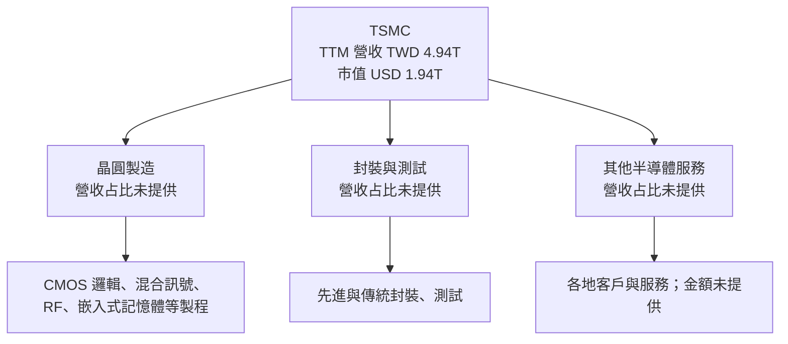
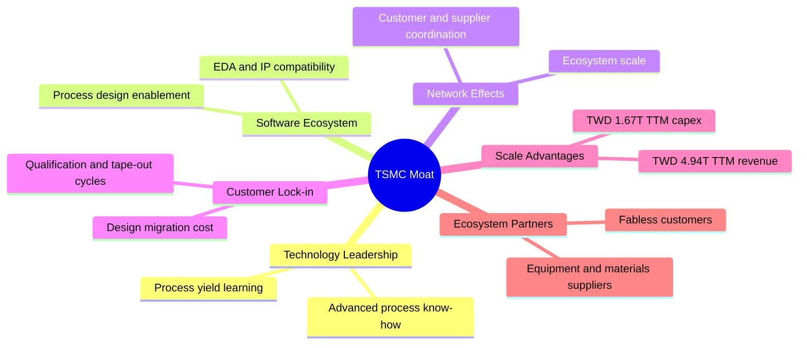
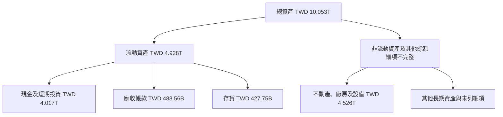
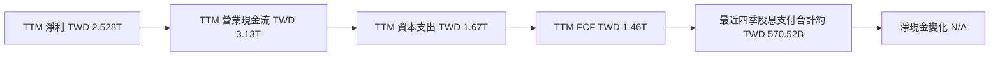
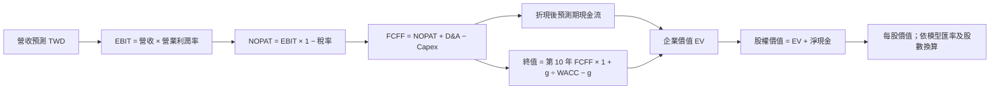
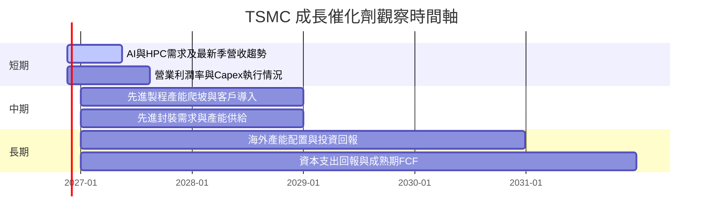
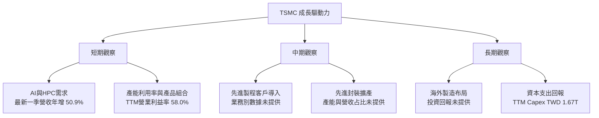
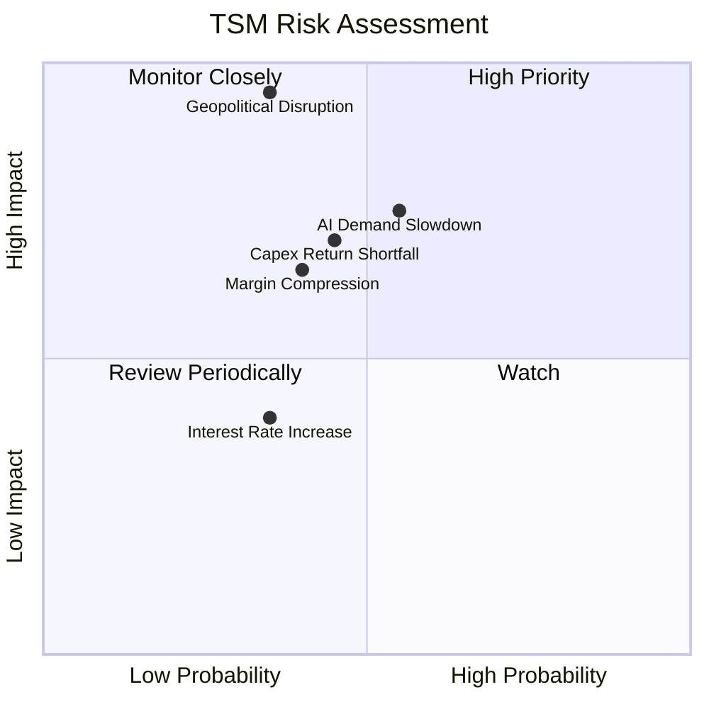
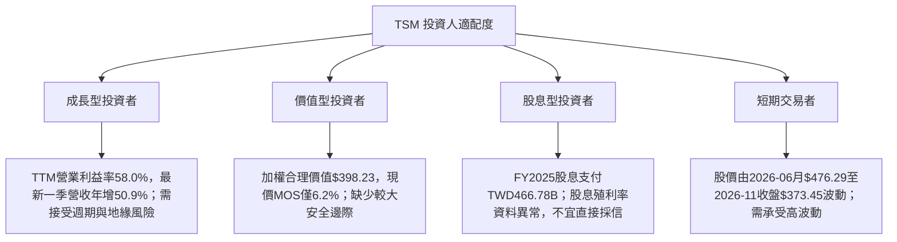

# TSM 基本面深度分析報告
> **報告日期**：2026-11-17 ｜ **語言**：繁體中文 ｜ **數據來源**：Yahoo Finance、Finviz、StockAnalysis、Roic.ai ｜ **分析師**：CFA 級機構研究

## 目錄

| # | 章節 | 核心結論 |
|---|------|----------|
| 1 | 執行摘要 | 持有；加權合理價值 $398.23，MOS +6.2% |
| 2 | 公司概覽與商業模式 | 晶圓代工與先進製程是核心，具技術、規模及客戶黏著優勢 |
| 3 | 損益表深度分析 | TTM 營收 TWD 4.94T；最新一季年增 50.9%，利潤率高 |
| 4 | 資產負債表分析 | 淨現金 TWD 3.20T，流動比率 2.505 |
| 5 | 現金流量深度分析 | TTM FCF TWD 1.46T，資本支出仍高 |
| 6 | 獲利能力與資本效率 | WACC 10.78%；最新 TTM ROIC 缺資料，不能直接判定利差 |
| 7 | 相對估值分析 | 同業估值分散；Forward P/E 15.97x |
| 8 | DCF 內在價值評估 | 基準 DCF $427.79；加權合理價值 $398.23 |
| 9 | 成長催化劑 | AI/HPC 需求、先進製程與先進封裝是主要質化催化劑 |
| 10 | 風險矩陣 | 地緣政治、資本密集度與 AI 需求週期為主要風險 |
| 11 | 投資建議 | 持有；現價高於 MOS 10% 的買入上限 $358.41 |

---

## 1. 執行摘要

TSM 最新 TTM 營收為 TWD 4.94T（約 USD 150.41B），最新一季營收年增 50.9%，TTM 營業利益率 58.0%，TTM FCF 為 TWD 1.46T；公司同時持有 TWD 3.20T 淨現金。估值方面，2026-11-16 收盤價為 $373.45，DCF 基準價值 $427.79，但四種估值方法加權後合理價值為 $398.23，MOS 僅 +6.2%。依 MOS 門檻評為**持有**；雖然 DCF 基準值高於現價，整體估值安全墊仍有限。

### 1.0 一頁式投資儀表板（Portfolio Manager 30 秒速讀）

| 項目 | 內容 |
|------|------|
| **投資論點（3 句）** | ① 最新一季營收年增 50.9%，反映需求與產品組合改善，但不能據此推定未來全年增速。② TTM 營業利益率 58.0%、FCF TWD 1.46T，經營獲利與現金產出均高。③ 淨現金 TWD 3.20T；但加權合理價值僅 $398.23，對現價上行空間為 6.6%。 |
| **綜合評分** | **7.8/10**（引用 1.1 評分卡） |
| **財務健康** | 🟢 淨現金 TWD 3.20T，流動比率 2.505；短期償付能力充足。 |
| **ROIC vs WACC** | ROIC：N/A（最新 TTM 缺資料）；WACC 10.78%。無法據此定量判斷當期 ROIC 是否高於 WACC。 |
| **FCF 趨勢** | TTM FCF TWD 1.46T；FCF Yield 2.29%。 |
| **估值** | Forward P/E 15.97x ｜ EV/EBITDA：N/A（幣別混用）｜ FCF Yield 2.29% |
| **DCF 內在價值（基準）** | $427.79；現價相對 DCF 溢價 **−12.7%**（$373.45 ÷ $427.79 − 1；即折價）。 |
| **安全邊際（MOS）** | **+6.2%**＝($398.23 − $373.45) ÷ $398.23；🔴 <10%，無明顯安全墊。 |
| **預期報酬（基準情境 12M）** | DCF 基準情境相對現價 **+14.6%**；此為模型情境，不等同保證的 12 個月報酬。 |
| **關鍵風險（前二）** | 地緣政治與供應集中；AI/HPC 需求或資本支出回報不及預期。 |
| **評級 + 信心度** | 🟡 **持有** ｜ 信心：中（基本面數據強，但 TTM 營收成長率及 ROIC 缺值，且估值安全墊有限）。 |

### 1.1 綜合評分卡（全報告唯一）

| 維度 | 評分（1–10） | 主要依據（引用數字與其來源章節） |
|------|--------------|----------------------------------|
| 成長性 | 8.0 | 最新一季營收年增 50.9%；TTM 對前一 TTM 成長率 N/A（3.2 節）。 |
| 獲利能力 | 9.0 | TTM 營業利益率 58.0%、毛利率 65.8%；最新 TTM ROIC N/A（3、6 節）。 |
| 財務健康 | 9.0 | 淨現金 TWD 3.20T、流動比率 2.505、CCC 2 天（4 節）。 |
| 估值 | 5.0 | MOS +6.2%；基準 DCF $427.79，但同業 EV/EBITDA 法為 $301.00（7–8 節）。 |
| 護城河 | 9.0 | 先進製程、規模與客戶轉換成本具質化優勢；本資料未提供市占率數字（2 節）。 |
| 管理層與資本配置 | 7.0 | FY2025 資本支出 TWD 1.28T、現金股息 TWD 466.78B；回購資料未提供（5 節）。 |
| **綜合評分** | **7.8** | 六項算術平均：(8.0 + 9.0 + 9.0 + 5.0 + 9.0 + 7.0) ÷ 6 = 7.83，四捨五入為 7.8。 |

### 1.2 五大投資論點 + 三大核心風險

| 類型 | 項目 | 具體依據 | 信心度 |
|------|------|----------|--------|
| 🟢 **投資論點①** | 高成長與高獲利並存 | 最新一季營收年增 50.9%，營業利益率 58.0%；需求若延續，固定成本吸收有助營業槓桿。 | 🟢 高 |
| 🟢 **投資論點②** | 現金流可支應大量再投資 | TTM OCF TWD 3.13T、Capex TWD 1.67T、FCF TWD 1.46T。 | 🟢 高 |
| 🟢 **投資論點③** | 資產負債表具緩衝 | 現金與短期投資 TWD 4.02T，總債務 TWD 818.38B，淨現金 TWD 3.20T。 | 🟢 高 |
| 🟢 **投資論點④** | 先進製程商業模式具規模優勢 | FY2025 營收 TWD 3.81T、營業利益 TWD 1.94T；可觀規模有助攤提研發與設備成本。 | 🟡 中 |
| 🟢 **投資論點⑤** | 相對估值不算極端 | Forward P/E 15.97x；同業 forward P/E 中位數 15.9x，但同業業務組合與成長差異大。 | 🟡 中 |
| 🟡 **風險①** | 台灣營運與地緣政治集中 | 財務數據未量化衝擊；若供應中斷，可能同時打擊收入、產能利用率與客戶交付。 | 🔴 高衝擊 |
| 🔴 **風險②** | 投資與折舊負擔 | TTM Capex TWD 1.67T，約為 TTM FCF 的 1.14 倍；需求放緩時可能令現金流快速收縮。 | 🟡 中 |
| 🟡 **風險③** | AI 需求與估值預期變化 | 近期新聞提及 AI 交易情緒與股價波動；最新收盤價較 2026-06 月收盤 $476.29 低約 21.6%。 | 🟡 中 |

### 1.3 快速統計卡片

| 指標 | 公司實際值（期間） | 同業中位數 | 狀態 |
|------|--------------------|------------|------|
| 營收成長（TTM） | **N/A** | — | 🟡 無法判定 |
| 營收成長（最新一季年增） | **50.9%** | 20.9%（INTC、UMC、GFS 中位數） | 🟢 |
| 毛利率（TTM） | **65.8%** | 31.7%（三家中位數） | 🟢 |
| 營業利益率（TTM） | **58.0%** | — | 🟢 |
| ROIC（TTM） | **N/A** | — | 🟡 無法判定 |
| Forward P/E | **15.97x** | 15.9x（INTC、UMC、GFS 中位數） | 🟡 |
| FCF Yield（TTM） | **2.29%** | — | 🟡 |
| Piotroski F-Score | **N/A / 9** | — | 🟡 缺兩個年度 SEC 申報資料 |

### 1.4 投資結論

```text
╔══════════════════════════════════════════════════════════════════╗
║                    📊 投資結論摘要                               ║
╠══════════════════════════════════════════════════════════════════╣
║  評級：持有（依加權合理價值 MOS +6.2%）                          ║
║  價格（2026-11-16 收盤）：$373.45                                ║
║  DCF 內在價值（基準）：$427.79（現價折價 12.7%）                 ║
║  安全邊際 MOS：+6.2%（以加權合理價值 $398.23 為基準）            ║
║  加權合理價值（8.8）：$398.23                                    ║
║  DCF 情境價值：                                                  ║
║    悲觀情境：$183.77（-50.8%）                                   ║
║    基準情境：$427.79（+14.6%）                                   ║
║    樂觀情境：$945.24（+153.1%）                                  ║
║  綜合評分：7.8/10（引用 1.1）                                    ║
║  適合投資人：能承受半導體週期與地緣政治風險的長線成長型投資人    ║
╚══════════════════════════════════════════════════════════════════╝
```

---

## 2. 公司概覽與商業模式

### 2.1 業務結構與收入來源

公司提供晶圓製造、封裝、測試及相關半導體服務。資料未提供各業務板塊營收占比、金額拆分或軟體／服務收入，因此不以推測比例繪圖。已知公司 FY2025 營收為 TWD 3.81T，TTM 營收為 TWD 4.94T；這反映公司具全球化營運規模，但不是業務別收入拆分。



### 2.2 市場份額

市場份額數據未提供，因此不繪製市占率圖，也不推估比例。以財務規模觀察，TSM TTM 營收約 USD 150.41B，最新一季營收年增 50.9%；同業資料顯示 INTC 最新一季營收年增 20.9%、UMC 25.6%、GFS 12.5%。這些數字可比較成長，不足以直接推導市場份額。

### 2.3 競爭護城河分析



### 2.4 護城河強度

| 護城河項目 | 強度（強／中／弱） | 證據（引用數字或事實） | 會削弱它的情況 |
|------------|--------------------|------------------------|----------------|
| 技術與製程能力 | 強 | TTM 毛利率 65.8%、營業利益率 58.0%；獲利能力與技術複雜度相符，但缺少製程節點市占資料。 | 競爭者縮小製程差距、良率不佳或客戶轉單。 |
| 規模效應 | 強 | TTM 營收 TWD 4.94T、Capex TWD 1.67T；規模支援大額研發與設備投資。 | 需求下滑導致產能利用率及資本回報下降。 |
| 客戶鎖定 | 中至強 | 客戶晶片設計、製程驗證與量產流程形成轉換成本；具體客戶集中度未提供。 | 主要客戶自建產能或將關鍵產品分散至其他代工廠。 |
| 軟體生態系統 | 中 | 公司經營仰賴設計工具、IP 與製程平台相容性；量化生態系收入未提供。 | 工具鏈、IP 相容性或平台服務能力落後。 |
| 網路效應 | 中 | 客戶、IP、EDA 與製造供應鏈的協作可互相強化；無可量化網路效應數據。 | 替代製程平台形成足夠規模。 |
| 生態夥伴 | 中至強 | 全球化製造與供應鏈協作是營運要素；合作夥伴營收占比未提供。 | 地緣衝突、出口限制或供應商集中造成中斷。 |

1.1「護城河」評分為 9.0，主要依據是 TTM 毛利率 65.8%、營業利益率 58.0%、營收規模 TWD 4.94T；惟市占率與客戶集中度缺值，故評分不是基於精確市占資料。

---

## 3. 損益表深度分析

### 3.1 年度收入成長趨勢（近 4 年）

收入單位為 TWD；柱長按 FY2022–FY2025 相對收入呈現，年增率照錄公司年度數據。

```text
╔══════════════════════════════════════════════════════════════════╗
║              TSMC 年度收入趨勢（FY2022-FY2025）                  ║
╠══════════════════════════════════════════════════════════════════╣
║  FY2022  TWD 2.26T  ████████████░░░░░░░░░░  YoY: +42.61% 🟢    ║
║  FY2023  TWD 2.16T  ███████████░░░░░░░░░░░  YoY:  -4.51% 🔴    ║
║  FY2024  TWD 2.89T  ███████████████░░░░░░░  YoY: +33.89% 🟢    ║
║  FY2025  TWD 3.81T  ████████████████████░░  YoY: +31.61% 🟢    ║
║                                                                  ║
║  FY2022 至 FY2025 年化成長率：                                   ║
║  (3.809T ÷ 2.263891T)^(1/3) − 1 ≈ 19.0%                         ║
╚══════════════════════════════════════════════════════════════════╝
```

FY2023 收入下滑 4.51%，之後 FY2024、FY2025 分別成長 33.89%、31.61%。TTM 營收較前一 TTM 的正式成長率為 N/A；不能用 FY2025 年增率替代 TTM 成長率。

### 3.2 季度收入趨勢分析

QoQ 由相鄰季度營收計算；YoY 使用 StockAnalysis 單季成長率。金額為 TWD。

| 季度 | 營收 | QoQ | YoY | 備註 |
|------|------:|----:|----:|------|
| 2025 Q4 | 1.046T | +5.7% | +20.45% | 相較 2025 Q3 繼續成長。 |
| 2026 Q1 | 1.134T | +8.4% | +35.13% | 年增加速；季增反映營收基礎提高。 |
| 2026 Q2 | 1.270T | +12.0% | +36.05% | 季增幅擴大，顯示該季動能增強。 |
| 2026 Q3 | 1.494T | +17.6% | +50.95% | 最新一季快速成長；不能將此單季年增率稱為 TTM 成長率。 |

### 3.3 利潤率演變分析

下表以年度營收、毛利及營業利益計算，四捨五入至一位小數；TTM 比率另列。

| 利潤率指標 | FY2022 | FY2023 | FY2024 | FY2025 | 趨勢 | 評估 |
|------------|-------:|-------:|-------:|-------:|------|------|
| **毛利率** | 59.6% | 54.4% | 56.1% | 59.9% | FY2023 回落後連續恢復 | 🟢 |
| **營業利益率** | 49.6% | 42.6% | 45.7% | 50.8% | FY2023 下滑後 FY2025 高於 FY2022 | 🟢 |
| **淨利率** | 43.9% | 39.4% | 40.0% | 44.6% | 隨營業獲利回升 | 🟢 |

TTM 毛利率為 65.8%、TTM 營業利益率 58.0%、TTM 淨利率 51.1%。與 FY2025 年度比率不同，可能涉及季度營收及獲利走勢；現有資料未提供產品別與地區別拆解，不能把改善單獨歸因於某一產品或價格因素。最新一季營業利益率 58.0%，顯示營收增長同時伴隨較高的營業獲利，但是否可持續仍取決於產品組合、產能利用率與高額設備投入。

### 3.4 費用結構分析

缺少完整的 FY2025 成本與營業費用分類，亦無法從提供的資料完整核對利息、稅項與其他損益，因此不繪製容易造成誤解的費用占比圓餅圖。FY2025 營收為 TWD 3.81T、毛利 TWD 2.28T、營業利益 TWD 1.94T；由此可見毛利以下營業費用約 TWD 344.42B（TWD 2,281.294B − TWD 1,936.874B），但細項組成未提供。

### 3.5 季度 EPS 趨勢與盈餘品質（Quality of Earnings）

| 季度 | EPS 實際／年增 | 超預期或不及預期 | 原因或資料限制 |
|------|----------------|------------------|----------------|
| 2025 Q4 | TWD 22.35；年增 34.97% | N/A | EPS 預估值缺失。 |
| 2026 Q1 | TWD 27.94；年增 58.38% | N/A | EPS 預估值缺失。 |
| 2026 Q2 | TWD 33.53；年增 77.40% | N/A | EPS 預估值缺失。 |
| 2026 Q3 | TWD 33.53；年增 68.73% | N/A | EPS 預估值缺失。 |

最近四季 EPS 驚喜資料中的估計值與實際值皆為 NaN，故不能判斷四季是否超預期。季度 EPS 序列、季度淨利與年度資料來源之間也存在呈現口徑差異，投資人宜以公司正式季報核對。

| 盈餘品質項目 | 數值／佔比 | 評估 |
|--------------|-----------|------|
| 股權薪酬 SBC / 營收 | TTM 約 TWD 513.37M ÷ TWD 4.944817T = **0.0104%** | 🟢 占比極低；以目前資料看，SBC 對股東稀釋影響有限。 |
| SBC / 營業現金流 | TWD 513.37M ÷ TWD 3.13T = **0.0164%** | 🟢 占比極低。 |
| FCF / 淨利（現金轉換率） | TWD 1.46T ÷ TWD 2.527571T = **57.8%** | 🟡 現金轉換低於 100%，主要須結合高額設備投資理解；FCF 已按 OCF 減 Capex 定義。 |
| 一次性／非經常性損益 | N/A（明細未提供） | 無法判斷一次性項目是否影響當期獲利。 |
| 有效稅率異常 | 17.0%（最新年度有效稅率） | 未見資料顯示稅率異常；歷史各年稅率變化較大，需查正式財報明細。 |
| 資本化支出 vs 費用化 | TTM Capex TWD 1.67T；資本化與費用化細分 N/A | 半導體設備投入主要透過資本支出進入資產並逐期折舊；缺少資本化利息及費用明細，無法量化盈餘遞延效果。 |

**盈餘品質結論：**公司獲利有現金流支撐，但 TTM FCF/淨利約 57.8%，顯示高資本支出吸收了相當部分營業現金流。SBC 占比低，不構成主要獲利品質疑慮；非經常性損益資料不足，故不能排除一次性因素。

---

## 4. 資產負債表分析

### 4.1 資產結構分解

最新 TTM 資產負債表總資產為 TWD 10.05289T；下圖只列出提供的資產項目，未提供細項不反推。



### 4.2 流動性與營運資金分析

| 指標 | 最新 TTM | 一年前 TTM | 變化 | 解讀 |
|------|----------|------------|------|------|
| DSO 應收帳款天數 | 1 天 | N/A | N/A | 公司報告未提供可比的一年前數值；單一期末餘額計算法對期末收款時點敏感。 |
| DIO 存貨天數 | 92 天 | N/A | N/A | 反映營運需維持一定製程存貨；缺去年同期計算值，無法判斷是否堆庫存。 |
| DPO 應付帳款天數 | 91 天 | N/A | N/A | 單期指標顯示供應商付款週期；缺去年同期值，不能推論議價力變化。 |
| CCC 現金轉換週期 | 2 天 | N/A | N/A | DSO + DIO − DPO = 1 + 92 − 91 = 2 天；一年前 CCC 未提供。 |

流動性比率如下，歷史值依年度資產負債表計算：

| 指標 | FY2022 | FY2023 | FY2024 | FY2025 | 最新資料 |
|------|-------:|-------:|-------:|-------:|---------:|
| Current Ratio | 2.08x | 2.32x | 2.36x | 2.51x | 最新資料列為 2.505x |
| Quick Ratio | N/A | N/A | N/A | N/A | 2.287x |

流動比率由 FY2022 約 2.08x 升至 FY2025 約 2.51x，現金與短期投資 TWD 4.02T亦高於總債務 TWD 818.38B，顯示短期流動性充足。比較時須留意最新資產負債表與年度數據期間不同。

### 4.3 債務結構分析

```text
╔══════════════════════════════════════════════════════════════════╗
║                   TSMC 債務健康診斷                              ║
╠══════════════════════════════════════════════════════════════════╣
║  總債務：        TWD 818.38B   ██░░░░░░░░░░░░░░░░░░░  🟢      ║
║  現金+短期投資： TWD 4.02T     ████████████████████░  🟢      ║
║  淨現金：        TWD 3.20T     ████████████████░░░░░  🟢      ║
║                                                                  ║
║  Current Ratio： 2.505x        🟢                                ║
║  Quick Ratio：   2.287x        🟢                                ║
║  Debt/EBITDA：   N/A（幣別不一致，未換算）                       ║
║  Interest Coverage：N/A（利息費用資料未提供）                    ║
╚══════════════════════════════════════════════════════════════════╝
```

### 4.4 股東權益趨勢

```text
╔══════════════════════════════════════════════════════════════════╗
║                   股東權益變化（TWD）                             ║
╠══════════════════════════════════════════════════════════════════╣
║  FY2022  TWD 2.90T  ███████████░░░░░░░░░░░  🟢                 ║
║  FY2023  TWD 3.43T  █████████████░░░░░░░░░  🟢                 ║
║  FY2024  TWD 4.24T  ████████████████░░░░░░  🟢                 ║
║  FY2025  TWD 5.36T  ████████████████████░░  🟢                 ║
╚══════════════════════════════════════════════════════════════════╝
```

FY2022 至 FY2025 股東權益增加，與同期淨利累積及資產擴張相符；資料未提供完整權益變動表，無法精確拆分留存盈餘、股利與其他權益變化。

---

## 5. 現金流量深度分析

### 5.1 現金流量瀑布圖



淨利與營業現金流並非直接相等，受折舊、營運資金及其他調整影響；現有資料不足以逐項還原現金流調節表。最新四季股息支付由季度數據合計約 TWD 570.52B，淨現金變動需完整資金流量表才能計算。

### 5.2 FCF 轉換率趨勢

| 財年 | FCF | 淨利 | FCF / 淨利 |
|------|----:|----:|-----------:|
| FY2022 | TWD 520.97B | TWD 992.92B | 52.5% |
| FY2023 | TWD 286.57B | TWD 851.74B | 33.6% |
| FY2024 | TWD 861.20B | TWD 1.158T | 74.3% |
| FY2025 | TWD 992.38B | TWD 1.698T | 58.5% |

FY2023 FCF 轉換率降至 33.6%，FY2024 回升至 74.3%，FY2025 回落至 58.5%。半導體業高資本支出使 FCF 的年度波動大於會計淨利，應與設備投資週期及產能建置並看。

### 5.3 自由現金流趨勢

```text
╔══════════════════════════════════════════════════════════════════╗
║              FCF 趨勢（FY2022-FY2025，TWD）                     ║
╠══════════════════════════════════════════════════════════════════╣
║  FY2022  TWD 520.97B  ██████████░░░░░░░░░░  FCF Yield N/A      ║
║  FY2023  TWD 286.57B  ██████░░░░░░░░░░░░░░  FCF Yield N/A      ║
║  FY2024  TWD 861.20B  █████████████████░░░  FCF Yield N/A      ║
║  FY2025  TWD 992.38B  ████████████████████  FCF Yield N/A      ║
║                                                                  ║
║  TTM FCF：TWD 1.46T ｜ TTM FCF Yield：2.29%                     ║
╚══════════════════════════════════════════════════════════════════╝
```

歷年 FCF Yield 欄未列年度值，避免用不同期間價格與現金流自行拼接；TTM FCF Yield 引用 2.29%。

### 5.4 資本配置評估

資本配置以「高額再投資、支付股息、保留流動性」為主。未提供回購金額，且缺少可完整對帳的 TTM 資本配置總額，故不以圓餅圖呈現不完整比例。

| 項目 | 數值 | 解讀 |
|------|------:|------|
| TTM Capex | TWD 1.67T | 佔 TTM 營收約 33.8%；支持產能與製程投資，也造成 FCF Yield 只有 2.29%。 |
| FY2025 股息支付 | TWD 466.78B | FY2025 FCF TWD 992.38B，高於年度股息支付。 |
| 最近四季股息支付 | 約 TWD 570.52B | 由四季現金股利支付合計；與 TTM FCF 比約 39.1%。 |
| 回購 | N/A | 資料未提供。 |
| 留存與淨現金 | 最新淨現金 TWD 3.20T | 提供景氣低迷或持續投資的財務緩衝。 |

---

## 6. 獲利能力與資本效率

### 6.1 ROE / ROA / ROIC 趨勢

| 指標 | FY2022 | FY2023 | FY2024 | FY2025／TTM | 評估 |
|------|-------:|-------:|-------:|------------:|------|
| ROE | N/A | N/A | N/A | TTM 41.9% | 高，惟杜邦分解資料不足。 |
| ROA | N/A | N/A | N/A | TTM 20.6% | 顯示資產獲利能力；年度可比序列未提供。 |
| ROIC | N/A | N/A | N/A | 最新 TTM N/A | 不以歷史年份替代最新 ROIC。 |

Roic.ai 歷史資料列示 2018 年 Return on Invested Capital 為 19.11%，但不是最新 TTM 數據；不能拿來與目前 WACC 直接作同期比較。未提供行業 ROE／ROA 均值，因此不列無來源的行業對照。

### 6.2 ROIC vs WACC 分析（核心價值創造判斷）

```text
╔══════════════════════════════════════════════════════════════════╗
║                ROIC vs WACC 深度分析                            ║
╠══════════════════════════════════════════════════════════════════╣
║  WACC（採用資本成本資料）：10.78%                                ║
║  ├── 無風險利率（10Y 美債）：5.12%                              ║
║  ├── 市場風險溢酬 ERP：5.00%                                    ║
║  ├── 原始 Beta：1.23；調整後 Beta：1.16                         ║
║  ├── 提供的股權成本 Ke：10.90%                                  ║
║  ├── 稅前債務成本：1.51%；稅率：17.0%                           ║
║  ├── 資本權重：股權 98.7%；債務 1.3%                            ║
║  └── 採用 WACC：10.78%                                          ║
║                                                                  ║
║  ROIC：最新 TTM N/A（品質資料未提供）                            ║
║  EVA = ROIC − WACC：N/A                                          ║
║                                                                  ║
║  結論：最新同期 ROIC 缺值，不能據此確認創造或摧毀經濟價值。      ║
║  歷史參考：Roic.ai 2018 年 ROIC 19.11%，非最新期，勿作同期比較。║
╚══════════════════════════════════════════════════════════════════╝
```

資本成本資料給出 Beta 調整方式為 ⅔ × 1.23 + ⅓ = 1.16。CAPM 直接用顯示值計算為 5.12% + 1.16 × 5.00% = 10.92%，與資料所列 Ke 10.90% 相差 0.02 個百分點；本報告依規則採用提供的 WACC 10.78%，不另行替換。由於利息費用與平均計息負債明細缺失，無法獨立重算稅前 Kd 1.51%。

### 6.3 杜邦三因素分解

| 因素 | 數值（TTM） | 解讀 |
|------|-------------|------|
| 淨利率 | N/A（QUALITY FIGURES 杜邦資料缺值） | 不以另一來源自行替代杜邦口徑。 |
| 資產週轉率 | N/A | 缺少可配套的杜邦計算數據。 |
| 權益乘數 | N/A | 缺少可配套的杜邦計算數據。 |
| **ROE** | **N/A** | 品質資料區塊標示杜邦 N/A；另行報告的 ROE 41.9% 不代表可用其反推三因素。 |

### 6.4 財務體質：Piotroski F-Score

Piotroski F-Score 為 **N/A**；需要相隔一年的兩個 TTM 期間與 SEC 申報資料，現有資料未提供九項測試結果。故無法逐項列示，也不將 N/A 解讀為未通過。

---

## 7. 相對估值分析

### 7.1 同業估值比較表格

TSM 倍數取市場資料；同業倍數取 Yahoo Finance Peer multiples。P/S、EV/EBITDA 如遇幣別不一致或未提供則保留 N/A。

| 估值指標 | **TSM** | **INTC** | **UMC** | **GFS** | TSM 評估 |
|----------|--------:|---------:|-------:|-------:|-----------|
| **Trailing P/E** | 24.20x | N/A | 13.5x | 112.6x | 🟡 GFS 的 TTM P/E 極高，差異反映獲利基數與週期不同。 |
| **Forward P/E** | 15.97x | 31.0x | 15.9x | 15.2x | 🟡 與同業中位數 15.9x 接近。 |
| **P/S Ratio TTM** | N/A | 4.9x | N/A | 3.1x | N/A；TSM 股價與財報幣別不同，且 UMC 混合幣別。 |
| **EV/EBITDA TTM** | N/A | 16.1x | N/A | 10.6x | N/A；TSM、UMC 不提供可比值。 |
| **最新一季營收 YoY** | 50.9% | 20.9% | 25.6% | 12.5% | 🟢 TSM 最新單季成長較快；不代表未來年度一定延續。 |
| **毛利率 TTM** | 65.8% | 40.2% | 31.7% | 28.5% | 🟢 TSM 利潤率明顯高於列示同業。 |

同業 forward P/E 中位數為 15.9x；同業 EV/EBITDA 中位數只使用可計算的 INTC、GFS，為 13.3x。Peer multiples 欄位不完整，因此倍數比較只代表可比公司樣本，不等於完整產業中位數。

### 7.2 歷史估值區間分析

```text
╔══════════════════════════════════════════════════════════════════╗
║                   歷史估值區間分析                               ║
╠══════════════════════════════════════════════════════════════════╣
║  Valuation vs own history：N/A（資料未提供）                     ║
║  當前 Trailing P/E：24.20x                                       ║
║  當前 Forward P/E：15.97x                                        ║
║  歷史 P/E 區間與百分位：N/A（不得以現有資料推估）                ║
╚══════════════════════════════════════════════════════════════════╝
```

### 7.3 情境價值（Bear / Base / Bull）

以下情境值與假設照錄 DCF 模型；模型未提供各情境完整逐年財務表，故不另行補造年度路徑。

| 情境 | 第 1 年營收成長 | 期末營業利潤率 | WACC | 每股價值 | 相對現價 | 機率 | 會發生的條件 |
|------|----------------:|----------------:|-----:|---------:|---------:|-----:|--------------|
| 🔴 悲觀 | 15.0% | 42.1% | 11.78% | $183.77 | -50.8% | 25% | AI/HPC 投資放緩、產能利用率下降，利潤率較基準大幅收斂。 |
| 🟡 基準 | 30.0% | 49.5% | 10.78% | $427.79 | +14.6% | 50% | 需求延續，成長逐步減速，長期利潤率由 TTM 58.0% 收斂至 49.5%。 |
| 🟢 樂觀 | 45.0% | 54.5% | 9.78% | $945.24 | +153.1% | 25% | 高成長持續且較高營業利潤率維持，資本成本同時下降。 |

### 7.4 相對估值隱含價格區間

```text
╔══════════════════════════════════════════════════════════════════╗
║                  相對估值方法隱含每股價值                        ║
╠══════════════════════════════════════════════════════════════════╣
║  $301.00 ───── $372.76 ───── [$373.45] ───── $427.79 ── $586.69 ║
║  EV/EBITDA      Forward P/E       現價          DCF       共識價 ║
╚══════════════════════════════════════════════════════════════════╝
```

| 方法 | 每股價值 | 依據 |
|------|---------:|------|
| 同業 EV/EBITDA | $301.00 | 同業中位數 13.3x（INTC、GFS）乘以 TTM EBITDA，再加淨現金。 |
| 同業 Forward P/E | $372.76 | 同業中位數 15.9x（INTC、UMC、GFS）× Forward EPS 23.39。 |
| DCF 基準 | $427.79 | 10 年 FCFF，WACC 10.78%、終值成長 3.0%。 |
| 分析師共識 | $586.69 | 20 位分析師平均目標價；作為參考而非獨立基本面模型。 |

---

## 8. DCF 內在價值評估（Discounted Cash Flow）

### 8.0 估值推理鏈（Thinking Logic）

**Step 1 — 價值來源與主導變數**

本模型以整體晶圓製造、封裝與測試業務作為一個現金流主體，TTM 營收 TWD 4.94482T；資料未提供業務別營收占比，不能把 AI、先進製程或封裝拆成不同營收比例。估值核心由營收成長路徑、營業利潤率、資本支出與終值假設決定。敏感度矩陣顯示 WACC 與永續成長率對價值有重大影響；營收與利潤率同樣是基礎情境能否成立的營運條件。

**Step 2 — 模型選擇**

| 決策點 | 本報告採用 | 理由（含數字） | 曾考慮但否決 | 否決理由 |
|--------|-----------|----------------|--------------|----------|
| 現金流定義 | FCFF | 以 TTM OCF TWD 3.13T、Capex TWD 1.67T 為現金流背景，對應 WACC 折現及企業價值。 | FCFE | 資本結構不是主要估值權重，且模型指定 FCFF。 |
| 預測期 N | 10 年 | DCF 模型設定 10 年，容納成長率由 30.0% 逐年降至 3.0%。 | 5 年 | 對高再投資、長建置周期的晶圓製造業，5 年預測期不足以反映模型設定的成長淡出。 |
| 終值方法 | Gordon Growth | 終值成長 g 3.0%，WACC 10.78%，滿足 WACC > g。 | 退出倍數為主 | DCF 模型提供 Gordon Growth 終值，未提供退出倍數終值。 |
| EBIT 基礎 | GAAP EBIT | 模型指定採 GAAP EBIT；FY+1 營業利益 TWD 3,726.88B。 | 非 GAAP EBIT | 無額外非 GAAP 調整資料。 |

**Step 3 — 關鍵假設推導鏈**

- **營收成長路徑**：錨點＝最新一季營收年增 50.9%，但 TTM 對前 TTM 成長率 N/A → 最新單季不適合作為 TTM 全年增速，模型將首年成長限制在 30.0%，之後每年減速 3 個百分點至第 10 年 3.0% → **採用 FY+1 30.0%、FY+10 3.0% 的逐年遞減路徑** → 曾考慮將 50.9% 延續為首年增速，因那是單季同比、且缺少 TTM 成長率，故不採用。
- **期末營業利潤率**：錨點＝TTM 58.0%，FY2025 年度約 50.8% → 考慮週期、競爭與成熟期利潤率收斂 → **採用 FY+1 58.0% 線性下降至 FY+10 49.5%** → 曾考慮維持 58.0% 至期末，因無法證明高位利潤率可長期固定，故否決。
- **預測期 N**：錨點＝模型定為 10 年，FY+1 至 FY+10 逐年列示 → 以十年逐步淡化短期高成長與利潤率 → **採用 10 年** → 曾考慮較短期，但與既定模型時間跨度不符；未另行變更模型。
- **Capex／營收**：錨點＝TTM Capex／營收約 33.8% → 模型認為成熟期投資強度會回落，並在期末淡化至 16.6% → **採用 FY+1 33.8% 至 FY+10 16.6%** → 曾考慮將目前資本支出比率固定 10 年，因會忽略成熟期資本強度下降，未採用。
- **永續成長率 g**：錨點＝長期名目經濟成長常作低個位數參考，但本資料未提供宏觀預測 → **採用 3.0%**，低於 WACC 10.78% → 曾考慮更高終值成長，因會顯著增加終值且缺乏數據依據，故不採用。
- **WACC**：錨點＝資本成本資料列示 10.78% → 保持模型折現率，不另算替代值 → **採用 10.78%** → 資本成本計算明細未完全提供，故不以自行推算值替換。
- **D&A／營收**：錨點＝TTM 15.1% → **採用固定 15.1%**；模型未提供按年變化假設。
- **稅率**：錨點＝最新年度有效稅率 17.0% → **採用 17.0%**。
- **營運資金**：模型明確未建模 → FCFF 不扣 ΔWC；這是模型簡化，不代表實際營運資金變動為零。
- **EBIT 與 SBC**：錨點＝模型用 GAAP EBIT，股權薪酬已列為費用 → **採用組合 (A)：GAAP EBIT、FCFF 不另扣 SBC、股數不再稀釋** → 否決再扣 SBC 或另做股數稀釋，避免同一成本重複計入。

**Step 4 — 最脆弱一環**

最脆弱之處是長期現金流與終值假設：基準情境終值現值佔 EV 59.9%；若長期利潤率或成長無法維持，價值會向敏感度矩陣較低端移動，且悲觀情境每股價值為 $183.77。

**Step 5 — 計算路徑圖**



### 8.1 模型假設總表（Model Inputs）

| 假設項目 | 採用值 | 依據／來源 | 敏感度 |
|----------|--------|-------------|--------|
| 預測期長度 **N** | 10 年 | DCF 模型明列 FY+1 至 FY+10。 | 🟡 中 |
| 營收成長 | FY+1 30.0%，FY+10 3.0%，逐年遞減 | 首年以最新單季年增 50.9% 為參考但封頂 30.0%；終年 3.0%。 | 🔴 高 |
| 營業利潤率 | 58.0% 降至 49.5% | 起點採 TTM 58.0%；期末採近五年中位數設定。 | 🔴 高 |
| 有效稅率 | 17.0% | 最新年度有效稅率。 | 🟢 低 |
| Capex／營收 | 33.8% 降至 16.6% | TTM 起點，逐步降至模型成熟期假設。 | 🔴 高 |
| D&A／營收 | 15.1% | TTM 比例，模型固定。 | 🟢 低 |
| 營運資金變動 | 不建模 | 模型明示 working capital is not modelled；不是假設實際變動為零。 | 🟡 中 |
| EBIT 基礎 | GAAP | 模型提供 GAAP EBIT 預測。 | 🟡 中 |
| SBC 處理 | 組合 (A)：不另扣 SBC | GAAP EBIT 已將 SBC 作為費用；避免重複扣減。 | 🟡 中 |
| 年稀釋率 | 0%／不另稀釋 | 與組合 (A) 一致；模型固定股數。 | 🟡 中 |
| 永續成長率 g | 3.0% | DCF 模型採用，且低於 WACC。 | 🔴 高 |
| 終值方法 | Gordon Growth | 模型提供 Gordon Growth 終值；未提供退出倍數終值。 | 🔴 高 |
| WACC | 10.78% | 資本成本資料列示值；詳見 8.2。 | 🔴 高 |
| 匯率 | USD 0.030417／TWD | DCF 模型列示匯率換算因子；外匯資料日期為 2026-11-16，1 USD = TWD 32.88。 | 🟡 中 |

本模型採用 **(A) GAAP EBIT + 固定股數**，故 SBC 影響已計入一次；FCFF 不再扣 SBC，也不再逐年放大股數。FCFF 使用 FCFF = NOPAT + D&A − Capex；營運資金不建模。

### 8.2 折現率推導（WACC）

```text
╔══════════════════════════════════════════════════════════════════╗
║                    WACC 推導（折現率）                           ║
╠══════════════════════════════════════════════════════════════════╣
║  股權成本 Ke（CAPM；採資本成本資料提供值）：10.90%               ║
║  ├── 無風險利率 Rf（10Y 美債）：5.12%                            ║
║  ├── 市場風險溢酬 ERP：5.00%                                     ║
║  ├── 原始 Beta：1.23；調整後 Beta：1.16                          ║
║  ├── Beta 調整：⅔ × 1.23 + ⅓ × 1.00 = 1.16                     ║
║  └── CAPM 顯示值：5.12% + 1.16 × 5.00% ≈ 10.90%                 ║
║                                                                  ║
║  債務成本 Kd：                                                   ║
║  ├── 稅前 Kd：1.51%（資料列示；利息與平均計息負債明細未提供）   ║
║  ├── 有效稅率：17.0%                                             ║
║  └── 稅後 Kd：1.51% × (1 − 17.0%) = 1.25%                       ║
║                                                                  ║
║  資本結構：股權 98.7%；債務 1.3%                                 ║
║  └── 採用 WACC：10.78%（依資本成本資料，不另替換）              ║
╚══════════════════════════════════════════════════════════════════╝
```

1. **Ke（CAPM）**：5.12% + 1.16 × 5.00% = 10.92%；資本成本資料列示 Ke 10.90%，本報告沿用列示值，兩者相差 0.02 個百分點。10Y 美債殖利率數值為資本成本資料所列；具體觀察時點未另提供。ERP 5.00% 為該資料所採假設。
2. **稅前 Kd**：1.51% 為資料列示值；利息費用與平均計息負債未提供，故無法依「利息 ÷ 平均計息負債」獨立驗算。
3. **稅後 Kd**：1.51% × (1 − 17.0%) = 1.2533% ≈ 1.25%。
4. **權重**：採資本成本資料列示 E/D 權重 98.7%/1.3%。市值約 USD 1.94T、債務約 USD 24.89B；債務以帳面值代理市場值，且公司報價與報表幣別不同，債務換算使用 2026-11-16 匯率。
5. **WACC**：採用提供值 **10.78%**。以列示權重與顯示 Ke、稅後 Kd 近似重算：98.7% × 10.90% + 1.3% × 1.25% = 10.77%；與提供的 10.78% 約差 0.01 個百分點，可能來自未顯示精度。DCF 與第 6.2 節均使用 10.78%。

### 8.3 逐年自由現金流預測（基準情境）

金額單位：TWD billion。折現因子保留三位小數；金額照錄 DCF 模型。模型未建模營運資金，表格不列 ΔWC。FY+1 代表示範使用完整輸入與輸出。

| 年度 | FY+1 | FY+2 | FY+3 | FY+4 | FY+5 | FY+6 | FY+7 | FY+8 | FY+9 | FY+10 |
|------|------:|------:|------:|------:|------:|------:|------:|------:|------:|-------:|
| 營收 | 6,428.26 | 8,163.89 | 10,123.23 | 12,249.11 | 14,453.94 | 16,622.04 | 18,616.68 | 20,292.18 | 21,509.71 | 22,155.00 |
| 營收 YoY | 30.0% | 27.0% | 24.0% | 21.0% | 18.0% | 15.0% | 12.0% | 9.0% | 6.0% | 3.0% |
| 營業利潤率 | 58.0% | 57.0% | 56.1% | 55.2% | 54.2% | 53.3% | 52.3% | 51.4% | 50.5% | 49.5% |
| EBIT | 3,726.88 | 4,656.49 | 5,679.00 | 6,756.58 | 7,837.06 | 8,856.56 | 9,744.56 | 10,431.05 | 10,854.96 | 10,972.60 |
| − 稅 | (632.56) | (790.34) | (963.90) | (1,146.79) | (1,330.18) | (1,503.22) | (1,653.94) | (1,770.46) | (1,842.41) | (1,862.38) |
| = NOPAT | 3,094.32 | 3,866.14 | 4,715.10 | 5,609.79 | 6,506.88 | 7,353.34 | 8,090.62 | 8,660.59 | 9,012.55 | 9,110.22 |
| + D&A | 970.20 | 1,232.15 | 1,527.86 | 1,848.72 | 2,181.48 | 2,508.71 | 2,809.75 | 3,062.63 | 3,246.39 | 3,343.78 |
| − Capex | (2,171.05) | (2,601.47) | (3,032.68) | (3,435.84) | (3,778.51) | (4,028.15) | (4,156.32) | (4,143.23) | (3,981.42) | (3,678.16) |
| **= FCFF** | **1,893.46** | **2,496.82** | **3,210.29** | **4,022.67** | **4,909.85** | **5,833.90** | **6,744.04** | **7,579.99** | **8,277.52** | **8,775.85** |
| 折現因子 @10.78% | 0.903 | 0.815 | 0.736 | 0.664 | 0.599 | 0.541 | 0.489 | 0.441 | 0.398 | 0.359 |
| **FCFF 現值 PV** | **1,709.28** | **2,034.70** | **2,361.65** | **2,671.42** | **2,943.43** | **3,157.19** | **3,294.73** | **3,342.91** | **3,295.44** | **3,153.98** |

預測期現值合計：  
1,709.28 + 2,034.70 + 2,361.65 + 2,671.42 + 2,943.43 + 3,157.19 + 3,294.73 + 3,342.91 + 3,295.44 + 3,153.98 = **27,964.73 TWD billion**。

**FY+1 逐步演算**

1. **營收** = TWD 4,944.82B × (1 + 30.0%) = **TWD 6,428.26B**。
2. **EBIT** = TWD 6,428.26B × 58.0% = **TWD 3,728.39B**；模型列示為 TWD 3,726.88B，顯示利潤率或未四捨五入輸入有精度差異，後續沿用模型列示數值。
3. **稅** = EBIT TWD 3,726.88B × 17.0% = **TWD 633.57B**；模型列示 TWD 632.56B，因模型內部未四捨五入輸入不完整，後續逐年數值均照錄模型。
4. **NOPAT** = TWD 3,726.88B − TWD 632.56B = **TWD 3,094.32B**。
5. **D&A** = TWD 6,428.26B × 15.1% = **TWD 970.67B**；模型列示 TWD 970.20B，差異來自模型內部未顯示精度。
6. **Capex** = TWD 6,428.26B × 33.8% = **TWD 2,171.75B**；模型列示 TWD 2,171.05B。
7. **ΔWC** = 不建模。
8. **FCFF** = TWD 3,094.32B + TWD 970.20B − TWD 2,171.05B = **TWD 1,893.47B**；模型列示 TWD 1,893.46B，差額 0.01B 為顯示精度尾差。
9. **折現因子** = 1 ÷ (1 + 10.78%)¹ ≈ **0.903**；PV = TWD 1,893.46B × 0.903 ≈ **TWD 1,709.28B**（精確折現因子使用模型未四捨五入值）。

> 上述模型列示 EBIT、稅、D&A 與 Capex 不能用已顯示的四捨五入比率完全重現；為遵守不改動模型輸出的要求，逐年表及估值採模型原列數值，不以四捨五入假設重算替換。

**合理性自檢**

- 預測 FCF 由 FY+1 的 TWD 1,893.46B 增至 FY+10 的 TWD 8,775.85B；此為模型路徑，所需年度歷史 FCF CAGR 與模型 FCF CAGR 未由資料區塊提供，故不另計作比較結論。
- FY+10 FCF 利潤率 = 8,775.85 ÷ 22,155.00 = **39.6%**；目前 TTM FCF 利潤率 = USD 44.34B ÷ USD 150.41B = **29.5%**。模型隱含長期 FCF 利潤率高於當前水準，主要由營業利潤率高、Capex 比例下滑所驅動。
- 所列預測年度 FCFF 均為正數；模型中資本支出占收入逐步下降，構成 FCF 擴張的重要來源，若投資強度未如假設回落，估值將偏高。

```text
╔══════════════════════════════════════════════════════════════════╗
║            自由現金流：歷史實際 vs 模型預測                      ║
╠══════════════════════════════════════════════════════════════════╣
║  FY2023(實) TWD 286.57B  █░░░░░░░░░░░░░░░░░░░░                  ║
║  FY2024(實) TWD 861.20B  ██░░░░░░░░░░░░░░░░░░░                   ║
║  FY2025(實) TWD 992.38B  ██░░░░░░░░░░░░░░░░░░░                   ║
║  FY+1 (預)  TWD 1,893.46B ████░░░░░░░░░░░░░░░░                  ║
║  FY+10(預)  TWD 8,775.85B ████████████████████                  ║
╠══════════════════════════════════════════════════════════════════╣
║  模型預測 FCF 增長倚賴收入持續擴張及 Capex/營收率下降。         ║
╚══════════════════════════════════════════════════════════════════╝
```

### 8.4 終值計算（Terminal Value）

**適用性檢查：**WACC 10.78% vs g 3.0% → WACC > g？✅

| 方法 | 計算式 | 終值 TV | TV 現值 | 佔總 EV 比重 |
|------|--------|---------:|--------:|-------------:|
| Gordon Growth | 8,775.85 × 1.03 ÷ (10.78% − 3.0%) | TWD 116,254.12B | TWD 41,780.97B | 59.9% |
| 退出倍數法 | N/A（模型未提供退出倍數終值） | N/A | N/A | N/A |

**逐步演算**

1. **FY+N 的 FCFF** = TWD **8,775.85B**。
2. **分子** = 8,775.85 × 1.03 = 9,039.1255 ≈ **TWD 9,039.13B**。
3. **分母** = 10.78% − 3.0% = **7.78%**；TV = 9,039.1255 ÷ 0.0778 = **TWD 116,254.12B**。
4. **PV(TV)** = TWD 116,254.12B × 模型折現因子 0.359 ≈ **TWD 41,780.97B**（採模型未四捨五入折現因子）。
5. **終值佔比** = 41,780.97 ÷ 69,745.69 = **59.9%**。

終值未超過 EV 的 75% 門檻，但仍占 59.9%，表示長期假設對估值有重大影響。

### 8.5 企業價值 → 每股內在價值（Bridge）

```text
╔══════════════════════════════════════════════════════════════════╗
║              企業價值 → 每股內在價值 橋接表                      ║
╠══════════════════════════════════════════════════════════════════╣
║  預測期 FCF 現值合計            +TWD 27,964.73B                  ║
║  終值現值 PV(TV)                +TWD 41,780.97B                  ║
║  ─────────────────────────────────────────────                  ║
║  = 企業價值 EV                   TWD 69,745.69B                  ║
║  + 淨現金                       +TWD 3,198.60B                   ║
║  = 股權價值                      TWD 72,944.29B                  ║
║  每股內在價值（模型換算）        USD 427.79                      ║
║  當前股價（2026-11-16）          USD 373.45                      ║
║  折溢價（現價÷DCF價值−1）       -12.7%（折價）                  ║
╚══════════════════════════════════════════════════════════════════╝
```

1. **EV** = TWD 27,964.73B + TWD 41,780.97B = **TWD 69,745.70B**；模型列示 TWD 69,745.69B，尾差 0.01B。
2. **股權價值** = TWD 69,745.69B + TWD 3,198.60B = **TWD 72,944.29B**。
3. **每股內在價值**：模型原列換算為 **USD 427.79**。模型說明採用股權價值、匯率 USD 0.030417／TWD，以及市值／價格換算方式；市場資料列示流通股數 5.19B。因模型展示的換算公式與所列股數、匯率精度無法逐位完全重現，保留模型原列每股價值，不另行重算替代。
4. **折溢價** = USD 373.45 ÷ USD 427.79 − 1 = **−12.7%**，即現價相對 DCF 基準價折價 12.7%。
5. **本節不計算 MOS**；MOS 唯一採用 8.8 加權合理價值為分母。

淨現金採 DCF 模型列示 TWD 3,198.60B；與最新 TTM 資產負債表淨現金 TWD 3.20T 接近。DCF 模型未列少數股東權益扣項。

### 8.6 敏感性分析（WACC × 永續成長率）

以下每股價值直接照錄 DCF 模型。括號未提供在模型原表，為避免新增未核對數字，表格只列原始價值。

| g（列）／WACC（欄） | 8.78% | 9.78% | **10.78%（基準）** | 11.78% | 12.78% |
|-----------|------:|------:|------------------:|-------:|-------:|
| **2.0%** | $536.10 | $457.70 | $397.76 | $350.60 | $312.61 |
| **2.5%** | $564.49 | $477.35 | $411.87 | $361.02 | $320.49 |
| **3.0%（基準）** | $597.80 | $499.90 | **$427.79** | $372.63 | $329.17 |
| **3.5%** | $637.42 | $526.04 | $445.91 | $385.64 | $338.79 |
| **4.0%** | $685.33 | $556.72 | $466.69 | $400.32 | $349.50 |

**所選格：WACC 11.78% > g 2.5% ✅**。模型已提供該格每股價值 **$361.02**；敏感度計算的逐年現值及該格終值分項未提供，依規則不另建第二套 DCF 反推。

三情境值及假設照錄 7.3。模型只提供每個情境的首年成長率、期末利潤率、WACC、價值與機率，未提供情境逐年收入、FCFF 及各自終值分解，因此無法在不重建模型的情況下列出「情境營收 CAGR → FY+N 營收 → FCFF → TV」的完整數值鏈。情境加權值照錄為 USD 496.15（僅供參考，不取代基準 DCF 或 8.8 加權合理價值）。

**敏感度結論（依提供矩陣）**

- g 由 2.0% 升至 3.0%、WACC 固定 10.78%：$397.76 → $427.79，增加 **$30.03**，約 **7.6%**。
- WACC 由 9.78% 升至 10.78%、g 固定 3.0%：$499.90 → $427.79，下降 **$72.11**，約 **14.4%**。
- 期末營業利潤率每 +1pp 的矩陣未提供單變數敏感度，故每股變動 **N/A**；不能從三情境同時改動多個變數中單獨分離。
- 在已列敏感度中 WACC 變動 1pp 的價格影響大於 g 上調 1pp；這與 Step 1 所述折現與終值是核心估值變數一致。

### 8.7 反推 DCF（Reverse DCF：市場在預期什麼）

固定基準模型其餘輸入，模型列示以下單一變數反推結果：

| 求解的變數（一次一個） | 其餘變數設定 | 市場隱含值（令 DCF = 現價） | 公司歷史實際 | 判斷 |
|------------------------|--------------|------------------------------|--------------|------|
| 第 1 年營收成長率 | 利潤率、g 與其他基準值固定 | **26.2%**（基準 30.0%） | 最新一季年增 50.9%；TTM 成長 N/A | 🟡 市場價格可由略低於模型基準的首年成長解釋。 |
| 固定營業利潤率 | 成長路徑、g 與其他基準值固定 | **45.2%** | TTM 營業利益率 58.0% | 🟢 低於目前 TTM，但不代表單一年度實際利潤率預測。 |
| 永續成長率 g | N/A | 未計算 | — | 模型未提供此變數的反推結果。 |
| 預測期 N | N/A | 未計算 | — | 模型未提供此變數的反推結果。 |

模型摘要未提供反推試算迭代軌跡、逐次營收或 FCFF，故不虛構收斂步驟。依已給反推結果，市場價格並不要求首年成長達到基準 30.0%；但其對基準固定假設高度敏感，不能把單一反推值解讀為市場的完整預期。

### 8.8 估值三角驗證與安全邊際

| 估值方法 | 隱含每股價值 | 上行空間（÷現價） | 權重 | 說明 |
|----------|--------------:|-------------------:|------:|------|
| DCF（基準） | $427.79 | +14.6% | 40% | 10 年 FCFF、WACC 10.78%、終值成長 3.0%。 |
| 同業 Forward P/E | $372.76 | -0.2% | 25% | 同業中位數 15.9x × Forward EPS 23.39。 |
| 同業 EV/EBITDA | $301.00 | -19.4% | 25% | 同業中位數 13.3x（INTC、GFS）× TTM EBITDA，加淨現金。 |
| 分析師共識目標價 | $586.69 | +57.1% | 10% | 20 位分析師平均目標價；只作參考。 |
| **加權合理價值** | **$398.23** | **+6.6%** | **100%** | 四種方法按獲利型公司固定權重加權。 |

加權合理價值算式：  
**$427.79 × 40% + $372.76 × 25% + $301.00 × 25% + $586.69 × 10% = $398.23**（各項未四捨五入總和依模型列示值；權重合計 100%）。模型提供的組合包含 DCF、兩種同業相對估值與分析師共識，沒有其他方法被列入；不得自行增加方法或調整權重。

```text
╔══════════════════════════════════════════════════════════════════╗
║                  估值區間與安全邊際                              ║
╠══════════════════════════════════════════════════════════════════╣
║  $183.77 ───── $373.45 ─── [$398.23] ───── $427.79 ─── $945.24 ║
║  悲觀DCF         現價         加權合理值         基準DCF    樂觀DCF║
║                                                                  ║
║  安全邊際 MOS = (398.23 − 373.45) ÷ 398.23 = +6.2%              ║
║  MOS 評估：🔴 <10%，無明顯安全墊                                ║
║  上行空間 = (398.23 − 373.45) ÷ 373.45 = +6.6%                 ║
║                                                                  ║
║  建議買入區間：≤ $358.41（按 MOS 至少 10% 推導）                 ║
║  合理持有區間：約 $358.41 – $438.05（MOS -10% 至 +10%）          ║
║  減碼考慮區間：高於 $438.05；MOS 低於 -10% 的起點                ║
╚══════════════════════════════════════════════════════════════════╝
```

買入上限推導：$398.23 × (1 − 10%) = **$358.41**。持有區間上緣：$398.23 × (1 + 10%) = **$438.05**。MOS 依其定義以合理價值作分母；上行空間則以現價作分母，兩者不可互換。

> 🔎 **程式複算（Python，依本節各項自動重算）**
>
> 加權合理價值 = $427.79 × 40% + $372.76 × 25% + $301.00 × 25% + $586.69 × 10% = **$398.23**（權重合計 100%）
>
> 以價格 $373.45 計：MOS = **+6.2%**，上行空間 = **+6.6%**
>
> ✅ 與本節所寫數值一致。

### 8.9 DCF 模型的局限與失效條件

- **終值依賴度：**終值 PV 為 TWD 41,780.97B，佔 EV 59.9%；約六成企業價值來自預測期後的現金流。
- **最脆弱的假設：**第一，Capex／營收由 FY+1 的 33.8% 降至 FY+10 的 16.6%；若長期資本需求維持高位，FCF 與估值會下降。第二，營業利潤率期末仍假設 49.5%；若下修，價值將低於基準情境。
- **DCF 適用限制：**公司 TTM FCF 為正且 TTM OCF TWD 3.13T，DCF 有一定適用性；但高資本支出與產能週期會使自由現金流波動，應同時參考同業倍數。
- **風險連結：**AI 需求下修會衝擊營收成長；地緣政治可能影響產能利用率與折現風險；建廠及設備成本增加會衝擊 Capex／營收；利率或股權風險溢酬上升會提高 WACC。

### 8.10 複算檢核表（Audit Trail）

| # | 檢核項目 | 檢查方式 | 結果 |
|---|----------|----------|------|
| 1 | 高／中敏感度輸入推導 | 8.0 已逐項說明；模型缺少部分細項來歷。 | ⚠️ 部分受模型資料限制 |
| 2 | 每項假設有來歷 | 依模型、TTM 或資本成本資料列示。 | ⚠️ ΔWC 與部分終值細節只標明未建模／未提供 |
| 3 | WACC 算式 | 採用 WACC 10.78%；顯示值重算約 10.77%，未顯示精度造成差異。 | ⚠️ 已揭露差異 |
| 4 | Kd 分母與債務權重範圍 | Kd 1.51% 來源列示，但利息與平均計息負債未提供，無法稽核範圍。 | ⚠️ |
| 5 | WACC 與第 6.2 節一致 | 兩處均為 10.78%。 | ✅ |
| 6 | 預測年度欄位數 | FY+1 至 FY+10，共 10 年，無省略年度。 | ✅ |
| 7 | FY+1 算式 | 模型輸出中的比率、金額存在顯示精度尾差，已標明並沿用模型結果。 | ⚠️ |
| 8 | 預測期 PV 加總 | 十年 PV 合計照錄 TWD 27,964.73B；逐項列式加總可能有 0.01B 尾差。 | ✅（尾差低於 1%） |
| 9 | WACC > g | 10.78% > 3.0%。 | ✅ |
| 10 | 終值基期與折現期 | 以 FY+10 FCFF 計算並折現 10 期。 | ✅ |
| 11 | 橋接算式 | EV 加淨現金等於股權價值；EV 有 0.01B 四捨五入尾差。 | ✅ |
| 12 | SBC 三要素相容性 | GAAP EBIT、不另扣 SBC、固定股數。 | ✅ |
| 13 | 敏感度基準格 | WACC 10.78%、g 3.0% 為 $427.79，與 8.5 相同。 | ✅ |
| 14 | 敏感度矩陣適用性 | 全部矩陣格 WACC 大於 g。 | ✅ |
| 15 | 情境機率 | 25% + 50% + 25% = 100%；機率加權值照錄 $496.15。 | ✅ |
| 16 | 反推 DCF 單一變數 | 已列模型提供的兩個單變數解；試算軌跡未提供。 | ⚠️ |
| 17 | MOS 與折溢價基準 | MOS 使用 $398.23；折溢價使用 DCF $427.79。 | ✅ |
| 18 | 章節完整性 | 已完整輸出至第 11 章。 | ✅ |
| 19 | 加權合理價值 | 方法價值與權重照錄，合理價值照錄 $398.23。 | ✅ |
| 20 | 評級符合 MOS 門檻 | MOS +6.2%，落在 -10% 至 +10%，評級持有。 | ✅ |

上述 ⚠️ 項目源自模型未提供未四捨五入輸入或反推試算軌跡；未以自行推估數字補齊，DCF 結論信心度因此採中。

---

## 9. 成長催化劑

### 9.1 催化劑時間軸

財務資料沒有提供未來明確產品量產日期或管理層財測，時間軸以下列季度／中長期區分，屬質化追蹤框架，不代表公司正式指引。



### 9.2 TAM 市場規模分析

N/A（TAM 數據未提供：缺少可引用的市場規模金額、來源與年份）。就公司自身規模而言，TTM 營收為 TWD 4.94T，最新一季年增 50.9%；這表示近期需求擴張明顯，但不能據此估算 TAM 或滲透率。

### 9.3 成長驅動力結構圖

以下為根據公司業務性質與現有季度數據整理的質化驅動因素；除營收年增 50.9% 外，不代表已量化的各業務收入預測。



---

## 10. 風險矩陣

### 10.1 風險評分矩陣

機率與衝擊位置為質化分析，不是公司公布的概率估計；使用英文節點以符合圖表語法限制。



### 10.2 風險清單詳細分析

風險評分為內部定性排序，並非財務模型輸出；衝擊百分比資料不足，不製造精確收入損失預估。

| # | 風險項目 | 發生機率 | 財務衝擊 | 風險評分 | 緩解措施 |
|---|----------|----------|----------|----------|----------|
| 1 | 🔴 **地緣政治與營運集中** | 中；無法可靠量化 | 高；可能衝擊生產、出貨與資產運作，收入損失幅度 N/A | 🔴 高 | 監控海外產能進度、供應鏈備援與客戶庫存政策；避免單一事件觸發過度集中持倉。 |
| 2 | 🟡 **AI/HPC 需求與投資週期反轉** | 中 | 高；需求放緩會削弱營收成長和產能利用率 | 🔴 高 | 每季追蹤營收同比、營業利益率、客戶需求與資本支出計畫。 |
| 3 | 🟡 **Capex 回報低於預期** | 中 | TTM Capex TWD 1.67T；若需求不足，可能壓低 FCF | 🟠 中高 | 追蹤 Capex／營收率及新增產能利用率；比較資本支出與 FCF。 |
| 4 | 🟡 **利潤率收縮** | 中 | TTM 營業利益率 58.0%；模型期末假設降至 49.5% | 🟠 中高 | 監控季度營業利益率、折舊負擔與產品組合變化。 |
| 5 | 🟡 **折現率上升與估值壓縮** | 中 | WACC 基準 10.78%；矩陣顯示 WACC 上升 1pp 對估值有顯著負面影響 | 🟠 中 | 以加權合理價值及 MOS 作估值紀律，不以分析師目標價替代估值。 |

---

## 11. 投資建議

### 11.1 最終評級與評分

按加權合理價值 $398.23 與 2026-11-16 收盤價 $373.45 計算，MOS 為 +6.2%，落在 -10% 至 +10% 區間，因此評級為**持有**，不作質化調整。1.1 綜合評分為 **7.8/10**，六項分數依序為成長性 8.0、獲利能力 9.0、財務健康 9.0、估值 5.0、護城河 9.0、管理層與資本配置 7.0。

### 11.2 合理價值與隱含報酬率

| 估值 | 每股價值 | 相對現價 | 機率／權重 |
|------|---------:|---------:|-----------:|
| 加權合理價值（8.8） | $398.23 | +6.6% | 方法權重合計 100% |
| 🔴 悲觀 DCF 情境 | $183.77 | -50.8% | 25% |
| 🟡 基準 DCF 情境 | $427.79 | +14.6% | 50% |
| 🟢 樂觀 DCF 情境 | $945.24 | +153.1% | 25% |
| DCF 情境機率加權值 | $496.15 | +32.9% | 100%；僅供參考，不取代基準估值 |

情境上行／下行百分比皆以現價 $373.45 為分母。估值區間很寬，反映長期成長、利潤率及折現率的假設不確定性。

### 11.3 買入時機與觸發因素

```text
╔══════════════════════════════════════════════════════════════════╗
║                  ✅ 買入觸發因素 Checklist                      ║
╠══════════════════════════════════════════════════════════════════╣
║  目前定位：持有；現價 $373.45，高於 MOS 10% 對應上限 $358.41。  ║
║                                                                  ║
║  增持前希望確認（多數符合）：                                    ║
║  ☐ 營收成長維持，且非僅單季高基期或短期拉貨                     ║
║  ☐ 營業利益率大致維持在 50% 以上                                ║
║  ☐ FCF 持續為正，Capex 增長未長期快於營業現金流                 ║
║                                                                  ║
║  加碼觸發條件：                                                  ║
║  ☐ 股價回到 $358.41 以下，對應加權合理價值 MOS 至少 10%          ║
║  ☐ 股價下跌期間，基本面指標未出現結構性惡化                     ║
║                                                                  ║
║  減碼／重新評估條件：                                            ║
║  ☐ 股價高於約 $438.05，MOS 低於 -10%                             ║
║  ☐ 連續兩季營收同比轉弱且營業利益率明顯收縮                     ║
║  ☐ FCF 轉負，或 Capex 增長無法由需求與現金流支持                 ║
╚══════════════════════════════════════════════════════════════════╝
```

$358.41 是由加權合理價值 $398.23 × 90% 推得的 10% MOS 上限；不代表技術支撐位或保證可成交價格。

### 11.4 投資人適配度分析



適配度概述：長線成長投資人可關注，但須接受高資本支出與地緣政治風險；價值型投資人目前需注意 MOS 只有 6.2%。市場資料列示股息殖利率 95.0%，與公司股利資料及常見報價口徑明顯不相稱，應視為異常數據而非可採信的預期殖利率。

### 11.5 每季財報監控清單（Quarterly Watch List）

| 指標 | 最新基準 | 加碼／維持觀察 | 減碼或重新評估觸發 |
|------|----------|----------------|-------------------|
| 單季營收年增 | 2026 Q3：50.9% | 保持正成長，並觀察季度趨勢是否由高基期以外因素支撐。 | 連續兩季年增低於 20%，且無明確週期性解釋。 |
| 營業利益率 | 最新季度 58.0%；TTM 58.0% | 維持在 50% 以上。 | 連續兩季低於 50%，或較近期水準收縮逾 5 個百分點。 |
| 營業現金流 | TTM TWD 3.13T | OCF 持續覆蓋 Capex 與股利支出。 | OCF 明顯下滑且 FCF 轉負。 |
| Capex | TTM TWD 1.67T | 投資增加能由需求、產能利用率與營收成長支持。 | Capex 上升但營收及營業利益率同步惡化。 |
| FCF | TTM TWD 1.46T；Yield 2.29% | FCF 維持正數並改善轉換率。 | FCF 轉負，或 FCF／淨利長期低於 40%。 |
| 庫存與營運資金 | DIO 92 天；CCC 2 天 | 追蹤 DIO、CCC 相對去年同期的方向。 | DIO 同比上升 20 天以上並伴隨營收減速。 |
| 股權薪酬 | 最近四季約 TWD 513.37M | SBC／營收維持低位。 | SBC／營收持續上升至 0.1% 以上，需重新評估稀釋成本。 |
| 財測與資本報酬 | ROIC TTM N/A；WACC 10.78% | 追蹤正式年報／季報能否提供 ROIC 與投資回報證據。 | 最新可得 ROIC 低於 10.78%，且持續兩期。 |

門檻為投資監控條件，不是公司管理層指引或對未來數值的預測。

### 11.6 反面論證：什麼會證明論點錯誤（What Would Change My Mind）

```text
╔══════════════════════════════════════════════════════════════════╗
║              ⚠️ 論點失效條件（Disconfirming Evidence）           ║
╠══════════════════════════════════════════════════════════════════╣
║  本投資論點在下列情況成立時應重新檢視或退出：                    ║
║  ☐ 核心營收連續兩季同比成長低於 20%，且訂單／需求同步轉弱       ║
║  ☐ 營業利益率連續兩季低於 50%，或較 58.0% 水準收縮逾 5pp       ║
║  ☐ TTM FCF 轉負，或 FCF／淨利連續兩期低於 40%                  ║
║  ☐ 最新可比 ROIC 低於 WACC 10.78%，且不是短暫建廠週期因素       ║
║  ☐ Capex 長期高於營業現金流，且新增產能未轉化為營收與現金流     ║
║  ☐ 地緣政治或出口限制造成產能、客戶交付或關鍵供應鏈中斷         ║
╚══════════════════════════════════════════════════════════════════╝
```

> **免責聲明**：本報告為 AI 自動生成，僅供研究參考，不構成投資建議。投資有風險，入市需謹慎。

---

## 資料與來源

| 項目 | 內容 |
|------|------|
| 價格 | 373.45 USD，2026-11-16 收盤（Yahoo Finance 即時報價（該交易日已收盤）） |
| 財務報表 | Yahoo quarterly statements (no SEC filing data)，最新季度 2026-09-30（TTM = four quarters to this date） |
| 有回應的資料來源 | Yahoo Finance、Finviz、StockAnalysis、Roic.ai |
| 未回應的資料來源 | SEC 申報資料 (XBRL) |
| 由程式計算 | TTM 數字、WACC、DCF 模型、估值方法與權重、加權合理價值、MOS、評級門檻、F-Score、杜邦分解、營運資金天數、綜合評分 |
| 撰寫模型 | openai / gpt-6-luna |

> 本區塊由產生報告的程式依實際取得的資料填寫，非模型撰寫。「由程式計算」的數字不是模型的估計；其餘判斷（評分、情境、策略）是模型的分析。
