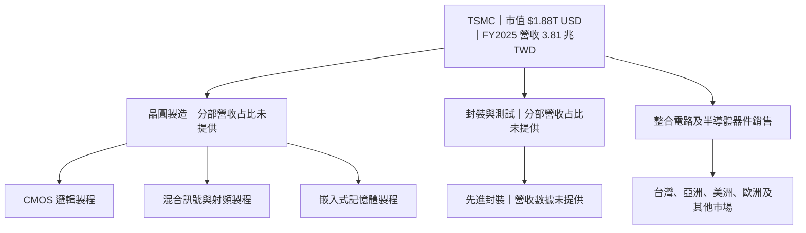
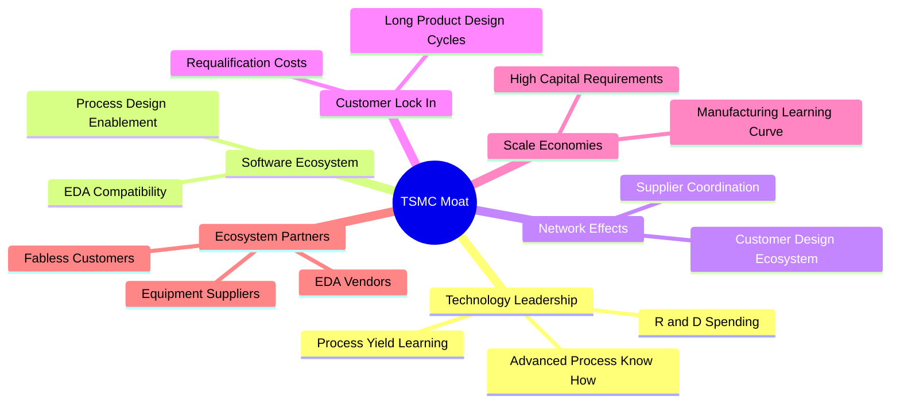
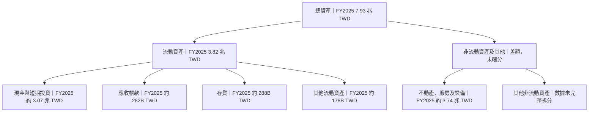
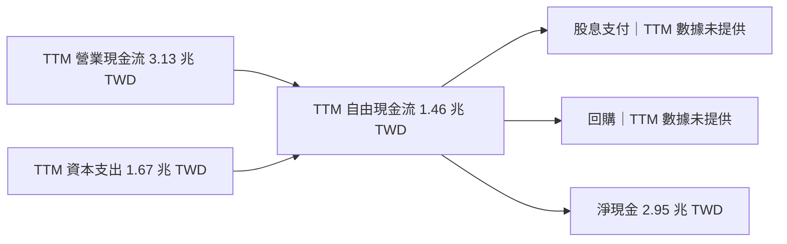
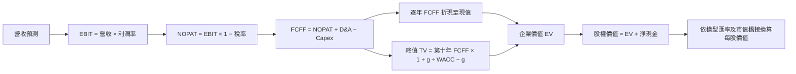
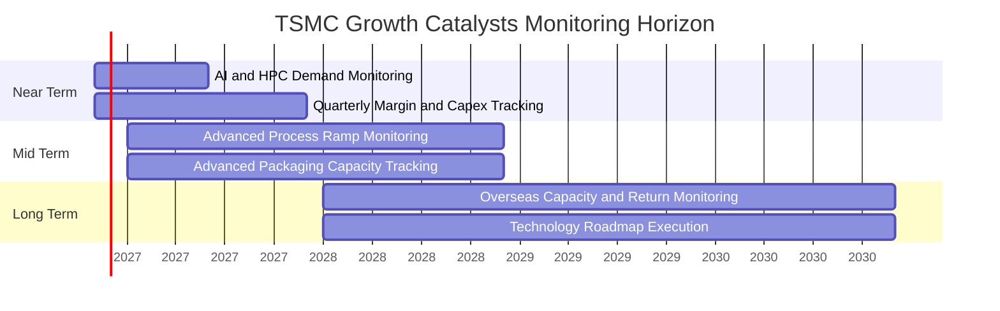
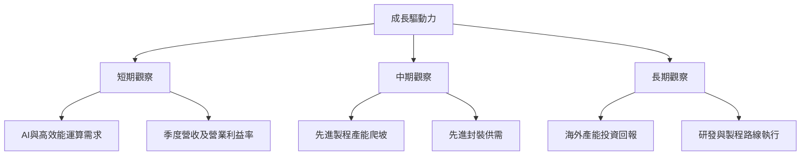
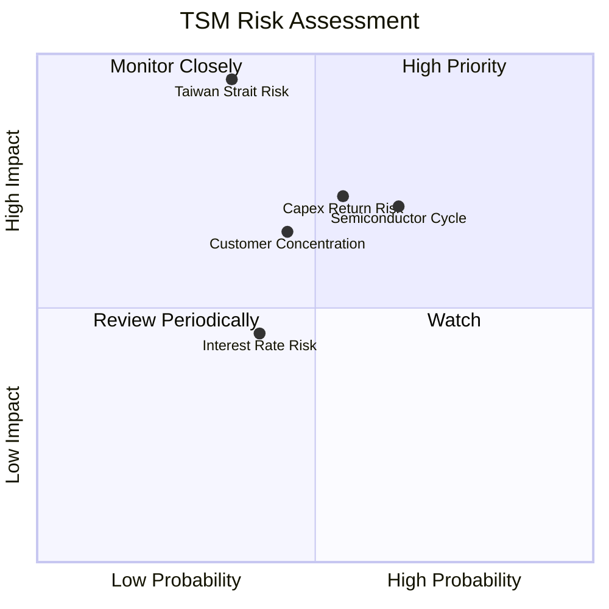
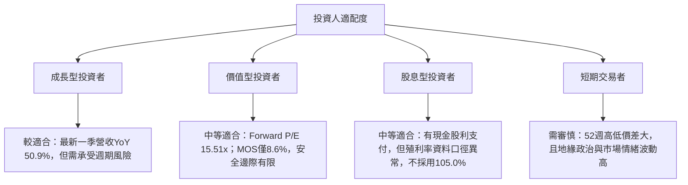

# TSM 基本面深度分析報告
> **報告日期**：2026-11-18 ｜ **語言**：繁體中文 ｜ **數據來源**：Yahoo Finance、Finviz、StockAnalysis、Roic.ai ｜ **分析師**：CFA 級機構研究

## 目錄

| # | 章節 | 核心結論 |
|---|------|----------|
| 1 | 執行摘要 | 持有；加權合理價值 $396.89，MOS +8.6% |
| 2 | 公司概覽與商業模式 | 先進製程與規模帶來護城河；細分營收占比未提供 |
| 3 | 損益表深度分析 | TTM 營收 4.94 兆 TWD；最新一季 YoY +50.9% |
| 4 | 資產負債表分析 | 淨現金 2.95 兆 TWD；流動比率 2.584 |
| 5 | 現金流量深度分析 | TTM FCF 1.46 兆 TWD；高資本支出仍是關鍵約束 |
| 6 | 獲利能力與資本效率 | 歷史 ROIC 高於 WACC；最新同期間 ROIC 未提供 |
| 7 | 相對估值分析 | 同業估值指標分化；估值方法隱含價值區間廣 |
| 8 | DCF 內在價值評估 | 基準 DCF $432.02；終值占 EV 60.3% |
| 9 | 成長催化劑 | AI 加速器、高效能運算與先進封裝需求是主要觀察方向 |
| 10 | 風險矩陣 | 地緣政治、週期與高資本支出最需監控 |
| 11 | 投資建議 | 持有；以加權合理價值與可量化營運門檻管理部位 |

## 1. 執行摘要

### 1.0 一頁式投資儀表板（Portfolio Manager 30 秒速讀）

| 項目 | 內容 |
|------|------|
| **投資論點（3 句）** | ① TTM 營收為 **4.94 兆 TWD（約 1,501.8 億 USD）**，最新一季營收年增 **50.9%**，顯示需求與出貨仍在擴張。② TTM 營業利益率 **58.0%**、FCF **1.46 兆 TWD**，獲利能力足以支應高額資本支出。③ 但現價 **$362.62** 高於部分同業估值法的隱含價值，且加權合理價值僅高出現價約 **9.5%**，估值緩衝有限。 |
| **綜合評分** | **7.4/10**（引用 1.1 評分卡） |
| **財務健康** | 🟢 現金及短期投資 **4.02 兆 TWD**，總債務 **1.07 兆 TWD**，淨現金 **2.95 兆 TWD**；流動比率 **2.584**。 |
| **ROIC vs WACC** | 最新同期間 ROIC：**N/A**；Roic.ai 可見的歷史 ROIC 為 2018 年 **19.11%**，高於 WACC **10.67%**，但不可視為最新年度比較。 |
| **FCF 趨勢** | TTM FCF **1.46 兆 TWD（約 442.7 億 USD）**；FCF Yield **2.35%**。近年 FCF 增長但年度波動明顯。 |
| **估值** | Forward P/E **15.51x**；公司 EV/EBITDA 因報價與財報幣別不同不提供；FCF Yield **2.35%**。 |
| **DCF 內在價值（基準）** | **$432.02**；相對現價折價 **16.1%**（折溢價基準為 DCF）。 |
| **安全邊際（MOS）** | **+8.6%＝($396.89 − $362.62) ÷ $396.89**；🔴 依本報告門檻屬低於 10%、保護有限。 |
| **預期報酬（基準情境 12M）** | DCF 基準情境 **+19.1%**；加權合理價值相對現價上行空間 **+9.5%**，兩者採用不同估值基準。 |
| **關鍵風險（前二）** | 台海地緣政治對供應連續性的衝擊；先進製程投資與產能利用率下降造成資本回收延後。 |
| **評級 + 信心度** | 🟡 **持有** ｜ 信心：中；主要不確定性在地緣政治、估值終值假設及 ROIC 缺少最新同期間數據。 |

### 1.1 綜合評分卡（全報告唯一）

| 維度 | 評分（1–10） | 主要依據（引用數字與其來源章節） |
|------|--------------|----------------------------------|
| 成長性 | 9.0 | 最新一季營收 YoY +50.9%；FY2025 營收 YoY +31.61%（第 3 章）。TTM 成長率為 N/A。 |
| 獲利能力 | 9.0 | TTM 營業利益率 58.0%、毛利率 65.8%；最新 ROIC 與 Piotroski F-Score 未提供（第 3、6 章）。 |
| 財務健康 | 9.0 | 淨現金 2.95 兆 TWD、流動比率 2.584、CCC 2 天（第 4 章）。 |
| 估值 | 5.0 | 加權合理價值 $396.89，MOS +8.6%；Forward P/E 15.51x（第 7、8 章）。 |
| 護城河 | 9.0 | 先進製程、規模及客戶製程轉換成本；FY2025 營收 3.81 兆 TWD，最新一季營收 YoY +50.9%（第 2 章）。 |
| 管理層與資本配置 | 5.0 | FY2025 資本支出約 1.28 兆 TWD；年度現金股利支付 466.78B TWD；SBC 相對營收很低，但股數變化資料有限（第 5 章）。 |
| **綜合評分** | **7.7** | 六項算術平均：(9.0 + 9.0 + 9.0 + 5.0 + 9.0 + 5.0) ÷ 6 = **7.7**。 |

### 1.2 五大投資論點 + 三大核心風險

| 類型 | 項目 | 具體依據 | 信心度 |
|------|------|----------|--------|
| 🟢 **投資論點①** | 營收增長加速 | 2026 Q3 營收 1.494 兆 TWD，YoY +50.9%、QoQ 約 +17.6%；代表短期需求仍快於 2025 年多數季度。 | 🟢 高 |
| 🟢 **投資論點②** | 營運利潤率高 | TTM 營業利益率 58.0%、毛利率 65.8%；為高額研發及資本支出提供內部資金。 | 🟢 高 |
| 🟢 **投資論點③** | 淨現金提供韌性 | 現金及短期投資 4.02 兆 TWD、總債務 1.07 兆 TWD，淨現金 2.95 兆 TWD。 | 🟢 高 |
| 🟢 **投資論點④** | 資本支出後仍有正 FCF | TTM OCF 3.13 兆 TWD、Capex 1.67 兆 TWD，FCF 1.46 兆 TWD。 | 🟢 高 |
| 🟢 **投資論點⑤** | 長期製程與規模優勢 | 2025 年研發支出 246.43B TWD；Roic.ai 歷史資料顯示 2018 年資本報酬率 20.61%，但非最新數據。 | 🟡 中 |
| 🟡 **風險①** | 地緣政治與供應集中 | 公司核心製造資產與營運高度集中於台灣；資料未量化事件損失，但中斷可能影響全球客戶供貨。 | 🔴 高衝擊 |
| 🔴 **風險②** | 資本支出及終值敏感度 | TTM Capex 1.67 兆 TWD；DCF 終值現值占 EV 60.3%，若長期利潤率或終值成長不成立，估值會顯著下修。 | 🟡 中 |
| 🟡 **風險③** | 半導體需求週期反轉 | 2026 Q3 單季營收年增 50.9%，但 TTM 營收成長率未提供；若基期墊高而需求降溫，增長率可能回落。 | 🟡 中 |

### 1.3 快速統計卡片

| 指標 | 公司實際值（期間） | 同業中位數 | 狀態 |
|------|--------------------|------------|------|
| 營收成長（TTM） | **N/A** | — | 🟡 |
| 營收成長（最新一季年增） | **50.9%** | INTC、UMC、GFS 中位數 **20.9%** | 🟢 |
| 毛利率（TTM） | **65.8%** | INTC、UMC、GFS 中位數 **31.7%** | 🟢 |
| 營業利益率（TTM） | **58.0%** | — | 🟢 |
| ROIC（TTM） | **N/A** | — | 🟡 |
| Forward P/E | **15.51x** | 15.5x | 🟡 |
| FCF Yield（TTM） | **2.35%** | — | 🟡 |
| Piotroski F-Score | **N/A** | — | 🟡 |

### 1.4 投資結論

```
╔══════════════════════════════════════════════════════════════════╗
║                    📊 投資結論摘要                               ║
╠══════════════════════════════════════════════════════════════════╣
║  評級：持有（MOS +8.6%，依規則 20）                              ║
║  價格（2026-11-18 收盤）：$362.62                               ║
║  DCF 內在價值（基準）：$432.02（現價折價 16.1%）                ║
║  安全邊際 MOS：+8.6%（＝(加權合理價值−現價)÷加權合理價值）       ║
║  加權合理價值（8.8）：$396.89                                    ║
║  DCF 情境價值：                                                  ║
║    悲觀情境：$184.22（-49.2%）                                  ║
║    基準情境：$432.02（+19.1%）                                  ║
║    樂觀情境：$959.11（+164.5%）                                 ║
║  綜合評分：7.7/10（引用 1.1）                                    ║
║  適合投資人：可承受地緣政治與半導體週期波動的長線投資人          ║
╚══════════════════════════════════════════════════════════════════╝
```

## 2. 公司概覽與商業模式

### 2.1 業務結構與收入來源

TSMC 從事晶圓製造、封裝、測試及銷售。財務資料未提供各製程、封裝、客戶或終端應用的收入占比，故不臆測分部比例。



截至 2025 年，年度營收為 3.81 兆 TWD；TTM 至 2026-09-30 為 4.94 兆 TWD。分部占比、服務收入及各技術節點營收數據未提供，不能以圖表呈現比例。

### 2.2 市場份額

市場份額數據未提供，亦沒有可引用的來源年份與比例。從營收規模、最新一季 +50.9% 年增及 58.0% TTM 營業利益率看，公司在晶圓代工產業具有顯著規模與獲利能力；但不能以這些數字替代市場份額。

### 2.3 競爭護城河分析



### 2.4 護城河強度

| 護城河項目 | 強度（強／中／弱） | 證據（引用數字或事實） | 會削弱它的情況 |
|------------|--------------------|------------------------|----------------|
| 技術領先 | 強 | 2025 年研發支出 246.43B TWD；TTM 營業利益率 58.0%。 | 競爭者縮小製程差距、良率爬坡不順或技術投資回報下降。 |
| 軟體生態系統 | 中 | 公司提供晶圓製造服務，與客戶設計流程相連；量化生態收入未提供。 | 客戶採用替代製程、設計工具或競爭者相容性提升。 |
| 網路效應 | 中 | 客戶、EDA、設備供應商的協作有助於製程導入；量化網路效應數據未提供。 | 產業生態轉移或供應鏈合作中斷。 |
| 客戶鎖定 | 強 | 製程轉換與重新驗證具有時間和成本；客戶別收入集中度未提供。 | 客戶多源化、內製或先進封裝／製程替代。 |
| 規模效應 | 強 | TTM 營收 4.94 兆 TWD，TTM Capex 1.67 兆 TWD，營業利益率 58.0%。 | 產能利用率下滑、固定成本吸收惡化或資本支出過度。 |
| 生態夥伴 | 中 | 跨國營運，且公司涵蓋製造、封裝、測試；合作夥伴量化資料未提供。 | 供應商瓶頸、地緣限制或關鍵設備供應受阻。 |

1.1 護城河評分為 **9.0/10**，依據是高營業利益率、巨額研發投入、規模與製程轉換成本；因客戶集中度及市場份額數據未提供，未將質化判斷視為無風險。

## 3. 損益表深度分析

### 3.1 年度收入成長趨勢（近 4 年）

單位：兆 TWD；FY2022–FY2025。

```
╔══════════════════════════════════════════════════════════════════╗
║              TSMC 年度收入趨勢（FY2022-FY2025）                  ║
╠══════════════════════════════════════════════════════════════════╣
║ FY2022  2.26  ███████████████░░░░░░░░░░░░  YoY：-4.5%  🔴      ║
║ FY2023  2.16  ██████████████░░░░░░░░░░░░░  YoY：-4.5%  🔴      ║
║ FY2024  2.89  ███████████████████░░░░░░░░  YoY：+33.9% 🟢      ║
║ FY2025  3.81  █████████████████████████░░  YoY：+31.6% 🟢      ║
╠══════════════════════════════════════════════════════════════════╣
║ FY2022 至 FY2025 營收 CAGR：約 +19.0%                            ║
╚══════════════════════════════════════════════════════════════════╝
```

2023 年營收下滑 4.5%，之後 2024、2025 年分別增長 33.9%、31.6%。兩年反彈顯示需求回升及高效能運算等需求可能推動恢復；但 TTM 對前一個 TTM 的成長率標示為 N/A，不能把單季 +50.9% 誤稱為 TTM 增長。

### 3.2 季度收入趨勢分析

| 季度 | 營收（B TWD） | QoQ | YoY | 備註 |
|------|---------------:|----:|----:|------|
| 2025 Q4 | 1,046.090 | — | +20.45% | 季度數據提供的比較基期。 |
| 2026 Q1 | 1,134.103 | +8.4% | +35.13% | QoQ 以 2025 Q4 為基期計算。 |
| 2026 Q2 | 1,270.380 | +12.0% | +36.05% | QoQ 增幅較 Q1 擴大。 |
| 2026 Q3 | 1,494.243 | +17.6% | +50.95% | 最新一季營收達高點，顯示出貨及需求加速。 |

QoQ 按相鄰季度營收計算。例如 2026 Q3：`(1,494.243 ÷ 1,270.380) − 1 = 17.6%`。最新季度 YoY 原始數據為 50.9%，表內 50.95% 是 StockAnalysis 顯示值的精度；評估使用 VERIFIED FIGURES 的 50.9%。

### 3.3 利潤率演變分析

| 利潤率指標 | FY2022 | FY2023 | FY2024 | FY2025 | 趨勢 | 評估 |
|------------|-------:|-------:|-------:|-------:|------|------|
| **毛利率** | 59.6% | 54.4% | 56.1% | 59.9% | 2023 下滑，之後回升 | 🟢 |
| **營業利益率** | 49.6% | 42.6% | 45.7% | 50.8% | 2023 收縮後高於 2022 | 🟢 |
| **淨利率** | 43.9% | 39.4% | 40.0% | 44.6% | 2025 回升至高於 2022 | 🟢 |

年度比率由年度財報數據計算，四捨五入至小數一位。2023 年營收下降同時毛利率與營業利益率下滑，反映半導體週期、產能利用率及固定成本吸收可能造成的營運槓桿；2024–2025 年營收復甦與產品組合改善，推動利潤率回升。TTM 毛利率為 65.8%、營業利益率為 58.0%，但不同資料口徑及期間需避免直接與年度比率混用。

### 3.4 費用結構分析

完整的費用明細與 TTM 成本拆分未提供，不製作比例圓餅圖。FY2025 研發支出為 246.43B TWD；TTM 營業利益率 58.0%。資本支出屬現金流量，不等同於當期費用，兩者不可混為一談。

### 3.5 季度 EPS 趨勢與盈餘品質（Quality of Earnings）

最近四季 EPS 估計值均為 NaN，故不能判斷公司是否超出分析師預期。實際 EPS 可見季度數列為 TWD 18.72、22.08、27.25、29.43（2025 Q4 至 2026 Q3）；此處不將其換算成美元 ADR EPS，亦不與未提供的預期值比較。2026 Q3 EPS YoY 增長 68.7%，同期單季淨利 YoY 亦增長 68.7%，與營收高增長及營業槓桿相符。

| 盈餘品質項目 | 數值/佔比 | 評估 |
|--------------|-----------|------|
| 股權薪酬 SBC / 營收 | 四季合計約 0.513B TWD ÷ TTM 營收 4,944.817B TWD ≈ **0.010%** | 🟢 比例很低；SBC 對目前股東經濟報酬的稀釋影響有限。 |
| SBC / 營業現金流 | 0.513B ÷ 約 3,130B ≈ **0.016%** | 🟢 佔比極低。 |
| FCF / 淨利（現金轉換率） | TTM FCF 1.46 兆 ÷ TTM 淨利 2.528 兆 ≈ **57.8%** | 🟡 有正現金轉換，但高 Capex 壓低 FCF 相對淨利比例。 |
| 一次性/非經常性損益 | N/A（未提供可辨識明細） | 🟡 無法判斷是否存在重大一次性損益。 |
| 有效稅率異常 | 17.0%（最新年度） | 🟢 DCF 採此稅率；更長期正常化稅率資料不足。 |
| 資本化支出 vs 費用化 | TTM Capex 1.67 兆 TWD；TTM D&A/營收為 15.1% | 🟡 資本密集產業，資本化支出透過折舊逐期費用化；折舊估計或資產壽命假設會影響當期利潤。 |

**盈餘品質結論**：低 SBC、強營業現金流與高利潤率支持獲利含金量；但 FCF/淨利約 57.8%，反映大額投資並未立即轉化為可分配現金。一次性損益資料缺少，且資本密集程度使淨利與自由現金流差距較大，估值宜同時看 FCF 與投入資本回報。

## 4. 資產負債表分析

### 4.1 資產結構分解

截至 2025-12-31，總資產為 7.93 兆 TWD；截至 2026-09-30，StockAnalysis 顯示總資產約 10.05 兆 TWD。季度資產明細以 TWD 百萬計。



### 4.2 流動性與營運資金分析

| 指標 | 最新 TTM | 一年前 TTM | 變化 | 解讀 |
|------|----------|------------|------|------|
| DSO 應收帳款天數 | 1 天 | N/A | N/A | 一年前同口徑數值未提供；最新數據顯示應收天數很低，但應注意採用期末餘額計算。 |
| DIO 存貨天數 | 92 天 | N/A | N/A | 未提供一年前比較，不能判定存貨週轉變化。 |
| DPO 應付帳款天數 | 91 天 | N/A | N/A | 未提供一年前比較；不可單憑此數據推斷議價力變化。 |
| CCC 現金轉換週期 | 2 天 | N/A | N/A | 收款、存貨及付款天數的合成指標；目前顯示資金占用週期短。 |

已知流動比率為 2.584、速動比率為 2.287。兩者高於 1，說明流動資產對短期負債有緩衝，但不代表所有流動資產都能即時變現。

### 4.3 債務結構分析

```
╔══════════════════════════════════════════════════════════════════╗
║                   TSMC 債務健康診斷                              ║
╠══════════════════════════════════════════════════════════════════╣
║  總債務：        1.07 兆 TWD     🟡 有債務，但規模受控           ║
║  現金+短期投資： 4.02 兆 TWD     🟢 現金緩衝充足                 ║
║  淨現金：        2.95 兆 TWD     🟢 淨現金                       ║
║  Debt/EBITDA：   N/A（幣別／口徑不一致，不回推）                 ║
║  Interest Coverage：N/A（利息費用未提供）                       ║
║  流動比率：      2.584           🟢                              ║
║  速動比率：      2.287           🟢                              ║
╚══════════════════════════════════════════════════════════════════╝
```

### 4.4 股東權益趨勢

```
╔══════════════════════════════════════════════════════════════════╗
║              FY2022-FY2025 股東權益變化（TWD 兆）                ║
╠══════════════════════════════════════════════════════════════════╣
║ FY2022  2.90  ███████████████░░░░░░░░░░░░                       ║
║ FY2023  3.43  ██████████████████░░░░░░░░░░                      ║
║ FY2024  4.24  ██████████████████████░░░░░░                      ║
║ FY2025  5.36  ████████████████████████████                      ║
╚══════════════════════════════════════════════════════════════════╝
```

FY2022–FY2025 股東權益由 2.90 兆增至 5.36 兆 TWD，反映多年留存盈餘與業務擴張；權益增加同時也需與資本支出回報、股利和未來產能利用率一併評估。

## 5. 現金流量深度分析

### 5.1 現金流量瀑布圖

各年度淨利、OCF、Capex 的完整一致口徑流水資料未提供，故不以淨利為起點製作會造成假精度的瀑布。以下呈現可確認的 TTM 轉換：



### 5.2 FCF 轉換率趨勢

| 年度 | FCF（B TWD） | 淨利（B TWD） | FCF/淨利 |
|------|-------------:|-------------:|---------:|
| 2022 | 520.97 | 992.92 | 52.5% |
| 2023 | 286.57 | 851.74 | 33.6% |
| 2024 | 861.20 | 1,158.38 | 74.3% |
| 2025 | 992.38 | 1,697.60 | 58.5% |
| TTM 至 2026-09-30 | 1,460（約） | 2,527.57 | 約 57.8% |

FCF 轉換率受資本支出時點影響，2023 年降至 33.6%，2024 年回升至 74.3%，2025 年為 58.5%。這類波動符合高資本支出公司的特徵，但不能只用單一年度的 FCF 評價永久現金創造能力。

### 5.3 自由現金流趨勢

```
╔══════════════════════════════════════════════════════════════════╗
║                 自由現金流：年度歷史實際                         ║
╠══════════════════════════════════════════════════════════════════╣
║ FY2022  520.97B TWD  ███████████░░░░░░░░░░░░                    ║
║ FY2023  286.57B TWD  ██████░░░░░░░░░░░░░░░░░                    ║
║ FY2024  861.20B TWD  ██████████████████░░░░░░                    ║
║ FY2025  992.38B TWD  █████████████████████░░░░                    ║
║ TTM     1.46T TWD    ██████████████████████████████              ║
╠══════════════════════════════════════════════════════════════════╣
║ TTM FCF Yield：2.35%（價格資料庫／程式計算）                     ║
╚══════════════════════════════════════════════════════════════════╝
```

TTM FCF 是按營業現金流減資本支出的統一定義，並非其他可能包含融資或租賃調整的自由現金流口徑。歷史 FCF Yield 只有 TTM 數值可引用。

### 5.4 資本配置評估

股利支付與 Capex 金額有資料，但未提供可完整分類的 TTM 回購及再投資分配比例，因此不製作資本配置比例圓餅圖。

| 項目 | 數據 | 解讀 |
|------|------:|------|
| FY2025 Capex | 1.28 兆 TWD | 支持產能與製程投資；同時提高週期下行時的固定成本風險。 |
| TTM Capex | 1.67 兆 TWD | 高於 FY2025 整年數值，顯示近期投資規模上升；未提供未來管理層 Capex 指引。 |
| FY2025 現金股利支付 | 466.78B TWD | FY2025 FCF 992.38B 的約 47.0%，有現金流覆蓋。 |
| FY2025 股票回購 | N/A | 回購金額未提供。 |
| FY2025 FCF | 992.38B TWD | 高於現金股利支付，但尚需滿足後續資本投資與營運需求。 |

## 6. 獲利能力與資本效率

### 6.1 ROE / ROA / ROIC 趨勢

| 指標 | 已提供數值 | 評估 |
|------|------------|------|
| ROE（TTM） | 41.9% | 高股東報酬，但杜邦構成數據被標示為 N/A，不能判定槓桿貢獻。 |
| ROA（TTM） | 20.6% | 顯示資產具獲利能力；缺乏同一口徑歷年序列。 |
| ROIC | 最新同期間 N/A；Roic.ai 歷史 2013–2018 年介於 18.31%–20.55% | 歷史值高於目前 WACC，但資料年份較舊，不當作最新 ROIC。 |
| 行業均值 | 未提供 | 不列無來源的同業平均值。 |

### 6.2 ROIC vs WACC 分析（核心價值創造判斷）

目前可確認的 WACC 為 **10.67%**。最新 TTM ROIC 未提供，因此不能以歷史 ROIC 直接宣稱目前價值利差。可得歷史資料中，Roic.ai 2018 年 Return on Invested Capital 為 19.11%，高於 WACC；這支持歷史上曾創造經濟價值，但非 2026 年實際值。

```
╔══════════════════════════════════════════════════════════════════╗
║                ROIC vs WACC 深度分析                            ║
╠══════════════════════════════════════════════════════════════════╣
║ WACC（採用成本資本數據）：10.67%                                ║
║ ├── 無風險利率：5.07%                                           ║
║ ├── 股權風險溢酬：5.00%                                         ║
║ ├── 原始 Beta：1.23；調整後 Beta：1.16                           ║
║ ├── 股權成本（來源值）：10.84%                                  ║
║ ├── 稅前債務成本：1.16%；稅率：17.0%                            ║
║ ├── 股權／債務權重：98.3%／1.7%                                  ║
║ └── WACC（指定值）：10.67%                                      ║
║                                                                  ║
║ ROIC：最新同期間 N/A                                             ║
║ 歷史參考：2018 ROIC 19.11%                                       ║
║ 歷史參考價值利差：19.11% − 10.67% = +8.44 個百分點               ║
║                                                                  ║
║ 判斷：🟡 歷史數據支持價值創造；當期是否仍高於 WACC 尚待確認       ║
╚══════════════════════════════════════════════════════════════════╝
```

成本資本數據提供的 CAPM 股權成本是 10.84%，其組件若按顯示值直接計算則 `5.07% + 1.16 × 5.00% = 10.87%`，存在 0.03 個百分點差異。依規則採用資料所列股權成本與 WACC，不自行改寫模型 WACC；8.10 會將這項來源內部差異列為待核。

### 6.3 杜邦三因素分解

| 因素 | 數值（TTM） | 解讀 |
|------|-------------|------|
| 淨利率 | N/A | QUALITY FIGURES 將 DuPont 標示為 N/A，因所需數據組合不完整。 |
| 資產週轉率 | N/A | 同上。 |
| 權益乘數 | N/A | 同上。 |
| **ROE** | **N/A（杜邦分解）** | 另有 ROE（TTM）41.9%，但不得以缺失項目自行補算。 |

### 6.4 財務體質：Piotroski F-Score

| 測試 | 結果 | 解讀 |
|------|------|------|
| Piotroski F-Score 總分 | N/A；需兩個相隔一年的 TTM SEC 申報資料 | SEC 申報資料不足，無法完成九項測試。 |
| 九項個別測試 | N/A（未提供各項結果） | 不補造測試結果；應取得同口徑申報資料後再評估。 |

## 7. 相對估值分析

### 7.1 同業估值比較表格

公司與同業數據採用 Yahoo Finance 的估值欄位；公司市銷率及 EV/EBITDA 因財報與報價幣別不同而不提供。Peer multiples 未列 TSM 自身對應 TTM P/E，故採市場估值欄位中可用的公司值。

| 估值指標 | **TSM** | **INTC** | **UMC** | **GFS** | TSM 評估 |
|----------|---------:|---------:|---------:|---------:|-----------|
| **Trailing P/E** | 23.50x | N/A | 13.2x | 113.8x | 🟡 同業分散，GFS TTM 倍數受盈利基數影響可能較高。 |
| **Forward P/E** | 15.51x | 30.5x | 15.5x | 15.3x | 🟢 接近 UMC、GFS，低於 INTC。 |
| **P/S Ratio（TTM）** | N/A | 4.9x | N/A | 3.1x | 🟡 TSM 無可比值；同業數據不完整。 |
| **EV/EBITDA（TTM）** | N/A | 16.0x | N/A | 10.6x | 🟡 TSM 幣別限制不提供，僅可觀察同業倍數範圍。 |
| **最新季度營收 YoY** | 50.9% | 20.9% | 25.6% | 12.5% | 🟢 TSM 增長高於三家同業。 |
| **毛利率（TTM）** | 65.8% | 40.2% | 31.7% | 28.5% | 🟢 TSM 毛利率較高，支持較高獲利能力。 |

Peer forward P/E 中位數為 **15.5x**；同業 EV/EBITDA 可計算的 INTC、GFS 中位數為 **13.3x**。同業企業在製程能力、獲利階段及資本密集程度不同，倍數比較只能作相對估值參考。

### 7.2 歷史估值區間分析

N/A（Valuation vs own history 的歷史估值區間與百分位數未提供；不自行估算目前在歷史分布的位置。）

### 7.3 情境價值（Bear / Base / Bull，照抄 DCF MODEL 的 Scenarios）

| 情境 | 第 1 年營收成長 | 期末營業利潤率 | WACC | 每股價值 | 相對現價 | 機率 | 會發生的條件 |
|------|----------------:|----------------:|-----:|---------:|---------:|-----:|--------------|
| 🔴 悲觀 | 15.0% | 42.1% | 11.67% | $184.22 | -49.2% | 25% | AI／先進製程需求降溫、產能利用率下行，利潤率向低位回歸且風險溢酬上升。 |
| 🟡 基準 | 30.0% | 49.5% | 10.67% | $432.02 | +19.1% | 50% | 第一年高增長後逐年降至第十年 3.0%，毛利與營業利潤率逐步正常化。 |
| 🟢 樂觀 | 45.0% | 54.5% | 9.67% | $959.11 | +164.5% | 25% | 需求高於基準、規模及產品組合持續提升利潤率，資本市場折現率下降。 |

### 7.4 相對估值隱含價格區間

```
╔══════════════════════════════════════════════════════════════════╗
║              相對估值法回推價格與現價                             ║
╠══════════════════════════════════════════════════════════════════╣
║ 同業 EV/EBITDA     $298.79 ───── 現價 $362.62                    ║
║ 同業 Forward P/E   $362.88 ───── 現價 $362.62                    ║
║ DCF 基準           $432.02                                         ║
║ 分析師共識         $586.69                                         ║
╚══════════════════════════════════════════════════════════════════╝
```

| 方法 | 每股價值 | 依據 |
|------|---------:|------|
| 同業 Forward P/E | $362.88 | INTC、UMC、GFS 同業中位數 15.5x × 公司 Forward EPS 23.39。 |
| 同業 EV/EBITDA | $298.79 | INTC、GFS 中位數 13.3x × TTM EBITDA，再加回淨現金。 |
| DCF 基準 | $432.02 | 10 年 FCFF、WACC 10.67%、終值成長率 3.0%。 |
| 分析師共識目標價 | $586.69 | 20 位分析師平均目標價，屬參考而非基本面模型輸入。 |

## 8. DCF 內在價值評估（Discounted Cash Flow）

> DCF 數字採程式計算模型原值。金額以 **TWD 十億元**為單位，除每股價值外；每股價格為 USD。表格保留原模型精度；計算式沿用原模型四捨五入值。

### 8.0 估值推理鏈（Thinking Logic）

**Step 1 — 價值來源與主導變數**

TSMC 的價值主要來自既有晶圓製造業務的現金流底盤、先進製程／封裝帶來的增量需求，以及長期製程領先的選擇權；公司未提供各部分營收占比，故不能為其指定比例。模型中營收增長、營業利益率與終值成長共同決定現值；敏感度矩陣顯示 WACC 變動的影響大於同幅度的終值成長變動，因此折現率是該矩陣中最大的可量化敏感變數。

**Step 2 — 模型選擇**

| 決策點 | 本報告採用 | 理由（含數字） | 曾考慮但否決 | 否決理由 |
|--------|-----------|----------------|--------------|----------|
| 現金流定義 | FCFF | 用 WACC 折現，模型包含企業現金流與淨現金橋接。 | FCFE | 未提供足以建立單獨融資政策路徑的預測。 |
| 預測期 N | 10 年 | DCF MODEL 固定 10 年；逐年呈現成長率由 30.0% 衰減至 3.0%。 | 5 年 | 無法沿用程式指定的模型預測期間。 |
| 終值方法 | Gordon Growth | 模型提供永續成長率 3.0% 並用於基準價值。 | 另設退出倍數 | DCF MODEL 未提供退出倍數的獨立終值估值輸出，不另建模型。 |
| EBIT 基礎 | GAAP EBIT | 模型明確使用 GAAP EBIT。 | 非 GAAP EBIT | 會改變已提供現金流預測。 |

**Step 3 — 關鍵假設推導鏈**

- **營收成長路徑**：錨點＝最新一季 YoY 50.9%，這是單季而非 TTM → 調整＝將單季增長限制在模型年 1 上限 30.0%，之後逐年線性降至 3.0% → **採用 FY+1 30.0%、FY+10 3.0%** → 曾考慮直接沿用 50.9%，但否決，因單季增長不能視為十年可持續成長。
- **營業利潤率**：錨點＝TTM 58.0% → 調整＝模型將其線性降至最近五個財年的中位數 49.5% → **採用 FY+1 58.0%、FY+10 49.5%** → 否決長期維持 58.0%，因未將目前高利潤率永久外推。
- **永續成長率 g**：錨點＝模型選定 3.0% → 調整＝低於 WACC 10.67%，以避免終值公式失效並反映成熟期成長放緩 → **採用 3.0%** → 否決高於 3.0% 的長期成長設定，因其會提高終值占比，且資料未提供可支持更高永續增長的長期市場數據。
- **預測期 N**：錨點＝模型指定 10 年 → 調整＝用十年呈現增長與利潤率收斂 → **採用 10 年** → 否決更短期間，因會改變終值起算年度及估值。
- **Capex/營收**：錨點＝TTM Capex/營收 33.8% → 調整＝模型逐年降至 16.6%，其終點為 D&A 的 1.1 倍 → **採用年 1 33.8%、年 10 16.6%** → 否決將 TTM 比率永久維持 33.8%，因那會忽略投資強度逐步正常化的模型假設。
- **GAAP EBIT、SBC 與稀釋**：錨點＝模型以 GAAP EBIT，SBC 已包含在費用內 → 調整＝不再扣 SBC，採固定股數、年稀釋率 0% → **採用組合 (A)** → 否決額外扣 SBC 或另加稀釋率，避免把同一成本重複計入。
- **有效稅率**：錨點及採用值＝最新年度有效稅率 17.0% → 不另調整。
- **D&A/營收**：錨點＝TTM 15.1% → 採用 15.1% 並固定；資料未提供長期比率分布。
- **營運資金**：DCF MODEL 明確未建模 Working Capital，故不列入 FCFF；營運資金變動率是 N/A，而非假設為可外推的數值。
- **WACC**：錨點＝指定成本資本模型 10.67% → 採用 10.67% → 不另計替代 WACC，以遵守統一成本資本輸入。
- **終值方法**：錨點＝模型使用 Gordon Growth → 採用基準 g 3.0% → 不另加入退出倍數，因沒有模型原值可供稽核。

**Step 4 — 最脆弱一環**

最脆弱的是十年後 FCFF 的成長及折現率；基準終值 PV 占 EV 60.3%，且敏感度矩陣中 WACC 上升 1 個百分點可使每股價值下降約 $56.50，若風險溢酬上升，價值偏差可能向下。

**Step 5 — 計算路徑圖**



### 8.1 模型假設總表（Model Inputs）

| 假設項目 | 採用值 | 依據 / 來源 | 敏感度 |
|----------|--------|-------------|--------|
| 預測期長度 **N** | 10 年 | DCF MODEL 指定；營收增長逐年衰減至第十年。 | 🟡 中 |
| 營收成長 | FY+1 30.0% 至 FY+10 3.0%，逐年下降 3 個百分點 | 第一年參照最新單季 YoY 50.9%，模型限制上限 30.0%。 | 🔴 高 |
| 營業利潤率 | FY+1 58.0% 至 FY+10 49.5% | TTM 58.0%；終值採最近五財年中位數。 | 🔴 高 |
| 有效稅率 | 17.0% | 最新年度有效稅率。 | 🟢 低 |
| Capex / 營收 | 33.8% 至 16.6% | TTM 比率起點，逐步降至 1.1×D&A。 | 🔴 高 |
| 折舊攤銷 D&A / 營收 | 15.1% | TTM 比率固定。 | 🟢 低 |
| 營運資金變動 | 未建模；N/A | DCF MODEL 明示 working capital is not modelled。 | 🟡 中 |
| EBIT 基礎 | GAAP | DCF MODEL 指定。 | 🟡 中 |
| SBC 處理 | GAAP EBIT 已含 SBC；不再扣 SBC | 採組合 (A)。 | 🟡 中 |
| 年稀釋率（股數） | 0% | 組合 (A)，固定股數；DCF MODEL 不再稀釋。 | 🟡 中 |
| 永續成長率 g | 3.0% | DCF MODEL 指定，且低於 WACC 10.67%。 | 🔴 高 |
| 終值方法 | Gordon Growth | DCF MODEL 使用 FCFF(FY+10) 永續成長公式。 | 🔴 高 |
| WACC | 10.67% | Cost of capital 指定數值。 | 🔴 高 |

本模型使用 **FCFF = NOPAT + D&A − Capex**；營運資金未建模，故不在公式中減列 ΔWC。採用 **(A) GAAP EBIT + 固定股數**，SBC 影響已計入一次：不另扣 SBC，也不再增加股數稀釋。

### 8.2 折現率推導（WACC）

```
╔══════════════════════════════════════════════════════════════════╗
║                    WACC 推導（折現率）                            ║
╠══════════════════════════════════════════════════════════════════╣
║ 股權成本 Ke：資料列示 10.84%                                     ║
║ ├── 無風險利率 Rf：5.07%                                         ║
║ ├── ERP：5.00%（假設值，成本資本模型輸入）                        ║
║ ├── 原始 Beta：1.23；調整後 Beta：1.16                           ║
║ ├── 調整方式：⅔ × 1.23 + ⅓ × 1 = 1.153 ≈ 1.16                  ║
║ └── 資料列示 Ke = 10.84%；組件直接算值 5.07%+1.16×5.00%=10.87% ║
║                                                                  ║
║ 債務成本 Kd：                                                    ║
║ ├── 稅前成本：1.16%（資料列示；利息金額未提供）                  ║
║ ├── 有效稅率：17.0%                                              ║
║ └── 稅後 Kd = 1.16% × (1 − 17.0%) = 0.9628% ≈ 0.96%            ║
║                                                                  ║
║ 資本結構：股權 98.3%，債務 1.7%                                  ║
║ └── WACC 採指定值：10.67%                                        ║
╚══════════════════════════════════════════════════════════════════╝
```

逐步演算：

1. **Ke（來源值）**：`Rf + β × ERP = 5.07% + 1.16 × 5.00% = 10.87%`；成本資本區塊列示 Ke 為 **10.84%**，兩者相差 0.03 個百分點，故模型沿用列示的 10.84%。
2. **稅前 Kd**：利息費用金額與平均計息負債細項未提供，無法從原始財務報表獨立複算；採成本資本區塊列示 **1.16%**。
3. **稅後 Kd**：`1.16% × (1 − 17.0%) = 0.9628% ≈ 0.96%`。
4. **資本權重**：市值／債務權重由成本資本資料列示為股權 **98.3%**、債務 **1.7%**；權重相加 `98.3% + 1.7% = 100.0%`。相關債務範圍及市值換算細節未提供，故不反推替代權重。
5. **WACC**：採用已提供的 **10.67%**，不以有差異的顯示組件自行重算或替代。

第 6.2 節同樣採用 **10.67%**。股權成本組件直接相乘與列示 Ke 不完全一致，是來源精度／計算口徑待核事項。

### 8.3 逐年自由現金流預測（基準情境）

金額單位：TWD 十億元；折現因子保留三位小數。FCFF 依模型定義，**沒有 ΔWC 列**。

| 年度 | FY+1 | FY+2 | FY+3 | FY+4 | FY+5 | FY+6 | FY+7 | FY+8 | FY+9 | FY+10 |
|------|-----:|-----:|-----:|-----:|-----:|-----:|-----:|-----:|-----:|------:|
| 營收 | 6,428.26 | 8,163.89 | 10,123.23 | 12,249.11 | 14,453.94 | 16,622.04 | 18,616.68 | 20,292.18 | 21,509.71 | 22,155.00 |
| 營收 YoY | 30.0% | 27.0% | 24.0% | 21.0% | 18.0% | 15.0% | 12.0% | 9.0% | 6.0% | 3.0% |
| 營業利潤率 | 58.0% | 57.0% | 56.1% | 55.2% | 54.2% | 53.3% | 52.3% | 51.4% | 50.5% | 49.5% |
| EBIT（GAAP） | 3,726.88 | 4,656.49 | 5,679.00 | 6,756.58 | 7,837.06 | 8,856.56 | 9,744.56 | 10,431.05 | 10,854.96 | 10,972.60 |
| − 稅（17.0%） | (632.56) | (790.34) | (963.90) | (1,146.79) | (1,330.18) | (1,503.22) | (1,653.94) | (1,770.46) | (1,842.41) | (1,862.38) |
| = NOPAT | 3,094.32 | 3,866.14 | 4,715.10 | 5,609.79 | 6,506.88 | 7,353.34 | 8,090.62 | 8,660.59 | 9,012.55 | 9,110.22 |
| + D&A | 970.20 | 1,232.15 | 1,527.86 | 1,848.72 | 2,181.48 | 2,508.71 | 2,809.75 | 3,062.63 | 3,246.39 | 3,343.78 |
| − Capex | (2,171.05) | (2,601.47) | (3,032.68) | (3,435.84) | (3,778.51) | (4,028.15) | (4,156.32) | (4,143.23) | (3,981.42) | (3,678.16) |
| **= FCFF** | **1,893.46** | **2,496.82** | **3,210.29** | **4,022.67** | **4,909.85** | **5,833.90** | **6,744.04** | **7,579.99** | **8,277.52** | **8,775.85** |
| 折現因子 | 0.904 | 0.816 | 0.738 | 0.667 | 0.602 | 0.544 | 0.492 | 0.444 | 0.401 | 0.363 |
| **FCFF 現值 PV** | **1,710.83** | **2,038.40** | **2,368.08** | **2,681.13** | **2,956.81** | **3,174.43** | **3,315.72** | **3,367.26** | **3,322.46** | **3,182.73** |

預測期 PV 合計完整加總：

`1,710.83 + 2,038.40 + 2,368.08 + 2,681.13 + 2,956.81 + 3,174.43 + 3,315.72 + 3,367.26 + 3,322.46 + 3,182.73 = 28,117.85 TWD 十億元`

**FY+1 逐步演算**：

1. 營收：`4,944.82 × (1 + 30.0%) = 6,428.266 ≈ 6,428.26`。  
2. EBIT：`6,428.26 × 58.0% = 3,728.39`；模型逐年表列 **3,726.88**，表示模型底層使用未顯示的精確輸入／口徑。依規則保留程式輸出 **3,726.88**，不以四捨五入的展示值替換。  
3. 稅：模型表列 **632.56**。  
4. NOPAT：`3,726.88 − 632.56 = 3,094.32`。  
5. D&A：模型表列 **970.20**。  
6. Capex：模型表列 **2,171.05**。  
7. ΔWC：模型未建模，無數值、無扣項。  
8. FCFF：`3,094.32 + 970.20 − 2,171.05 = 1,893.47`；模型表列 **1,893.46**，差異約 0.01，屬顯示精度尾差，沿用模型原值。  
9. 折現及 PV：`1 ÷ (1 + 10.67%)^1 ≈ 0.904`；`1,893.46 × 0.904 ≈ 1,710.83`，依模型未四捨五入折現因子列值。

**合理性自檢**：

- FY+1 至 FY+10 FCFF CAGR：約 `(8,775.85 ÷ 1,893.46)^(1/9) − 1 ≈ 18.6%`；歷史年度 FCF CAGR 受 FY2023 低基期影響很大，不宜直接視作可比趨勢。  
- FY+10 FCFF 利潤率：`8,775.85 ÷ 22,155.00 = 39.6%`；目前 TTM FCF 利潤率約 `1,460 ÷ 4,944.82 = 29.5%`。  
- 同業最佳 FCF 利潤率未提供，不能判斷模型是否超越同業最佳。預測年度 FCFF 均為正值。

```
╔══════════════════════════════════════════════════════════════════╗
║           自由現金流：歷史實際 vs 模型預測                       ║
╠══════════════════════════════════════════════════════════════════╣
║ FY2023（實）  286.57B TWD  ██████░░░░░░░░░░░░░░░░                ║
║ FY2024（實）  861.20B TWD  ██████████████████░░░░                ║
║ FY2025（實）  992.38B TWD  █████████████████████░░░              ║
║ FY+1（預）  1,893.46B TWD  ██████████████████████████████        ║
║ FY+10（預） 8,775.85B TWD  ████████████████████████████████████  ║
╠══════════════════════════════════════════════════════════════════╣
║ 預測初期 FCFF 高於歷史實際；Capex 率由 33.8% 逐步降至 16.6% 是重要║
║ 假設，若投資強度無法下降，預測 FCF 與估值會向下。               ║
╚══════════════════════════════════════════════════════════════════╝
```

### 8.4 終值計算（Terminal Value）

適用性檢查：`WACC 10.67% vs g 3.0% → WACC > g？✅`

DCF MODEL 提供的基準 Gordon Growth 終值：

| 方法 | 計算式 | 終值 TV（TWD 十億元） | TV 現值（TWD 十億元） | 佔總 EV 比重 |
|------|--------|----------------------:|----------------------:|-------------:|
| Gordon Growth | FY+10 FCFF × (1+g) ÷ (WACC−g) | 117,775.86 | 42,713.67 | 60.3% |
| 退出倍數法 | 未提供 DCF MODEL 的終值倍數輸出 | N/A | N/A | N/A |

逐步演算：

1. FY+10 FCFF：**8,775.85**（TWD 十億元）。  
2. 分子：`8,775.85 × (1 + 3.0%) = 9,039.1255`。  
3. 分母：`10.67% − 3.0% = 7.67%`；`9,039.1255 ÷ 7.67% = 117,775.86`。  
4. PV(TV)：`117,775.86 × 0.363 = 42,713.67`（依模型折現值）。  
5. 終值占比：`42,713.67 ÷ 70,831.52 = 60.3%`。

終值占比低於 75% 的警示門檻，但仍代表六成 EV 取決於預測期後的假設。模型未提供退出倍數法所需的終值輸出，故不自建第二套估值。

### 8.5 企業價值 → 每股內在價值（Bridge）

```
╔══════════════════════════════════════════════════════════════════╗
║              企業價值 → 每股內在價值 橋接表                      ║
╠══════════════════════════════════════════════════════════════════╣
║ 預測期 FCF 現值合計             +28,117.85 TWD 十億元            ║
║ 終值現值 PV(TV)                 +42,713.67 TWD 十億元            ║
║ = 企業價值 EV                    70,831.52 TWD 十億元             ║
║ + 淨現金                         +2,947.23 TWD 十億元             ║
║ = 股權價值                       73,778.74 TWD 十億元             ║
║                                                                  ║
║ ★ 每股內在價值（模型值）         $432.02 USD                      ║
║   當前股價（2026-11-18 收盤）    $362.62 USD                      ║
║   折溢價（現價÷DCF價值−1）       -16.1%（折價）                   ║
╚══════════════════════════════════════════════════════════════════╝
```

逐步演算：

1. **EV**：`28,117.85 + 42,713.67 = 70,831.52 TWD 十億元`。  
2. **股權價值**：`70,831.52 + 2,947.23 = 73,778.75`；模型原值為 **73,778.74**，差 0.01 為底層未四捨五入值造成的尾差，沿用模型原值。  
3. **每股內在價值**：依模型原式：`股權價值 × FX 0.0303702 USD/TWD × 價格 ÷ 市值 = $432.02`。  
4. **折溢價**：`$362.62 ÷ $432.02 − 1 = -16.1%`。  
5. **本節不計算 MOS**；MOS 只以 8.8 加權合理價值為分母。

股權價值由模型以淨現金 2,947.23B TWD 加回 EV；該淨現金採用模型列示值。模型 per-share 換算使用其指定匯率因子及價格／市值橋接，不能將不同幣別財報金額直接除以美元價格。資料列示流通股數 5.19B，但模型採用程式生成的每股橋接值；未額外替換模型股數。

### 8.6 敏感性分析（WACC × 永續成長率）

以下每股價值照 DCF MODEL 原表列示；括號內上行空間依 `(價值 ÷ 362.62) − 1` 計算並四捨五入至一位小數。

| g（列）／WACC（欄） | 8.67% | 9.67% | **10.67%（基準）** | 11.67% | 12.67% |
|-----------|------:|------:|-------------------:|------:|------:|
| 2.0% | $543.01（+49.7%） | $462.43（+27.5%） | $401.04（+10.6%） | $352.86（-2.7%） | $314.13（-13.4%） |
| 2.5% | $572.50（+57.9%） | $482.75（+33.1%） | $415.59（+14.6%） | $363.57（+0.3%） | $322.21（-11.1%） |
| **3.0%** | $607.18（+67.4%） | $506.12（+39.6%） | **$432.02（+19.1%）** | $375.52（+3.6%） | $331.13（-8.7%） |
| 3.5% | $648.56（+78.8%） | $533.27（+47.0%） | $450.75（+24.3%） | $388.93（+7.3%） | $341.02（-6.0%） |
| 4.0% | $698.80（+92.7%） | $565.21（+55.9%） | $472.29（+30.2%） | $404.09（+11.4%） | $352.04（-2.9%） |

**矩陣示範格：WACC 11.67% > g 3.0% ✅**  
DCF MODEL 中相應每股價值為 **$375.52**。逐年折現值與該格的 PV(TV) 未在矩陣資料中逐項提供；依要求不重建替代模型，故不虛構中間計算數字。

**敏感度結論**：

- g 每增加 1 個百分點（3.0% 至 4.0%）：`$472.29 − $432.02 = +$40.27`，相對基準約 `40.27 ÷ 432.02 = +9.3%`。
- WACC 每增加 1 個百分點（10.67% 至 11.67%）：`$375.52 − $432.02 = −$56.50`，相對基準約 `−56.50 ÷ 432.02 = −13.1%`。
- 期末營業利潤率每 +1 個百分點的獨立敏感度：DCF MODEL 未提供，N/A。
- 在已提供矩陣可直接比較的因素中，WACC 每 +1 個百分點影響較大；這與 8.0 所說「折現率為矩陣最大可量化敏感變數」一致。

**DCF MODEL 原始三情境**：

| 情境 | 年 1 成長 | 第 10 年營業利潤率 | WACC | 每股價值 | 相對現價 | 機率 |
|------|---------:|--------------------:|-----:|---------:|---------:|-----:|
| 悲觀 | 15.0% | 42.1% | 11.67% | $184.22 | -49.2% | 25% |
| 基準 | 30.0% | 49.5% | 10.67% | $432.02 | +19.1% | 50% |
| 樂觀 | 45.0% | 54.5% | 9.67% | $959.11 | +164.5% | 25% |

模型未提供三情境各自的 FY+10 營收、FCFF 與 TV，故不自行重建情境推導鏈。情境機率加權值按模型列示為 **$501.84**；核對算式為 `$184.22×25% + $432.02×50% + $959.11×25% = $501.84`（模型四捨五入）。

### 8.7 反推 DCF（Reverse DCF：市場在預期什麼）

反推值及其餘固定變數照 DCF MODEL 輸出；沒有提供的逐點疊代軌跡不自行編造。

| 求解的變數（一次一個） | 其餘變數設定 | 市場隱含值（令 DCF = 現價） | 公司歷史實際 | 判斷 |
|------------------------|--------------|------------------------------|--------------|------|
| 年 1 營收成長率 | 其餘條件固定為基準 DCF | **25.2%** | 最新單季 YoY 50.9%；TTM 增長 N/A | 🟡 現價隱含的初年成長低於基準 30.0%，但仍高於成熟期增長。 |
| 固定營業利潤率 | 其餘條件固定為基準 DCF | **43.7%** | TTM 營業利益率 58.0% | 🟡 低於當前利潤率，隱含長期利潤率正常化。 |
| 永續成長率 g | N/A | 未提供 | — | N/A |
| 高成長持續年數 N | N/A | 未提供 | — | N/A |

逐點試算軌跡及求解容差未提供，因此不宣稱模型採用某一特定級距或誤差。反推的核心含義是：以其他基準輸入固定時，市場價格可由年 1 成長 25.2% 或固定營業利潤率 43.7% 分別單變數解釋；這兩個結果是各自求解，不能同時成立為唯一市場預期。

### 8.8 估值三角驗證與安全邊際

| 估值方法 | 隱含每股價值 | 上行空間（÷現價） | 權重 | 說明 |
|----------|--------------:|------------------:|------:|------|
| DCF（基準） | $432.02 | +19.1% | 40% | 10 年 FCFF，WACC 10.67%，永續成長 3.0%。 |
| 同業 Forward P/E | $362.88 | +0.1% | 25% | 同業中位數 15.5x × Forward EPS 23.39。 |
| 同業 EV/EBITDA | $298.79 | -17.6% | 25% | 同業中位數 13.3x × TTM EBITDA，加回淨現金。 |
| 分析師共識目標價 | $586.69 | +61.8% | 10% | 20 位分析師平均目標價。 |
| **加權合理價值** | **$396.89** | **+9.5%** | **100%** | 公司類型為 profitable；權重依既定類型配置。 |

加權算式：

`$432.02 × 40% + $362.88 × 25% + $298.79 × 25% + $586.69 × 10%`
`= $172.808 + $90.720 + $74.6975 + $58.669`
`= $396.8945 ≈ $396.89`

**MOS**：`($396.89 − $362.62) ÷ $396.89 = $34.27 ÷ $396.89 = +8.6%`。  
**上行空間**：`($396.89 − $362.62) ÷ $362.62 = $34.27 ÷ $362.62 = +9.5%`。  
本加權估值包含四個方法；沒有需剔除的估值方法。相對估值採同業中位數，不使用公司自身目前倍數回推。

```
╔══════════════════════════════════════════════════════════════════╗
║                  估值區間與安全邊際                              ║
╠══════════════════════════════════════════════════════════════════╣
║ 悲觀 DCF $184.22 ─ 現價 $362.62 ─ 加權合理值 $396.89 ─ 基準 DCF $432.02║
║                                                                  ║
║ 安全邊際 MOS = ($396.89−$362.62)÷$396.89 = +8.6%                 ║
║ 上行空間 = ($396.89−$362.62)÷$362.62 = +9.5%                    ║
║ MOS 評估：🔴 低於 10%，估值保護有限                              ║
║                                                                  ║
║ 評級：🟡 持有                                                    ║
║ 買入參考區間：≤ $357.20（MOS 達 10% 的價格上限）                 ║
║ 合理持有區間：$357.20 – $496.11（MOS 約 -25% 至 +10% 的估值範圍）║
║ 減碼考慮：> $496.11（相對加權價值溢價超過約 25%）                ║
╚══════════════════════════════════════════════════════════════════╝
```

> 🔎 **程式複算（Python，依本節各項自動重算）**
>
> 加權合理價值 = $432.02 × 40% + $362.88 × 25% + $298.79 × 25% + $586.69 × 10% = **$396.89**（權重合計 100%）
>
> 以價格 $362.62 計：MOS = **+8.6%**，上行空間 = **+9.5%**
>
> ✅ 與本節所寫數值一致。

### 8.9 DCF 模型的局限與失效條件

- **終值依賴度**：終值 PV 佔企業價值 **60.3%**，代表估值有相當部分由 FY+10 以後的假設決定。
- **最脆弱假設**：其一，WACC；敏感度表中 WACC 由 10.67% 升至 11.67%，每股價值由 $432.02 降至 $375.52。其二，長期利潤率；基準模型由 TTM 58.0% 收斂至 49.5%，若回落幅度大於模型假設，價值下行；缺乏單獨利潤率敏感度，不能提供精確跌幅。
- **資本支出假設**：Capex/營收由 33.8% 降至 16.6%，若先進製程投資強度長期居高，預測 FCFF 將低於基準。
- **不適用情境**：公司目前 FCF 為正，故 DCF 可作估值參考；但晶圓廠資本投入週期、地緣風險及產品需求週期會削弱長期預測可靠度。應與同業 Forward P/E、EV/EBITDA 及產能利用率趨勢交叉驗證。
- **第 10 章連結**：地緣政治風險會影響供應與 WACC；需求週期及競爭風險會影響收入成長、利潤率及 Capex；利率上升則直接提高 WACC。

### 8.10 複算檢核表（Audit Trail）

| # | 檢核項目 | 檢查方式 | 結果 |
|---|----------|----------|------|
| 1 | 🔴高／🟡中敏感度輸入有推導 | 對照 8.0 假設鏈 | ✅ 已說明模型值、錨點及替代假設；模型未提供的情境中間值標 N/A。 |
| 2 | 假設均有來歷 | 檢查 8.1 依據欄 | ✅ |
| 3 | WACC 五步與算術 | 對照資本成本輸入 | 🟡 來源列示 Ke 10.84%，顯示組件相乘得 10.87%；已揭露差異並沿用指定 WACC。 |
| 4 | Kd 分母與債務權重範圍一致 | 查利息與計息債務明細 | 🟡 細項資料未提供，採已列示 Kd、權重及 WACC，無法獨立核實負債範圍。 |
| 5 | WACC 與第 6.2 節一致 | 兩處對照 | ✅ 均為 10.67%。 |
| 6 | 預測年度數與 N 相符 | 檢查年度欄 | ✅ 10 年，無省略。 |
| 7 | FY+1 代表年度可複算 | 對照原模型展示值 | 🟡 顯示數字存在約 0.01 尾差；保留模型原值，避免替換原格。 |
| 8 | 預測期 PV 加總 | 十項 PV 相加 | ✅ 合計 28,117.85。 |
| 9 | WACC > g | 10.67% 對 3.0% | ✅ |
| 10 | 終值用 FY+N 並折現 10 期 | 檢查 FCFF 與折現因子 | ✅ 使用 FY+10 FCFF、因子 0.363。 |
| 11 | 橋接數字一致 | EV、淨現金及股權價值 | 🟡 股權價值直接相加差 0.01；為顯示精度尾差，採模型原值。 |
| 12 | SBC 三要素相容 | GAAP、SBC 列、股數 | ✅ 組合 (A)：GAAP EBIT、無 SBC 扣項、稀釋率 0%。 |
| 13 | 敏感度基準格等於 DCF | 比較 10.67%／3.0% 格 | ✅ $432.02。 |
| 14 | 矩陣格有效 | 檢查 WACC > g | ✅ 所有格均為 WACC 高於 g。 |
| 15 | 情境機率與加權 | 25%+50%+25% | ✅ 合計 100%；模型加權值 $501.84。 |
| 16 | 反推每列只放一個變數 | 檢查反推模型欄位 | ✅ 已提供年 1 成長率及固定利潤率兩個單變數結果；未提供者標 N/A。 |
| 17 | MOS、上行與折溢價基準 | 比對 1.0、8.5、8.8 | ✅ MOS 以 $396.89；折溢價以 $432.02。 |
| 18 | 報告完整至第 11 章 | 檢查章節 | ✅ |
| 19 | 加權價值等於各方法加權和 | 重算四項加權 | ✅ 原始和 $396.8945，四捨五入 $396.89。 |
| 20 | 評級符合 MOS 門檻 | MOS +8.6% | ✅ 持有；未作一級調整。 |

## 9. 成長催化劑

### 9.1 催化劑時間軸

具體營收貢獻及管理層量化財測未提供。下列時間軸表示監控期限與質化方向，不代表公司已公布特定日期或目標。



### 9.2 TAM 市場規模分析

N/A（TAM 數據未提供）。公司 FY2025 營收 3.81 兆 TWD，TTM 營收 4.94 兆 TWD，最新一季 YoY 增長 50.9%；可確認公司正處於增長階段，但缺少市場規模、滲透率及分部營收資料，不能自行估算 TAM。

### 9.3 成長驅動力結構圖



## 10. 風險矩陣

### 10.1 風險評分矩陣

機率與衝擊座標為分析師質化判斷，不是公司財務預測；財務數據並未提供事件發生概率。



### 10.2 風險清單詳細分析

| # | 風險項目 | 發生機率 | 財務衝擊 | 風險評分 | 緩解措施 |
|---|----------|----------|----------|----------|----------|
| 1 | 🔴 **地緣政治與營運中斷** | 中（量化概率未提供） | 極高；供應中斷可能影響營收與交付，未提供可量化收入損失 | 🔴 高 | 監測跨區產能、供應鏈備援與客戶交付；不以未公布的產能占比作量化推測。 |
| 2 | 🔴 **半導體需求週期反轉** | 中高 | 高；若需求及產能利用率下滑，58.0% TTM 營業利益率可能收縮 | 🔴 高 | 追蹤季度營收、毛利率、庫存天數及資本支出。 |
| 3 | 🟠 **資本支出回報不及預期** | 中 | 高；TTM Capex 1.67 兆 TWD，若新增產能利用率不足，FCF 和 ROIC 受壓 | 🟠 中高 | 檢視 Capex/營收、FCF 轉換率及 ROIC 是否持續高於 WACC。 |
| 4 | 🟡 **客戶集中與議價風險** | 中 | 中至高；客戶別營收比例未提供，無法估計單一客戶失單衝擊 | 🟡 中 | 定期追蹤客戶集中度及主要終端需求變化。 |
| 5 | 🟡 **利率與估值折現風險** | 中 | 中；WACC 上升 1 個百分點，基準 DCF 由 $432.02 降至 $375.52 | 🟡 中 | 監控美債殖利率、ERP 及市場對半導體風險溢酬變化。 |

## 11. 投資建議

### 11.1 最終評級與評分

評級為 **持有**：加權合理價值 $396.89，現價 $362.62，MOS 為 +8.6%，符合規則 20 的持有區間，因此未作一級調整。1.1 綜合評分為 **7.7/10**，六項分數依序為成長性 9.0、獲利能力 9.0、財務健康 9.0、估值 5.0、護城河 9.0、管理層與資本配置 5.0。

### 11.2 合理價值與隱含報酬率

| 估值參考 | 每股價值 | 相對現價 | 機率 |
|----------|---------:|---------:|-----:|
| 加權合理價值 | $396.89 | +9.5% | — |
| 悲觀 DCF 情境 | $184.22 | -49.2% | 25% |
| 基準 DCF 情境 | $432.02 | +19.1% | 50% |
| 樂觀 DCF 情境 | $959.11 | +164.5% | 25% |

### 11.3 買入時機與觸發因素

```
╔══════════════════════════════════════════════════════════════════╗
║                  ✅ 買入觸發因素 Checklist                      ║
╠══════════════════════════════════════════════════════════════════╣
║  立即增加曝險前宜確認：                                          ║
║  ✅ MOS 至少達 10%，即價格回到約 $357.20 或以下                  ║
║  ✅ 營業利益率維持在 55% 以上，且季度營收仍為正成長              ║
║  ✅ TTM FCF 保持正值，資本支出未持續快於營收增長                 ║
║                                                                  ║
║  加碼觸發條件：                                                  ║
║  ☐ 市價低於加權合理價值 $396.89，且營運假設未惡化                ║
║  ☐ FCF Yield 較目前 2.35% 上升，原因是價格回落而非現金流轉弱     ║
║  ☐ ROIC 可取得最新同期間數值並持續高於 WACC 10.67%                ║
║                                                                  ║
║  減碼/重新評估條件：                                             ║
║  ☐ 估值溢價擴大，且成長或利潤率未同步上修                        ║
║  ☐ TTM FCF 轉負，或 Capex 增長持續高於營收與營業現金流            ║
║  ☐ 地緣政治造成可辨識的產能、交付或客戶訂單中斷                  ║
╚══════════════════════════════════════════════════════════════════╝
```

### 11.4 投資人適配度分析



資料中的 Dividend Yield 105.0% 與通常可解讀的殖利率口徑不相容，且未提供 ADR 股利換算細節，因此不據此判定股息投資吸引力。

### 11.5 每季財報監控清單（Quarterly Watch List）

| 監控指標 | 現有基準 | 觸發加碼 | 觸發減碼／重新評估 |
|----------|----------|----------|---------------------|
| 營收 YoY | 最新一季 50.9% | 維持正增長，且後續季度增長放緩仍符合公司指引 | 連續兩季 YoY 低於 20% |
| 營業利益率 | TTM／最新一季 58.0% | 維持在 55% 以上 | 低於 50%，或連續兩季下滑 |
| 毛利率 | TTM 65.8% | 維持高於 60% | 低於 55% 且不能由產品組合短期解釋 |
| Capex | TTM 1.67 兆 TWD | Capex 增長與需求、營收相符 | Capex 上升而營收／利用率下降 |
| FCF | TTM 1.46 兆 TWD；Yield 2.35% | FCF 維持正值且轉換率改善 | FCF 轉負或 FCF/淨利低於 40% |
| 存貨天數 DIO | 92 天 | 穩定或下降 | 明顯上升並伴隨營收放緩 |
| DSO / DPO / CCC | 1 / 91 / 2 天 | 收款與付款週期穩定 | DSO 或 CCC 持續惡化；先確認數據口徑 |
| 研發支出 | FY2025 246.43B TWD | 研發投入轉化為製程與客戶需求 | 支出增加但製程競爭力與利潤率下滑 |
| ROIC vs WACC | 最新同期間 ROIC N/A；WACC 10.67% | 最新 ROIC 持續高於 10.67% | ROIC 低於 10.67% 並持續兩期 |
| 分析師財測與實際 | EPS 預期值未提供 | 取得可比預期值後，營收與利潤達成或上修 | 連續下修營收與利潤指引 |

### 11.6 反面論證：什麼會證明論點錯誤（What Would Change My Mind）

```
╔══════════════════════════════════════════════════════════════════╗
║              ⚠️ 論點失效條件（Disconfirming Evidence）           ║
╠══════════════════════════════════════════════════════════════════╣
║ 本投資論點在下列情況成立時應重新檢視或退出：                    ║
║ ☐ 核心營收連續兩季 YoY <20%，且管理層展望未顯示反彈             ║
║ ☐ 營業利益率連續兩季低於 50%，較目前 58.0% 明顯收縮             ║
║ ☐ TTM FCF 轉負，或 FCF/淨利持續低於 40%                         ║
║ ☐ 最新 ROIC 低於 WACC 10.67%，且非短期投資高峰造成              ║
║ ☐ Capex/營收長期高於模型年 1 的 33.8%，但新增產能回報未提升     ║
║ ☐ 關鍵產能供應或交付發生持續性中斷                              ║
╚══════════════════════════════════════════════════════════════════╝
```

> **免責聲明**：本報告為 AI 自動生成，僅供研究參考，不構成投資建議。投資有風險，入市需謹慎。

---

## 資料與來源

| 項目 | 內容 |
|------|------|
| 價格 | 362.62 USD，2026-11-18 收盤（Yahoo Finance 日線） |
| 財務報表 | Yahoo quarterly statements (no SEC filing data)，最新季度 2026-09-30（TTM = four quarters to this date） |
| 有回應的資料來源 | Yahoo Finance、Finviz、StockAnalysis、Roic.ai |
| 未回應的資料來源 | SEC 申報資料 (XBRL) |
| 由程式計算 | TTM 數字、WACC、DCF 模型、估值方法與權重、加權合理價值、MOS、評級門檻、F-Score、杜邦分解、營運資金天數、綜合評分 |
| 撰寫模型 | openai / gpt-6-luna |

> 本區塊由產生報告的程式依實際取得的資料填寫，非模型撰寫。「由程式計算」的數字不是模型的估計；其餘判斷（評分、情境、策略）是模型的分析。
