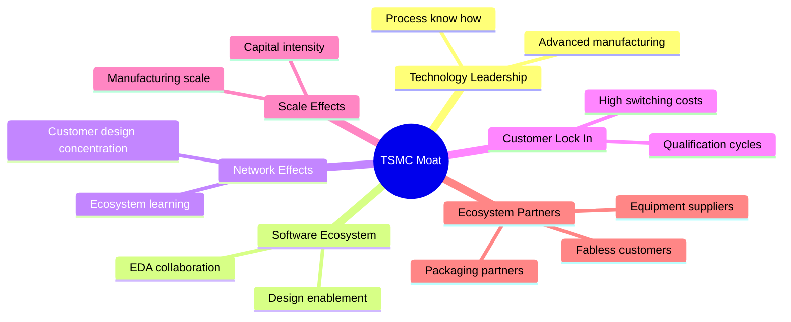
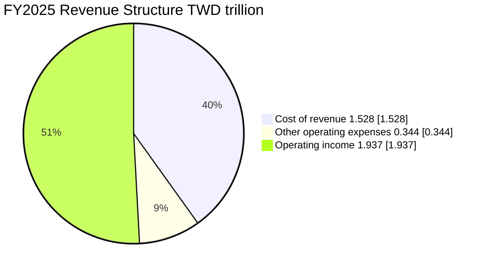
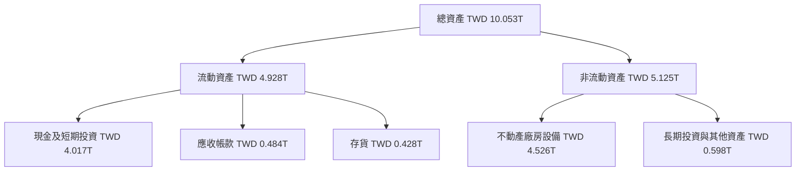
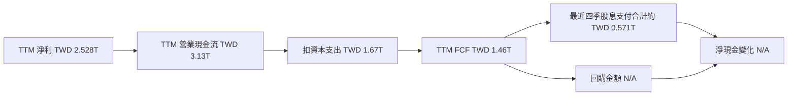
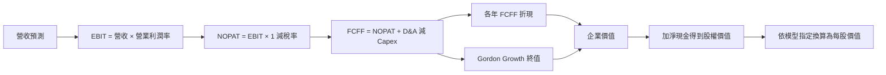
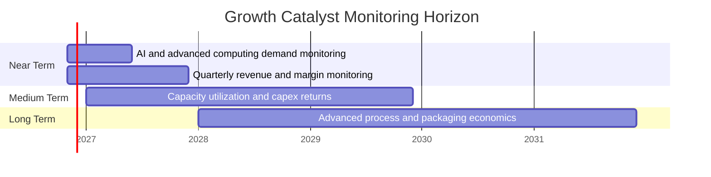
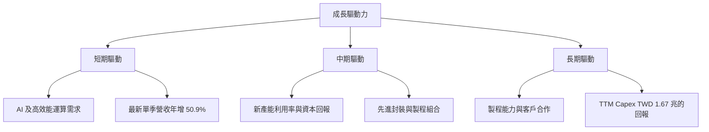
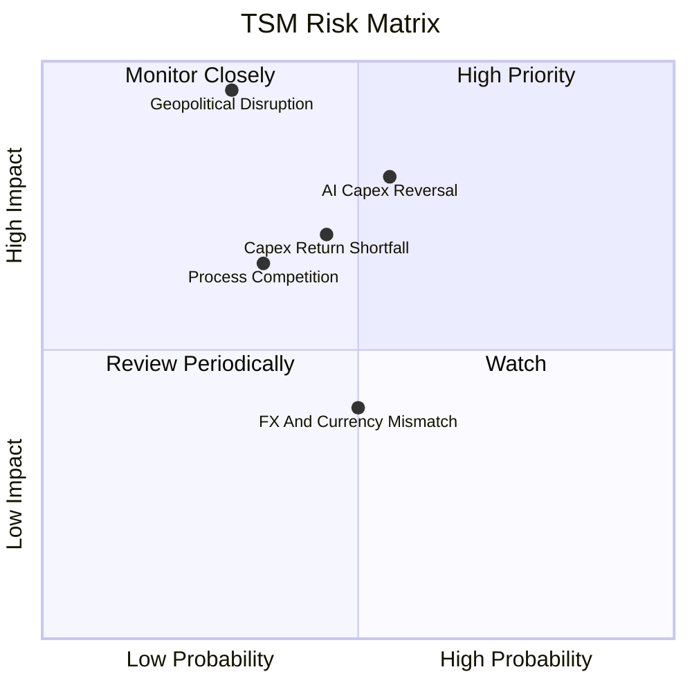
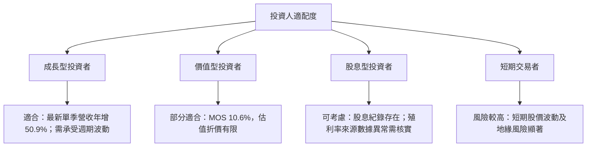

# TSM 基本面深度分析報告
> **報告日期**：2026-11-19 ｜ **語言**：繁體中文 ｜ **數據來源**：Yahoo Finance、Finviz、StockAnalysis、Roic.ai ｜ **分析師**：CFA 級機構研究

## 目錄

| # | 章節 | 核心結論 |
|---|------|----------|
| 1 | 執行摘要 | 買入；加權合理價值 $394.04，MOS 10.6% |
| 2 | 公司概覽與商業模式 | 純晶圓代工的技術、規模與客戶黏著構成護城河 |
| 3 | 損益表深度分析 | 最新單季營收年增 50.9%，TTM 營業利益率 58.0% |
| 4 | 資產負債表分析 | TTM 淨現金 TWD 2.95 兆，流動性充足 |
| 5 | 現金流量深度分析 | TTM FCF TWD 1.46 兆，資本支出仍高 |
| 6 | 獲利能力與資本效率 | 歷史 ROIC 高於 WACC；最新 TTM ROIC 無法確認 |
| 7 | 相對估值分析 | 相對估值方法分歧，股價接近同業 Forward P/E 推算價 |
| 8 | DCF 內在價值評估 | DCF 基準價 $431.89；加權合理價值 $394.04 |
| 9 | 成長催化劑 | AI 與先進製程需求是核心催化劑，量化 TAM 未提供 |
| 10 | 風險矩陣 | 地緣政治、資本密集與 AI 投資循環為主要風險 |
| 11 | 投資建議 | 買入；按加權價值衡量 MOS 有限，採分批布局 |

## 1. 執行摘要

### 1.0 一頁式投資儀表板（Portfolio Manager 30 秒速讀）

| 項目 | 內容 |
|------|------|
| **投資論點（3 句）** | ① 最新單季營收年增 **50.9%**，反映先進製程需求仍在擴張。② TTM 營業利益率 **58.0%**、FCF **TWD 1.46 兆**，顯示營運獲利可轉化為現金，但高資本支出限制自由現金流。③ 加權合理價值 **$394.04**，較 2026-11-19 收盤價高 **11.9%**，估值支持有限度買入而非追價。 |
| **綜合評分** | **8.2/10**（引用 1.1；六項算術平均） |
| **財務健康** | 🟢 TTM 淨現金 TWD **2.95 兆**，流動比率 **2.584** |
| **ROIC vs WACC** | 歷史 ROIC（2018）**19.11%** vs WACC **10.66%**；歷史數據支持價值創造，但最新 TTM ROIC **N/A** |
| **FCF 趨勢** | FY2022–FY2025 年度 FCF 波動向上；TTM FCF **TWD 1.46 兆**，FCF Yield **2.42%** |
| **估值** | Forward P/E **15.06x**｜EV/EBITDA：本公司 **N/A**｜FCF Yield **2.42%** |
| **DCF 內在價值（基準）** | **$431.89**；現價相對 DCF 折價 **18.5%**（以 DCF 基準值計） |
| **安全邊際（MOS）** | **10.6%**＝($394.04 − $352.09) ÷ $394.04；🟡 有限 |
| **預期報酬（基準情境 12M）** | DCF 基準情境相對現價 **+22.7%**；加權合理價值上行空間 **+11.9%** |
| **關鍵風險（前二）** | 台海／地緣政治衝擊；AI 資本支出週期反轉導致訂單與利用率下滑 |
| **評級 + 信心度** | 🟢 **買入**｜信心：中（評級按 MOS；DCF 有明確輸入，但模型數字存在內部算式差異） |

### 1.1 綜合評分卡（全報告唯一）

| 維度 | 評分（1–10） | 主要依據（引用數字與其來源章節） |
|------|--------------|----------------------------------|
| 成長性 | 8.5 | TTM 營收成長率 N/A；最新單季營收年增 50.9%（第 3 章） |
| 獲利能力 | 9.0 | TTM 營業利益率 58.0%；2018 ROIC 19.11% 高於 WACC 10.66%；當期 F-Score N/A（第 6 章） |
| 財務健康 | 9.0 | 淨現金 TWD 2.95 兆、流動比率 2.584、CCC 2 天（第 4 章） |
| 估值 | 6.0 | MOS 10.6%；同業 Forward P/E 法推算 $350.30，接近現價 $352.09（第 7、8 章） |
| 護城河 | 9.5 | TTM 營業利益率 58.0%、毛利率 65.8%，反映製程與規模優勢（第 2、3 章） |
| 管理層與資本配置 | 7.0 | FY2025 Capex TWD 1.28 兆、年度股息支付 TWD 466.78B；回購資料未提供（第 5 章） |
| **綜合評分** | **8.2** | 六項算術平均： (8.5 + 9.0 + 9.0 + 6.0 + 9.5 + 7.0) ÷ 6 = 8.1667，四捨五入至一位小數 |

### 1.2 五大投資論點 + 三大核心風險

| 類型 | 項目 | 具體依據 | 信心度 |
|------|------|----------|--------|
| 🟢 **投資論點①** | AI 與高階運算需求推升營收 | 最新一季營收 TWD 1.494 兆，年增 50.9%；FY2026 Q1 至 Q3 營收逐季增加 | 🟢 高 |
| 🟢 **投資論點②** | 獲利能力具有韌性 | TTM 毛利率 65.8%、營業利益率 58.0%；最新季營業利益 TWD 876.45B | 🟢 高 |
| 🟢 **投資論點③** | 資產負債表提供投資彈性 | TTM 現金及短期投資 TWD 4.02 兆，總債務 TWD 1.07 兆，淨現金 TWD 2.95 兆 | 🟢 高 |
| 🟢 **投資論點④** | 現金流規模可支撐研發與擴產 | TTM OCF TWD 3.13 兆、Capex TWD 1.67 兆、FCF TWD 1.46 兆 | 🟢 高 |
| 🟡 **投資論點⑤** | 市場共識與基準 DCF 均高於現價 | 分析師平均目標價 $586.69；DCF 基準價 $431.89；但共識與模型對風險的估計可能偏樂觀 | 🟡 中 |
| 🟡 **風險①** | 地緣政治與供應鏈集中 | 生產集中於台灣的地理風險無法由現有財務數字充分量化；極端事件可能衝擊產能、交付與估值 | 🟡 中 |
| 🔴 **風險②** | AI 資本支出週期反轉 | 若客戶投資放緩，最新單季 50.9% 的營收年增可能迅速降溫，且固定成本會放大利潤率下滑 | 🔴 高衝擊 |
| 🟡 **風險③** | 資本支出與現金流負擔 | TTM Capex TWD 1.67 兆，占 TTM 營收約 33.8%；投資回收延後會壓低 FCF | 🟡 中 |

### 1.3 快速統計卡片

| 指標 | 公司實際值（期間） | 同業中位數 | 狀態 |
|------|--------------------|------------|------|
| 營收成長（TTM） | **N/A** | — | 🟡 資料不可得 |
| 營收成長（最新一季年增） | **50.9%** | **20.9%**（INTC、UMC、GFS 中位數） | 🟢 |
| 毛利率（TTM） | **65.8%** | **31.7%** | 🟢 |
| 營業利益率（TTM） | **58.0%** | — | 🟢 |
| ROIC（TTM） | **N/A** | — | 🟡 |
| Forward P/E | **15.06x** | **15.0x**（Peer 區塊可用公司中位數） | 🟡 |
| FCF Yield（TTM） | **2.42%** | — | 🟡 |
| Piotroski F-Score | **N/A / 9** | — | 🟡 |

### 1.4 投資結論

╔══════════════════════════════════════════════════════════════════╗  
║                    📊 投資結論摘要                               ║  
╠══════════════════════════════════════════════════════════════════╣  
║ 評級：買入（MOS 10.6%，依規則 20）                               ║  
║ 價格（2026-11-19 收盤）：$352.09                                 ║  
║ DCF 內在價值（基準）：$431.89（現價折價 18.5%）                  ║  
║ 安全邊際 MOS：10.6%（＝($394.04−$352.09)÷$394.04）              ║  
║ 加權合理價值（8.8）：$394.04                                     ║  
║ DCF 情境價值：悲觀 $184.07（−47.7%）                             ║  
║              基準 $431.89（+22.7%）                              ║  
║              樂觀 $959.32（+172.5%）                             ║  
║ 綜合評分：8.2/10（引用 1.1）                                      ║  
║ 適合投資人：能承受地緣政治、資本支出及半導體週期風險的長線投資人 ║  
╚══════════════════════════════════════════════════════════════════╝

## 2. 公司概覽與商業模式

### 2.1 業務結構與收入來源

公司資料說明 TSMC 從事晶圓製造、封裝、測試及積體電路銷售，但沒有提供各製程、平台或服務的營收金額與占比。因此不把業務占比繪成數字圖，以免將未提供的分部數據誤作已知。

已知公司 TTM 營收為 **TWD 4.94 兆（約 USD 149.72B）**；最新一季營收 **TWD 1.494 兆**。主要經濟模式是以高資本投入建置製程產能，向客戶提供晶圓代工及相關製造服務；營收組合及先進製程占比資料未提供。

### 2.2 市場份額

市場份額數據未提供。以相對位置觀察，TSMC 最新單季營收年增 **50.9%**，高於 Peer multiples 中 INTC **20.9%**、UMC **25.6%**、GFS **12.5%**；這支持其當期需求與規模表現較佳，但不能直接等同於市場份額提升。

### 2.3 競爭護城河分析

### 2.4 護城河強度

| 護城河項目 | 強度（強／中／弱） | 證據（引用數字或事實） | 會削弱它的情況 |
|------------|--------------------|------------------------|----------------|
| 技術與製程能力 | 強 | TTM 毛利率 65.8%、營業利益率 58.0%，代表具備高價值製造能力 | 競爭對手縮小製程差距或客戶轉向自製 |
| 規模效應 | 強 | TTM 營收約 TWD 4.94 兆；TTM Capex TWD 1.67 兆 | 資本投入未獲足夠利用率或回報 |
| 客戶鎖定 | 中至強 | 客戶轉換代工廠涉及產品設計、驗證與供應鏈協作；公司資料未提供客戶集中度 | 大客戶自製、分散供應或重新設計降低轉換成本 |
| 軟體／生態系統 | 中 | 與設計工具、IP、封裝及晶片設計生態互補；量化資料未提供 | 生態系合作減弱或替代平台成熟 |
| 網路效應 | 中 | 產能、客戶需求及供應鏈合作互相強化，但缺少可量化網路效應指標 | 競爭者獲得足夠規模與客戶支持 |
| 生態夥伴 | 中至強 | 需仰賴設備、材料、設計與封裝夥伴；具體分部數字未提供 | 供應中斷、地緣政治限制或關鍵設備瓶頸 |

**1.1 護城河評分 9.5/10**，主要依據是 58.0% TTM 營業利益率與高資本投入形成的規模門檻；地理集中和產業週期仍限制評分上限。

## 3. 損益表深度分析

### 3.1 年度收入成長趨勢（近 4 年）

╔══════════════════════════════════════════════════════════════════╗  
║              TSMC 年度收入趨勢（FY2022–FY2025）                 ║  
╠══════════════════════════════════════════════════════════════════╣  
║ FY2022  TWD 2.264 兆  ██████████████░░░░░░░░  YoY +4.7% 🟡     ║  
║ FY2023  TWD 2.162 兆  █████████████░░░░░░░░░  YoY −4.5% 🔴     ║  
║ FY2024  TWD 2.894 兆  ██████████████████░░░░  YoY +33.9% 🟢    ║  
║ FY2025  TWD 3.809 兆  ████████████████████████ YoY +31.6% 🟢   ║  
╠══════════════════════════════════════════════════════════════════╣  
║ FY2022–FY2025 營收 CAGR = (3.809 ÷ 2.264)^(1/3) − 1 = 18.9%    ║  
╚══════════════════════════════════════════════════════════════════╝

FY2023 營收下滑 4.5% 後，FY2024、FY2025 分別成長 33.9% 和 31.6%，呈現週期復甦及需求回升。TTM 營收成長率在來源資料中為 **N/A**；StockAnalysis 列示 TTM 營收 TWD 4,944.817B，但其成長率欄與 Verified TTM 成長率不一致，因此此處不以其替代 TTM 成長率。

### 3.2 季度收入趨勢分析

以季度財報列示的 TWD 金額計算 QoQ；YoY 使用季度來源數據。金額四捨五入至 TWD 十億。

| 季度 | 營收（TWD 兆） | QoQ | YoY | 備註 |
|------|----------------|-----|-----|------|
| 2025 Q4 | 1.046 | — | 20.45% | 上年同期比較基期較低 |
| 2026 Q1 | 1.134 | +8.4% | 35.13% | 營收續增 |
| 2026 Q2 | 1.270 | +12.0% | 36.05% | QoQ 增速擴大 |
| 2026 Q3 | 1.494 | +17.6% | 50.95% | 最新季成長加速 |

計算示例：2026 Q3 QoQ = (1.494243 ÷ 1.270380) − 1 = **17.6%**。最新一季營收與年增率均加速，但單季增速不能直接視為 TTM 成長率。

### 3.3 利潤率演變分析

年度毛利率與營業利益率以年度收入、毛利及營業利益計算；淨利率依年度淨利與收入計算。

| 利潤率指標 | FY2022 | FY2023 | FY2024 | FY2025 | 趨勢 | 評估 |
|------------|--------|--------|--------|--------|------|------|
| **毛利率** | 59.6% | 54.4% | 56.1% | 59.9% | FY2023 下滑後回升 | 🟢 |
| **營業利益率** | 49.6% | 42.6% | 45.7% | 50.8% | FY2025 高於前期 | 🟢 |
| **淨利率** | 43.9% | 39.4% | 40.0% | 44.6% | 隨獲利復甦改善 | 🟢 |

年度毛利率示例：FY2025 = TWD 2.281294 兆 ÷ TWD 3.809054 兆 = **59.9%**。另據季度資料，最新季毛利率 = TWD 992.379B ÷ TWD 1,494.243B = **66.4%**；與資料列示 TTM 毛利率 **65.8%** 期間不同，不可混用。

FY2023 利潤率回落後復原，與營收及營業利益回升同向。更細的製程、利用率、折舊及產品組合拆分未提供，因此不能將改善精確歸因於單一因素；但從最新季度 66.4% 毛利率、58.0% 營業利益率可見，營收擴張伴隨高營業槓桿。

### 3.4 費用結構分析

以下為 FY2025 可由收入、毛利與營業利益推導的成本結構；「其他營業費用」是毛利與營業利益之差，不代表單一財報科目。

╔══════════════════════════════════════════════════════════════════╗  
║ FY2025 收入 TWD 3.809 兆                                       ║  
║ ├─ 銷貨成本 = 3.809054 − 2.281294 = TWD 1.527760 兆            ║  
║ ├─ 其他營業費用 = 2.281294 − 1.936874 = TWD 0.344420 兆        ║  
║ └─ 營業利益 TWD 1.936874 兆                                    ║  
╚══════════════════════════════════════════════════════════════════╝

### 3.5 季度 EPS 趨勢與盈餘品質（Quality of Earnings）

| 盈餘品質項目 | 數值/佔比 | 評估 |
|--------------|-----------|------|
| 股權薪酬 SBC / 營收 | 約 **0.0104%**（TTM SBC 由最近四季合計約 TWD 0.513B ÷ TTM 營收 TWD 4,944.817B） | 🟢 占比很低；股權稀釋影響相對有限 |
| SBC / 營業現金流 | 約 **0.0164%**（TWD 0.513B ÷ TWD 3.13 兆） | 🟢 對現金流影響很小 |
| FCF / 淨利（現金轉換率） | 約 **57.8%**（TWD 1.46 兆 ÷ TTM 淨利 TWD 2.527571 兆） | 🟡 正向但未達 100%；主要受高資本支出影響 |
| 一次性／非經常性損益 | N/A（未提供可核實拆分） | 無法判斷是否存在重大一次性盈餘 |
| 有效稅率異常 | 17.0%（最新年度有效稅率） | 未見資料顯示當期由稅務利益主導 |
| 資本化支出 vs 費用化 | TTM Capex TWD 1.67 兆；費用化項目拆分 N/A | 半導體設備資本化及折舊對期間獲利影響重大；詳細資本化政策資料未提供 |

**EPS 趨勢與預期差異：**最近四季 EPS actual 分別為 2025 Q4 **18.72**、2026 Q1 **22.08**、Q2 **27.25**、Q3 **29.43**；同期年增率為 **34.97%、58.38%、77.40%、68.73%**。EPS Est 欄均為 nan，因此無法可靠判定「超預期」或「不及預期」，不能把 EPS 年增率當成預期差異。  
**盈餘品質結論：**FCF 低於淨利，顯示資本密集度高；SBC 占營收極低，獲利未見由股權薪酬大量稀釋的證據。由於一次性損益與稅務細節不足，品質判斷仍保留。

## 4. 資產負債表分析

### 4.1 資產結構分解

依 2026-09-30 資產負債表 TWD 10.05289 兆、流動資產 TWD 4.92829 兆；非流動資產為差額 **TWD 5.12460 兆**。

上述「其他非流動資產」為非流動資產扣除 PPE 的算術差額，為合併項目而非單一財報科目。

### 4.2 流動性與營運資金分析

| 指標 | 最新值 | 歷史趨勢 | 評估 |
|------|--------|----------|------|
| 流動比率 | 2.584 | FY2025：3.817 ÷ 1.52 約 2.51；FY2024 約 2.36 | 🟢 短期資產覆蓋流動負債 |
| 速動比率 | 2.287 | 歷史序列未完整提供 | 🟢 |
| 現金及短期投資 | TWD 4.017 兆 | FY2025 TWD 3.068 兆 | 🟢 |
| 淨現金 | TWD 2.947 兆 | 年度現金部位持續增加 | 🟢 |

**營運資金天數（QUALITY FIGURES 原值）：**

| 指標 | 最新 TTM | 一年前 TTM | 變化 | 解讀 |
|------|----------|------------|------|------|
| DSO 應收帳款天數 | 1 天 | N/A | N/A | 一年前數據未提供；應收天數極低，但需注意資料口徑 |
| DIO 存貨天數 | 92 天 | N/A | N/A | 一年前數據未提供；存貨代表生產週期及供應鏈安排 |
| DPO 應付帳款天數 | 91 天 | N/A | N/A | 一年前數據未提供；無法比較供應商付款期限變化 |
| CCC 現金轉換週期 | 2 天 | N/A | N/A | 一年前數據未提供；最新值顯示營運週期短 |

### 4.3 債務結構分析

╔══════════════════════════════════════════════════════════════════╗  
║                   TSMC 債務健康診斷                              ║  
╠══════════════════════════════════════════════════════════════════╣  
║ 總債務：TWD 1.07 兆       ██░░░░░░░░░░░░░░░░░░░                 ║  
║ 現金+短期投資：TWD 4.02 兆 ████████████████████                 ║  
║ 淨現金：TWD 2.95 兆       ██████████████░░░░░░ 🟢               ║  
║ Debt/EBITDA：N/A（幣別／市值口徑不匹配，未提供可比數字）       ║  
║ 利息保障倍數：N/A（利息費用未提供）                              ║  
╚══════════════════════════════════════════════════════════════════╝

### 4.4 股東權益趨勢

╔══════════════════════════════════════════════════════════════════╗  
║                     股東權益趨勢（TWD）                          ║  
╠══════════════════════════════════════════════════════════════════╣  
║ FY2022  TWD 2.90 兆  ███████████████░░░░░                         ║  
║ FY2023  TWD 3.43 兆  ██████████████████░                         ║  
║ FY2024  TWD 4.24 兆  ██████████████████████░                    ║  
║ FY2025  TWD 5.36 兆  ████████████████████████████               ║  
╚══════════════════════════════════════════════════════════════════╝

FY2022–FY2025 股東權益持續增加，與累積獲利一致；ROE、分紅和留存盈餘的逐項橋接資料未提供。

## 5. 現金流量深度分析

### 5.1 現金流量瀑布圖

淨現金變化不能只以 FCF 減股息推算，因仍包含其他投資與融資現金流。

### 5.2 FCF 轉換率趨勢

| 財年 | FCF（TWD B） | 淨利（TWD B） | FCF / 淨利 |
|------|-------------:|--------------:|-----------:|
| FY2022 | 520.97 | 992.92 | 52.5% |
| FY2023 | 286.57 | 851.74 | 33.6% |
| FY2024 | 861.20 | 1,158.38 | 74.3% |
| FY2025 | 992.38 | 1,697.60 | 58.5% |

比率波動反映資本支出及營運現金流週期；FY2024 轉換率改善，FY2025 淨利增長快於 FCF，顯示成長投入仍消耗現金。

### 5.3 自由現金流趨勢

╔══════════════════════════════════════════════════════════════════╗  
║                  年度自由現金流趨勢                              ║  
╠══════════════════════════════════════════════════════════════════╣  
║ FY2022  TWD 520.97B  █████████████░░░░░░░░░░░                    ║  
║ FY2023  TWD 286.57B  ███████░░░░░░░░░░░░░░░░░                    ║  
║ FY2024  TWD 861.20B  █████████████████████░░░                    ║  
║ FY2025  TWD 992.38B  ████████████████████████                   ║  
║ TTM     TWD 1.46T    FCF Yield 2.42%                              ║  
╚══════════════════════════════════════════════════════════════════╝

### 5.4 資本配置評估

FY2025 可量化現金流項目如下；未把各項支出誤作互斥的 100% 資本配置比例。

| 項目 | FY2025 金額 | 解讀 |
|------|-------------|------|
| 營業現金流 | TWD 2.27 兆 | 支撐營運及資本投資 |
| Capex | TWD 1.28 兆 | 製造產能與設備投入；為最大現金用途 |
| FCF | TWD 992.38B | OCF 扣除 Capex 後餘額 |
| 現金股息支付 | TWD 466.78B | 約為當年 FCF 的 47.0% |
| 回購 | N/A | 財務資料未提供 |
| 研發費用 | TWD 246.43B | FY2025，研發投入增加至較 FY2024 高 |

## 6. 獲利能力與資本效率

### 6.1 ROE / ROA / ROIC 趨勢

| 指標 | 歷史數據 | 最新可用 | 評估 |
|------|----------|----------|------|
| ROE | TTM 41.9%；FY2025 依淨利／期末權益約 31.7% | 41.9% | 🟢 高，但期間與平均權益口徑可能不同 |
| ROA | TTM 20.6% | 20.6% | 🟢 |
| ROIC | 2013–2018：18.31%、20.55%、19.51%、20.38%、19.48%、19.11% | TTM N/A | 🟢 歷史高於資本成本，不能代替當期 ROIC |
| 行業均值比較 | N/A | N/A | 未提供可比、同口徑行業均值 |

### 6.2 ROIC vs WACC 分析（核心價值創造判斷）

╔══════════════════════════════════════════════════════════════════╗  
║                  ROIC vs WACC 深度分析                           ║  
╠══════════════════════════════════════════════════════════════════╣  
║ 無風險利率：5.05%｜ERP：5.00%                                    ║  
║ 原始 Beta：1.23；調整後 Beta：1.16                               ║  
║ 股權成本（來源值）：10.83%                                       ║  
║ 稅前債務成本：1.16%；有效稅率：17.0%                             ║  
║ 股權／債務權重：98.3%／1.7%                                      ║  
║ 採用 WACC：10.66%（DCF 與資本成本資料原值）                       ║  
║ 歷史 ROIC（2018）：19.11%                                        ║  
║ 歷史 ROIC − WACC：19.11% − 10.66% = +8.45 個百分點               ║  
║ 結論：歷史數據支持創造股東價值；最新 TTM ROIC 為 N/A              ║  
╚══════════════════════════════════════════════════════════════════╝

Beta 調整方式：**⅔ × 原始 Beta 1.23 + ⅓ = 1.16**（四捨五入）。資料所列 CAPM 股權成本 **10.83%** 與顯示組成數字直接計算的 **5.05% + 1.16 × 5.00% = 10.85%** 有 0.02 個百分點差異；權重與 WACC 的顯示值也可能受底層未四捨五入數字影響。此處依規定採用來源 WACC **10.66%**，不另建替代 WACC。歷史 ROIC 非最新 TTM 數據，故不能據此聲稱當期 ROIC 必然高於 WACC。

### 6.3 杜邦三因素分解

**N/A（QUALITY FIGURES：缺少淨利、營收、總資產或正權益的統一 TTM 口徑，無法提供可核實 DuPont 三因素；不自行補算。）**

### 6.4 財務體質：Piotroski F-Score

**N/A（需要相隔一年的兩個 TTM 期間及 SEC 申報數據；目前資料來源沒有足夠數據。）**九項測試逐項結果亦未提供，故不以 N/A 表格冒充已判定項目。

## 7. 相對估值分析

### 7.1 同業估值比較

公司自身 P/S、EV/EBITDA 的報價與財報幣別口徑不一致，相關比率不可直接使用；同業數字依 Peer multiples 原值列示。

| 估值指標 | **TSM** | **INTC** | **UMC** | **GFS** | 本公司評估 |
|----------|---------|---------|---------|---------|-----------|
| **Trailing P/E** | 22.82x | N/A | 12.6x | 111.3x | 🟡 同業差異大，GFS 倍數受盈餘基數影響 |
| **Forward P/E** | 15.06x | 31.1x | 14.9x | 15.0x | 🟢 TSM 低於 INTC，接近 UMC、GFS |
| **P/S TTM** | N/A | 4.9x | N/A | 3.0x | 🟡 TSM 不可比 |
| **EV/EBITDA TTM** | N/A | 16.1x | N/A | 10.7x | 🟡 TSM 不可比 |
| **最新季度營收 YoY** | 50.9% | 20.9% | 25.6% | 12.5% | 🟢 本公司增長較快 |
| **毛利率 TTM** | 65.8% | 40.2% | 31.7% | 28.5% | 🟢 獲利結構較高 |

同業 Forward P/E 中位數為 **15.0x**（31.1x、14.9x、15.0x 的中位數）。INTC TTM P/E 為 N/A，且 UMC 的 P/S、EV/EBITDA 因幣別混合不可用。

### 7.2 歷史估值區間分析

**N/A（未提供「Valuation vs own history」歷史估值區間及百分位數，不能自行估計。）**

### 7.3 情境價值（DCF Scenarios）

| 情境 | 第 1 年營收成長 | 期末營業利潤率 | WACC | 每股價值 | 相對現價 | 機率 | 可能條件 |
|------|----------------|----------------|------|----------|----------|------|----------|
| 🔴 悲觀 | 15.0% | 42.1% | 11.66% | $184.07 | −47.7% | 25% | 先進製程需求減速、價格／利用率承壓，且資本成本升高 |
| 🟡 基準 | 30.0% | 49.5% | 10.66% | $431.89 | +22.7% | 50% | 需求增長逐步放緩，利潤率由 58.0% 漸降至模型長期假設 |
| 🟢 樂觀 | 45.0% | 54.5% | 9.66% | $959.32 | +172.5% | 25% | 高成長延續、規模效益抵銷成本上升且折現率下降 |

三情境及機率均照列 DCF 模型；情境價格非 12 個月承諾目標價。

### 7.4 相對估值隱含價格

╔══════════════════════════════════════════════════════════════════╗  
║ 相對估值推算每股價值                                            ║  
╠══════════════════════════════════════════════════════════════════╣  
║ $300.16 ───────── $350.30 ── $352.09 ───────── $431.89 ── $586.69║  
║ EV/EBITDA      Forward P/E    現價        DCF       分析師共識     ║  
╚══════════════════════════════════════════════════════════════════╝

| 方法 | 推算價值 | 依據 |
|------|---------:|------|
| 同業 Forward P/E | $350.30 | Peer 中位數 15.0x × Forward EPS 23.39 |
| 同業 EV/EBITDA | $300.16 | INTC、GFS 中位數 13.4x × TTM EBITDA，再加淨現金 |
| DCF（基準） | $431.89 | 10 年 FCFF、WACC 10.66%、終值成長 3.0% |
| 分析師共識 | $586.69 | 20 位分析師平均目標價 |

## 8. DCF 內在價值評估（Discounted Cash Flow）

### 8.0 估值推理鏈（Thinking Logic）

**Step 1 — 價值來源與主導變數：**模型把價值視為整體晶圓代工現金流，並未取得 AI、先進製程或其他產品的分部營收占比，因此不能把分部占比拆成估值來源。模型的主要可驗證變數是營收增長、營業利潤率及終值折現；敏感度表顯示 WACC 每上升 1 個百分點對價值的影響高於 g 上升 1 個百分點。

**Step 2 — 模型選擇**

| 決策點 | 本報告採用 | 理由 | 曾考慮但否決 | 否決理由 |
|--------|-----------|------|--------------|----------|
| 現金流定義 | FCFF | 與 WACC 折現、由 EV 橋接到股權價值一致 | FCFE | 資料所列模型已採 FCFF |
| 預測期 N | 10 年 | 直接採用模型假設，容納由高成長向成熟期淡化 | 5 年 | 不符合既定模型，且會改變終值權重 |
| 終值方法 | Gordon Growth | DCF 模型採用永續成長率 3.0% | 退出倍數為主要法 | 未提供 DCF 模型的退出倍數終值計算 |
| EBIT 基礎 | GAAP | 模型指定 GAAP EBIT | 非 GAAP | 不能與既定模型混用 |

**Step 3 — 關鍵假設推導鏈**

- **營收成長路徑：**錨點＝最新單季 YoY 50.9%，但 TTM 成長為 N/A；模型把年 1 設為 30.0%，並線性下降至第 10 年 3.0%。採用值不是 TTM 歷史 CAGR，而是明確基於最新單季年增率且限制於 0%–30%。模型沒有提供被否決的其他數值；不以資料包外數字補造替代假設。
- **期末營業利益率：**錨點＝TTM 58.0%；模型第 10 年採 49.5%，依據為最近五個財年中位數（含 TTM）。這代表利潤率正常化；不採持續維持 58.0%，因模型假設長期均值回歸。
- **永續成長率 g：**模型採 3.0%，低於 WACC 10.66%，因此 Gordon Growth 分母為正。外部 GDP／通膨數據未提供；不能另稱該值等同某個宏觀預測。替代值由敏感度矩陣測試 2.0%–4.0%。
- **預測期 N：**採用 10 年，為既定模型長度；替代期長未在模型輸入中提供，且改變 N 會改變現金流期數及終值基期。
- **Capex／營收：**年 1 33.8%，降至年 10 16.6%；TTM Capex／營收為 1.67 ÷ 4.944817 = 約 33.8%，模型逐步淡化至約 1.1 倍 D&A。否決固定維持 TTM Capex 比率，因模型設定以後期投資強度下降。
- **WACC：**採用 10.66%，直接使用資本成本資料；不以另一組自行估算的 WACC 替代。敏感度矩陣顯示其對估值具高影響。
- **GAAP EBIT、SBC 與股數：**採用組合 **(A)**：GAAP EBIT 已含 SBC 費用，不再減 SBC；股數不再額外稀釋。模型沒有明列稀釋股數的獨立原始輸入，故每股價值依模型指定的換算方式引用。
- **稅率與折舊：**有效稅率 17.0%，錨點為最新年度有效稅率；D&A／營收 15.1%，錨點為 TTM；兩項直接採模型值。
- **ΔWC：**模型未建模營運資金變動，不代表實際營運資金需求為零；額外補入 ΔWC 會偏離唯一指定模型。

**Step 4 — 最脆弱假設：**長期 Capex 下降與終值現金流是主要脆弱處；若資本支出長期高於模型假設，FCFF 和價值將下修。DCF 模型的 10 年終值現值占 EV 60.4%，方向與終值依賴風險一致。

**Step 5 — 計算路徑**

### 8.1 模型假設總表（Model Inputs）

| 假設項目 | 採用值 | 依據／來源 | 敏感度 |
|----------|--------|-------------|--------|
| 預測期長度 N | 10 年 | DCF 模型設定 | 🟡 中 |
| 營收增長 | 年 1 30.0%，年 10 3.0%，逐年線性淡化 | 最新單季 YoY 50.9%，模型上限 30%；TTM 成長 N/A | 🔴 高 |
| 營業利潤率 | 年 1 58.0% → 年 10 49.5% | TTM 營業利益率 58.0%；期末值取最近五年中位數 | 🔴 高 |
| 有效稅率 | 17.0% | 最新年度有效稅率 | 🟢 低 |
| Capex／營收 | 年 1 33.8% → 年 10 16.6% | TTM Capex／營收及模型向 1.1×D&A 淡化 | 🔴 高 |
| D&A／營收 | 15.1% | TTM | 🟢 低 |
| ΔWC／營收增額 | 未建模 | 模型明示 working capital is not modelled | 🟡 中 |
| EBIT 基礎 | GAAP | DCF 模型設定 | 🟡 中 |
| SBC 處理 | SBC 已包含於 GAAP EBIT，不再扣除 | 模型明示 EBIT 為 GAAP | 🟡 中 |
| 年稀釋率 | 0%／不另稀釋 | 組合 A：GAAP EBIT + 固定股數 | 🟡 中 |
| 永續成長率 g | 3.0% | DCF 模型設定；低於 WACC | 🔴 高 |
| 終值方法 | Gordon Growth | DCF 模型列式 | 🔴 高 |
| WACC | 10.66% | 資本成本資料指定值 | 🔴 高 |

本模型採用 **(A)**：GAAP EBIT 已含 SBC，不另扣 SBC，也不再以年稀釋率增加股數，故 SBC 影響只計入一次。FCFF 定義為 **NOPAT + D&A − Capex**，不含 ΔWC。

### 8.2 折現率推導（WACC）

╔══════════════════════════════════════════════════════════════════╗  
║                    WACC 推導（折現率）                           ║  
╠══════════════════════════════════════════════════════════════════╣  
║ Rf（10Y 美債）：5.05%｜ERP：5.00%                               ║  
║ 原始 Beta：1.23；調整後 Beta：1.16                              ║  
║ Beta 調整：⅔×1.23 + ⅓×1 = 1.1533 ≈ 1.16                        ║  
║ 資料所列 Ke：10.83%                                              ║  
║ 稅前 Kd：1.16%｜稅率：17.0%                                     ║  
║ 股權／債務權重：98.3%／1.7%                                     ║  
║ 採用 WACC：10.66%                                                ║  
╚══════════════════════════════════════════════════════════════════╝

資料提供的資本成本輸入沒有利息費用、平均計息負債及以 2026-11-19 股價計算的市場股權價值完整明細，因此不能獨立重建 WACC 五步算式。應用來源原值，不把總負債誤當成指定的計息負債，也不另算一個折現率。使用列示的四捨五入數字驗算，CAPM 為 5.05% + 1.16 × 5.00% = 10.85%，與來源 Ke 10.83% 相差 0.02 個百分點；WACC 亦可能受未四捨五入權重影響。第 6.2 與本章均使用 **10.66%**。

### 8.3 逐年自由現金流預測（基準情境）

單位：TWD 十億；折現因子與模型數字照列。ΔWC 未建模，故不列為數值列；SBC 不另扣。

| 年度 | FY+1 | FY+2 | FY+3 | FY+4 | FY+5 | FY+6 | FY+7 | FY+8 | FY+9 | FY+10 |
|------|------:|------:|------:|------:|------:|------:|------:|------:|------:|-------:|
| 營收 | 6,428.26 | 8,163.89 | 10,123.23 | 12,249.11 | 14,453.94 | 16,622.04 | 18,616.68 | 20,292.18 | 21,509.71 | 22,155.00 |
| 營收 YoY | 30.0% | 27.0% | 24.0% | 21.0% | 18.0% | 15.0% | 12.0% | 9.0% | 6.0% | 3.0% |
| 營業利潤率 | 58.0% | 57.0% | 56.1% | 55.2% | 54.2% | 53.3% | 52.3% | 51.4% | 50.5% | 49.5% |
| EBIT | 3,726.88 | 4,656.49 | 5,679.00 | 6,756.58 | 7,837.06 | 8,856.56 | 9,744.56 | 10,431.05 | 10,854.96 | 10,972.60 |
| 稅 | (632.56) | (790.34) | (963.90) | (1,146.79) | (1,330.18) | (1,503.22) | (1,653.94) | (1,770.46) | (1,842.41) | (1,862.38) |
| NOPAT | 3,094.32 | 3,866.14 | 4,715.10 | 5,609.79 | 6,506.88 | 7,353.34 | 8,090.62 | 8,660.59 | 9,012.55 | 9,110.22 |
| D&A | 970.20 | 1,232.15 | 1,527.86 | 1,848.72 | 2,181.48 | 2,508.71 | 2,809.75 | 3,062.63 | 3,246.39 | 3,343.78 |
| Capex | (2,171.05) | (2,601.47) | (3,032.68) | (3,435.84) | (3,778.51) | (4,028.15) | (4,156.32) | (4,143.23) | (3,981.42) | (3,678.16) |
| FCFF | 1,893.46 | 2,496.82 | 3,210.29 | 4,022.67 | 4,909.85 | 5,833.90 | 6,744.04 | 7,579.99 | 8,277.52 | 8,775.85 |
| 折現因子 | 0.904 | 0.817 | 0.738 | 0.667 | 0.603 | 0.545 | 0.492 | 0.445 | 0.402 | 0.363 |
| FCFF 現值 | 1,711.11 | 2,039.07 | 2,369.25 | 2,682.90 | 2,959.24 | 3,177.56 | 3,319.53 | 3,371.69 | 3,327.37 | 3,187.96 |

**預測期 PV 合計算式：**  
1,711.11 + 2,039.07 + 2,369.25 + 2,682.90 + 2,959.24 + 3,177.56 + 3,319.53 + 3,371.69 + 3,327.37 + 3,187.96 = **28,145.68 TWD 十億**。

**FY+1 逐步演算（依模型列示值）：**

1. 營收 = 4,944.82 × (1 + 30.0%) = **6,428.26**  
2. EBIT = 6,428.26 × 58.0% = **3,726.88**（模型原列；依顯示數字直接相乘存在差異，詳見 8.10）  
3. 稅 = 3,726.88 × 17.0% = **632.56**  
4. NOPAT = 3,726.88 − 632.56 = **3,094.32**  
5. D&A = **970.20**（模型原列）  
6. Capex = **2,171.05**（模型原列）  
7. ΔWC = 未建模  
8. FCFF = 3,094.32 + 970.20 − 2,171.05 = **1,893.47**；模型原列 **1,893.46**，差 0.01 為顯示精度尾差  
9. PV = 1,893.46 × 0.904 = **1,711.11**（模型採用未四捨五入折現因子）

**合理性自檢：**

- 模型 FCFF 由 FY+1 的 1,893.46 增至 FY+10 的 8,775.85，按十年期間端點計算 CAGR = (8,775.85 ÷ 1,893.46)^(1/9) − 1 = **18.6%**；歷史可比 FCF CAGR 因年度投資週期波動，不足以證明此預測必然成立。
- FY+10 FCFF 利潤率 = 8,775.85 ÷ 22,155.00 = **39.6%**；TTM FCF 利潤率 = 1.46 ÷ 4.944817 = **29.5%**。可比同業最佳 FCF 利潤率未提供。
- 模型預測各年 FCFF 均為正；但模型假設 Capex／營收由 33.8% 降至 16.6%，是重要價值來源。

╔══════════════════════════════════════════════════════════════════╗  
║             自由現金流：歷史實際 vs 模型預測                     ║  
╠══════════════════════════════════════════════════════════════════╣  
║ FY2023 實際  TWD 286.57B  ███████░░░░░░░░░░░░░░                  ║  
║ FY2024 實際  TWD 861.20B  █████████████████████░                  ║  
║ FY2025 實際  TWD 992.38B  ████████████████████████               ║  
║ FY+1 預測    TWD 1,893.46B ███████████████████████████████████    ║  
║ FY+10 預測   TWD 8,775.85B ██████████████████████████████████████ ║  
╠══════════════════════════════════════════════════════════════════╣  
║ 預測增長高度仰賴營收延續增長及資本支出比率逐步下降               ║  
╚══════════════════════════════════════════════════════════════════╝

### 8.4 終值計算（Terminal Value）

**適用性檢查：**WACC **10.66%** vs g **3.0%** → WACC > g？✅

| 方法 | 計算式 | 終值 TV（TWD B） | TV 現值（TWD B） | 佔總 EV |
|------|--------|----------------:|-----------------:|--------:|
| Gordon Growth | 8,775.85 × (1 + 3.0%) ÷ (10.66% − 3.0%) | 118,055.48（模型原列） | 42,885.46（模型原列） | 60.4% |
| 退出倍數法 | 未提供可直接引用的 DCF 模型終值 | N/A | N/A | N/A |

模型列示終值與其顯示算式有約 0.04% 差異：按展示數字計算，8,775.85 × 1.03 ÷ 0.0766 = **約 118,005.55**，而 DCF 模型原列 **118,055.48**。依「DCF 數字一律照抄」要求，估值橋接沿用原列 118,055.48，不以外部重算替換；此差異列為審核限制。

終值佔 EV **60.4%**，低於 75% 警示線，但仍表示超過一半企業價值取決於第 10 年以後現金流假設。

### 8.5 企業價值 → 每股內在價值（Bridge）

╔══════════════════════════════════════════════════════════════════╗  
║              企業價值 → 每股內在價值 橋接表                      ║  
╠══════════════════════════════════════════════════════════════════╣  
║ 預測期 FCF 現值合計          +TWD 28,145.68B                     ║  
║ 終值現值 PV(TV)              +TWD 42,885.46B                     ║  
║ = 企業價值 EV                 TWD 71,031.15B                     ║  
║ + 淨現金                     +TWD 2,947.23B                      ║  
║ = 股權價值                   TWD 73,978.37B                      ║  
║ 每股內在價值（模型原值）      USD 431.89                         ║  
║ 當前股價（2026-11-19）        USD 352.09                         ║  
║ 折溢價：352.09 ÷ 431.89 − 1   −18.5%（現價折價）                 ║  
╚══════════════════════════════════════════════════════════════════╝

**逐步演算與口徑：**

1. EV = 28,145.68 + 42,885.46 = **71,031.14 TWD B**；模型原列 **71,031.15 TWD B**，差 0.01 為列示四捨五入差。
2. 股權價值 = 71,031.15 + 2,947.23 = **73,978.38 TWD B**；模型原列 **73,978.37 TWD B**，差 0.01 為列示四捨五入差。
3. 每股內在價值採模型原列算式：**股權價值 × FX 0.0302792 USD/TWD × 價格 ÷ 市值 = USD 431.89**。該模型將股權價值、匯率、價格及市值連結換算；未提供可獨立核驗的同口徑稀釋股數，因此不另以不匹配的股數重建。
4. 折溢價 = 352.09 ÷ 431.89 − 1 = **−18.5%**。
5. 本節不計算 MOS；MOS 僅於 8.8 以加權合理價值為分母。

### 8.6 敏感性分析（WACC × 永續成長率）

每股價值照 DCF 模型矩陣列示；括號為依現價 $352.09 計算的上行空間，基準格照原值加粗。

| g／WACC | 8.66% | 9.66% | **10.66% 基準** | 11.66% | 12.66% |
|---------|------:|------:|-----------------:|-------:|-------:|
| 2.0% | $543.08（+54.2%） | $462.31（+31.3%） | $400.82（+13.8%） | $352.58（+0.1%） | $313.82（−10.9%） |
| 2.5% | $572.69（+62.7%） | $482.70（+37.1%） | $415.41（+18.0%） | $363.32（+3.2%） | $321.92（−8.6%） |
| 3.0% | $607.53（+72.6%） | $506.16（+43.8%） | **$431.89（+22.7%）** | $375.30（+6.6%） | $330.85（−6.0%） |
| 3.5% | $649.13（+84.4%） | $533.42（+51.5%） | $450.69（+28.0%） | $388.75（+10.4%） | $340.77（−3.8%） |
| 4.0% | $699.66（+98.7%） | $565.51（+60.6%） | $472.30（+34.1%） | $403.95（+14.7%） | $351.82（−0.1%） |

**矩陣代表格重算限制：**矩陣各格已按要求照抄模型結果，但模型未提供各折現率下逐年折現現值的精確未四捨五入數值；因此無法在不自建模型的前提下對非基準格完整重建 EV 與每股值。不得把另一組自行試算值取代矩陣。

**三情境 DCF：**

| 情境 | 營收／利潤率／WACC 假設 | 每股內在價值 | 相對現價 | 主觀機率 |
|------|-------------------------|-------------:|---------:|---------:|
| 🔴 悲觀 | 年 1 增長 15.0%；年 10 利潤率 42.1%；WACC 11.66% | $184.07 | −47.7% | 25% |
| 🟡 基準 | 年 1 增長 30.0%；年 10 利潤率 49.5%；WACC 10.66% | $431.89 | +22.7% | 50% |
| 🟢 樂觀 | 年 1 增長 45.0%；年 10 利潤率 54.5%；WACC 9.66% | $959.32 | +172.5% | 25% |
| **機率加權** | — | **$501.80** | **+42.5%** | **100%** |

情境模型沒有提供每個情境的完整逐年營收、FCFF 與終值表，故不補造「營收 CAGR → 第 10 年 FCFF → 終值」中間值。機率加權算式：184.07 × 25% + 431.89 × 50% + 959.32 × 25% = **501.80**（按列示值四捨五入）。

**敏感度結論：**

- g 從 3.0% 增至 4.0%（WACC 10.66%）：$431.89 → $472.30，增加 **$40.41／9.4%**。
- WACC 從 10.66% 增至 11.66%（g 3.0%）：$431.89 → $375.30，減少 **$56.59／13.1%**。
- 期末營業利益率每 +1pp：模型未提供對應敏感度數值，**N/A**，不可自行建模替代。
- 目前可觀察到 WACC 彈性大於 g 彈性；與 8.0 所稱「終值及折現率是重要風險」一致。

### 8.7 反推 DCF（Reverse DCF）

固定的基準輸入：WACC **10.66%**、稅率 **17.0%**、Capex 年 1 **33.8%** 至年 10 **16.6%**、ΔWC 不建模、N **10 年**；股數依 DCF 模型換算設定，不另假定稀釋。以下只列模型實際提供的兩個單變數反推結果。

| 求解的變數（一次一個） | 其餘變數設定 | 市場隱含值 | 公司歷史實際／基準 | 判斷 |
|------------------------|--------------|--------------|------------------|------|
| 年 1 營收成長率 | 其餘沿用基準模型 | 24.4% | 基準 30.0%；最新單季 YoY 50.9% | 🟡 現價所隱含增長低於基準假設 |
| 固定營業利潤率 | 其餘沿用基準模型 | 42.5% | TTM 58.0% | 🟢 隱含利潤率低於當前 TTM |
| 永續成長率 g | 未計算 | N/A | 基準 3.0% | 未提供解 |
| 預測期 N | 未計算 | N/A | 基準 10 年 | 未提供解 |

模型未提供收斂軌跡表，也未提供 FY+N 收入、FCFF 及每股價值的試算點，故不編造疊代數字。反推結果表示若其他輸入維持模型基準，市場價格可由較低的單年增長率或較低固定利潤率支持；但反推值不是獨立預測。

### 8.8 估值三角驗證與安全邊際

| 估值方法 | 隱含每股價值 | 上行空間（÷現價） | 權重 | 說明 |
|----------|--------------|-------------------|------|------|
| DCF（基準） | $431.89 | +22.7% | 40% | 10 年 FCFF、WACC 10.66%、g 3.0% |
| 同業 Forward P/E | $350.30 | −0.5% | 25% | 同業中位數 15.0x × Forward EPS 23.39 |
| 同業 EV/EBITDA | $300.16 | −14.7% | 25% | INTC、GFS 中位數 13.4x × TTM EBITDA，加回淨現金 |
| 分析師共識目標價 | $586.69 | +66.6% | 10% | 20 位分析師平均目標價 |
| **加權合理價值** | **$394.04** | **+11.9%** | **100%** | — |

加權合理價值算式：  
$431.89 × 40% + $350.30 × 25% + $300.16 × 25% + $586.69 × 10%  
= $172.756 + $87.575 + $75.040 + $58.669  
= **$394.04**。

公司類型為獲利企業，權重依估值方法設定；四種方法均有數值，沒有方法被剔除。

╔══════════════════════════════════════════════════════════════════╗  
║                  估值區間與安全邊際                              ║  
╠══════════════════════════════════════════════════════════════════╣  
║ $184.07 ─ $352.09 ─ [$394.04] ─ $431.89 ─ $959.32                ║  
║ 悲觀DCF     現價      加權合理值    基準DCF     樂觀DCF            ║  
║                                                                  ║  
║ MOS = (394.04 − 352.09) ÷ 394.04 = 10.6%                       ║  
║ 上行空間 = (394.04 − 352.09) ÷ 352.09 = 11.9%                   ║  
║ MOS 評估：🟡 有限（10%–25%）                                     ║  
║ 建議買入區間：$352.09–$354.64                                   ║  
║ （上限按合理價值的 90%：394.04×90%=354.64；買入評級區間上限不低於現價）║  
║ 合理持有區間：$354.64–$394.04                                    ║  
║ 減碼考慮區間：高於 $959.32，並須重估樂觀情境假設                  ║  
╚══════════════════════════════════════════════════════════════════╝

MOS 僅以加權合理價值 **$394.04** 為分母；DCF 折溢價則以 DCF 基準價 **$431.89** 為基準。**依 MOS 應為買入，未作質化調整。**

> 🔎 **程式複算（Python，依本節各項自動重算）**
>
> 加權合理價值 = $431.89 × 40% + $350.30 × 25% + $300.16 × 25% + $586.69 × 10% = **$394.04**（權重合計 100%）
>
> 以價格 $352.09 計：MOS = **+10.6%**，上行空間 = **+11.9%**
>
> ✅ 與本節所寫數值一致。

### 8.9 DCF 模型的局限與失效條件

- **終值依賴度：**終值現值占 EV **60.4%**，代表較大部分價值來自第 10 年以後現金流。
- **最脆弱假設：**Capex／營收由 33.8% 降至 16.6%；若下降不成立，FCF 低於模型。其次是長期利潤率從 58.0% 逐步收斂至 49.5% 的假設。
- **估值區間：**基準 DCF $431.89，悲觀情境 $184.07，顯示營收、利潤率與資本成本聯動變化可能帶來大幅估值差異。
- **模型可靠度：**TSMC FCF 為正且獲利穩定，DCF 可作參考；但公司仍處於高再投資期，應與同業 P/E、EV/EBITDA 及資本支出回報交叉檢驗。
- **與第 10 章連結：**AI 投資退潮會壓低營收成長與產能利用率；地緣政治可能抬升 WACC 並擾亂產能；擴產回報不佳則直接影響 Capex 假設及 FCFF。
- **模型內部差異：**逐年部分算式與展示數字、終值算式存在小幅差異；橋接採用程式列示值，因此估值結論信心度需低於完全可獨立重建的模型。

### 8.10 複算檢核表（Audit Trail）

| # | 檢核項目 | 檢查方式 | 結果 |
|---|----------|----------|------|
| 1 | 高／中敏感度輸入均有推導 | 對照 8.0、8.1 | ✅ 已說明；部分替代值未提供並明示 |
| 2 | 每個假設均有來歷 | 檢查 8.1 依據欄 | ✅ |
| 3 | WACC 五步算式與加總 | 缺利息、平均計息債務、E 市值明細；來源原值內部有四捨五入差 | ❌ 無法獨立重建；採用來源 WACC 10.66% |
| 4 | Kd 分母與債務權重範圍一致 | 完整計息債務明細未提供 | ❌ 無法核驗 |
| 5 | WACC 與第 6.2 同值 | 比對兩處 | ✅ 10.66% |
| 6 | 預測年度數等於 N，無省略 | 10 個年度欄 | ✅ |
| 7 | FY+1 代表算式可複算 | EBIT、FCFF 以列示值重算 | ❌ EBIT 乘法與 FCFF 有小額差異，已揭露 |
| 8 | 預測 PV 加總 | 10 年 PV 加總 | ✅ 28,145.68 |
| 9 | WACC > g | 10.66% > 3.0% | ✅ |
| 10 | 終值以 FY+N 現金流折現 N 期 | 按模型設定 | ✅ 模型原值；算式展示值有小幅差異 |
| 11 | 橋接至每股價值無跳步 | EV、淨現金及每股換算 | ❌ 稀釋股數及匯率換算細節不足以獨立重建 |
| 12 | SBC 組合相容 | GAAP、不另扣 SBC、股數不另稀釋 | ✅ 組合 A |
| 13 | 敏感性基準格等於 DCF 基準 | 比對矩陣與 8.5 | ✅ $431.89 |
| 14 | 矩陣格與 WACC > g | 所有矩陣均 WACC 高於 g | ✅ |
| 15 | 三情境機率加總 | 25% + 50% + 25% | ✅ 100% |
| 16 | 反推每列僅放開一個變數 | 僅列示模型有解的兩項 | ✅；疊代軌跡資料未提供 |
| 17 | MOS、折溢價基準正確 | MOS 用 $394.04；DCF 折溢價用 $431.89 | ✅ |
| 18 | 報告輸出至第 11 章 | 檢查章節 | ✅ |
| 19 | 加權合理價值與各項乘權重加總一致 | 逐項乘權後加總 | ✅ $394.04 |
| 20 | 評級符合 MOS 門檻 | MOS 10.6% | ✅ 買入 |

未通過項目主要是來源模型及輸入資料不足以獨立重建，不以自行改造模型掩蓋差異；因此對 DCF 絕對價值的信心度為中等。

## 9. 成長催化劑

### 9.1 催化劑時間軸

資料未提供可核實的產品上市或產能投產日期，以下以投資觀察期間表示，不宣稱具體日程。

### 9.2 TAM 市場規模分析

**N/A（TAM 數據未提供）。**公司 TTM 營收約 TWD 4.94 兆，最新一季營收年增 50.9%，顯示目前業務增長動能，但不能由營收增長直接推算市場總量或滲透率。AI、高效能運算及先進製程屬合理的需求觀察方向，仍需以後續訂單、產能利用率及資本回報驗證。

### 9.3 成長驅動力結構圖

## 10. 風險矩陣

### 10.1 風險評分矩陣

下圖機率與衝擊座標為質化風險排序，不是財務數據或統計概率。

### 10.2 風險清單詳細分析

| # | 風險項目 | 發生機率 | 財務衝擊 | 風險評分 | 緩解措施 |
|---|----------|----------|----------|----------|----------|
| 1 | 🔴 地緣政治與台灣產能集中 | 中；未能量化 | 極高，可能影響營收、交付及折現率；損失比例 N/A | 🔴 9/10 | 追蹤海外產能進度、供應鏈分散及庫存備援；避免單一地區曝險過高 |
| 2 | 🔴 AI／客戶資本支出週期反轉 | 中 | 高；最新季營收年增 50.9%，若需求快速減速，營業槓桿將放大利潤下滑 | 🔴 8/10 | 追蹤季度營收 YoY、指引、產能利用率及客戶集中度 |
| 3 | 🟠 Capex 回報低於預期 | 中 | 高；TTM Capex TWD 1.67 兆，約占營收 33.8% | 🟠 7/10 | 對照產能投入、折舊、毛利率及 FCF，而非只看營收成長 |
| 4 | 🟡 競爭者追趕及客戶自製 | 中低 | 中至高；若議價能力下降，可能壓低 65.8% TTM 毛利率 | 🟡 6/10 | 追蹤產品組合、客戶設計轉移與同業毛利率差距 |
| 5 | 🟡 匯率與報價／財報幣別差異 | 中 | 中；股價以 USD 報價，財報以 TWD 表示，換算可能影響美國投資人回報 | 🟡 5/10 | 以來源匯率 2026-11-19 的 1 USD = TWD 33.03 換算，不混用貨幣口徑 |

## 11. 投資建議

### 11.1 最終評級與評分

按加權合理價值 $394.04 與現價 $352.09 計算，MOS 為 **10.6%**，符合規則 20 的**買入**門檻，沒有因質化因素上下調整。公司品質綜合評分為 **8.2/10**，六項分數依序為成長性 8.5、獲利能力 9.0、財務健康 9.0、估值 6.0、護城河 9.5、管理層與資本配置 7.0。

### 11.2 合理價值與隱含報酬率

| 價值參考 | 每股價值 | 相對現價 | 機率／權重 | 解讀 |
|----------|---------:|---------:|-----------:|------|
| 加權合理價值 | $394.04 | +11.9% | 100% 權重後總值 | MOS 10.6% |
| DCF 悲觀情境 | $184.07 | −47.7% | 25% | 風險下行情境 |
| DCF 基準情境 | $431.89 | +22.7% | 50% | 模型基準價 |
| DCF 樂觀情境 | $959.32 | +172.5% | 25% | 高成長與較低 WACC 情境 |
| DCF 機率加權參考 | $501.80 | +42.5% | 100% | 情境參考；非 8.8 加權合理價值 |

### 11.3 買入時機與觸發因素

╔══════════════════════════════════════════════════════════════════╗  
║                  ✅ 買入觸發因素 Checklist                       ║  
╠══════════════════════════════════════════════════════════════════╣  
║ 立即布局條件（多數符合）：                                       ║  
║ ✅ 價格不高於加權合理價值的 90%：$394.04×90%=$354.64            ║  
║ ✅ 最新一季營收年增維持正增長，且營業利益率接近 58.0%            ║  
║ ✅ FCF 保持正值；TTM FCF 基準為 TWD 1.46 兆                      ║  
║                                                                  ║  
║ 加碼觸發條件：                                                   ║  
║ ☐ 股價回落至或低於 2026-11-19 現價 $352.09，基本面未惡化        ║  
║ ☐ 季度營收年增維持高於同業中位數 20.9%，且毛利率穩定            ║  
║                                                                  ║  
║ 減碼／重新評估條件：                                             ║  
║ ☐ 股價顯著高於基準 DCF $431.89，但營收、FCF 未同步上修           ║  
║ ☐ Capex 持續上升而 FCF 下降，顯示新增產能回報延後                ║  
║ ☐ 連續季度營收年增放緩且營業利益率明顯低於 58.0%                 ║  
╚══════════════════════════════════════════════════════════════════╝

### 11.4 投資人適配度分析

### 11.5 每季財報監控清單（Quarterly Watch List）

| 監控指標 | 最新基準 | 觸發加碼 | 觸發減碼／重估 |
|----------|----------|----------|----------------|
| 營收年增率 | 最新季 50.9% | 維持高於 Peer 中位數 20.9%，且指引向上 | 連續兩季低於 20.9%，並伴隨指引下修 |
| 營業利益率 | 最新季 58.0% | 維持約 58.0% 或改善 | 較 58.0% 下滑超過 5 個百分點 |
| 毛利率 | TTM 65.8% | 維持或上升 | 連續兩季收縮且無產品組合解釋 |
| Capex | TTM TWD 1.67 兆 | 投資擴張同時 FCF 保持正值 | Capex 上升、FCF 連續兩季下滑 |
| FCF | TTM TWD 1.46 兆 | 保持正值並改善 | TTM FCF 轉負 |
| 現金與債務 | 現金及短期投資 TWD 4.02 兆；債務 TWD 1.07 兆 | 淨現金維持正值 | 淨現金大幅下降且營運現金流惡化 |
| EPS 預期差異 | 最近四季 EPS Est 缺失 | 取得可核實一致預期後追蹤 beat／miss | 未取得可核實預期前不以「超預期」作投資依據 |
| 估值 | 加權合理價值 $394.04 | 股價不高於 $354.64 且基本面穩定 | 股價遠高於基準價且估值假設未上修 |

### 11.6 反面論證：什麼會證明論點錯誤（What Would Change My Mind）

╔══════════════════════════════════════════════════════════════════╗  
║              ⚠️ 論點失效條件（Disconfirming Evidence）            ║  
╠══════════════════════════════════════════════════════════════════╣  
║ ☐ 營收年增連續兩季低於同業中位數 20.9%，且公司指引下修           ║  
║ ☐ 營業利益率低於 53.0%（較 TTM 58.0% 收縮超過 5 個百分點）      ║  
║ ☐ TTM FCF 轉負，或 FCF／淨利長期低於 30%                         ║  
║ ☐ 最新 ROIC 經核實後低於 WACC 10.66%，並連續兩期未改善           ║  
║ ☐ Capex 持續提高但營收及營業利益未同步增長                       ║  
║ ☐ 地緣政治事件造成產能中斷、交付延誤或客戶供應鏈永久轉移         ║  
╚══════════════════════════════════════════════════════════════════╝

> **免責聲明**：本報告為 AI 自動生成，僅供研究參考，不構成投資建議。投資有風險，入市需謹慎。

---

## 資料與來源

| 項目 | 內容 |
|------|------|
| 價格 | 352.09 USD，2026-11-19 收盤（Yahoo Finance 日線） |
| 財務報表 | Yahoo quarterly statements (no SEC filing data)，最新季度 2026-09-30（TTM = four quarters to this date） |
| 有回應的資料來源 | Yahoo Finance、Finviz、StockAnalysis、Roic.ai |
| 未回應的資料來源 | SEC 申報資料 (XBRL) |
| 由程式計算 | TTM 數字、WACC、DCF 模型、估值方法與權重、加權合理價值、MOS、評級門檻、F-Score、杜邦分解、營運資金天數、綜合評分 |
| 撰寫模型 | openai / gpt-6-luna |

> 本區塊由產生報告的程式依實際取得的資料填寫，非模型撰寫。「由程式計算」的數字不是模型的估計；其餘判斷（評分、情境、策略）是模型的分析。
