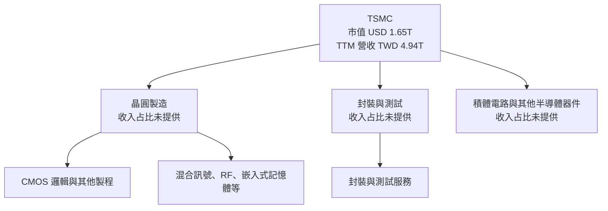
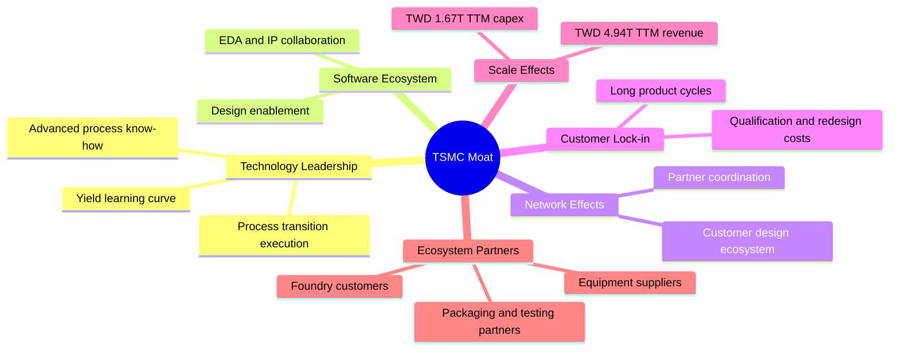
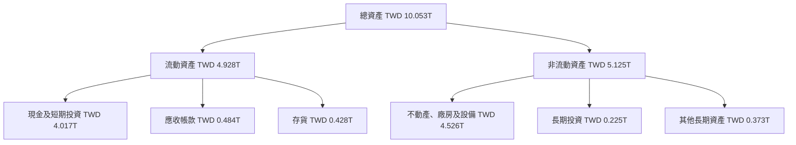
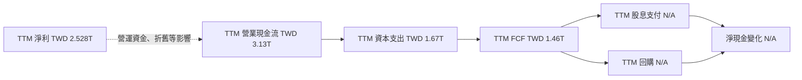
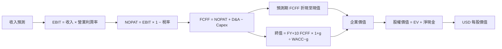
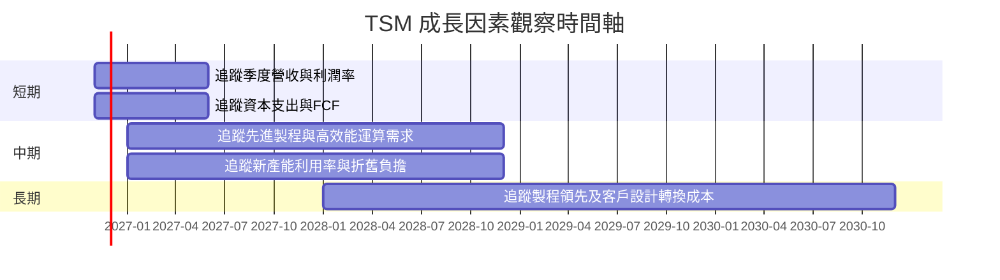
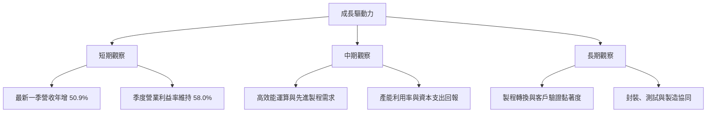
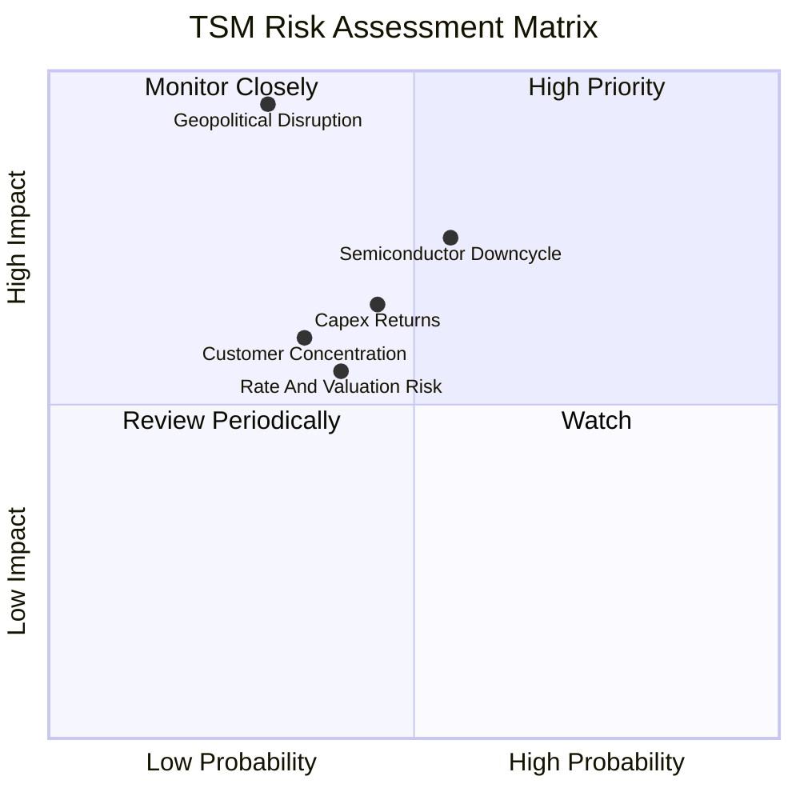
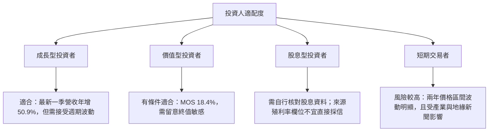

# TSM 基本面深度分析報告
> **報告日期**：2026-11-20 ｜ **語言**：繁體中文 ｜ **數據來源**：Yahoo Finance、Finviz、StockAnalysis、Roic.ai ｜ **分析師**：CFA 級機構研究

## 目錄

| # | 章節 | 核心結論 |
|---|------|----------|
| 1 | 執行摘要 | 買入；加權合理價值 $390.39；MOS 18.4% |
| 2 | 公司概覽與商業模式 | 晶圓代工、製程與規模構成護城河；市場份額資料未提供 |
| 3 | 損益表深度分析 | TTM 營收 TWD 4.94T；最新一季年增 50.9%，TTM 營收年增率 N/A |
| 4 | 資產負債表分析 | 淨現金 TWD 2.95T；流動比率 2.584 |
| 5 | 現金流量深度分析 | TTM FCF TWD 1.46T，按營業現金流減資本支出計算 |
| 6 | 獲利能力與資本效率 | TTM ROIC N/A；WACC 10.50%，不能以歷史 ROIC 取代當期值 |
| 7 | 相對估值分析 | 公司 Forward P/E 13.63x；同業估值顯示相對便宜程度有限 |
| 8 | DCF 內在價值評估 | 基準 DCF $443.00；加權合理價值 $390.39；MOS 18.4% |
| 9 | 成長催化劑 | AI／高效能運算與先進製程需求是主要質化催化劑；TAM 數字未提供 |
| 10 | 風險矩陣 | 地緣政治、半導體週期與高資本支出是主要風險 |
| 11 | 投資建議 | 買入；以 $351.35 以下作為 MOS 10% 的估值上限參考 |

## 1. 執行摘要

2026-11-20 收盤價為 **$318.71**。最新一季營收年增 **50.9%**、TTM 營業利益率 **58.0%**，TTM FCF 為 **TWD 1.46T（約 USD 44.23B）**，顯示高成長與高獲利率同時存在；但 TTM 營收成長率與當期 ROIC 未提供，不能據此假設成長可持續或直接判定當期資本報酬。DCF 基準價值為 **$443.00**，相對現價折價 **28.1%**；估值方法加權後合理價值為 **$390.39**，MOS 為 **18.4%**。依 MOS 門檻，評級為 **買入**；由於當期 ROIC 未提供，且基準 DCF 對終值假設敏感，不上調為強烈買入。

### 1.0 一頁式投資儀表板（Portfolio Manager 30 秒速讀）

| 項目 | 內容 |
|------|------|
| **投資論點（3 句）** | ① 最新一季營收年增 **50.9%**，反映近期需求加速，但不能把單季增速視為 TTM 成長率。② TTM 營業利益率 **58.0%**、毛利率 **65.8%**，支持其製程、規模與產品組合的獲利優勢。③ TTM FCF **TWD 1.46T**、淨現金 **TWD 2.95T**，可支撐高資本支出；但資本密集度仍是估值重要變數。 |
| **綜合評分** | **8.3/10**（引用 1.1；六項算術平均） |
| **財務健康** | 🟢 現金及短期投資 **TWD 4.02T**，總債務 **TWD 1.07T**，淨現金 **TWD 2.95T**；流動比率 **2.584**。 |
| **ROIC vs WACC** | TTM ROIC：**N/A**；WACC：**10.50%**。當期無法嚴謹判定 ROIC 是否高於 WACC；Roic.ai 歷史資料列示 2018 年 Return on Capital **20.61%**，僅作歷史參考。 |
| **FCF 趨勢** | FY2022–FY2025 年度 FCF 依序為 TWD **520.97B、286.57B、861.20B、992.38B**；TTM FCF Yield **2.68%**。歷史波動反映資本支出與晶圓景氣週期。 |
| **估值** | Forward P/E **13.63x** ｜ EV/EBITDA **N/A**（幣別不一致）｜ FCF Yield **2.68%** |
| **DCF 內在價值（基準）** | **$443.00** ｜ 現價相對 DCF 折價 **28.1%**（折溢價以 DCF 基準值為分母） |
| **安全邊際（MOS）** | **18.4%＝($390.39 − $318.71) ÷ $390.39**；🟡 10%–25% 有限，基準為 8.8 加權合理價值 |
| **預期報酬（基準情境 12M）** | DCF 基準情境相對現價 **+39.0%**；此為情境模型輸出，不等同保證的 12 個月報酬 |
| **關鍵風險（前二）** | 地緣政治及供應鏈中斷；先進製程投資與資本支出高於現金流成長 |
| **評級 + 信心度** | 🟢 **買入** ｜ 信心：中。基準 DCF 與加權估值支持正報酬，但當期 ROIC、TTM 營收年增率及 EPS 預期差資料缺漏。 |

### 1.1 綜合評分卡（全報告唯一）

| 維度 | 評分（1–10） | 主要依據（引用數字與其來源章節） |
|------|--------------|----------------------------------|
| 成長性 | 9.0 | 最新一季營收年增 **50.9%**；FY2022–FY2025 營收由 TWD **2.26T** 增至 **3.81T**（第 3 章）。 |
| 獲利能力 | 9.0 | TTM 毛利率 **65.8%**、營業利益率 **58.0%**、淨利率 **51.1%**；當期 ROIC 與 Piotroski F-Score 為 N/A（第 3、6 章）。 |
| 財務健康 | 9.0 | 淨現金 **TWD 2.95T**、流動比率 **2.584**、現金轉換週期 **2 天**（第 4 章）。 |
| 估值 | 7.0 | MOS **18.4%**、Forward P/E **13.63x**；DCF 對終值依賴度 **61.0%**（第 7、8 章）。 |
| 護城河 | 9.0 | TTM 營業利益率 **58.0%**、毛利率 **65.8%**，並具有製程、規模與客戶驗證等產業特性；沒有市場份額數字可量化（第 2 章）。 |
| 管理層與資本配置 | 7.0 | FY2025 資本支出 **TWD 1.28T**、股息支付 **TWD 466.78B**；SBC 佔 TTM 營收約 **0.01%**。資料未提供足以評估回購紀錄的數字（第 3、5 章）。 |
| **綜合評分** | **8.3** | 六項算術平均：**(9.0 + 9.0 + 9.0 + 7.0 + 9.0 + 7.0) ÷ 6 = 8.33，四捨五入為 8.3**。 |

### 1.2 五大投資論點 + 三大核心風險

| 類型 | 項目 | 具體依據 | 信心度 |
|------|------|----------|--------|
| 🟢 **投資論點①** | 近期營收動能上升 | 2026-09-30 季營收 **TWD 1.49T**，年增 **50.9%**、季增約 **17.6%**；成長可擴大固定成本吸收，但最新一季不能代表全年成長率。 | 🟢 高 |
| 🟢 **投資論點②** | 高利潤率提供週期緩衝 | TTM 毛利率 **65.8%**、營業利益率 **58.0%**；高毛利可在需求放緩時提供一定緩衝，但無法消除製程轉換成本。 | 🟢 高 |
| 🟢 **投資論點③** | 強勁現金流及淨現金 | TTM OCF **TWD 3.13T**、資本支出 **TWD 1.67T**、FCF **TWD 1.46T**；淨現金 **TWD 2.95T**。 | 🟢 高 |
| 🟢 **投資論點④** | 估值方法加權後仍有折價 | 加權合理價值 **$390.39**，高於現價 **$318.71**；MOS **18.4%**，屬有限但正向緩衝。 | 🟡 中 |
| 🟢 **投資論點⑤** | 低 SBC 佔比減輕稀釋疑慮 | 最近四季 SBC 合計約 **TWD 513M**，約佔 TTM 營收 **0.01%**；惟資料源間 SBC 定義與期間可能有差異。 | 🟡 中 |
| 🟡 **風險①** | 地緣政治及集中生產風險 | 可能影響營運連續性、設備供應、客戶交付及風險溢酬；財務資料無法量化事件概率。 | 🔴 高衝擊 |
| 🔴 **風險②** | 高資本支出及產能利用率 | TTM Capex **TWD 1.67T**，約為 TTM 營收 **33.8%**；若產能利用率或先進製程需求弱於預期，FCF 與估值將受壓。 | 🔴 高 |
| 🟡 **風險③** | DCF 終值及折現率敏感 | DCF 終值現值佔 EV **61.0%**；WACC 或永續成長率稍變即明顯改變每股價值。 | 🟡 中高 |

### 1.3 快速統計卡片

| 指標 | 公司實際值（期間） | 同業中位數 | 狀態 |
|------|--------------------|------------|------|
| 營收成長（TTM） | **N/A** | — | 🟡 資料不足 |
| 營收成長（最新一季年增） | **50.9%** | **20.9%**（INTC、UMC、GFS 中位數） | 🟢 |
| 毛利率（TTM） | **65.8%** | **31.7%**（INTC、UMC、GFS 中位數） | 🟢 |
| 營業利益率（TTM） | **58.0%** | — | 🟢 |
| ROIC（TTM） | **N/A** | — | 🟡 資料不足 |
| Forward P/E | **13.63x** | **13.7x**（INTC、UMC、GFS 中位數） | 🟢 略低 |
| FCF Yield（TTM） | **2.68%** | — | 🟡 |
| Piotroski F-Score | **N/A / 9** | — | 🟡 資料不足 |

### 1.4 投資結論

```text
╔══════════════════════════════════════════════════════════════════╗
║                    📊 投資結論摘要                               ║
╠══════════════════════════════════════════════════════════════════╣
║  評級：買入（依加權合理價值 MOS 門檻）                           ║
║  價格（2026-11-20 收盤）：$318.71                                ║
║  DCF 內在價值（基準）：$443.00（現價折價 28.1%）                ║
║  安全邊際 MOS：18.4%（以加權合理價值 $390.39 為分母）            ║
║  加權合理價值（8.8）：$390.39                                    ║
║  DCF 情境價值：                                                  ║
║    悲觀情境：$187.99（-41.0%）                                   ║
║    基準情境：$443.00（+39.0%）                                   ║
║    樂觀情境：$988.45（+210.1%）                                  ║
║  綜合評分：8.3/10（引用 1.1）                                    ║
║  適合投資人：能承受半導體週期、地緣政治與估值波動的長線投資人    ║
╚══════════════════════════════════════════════════════════════════╝
```

## 2. 公司概覽與商業模式

### 2.1 業務結構與收入來源

公司概覽描述其業務包括晶圓製造、封裝、測試與積體電路銷售；但未提供各業務收入金額或占比，故不可用比例繪製業務收入分布圖。以下僅呈現業務關係，非收入分拆。



### 2.2 市場份額

市場份額數據未提供，因此不列份額百分比或繪製市場份額圖。TTM 營收為 TWD **4.94T**，最新一季營收年增 **50.9%**，高於所列 INTC、UMC、GFS 的最新一季營收年增率中位數 **20.9%**；惟不同公司的業務組合與產能定位不同，營收成長率不能直接替代市場份額。

### 2.3 競爭護城河分析

以下 mindmap 使用英文節點文字以符合圖表語法限制；內容為定性分析，不表示各護城河具可量化收入占比。



### 2.4 護城河強度

| 護城河項目 | 強度（強／中／弱） | 證據（引用數字或事實） | 會削弱它的情況 |
|------------|--------------------|------------------------|----------------|
| 技術與製程能力 | 強 | TTM 營業利益率 **58.0%**、毛利率 **65.8%**；公司業務包含多種 CMOS 與混合訊號製程。 | 製程轉換良率不佳、競爭者縮小技術差距、客戶轉單。 |
| 軟體與設計生態 | 中 | 公司概覽支持其與設計、製造及封裝流程相連；未提供生態系收入或客戶留存數據。 | 設計工具、IP 或流程支援不能及時配合新製程。 |
| 網路效應 | 中 | 多方參與的設計與供應鏈合作提高轉換成本；缺少網路規模的量化資料。 | 替代平台提高相容性、客戶多來源策略擴大。 |
| 客戶鎖定 | 強 | 半導體製程需要重新驗證與產品設計配合；財務資料未提供客戶集中度或合約年期。 | 客戶要求多來源、產品設計轉移成本下降。 |
| 規模效應 | 強 | TTM 營收 **TWD 4.94T**、TTM Capex **TWD 1.67T**，具大規模投資及產能營運能力。 | 資本投入回報下降、產能利用率不足。 |
| 生態夥伴 | 中 | 業務涵蓋晶圓製造、封裝及測試，需供應商、客戶與協作夥伴共同配合。 | 供應商集中、設備交付受限或供應鏈中斷。 |

**護城河分數理由：**1.1 護城河評為 **9.0/10**，依據是高毛利率、58.0% TTM 營業利益率與高資本投入規模；沒有市場份額、客戶集中度等資料，因此不評為滿分。

## 3. 損益表深度分析

### 3.1 年度收入成長趨勢（近 4 年）

年度營收來自年度損益表；2022 至 2025 CAGR 約為 **18.9%**。金額以 TWD 計，括號為按 2026-11-20 匯率 **1 USD = 32.96 TWD**換算的約數。

```text
╔══════════════════════════════════════════════════════════════════╗
║       Taiwan Semiconductor 年度收入趨勢（FY2022–FY2025）         ║
╠══════════════════════════════════════════════════════════════════╣
║  FY2022  TWD 2.26T（約 USD 68.69B）  YoY: -4.5%                 ║
║  FY2023  TWD 2.16T（約 USD 65.59B）  YoY: -4.5%                 ║
║  FY2024  TWD 2.89T（約 USD 87.81B）  YoY: +33.9%                ║
║  FY2025  TWD 3.81T（約 USD 115.57B） YoY: +31.6%                ║
║                                                                  ║
║  三年 CAGR = (3.809T ÷ 2.264T)^(1/3) − 1 ≈ 18.9%                ║
╚══════════════════════════════════════════════════════════════════╝
```

2023 年營收較 2022 年下降約 **4.5%**，顯示週期性需求可帶來短期回落；2024、2025 年則分別增長 **33.9%**、**31.6%**。FY2025 增長有助提高廠房與設備利用效率，但資料未提供產品別與終端需求拆分，不能把回升全部歸因於單一市場或產品。

### 3.2 季度收入趨勢分析

| 季度 | 營收（TWD） | QoQ 成長 | YoY 成長 | 備註 |
|------|-------------|---------:|---------:|------|
| 2025 Q4 | TWD 1.046T | +5.7%（相對 2025 Q3） | +20.5% | 由季度資料計算；年增率亦見 StockAnalysis。 |
| 2026 Q1 | TWD 1.134T | +8.4% | +35.1% | 相對 2025 Q1。 |
| 2026 Q2 | TWD 1.270T | +12.0% | +36.1% | 相對 2025 Q2。 |
| 2026 Q3 | TWD 1.494T | +17.6% | +50.9% | 最新季增速最高；此為單季年增，不是 TTM 成長率。 |

計算示例：2026 Q3 QoQ = **(1,494.243 ÷ 1,270.380) − 1 = 17.6%**；2026 Q3 YoY = **(1,494.243 ÷ 989.918) − 1 = 50.9%**。營收加速可能改善營運槓桿，但若供應能力、成本或產品組合同步改變，營收成長不必然等比例轉化為利潤。

### 3.3 利潤率演變分析

| 利潤率指標 | FY2022 | FY2023 | FY2024 | FY2025 | 趨勢 | 評估 |
|------------|-------:|-------:|-------:|-------:|------|------|
| **毛利率** | 59.6% | 54.4% | 56.1% | 59.9% | 2023 下滑後回升 | 🟢 |
| **營業利益率** | 49.6% | 42.6% | 45.7% | 50.9% | 2023 下滑後回升 | 🟢 |
| **淨利率** | 43.9% | 39.4% | 40.0% | 44.6% | 2023 下滑後改善 | 🟢 |

年度利潤率為年度毛利、營業利益與淨利分別除以收入的計算結果。例如 FY2025 營業利益率 = **TWD 1.936874T ÷ TWD 3.809054T = 50.9%**。2023 年毛利率與營業利益率走弱，與當年收入下降及半導體週期低迷相符；2024–2025 利潤率回升，可能反映產能利用、產品組合與營收規模改善。資料未提供單位製造成本與產品組合拆分，故不能把利潤率回升精確歸因於特定製程或定價因素。

TTM 毛利率 **65.8%**、營業利益率 **58.0%** 高於 FY2025 年度比率，顯示截至 2026-09-30 的滾動期間獲利水平提高；由於 TTM 與單一財年的區間不同，兩者不可直接當作同一期的同口徑比較。

### 3.4 費用結構分析

目前沒有足夠資料建立完整的收入費用結構圓餅圖：年度損益表提供研發費用，但未完整提供 TTM 成本、銷售管理費用與其他費用拆分。可確認 FY2025 研發支出為 **TWD 246.43B**，約佔 FY2025 營收 **6.5%**；年度資本支出則在現金流量表列示，屬資本支出而非當期費用，不宜與損益費用混為一談。

```text
╔══════════════════════════════════════════════════════════════════╗
║                     可取得的費用資料                             ║
╠══════════════════════════════════════════════════════════════════╣
║  FY2025 研發支出：TWD 246.43B                                   ║
║  FY2025 營收：  TWD 3.809T                                       ║
║  研發／營收：   246.43B ÷ 3,809.054B ≈ 6.5%                    ║
║  其他費用拆分：未提供；不以不完整資料製作比例圖                  ║
╚══════════════════════════════════════════════════════════════════╝
```

### 3.5 季度 EPS 趨勢與盈餘品質（Quality of Earnings）

| 盈餘品質項目 | 數值／佔比 | 評估 |
|--------------|------------|------|
| 股權薪酬 SBC / 營收 | 最近四季 SBC 約 TWD **513M** ÷ TTM 營收 TWD **4.945T** ≈ **0.01%** | 🟢 按季度現金流資料估算，直接稀釋壓力低；年度資料與季度數據期間、分類可能不完全一致。 |
| SBC / 營業現金流 | 約 TWD **513M** ÷ TTM OCF TWD **3.13T** ≈ **0.02%** | 🟢 佔營運現金流比重低。 |
| FCF / 淨利（現金轉換率） | TTM FCF 約 TWD **1.46T**；TTM 淨利 TWD **2.528T**，約 **57.7%** | 🟡 現金轉換低於 100%，主要須結合高資本支出理解；FCF 並非淨利的替代指標。 |
| 一次性／非經常性損益 | N/A（未提供足以辨認的明細） | 🟡 無法判斷本期是否受一次性損益影響。 |
| 有效稅率異常 | DCF 採用有效稅率 **17.0%**；未提供最新單季有效稅率拆分 | 🟡 沒有證據確認單季稅率是否異常。 |
| 資本化支出 vs 費用化 | TTM Capex **TWD 1.67T**；詳細資本化政策與折舊年限 N/A | 🟡 半導體設備支出以資產投資反映，會經折舊多年轉入損益；須持續監控資本回報。 |

最近四季 EPS 實際值資料列示：2025 Q4 **TWD 18.72**、2026 Q1 **TWD 22.08**、2026 Q2 **TWD 27.25**、2026 Q3 **TWD 29.43**；相較去年同期，EPS 年增分別為 **35.0%、58.4%、77.4%、68.7%**。但 EPS Est 欄位皆為 nan，故**無法判定四季究竟超預期或不及預期**。EPS 年增與淨利年增同為正值，支持盈餘上升；盈餘品質仍須考慮 TTM FCF 約為淨利的 57.7%、Capex 高，以及未提供一次性項目明細。

## 4. 資產負債表分析

### 4.1 資產結構分解

以下採 2026-09-30 TTM／季末資產負債表數據，總資產約 TWD **10.053T**。各類別依 StockAnalysis 的季末分類呈現。



### 4.2 流動性與營運資金分析

| 指標 | 數值／趨勢 | 評估 |
|------|------------|------|
| 流動比率 | **2.584** | 🟢 流動資產對短期負債有一定覆蓋能力。 |
| 速動比率 | **2.287** | 🟢 排除存貨後流動性仍充足。 |
| 現金及短期投資 | **TWD 4.02T** | 🟢 高於總債務 TWD 1.07T。 |
| DSO 應收帳款天數 | 最新 **1 天**；一年前 N/A；變化 N/A | 資料未提供一年前的 QUALITY FIGURES，不作推算；極低天數亦可能受期末餘額與資料口徑影響。 |
| DIO 存貨天數 | 最新 **92 天**；一年前 N/A；變化 N/A | 無一年前數據，不能判定存貨天數升降；存貨水位須與產品需求、製程週期合併觀察。 |
| DPO 應付帳款天數 | 最新 **91 天**；一年前 N/A；變化 N/A | 無一年前數據，不能據此推斷供應商議價力變化。 |
| CCC 現金轉換週期 | 最新 **2 天**；一年前 N/A；變化 N/A | 依品質指標直接引用；未提供一年比較值，趨勢判讀受限。 |

DSO、DIO、DPO 與 CCC 直接引用 QUALITY FIGURES；其定義為期末餘額除以 TTM 流量乘以 365 天。單一時點餘額可能令周轉天數較敏感，故不將 2 天 CCC 解讀為穩定的長期營運資金結構。

### 4.3 債務結構分析

```text
╔══════════════════════════════════════════════════════════════════╗
║                    TSM 債務健康診斷                              ║
╠══════════════════════════════════════════════════════════════════╣
║  總債務：          TWD 1.07T（約 USD 32.46B）                   ║
║  現金及短期投資：  TWD 4.02T（約 USD 121.88B）                  ║
║  淨現金：          TWD 2.95T（約 USD 89.42B）  🟢               ║
║                                                                  ║
║  流動比率：        2.584x                         🟢             ║
║  速動比率：        2.287x                         🟢             ║
║  Debt/EBITDA：     N/A（未提供可直接匹配的同幣別口徑）           ║
║  利息保障倍數：    N/A（未提供利息費用）                         ║
╚══════════════════════════════════════════════════════════════════╝
```

### 4.4 股東權益趨勢

| 財年 | 股東權益 | 年增額 | 解讀 |
|------|---------:|-------:|------|
| FY2022 | TWD 2.90T | — | 資料表列示值。 |
| FY2023 | TWD 3.43T | TWD 0.53T | 盈餘留存等因素可能增加權益；未提供權益變動明細。 |
| FY2024 | TWD 4.24T | TWD 0.81T | 權益續增。 |
| FY2025 | TWD 5.36T | TWD 1.12T | 與 FY2025 淨利 TWD 1.70T 並列觀察，但不能把差額直接等同股息或其他單一項目。 |

```text
╔══════════════════════════════════════════════════════════════════╗
║                    股東權益變化（TWD）                           ║
╠══════════════════════════════════════════════════════════════════╣
║  FY2022  2.90T  ███████████                                      ║
║  FY2023  3.43T  █████████████                                    ║
║  FY2024  4.24T  ████████████████                                 ║
║  FY2025  5.36T  ████████████████████                             ║
╚══════════════════════════════════════════════════════════════════╝
```

## 5. 現金流量深度分析

### 5.1 現金流量瀑布圖

資料沒有 TTM 淨利與資本支出後的股息、回購、淨現金變動完整橋接，因此圖中只連接已提供數字，未提供者明確標示。



### 5.2 FCF 轉換率趨勢

| 財年 | FCF | 淨利 | FCF / 淨利 |
|------|----:|-----:|-----------:|
| FY2022 | TWD 520.97B | TWD 992.92B | 52.5% |
| FY2023 | TWD 286.57B | TWD 851.74B | 33.6% |
| FY2024 | TWD 861.20B | TWD 1.158T | 74.3% |
| FY2025 | TWD 992.38B | TWD 1.698T | 58.5% |

FCF 轉換率逐年波動，主要需要結合資本支出週期解讀。FY2025 OCF 為 TWD **2.27T**、Capex 為 TWD **1.28T**，形成 FCF TWD **992.38B**；當資本支出在先進製程擴產期提高，FCF 會落後於會計淨利，故不能只以淨利增長評估股東可分配現金。

### 5.3 自由現金流趨勢

| 財年／期間 | FCF（TWD） | 約 USD（按 32.96 換算） | 備註 |
|------------|-----------:|------------------------:|------|
| FY2022 | 520.97B | 15.81B | 年度值。 |
| FY2023 | 286.57B | 8.70B | 年度低點，反映現金流與資本支出週期波動。 |
| FY2024 | 861.20B | 26.13B | 回升。 |
| FY2025 | 992.38B | 30.11B | 年度增長。 |
| TTM 至 2026-09-30 | 1.46T | 44.23B | FCF Yield **2.68%**，依 OCF − Capex 定義。 |

```text
╔══════════════════════════════════════════════════════════════════╗
║              自由現金流趨勢（年度 TWD）                          ║
╠══════════════════════════════════════════════════════════════════╣
║  FY2022  520.97B  ███████████                                     ║
║  FY2023  286.57B  ██████                                          ║
║  FY2024  861.20B  ██████████████████                              ║
║  FY2025  992.38B  ████████████████████                            ║
║  TTM     1.46T    TTM值不同於完整財年，不併入年度比較             ║
║  TTM FCF Yield：2.68%                                              ║
╚══════════════════════════════════════════════════════════════════╝
```

### 5.4 資本配置評估

FY2025 現金流資料可確認股息支付 **TWD 466.78B**，FY2025 Capex **TWD 1.28T**；FY2025 FCF **TWD 992.38B**。這些指標期間口徑不同於 TTM，且資本配置類別不構成互斥的同期間百分比，因此不以不完整資料製作圓餅圖。回購金額、併購支出與完整留存現金變化未提供。

| 資本配置項目 | 可用數據 | 解讀 |
|--------------|----------|------|
| 資本支出 | FY2025 **TWD 1.28T**；TTM **TWD 1.67T** | 擴產與製程升級具策略必要性，也提高固定成本與回報風險。 |
| 股息 | FY2025 **TWD 466.78B** | 為股東提供現金回報；未以可疑的股息殖利率資料作判斷。 |
| 回購 | N/A | 未提供可核對數字。 |
| 留存／其他投資 | N/A | 未提供完整同期間資金配置表。 |

## 6. 獲利能力與資本效率

### 6.1 ROE / ROA / ROIC 趨勢

| 指標 | 可用數據 | 評估 |
|------|----------|------|
| ROE | TTM **41.9%** | 🟢 高；但未提供可依品質指標照抄的杜邦分解。 |
| ROA | TTM **20.6%** | 🟢 資產獲利能力高；需留意資本支出造成資產基礎擴大。 |
| ROIC | TTM **N/A**；Roic.ai 歷史 Return on Capital：2018 **20.61%** | 🟡 當期值缺漏，歷史數值不可冒充為 TTM。 |
| 行業均值 | 未提供 | 不做無來源比較。 |

### 6.2 ROIC vs WACC 分析（核心價值創造判斷）

當期 ROIC 缺漏，故無法用當期 ROIC − WACC 得出精確 EVA。公司歷史上 Roic.ai 列示 2018 Return on Capital **20.61%**，高於目前採用 WACC **10.50%**，但年份不同，僅能說明歷史曾有高於資本成本的紀錄，不能作當期結論。

```text
╔══════════════════════════════════════════════════════════════════╗
║                ROIC vs WACC 深度分析                            ║
╠══════════════════════════════════════════════════════════════════╣
║  WACC（依資本成本資料區塊採用）：10.50%                          ║
║  ├── 無風險利率（10Y 美債）：4.91%                               ║
║  ├── ERP：5.00%                                                   ║
║  ├── 原始 Beta：1.23；調整 Beta：1.16                            ║
║  ├── 提供的股權成本 Ke：10.69%                                   ║
║  ├── 稅前債務成本：1.16%；稅後約 0.96%                           ║
║  ├── 股權／債務權重：98.1%／1.9%                                 ║
║  └── WACC：10.50%（沿用指定資本成本輸出）                        ║
║                                                                  ║
║  ROIC（TTM）：N/A；無法計算當期 EVA                               ║
║  歷史參考：Roic.ai 2018 Return on Capital = 20.61%               ║
║  2018 歷史值 − 現行 WACC = 20.61% − 10.50% = +10.11pp           ║
║  注意：此差額不是當期 EVA，期間不可比。                          ║
║                                                                  ║
║  結論：當期是否創造超額經濟價值無法確認；需補充 TTM ROIC。        ║
╚══════════════════════════════════════════════════════════════════╝
```

資本成本來源提供的 Ke、Beta 與其計算結果有四捨五入差異：按顯示數字 **4.91% + 1.16 × 5.00% = 10.71%**，與列示 Ke **10.69%** 相差 0.02 個百分點；權重與稅後債務成本按顯示值重算也可能有小幅差異。本報告遵從指定輸出，WACC 一律採 **10.50%**，不另建或替換折現率。

### 6.3 杜邦三因素分解

| 因素 | 數值（TTM） | 解讀 |
|------|-------------|------|
| 淨利率 | N/A（QUALITY FIGURES 未提供 DuPont 數值） | 不以其他來源重算填補。 |
| 資產週轉率 | N/A | 不以其他來源重算填補。 |
| 權益乘數 | N/A | 不以其他來源重算填補。 |
| **ROE** | **N/A（品質指標欄位）** | QUALITY FIGURES 說明缺少計算所需項目；其他來源列示 TTM ROE 41.9%，但不能替代指定的杜邦分解。 |

### 6.4 財務體質：Piotroski F-Score

| 測試 | 結果 | 解讀 |
|------|------|------|
| F-Score 總分 | **N/A / 9** | QUALITY FIGURES 說明需要相隔一年的兩期 SEC 申報資料；目前資料來源沒有 SEC filing data。 |
| 九項測試 | N/A | 各項測試結果未提供，不逐項推估或補寫。 |

**解讀：**F-Score 缺漏不是公司未通過測試，而是資料不足，不能當作負面基本面證據。後續取得 SEC 申報與可比期間財報後，方可評估獲利、槓桿與營運效率變化。

## 7. 相對估值分析

### 7.1 同業估值比較表格

公司自身估值採市場數據；同業倍數依 Yahoo Finance 同業資料。公司 P/S、EV/EBITDA 因報價與財報幣別不同而未提供，不用跨幣別硬算。

| 估值指標 | **TSM** | **INTC** | **UMC** | **GFS** | TSM 評估 |
|----------|---------:|---------:|---------:|---------:|-----------|
| **Trailing P/E** | 20.66x | N/A | 11.4x | 101.6x | 🟡 INTC 缺值、GFS 極高，單一同業倍數比較有限。 |
| **Forward P/E** | 13.63x | 28.6x | 13.4x | 13.7x | 🟢 低於 INTC，接近 UMC、GFS；三家中位數 **13.7x**。 |
| **P/S（TTM）** | N/A | 4.6x | N/A（混合幣別） | 2.8x | N/A，TSM 不進行跨幣別比較。 |
| **EV/EBITDA（TTM）** | N/A | 16.1x | N/A（混合幣別） | 10.4x | N/A，TSM 不進行跨幣別比較。 |
| 最新一季營收年增 | 50.9% | 20.9% | 25.6% | 12.5% | 🟢 TSM 最新季度增速較高，但屬單季同比。 |
| 毛利率（TTM） | 65.8% | 40.2% | 31.7% | 28.5% | 🟢 TSM 高於所列同業。 |

### 7.2 歷史估值區間分析

**N/A（數據未提供：缺少 Valuation vs own history 的歷史本益比區間與百分位資料）**。兩年價格歷史顯示股價由 2024-11 的 **$180.21** 升至 2026-06 的 **$476.29**，再回落至 2026-11 的 **$318.71**；價格走勢不能替代歷史估值倍數區間。

### 7.3 情境價值（Bear / Base / Bull，照抄 DCF MODEL 的 Scenarios）

| 情境 | 第 1 年營收成長 | 期末營業利潤率 | WACC | 每股價值 | 相對現價 | 機率 | 會發生的條件 |
|------|----------------|----------------|------|----------|----------|------|--------------|
| 🔴 悲觀 | 15.0% | 42.1% | 11.50% | **$187.99** | **-41.0%** | 25% | 需求放緩、資本成本上升且長期利潤率明顯下滑。 |
| 🟡 基準 | 30.0% | 49.5% | 10.50% | **$443.00** | **+39.0%** | 50% | 高成長逐步降溫，長期營業利潤率向模型採用的期末值收斂。 |
| 🟢 樂觀 | 45.0% | 54.5% | 9.50% | **$988.45** | **+210.1%** | 25% | 成長持續高於基準，期末利潤率較高且折現率下移。 |

### 7.4 相對估值隱含價格區間

```text
╔══════════════════════════════════════════════════════════════════╗
║                 估值方法隱含價格（USD／股）                     ║
╠══════════════════════════════════════════════════════════════════╣
║  $298.20             $318.71             $319.89       $443.00  ║
║  EV/EBITDA           現價                Forward P/E   基準 DCF  ║
║  同業中位數法                              分析師共識：$586.69   ║
╚══════════════════════════════════════════════════════════════════╝
```

| 方法 | 每股價值 | 依據 |
|------|---------:|------|
| 同業 Forward P/E | **$319.89** | INTC、UMC、GFS Forward P/E 中位數 **13.7x** × TSM Forward EPS **$23.39**。 |
| 同業 EV/EBITDA | **$298.20** | INTC、GFS EV/EBITDA 中位數 **13.3x** × TTM EBITDA，加回淨現金；具體 TTM EBITDA 未在此方法摘要提供。 |
| 基準 DCF | **$443.00** | 10 年 FCFF、WACC **10.50%**、永續成長率 **3.0%**。 |
| 分析師共識目標價 | **$586.69** | 20 位分析師平均目標價。 |

現價 **$318.71** 略低於 Forward P/E 推導價 **$319.89**，高於 EV/EBITDA 推導價 **$298.20**；相對估值方法彼此分歧，顯示估值對盈利倍數與方法選擇敏感。

## 8. DCF 內在價值評估（Discounted Cash Flow）

> 本節只沿用 DCF MODEL 的輸入與輸出，不另建模型。模型金額以 TWD billions 呈現，股價以 USD 呈現；換算匯率採 2026-11-20 的 **1 USD = 32.96 TWD**。下表四捨五入依模型原始顯示：金額 2 位小數、百分比 1 位小數、折現因子 3 位小數。

### 8.0 估值推理鏈（Thinking Logic）

**Step 1 — 價值由哪些變數決定？**  
模型把價值主要分成未來主業現金流及其終值；資料未提供 AI、先進封裝等業務收入占比，不能額外拆出第二成長曲線或選擇權價值。主導估值的變數是折現率、永續成長率與長期 FCFF；基準 DCF 的終值現值佔 EV **61.0%**，與敏感性矩陣中 WACC、g 改變時價值顯著變動相符。

**Step 2 — 模型選擇**

| 決策點 | 本報告採用 | 理由 | 曾考慮但否決 | 否決理由 |
|--------|-----------|------|--------------|----------|
| 現金流定義 | FCFF | 與 WACC 折現後得到企業價值，並加回淨現金。 | FCFE | 模型已固定採用 FCFF。 |
| 預測期 N | 10 年 | DCF MODEL 固定列示 FY+1 至 FY+10。 | 5 年 | 會改動模型已給定期間與輸出。 |
| 終值方法 | Gordon Growth | DCF MODEL 指定永續成長率 3.0%。 | 退出倍數 | 未提供模型退出倍數與相應價值，不自行補數。 |
| EBIT 基礎 | GAAP EBIT | DCF MODEL 明示 GAAP EBIT，SBC 已作費用。 | 非 GAAP EBIT | 會造成與模型假設不一致。 |

**Step 3 — 關鍵假設四段式推導**

- **營收成長路徑**：錨點＝最新一季營收年增 **50.9%**，但 TTM 對前一 TTM 成長率為 N/A → 調整＝避免把單季同比直接當長期成長，模型將第 1 年限制在 30.0%，並線性降至第 10 年 3.0% → **採用第 1 年 30.0%、第 10 年 3.0%** → 曾考慮以 50.9% 作第 1 年，因它是單季同比且無法證明可延續而否決。
- **期末營業利潤率**：錨點＝TTM 營業利潤率 **58.0%**；模型參照近五財年中位數（含 TTM） → 調整＝由 58.0% 線性降至 **49.5%** → **採用 49.5%** → 曾考慮維持 58.0%，因模型採用長期均值回歸而未採取持平假設。
- **WACC**：錨點＝資本成本資料列示 WACC **10.50%** → 調整＝不自算替換，以確保估值口徑一致 → **採用 10.50%** → 曾考慮用重新計算的顯示值，因輸入經四捨五入後不完全相等而否決。
- **Capex／營收**：錨點＝TTM Capex **TWD 1.67T**、營收 **TWD 4.94T**，模型比率 **33.8%** → 調整＝假設資本支出比率逐步降至 D&A 的 1.1 倍 → **採用第 1 年 33.8%、第 10 年 16.6%** → 曾考慮維持 33.8%，因模型假設成熟期投資強度下降。
- **永續成長率 g**：錨點＝長期成熟企業應低於折現率；模型採 **3.0%**，低於 WACC 10.50% → 調整＝採用漸趨成熟後的正向名目成長 → **採用 3.0%** → 曾考慮更高 g，因會進一步加大終值占比及降低模型穩健性。
- **預測期 N**：錨點＝DCF MODEL 預測期 **10 年** → 調整＝無，遵從模型 → **採用 10 年** → 曾考慮縮短期間，因會改變給定估值結果。
- **D&A／營收**：錨點＝TTM **15.1%** → **採用 15.1%**，模型固定；沒有另行調整。
- **有效稅率**：錨點＝最新年度有效稅率 **17.0%** → **採用 17.0%**，模型固定。
- **營運資金變動**：DCF MODEL 指明未建模 → **採用不列 ΔWC**；不以營運資金天數另造預測。
- **SBC 與股數**：模型採 GAAP EBIT，且股數不再稀釋 → **採用組合 (A)**；SBC 已在 EBIT 費用反映，不再另扣，也不另增股數稀釋率。
- **終值方法**：採 Gordon Growth，錨點為模型給定的 FCFF、WACC、g → **採用基準模型終值**；退出倍數因模型未給定而不自行加入。

**Step 4 — 最脆弱一環**  
最脆弱的一環是第 10 年後 FCFF 與 g 的持續性；若終值承載價值低於基準假設，價值可能大幅下降，悲觀情境模型輸出為 **$187.99**。

**Step 5 — 計算路徑圖**



### 8.1 模型假設總表（Model Inputs）

| 假設項目 | 採用值 | 依據／來源 | 敏感度 |
|----------|--------|-------------|--------|
| 預測期長度 **N** | **10 年** | DCF MODEL 指定 FY+1 至 FY+10。 | 🟡 中 |
| 營收成長 | 第 1 年 **30.0%**，第 10 年 **3.0%**，逐年線性遞減 | 第 1 年以最新季度同比 **50.9%** 為參考並限制在 30.0%；TTM 成長率 N/A。 | 🔴 高 |
| 營業利潤率 | 第 1 年 **58.0%** → 第 10 年 **49.5%** | TTM **58.0%**，期末值為模型近五財年中位數。 | 🔴 高 |
| 有效稅率 | **17.0%** | 最新年度有效稅率。 | 🟢 低 |
| Capex／營收 | 第 1 年 **33.8%** → 第 10 年 **16.6%** | TTM 投資強度，長期漸降至 1.1 × D&A。 | 🔴 高 |
| D&A／營收 | **15.1%** | TTM 比率。 | 🟢 低 |
| 營運資金變動／營收增額 | 未建模 | DCF MODEL 明示 working capital is not modelled。 | 🟢 低 |
| EBIT 基礎 | **GAAP EBIT** | DCF MODEL 指定。 | 🟡 中 |
| SBC 處理 | **組合 (A)：GAAP EBIT 已含 SBC，不另扣 SBC** | 模型固定假設。 | 🟡 中 |
| 年稀釋率 | **0%** | 組合 (A)；按模型設定固定股數。 | 🟡 中 |
| 永續成長率 g | **3.0%** | DCF MODEL 給定；低於 WACC 10.50%。 | 🔴 高 |
| 終值方法 | **Gordon Growth** | DCF MODEL 給定終值公式。 | 🔴 高 |
| WACC | **10.50%** | 資本成本資料列示值。 | 🔴 高 |

FCFF 定義為 **FCFF = NOPAT + D&A − Capex**；依模型設定，不另列 ΔWC。SBC 只計一次：**本模型採用 (A)，GAAP EBIT 已含 SBC 費用，因此 FCFF 不再減 SBC，股數不再另作稀釋調整。**

### 8.2 折現率推導（WACC）

```text
╔══════════════════════════════════════════════════════════════════╗
║                    WACC 推導（折現率）                           ║
╠══════════════════════════════════════════════════════════════════╣
║  股權成本 Ke（CAPM，依成本資料列示）：10.69%                     ║
║  ├── 無風險利率 Rf：4.91%                                        ║
║  ├── ERP：5.00%                                                   ║
║  ├── 原始 Beta：1.23                                             ║
║  ├── 調整 Beta：1.16 = ⅔ × 1.23 + ⅓                             ║
║  ├── 規模／國別溢酬：未列示，採 0%                                ║
║  └── 提供的 Ke：10.69%                                           ║
║                                                                  ║
║  稅前債務成本：1.16%                                             ║
║  ├── 有效稅率：17.0%                                             ║
║  └── 稅後 Kd = 1.16% × (1 − 17.0%) = 0.96%                      ║
║                                                                  ║
║  資本結構：股權權重 98.1%；債務權重 1.9%                         ║
║  └── 採用 WACC：10.50%（照列示成本資本值）                       ║
╚══════════════════════════════════════════════════════════════════╝
```

**五步檢核：**

1. Ke 按顯示值重算：**4.91% + 1.16 × 5.00% = 10.71%**；資本成本來源列示 Ke **10.69%**，存在 0.02 個百分點顯示值差異，故以來源列示值作成本輸入。
2. 稅前 Kd：資本成本來源直接列示 **1.16%**；利息費用金額與平均計息負債餘額未提供，不能另作分子、分母推導。
3. 稅後 Kd：**1.16% × (1 − 17.0%) = 0.9628% ≈ 0.96%**。
4. 權重：來源列示股權 **98.1%**、債務 **1.9%**，合計 **100.0%**；市場市值及計息負債的詳細口徑與來源權重不能完全逐項核對。
5. WACC：使用資本成本資料列示的 **10.50%**，不另算替代 WACC。按已四捨五入的 Ke、Kd、權重直接重算會有細小差異；報告各處統一使用 **10.50%**。

WACC 的無風險利率日期資料僅標示 2026-11-20 成本資本資料，未提供更細的市場時間戳。未加計規模或國別溢酬，因來源沒有列示其數值。第 6.2 節亦採用同一 **10.50%**。

### 8.3 逐年自由現金流預測（基準情境）

金額單位為 **TWD billions**。逐年數值照 DCF MODEL 引用；模型沒有營運資金變動列。

| 年度 | FY+1 | FY+2 | FY+3 | FY+4 | FY+5 | FY+6 | FY+7 | FY+8 | FY+9 | FY+10 |
|------|-----:|-----:|-----:|-----:|-----:|-----:|-----:|-----:|-----:|------:|
| 營收 | 6,428.26 | 8,163.89 | 10,123.23 | 12,249.11 | 14,453.94 | 16,622.04 | 18,616.68 | 20,292.18 | 21,509.71 | 22,155.00 |
| 營收 YoY | 30.0% | 27.0% | 24.0% | 21.0% | 18.0% | 15.0% | 12.0% | 9.0% | 6.0% | 3.0% |
| 營業利潤率 | 58.0% | 57.0% | 56.1% | 55.2% | 54.2% | 53.3% | 52.3% | 51.4% | 50.5% | 49.5% |
| EBIT（GAAP） | 3,726.88 | 4,656.49 | 5,679.00 | 6,756.58 | 7,837.06 | 8,856.56 | 9,744.56 | 10,431.05 | 10,854.96 | 10,972.60 |
| − 稅 | (632.56) | (790.34) | (963.90) | (1,146.79) | (1,330.18) | (1,503.22) | (1,653.94) | (1,770.46) | (1,842.41) | (1,862.38) |
| = NOPAT | 3,094.32 | 3,866.14 | 4,715.10 | 5,609.79 | 6,506.88 | 7,353.34 | 8,090.62 | 8,660.59 | 9,012.55 | 9,110.22 |
| + D&A | 970.20 | 1,232.15 | 1,527.86 | 1,848.72 | 2,181.48 | 2,508.71 | 2,809.75 | 3,062.63 | 3,246.39 | 3,343.78 |
| − Capex | (2,171.05) | (2,601.47) | (3,032.68) | (3,435.84) | (3,778.51) | (4,028.15) | (4,156.32) | (4,143.23) | (3,981.42) | (3,678.16) |
| **= FCFF** | **1,893.46** | **2,496.82** | **3,210.29** | **4,022.67** | **4,909.85** | **5,833.90** | **6,744.04** | **7,579.99** | **8,277.52** | **8,775.85** |
| 折現因子 @10.50% | 0.905 | 0.819 | 0.741 | 0.671 | 0.607 | 0.549 | 0.497 | 0.450 | 0.407 | 0.368 |
| **FCFF 現值 PV** | **1,713.52** | **2,044.80** | **2,379.26** | **2,698.02** | **2,980.10** | **3,204.46** | **3,352.34** | **3,409.80** | **3,369.71** | **3,233.07** |

預測期現值合計，依模型列示值逐項相加：  
**1,713.52 + 2,044.80 + 2,379.26 + 2,698.02 + 2,980.10 + 3,204.46 + 3,352.34 + 3,409.80 + 3,369.71 + 3,233.07 = 28,385.08 TWD billions**。  
DCF MODEL 列示合計為 **28,385.07 TWD billions**，差 **0.01**，屬表內四捨五入尾差。

**FY+1 逐步演算：**

1. 營收 = TTM 營收 **4,944.82 × (1 + 30.0%) = 6,428.266**，列示 **6,428.26**。
2. EBIT = **6,428.26 × 58.0% = 3,728.39**；模型列示 **3,726.88**，與顯示營收及利潤率重算有差異，故保留模型原值並列為模型複算差異。
3. 稅 = 模型 EBIT **3,726.88 × 17.0% = 633.57**；模型列示稅額 **632.56**，存在顯示數字不一致。
4. NOPAT = 模型列示 **3,094.32**；其數值與列示 EBIT 減列示稅額一致：**3,726.88 − 632.56 = 3,094.32**。
5. D&A = 模型列示 **970.20**。
6. Capex = 模型列示 **2,171.05**。
7. ΔWC = 模型設定未建模，**不列項**。
8. FCFF = **3,094.32 + 970.20 − 2,171.05 = 1,893.47**；模型列示 **1,893.46**，差 **0.01**，為顯示精度尾差。
9. 折現因子 = **1 ÷ (1 + 10.50%)^1 = 0.905**；模型 PV **1,713.52**，依模型列示值引用。

**合理性自檢：**

- 預測 FCF 從 FY+1 **1,893.46** 增至 FY+10 **8,775.85**，九年間年化約 **18.6%**；歷史 FY2022–FY2025 FCF 年化約 **24.0%**（520.97B 至 992.38B），模型成長低於這段歷史年化，但歷史僅四年且週期波動大。
- FY+10 FCF 利潤率 = **8,775.85 ÷ 22,155.00 = 39.6%**；目前 TTM FCF 利潤率約 **1.46T ÷ 4.94T = 29.6%**。同業最佳 FCF 利潤率未提供，不能比較產業排名。
- 模型各年 FCFF 均為正；無負值年份。

```text
╔══════════════════════════════════════════════════════════════════╗
║            自由現金流：歷史實際 vs 模型預測                      ║
╠══════════════════════════════════════════════════════════════════╣
║  FY2023 實際  TWD 286.57B   ███                                  ║
║  FY2024 實際  TWD 861.20B   █████████                            ║
║  FY2025 實際  TWD 992.38B   ██████████                           ║
║  FY+1 預測    TWD 1,893.46B ███████████████████                  ║
║  FY+10 預測   TWD 8,775.85B ██████████████████████████████       ║
╠══════════════════════════════════════════════════════════════════╣
║  預測期間 FCFF 增長高於單純成熟公司假設；但模型逐年降低 Capex 比率 ║
╚══════════════════════════════════════════════════════════════════╝
```

### 8.4 終值計算（Terminal Value）

適用性檢查：**WACC 10.50% vs g 3.0% → WACC > g？✅**

| 方法 | 計算式 | 終值 TV | TV 現值 | 佔總 EV 比重 |
|------|--------|---------|---------|--------------|
| Gordon Growth | FY+10 FCFF × (1 + g) ÷ (WACC − g) | **TWD 120,500.46B**（模型值） | **TWD 44,392.97B** | **61.0%** |
| 退出倍數法 | N/A（DCF MODEL 未提供退出倍數及其價值） | N/A | N/A | N/A |

**逐步演算：**

1. FY+N FCFF = **TWD 8,775.85B**，取自 FY+10。
2. 分子按列示值計算：**8,775.85 × (1 + 3.0%) = 9,039.13**。
3. 分母：**10.50% − 3.0% = 7.50%**；以顯示輸入直接計算的 TV 約為 **9,039.13 ÷ 7.50% = TWD 120,521.73B**。DCF MODEL 列示 TV **TWD 120,500.46B**；差異約 0.02%，可能源自模型未四捨五入輸入，本報告保留模型值。
4. PV(TV) 照模型列示：**TWD 120,500.46B × 0.368 = TWD 44,392.97B**；此處折現因子使用模型未四捨五入值，展示精度會有尾差。
5. 終值佔比：**44,392.97 ÷ 72,778.04 = 61.0%**。

終值現值佔 EV **61.0%**，低於 75% 警示線，但仍代表過半企業價值來自預測期後現金流。退出倍數法缺少模型輸入，不能自行以同業倍數補造第二個終值。

### 8.5 企業價值 → 每股內在價值（Bridge）

```text
╔══════════════════════════════════════════════════════════════════╗
║              企業價值 → 每股內在價值 橋接表                      ║
╠══════════════════════════════════════════════════════════════════╣
║  預測期 FCF 現值合計            +TWD 28,385.07B                  ║
║  終值現值 PV(TV)                +TWD 44,392.97B                  ║
║  ─────────────────────────────────────────────                  ║
║  = 企業價值 EV                   TWD 72,778.04B                  ║
║  + 淨現金                       +TWD 2,947.23B                   ║
║  = 股權價值                      TWD 75,725.27B                  ║
║                                                                  ║
║  每股換算：沿用 DCF MODEL 指定 FX 與市值／價格換算方式           ║
║  ★ 每股內在價值                  USD $443.00                     ║
║    當前股價                      USD $318.71                     ║
║    折溢價（現價÷DCF價值−1）       -28.1%（折價）                 ║
╚══════════════════════════════════════════════════════════════════╝
```

1. EV = **TWD 28,385.07B + TWD 44,392.97B = TWD 72,778.04B**。
2. 股權價值 = **TWD 72,778.04B + TWD 2,947.23B = TWD 75,725.27B**。
3. DCF MODEL 每股價值公式照抄：**股權價值 × FX 0.0303416 USD／TWD × 價格 ÷ USD 市值 = $443.00**。模型未在 per-share 行提供明確稀釋股數；市場數據列示 Shares Outstanding **5.19B**，但不能以它替換模型每股換算口徑。
4. 折溢價 = **($318.71 ÷ $443.00) − 1 = -28.1%**。
5. 本節**不計算 MOS**；MOS 僅依 8.8 加權合理價值計算。

現金與債務採最新 TTM／季末數據的淨現金 **TWD 2.94723T**；DCF MODEL 使用其淨現金值直接橋接。每股換算方式依模型給定，以匯率、股價與市值比例轉換；由於資料沒有提供與此模型完全一致的稀釋股數，橋接無法以一般「股權價值 ÷ 股數」形式獨立重現。

### 8.6 敏感性分析（WACC × 永續成長率）

以下每股價值照 DCF MODEL；括號為相對 2026-11-20 收盤價 **$318.71** 的上行空間，按「價值 ÷ 現價 − 1」計算。

| g（列）／WACC（欄） | 8.50% | 9.50% | **10.50%（基準）** | 11.50% | 12.50% |
|-----------|------|------|------------------|-------|-------|
| **2.0%** | $559.08（+75.4%） | $474.37（+48.8%） | $410.23（+28.7%） | $360.12（+13.0%） | $319.99（+0.4%） |
| **2.5%** | $590.65（+85.3%） | $495.97（+55.6%） | $425.59（+33.5%） | $371.38（+16.5%） | $328.45（+3.1%） |
| **3.0%（基準）** | $627.96（+97.0%） | $520.88（+63.4%） | **$443.00（+39.0%）** | $383.98（+20.5%） | $337.81（+6.0%） |
| **3.5%** | $672.73（+111.1%） | $549.95（+72.5%） | $462.90（+45.2%） | $398.14（+24.9%） | $348.21（+9.3%） |
| **4.0%** | $727.44（+128.2%） | $584.30（+83.3%） | $485.86（+52.4%） | $414.20（+30.0%） | $359.83（+12.9%） |

**代表格演算限制：**敏感性矩陣數值由 DCF MODEL 直接產生；沒有提供各 WACC 情境下的預測期 PV 合計與未四捨五入折現因子。若只用已公開的基準 PV 與基準終值重算非基準格，無法保證精確重現矩陣，因此不虛構該格中間值。基準格與 8.5 DCF 每股價值一致，均為 **$443.00**。

**三情境 DCF：**

| 情境 | 第 1 年營收成長 | 期末營業利潤率 | 永續成長 g | WACC | 每股內在價值 | 相對現價 | 機率 |
|------|----------------|----------------|------------|------|--------------|----------|------:|
| 🔴 悲觀 | 15.0% | 42.1% | DCF MODEL 未另列 | 11.50% | $187.99 | -41.0% | 25% |
| 🟡 基準 | 30.0% | 49.5% | 3.0% | 10.50% | $443.00 | +39.0% | 50% |
| 🟢 樂觀 | 45.0% | 54.5% | DCF MODEL 未另列 | 9.50% | $988.45 | +210.1% | 25% |
| **機率加權** | — | — | — | — | **$515.61** | **+61.8%** | **100%** |

機率加權核對：**$187.99 × 25% + $443.00 × 50% + $988.45 × 25% = $515.61**（依模型輸出四捨五入）。MODEL 沒有列出悲觀、樂觀情境的 FY+N 營收、FCFF、TV 及各自 g，故不能補造完整情境演算鏈；情境價格與假設採模型原值。

**敏感度結論：**

- g 由 **2.5%** 升至 **3.5%**、WACC 固定 10.50%：每股價值 **$425.59 → $462.90**，增加 **$37.31**，約 **+8.8%**。
- WACC 由 **9.50%** 升至 **11.50%**、g 固定 3.0%：每股價值 **$520.88 → $383.98**，下降 **$136.90**，約 **−26.3%**。
- 期末營業利潤率每 +1pp 的價值變動：模型未提供該單變數敏感度，**N/A**，不自行重算。
- 就已有矩陣而言，WACC 變動 2pp 的估值影響大於 g 變動 1pp；因此折現率是可量化的高敏感變數，與 8.0 所指出的終值與折現率風險一致。

### 8.7 反推 DCF（Reverse DCF：市場在預期什麼）

DCF MODEL 只提供兩項反推結果。其餘變數固定於基準值的完整清單、第三與第四個反推變數，以及逐步試算軌跡未提供；不另行疊代或補造。

| 求解的變數 | 其餘變數設定 | 市場隱含值（令 DCF = 現價） | 公司歷史實際 | 判斷 |
|------------|--------------|------------------------------|--------------|------|
| 年 1 營收成長 | 其餘基準輸入固定 | **21.0%**（基準 30.0%） | FY2022–FY2025 營收 CAGR 約 18.9%；最新一季同比 50.9% | 🟡 市場隱含低於模型基準，但高於近三年年化歷史成長。 |
| 固定營業利潤率 | 其他輸入固定 | **38.0%** | TTM 營業利潤率 58.0%；FY2023 年度營業利潤率約 42.6% | 🟢 現價可由低於目前利潤率的固定長期利潤率支持，惟口徑與模型設定不同。 |
| 永續成長率 g | 未提供反推結果 | 未計算 | — | N/A |
| 預測期 N | 未提供反推結果 | 未計算 | — | N/A |

**反推結論：**在 DCF MODEL 的其他基準假設下，現價對應年 1 營收成長 **21.0%**，低於基準採用的 **30.0%**；但沒有提供反推試算表與其他固定變數的逐項設定，故不能把 21.0% 描述為可獨立複算的收斂解。

### 8.8 估值三角驗證與安全邊際

| 估值方法 | 隱含每股價值 | 上行空間（÷現價） | 權重 | 說明 |
|----------|--------------|-------------------|------|------|
| DCF（基準） | $443.00 | +39.0% | 40% | 10 年 FCFF、WACC 10.50%、g 3.0%。 |
| 同業 Forward P/E | $319.89 | +0.4% | 25% | 同業中位數 13.7x × Forward EPS $23.39。 |
| 同業 EV/EBITDA | $298.20 | -6.4% | 25% | 同業中位數 13.3x × TTM EBITDA，加回淨現金。 |
| 分析師共識目標價 | $586.69 | +84.1% | 10% | 20 位分析師平均目標價；參考權重。 |
| **加權合理價值** | **$390.39** | **+22.5%** | **100%** | 獲利公司類型固定權重；無額外增刪方法。 |

加權合理價值核算：  
**$443.00 × 40% + $319.89 × 25% + $298.20 × 25% + $586.69 × 10%**  
**= $177.20 + $79.9725 + $74.55 + $58.669 = $390.3915 ≈ $390.39**。  
四項權重合計 **40% + 25% + 25% + 10% = 100%**。

```text
╔══════════════════════════════════════════════════════════════════╗
║                  估值區間與安全邊際                              ║
╠══════════════════════════════════════════════════════════════════╣
║  $187.99 ───── $318.71 ───── [$390.39] ───── $443.00 ─── $988.45║
║  悲觀DCF        現價           加權合理值       基準DCF      樂觀DCF║
║                                                                  ║
║  MOS = ($390.39 − $318.71) ÷ $390.39 = 18.4%                    ║
║  MOS 評估：🟡 有限                                               ║
║  上行空間 = ($390.39 − $318.71) ÷ $318.71 = 22.5%               ║
║                                                                  ║
║  買入參考區間：$292.79–$351.35（MOS 約 25%–10%）                ║
║  現價 $318.71 位於此區間。                                       ║
║  合理持有參考：$351.35–$390.39                                   ║
║  高於 $390.39：估值已高於加權合理價值，考慮減碼或等待。          ║
╚══════════════════════════════════════════════════════════════════╝
```

買入參考價格依 MOS 定義反推：MOS 25% 對應價格 **$390.39 × (1 − 25%) = $292.79**；MOS 10% 對應 **$390.39 × (1 − 10%) = $351.35**。此價格帶是估值參考，不是保證成交或單獨改變規則 20 評級。

> 🔎 **程式複算（Python，依本節各項自動重算）**
>
> 加權合理價值 = $443.00 × 40% + $319.89 × 25% + $298.20 × 25% + $586.69 × 10% = **$390.39**（權重合計 100%）
>
> 以價格 $318.71 計：MOS = **+18.4%**，上行空間 = **+22.5%**
>
> ✅ 與本節所寫數值一致。

### 8.9 DCF 模型的局限與失效條件

- **終值依賴度：**終值現值佔 EV **61.0%**，故超過一半價值來自 FY+10 後的現金流假設。
- **最脆弱假設：**長期利潤率由 TTM **58.0%** 降至第 10 年 **49.5%**；若利潤率因價格競爭或成本上升跌得更多，估值下移。模型提供的悲觀情境價值為 **$187.99**。
- **再投資與現金流：**TTM Capex／營收 **33.8%**，模型假設逐步降至 **16.6%**。若擴產需求令高資本支出維持更久，FCF 低於模型路徑。
- **幣別與每股橋接：**財報為 TWD、股票報價為 USD；DCF 模型按指定 FX 與市值／價格轉換。輸出沒有提供與模型一致的明確稀釋股數，難以獨立用股權價值除股數重現每股價值。
- **數據精度及內部一致性：**FY+1 EBIT、稅額與 FCFF 的列示值部分不能由展示位數完全相乘相減重現；終值公式以展示輸入重算亦與模型列示值有約 0.02% 差異。本報告保留模型輸出，不將差異掩蓋。
- **與第 10 章連結：**地緣政治若使產能或供應鏈中斷，會打擊收入成長與 Capex 回報；AI／半導體投資週期逆轉會影響營收、利潤率及終值；資本成本上升會直接壓低折現價值。

### 8.10 複算檢核表（Audit Trail）

| # | 檢核項目 | 檢查方式 | 結果 |
|---|----------|----------|------|
| 1 | 所有高／中敏感度輸入有四段式推導 | 對照 8.0 與 8.1；受模型資料不足限制的稀釋假設已按組合 A 說明 | ⚠️ 部分模型來源未提供完整替代情境 |
| 2 | 每個假設都有來歷 | 8.1 逐項列來源或指出模型固定值 | ✅ |
| 3 | WACC 算式齊全且精確相符 | 成本資本來源的 Ke、權重與 WACC 按顯示位數重算有細小差異；採用來源 WACC 10.50% | ⚠️ 已揭露差異 |
| 4 | Kd 分母與權重 D 範圍一致 | 平均計息負債及其分項未提供；不能獨立核對來源權重 | ⚠️ |
| 5 | WACC 與第 6.2 節一致 | 兩處均為 10.50% | ✅ |
| 6 | 逐年欄位數與 N 相同、無省略 | FY+1 至 FY+10 共 10 年 | ✅ |
| 7 | 代表年度九步算式可複算 | FY+1 部分列示 EBIT／稅額與計算有差異，已逐項揭露並沿用模型原值 | ⚠️ |
| 8 | 預測期 PV 加總 | 表列逐項相加 28,385.08；模型合計 28,385.07，差 0.01 | ✅ 尾差 |
| 9 | WACC > g | 10.50% > 3.0% | ✅ |
| 10 | 終值以 FY+10 FCFF 為基礎、折現 10 期 | 模型列示如此；展示值重算存在小額尾差 | ⚠️ |
| 11 | EV 至每股價值可完整重現 | EV、淨現金及股權價值一致；每股換算未提供明確股數，只能照抄模型公式 | ⚠️ |
| 12 | SBC 組合經濟一致 | 組合 (A)：GAAP EBIT、無 SBC 扣除列、年稀釋率 0% | ✅ |
| 13 | 矩陣基準格等於 DCF | 均為 $443.00 | ✅ |
| 14 | 敏感性矩陣有效格 | 所列矩陣的 WACC 均高於 g | ✅ |
| 15 | 情境機率與加權值 | 25% + 50% + 25% = 100%；加權值照模型為 $515.61 | ✅ |
| 16 | 反推每列一次放開一變數且有軌跡 | 模型只給兩項反推值，沒有試算軌跡 | ⚠️ |
| 17 | MOS 分母為 8.8 加權價值、折溢價以 DCF 為準 | 儀表板與第 8.8 MOS 均 18.4%；DCF 折溢價 -28.1% | ✅ |
| 18 | 報告完整至第 11 章 | 已完整輸出 | ✅ |
| 19 | 加權合理價值等於逐項加權總和 | 未四捨五入合計 $390.3915，列示 $390.39 | ✅ |
| 20 | 評級符合 MOS 門檻 | MOS 18.4%，評級買入 | ✅ |

## 9. 成長催化劑

### 9.1 催化劑時間軸

以下時間軸是投資監控框架，並非公司已公布的訂單或財測；資料未提供可量化的催化劑到期日。



### 9.2 TAM 市場規模分析

**N/A（TAM 數據未提供）**。財務數據顯示 TTM 營收 **TWD 4.94T**，最新一季營收年增 **50.9%**，可用作公司近期規模與成長狀況觀察，但不等同可服務市場規模或滲透率。未提供 TAM 來源、年份及分市場金額，因此不推估市場規模。

### 9.3 成長驅動力結構圖

以下為依公司業務與產業特性整理的定性驅動因素，並非財務預測。



## 10. 風險矩陣

### 10.1 風險評分矩陣

圖中的座標是研究分析者對相對機率與衝擊的**定性估計**，不是財務資料庫統計值；風險事件的實際發生率無法由目前資料精確推導。



### 10.2 風險清單詳細分析

| # | 風險項目 | 發生機率 | 財務衝擊 | 風險評分 | 緩解措施 |
|---|----------|----------|----------|----------|----------|
| 1 | 🔴 **地緣政治與供應鏈中斷** | 中（分析估計，無資料庫機率） | 高；衝擊營收、產能、設備供應與風險溢酬，無法用資料包精確量化 | 🔴 9/10 | 追蹤產地、供應鏈與客戶交付風險；避免將單一地緣風險視為可由財務模型完全分散。 |
| 2 | 🔴 **半導體景氣反轉／需求下滑** | 中高（分析估計） | 高；若營收成長回落，固定成本與產能利用率可能壓低利潤率。FY2023 年營收曾年減 4.5%。 | 🔴 8/10 | 監控連續兩季營收同比、毛利率、庫存及客戶需求訊號。 |
| 3 | 🟡 **資本支出高、回報週期延長** | 中（分析估計） | 高；TTM Capex **TWD 1.67T**、約佔營收 **33.8%**，投資回報延遲將壓低 FCF。 | 🟠 7/10 | 追蹤 Capex／營收、FCF、產能利用率及折舊增加速度。 |
| 4 | 🟡 **折現率與終值敏感性** | 中（分析估計） | 中高；WACC 9.50% 至 11.50% 下，g 3.0% 情境價值由 **$520.88** 降至 **$383.98**。 | 🟠 7/10 | 用加權合理價值而非單一 DCF 作決策，逐季更新利率與風險溢酬。 |
| 5 | 🟡 **客戶集中與替代供應來源** | 中（分析估計） | 中高；客戶集中度及客戶別營收未提供，無法量化特定客戶風險。 | 🟡 6/10 | 追蹤客戶集中度、主要客戶訂單與多來源策略。 |

## 11. 投資建議

### 11.1 最終評級與評分

評級為 **買入**：加權合理價值 **$390.39**、現價 **$318.71**，MOS **18.4%**，符合 10%–25% 買入門檻，未作質化一級調整。綜合評分 **8.3/10**，六項分數依序為成長性 **9.0**、獲利能力 **9.0**、財務健康 **9.0**、估值 **7.0**、護城河 **9.0**、管理層與資本配置 **7.0**；綜合評分不取代由 MOS 決定的評級。

### 11.2 合理價值與隱含報酬率

| 指標 | 每股價值 | 相對現價 $318.71 | 機率／權重 | 說明 |
|------|---------:|-----------------:|------------:|------|
| 加權合理價值 | **$390.39** | **+22.5%** | 估值方法權重 100% | MOS **18.4%**。 |
| 🔴 悲觀 DCF | **$187.99** | **-41.0%** | 25% | 依 DCF MODEL 情境值。 |
| 🟡 基準 DCF | **$443.00** | **+39.0%** | 50% | 依 DCF MODEL 情境值。 |
| 🟢 樂觀 DCF | **$988.45** | **+210.1%** | 25% | 依 DCF MODEL 情境值。 |
| 機率加權 DCF | **$515.61** | **+61.8%** | 100% | 僅作情境參考；8.8 加權合理價值採基準 DCF 而非此值。 |

### 11.3 買入時機與觸發因素

```text
╔══════════════════════════════════════════════════════════════════╗
║                  ✅ 買入觸發因素 Checklist                      ║
╠══════════════════════════════════════════════════════════════════╣
║  立即買入觸發條件（需結合持倉風險）：                            ║
║  ✅ 現價低於加權合理價值 MOS 10% 對應上限 $351.35               ║
║  ✅ 最新一季營收同比仍維持正成長，且營業利益率未明顯收縮        ║
║  ✅ TTM FCF 維持正值，淨現金保持正數                            ║
║                                                                  ║
║  加碼觸發條件（出現以下任一並確認基本面未惡化）：                ║
║  ☐ 股價落入 $292.79 以下，且基本面假設未下修                    ║
║  ☐ 連續季度 FCF 增長，Capex／營收未高於模型基準路徑             ║
║  ☐ 最新季度營收同比高於 50.9%，且營業利潤率保持在 58.0% 附近    ║
║                                                                  ║
║  減碼／停損觸發條件（出現以下任一）：                            ║
║  ☐ 股價高於加權合理價值 $390.39，且估值缺乏獲利上修支撐          ║
║  ☐ 營業利益率較 TTM 58.0% 下滑超過 5 個百分點並持續兩季         ║
║  ☐ FCF 轉負，或淨現金降至淨負債                                 ║
║  ☐ 地緣政治或供應鏈事件造成重大交付中斷                         ║
╚══════════════════════════════════════════════════════════════════╝
```

### 11.4 投資人適配度分析

Mermaid 節點中的星等僅為投資人適配說明，不是公司評分卡，不構成另一套公司評分。



### 11.5 每季財報監控清單（Quarterly Watch List）

| 追蹤指標 | 目前基準 | 觸發加碼參考 | 觸發減碼／重估參考 |
|----------|---------:|--------------|--------------------|
| 季營收年增率 | 最新一季 **50.9%** | 需求及營收保持正向，並高於模型中長期成長假設 | 連續兩季低於 **10%**，重新檢視需求及估值 |
| 營業利益率 | TTM **58.0%**；最新季 **58.0%** | 維持在 **58.0%** 附近，且營收持續成長 | 較 58.0% 收縮超過 **5pp** 並持續兩季 |
| 毛利率 | TTM **65.8%** | 大致維持當前區間 | 持續下滑並伴隨營業利益率下降 |
| Capex／營收 | TTM 約 **33.8%** | Capex 投入帶動收入與 FCF 成長 | 高於 33.8% 且 FCF 持續下降，檢討投資回報 |
| FCF | TTM **TWD 1.46T** | 保持正值、且年度趨勢改善 | FCF 轉負或長期低於資本配置需求 |
| 淨現金 | **TWD 2.95T** | 維持正淨現金 | 淨現金轉為淨負債 |
| EPS 年增 | 最新一季 **68.7%** | 盈利成長與營收、利潤率同步 | EPS 成長與營收／現金流背離，查核稅項及一次性項目 |
| 財測與訂單 | 公司財測資料未提供 | 後續公司財測支持營收與利潤率假設 | 財測下修、訂單或產能利用率轉弱 |
| ROIC | TTM N/A | 後續取得可核對 TTM ROIC，並確認高於 **10.50% WACC** | ROIC 跌破 WACC，重新評估長期價值創造 |

### 11.6 反面論證：什麼會證明論點錯誤（What Would Change My Mind）

```text
╔══════════════════════════════════════════════════════════════════╗
║              ⚠️ 論點失效條件（Disconfirming Evidence）           ║
╠══════════════════════════════════════════════════════════════════╣
║  本投資論點在下列情況成立時應重新檢視或退出：                    ║
║  ☐ 最新一季營收同比低於 10%，並連續兩季未恢復                   ║
║  ☐ TTM 營業利益率由 58.0% 收縮超過 5 個百分點並持續兩季         ║
║  ☐ TTM FCF 轉負，或 FCF／淨利低於 30% 且資本支出仍高            ║
║  ☐ 後續可核對 ROIC 低於 WACC 10.50%，且非短期擴產週期所致        ║
║  ☐ Capex／營收長期高於目前約 33.8%，但營收與 FCF 未相應成長      ║
║  ☐ 淨現金 TWD 2.95T 明顯下降並轉為淨負債                        ║
║  ☐ 關鍵供應鏈或地緣政治事件造成持續性產能或交付中斷              ║
╚══════════════════════════════════════════════════════════════════╝
```

> **免責聲明**：本報告為 AI 自動生成，僅供研究參考，不構成投資建議。投資有風險，入市需謹慎。

---

## 資料與來源

| 項目 | 內容 |
|------|------|
| 價格 | 318.71 USD，2026-11-20 收盤（Yahoo Finance 日線） |
| 財務報表 | Yahoo quarterly statements (no SEC filing data)，最新季度 2026-09-30（TTM = four quarters to this date） |
| 有回應的資料來源 | Yahoo Finance、Finviz、StockAnalysis、Roic.ai |
| 未回應的資料來源 | SEC 申報資料 (XBRL) |
| 由程式計算 | TTM 數字、WACC、DCF 模型、估值方法與權重、加權合理價值、MOS、評級門檻、F-Score、杜邦分解、營運資金天數、綜合評分 |
| 撰寫模型 | openai / gpt-6-luna |

> 本區塊由產生報告的程式依實際取得的資料填寫，非模型撰寫。「由程式計算」的數字不是模型的估計；其餘判斷（評分、情境、策略）是模型的分析。
