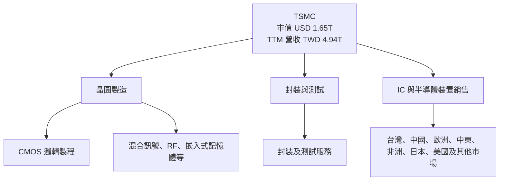
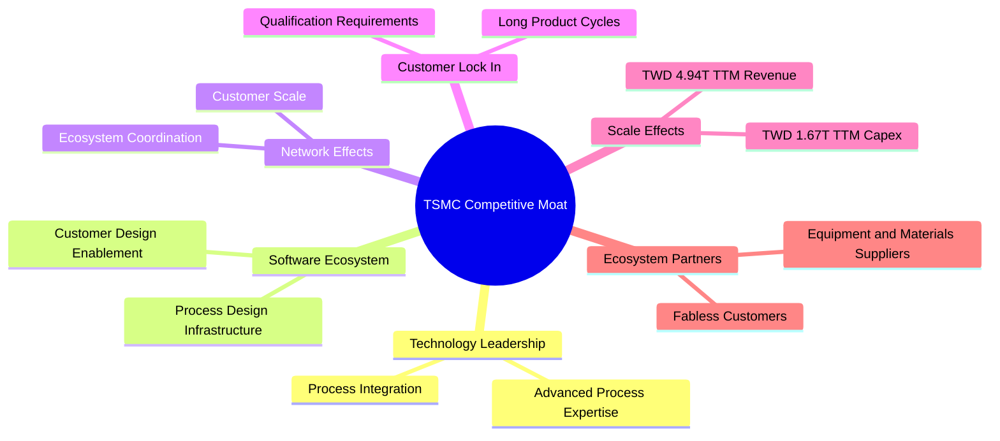
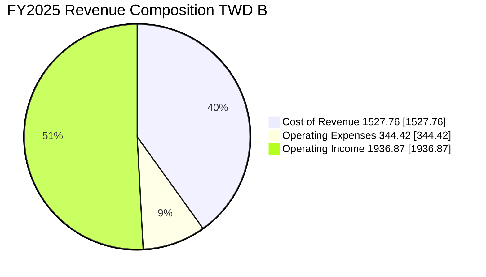
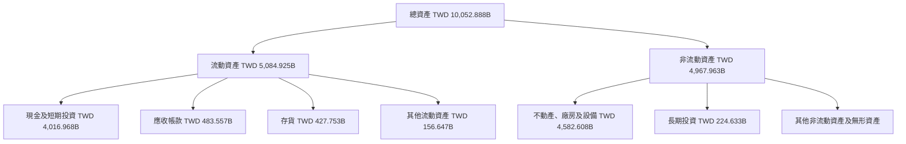
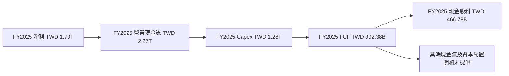
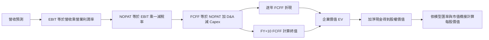
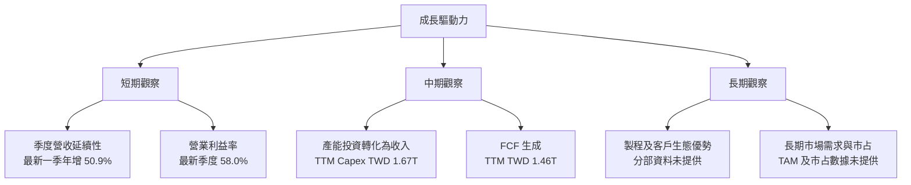
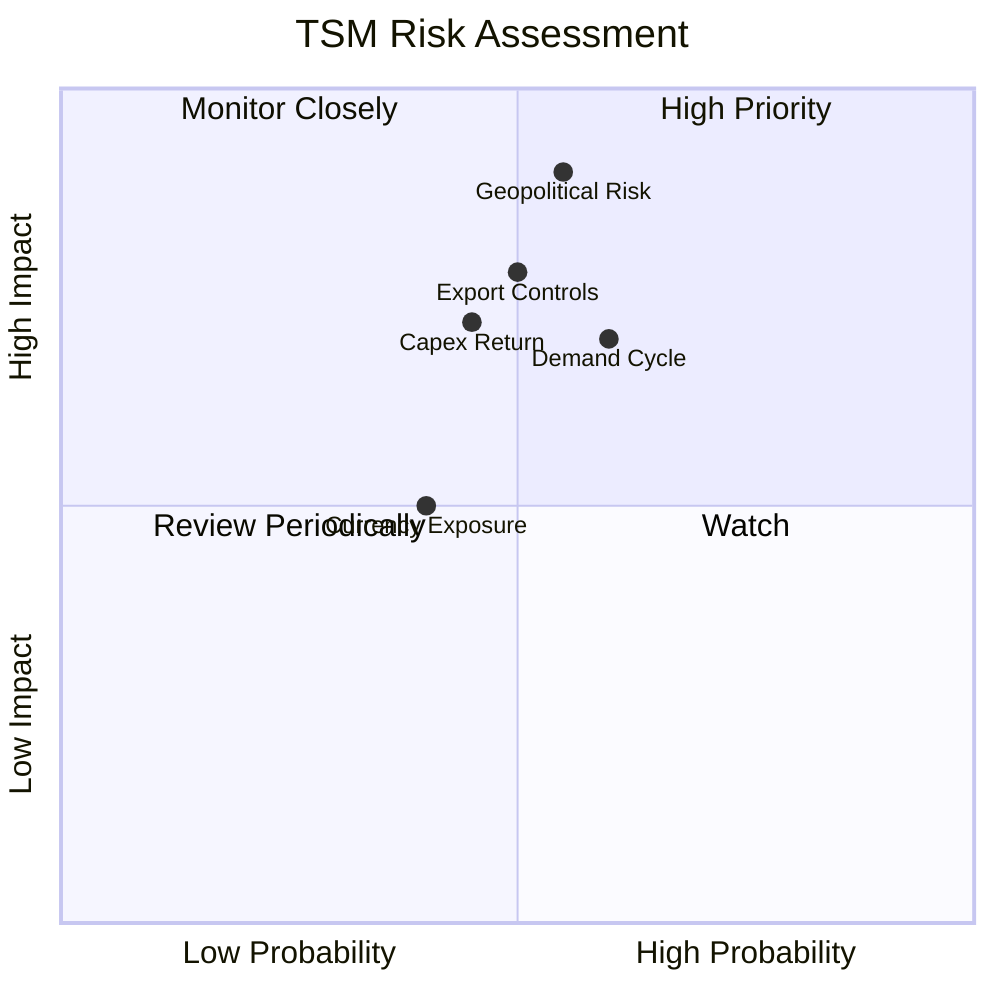
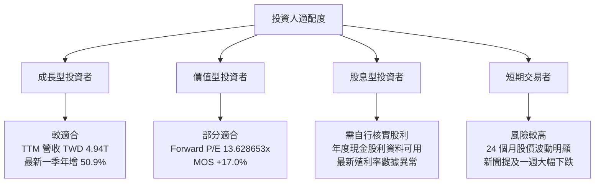

# TSM 基本面深度分析報告
> **報告日期**：2026-11-21 ｜ **語言**：繁體中文 ｜ **數據來源**：Yahoo Finance、Finviz、StockAnalysis、Roic.ai ｜ **分析師**：CFA 級機構研究

## 目錄

| # | 章節 | 核心結論 |
|---|------|----------|
| 1 | 執行摘要 | 買入；加權合理價值 $384.17；MOS +17.0% |
| 2 | 公司概覽與商業模式 | 純晶圓代工的技術、規模及客戶關係構成主要護城河 |
| 3 | 損益表深度分析 | TTM 營收 TWD 4.94T；最新一季年增 50.9%，利潤率維持高位 |
| 4 | 資產負債表分析 | 淨現金 TWD 2.95T；流動性充足，CCC 2 天 |
| 5 | 現金流量深度分析 | TTM FCF TWD 1.46T；高資本支出是現金流分析核心 |
| 6 | 獲利能力與資本效率 | ROIC 最新值未提供，無法精確判定；WACC 為 10.50% |
| 7 | 相對估值分析 | Forward P/E 13.6x；同業倍數支持與 DCF 不同的估值區間 |
| 8 | DCF 內在價值評估 | 基準 DCF 每股 $442.06；終值現值佔 EV 61.0% |
| 9 | 成長催化劑 | 近期成長與 AI 相關需求具備支撐，但 TAM 與分部數據未提供 |
| 10 | 風險矩陣 | 地緣政治、資本支出回報及需求週期為主要風險 |
| 11 | 投資建議 | MOS 支持買入；以合理價值區間及營運指標設定再評估門檻 |

## 1. 執行摘要

### 1.0 一頁式投資儀表板（Portfolio Manager 30 秒速讀）

| 項目 | 內容 |
|------|------|
| **投資論點（3 句）** | ① TTM 營收 TWD 4.94T，最新一季年增 50.9%，反映當前需求擴張。② TTM 營業利益率 58.0%、TTM FCF TWD 1.46T，盈利與現金流均有規模支撐。③ 2026-11-20 收盤價 $318.71，低於加權合理價值 $384.17，但 MOS 為 17.0%，緩衝有限。 |
| **綜合評分** | **8.3/10**（引用 1.1 評分卡） |
| **財務健康** | 🟢 TWD 2.95T 淨現金、流動比率 2.584；流動性充裕。 |
| **ROIC vs WACC** | ROIC：N/A；WACC：10.50%。缺少可直接比較的最新 ROIC，不能據此確認當期價值創造幅度。 |
| **FCF 趨勢** | FY2022–FY2025 FCF 由 TWD 520.97B 增至 TWD 992.38B；TTM FCF Yield 2.67%。 |
| **估值** | Forward P/E 13.628653x ｜ EV/EBITDA：N/A（幣別不一致）｜ FCF Yield 2.67% |
| **DCF 內在價值（基準）** | $442.06 ｜ 相對 DCF 折價 **27.9%**（現價 ÷ DCF 價值 − 1） |
| **安全邊際（MOS）** | **+17.0%**＝($384.17 − $318.71) ÷ $384.17；🟡 有限 |
| **預期報酬（基準情境 12M）** | DCF 基準情境相對現價 **+38.7%**；模型期限為 10 年，非單獨的 12 個月預測。 |
| **關鍵風險（前二）** | 地緣政治及出口管制；高資本支出若不能轉化成持續需求，可能壓低 FCF。 |
| **評級 + 信心度** | 🟢 **買入** ｜ 信心：中（MOS 依規則達買入，但 DCF 對長期假設敏感） |

### 1.1 綜合評分卡（全報告唯一）

| 維度 | 評分（1–10） | 主要依據（引用數字與其來源章節） |
|------|--------------|----------------------------------|
| 成長性 | 9.0 | 最新一季營收年增 50.9%；TTM 對前一 TTM 成長率 N/A（第 3 章） |
| 獲利能力 | 9.0 | TTM 營業利益率 58.0%、淨利率 51.1%；最新 ROIC 與 F-Score N/A（第 3、6 章） |
| 財務健康 | 9.0 | 淨現金 TWD 2.95T、流動比率 2.584、CCC 2 天（第 4 章） |
| 估值 | 7.0 | MOS +17.0%；Forward P/E 13.628653x；歷史估值百分位未提供（第 7、8 章） |
| 護城河 | 9.0 | TTM 營業利益率 58.0%、營收 TWD 4.94T；市場份額數據未提供（第 2 章） |
| 管理層與資本配置 | 7.0 | FY2025 Capex TWD 1.28T、現金股利 TWD 466.78B；回購及管理層資本回報目標未提供（第 5 章） |
| **綜合評分** | **8.3** | 六項算術平均： (9.0 + 9.0 + 9.0 + 7.0 + 9.0 + 7.0) ÷ 6 = 8.333…，四捨五入至一位小數 |

### 1.2 五大投資論點 + 三大核心風險

| 類型 | 項目 | 具體依據 | 信心度 |
|------|------|----------|--------|
| 🟢 **投資論點①** | 當前需求動能明顯 | 最新一季營收 TWD 1.49T，年增 50.9%、季增約 17.6%。 | 🟢 高 |
| 🟢 **投資論點②** | 營業獲利率高 | TTM 營業利益率 58.0%，表示增量營收具備較強的營業槓桿。 | 🟢 高 |
| 🟢 **投資論點③** | 現金流具規模 | TTM 營業現金流 TWD 3.13T、資本支出 TWD 1.67T、FCF TWD 1.46T。 | 🟢 高 |
| 🟢 **投資論點④** | 淨現金提供抗壓空間 | 現金及短期投資 TWD 4.02T，總債務 TWD 1.07T，淨現金 TWD 2.95T。 | 🟢 高 |
| 🟢 **投資論點⑤** | 綜合估值仍有折價 | 加權合理價值 $384.17，高於現價 $318.71；MOS +17.0%。 | 🟡 中 |
| 🟡 **風險①** | 地緣政治與出口管制 | 新聞提及美國對中國晶片限制及暫停先進晶片出貨；相關營收曝險比例未提供。 | 🔴 高衝擊 |
| 🔴 **風險②** | 高 Capex 的利用率風險 | TTM Capex TWD 1.67T，約為 TTM 營收的 33.8%；若需求反轉，折舊與產能利用率可能壓縮利潤。 | 🟡 中 |
| 🟡 **風險③** | 估值依賴長期預測 | DCF 終值現值佔企業價值 61.0%；永續成長率或 WACC 小幅改變即可顯著改變價值。 | 🟡 中 |

### 1.3 快速統計卡片

| 指標 | 公司實際值（期間） | 同業中位數 | 狀態 |
|------|--------------------|------------|------|
| 營收成長（TTM） | **N/A**（TTM 對前一 TTM） | — | 🟡 |
| 營收成長（最新一季年增） | **50.9%** | 20.9%（INTC、UMC、GFS 中位數） | 🟢 |
| 毛利率（TTM） | **65.8%** | 31.7%（三家中位數） | 🟢 |
| 營業利益率（TTM） | **58.0%** | — | 🟢 |
| ROIC（TTM） | **N/A** | — | 🟡 |
| Forward P/E | **13.628653x** | 13.7x（INTC、UMC、GFS 中位數） | 🟢 |
| FCF Yield（TTM） | **2.67%** | — | 🟡 |
| Piotroski F-Score | **N/A** | — | 🟡 |

### 1.4 投資結論

╔══════════════════════════════════════════════════════════════════╗  
║                    📊 投資結論摘要                               ║  
╠══════════════════════════════════════════════════════════════════╣  
║  評級：買入（依 8.8 MOS 門檻直接採用）                           ║  
║  價格（2026-11-20 收盤）：$318.71                                ║  
║  DCF 內在價值（基準）：$442.06（相對現價折價 27.9%）             ║  
║  安全邊際 MOS：+17.0%（以加權合理價值 $384.17 為分母）           ║  
║  加權合理價值（8.8）：$384.17                                    ║  
║  DCF 情境價值：                                                   ║  
║    悲觀情境：$187.59（-41.1%）                                    ║  
║    基準情境：$442.06（+38.7%）                                    ║  
║    樂觀情境：$986.34（+209.5%）                                   ║  
║  綜合評分：8.3/10（引用 1.1）                                    ║  
║  適合投資人：可承受半導體週期與地緣政治風險的成長型、長線投資人  ║  
╚══════════════════════════════════════════════════════════════════╝  

## 2. 公司概覽與商業模式

### 2.1 業務結構與收入來源

公司資料顯示，TSMC 與子公司從事晶圓製造、封裝、測試及 IC 銷售；未提供各業務、製程節點或終端市場的營收占比，因此不拆分分部金額或占比。

### 2.2 市場份額

市場份額資料未提供，故不填入市占百分比。以本期已知數據觀察，TSM TTM 營收約 USD 149.72B、最新一季營收年增 50.9%；同業最新季度營收年增率為 INTC 20.9%、UMC 25.6%、GFS 12.5%。這顯示 TSM 的近期營收成長高於提供的同業數據，但不能僅憑成長率推定市占率。

### 2.3 競爭護城河分析

### 2.4 護城河強度

| 護城河項目 | 強度（強／中／弱） | 證據（引用數字或事實） | 會削弱它的情況 |
|------------|--------------------|------------------------|----------------|
| 技術與製程能力 | 強 | TTM 毛利率 65.8%、營業利益率 58.0%；反映高附加價值製造及營運效率，但非直接製程領先指標。 | 競爭對手縮小製程差距、客戶改用替代製程或製程良率受損。 |
| 規模效應 | 強 | TTM 營收 TWD 4.94T、TTM Capex TWD 1.67T。 | 需求不足導致新增產能利用率偏低，規模優勢轉為折舊負擔。 |
| 客戶鎖定 | 中至強 | 先進製程與封裝須經客戶設計、驗證及量產流程；數據未提供客戶留存率或集中度。 | 客戶分散訂單、轉向自製或其他代工廠。 |
| 軟體生態系統 | 中 | 公司提供先進製程及相關製造服務；生態系營收、設計工具使用量未提供。 | 競爭者提供相容性更高的設計平台或成本更低的替代方案。 |
| 網路效應 | 中 | 客戶與供應商規模有助於技術協作；未提供可量化網路效應指標。 | 客戶合作不具排他性，或平台轉換成本下降。 |
| 生態夥伴 | 中至強 | 全球營運及製造、封裝、測試整合是公司業務範圍；供應商集中度資料未提供。 | 關鍵設備、材料、能源或物流供應中斷。 |

**護城河評分理由**：1.1 的護城河評分為 9.0/10，依據是 TTM 營收規模與 58.0% 營業利益率；但缺少市占、客戶集中度及技術節點量化資料，因此不把質化優勢表述為可精確量化的市場份額。

## 3. 損益表深度分析

### 3.1 年度收入成長趨勢（近4年）

FY2022–FY2025 營收取自年度損益表；YoY 依年度收入計算。金額換算使用 2026-11-20 匯率 **1 USD = 33.03 TWD**。

╔══════════════════════════════════════════════════════════════════╗  
║              TSMC 年度收入趨勢（FY2022-FY2025）                 ║  
╠══════════════════════════════════════════════════════════════════╣  
║ FY2022  TWD 2.26T  ███████████████░░░░░░░░░░  YoY：-4.5% 🟡    ║  
║ FY2023  TWD 2.16T  ██████████████░░░░░░░░░░░  YoY：-4.5% 🟡    ║  
║ FY2024  TWD 2.89T  ███████████████████░░░░░░  YoY：+33.9% 🟢   ║  
║ FY2025  TWD 3.81T  █████████████████████████  YoY：+31.6% 🟢   ║  
╠══════════════════════════════════════════════════════════════════╣  
║ FY2022–FY2025 CAGR：(3.809 ÷ 2.263891)^(1/3) − 1 ≈ 19.0%       ║  
╚══════════════════════════════════════════════════════════════════╝  

FY2023 收入下降 4.5%，其後 FY2024、FY2025 分別成長 33.9%、31.6%。這種反彈與高成長說明半導體需求具有周期性；不能把單年高成長直接外推為長期常態。FY2022–FY2025 CAGR 約 19.0%，仍低於 DCF 首年假設 30.0% 的短期成長率。

### 3.2 季度收入趨勢分析

| 季度 | 營收（TWD B） | QoQ 成長 | YoY 成長 | 備註 |
|------|-------------:|---------:|---------:|------|
| 2025 Q4 | 1,046.090 | — | 20.45% | QoQ 前一季營收未列入季度表。 |
| 2026 Q1 | 1,134.103 | +8.41% | 35.13% | 季增與年增同步擴大。 |
| 2026 Q2 | 1,270.380 | +12.02% | 36.05% | 成長加速。 |
| 2026 Q3 | 1,494.243 | +17.62% | 50.95% | 年增率較前季提高；與資料中的 50.9% 一致。 |

QoQ 成長依公式「本季營收 ÷ 前季營收 − 1」計算。例如 2026 Q3：1,494.243 ÷ 1,270.380 − 1 = 17.62%。需求延續將帶動產能利用率與固定成本吸收，但若後續訂單回落，急速攀升的季度基期也會提高比較難度。

### 3.3 利潤率演變分析

下表年度毛利率、營業利益率與淨利率由年度財務數字計算，四捨五入至一位小數。

| 利潤率指標 | FY2022 | FY2023 | FY2024 | FY2025 | 趨勢 | 評估 |
|------------|--------|--------|--------|--------|------|------|
| **毛利率** | 59.6% | 54.4% | 56.1% | 59.9% | 2023 下滑後連續回升 | 🟢 |
| **營業利益率** | 49.6% | 42.6% | 45.7% | 50.8% | 2023 谷底後改善 | 🟢 |
| **淨利率** | 43.9% | 39.4% | 40.0% | 44.6% | 2023 下滑後回復 | 🟢 |

**利潤率演變深度解析**：FY2023 營收降至 TWD 2.16T，毛利率和營業利益率同步受壓，符合晶圓製造在需求走弱時固定成本吸收轉差的特徵。FY2024–FY2025 收入增長後，FY2025 營業利益率回升至 50.8%；TTM 營業利益率進一步為 58.0%。季度營收增速、產品組合及產能利用率可能共同推動改善，但分產品收入、ASP、利用率與單位成本資料未提供，因此不將改善單獨歸因於某一製程或產品。

### 3.4 費用結構分析

以下以 FY2025 營收拆解：銷貨成本＝營收−毛利；營業費用＝毛利−營業利益；營業利益為扣除營業費用後餘額。這是營業層級拆解，不代表完整淨利費用結構。

╔══════════════════════════════════════════════════════════════════╗  
║ FY2025 營業層級費用拆解（TWD B）                                ║  
╠══════════════════════════════════════════════════════════════════╣  
║ 營收               3,809.05                                      ║  
║ ├─ 銷貨成本        1,527.76 ＝ 3,809.05 − 2,281.29               ║  
║ ├─ 營業費用          344.42 ＝ 2,281.29 − 1,936.87               ║  
║ └─ 營業利益        1,936.87                                      ║  
╚══════════════════════════════════════════════════════════════════╝  

FY2025 研發費用 TWD 246.43B，約為營收 6.5%（246.43 ÷ 3,809.054）；這是維持製程競爭力的費用投入，不宜只視為短期利潤拖累。

### 3.5 季度 EPS 趨勢與盈餘品質（Quality of Earnings）

| 盈餘品質項目 | 數值/佔比 | 評估 |
|--------------|-----------|------|
| 股權薪酬 SBC / 營收 | 近四季 SBC 約 TWD 0.513B ÷ TTM 營收 TWD 4,944.817B ≈ 0.010% | 🟢 金額占比低；此處以季度現金流量表所列 SBC 加總估算。 |
| SBC / 營業現金流 | TWD 0.513B ÷ TWD 3,130B ≈ 0.016% | 🟢 對現金流相對有限。 |
| FCF / 淨利（現金轉換率） | TTM FCF TWD 1.46T ÷ TTM 淨利 TWD 2.528T ≈ 57.8% | 🟡 FCF 低於淨利，主要需同時考慮晶圓廠資本支出規模。 |
| 一次性/非經常性損益 | N/A（資料未提供逐項明細） | 無法判定是否存在重大一次性損益。 |
| 有效稅率異常 | 最新年度有效稅率 17.0% | 🟢 DCF 採同一稅率；未提供完整多年稅率序列以辨認異常。 |
| 資本化支出 vs 費用化 | TTM Capex TWD 1.67T；資本化明細與折舊年限 N/A | 🟡 資本支出形成未來產能，短期現金成本高；會計資本化的詳細政策資料未提供。 |
| EPS 超預期／不及預期 | 最近四季 EPS Est、EPS Act 均為 NaN | 🟡 無法可靠判定超預期或不及預期；季度 EPS 成長率另見下述。 |

季度 EPS 實際值序列（ROIC.ai）為：2025 Q4 TWD 21.09、2026 Q1 TWD 26.36、Q2 TWD 31.63、Q3 TWD 31.63；資料來源另列的年度口徑可能有差異。季度 EPS 預估值及 surprise 均為缺失，故不能判斷四季盈餘是否超預期。StockAnalysis 列示最新 TTM EPS 為 97.47，較前一年 TTM 成長 60.79%，與季度表所列淨利變化方向一致。

**盈餘品質結論**：TTM 營業現金流為 TWD 3.13T，但資本支出 TWD 1.67T 後 FCF 為 TWD 1.46T；FCF/淨利約 57.8%，因此 GAAP 淨利有現金流支持，但不能忽略固定資產投資。SBC 相對營收極低，現有資料未顯示其為主要稀釋來源；一次性損益與資本化細節未提供，估值宜保留不確定性。

## 4. 資產負債表分析

### 4.1 資產結構分解

依 2026-09-30 資產負債表，總資產 TWD 10,052.888B，流動資產 TWD 5,084.925B；非流動資產為兩者差額 TWD 4,967.963B。

非流動資產細項中，PP&E 為 TWD 4,582.608B，約占總資產 45.6%。這體現晶圓製造的資本密集特性：資產增長有助於擴充產能，但也提高折舊與未來現金支出要求。

### 4.2 流動性與營運資金分析

| 指標 | 最新值 | FY2025 年末 | FY2024 年末 | 解讀 |
|------|--------|-------------|-------------|------|
| 流動比率 | 2.584 | 2.51（3.817 ÷ 1.52） | 2.36（3.088 ÷ 1.31） | 短期資產覆蓋流動負債；最新值高於兩個年度末。 |
| 速動比率 | 2.287 | N/A | N/A | 最新值顯示扣除較不流動項目後仍有流動性；歷史序列未提供。 |
| 現金及短期投資 | TWD 4.017T | TWD 3.068T | TWD 2.422T | 現金與短期投資增加，形成資金緩衝。 |

**營運資金天數**：一年前的同口徑品質指標未提供，依規則不自行補算。

| 指標 | 最新 TTM | 一年前 TTM | 變化 | 解讀 |
|------|----------|------------|------|------|
| DSO 應收帳款天數 | 1 天 | N/A | N/A | 依期末餘額及 TTM 流量計算；數值很低，但缺少一年前口徑。 |
| DIO 存貨天數 | 92 天 | N/A | N/A | 存貨週轉時間較 DSO 長；需觀察是否因產能擴張或需求放緩而延長。 |
| DPO 應付帳款天數 | 91 天 | N/A | N/A | 對供應商付款期限與議價能力的量化解讀需同業及歷史比較。 |
| CCC 現金轉換週期 | 2 天 | N/A | N/A | 低 CCC 表示營運資金占用有限；公式為 DSO + DIO − DPO。 |

### 4.3 債務結構分析

╔══════════════════════════════════════════════════════════════════╗  
║                     TSMC 債務健康診斷                           ║  
╠══════════════════════════════════════════════════════════════════╣  
║ 總債務：          TWD 1.07T                                      ║  
║ 現金及短期投資：  TWD 4.02T                                      ║  
║ 淨現金：          TWD 2.95T  🟢                                  ║  
║ 流動比率：        2.584x    🟢                                   ║  
║ Debt/EBITDA：     N/A（幣別混用限制，不自行換算）                 ║  
║ Interest Coverage：N/A（利息費用未提供）                         ║  
╚══════════════════════════════════════════════════════════════════╝  

淨現金降低再融資風險，也提供資本支出與股利支付彈性；但並不代表新增產能的投資回報一定高於資本成本。

### 4.4 股東權益趨勢

╔══════════════════════════════════════════════════════════════════╗  
║              股東權益變化（年度，TWD）                          ║  
╠══════════════════════════════════════════════════════════════════╣  
║ FY2022  TWD 2.90T  █████████████░░░░░░░░░░░░░░░                  ║  
║ FY2023  TWD 3.43T  ███████████████░░░░░░░░░░░░░░                ║  
║ FY2024  TWD 4.24T  ████████████████████░░░░░░░░░                ║  
║ FY2025  TWD 5.36T  █████████████████████████░░░                  ║  
╚══════════════════════════════════════════════════════════════════╝  

FY2022–FY2025 股東權益由 TWD 2.90T 增至 TWD 5.36T，與同期獲利累積一致；股東權益增加不應取代對資本回報率與資本配置效率的分析。

## 5. 現金流量深度分析

### 5.1 現金流量瀑布圖

年度現金流表同時列有淨利、營業現金流、Capex、FCF 與股利。股東回購金額及淨現金變化未提供。

FY2025 營業現金流高於淨利，代表營運現金生成強於會計淨利；但經 Capex 後 FCF 為 TWD 992.38B，反映晶圓製造仍需持續大量投資。

### 5.2 FCF 轉換率趨勢

| 財年 | FCF（TWD B） | 淨利（TWD B） | FCF / 淨利 | 解讀 |
|------|-------------:|--------------:|-----------:|------|
| FY2022 | 520.97 | 992.92 | 52.5% | Capex 使現金轉換低於會計獲利。 |
| FY2023 | 286.57 | 851.74 | 33.6% | FCF 明顯下降，與收入及獲利走弱同時發生。 |
| FY2024 | 861.20 | 1,158.38 | 74.3% | 現金轉換回升。 |
| FY2025 | 992.38 | 1,697.60 | 58.4% | FCF 增長但低於淨利增長。 |
| TTM 至 2026-09-30 | 1,460（程式計算口徑） | 2,527.571 | 約 57.8% | TTM FCF 按營業現金流減 Capex 定義。 |

### 5.3 自由現金流趨勢

╔══════════════════════════════════════════════════════════════════╗  
║             自由現金流趨勢（年度，TWD B）                       ║  
╠══════════════════════════════════════════════════════════════════╣  
║ FY2022  520.97   █████████████░░░░░░░░░░░░░░                     ║  
║ FY2023  286.57   ███████░░░░░░░░░░░░░░░░░░░░░                     ║  
║ FY2024  861.20   ██████████████████████░░░░░░                     ║  
║ FY2025  992.38   █████████████████████████░░░                     ║  
║ TTM     1,460.00 █████████████████████████████░                   ║  
║ TTM FCF Yield：2.67%                                               ║  
╚══════════════════════════════════════════════════════════════════╝  

TTM FCF 使用程式計算定義：營業現金流減資本支出。FY2025 與 TTM 口徑期間不同，不把兩者視為完全同口徑的年度比較。

### 5.4 資本配置評估

| 資本配置項目 | 已知金額 | 評估 |
|--------------|----------|------|
| FY2025 Capex | TWD 1.28T | 最大且具策略必要性的資本用途；長期回報取決於產能需求、利用率與折舊吸收。 |
| FY2025 現金股利 | TWD 466.78B | 低於 FY2025 FCF TWD 992.38B，現金流足以覆蓋該年度股利。 |
| FY2025 回購 | N/A | 回購金額未提供。 |
| FY2025 留存及其他用途 | N/A | 無法完整調節資本配置總額。 |

現有數據不足以建立完整資本配置圓餅圖；不以未提供的回購、併購或現金留存金額填補。

## 6. 獲利能力與資本效率

### 6.1 ROE / ROA / ROIC 趨勢

| 指標 | 最新可用值 | 歷史資料 | 評估 |
|------|-----------:|----------|------|
| ROE | TTM 41.9% | 年度歷史 ROE 序列未完整提供 | 🟢 獲利相對權益規模高；最新杜邦拆分 N/A。 |
| ROA | TTM 20.6% | 年度歷史 ROA 序列未提供 | 🟢 資產產出有獲利支撐。 |
| ROIC | N/A | Roic.ai 提供至 2018 年的 Return on Capital 20.61%，非當期值 | 🟡 無法與當期 WACC 直接比較。 |

沒有可靠的同期行業均值，故不列行業均值欄。2018 年 Return on Capital 20.61% 僅作歷史參考，不冒充為 2026 TTM ROIC。

### 6.2 ROIC vs WACC 分析（核心價值創造判斷）

╔══════════════════════════════════════════════════════════════════╗  
║                ROIC vs WACC 深度分析                            ║  
╠══════════════════════════════════════════════════════════════════╣  
║ WACC 輸入（資本成本資料）：                                      ║  
║ ├─ 無風險利率（10Y 美債）：4.91%                                 ║  
║ ├─ ERP：5.00%                                                     ║  
║ ├─ 原始 Beta：1.23；調整 Beta：1.16                              ║  
║ ├─ 股權成本 Ke（資料列示）：10.69%                               ║  
║ ├─ 稅前債務成本 Kd：1.16%；稅後約 0.96%                          ║  
║ ├─ 股權／債務權重：98.1%／1.9%                                   ║  
║ └─ 採用 WACC：10.50%                                              ║  
║                                                                  ║  
║ ROIC（TTM）：N/A，缺少可按一致口徑計算的投入資本資料。            ║  
║ EVA = ROIC − WACC：N/A，不能從現有資料計算。                      ║  
║ 結論：歷史盈利能力支持高資本回報的可能性，但當期 ROIC > WACC   ║  
║ 的命題尚未由可比期間數字驗證。                                   ║  
╚══════════════════════════════════════════════════════════════════╝  

資本成本表列示的 Ke 10.69% 與四捨五入後 Rf 4.91%、調整 Beta 1.16、ERP 5.00% 的直接乘加會有微小差異；本報告遵循資本成本資料列示值，直接採用 WACC 10.50%，不另建 WACC。因 ROIC 缺失，評級採用 8.8 的 MOS 結果，而非宣稱 ROIC 高於 WACC。

### 6.3 杜邦三因素分解

| 因素 | 數值（TTM） | 解讀 |
|------|-------------|------|
| 淨利率 | N/A（QUALITY FIGURES 註明缺少所需數據） | 不以其他口徑自行填入。 |
| 資產週轉率 | N/A | 缺少一致口徑的必要輸入。 |
| 權益乘數 | N/A | 缺少一致口徑的必要輸入。 |
| **ROE** | **N/A（杜邦分解）** | QUALITY FIGURES 指出淨利、營收、總資產或正權益資料不符合計算條件；一般 TTM ROE 41.9% 不等於可用杜邦分解反推。 |

### 6.4 財務體質：Piotroski F-Score

| 測試 | 結果 | 解讀 |
|------|------|------|
| Piotroski F-Score 總分 | N/A | 欠缺兩個相隔一年的 SEC 申報 TTM 期間。 |
| 九項測試 | N/A | 各項測試結果未提供；不自行推定或補分。 |

**解讀**：資料缺口不代表公司未通過測試，也不代表財務體質差；僅表示目前無法按指定方法取得可核驗的 F-Score。

## 7. 相對估值分析

### 7.1 同業估值比較表格

公司與同業倍數取自 Yahoo Finance Peer multiples。TSM 的 P/S、EV/EBITDA 因報價為 USD、財報為 TWD 而未提供，故保留 N/A。

| 估值指標 | **TSM** | **INTC** | **UMC** | **GFS** | TSM 評估 |
|----------|---------:|---------:|---------:|---------:|-----------|
| **Trailing P/E** | 20.655216x | N/A | 11.4x | 101.6x | 🟡 同業差異極大；INTC 缺值，GFS 高倍數不宜直接作錨。 |
| **Forward P/E** | 13.628653x | 28.6x | 13.4x | 13.7x | 🟢 低於 INTC，接近 UMC、GFS。 |
| **P/S TTM** | N/A | 4.6x | N/A（幣別混用） | 2.8x | 🟡 TSM 無可比值，不能據此定價。 |
| **EV/EBITDA TTM** | N/A | 14.9x | N/A（幣別混用） | 9.5x | 🟡 TSM 無可比值，不能直接比較。 |
| **最新一季營收年增** | 50.9% | 20.9% | 25.6% | 12.5% | 🟢 TSM 最新季度成長率高於三家同業。 |
| **毛利率 TTM** | 65.8% | 40.2% | 31.7% | 28.5% | 🟢 TSM 高於所列同業；需留意各公司產品組合差異。 |

同業 Forward P/E 中位數為 13.7x；同業 EV/EBITDA 中位數為 12.2x（INTC 與 GFS）。這些倍數是相對估值輸入，不應與 TSM 本身目前的估值倍數混用。

### 7.2 歷史估值區間分析

N/A（缺少「Valuation vs own history」的歷史估值區間及百分位資料）。24 個月股價序列顯示價格由 2024-11 的 $180.21 升至 2026-06 的 $476.29，至 2026-11-20 降至 $318.71；股價走勢不能替代歷史 P/E 區間或估值百分位。

### 7.3 情境價值（Bear / Base / Bull）

下表逐項照錄 DCF 模型的 Scenarios。此處的首年成長假設是第一年營收成長率，不應誤讀為 10 年 CAGR。

| 情境 | 第 1 年營收成長 | 期末營業利潤率 | WACC | 每股價值 | 相對現價 | 機率 | 會發生的條件 |
|------|----------------:|----------------:|-----:|---------:|---------:|-----:|--------------|
| 🔴 悲觀 | 15.0% | 42.1% | 11.50% | $187.59 | -41.1% | 25% | 需求降溫、投資回報及成本吸收弱於基準，且風險溢酬提高。 |
| 🟡 基準 | 30.0% | 49.5% | 10.50% | $442.06 | +38.7% | 50% | 首年高成長隨時間線性下降，期末利潤率收斂至歷史中位數假設。 |
| 🟢 樂觀 | 45.0% | 54.5% | 9.50% | $986.34 | +209.5% | 25% | 成長與利潤率均高於基準，且折現率降低。 |

機率加權 DCF 價值為 $514.51（+61.4%），但 8.8 估值三角驗證按要求採用基準 DCF $442.06，並不使用機率加權值。

### 7.4 相對估值隱含價格區間

╔══════════════════════════════════════════════════════════════════╗  
║              相對估值及參考價格（每股 USD）                     ║  
╠══════════════════════════════════════════════════════════════════╣  
║ 同業 EV/EBITDA      $274.80                                       ║  
║ 現價                 $318.71                                      ║  
║ 同業 Forward P/E     $319.89                                      ║  
║ DCF 基準             $442.06                                      ║  
║ 分析師共識            $586.69                                      ║  
╚══════════════════════════════════════════════════════════════════╝  

- **同業 Forward P/E：$319.89**＝同業中位數 13.7x × Forward EPS 23.39。
- **同業 EV/EBITDA：$274.80**＝同業中位數 12.2x（INTC、GFS）× TTM EBITDA，加回淨現金；此數字依估值方法區塊照錄。
- DCF 與分析師共識僅作區間參照，不屬於相對估值倍數法。

## 8. DCF 內在價值評估（Discounted Cash Flow）

### 8.0 估值推理鏈（Thinking Logic）

**Step 1 — 價值由哪些變數決定？**  
本模型以單一合併主業現金流作估值；公司業務組成與分部收入占比未提供，不能把 AI、先進製程或封裝拆成獨立估值來源。可量化起點為 TTM 營收 TWD 4,944.82B、TTM 營業利益率 58.0%、TTM FCF TWD 1.46T。DCF 敏感度顯示 WACC 與永續成長率 g 對每股價值影響顯著；營運端的成長、利潤率及 Capex 路徑則決定終值現金流底盤。

**Step 2 — 模型選擇**

| 決策點 | 本報告採用 | 理由（含數字） | 曾考慮但否決 | 否決理由 |
|--------|-----------|----------------|--------------|----------|
| 現金流定義 | FCFF | 與 WACC 折現、先算 EV 再加淨現金的模型一致；TTM FCF 為 TWD 1.46T。 | FCFE | 模型資料已指定 FCFF；不得另建模型。 |
| 預測期 N | 10 年 | DCF 模型指定 10 年，收入成長由 30.0% 線性降至 3.0%。 | 5 年 | 會改變既定模型期間與價值，不採用。 |
| 終值方法 | Gordon Growth | 區塊基準 g 3.0%、WACC 10.50%，且已提供終值。 | 另建退出倍數終值 | DCF 模型未提供該方法的終值金額；不得另建模型。 |
| EBIT 基礎 | GAAP EBIT | 模型明確以 GAAP EBIT 建立逐年預測。 | 非 GAAP EBIT | 會改變模型收益基礎。 |

**Step 3 — 關鍵假設推導鏈**

- **營收成長**：錨點＝FY2022–FY2025 營收 CAGR 約 19.0%，最新一季年增 50.9%，但 TTM 對前一 TTM 成長率 N/A → 調整＝高於歷史 CAGR 的首年成長用以反映最新季度動能，之後逐年淡出 → **採用首年 30.0%、第十年 3.0%** → 曾考慮把最新季度 50.9% 延伸至預測期，因單季年增不是 TTM 長期增速而否決。
- **營業利潤率**：錨點＝TTM 58.0%，FY2025 約 50.8% → 調整＝模型把利潤率逐年下修至五年中位數假設 → **採用 FY+1 58.0% 至 FY+10 49.5%** → 曾考慮維持 58.0% 十年，因未反映周期及成本壓力而否決。
- **永續成長率 g**：錨點＝模型設定 3.0%，低於 10.50% WACC → 調整＝不將近期高速成長延伸至永續期 → **採用 3.0%** → 不採用接近 WACC 的高 g，避免終值發散或失去經濟合理性。
- **預測期 N**：錨點＝模型固定 10 年；收入增速逐年從 30.0% 降至 3.0% → 調整＝不另改模型期限 → **採用 10 年** → 否決較短預測期，因無法照錄已指定的 10 年模型。
- **Capex/營收**：錨點＝TTM 33.8% → 調整＝模型將其逐年淡化至第十年 16.6%，即 1.1 倍 D&A 比例 → **採用 FY+1 33.8% 至 FY+10 16.6%** → 不採用固定 TTM Capex 比率十年，因模型預期資本密集度隨成熟下降。
- **有效稅率**：錨點＝最新年度有效稅率 17.0% → **採用 17.0%**。
- **D&A/營收**：錨點＝TTM 15.1% → **採用 15.1% 並維持不變**。
- **營運資金變動**：模型明確不建模營運資金，沒有 ΔWC/營收增額假設；不得自行填入。
- **EBIT 與 SBC**：採 GAAP EBIT，SBC 已包含於費用；模型不再扣 SBC。
- **股數稀釋**：採模型組合 A，固定股數假設，年稀釋率 0%；稀釋股數未提供具體股數，按模型每股橋接公式照錄，不另反推。
- **終值方法**：採模型 Gordon Growth；替代退出倍數的終值輸入未提供，故不另造估值。
- **WACC**：採用資本成本區塊的 10.50%；詳見 8.2，不另計一個折現率。

**Step 4 — 最脆弱一環**  
最脆弱的假設是長期營業利潤率與終值現金流可持續性；終值現值已佔 EV 61.0%，若 WACC 上升或 g 下調，估值將下降，敏感度依 8.6 原矩陣檢視。

**Step 5 — 計算路徑圖**

### 8.1 模型假設總表（Model Inputs）

金額為 TWD B；成長率與比率取一位小數。模型並未對 ΔWC 建模。

| 假設項目 | 採用值 | 依據 / 來源 | 敏感度 |
|----------|--------|-------------|--------|
| 預測期長度 **N** | 10 年 | DCF 模型固定期間；從 FY+1 至 FY+10。 | 🟡 中 |
| 營收成長路徑 | FY+1 30.0% 線性降至 FY+10 3.0% | FY+1 以最新一季 YoY 50.9% 為錨並限於 0%–30%；FY+10 為模型假設。 | 🔴 高 |
| 營業利潤率 | FY+1 58.0% 至 FY+10 49.5% | TTM 58.0%，淡化至過去五個財年的中位數假設。 | 🔴 高 |
| 有效稅率 | 17.0% | 最新年度有效稅率。 | 🟢 低 |
| Capex / 營收 | FY+1 33.8% 至 FY+10 16.6% | TTM 33.8%，模型逐年淡化至 1.1×D&A。 | 🔴 高 |
| D&A / 營收 | 15.1% | TTM 比率，模型固定。 | 🟢 低 |
| 營運資金變動 / 營收增額 | 未建模 | DCF 模型明確排除；沒有數值可列。 | 未建模 |
| EBIT 基礎 | GAAP EBIT | DCF 模型指定 GAAP EBIT。 | 🟡 中 |
| SBC 處理 | 不另扣 SBC | GAAP EBIT 已含 SBC 費用，採組合 A。 | 🟡 中 |
| 年稀釋率（股數） | 0% | 組合 A：SBC 已反映於 GAAP 費用，模型不再增加股數。 | 🟡 中 |
| 永續成長率 g | 3.0% | DCF 模型指定，低於 WACC 10.50%。 | 🔴 高 |
| 終值方法 | Gordon Growth | DCF 模型指定並已提供終值計算。 | 🔴 高 |
| WACC | 10.50% | 資本成本資料列示值；詳見 8.2。 | 🔴 高 |

**FCF 定義**：FCFF = NOPAT + D&A − Capex。DCF 模型未包含 ΔWC 項，故本章依原模型不新增該項。**本模型採用 (A)：GAAP EBIT + 固定股數，故 SBC 影響已計入一次。**

### 8.2 折現率推導（WACC）

╔══════════════════════════════════════════════════════════════════╗  
║                    WACC 推導（折現率）                           ║  
╠══════════════════════════════════════════════════════════════════╣  
║ 股權成本 Ke（CAPM）：                                            ║  
║ ├─ 無風險利率 Rf：4.91%（10Y 美債；觀察日期未提供）              ║  
║ ├─ ERP：5.00%（假設值，依資本成本資料）                           ║  
║ ├─ 原始 Beta：1.23；調整 Beta：1.16                              ║  
║ ├─ Beta 調整：⅔ × 1.23 + ⅓ × 1 = 1.153…，資料列示 1.16           ║  
║ ├─ Ke：資本成本資料列示 10.69%                                   ║  
║ ├─ 規模／國別溢酬：資料未另列，採用值未加計                       ║  
║                                                                  ║  
║ 債務成本 Kd：                                                    ║  
║ ├─ 稅前 Kd：1.16%（利息 ÷ 債務，資料列示）                       ║  
║ ├─ 稅率：17.0%                                                    ║  
║ └─ 稅後 Kd：1.16% × (1 − 17.0%) = 0.9628% ≈ 0.96%               ║  
║                                                                  ║  
║ 資本結構（資本成本資料列示）：                                   ║  
║ ├─ 股權權重 E：98.1%                                             ║  
║ ├─ 債務權重 D：1.9%                                              ║  
║ └─ 採用 WACC：10.50%                                             ║  
╚══════════════════════════════════════════════════════════════════╝  

**逐步演算與輸入限制**  
1. **Ke**：資料列示 10.69%；使用四捨五入輸入直接計算為 4.91% + 1.16 × 5.00% = 10.71%。差異源於原始 Beta 與中間數值的精度，依要求採用資料列示 Ke，不以四捨五入輸入取代。
2. **稅前 Kd**：1.16%，資料列示為利息 ÷ 債務；利息金額與平均計息負債細項未提供，無法重建分子、分母。
3. **稅後 Kd**：1.16% × (1 − 17.0%) = 0.9628% ≈ 0.96%。
4. **權重**：股權 98.1% + 債務 1.9% = 100.0%；用市值、期末計息負債各自的原始金額無法從資料列示權重中重建。
5. **WACC**：98.1% × 10.69% + 1.9% × 0.9628% = 10.504…% ≈ **10.50%**。依資本成本資料列示採用值為 **10.50%**。

**輸入來源說明**：價格資料日期為 2026-11-20；10Y Treasury 利率日期未單獨提供。原始 Beta 1.23、調整 Beta 1.16，按資料列示調整方法。ERP 5.00% 是假設輸入，未附獨立來源或歷史範圍，視為模型限制。WACC 與第 6.2 節一致。

### 8.3 逐年自由現金流預測（基準情境）

下表照錄 DCF 模型，金額單位 TWD B，折現因子保留三位小數。模型不含 ΔWC，GAAP EBIT 已含 SBC，不另扣 SBC。

| 年度 | FY+1 | FY+2 | FY+3 | FY+4 | FY+5 | FY+6 | FY+7 | FY+8 | FY+9 | FY+10 |
|------|-----:|-----:|-----:|-----:|-----:|-----:|-----:|-----:|-----:|------:|
| 營收 | 6,428.26 | 8,163.89 | 10,123.23 | 12,249.11 | 14,453.94 | 16,622.04 | 18,616.68 | 20,292.18 | 21,509.71 | 22,155.00 |
| 營收 YoY | 30.0% | 27.0% | 24.0% | 21.0% | 18.0% | 15.0% | 12.0% | 9.0% | 6.0% | 3.0% |
| 營業利潤率 | 58.0% | 57.0% | 56.1% | 55.2% | 54.2% | 53.3% | 52.3% | 51.4% | 50.5% | 49.5% |
| 營業利益 EBIT | 3,726.88 | 4,656.49 | 5,679.00 | 6,756.58 | 7,837.06 | 8,856.56 | 9,744.56 | 10,431.05 | 10,854.96 | 10,972.60 |
| − 稅 | (632.56) | (790.34) | (963.90) | (1,146.79) | (1,330.18) | (1,503.22) | (1,653.94) | (1,770.46) | (1,842.41) | (1,862.38) |
| = NOPAT | 3,094.32 | 3,866.14 | 4,715.10 | 5,609.79 | 6,506.88 | 7,353.34 | 8,090.62 | 8,660.59 | 9,012.55 | 9,110.22 |
| + D&A | 970.20 | 1,232.15 | 1,527.86 | 1,848.72 | 2,181.48 | 2,508.71 | 2,809.75 | 3,062.63 | 3,246.39 | 3,343.78 |
| − Capex | (2,171.05) | (2,601.47) | (3,032.68) | (3,435.84) | (3,778.51) | (4,028.15) | (4,156.32) | (4,143.23) | (3,981.42) | (3,678.16) |
| **= FCFF** | **1,893.46** | **2,496.82** | **3,210.29** | **4,022.67** | **4,909.85** | **5,833.90** | **6,744.04** | **7,579.99** | **8,277.52** | **8,775.85** |
| 折現因子 @10.50% | 0.905 | 0.819 | 0.741 | 0.671 | 0.607 | 0.549 | 0.497 | 0.450 | 0.407 | 0.368 |
| **FCFF 現值 PV** | **1,713.51** | **2,044.79** | **2,379.23** | **2,697.98** | **2,980.05** | **3,204.39** | **3,352.26** | **3,409.71** | **3,369.61** | **3,232.95** |

預測期 FCF 現值合計（逐項相加）：

1,713.51 + 2,044.79 + 2,379.23 + 2,697.98 + 2,980.05 + 3,204.39 + 3,352.26 + 3,409.71 + 3,369.61 + 3,232.95 = **28,384.48 TWD B**。

**逐步演算（FY+1）**  
1. 營收：4,944.82 × (1 + 30.0%) = 6,428.266 ≈ **6,428.26**（模型值）。  
2. EBIT：6,428.26 × 58.0% = **3,726.88**（模型值；尾差來自中間值精度）。  
3. 稅：3,726.88 × 17.0% = **633.57**，而模型列示稅額為 **632.56**。  
4. NOPAT：模型列示 3,094.32；其與列示 EBIT、稅額的直接相減存在約 1.00 的差異。  
5. D&A：模型列示 970.20。  
6. Capex：模型列示 2,171.05。  
7. ΔWC：未建模。  
8. FCFF：模型列示 1,893.46；用表內列示 NOPAT + D&A − Capex = 3,094.32 + 970.20 − 2,171.05 = 1,893.47，與模型列示值相差 0.01。  
9. 折現：1 ÷ (1 + 10.50%)¹ = 0.90498 ≈ 0.905；依模型列示折現因子計，1,893.46 × 0.905 = 1,713.58，模型 PV 為 1,713.51。  

**複算差異揭露**：DCF 模型原始表格中部分列示數字存在小幅不一致，且模型內部未提供更高精度的中間值，因此本報告遵照要求原值引用，不自行改動任何 DCF 表格值。這些差異超過單純四捨五入可完全解釋的範圍，降低模型可稽核性；不得把上述演算示例誤讀為對原模型逐格重算後完全一致。

**合理性自檢**
- FY+1 至 FY+10 的 FCFF 由 TWD 1,893.46B 增至 TWD 8,775.85B，複合成長約 18.6%；歷史年度 FCF CAGR 會受 FY2023 低基期影響，FY2022–FY2025 約 24.0%，模型成長較低，但仍假設未來持續擴大。
- FY+10 FCFF 利潤率 = 8,775.85 ÷ 22,155.00 = **39.6%**；目前 TTM FCF 利潤率 = 1.46T ÷ 4.944817T ≈ **29.5%**。同業最佳 FCF 利潤率未提供，無法判斷是否超越同業。
- 模型逐年 FCFF 均為正；高額 Capex 已在各年 FCFF 中扣除，但營運資金變動未建模。

╔══════════════════════════════════════════════════════════════════╗  
║             自由現金流：歷史實際 vs 模型預測                    ║  
╠══════════════════════════════════════════════════════════════════╣  
║ FY2023 實際  TWD 286.57B  █████░░░░░░░░░░░░░░░                   ║  
║ FY2024 實際  TWD 861.20B  ███████████████░░░░░                   ║  
║ FY2025 實際  TWD 992.38B  █████████████████░░░                   ║  
║ FY+1 預測    TWD 1,893.46B █████████████████████░                ║  
║ FY+10 預測   TWD 8,775.85B ██████████████████████████████         ║  
╠══════════════════════════════════════════════════════════════════╣  
║ 模型 FCFF 長期擴張依賴營收成長、利潤率維持及 Capex 比率下降。  ║  
╚══════════════════════════════════════════════════════════════════╝  

### 8.4 終值計算（Terminal Value）

**適用性檢查**：WACC 10.50% vs g 3.0% → WACC > g？✅

| 方法 | 計算式 | 終值 TV（TWD B） | TV 現值（TWD B） | 佔總 EV 比重 |
|------|--------|-----------------:|-----------------:|-------------:|
| Gordon Growth | 8,775.85 × (1 + 3.0%) ÷ (10.50% − 3.0%) | 120,494.35 | 44,389.19 | 61.0% |
| 退出倍數法 | N/A | N/A | N/A | N/A |

退出倍數終值的 FY+10 EBITDA 與採用倍數未在 DCF MODEL 提供，依規則不另建模型。

**逐步演算（依模型列示數字）**
1. FY+N FCFF = **TWD 8,775.85B**。
2. 分子 = 8,775.85 × (1 + 3.0%) = 9,039.1255 ≈ **TWD 9,039.13B**。
3. 分母 = 10.50% − 3.0% = **7.50%**；TV 依模型列示為 **TWD 120,494.35B**。以展示值直接計算，9,039.13 ÷ 7.50% 約為 TWD 120,521.7B，與模型列示有差異，反映中間值或模型精度差異。
4. PV(TV) 依模型列示：120,494.35 × 0.368 = **TWD 44,389.19B**（使用未四捨五入因子時可能有細微差異）。
5. 終值佔比：44,389.19 ÷ 72,773.67 = **61.0%**。

### 8.5 企業價值 → 每股內在價值（Bridge）

╔══════════════════════════════════════════════════════════════════╗  
║              企業價值 → 每股內在價值 橋接表                      ║  
╠══════════════════════════════════════════════════════════════════╣  
║ 預測期 FCF 現值合計             +TWD 28,384.48B                  ║  
║ 終值現值 PV(TV)                 +TWD 44,389.19B                  ║  
║ = 企業價值 EV                    TWD 72,773.67B                   ║  
║ + 淨現金                         +TWD 2,947.23B                   ║  
║ = 股權價值                       TWD 75,720.90B                   ║  
║ ★ 每股內在價值                   $442.06                           ║  
║ 當前股價                         $318.71                           ║  
║ 折溢價（現價÷DCF價值−1）         -27.9%（折價）                    ║  
╚══════════════════════════════════════════════════════════════════╝  

**逐步演算及橋接口徑**
1. EV：28,384.48 + 44,389.19 = **72,773.67 TWD B**。
2. 股權價值：72,773.67 + 2,947.23 = **75,720.90 TWD B**。其中淨現金為現金及短期投資減總債務；模型橋接未另列少數股權。
3. 每股內在價值：依模型指定公式 **股權價值 × FX 0.0302789 USD/TWD × 價格 ÷ 市值（USD）= $442.06**；原始市值與公式中間精度未在 DCF 模型列示，故不可用股數公式替代或重新估算。
4. 折溢價：$318.71 ÷ $442.06 − 1 = **-27.9%**。
5. 本節不計算 MOS；MOS 僅依 8.8 加權合理價值計算一次。

**股數及資產負債表來歷**：DCF 模型未提供可直接套用的稀釋股數，並指定以股權價值、換算匯率、價格與市值進行每股橋接。現金及債務依模型淨現金 TWD 2,947.23B；財務報表貨幣換算匯率為 2026-11-20 的 1 USD = 33.03 TWD。DCF 模型公式中的匯率係數另照錄為 0.0302789 USD/TWD，不以另一匯率替換。

### 8.6 敏感性分析（WACC × 永續成長率）

下表每格為模型原列每股價值；括號為相對現價 $318.71 的上行空間，按 (價值−現價) ÷ 現價 計算並四捨五入至一位小數。

| g（列）／WACC（欄） | 8.50% | 9.50% | **10.50%（基準）** | 11.50% | 12.50% |
|-----------|------:|------:|-------------------:|-------:|-------:|
| 2.0% | $557.89 (+75.0%) | $473.37 (+48.5%) | $409.36 (+28.4%) | $359.35 (+12.7%) | $319.31 (+0.2%) |
| 2.5% | $589.39 (+84.9%) | $494.91 (+55.3%) | $424.69 (+33.2%) | $370.60 (+16.3%) | $327.76 (+2.8%) |
| **3.0%（基準）** | $626.61 (+96.6%) | $519.77 (+63.1%) | **$442.06 (+38.7%)** | $383.16 (+20.2%) | $337.10 (+5.8%) |
| 3.5% | $671.28 (+110.6%) | $548.78 (+72.2%) | $461.92 (+44.9%) | $397.30 (+24.7%) | $347.47 (+9.0%) |
| 4.0% | $725.87 (+127.7%) | $583.05 (+82.9%) | $484.82 (+52.1%) | $413.32 (+29.7%) | $359.07 (+12.6%) |

**矩陣示範格限制**：DCF 模型提供原始矩陣，但沒有提供非基準格的折現現金流、TV 及橋接明細；依不得重建或改動矩陣的規則，不在此自行製作與原矩陣可能不一致的逐步重算。

**三情境 DCF（模型提供的逐項結果）**

| 情境 | 第 1 年營收成長 | 期末營業利潤率 | WACC | 每股內在價值 | 相對現價 | 機率 |
|------|----------------:|----------------:|-----:|-------------:|---------:|-----:|
| 🔴 悲觀 | 15.0% | 42.1% | 11.50% | $187.59 | -41.1% | 25% |
| 🟡 基準 | 30.0% | 49.5% | 10.50% | $442.06 | +38.7% | 50% |
| 🟢 樂觀 | 45.0% | 54.5% | 9.50% | $986.34 | +209.5% | 25% |
| **機率加權** | — | — | — | **$514.51** | **+61.4%** | 100% |

模型未提供三情境的逐年營收、FY+N FCFF 及終值明細，因此不補造逐情境完整演算鏈。可核驗的機率加權算式為：$187.59 × 25% + $442.06 × 50% + $986.34 × 25% = **$514.5125 ≈ $514.51**。

**敏感度結論（直接照錄原模型可計算的變化）**
- g 由 2.5% 升至 3.5%，在 WACC 10.50% 欄位，價值由 $424.69 升至 $461.92，增加 **$37.23**，約 +8.8%。
- WACC 由 9.50% 升至 11.50%，在 g 3.0% 列，價值由 $519.77 降至 $383.16，減少 **$136.61**，約 -26.3%。
- 期末營業利潤率每 +1pp 的價值敏感度未在模型矩陣提供，**N/A**。
- WACC 跨度對每股值的變動幅度大；因此主導估值的不僅是營運端成長，資本成本亦為重要主導變數，與 8.0 Step 1 的敏感度判斷一致。

### 8.7 反推 DCF（Reverse DCF：市場在預期什麼）

DCF 模型已提供兩個「一次解一個變數」的結果；模型未附其他變數反推值及完整迭代表，不自行補算。

| 求解的變數（一次一個） | 其餘變數設定 | 市場隱含值（令 DCF = 現價） | 對照基準 | 判斷 |
|------------------------|--------------|------------------------------|----------|------|
| Year-1 營收成長率 | 其他條件固定於基準 | 21.0% | 基準 30.0% | 🟢 單就首年成長假設而言，市場隱含值低於基準。 |
| 固定營業利潤率 | 其他條件固定於基準 | 38.0% | 基準由 58.0% 降至 49.5% | 🟢 隱含固定利潤率低於當前 TTM 利潤率。 |
| 永續成長率 g | 未計算 | N/A | — | 模型未提供。 |
| 高成長持續年數 N | 未計算 | N/A | 基準 10 年 | 模型未提供。 |

**求解方法與軌跡限制**：數據來源僅提供反推結果，沒有給出每次試算的 CAGR、FY+N 營收、FY+N FCFF 與每股值，故不製造迭代軌跡或聲稱誤差門檻。其含義是：在其餘基準假設固定時，單變數反推的首年營收成長 21.0% 或固定營業利潤率 38.0% 可對應現價；這不等於兩個條件能同時成立。

### 8.8 估值三角驗證與安全邊際

| 估值方法 | 隱含每股價值 | 上行空間（÷現價） | 權重 | 說明 |
|----------|--------------:|-------------------:|------:|------|
| DCF（基準） | $442.06 | +38.7% | 40% | 10 年 FCFF、WACC 10.50%、g 3.0%。 |
| 同業 Forward P/E | $319.89 | +0.4% | 25% | 同業中位數 13.7x × Forward EPS 23.39。 |
| 同業 EV/EBITDA | $274.80 | -13.8% | 25% | 同業中位數 12.2x（INTC、GFS）× TTM EBITDA，加回淨現金。 |
| 分析師共識目標價 | $586.69 | +84.1% | 10% | 20 位分析師平均目標價，作參考。 |
| **加權合理價值** | **$384.17** | **+20.5%** | **100%** | Profitable 公司類型的固定方法權重。 |

逐步演算：  
$442.06 × 40% + $319.89 × 25% + $274.80 × 25% + $586.69 × 10%  
= $176.824 + $79.9725 + $68.700 + $58.669  
= $384.1655 ≈ **$384.17**。  

權重依 Profitable 公司類型固定，合計 100%；四種方法均保留。加權合理價值不得事後折讓或調整。

╔══════════════════════════════════════════════════════════════════╗  
║                  估值區間與安全邊際                              ║  
╠══════════════════════════════════════════════════════════════════╣  
║ $187.59 ─── $318.71 ─── [$384.17] ─── $442.06 ─── $986.34       ║  
║ 悲觀DCF       現價       加權合理值    基準DCF      樂觀DCF       ║  
║                                                                  ║  
║ MOS = ($384.17 − $318.71) ÷ $384.17 = +17.0%                    ║  
║ MOS 評估：🟡 有限                                               ║  
║ 上行空間 = ($384.17 − $318.71) ÷ $318.71 = +20.5%              ║  
║                                                                  ║  
║ 建議買入區間：$288.13 – $345.75（MOS 約 25% 至 10%）             ║  
║ 合理持有區間：$345.75 – $422.59（MOS 約 10% 至 -10%）            ║  
║ 減碼考慮區間：$422.59 以上；價位高於加權價值 10% 後風險報酬轉差  ║  
╚══════════════════════════════════════════════════════════════════╝  

買入區間端點依加權合理價值計算：$384.17 × 75% = $288.13；$384.17 × 90% = $345.75。MOS 與 1.0 儀表板一致，均為 +17.0%。

> 🔎 **程式複算（Python，依本節各項自動重算）**
>
> 加權合理價值 = $442.06 × 40% + $319.89 × 25% + $274.80 × 25% + $586.69 × 10% = **$384.17**（權重合計 100%）
>
> 以價格 $318.71 計：MOS = **+17.0%**，上行空間 = **+20.5%**
>
> ✅ 與本節所寫數值一致。

### 8.9 DCF 模型的局限與失效條件

- **終值依賴度**：終值現值佔 EV 61.0%，代表超過半數企業價值來自 FY+10 之後的現金流假設。
- **最脆弱假設**：期末利潤率及折現率。悲觀情境在首年成長 15.0%、期末利潤率 42.1%、WACC 11.50% 時，價值降至 $187.59；敏感度矩陣亦顯示 g 3.0%、WACC 12.50% 時每股值為 $337.10。
- **不適用情境說明**：公司目前 FCF 為正，並非負 FCF 公司；但因仍有大量資本支出，Capex 路徑對 DCF 影響重大。若產能投資週期改變，應搭配 EV/EBITDA、同業 P/E 及產能利用率分析，而非只看終值。
- **模型一致性局限**：逐年明細的部分稅額、NOPAT、PV 與終值計算未能用展示精度完全逐項重現，且 ΔWC 未建模；DCF $442.06 應視為模型輸出，不宜視作精確估值。
- **與第 10 章連結**：出口限制、需求循環及產能利用率會影響收入成長、EBIT 利潤率及 Capex/收入；地緣政治風險還可能提高 WACC。

### 8.10 複算檢核表（Audit Trail）

| # | 檢核項目 | 檢查方式 | 結果 |
|---|----------|----------|------|
| 1 | 所有 🔴高 / 🟡中敏感度輸入均有推導 | 對照 8.0 與 8.1 | 🟡 有推導；部分替代值與管理層財測資料未提供。 |
| 2 | 每個假設都有來歷 | 檢查 8.1 依據欄 | 🟡 部分假設依賴 DCF 模型假設；原始管理層財測未提供。 |
| 3 | WACC 五步算式及權重 | 檢查資本成本輸入與計算 | 🟡 權重為 100%；Ke 以資料列示值優先，四捨五入輸入重算略有差異。 |
| 4 | Kd 分母與權重 D 範圍一致 | 檢查計息負債明細 | 🟡 利息、平均計息負債、期末計息負債細項未提供，無法完全核對。 |
| 5 | WACC 與第 6.2 節同值 | 比對數字 | ✅ 均為 10.50%。 |
| 6 | 逐年表格年度數 = N，無省略 | 檢查年度欄位 | ✅ 10 個年度，FY+1 至 FY+10。 |
| 7 | FY+1 九步算式可複算 | 重算列示值 | ❌ 原模型部分稅額、NOPAT、PV 有差異，已揭露而未竄改原表。 |
| 8 | 預測期 PV 加總 | 逐項加總模型 PV | ✅ 列示值合計 28,384.48 TWD B。 |
| 9 | WACC > g | 10.50% 比較 3.0% | ✅ |
| 10 | 終值以 FY+N 現金流為基礎 | 檢查 FY+10 FCFF | ✅ 使用 FY+10 FCFF；展示精度下 TV 算式與模型結果有小幅差異。 |
| 11 | 橋接 EV 至每股價值 | 檢查模型橋接 | 🟡 EV、股權價值可相加；每股公式的市值中間輸入未完整列示。 |
| 12 | SBC 三要素相容 | GAAP、SBC 列、股數 | ✅ 組合 A：GAAP、無額外 SBC 扣除、固定股數。 |
| 13 | 敏感性基準格 = 8.5 | 比對數值 | ✅ $442.06。 |
| 14 | 敏感性格的有效性 | 檢查 WACC 與 g | ✅ 所有提供矩陣格皆為 WACC > g。 |
| 15 | 三情境機率與加權 | 25% + 50% + 25% | ✅ 合計 100%，加權值 $514.51。 |
| 16 | 反推每列只放開一個變數且有軌跡 | 檢查反推資料 | 🟡 模型只提供兩個單變數答案，未附迭代軌跡；未另行偽造。 |
| 17 | MOS 分母與折溢價基準 | 8.8 及 8.5 比對 | ✅ MOS 以 $384.17；DCF 折溢價以 $442.06。 |
| 18 | 報告完整至第 11 章 | 檢查章節 | ✅ |
| 19 | 加權合理價值為方法加權總和 | 重加估值方法 | ✅ $384.1655 ≈ $384.17，無事後調整。 |
| 20 | 評級符合 MOS 門檻 | 依規則 20 | ✅ MOS +17.0%，評級買入；未作質化調整。 |

未能消除的檢核差異主要是原模型中間值未提供足夠精度，且若直接以展示值重算會與部分模型行不一致；報告保留原模型輸出並明確降低對 DCF 精確度的信心。

## 9. 成長催化劑

### 9.1 催化劑時間軸

資料未提供可量化的公司正式催化劑日期或交付時程，因此不建立含推測日期的 Gantt 圖。可追蹤的近期變化是最新一季營收年增 50.9%、季增約 17.6%；其是否持續，應由後續季度營收、利潤率與 Capex 實際值確認。

### 9.2 TAM 市場規模分析

**N/A（TAM 數據未提供）**。TTM 營收為 TWD 4.94T，最新一季營收年增 50.9%；公司在晶圓代工、封裝及測試等領域有多項業務，但缺少可引用的市場總額、公司分部收入與滲透率，故不自行推算 TAM。

### 9.3 成長驅動力結構圖

## 10. 風險矩陣

### 10.1 風險評分矩陣

以下座標是分析師對定性風險的排序，不是財務預測值。

### 10.2 風險清單詳細分析

| # | 風險項目 | 發生機率 | 財務衝擊 | 風險評估 | 緩解措施 |
|---|----------|----------|----------|----------|----------|
| 1 | 🔴 **地緣政治、台海及營運中斷** | 中高；未提供量化機率 | 高；受影響收入比例未提供 | 🔴 高衝擊 | 追蹤產能地理分布、保險與備援安排；持續檢視客戶及供應鏈曝險。 |
| 2 | 🔴 **出口管制及中國出貨限制** | 中；新聞已提及限制與暫停出貨，但影響範圍未知 | 中至高；營收敏感度 N/A | 🔴 高衝擊 | 追蹤受限制產品、地區營收及規範更新；避免把中國相關需求外推為固定營收。 |
| 3 | 🟡 **半導體需求反轉與產能利用率下降** | 中 | 高；營業利益率可能受固定成本影響 | 🔴 高衝擊 | 追蹤單季營收成長、58.0% TTM 營業利益率及存貨天數；若訂單放緩，重估成長及利潤率。 |
| 4 | 🟡 **Capex 回報低於預期** | 中 | 高；TTM Capex TWD 1.67T、約營收 33.8% | 🟡 中高 | 逐季比較新增產能、營收及 FCF；檢視 Capex/營收是否依預期下滑。 |
| 5 | 🟡 **估值假設及折現率變動** | 中 | 中高；終值現值佔 EV 61.0% | 🟡 中高 | 以 WACC、g 敏感度矩陣及同業估值交叉驗證，不只依賴單一 DCF。 |
| 6 | 🟡 **匯率與報價、財報幣別差異** | 中；敞口未提供 | 中；美元報價、TWD 財報 | 🟡 中 | 使用可核驗匯率換算並區分營運外匯曝險與 ADR 報價影響。 |

## 11. 投資建議

### 11.1 最終評級與評分

加權合理價值 $384.17，相較 2026-11-20 收盤 $318.71 的 MOS 為 +17.0%，依規則 20 評級為 **買入**，未作一級質化調整。綜合評分 **8.3/10**，引用 1.1 的六項評分：成長性 9.0、獲利能力 9.0、財務健康 9.0、估值 7.0、護城河 9.0、管理層與資本配置 7.0。

### 11.2 合理價值與隱含報酬率

| 估值基準 | 每股價值 | 相對現價 $318.71 | 機率／權重 | 解讀 |
|----------|---------:|------------------:|-----------:|------|
| 加權合理價值 | $384.17 | +20.5% | 估值權重 100% | MOS +17.0%，屬有限安全邊際。 |
| DCF 悲觀情境 | $187.59 | -41.1% | 25% | 成長與利潤率均弱於基準，WACC 上升。 |
| DCF 基準情境 | $442.06 | +38.7% | 50% | DCF 模型基準假設。 |
| DCF 樂觀情境 | $986.34 | +209.5% | 25% | 高成長、高期末利潤率及較低 WACC 同時成立。 |
| 分析師共識目標價 | $586.69 | +84.1% | 20 位分析師平均值；估值法權重 10% | 只作參考，不視為保證報酬。 |

### 11.3 買入時機與觸發因素

╔══════════════════════════════════════════════════════════════════╗  
║                  ✅ 買入觸發因素 Checklist                      ║  
╠══════════════════════════════════════════════════════════════════╣  
║ 目前價格：$318.71；加權合理價值：$384.17；MOS：+17.0%。         ║  
║                                                                  ║  
║ 立即／分批買入考量：                                             ║  
║ ✅ 現價處於按 MOS 約 10%–25% 緩衝推導的買入區間。                ║  
║ ✅ 最新一季營收年增 50.9%，TTM 營業利益率 58.0%。                ║  
║ ✅ TTM FCF TWD 1.46T、淨現金 TWD 2.95T。                         ║  
║                                                                  ║  
║ 加碼觸發條件：                                                   ║  
║ ☐ 股價回落至約 $288.13 或以下，且基本面未惡化，MOS 約達 25%。   ║  
║ ☐ 後續季度收入增長維持正值，營業利益率仍接近或高於 50%。       ║  
║ ☐ FCF 保持正值，且 Capex 投入逐步轉化為收入及現金流。           ║  
║                                                                  ║  
║ 減碼／重新評估觸發條件：                                         ║  
║ ☐ 股價高於加權合理價值 10%（約 $422.59），而盈利假設未上修。    ║  
║ ☐ 營業利益率明顯跌破 50%，或 FCF 轉負。                          ║  
║ ☐ 出口限制或地緣政治事件對營運、客戶供應形成實質中斷。         ║  
╚══════════════════════════════════════════════════════════════════╝  

### 11.4 投資人適配度分析

股利數據存在口徑疑點：資料列示 Dividend Yield 118.0%，與其他股利欄位可能存在單位或資料品質問題；因此不把該殖利率作為股息型投資依據。短線股價波動亦不代表公司基本面同步變化。

### 11.5 每季財報監控清單（Quarterly Watch List）

| 監控項目 | 最新基準 | 加碼觀察門檻 | 減碼／重估門檻 |
|----------|----------|--------------|----------------|
| 營收年增 | 2026 Q3 +50.9% | 持續正成長且高於同業，需同時觀察基期 | 連續兩季營收年增轉負或急速放緩 |
| 營業利益率 | TTM 58.0%；最新季度 58.0% | 維持 50% 以上且未快速收縮 | 低於 50% 或較近期水準收縮 5 個百分點以上 |
| 資本支出 | TTM TWD 1.67T | 新增投資伴隨收入及 FCF 增長 | Capex 上升但收入、FCF 同時轉弱 |
| FCF | TTM TWD 1.46T | 維持正值且現金轉換改善 | FCF 轉負或連續兩季顯著下滑 |
| 現金與淨現金 | 現金及短期投資 TWD 4.02T；淨現金 TWD 2.95T | 維持淨現金及充足流動性 | 淨現金快速消耗且負債持續上升 |
| 存貨與 CCC | DIO 92 天；CCC 2 天 | 存貨天數穩定、CCC 維持短週期 | DIO 明顯上升並伴隨營收放緩 |
| 研發投入 | FY2025 TWD 246.43B | 投入與營收成長、利潤率維持相容 | 投入上升但核心盈利及現金流持續惡化 |
| EPS 預期與財測 | 最新四季 EPS 預估資料缺失 | 實際 EPS 成長與營收、利潤率一致 | 財測下修且營運數字同步轉弱 |

### 11.6 反面論證：什麼會證明論點錯誤（What Would Change My Mind）

╔══════════════════════════════════════════════════════════════════╗  
║              ⚠️ 論點失效條件（Disconfirming Evidence）           ║  
╠══════════════════════════════════════════════════════════════════╣  
║ 本投資論點在下列情況成立時應重新檢視或退出：                    ║  
║ ☐ 核心營收年增連續兩季轉負，或成長明顯低於同業增速。           ║  
║ ☐ 營業利益率跌破 50%，且連續兩季未見穩定。                      ║  
║ ☐ TTM FCF 轉負，或 FCF / 淨利持續低於 40%。                     ║  
║ ☐ 最新 ROIC 一旦可計算，若連續期間低於 10.50% WACC，需重估     ║  
║    公司是否仍創造經濟價值。                                     ║  
║ ☐ Capex 維持高位但營收、FCF 未相應成長，顯示投資回報惡化。     ║  
║ ☐ 出口管制或地緣事件造成持續性生產中斷、客戶流失或重要市場    ║  
║    供應受限。                                                     ║  
║ ☐ DCF 基準所依賴的高營業利潤率、Capex 比率下降或 3.0% 永續成長 ║  
║    假設被實際財報否定，應下調估值而非固守 $442.06。             ║  
╚══════════════════════════════════════════════════════════════════╝  

> **免責聲明**：本報告為 AI 自動生成，僅供研究參考，不構成投資建議。投資有風險，入市需謹慎。

---

## 資料與來源

| 項目 | 內容 |
|------|------|
| 價格 | 318.71 USD，2026-11-20 收盤（Yahoo Finance 日線） |
| 財務報表 | Yahoo quarterly statements (no SEC filing data)，最新季度 2026-09-30（TTM = four quarters to this date） |
| 有回應的資料來源 | Yahoo Finance、Finviz、StockAnalysis、Roic.ai |
| 未回應的資料來源 | SEC 申報資料 (XBRL) |
| 由程式計算 | TTM 數字、WACC、DCF 模型、估值方法與權重、加權合理價值、MOS、評級門檻、F-Score、杜邦分解、營運資金天數、綜合評分 |
| 撰寫模型 | openai / gpt-6-luna |

> 本區塊由產生報告的程式依實際取得的資料填寫，非模型撰寫。「由程式計算」的數字不是模型的估計；其餘判斷（評分、情境、策略）是模型的分析。
