# TSM 基本面深度分析報告
> **報告日期**：2026-11-22 ｜ **語言**：繁體中文 ｜ **數據來源**：Yahoo Finance、Finviz、StockAnalysis、Roic.ai ｜ **分析師**：CFA 級機構研究

## 目錄

| # | 章節 | 核心結論 |
|---|------|----------|
| 1 | 執行摘要 | 買入；加權合理價值 $384.70；MOS +17.2% |
| 2 | 公司概覽與商業模式 | 製程、規模與客戶黏著構成護城河；營收分部占比未提供 |
| 3 | 損益表深度分析 | TTM 營收約 TWD 4.94T；最新一季年增 50.9%，利潤率上升 |
| 4 | 資產負債表分析 | 淨現金 TWD 2.95T；流動比率 2.584 |
| 5 | 現金流量深度分析 | TTM FCF TWD 1.46T；資本支出仍高 |
| 6 | 獲利能力與資本效率 | 最新 TTM ROIC 未提供；歷史 ROIC 高於 WACC |
| 7 | 相對估值分析 | DCF $443.03；同業估值支持區間較低 |
| 8 | DCF 內在價值評估 | 基準 DCF $443.03；加權合理價值 $384.70；MOS +17.2% |
| 9 | 成長催化劑 | 近期營收加速；TAM 數據未提供 |
| 10 | 風險矩陣 | 地緣政治、AI需求／估值、資本支出回報為主要風險 |
| 11 | 投資建議 | 買入；建議區間 $318.71–$346.23，並設定營運監控條件 |

## 1. 執行摘要

### 1.0 一頁式投資儀表板（Portfolio Manager 30 秒速讀）

| 項目 | 內容 |
|------|------|
| **投資論點（3 句）** | ① 最新一季營收年增 **50.9%**，代表需求與出貨動能加速；若延續，產能利用與產品組合可支撐利潤率。② TTM 營業利益率 **58.0%**、TTM FCF **TWD 1.46T（約 USD 44.23B）**，高獲利伴隨充足現金流。③ 2026-11-20 收盤價 **$318.71**，低於加權合理價值 **$384.70**，但 DCF 基準值 **$443.03** 仰賴長期成長與終值假設。 |
| **綜合評分** | **8.2/10**（引用 1.1；六項算術平均） |
| **財務健康** | 🟢 現金及短期投資 TWD 4.02T、總債務 TWD 1.07T，淨現金 TWD 2.95T |
| **ROIC vs WACC** | 最新 TTM ROIC：N/A；可引用的歷史 ROIC 為 2018 年 **20.61%**，高於 WACC **10.50%**，但不能視為當期 ROIC |
| **FCF 趨勢** | TTM FCF TWD 1.46T；FCF Yield **2.68%**。年度 FCF 2023–2025 回升，但資本支出仍高 |
| **估值** | Forward P/E **13.63x** ｜ EV/EBITDA：N/A（跨幣別）｜ FCF Yield **2.68%** |
| **DCF 內在價值（基準）** | **$443.03** ｜ 現價相對 DCF 折價 **28.1%**（現價 ÷ DCF 價值 − 1） |
| **安全邊際（MOS）** | **+17.2%**＝($384.70 − $318.71) ÷ $384.70；🟡 有限 |
| **預期報酬（基準情境）** | DCF 基準情境上行空間 **+39.0%**；加權合理價值上行空間 **+20.7%** |
| **關鍵風險（前二）** | 台海／出口管制衝擊產能與客戶供應；AI需求與資本支出回報低於預期 |
| **評級 + 信心度** | 🟢 **買入** ｜ 信心：中（估值輸入與部分財務數據存在可稽核性限制） |

### 1.1 綜合評分卡（全報告唯一）

| 維度 | 評分（1–10） | 主要依據（引用數字與其來源章節） |
|------|--------------|----------------------------------|
| 成長性 | 9.0 | 最新一季營收年增 50.9%；TTM 成長率按 Yahoo／程式計算為 N/A（第 3 章） |
| 獲利能力 | 9.0 | TTM 營業利益率 58.0%、淨利率 51.1%；最新 TTM ROIC 與 F-Score 未提供（第 3、6 章） |
| 財務健康 | 9.0 | 淨現金 TWD 2.95T、流動比率 2.584、速動比率 2.287（第 4 章） |
| 估值 | 6.0 | MOS +17.2%；同業 Forward P/E 中位數 13.7x，TSM Forward P/E 13.63x（第 7、8 章） |
| 護城河 | 9.0 | 2025 年營收 TWD 3.81T、TTM 營業利益率 58.0%；先進製程、規模與客戶轉換成本支撐競爭地位（第 2 章） |
| 管理層與資本配置 | 7.0 | 2025 年資本支出 TWD 1.28T、股息支付 TWD 466.78B；SBC TWD 1.25B，回購資料未提供（第 5 章） |
| **綜合評分** | **8.2** | 六項算術平均：(9.0 + 9.0 + 9.0 + 6.0 + 9.0 + 7.0) ÷ 6 = 8.17，四捨五入為 8.2 |

### 1.2 五大投資論點 + 三大核心風險

| 類型 | 項目 | 具體依據 | 信心度 |
|------|------|----------|--------|
| 🟢 **投資論點①** | 收入動能加速 | 2026 Q3 營收 TWD 1.494T，年增 50.9%；高於 2026 Q2 年增 36.05% | 🟢 高 |
| 🟢 **投資論點②** | 高營業槓桿與獲利能力 | TTM 營業利益率 58.0%、毛利率 65.8%；反映製程組合與定價能力 | 🟢 高 |
| 🟢 **投資論點③** | 現金流與資產負債表穩健 | TTM FCF TWD 1.46T，淨現金 TWD 2.95T | 🟢 高 |
| 🟢 **投資論點④** | 規模和客戶轉換成本 | 2025 年營收 TWD 3.81T，2022–2025 年營收 CAGR 約 18.9%；先進製程轉換需要客戶重新驗證 | 🟢 中高 |
| 🟢 **投資論點⑤** | 估值仍有折價 | $318.71 現價較加權合理價值 $384.70 低 17.2%（MOS 定義） | 🟡 中 |
| 🟡 **風險①** | 地緣政治與出口管制 | 若產能、設備供應或對中出貨受限，影響可能跨越多個季度；新聞提及美國新限制及暫停對中國先進晶片出貨 | 🔴 高衝擊 |
| 🔴 **風險②** | AI需求與客戶資本支出反轉 | 高成長基準假設採第 1 年 30.0%；若需求退潮，收入增速及產能利用率均可能低於 DCF 假設 | 🟡 中高 |
| 🟡 **風險③** | 高資本支出壓低自由現金流 | TTM Capex TWD 1.67T，約為 TTM 營收的 33.8%；若新增產能無法帶來足夠回報，FCF 與估值承壓 | 🟡 中高 |

### 1.3 快速統計卡片

| 指標 | 公司實際值（期間） | 同業中位數 | 狀態 |
|------|--------------------|------------|------|
| 營收成長（TTM） | **N/A** | — | 🟡 缺少可引用數值 |
| 營收成長（最新一季年增） | **50.9%** | 20.9% | 🟢 |
| 毛利率（TTM） | **65.8%** | 31.7% | 🟢 |
| 營業利益率（TTM） | **58.0%** | — | 🟢 |
| ROIC（TTM） | **N/A** | — | 🟡 |
| Forward P/E | **13.63x** | 13.7x | 🟢 接近同業中位數 |
| FCF Yield（TTM） | **2.68%** | — | 🟡 |
| Piotroski F-Score | **N/A** | — | 🟡 |

### 1.4 投資結論

╔══════════════════════════════════════════════════════════════════╗  
║                    📊 投資結論摘要                               ║  
╠══════════════════════════════════════════════════════════════════╣  
║  評級：買入（依規則 20；MOS +17.2%）                             ║  
║  價格（2026-11-20 收盤）：$318.71                               ║  
║  DCF 內在價值（基準）：$443.03（相對現價折價 28.1%）             ║  
║  安全邊際 MOS：+17.2%（＝($384.70−$318.71)÷$384.70）            ║  
║  加權合理價值（8.8）：$384.70                                    ║  
║  DCF 情境價值：                                                  ║  
║    悲觀情境：$188.00（-41.0%）                                   ║  
║    基準情境：$443.03（+39.0%）                                   ║  
║    樂觀情境：$988.52（+210.2%）                                  ║  
║  綜合評分：8.2/10（引用 1.1）                                    ║  
║  適合投資人：能承受地緣政治及半導體週期波動的成長型、長線投資人   ║  
╚══════════════════════════════════════════════════════════════════╝

## 2. 公司概覽與商業模式

### 2.1 業務結構與收入來源

TSMC 為晶圓代工企業，提供晶圓製造、封裝、測試及相關半導體服務。可用財務資料沒有營收分部、節點別營收或服務別收入占比，因此不虛構板塊百分比。

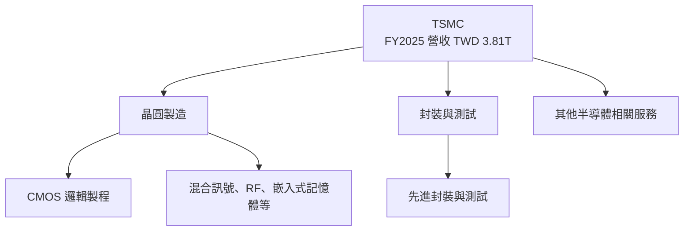

### 2.2 市場份額

市場份額數據未提供，故不列數值或繪製比例圖。以規模作為質化參考，TSMC FY2025 營收為 TWD 3.81T，TTM 營收為 TWD 4.94T；最近一季營收年增 50.9%，高於 INTC、UMC、GFS 的最新一季年增率。

### 2.3 競爭護城河分析

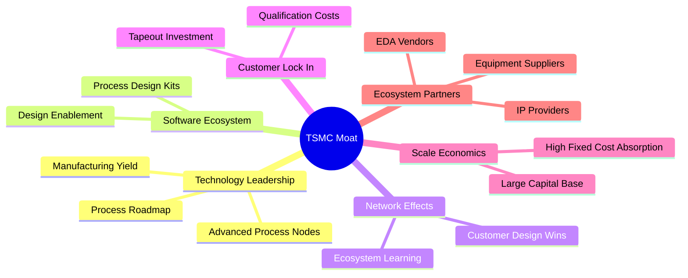

### 2.4 護城河強度

| 護城河項目 | 強度（強／中／弱） | 證據（引用數字或事實） | 會削弱它的情況 |
|------------|--------------------|------------------------|----------------|
| 技術與製程能力 | 強 | TTM 營業利益率 58.0%；公司提供多類 CMOS、混合訊號、RF 等製程 | 競爭者追近先進節點、良率或成本優勢下降 |
| 規模效應 | 強 | TTM 營收 TWD 4.94T，TTM Capex TWD 1.67T | 產能閒置、投資回收期延長 |
| 客戶鎖定 | 強 | 客戶產品設計、製程驗證與量產流程提高轉換成本；量化客戶集中度未提供 | 客戶改採自製或轉向其他代工廠 |
| 軟體與設計生態 | 中 | 企業提供製程與客戶設計支援；營收或生態系量化資料未提供 | 競爭對手的設計工具與合作體系成熟 |
| 網路效應 | 中 | 客戶與設計夥伴累積經驗可能提高平台吸引力；量化資料未提供 | 客戶需求集中或替代平台成熟 |
| 生態夥伴 | 中 | 製程需要 EDA、IP、設備與材料供應鏈協同 | 關鍵設備或材料供應中斷 |

護城河評分引用 1.1 的 **9.0/10**：評分依據是營收規模、58.0% TTM 營業利益率及製程與客戶轉換成本；生態系量化資料有限，因此不把各項優勢都當作已量化事實。

## 3. 損益表深度分析

### 3.1 年度收入成長趨勢（近4年）

╔══════════════════════════════════════════════════════════════════╗  
║              TSMC 年度收入趨勢（FY2022–FY2025）                  ║  
╠══════════════════════════════════════════════════════════════════╣  
║  FY2022  TWD 2.26T  ████████████░░░░░░░░░  YoY +4.7%  🟡       ║  
║  FY2023  TWD 2.16T  ███████████░░░░░░░░░░  YoY -4.5%  🔴       ║  
║  FY2024  TWD 2.89T  ███████████████░░░░░░  YoY +33.9% 🟢       ║  
║  FY2025  TWD 3.81T  ████████████████████░  YoY +31.6% 🟢       ║  
╠══════════════════════════════════════════════════════════════════╣  
║  FY2022–FY2025 營收 CAGR：約 18.9%                              ║  
╚══════════════════════════════════════════════════════════════════╝

FY2023 營收較前一年下降 4.5%，反映半導體需求循環回落；2024、2025 年連續成長，顯示需求復甦及產品組合改善。最新 TTM 營收成長率在 Yahoo／程式計算中為 **N/A**，因此不以其他來源數字替代該 TTM 指標。

### 3.2 季度收入趨勢分析

| 季度 | 營收（TWD B） | QoQ | YoY | 備註 |
|------|---------------:|----:|----:|------|
| 2025 Q4 | 1,046.09 | +5.7% | +20.45% | 延續年增 |
| 2026 Q1 | 1,134.10 | +8.4% | +35.13% | 年增加速 |
| 2026 Q2 | 1,270.38 | +12.0% | +36.05% | 季增擴大 |
| 2026 Q3 | 1,494.24 | +17.6% | +50.9% | 最新一季加速 |

QoQ 為根據相鄰季度營收計算：例如 Q3 QoQ = (1,494.243 ÷ 1,270.380) − 1 = 17.6%。季度連續增長與年增加速有利於營運槓桿，但單季高增速不應直接等同長期成長率。

### 3.3 利潤率演變分析

| 利潤率指標 | FY2022 | FY2023 | FY2024 | FY2025 | 趨勢 | 評估 |
|------------|-------:|-------:|-------:|-------:|------|------|
| **毛利率** | 59.6% | 54.4% | 56.1% | 59.9% | 2023 下滑，後續恢復 | 🟢 |
| **營業利益率** | 49.6% | 42.6% | 45.7% | 50.8% | 2023 下滑，2025 超越 2022 | 🟢 |
| **淨利率** | 43.9% | 39.4% | 40.0% | 44.6% | 與營業利益率同步恢復 | 🟢 |

年度比率由各年損益表項目相除計算。另按 Yahoo TTM 口徑，毛利率 65.8%、營業利益率 58.0%、淨利率 51.1%；資料源口徑及期間可能不同，故不直接將年度比率與 TTM 比率視作同一基礎。利潤率改善可能來自高階製程及產品組合、營收規模擴大後固定成本吸收改善；具體節點別營收占比未提供，不能將改善完全歸因於單一產品。

### 3.4 費用結構分析

以 StockAnalysis TTM 營收、毛利、營業利益作簡化損益結構：營收 TWD 4,944.817B − 毛利 TWD 3,255.972B = 銷貨成本 TWD 1,688.845B；毛利與營業利益差額為營業費用 TWD 389.927B。

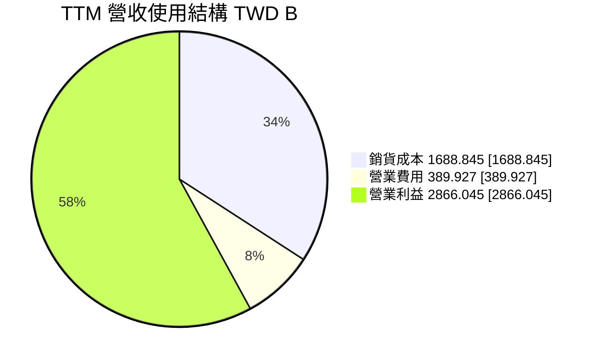

╔══════════════════════════════════════════════════════════════════╗  
║  TTM 營收結構（TWD B）                                            ║  
╠══════════════════════════════════════════════════════════════════╣  
║  營收      4,944.817                                               ║  
║  毛利      3,255.972 ＝ 營收 − 銷貨成本                          ║  
║  營業利益  2,866.045 ＝ 毛利 − 營業費用                          ║  
║  差額營業費用 389.927                                             ║  
╚══════════════════════════════════════════════════════════════════╝

### 3.5 季度 EPS 趨勢與盈餘品質（Quality of Earnings）

| 盈餘品質項目 | 數值／佔比 | 評估 |
|--------------|-----------|------|
| 股權薪酬 SBC / 營收 | FY2025：TWD 1.25B ÷ TWD 3,809.054B = **0.033%** | 🟢 比重低；惟屬年度資料，非最新 TTM |
| SBC / 營業現金流 | FY2025：TWD 1.25B ÷ TWD 2,270B = **0.055%** | 🟢 對現金流影響小 |
| FCF / 淨利（現金轉換率） | TTM：TWD 1.46T ÷ TWD 2.528T = **57.8%** | 🟡 大額資本支出壓低 FCF 對淨利轉換 |
| 一次性／非經常性損益 | N/A | 無足夠明細判定 |
| 有效稅率異常 | DCF／資本成本採用最新年度有效稅率 17.0% | 🟡 缺少逐季稅項明細；無法確認是否有一次性稅務影響 |
| 資本化支出 vs 費用化 | TTM Capex TWD 1.67T；資本支出會以折舊逐期進入費用 | 🟡 重資產產業的正常會計處理；若資產回報不足，經濟成本仍會增加 |

季度 EPS 估值數據（EPS Est／EPS Act）為 NaN，故最近四季超預期／不及預期均無法判定。StockAnalysis 報列季度 EPS 年增：2025 Q4 34.97%、2026 Q1 58.38%、Q2 77.40%、Q3 68.73%；此為 EPS 成長，不是盈餘驚喜幅度。TTM FCF / 淨利約 57.8%，說明會計獲利尚未等比例轉成自由現金流，主要需要考慮資本支出。SBC 相對營收很低，短期稀釋不是主要獲利品質問題；核心監控仍是高額投資是否轉成未來產能利用及現金回收。

## 4. 資產負債表分析

### 4.1 資產結構分解

依 2026-09-30 StockAnalysis 資產負債表，總資產 TWD 10,052.888B，流動資產 TWD 5,084.925B，非流動資產差額 TWD 4,967.963B。

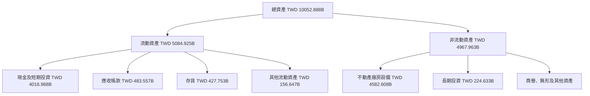

### 4.2 流動性與營運資金分析

| 指標 | 最新值 | 歷史值 | 評估 |
|------|-------:|-------:|------|
| 流動比率 | 2.584 | 2025 年末約 2.51（3,817.131 ÷ 1,520） | 🟢 |
| 速動比率 | 2.287 | N/A | 🟢 |
| 現金及短期投資 | TWD 4.02T | FY2025 TWD 3.07T | 🟢 |

| 指標 | 最新 TTM | 一年前 TTM | 變化 | 解讀 |
|------|----------:|------------:|------|------|
| DSO 應收帳款天數 | 1 天 | N/A | N/A | 品質指標所列天數；一年前資料未提供。極低讀數應核實資料口徑 |
| DIO 存貨天數 | 92 天 | N/A | N/A | 庫存占用需結合出貨與產品組合觀察 |
| DPO 應付帳款天數 | 91 天 | N/A | N/A | 反映付款週期；無前期數據不判斷議價變化 |
| CCC 現金轉換週期 | 2 天 | N/A | N/A | 按品質指標直接引用；未提供年度比較值 |

### 4.3 債務結構分析

╔══════════════════════════════════════════════════════════════════╗  
║                   TSMC 債務健康診斷                              ║  
╠══════════════════════════════════════════════════════════════════╣  
║  總債務：        TWD 1.07T                                         ║  
║  現金及短期投資：TWD 4.02T                                         ║  
║  淨現金：        TWD 2.95T   🟢                                   ║  
║  流動比率：      2.584       🟢                                   ║  
║  速動比率：      2.287       🟢                                   ║  
║  Debt/EBITDA：   N/A（財報幣別與市場資料幣別不同，未換算）        ║  
║  Interest Coverage：N/A（利息費用金額未提供）                     ║  
╚══════════════════════════════════════════════════════════════════╝

公司有淨現金緩衝，可降低融資壓力並支持資本支出；但不代表高額投資沒有回報風險。最新淨現金換算依財務資料所列匯率：TWD 2.95T ÷ 32.96 = 約 USD 89.43B。

### 4.4 股東權益趨勢

╔══════════════════════════════════════════════════════════════════╗  
║                   股東權益變化（TWD T）                           ║  
╠══════════════════════════════════════════════════════════════════╣  
║  FY2022  2.90  ████████████░░░░░░░░                              ║  
║  FY2023  3.43  ██████████████░░░░░░                              ║  
║  FY2024  4.24  █████████████████░░░                              ║  
║  FY2025  5.36  ████████████████████                              ║  
╚══════════════════════════════════════════════════════════════════╝

FY2022–FY2025 股東權益逐年增加，與持續獲利及保留盈餘累積相符。股東權益增長不等同每股價值增長，仍需將資本回報與新增股數、資本投資效率一併監控。

## 5. 現金流量深度分析

### 5.1 現金流量瀑布圖

年度 FCF 與股息有來源數據，但回購及淨現金變化沒有一致可用的完整流量資料，故不以虛構數值連接。

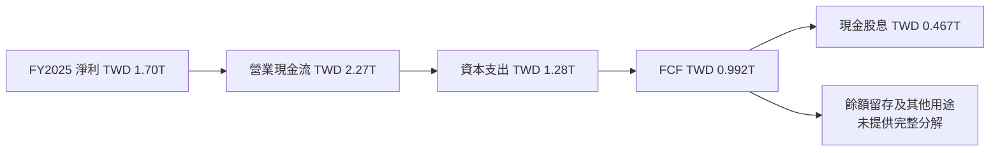

### 5.2 FCF 轉換率趨勢

| 年度 | FCF（TWD B） | 淨利（TWD B） | FCF / 淨利 |
|------|-------------:|--------------:|-----------:|
| 2022 | 520.97 | 992.92 | 52.5% |
| 2023 | 286.57 | 851.74 | 33.6% |
| 2024 | 861.20 | 1,158.38 | 74.3% |
| 2025 | 992.38 | 1,697.60 | 58.5% |

2023 轉換率降至 33.6%，2024 回升至 74.3%，2025 因資本支出上升及獲利增長的相對速度而降至 58.5%。TTM FCF／淨利約 57.8%。

### 5.3 自由現金流趨勢

╔══════════════════════════════════════════════════════════════════╗  
║                   自由現金流趨勢（年度，TWD B）                   ║  
╠══════════════════════════════════════════════════════════════════╣  
║  FY2022  520.97  ██████████░░░░░░░░░░                            ║  
║  FY2023  286.57  ██████░░░░░░░░░░░░░░                            ║  
║  FY2024  861.20  █████████████████░░░                            ║  
║  FY2025  992.38  ████████████████████                             ║  
║  TTM     1,460.00（約）                                           ║  
║  TTM FCF Yield：2.68%                                             ║  
╚══════════════════════════════════════════════════════════════════╝

TTM FCF 按 OCF − Capex 定義為 TWD 1.46T（約 USD 44.23B）。TTM FCF Yield 為 2.68%，顯示現價估值仍要求後續獲利與現金流增長來支撐。

### 5.4 資本配置評估

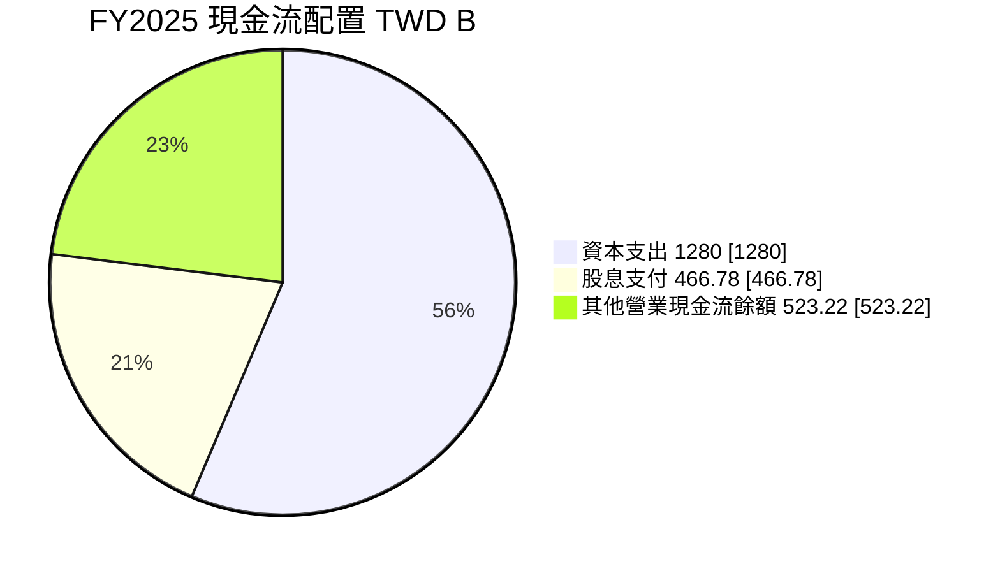

| 項目 | FY2025 金額 | 評估 |
|------|------------:|------|
| 營業現金流 | TWD 2.27T | 提供資本支出與股息的主要資金 |
| 資本支出 | TWD 1.28T | 佔營業現金流約 56.4%；支持產能但提高投資回收要求 |
| 股息支付 | TWD 466.78B | 約為 FCF 的 47.0% |
| 股票回購 | N/A | 資料未提供 |
| 留存及其他用途 | 無法完整拆分 | 不能將現金流差額直接認定為單一資本配置項目 |

上圖「其他營業現金流餘額」為營業現金流扣除資本支出與股息後的算術差額，不代表完整的現金資金用途或資產負債表現金變化。

## 6. 獲利能力與資本效率

### 6.1 ROE / ROA / ROIC 趨勢

| 指標 | 最新可用值 | 歷史參考 | 評估 |
|------|-----------:|----------|------|
| ROE | TTM 41.9% | FY2025 約 31.7%（淨利 ÷ 年末權益） | 🟢 |
| ROA | TTM 20.6% | FY2025 約 21.4%（淨利 ÷ 年末資產） | 🟢 |
| ROIC | 最新 TTM N/A | Roic.ai 2018 年 Return on Capital 20.61% | 🟡 歷史值高於 WACC，但年份較早 |
| Piotroski F-Score | N/A | 需要兩個相隔一年的 TTM SEC 申報資料 | 🟡 |

行業均值資料未提供，故不列比較欄。ROIC 的當期 NOPAT 與投入資本計算所需項目不完整，不以歷史值冒充當期 ROIC。

### 6.2 ROIC vs WACC 分析（核心價值創造判斷）

╔══════════════════════════════════════════════════════════════════╗  
║                ROIC vs WACC 深度分析                            ║  
╠══════════════════════════════════════════════════════════════════╣  
║  WACC（程式提供）：10.50%                                        ║  
║  ├── 無風險利率：4.91%                                           ║  
║  ├── ERP：5.00%                                                  ║  
║  ├── 原始 Beta：1.23；調整後 Beta：1.16                          ║  
║  ├── 股權成本：10.69%（直接引用資本成本數據）                    ║  
║  ├── 稅前債務成本：1.16%；有效稅率：17.0%                        ║  
║  ├── E / D 權重：98.1% / 1.9%                                    ║  
║  └── ✅ WACC：10.50%                                             ║  
║                                                                  ║  
║  ROIC：最新 TTM N/A；可用歷史參考為 2018 年 20.61%               ║  
║  歷史參考利差：20.61% − 10.50% = +10.11 個百分點                 ║  
║  判斷：歷史資料支持曾創造價值；當期 ROIC 缺漏，不能確認現況      ║  
╚══════════════════════════════════════════════════════════════════╝

資本成本輸入以資料所列數字為準。需要注意，提供的 Rf、Beta 與 ERP 直接代入 CAPM 得 4.91% + 1.16 × 5.00% = 10.71%，而資料列示股權成本為 10.69%；此處保留提供的成本資本數值，視為輸入精度／口徑差異，不另改 WACC。歷史 ROIC 高於 WACC 的幅度是歷史訊號，不是最新 TTM 價值創造的證明。

### 6.3 杜邦三因素分解

N/A（數據未提供：品質指標所需的同口徑淨利率、營收、總資產與正股東權益組合資料缺漏；因此不重算或補列杜邦項目。）

### 6.4 財務體質：Piotroski F-Score

N/A（缺少相隔一年的兩個 TTM SEC 申報資料；九項測試結果亦未提供，故不推估分數或逐項填列。）

## 7. 相對估值分析

### 7.1 同業估值比較表格

| 估值指標 | **TSM** | **INTC** | **UMC** | **GFS** | TSM 評估 |
|----------|--------:|---------:|--------:|-------:|-----------|
| **Trailing P/E** | 20.66x | N/A | 11.4x | 101.6x | 🟡 GFS 倍數受低獲利基數影響較大 |
| **Forward P/E** | 13.63x | 28.6x | 13.4x | 13.7x | 🟢 接近同業中位數 13.7x |
| **P/S（TTM）** | N/A | 4.6x | N/A | 2.8x | N/A（跨幣別口徑不適合直接比較） |
| **EV/EBITDA（TTM）** | N/A | 14.9x | N/A | 9.5x | N/A（公司口徑跨幣別） |
| **最新一季營收 YoY** | 50.9% | 20.9% | 25.6% | 12.5% | 🟢 高於三家同業 |
| **毛利率（TTM）** | 65.8% | 40.2% | 31.7% | 28.5% | 🟢 高於同業 |

同業數值均依 Yahoo Finance Peer multiples。Forward P/E 中位數為 13.7x；INTC 的 TTM P/E 為 N/A，按資料不替代。TSM 的美元報價與新台幣財報使部分估值比率被標為 N/A，故不自行進行跨幣別計算。

### 7.2 歷史估值區間分析

N/A（數據未提供：沒有可引用的「Valuation vs own history」估值歷史區間資料，故不推算百分位或區間位置。）

### 7.3 情境價值（Bear / Base / Bull，照抄 DCF MODEL 的 Scenarios）

| 情境 | 第 1 年營收成長 | 期末營業利潤率 | WACC | 每股價值 | 相對現價 | 機率 | 會發生的條件 |
|------|----------------:|----------------:|-----:|---------:|---------:|------:|--------------|
| 🔴 悲觀 | 15.0% | 42.1% | 11.50% | $188.00 | -41.0% | 25% | AI／先進製程需求放緩、價格與產品組合不利，投資資產利用率低於預期 |
| 🟡 基準 | 30.0% | 49.5% | 10.50% | $443.03 | +39.0% | 50% | 近期增長可延續一段時間，長期利潤率逐步回落 |
| 🟢 樂觀 | 45.0% | 54.5% | 9.50% | $988.52 | +210.2% | 25% | 高成長超預期、利潤率維持高位且折現率下降 |

情境表的數值與假設直接引用 DCF 模型輸出。沒有情境逐年收入、Capex、折舊與 FCFF 明細，故不另造各情境 FY+N 現金流推導鏈。機率加權值 $515.64 僅作情境參考；第 8.8 節加權估值採用基準 DCF 值 $443.03。

### 7.4 相對估值隱含價格區間

╔══════════════════════════════════════════════════════════════════╗  
║            同業估值方法回推之每股價值（美元）                    ║  
╠══════════════════════════════════════════════════════════════════╣  
║  同業 EV/EBITDA     $275.39  ── 現價 $318.71 ── Forward P/E $319.89║  
║  DCF 基準           $443.03                                       ║  
║  分析師共識目標價   $586.69                                       ║  
╚══════════════════════════════════════════════════════════════════╝

| 方法 | 每股價值 | 依據 |
|------|---------:|------|
| 同業 Forward P/E | $319.89 | INTC、UMC、GFS 同業中位數 13.7x × TSM Forward EPS 23.39 |
| 同業 EV/EBITDA | $275.39 | INTC、GFS 中位數 12.2x × TTM EBITDA，再加淨現金 |
| 分析師共識 | $586.69 | 20 位分析師平均目標價；作為參考而非單一估值錨 |

同業 EV/EBITDA 僅使用有可比數據的 INTC、GFS，沒有以 TSM 自身目前倍數替代同業倍數。

## 8. DCF 內在價值評估（Discounted Cash Flow）

> 以下 DCF 數值依程式模型原值引用，不自行改格或重建模型。該模型的部分列示算式與結果存在小幅不一致，詳見 8.10；因此估值作為模型輸出使用，複算信心需折減。

### 8.0 估值推理鏈（Thinking Logic）

**Step 1 — 價值來源與主導變數**

TSMC 的模型價值主要由既有晶圓製造現金流底盤（TTM 營收 TWD 4,944.82B；公司業務營收占比拆分未提供）、封裝測試等相關業務，以及未來製程／產能成長選擇權構成；分部營收比例無資料，不能把後兩項量化成獨立價值。模型敏感度矩陣顯示 WACC 變化對價值影響顯著，終值亦佔 EV 61.0%，故長期折現率與成長率是最主導估值的變數。

**Step 2 — 模型選擇**

| 決策點 | 本報告採用 | 理由 | 曾考慮但否決 | 否決理由 |
|--------|-----------|------|--------------|----------|
| 現金流定義 | FCFF | 對應 WACC 折現並推得 EV | FCFE | 模型已提供 FCFF 及淨現金橋接 |
| 預測期 N | 10 年 | 依指定模型，收入成長逐年由 30.0% 減至 3.0% | 5 年 | 模型輸出固定為 10 年，不自行改動 |
| 終值方法 | Gordon Growth | 模型提供 g = 3.0% 與終值輸出 | 退出倍數 | DCF 模型沒有提供退出倍數終值，不補造 |
| EBIT 基礎 | GAAP EBIT | 模型註明 SBC 已包含於 GAAP EBIT | 非 GAAP EBIT | 避免加回 SBC 後又漏扣其經濟成本 |

**Step 3 — 關鍵假設四段式推導**

- **預測期 N**：錨點＝模型預測 10 年，且 DCF 明確列 FY+1 至 FY+10 → 調整＝不調整模型年數，讓成長率與利潤率逐步淡出 → **採用 10 年** → 曾考慮 5 年，否決理由是會改變程式提供的預測現值及終值起算年。
- **營收成長**：錨點＝最新一季 YoY 50.9%，但 TTM 成長率 N/A → 調整＝基期單季增長不可直接延伸，模型將成長封頂並由 30.0% 線性降至 3.0% → **採用年 1 成長 30.0%、年 10 成長 3.0%** → 曾考慮直接採最新一季 50.9%，否決理由是會把單季增速當作全年長期趨勢。
- **期末營業利潤率**：錨點＝TTM 營業利益率 58.0%；過去五年中位數由模型指定為 49.5% → 調整＝考慮利潤率回歸歷史中位數 → **採用 FY+10 49.5%** → 曾考慮維持 58.0%，否決理由是未充分反映長期競爭與成本變化。
- **Capex／營收**：錨點＝TTM 33.8% → 調整＝模型逐步淡化至 FY+10 的 16.6%，並按模型規則與 D&A 關聯 → **採用 33.8% 至 16.6%** → 曾考慮固定 TTM 33.8%，否決理由是十年期不假設投資強度永遠維持現況。
- **永續成長率 g**：錨點＝模型選取 3.0% → 調整＝假設成熟企業長期成長放緩，且低於 WACC 10.50% → **採用 3.0%** → 曾考慮更高 g，否決理由是會增加終值比重及敏感性。
- **WACC**：錨點＝資本成本資料列示 10.50% → 調整＝依該輸入直接採用，避免另建折現率 → **採用 10.50%** → 曾考慮以最新新聞風險另加溢酬，否決理由是沒有可量化、經核實的新增資本成本輸入。
- **GAAP EBIT、SBC 與股數**：錨點＝模型註明 GAAP EBIT，SBC 已作費用處理，固定股數、不另稀釋 → 調整＝依模型組合 A 執行 → **採用 (A)** → 否決額外扣 SBC 或再加稀釋，避免同一成本重複計入。
- **稅率與 D&A**：錨點＝有效稅率 17.0%；D&A／營收 TTM 15.1% → **模型採用 17.0% 與 15.1%**；營運資金不建模，按原模型處理。

**Step 4 — 最脆弱環節**

最脆弱環節是終值假設：終值現值佔 EV **61.0%**；若 WACC 上升或 g 下降，內在價值會顯著下修，方向與 8.6 敏感度矩陣一致。

**Step 5 — 計算路徑**

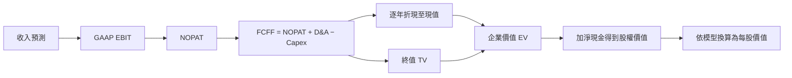

### 8.1 模型假設總表（Model Inputs）

| 假設項目 | 採用值 | 依據／來源 | 敏感度 |
|----------|-------:|-------------|--------|
| 預測期長度 N | 10 年 | 模型預測表 FY+1 至 FY+10 | 🟡 中 |
| 營收成長 | 年 1 30.0% → 年 10 3.0% | 年 1 參考最新單季 YoY 50.9%，並封頂；線性淡出 | 🔴 高 |
| 營業利潤率 | 58.0% → 49.5% | TTM 營業利益率與過去五年中位數 | 🔴 高 |
| 有效稅率 | 17.0% | 最新年度有效稅率 | 🟢 低 |
| Capex／營收 | 33.8% → 16.6% | TTM 33.8%，模型淡化至 1.1 × D&A 的規則水準 | 🔴 高 |
| D&A／營收 | 15.1% | TTM 比率，模型固定 | 🟢 低 |
| 營運資金變動 | 不建模 | DCF 模型明示 working capital is not modelled | 🟡 中 |
| EBIT 基礎 | GAAP | DCF 模型註明 GAAP EBIT | 🟡 中 |
| SBC 處理 | 組合 (A)：不另扣 SBC | GAAP EBIT 已將 SBC 作費用處理 | 🟡 中 |
| 年稀釋率 | 0%／固定股數 | 模型指定股數不另稀釋；稀釋股數絕對值未提供 | 🟡 中 |
| 永續成長率 g | 3.0% | 模型指定；低於 WACC | 🔴 高 |
| 終值方法 | Gordon Growth | 模型所列終值方式 | 🔴 高 |
| WACC | 10.50% | 資本成本數據及 DCF 模型 | 🔴 高 |

**FCFF 定義**：依模型採用 `FCFF = NOPAT + D&A − Capex`；營運資金未建模。**本模型採用 (A)，故 SBC 影響已計入一次**：使用 GAAP EBIT、不另扣 SBC，股數不再按年稀釋。

### 8.2 折現率推導（WACC）

╔══════════════════════════════════════════════════════════════════╗  
║                    WACC 推導（折現率）                           ║  
╠══════════════════════════════════════════════════════════════════╣  
║  股權成本 Ke：資料列示 10.69%                                     ║  
║  ├── 無風險利率 Rf：4.91%                                        ║  
║  ├── ERP：5.00%                                                   ║  
║  ├── 原始 Beta：1.23；調整後 Beta：1.16                          ║  
║  ├── Beta 調整：⅔ × 1.23 + ⅓ × 1 = 1.153，列示為 1.16           ║  
║  └── 資料列示 Ke：10.69%；按已四捨五入輸入直接代入為 10.71%       ║  
║                                                                  ║  
║  債務成本 Kd：                                                   ║  
║  ├── 稅前 Kd：1.16%（資料列示；利息金額未提供）                  ║  
║  ├── 稅率：17.0%                                                  ║  
║  └── 稅後 Kd：1.16% × (1 − 17.0%) = 0.9628%                      ║  
║                                                                  ║  
║  資本結構：股權權重 98.1%；債務權重 1.9%                         ║  
║  ✅ WACC：10.50%（模型及資本成本資料採用值）                      ║  
╚══════════════════════════════════════════════════════════════════╝

**五步演算與輸入限制**

1. Ke 依資料列示為 **10.69%**；用顯示精度輸入重算：4.91% + 1.16 × 5.00% = 10.71%。這是來源四捨五入／口徑差異，本報告不替換已列示 Ke。
2. 稅前 Kd 直接引用 **1.16%**；利息費用金額及平均計息負債額未提供，不能重建分子與分母。
3. 稅後 Kd = 1.16% × (1 − 17.0%) = **0.9628%**。
4. 資本結構權重直接引用：E = **98.1%**，D = **1.9%**，合計 100.0%。市場市值與匯率口徑存在資料內部不一致，故不以其他欄位重算權重。
5. 採用 WACC = **10.50%**（程式資本成本輸出）。以顯示值計算 98.1% × 10.69% + 1.9% × 0.9628% 約為 10.52%，差異源於輸入精度／口徑；保持模型採用值以符合 DCF 輸入。

本節與 6.2 節均採用 **10.50%**。

### 8.3 逐年自由現金流預測（基準情境）

金額單位：TWD B；折現因子引用模型。模型沒有營運資金變動列，因此不新增 ΔWC 預測。

| 年度 | FY+1 | FY+2 | FY+3 | FY+4 | FY+5 | FY+6 | FY+7 | FY+8 | FY+9 | FY+10 |
|------|-----:|-----:|-----:|-----:|-----:|-----:|-----:|-----:|-----:|------:|
| 營收 | 6,428.26 | 8,163.89 | 10,123.23 | 12,249.11 | 14,453.94 | 16,622.04 | 18,616.68 | 20,292.18 | 21,509.71 | 22,155.00 |
| 營收 YoY | 30.0% | 27.0% | 24.0% | 21.0% | 18.0% | 15.0% | 12.0% | 9.0% | 6.0% | 3.0% |
| 營業利潤率 | 58.0% | 57.0% | 56.1% | 55.2% | 54.2% | 53.3% | 52.3% | 51.4% | 50.5% | 49.5% |
| EBIT | 3,726.88 | 4,656.49 | 5,679.00 | 6,756.58 | 7,837.06 | 8,856.56 | 9,744.56 | 10,431.05 | 10,854.96 | 10,972.60 |
| 稅 | (632.56) | (790.34) | (963.90) | (1,146.79) | (1,330.18) | (1,503.22) | (1,653.94) | (1,770.46) | (1,842.41) | (1,862.38) |
| NOPAT | 3,094.32 | 3,866.14 | 4,715.10 | 5,609.79 | 6,506.88 | 7,353.34 | 8,090.62 | 8,660.59 | 9,012.55 | 9,110.22 |
| D&A | 970.20 | 1,232.15 | 1,527.86 | 1,848.72 | 2,181.48 | 2,508.71 | 2,809.75 | 3,062.63 | 3,246.39 | 3,343.78 |
| Capex | (2,171.05) | (2,601.47) | (3,032.68) | (3,435.84) | (3,778.51) | (4,028.15) | (4,156.32) | (4,143.23) | (3,981.42) | (3,678.16) |
| **FCFF** | **1,893.46** | **2,496.82** | **3,210.29** | **4,022.67** | **4,909.85** | **5,833.90** | **6,744.04** | **7,579.99** | **8,277.52** | **8,775.85** |
| 折現因子 | 0.905 | 0.819 | 0.741 | 0.671 | 0.607 | 0.549 | 0.497 | 0.450 | 0.407 | 0.368 |
| **FCFF 現值 PV** | **1,713.52** | **2,044.80** | **2,379.26** | **2,698.02** | **2,980.10** | **3,204.46** | **3,352.34** | **3,409.80** | **3,369.72** | **3,233.07** |

預測期 PV 加總完整算式：  
**1,713.52 + 2,044.80 + 2,379.26 + 2,698.02 + 2,980.10 + 3,204.46 + 3,352.34 + 3,409.80 + 3,369.72 + 3,233.07 = 28,385.09 TWD B**（依模型列示合計；各列四捨五入可能產生尾差）。

**FY+1 逐步演算示例**

1. 營收 = TTM 營收 4,944.82 × (1 + 30.0%) = **6,428.26 TWD B**（模型列示）。
2. EBIT：模型列示 **3,726.88 TWD B**。注意模型營收乘 58.0% 與列示 EBIT 存在小幅算術差異，詳見 8.10；不改寫模型值。
3. 稅 = 3,726.88 × 17.0% = **632.57 TWD B**，模型列示 632.56。
4. NOPAT = 3,726.88 − 632.56 = **3,094.32 TWD B**。
5. D&A = 模型列示 **970.20 TWD B**。
6. Capex = 模型列示 **2,171.05 TWD B**。
7. ΔWC = **不建模**（依 DCF 模型設定）。
8. FCFF = 3,094.32 + 970.20 − 2,171.05 = **1,893.47 TWD B**；模型列示 1,893.46。
9. PV = 模型列示 **1,713.52 TWD B**；以 1,893.46 × 0.905 計為 1,713.08，與模型列示亦有差異，源於折現因子僅列三位小數或模型內部精度不一致；數值照抄不重建。

合理性自檢：
- 預測 FCFF FY+1 至 FY+10 CAGR 約 **16.6%**（由 1,893.46 至 8,775.85，十年期含九個增長區間）；FY2022–FY2025 年度 FCF CAGR 約 **24.0%**。預測增速低於近期年度歷史起點，仍受成長及 Capex 淡化假設影響。
- FY+10 FCFF 利潤率 = 8,775.85 ÷ 22,155.00 = **39.6%**；目前 TTM FCF 利潤率約 44.23 ÷ 150.04 = **29.5%**。同業最佳 FCF 利潤率資料未提供。
- 預測期間各年 FCFF 均為正，並逐年增加。

╔══════════════════════════════════════════════════════════════════╗  
║               自由現金流：歷史實際 vs 模型預測                   ║  
╠══════════════════════════════════════════════════════════════════╣  
║  FY2023（實）  TWD 286.57B  ██████░░░░░░░░░░░░░░                 ║  
║  FY2024（實）  TWD 861.20B  █████████████████░░░                 ║  
║  FY2025（實）  TWD 992.38B  ████████████████████                 ║  
║  FY+1（預）    TWD 1,893.46B                                    ║  
║  FY+10（預）   TWD 8,775.85B                                    ║  
╠══════════════════════════════════════════════════════════════════╣  
║  歷史與預測 FCF 口徑及基期不同；十年預測依賴 Capex／營收下行。   ║  
╚══════════════════════════════════════════════════════════════════╝

### 8.4 終值計算（Terminal Value）

適用性檢查：**WACC 10.50% vs g 3.0% → WACC > g？✅**

| 方法 | 計算式（模型列示） | 終值 TV | TV 現值 | 佔總 EV 比重 |
|------|-------------------|--------:|--------:|-------------:|
| Gordon Growth | 8,775.85 × (1 + 3.0%) ÷ (10.50% − 3.0%) | 120,500.64 | 44,393.08 | 61.0% |
| 退出倍數法 | N/A（DCF 模型未提供退出倍數終值） | N/A | N/A | N/A |

模型列示終值推導：  
1. FY+10 FCFF = **8,775.85 TWD B**。  
2. 分子 = 8,775.85 × 1.03 = **9,039.13 TWD B**。  
3. 分母 = 10.50% − 3.0% = **7.50%**；模型列示 TV **120,500.64 TWD B**。  
4. PV(TV) = 模型列示 **44,393.08 TWD B**。  
5. TV 佔比 = 44,393.08 ÷ 72,778.16 = **61.0%**。

以顯示值直接計算第 3 步約為 120,521.67，而非 120,500.64；第 4 步的模型 PV 亦受折現因子內部精度影響。依要求保留程式模型輸出，並在 8.10 標記此算式鏈不能完全複算。

### 8.5 企業價值 → 每股內在價值（Bridge）

╔══════════════════════════════════════════════════════════════════╗  
║              企業價值 → 每股內在價值 橋接表                      ║  
╠══════════════════════════════════════════════════════════════════╣  
║  預測期 FCF 現值合計          +TWD 28,385.09B                     ║  
║  終值現值 PV(TV)              +TWD 44,393.08B                     ║  
║  = 企業價值 EV                  TWD 72,778.16B                    ║  
║  + 淨現金                     +TWD 2,947.23B                     ║  
║  = 股權價值                     TWD 75,725.39B                    ║  
║  每股內在價值（模型換算）       USD 443.03                        ║  
║  2026-11-20 收盤價              USD 318.71                        ║  
║  折溢價（現價÷DCF價值−1）       -28.1%（折價）                    ║  
╚══════════════════════════════════════════════════════════════════╝

橋接算式：
1. EV = 28,385.09 + 44,393.08 = **TWD 72,778.17B**；模型列示 **72,778.16B**，差額 0.01B。
2. 股權價值 = 72,778.16 + 2,947.23 = **TWD 75,725.39B**。
3. 每股內在價值：模型列示換算公式為「股權價值 × FX 0.0303435 USD per TWD × price ÷ market cap（in USD）」= **$443.03**。該換算使用程式模型，未提供可獨立核對的稀釋股數及相容市值口徑。
4. 折溢價 = 318.71 ÷ 443.03 − 1 = **-28.1%**。
5. 本節不計算 MOS；MOS 僅按 8.8 加權合理價值計算。

現金與債務橋接以模型合併提供的淨現金 TWD 2,947.23B；財報幣別換算使用提供匯率 1 USD = 32.96 TWD。模型每股轉換公式與市場股數、市值資料存在口徑疑點，需視為模型輸出而非獨立重建結果。

### 8.6 敏感性分析（WACC × 永續成長率）

| g（列）／WACC（欄） | 8.50% | 9.50% | **10.50%（基準）** | 11.50% | 12.50% |
|-----------|------:|------:|------------------:|------:|------:|
| 2.0% | $559.12 | $474.40 | $410.26 | $360.14 | $320.01 |
| 2.5% | $590.69 | $496.00 | $425.62 | $371.41 | $328.48 |
| 3.0% | $628.00 | $520.92 | **$443.03** | $384.00 | $337.83 |
| 3.5% | $672.77 | $549.99 | $462.93 | $398.17 | $348.23 |
| 4.0% | $727.48 | $584.34 | $485.89 | $414.22 | $359.85 |

基準格為 **g 3.0%、WACC 10.50%、$443.03**，與 DCF 基準價一致。矩陣直接照抄程式輸出；沒有提供其他格的逐年折現因子，故不另造重算軌跡。

**DCF 三情境（直接引用模型）**

| 情境 | 第 1 年成長 | 期末營業利潤率 | WACC | 每股內在價值 | 相對現價 | 機率 |
|------|------------:|---------------:|-----:|--------------:|---------:|-----:|
| 🔴 悲觀 | 15.0% | 42.1% | 11.50% | $188.00 | -41.0% | 25% |
| 🟡 基準 | 30.0% | 49.5% | 10.50% | $443.03 | +39.0% | 50% |
| 🟢 樂觀 | 45.0% | 54.5% | 9.50% | $988.52 | +210.2% | 25% |
| **機率加權** | — | — | — | **$515.64** | **+61.8%** | **100%** |

機率加權：188.00 × 25% + 443.03 × 50% + 988.52 × 25% = **515.645，模型列示 $515.64**。分項按顯示精度計算有 0.005 的尾差，使用程式模型列示值。

**敏感度結論（引用矩陣）**

- g 從 2.5% 升至 3.5%（WACC 10.50%）：$425.62 → $462.93，增加 **$37.31，約 +8.8%**（相對 $425.62）。
- WACC 從 10.50% 升至 11.50%（g 3.0%）：$443.03 → $384.00，下降 **$59.03，約 -13.3%**。
- 期末營業利潤率每 +1pp 的價值變動：N/A（敏感度數字未提供，不自行重建）。
- 因終值現值佔 EV 61.0%，折現率及永續成長假設對估值的影響均重要；與 8.0 Step 1 的判斷一致。

### 8.7 反推 DCF（Reverse DCF：市場在預期什麼）

固定基準其餘輸入：WACC 10.50%、稅率 17.0%、Capex 淡出假設、預測期 10 年、固定股數；工作資金不建模。模型只提供兩個單變數解，沒有提供可供完整疊代軌跡的試算點。

| 求解的變數（一次一個） | 其餘變數設定 | 市場隱含值（令 DCF = 現價） | 公司歷史實際 | 判斷 |
|------------------------|--------------|------------------------------|--------------|------|
| 第 1 年營收成長 | 其餘採基準假設 | 21.0% | 最新一季 YoY 50.9%；TTM 成長率 N/A | 🟡 現價隱含成長低於基準 30.0% |
| 固定營業利潤率 | 其餘採基準假設 | 38.0% | TTM 營業利益率 58.0% | 🟢 低於目前利潤率，但模型解法假設固定利潤率 |

模型輸出另列「營收增長率」及「固定營業利潤率」兩個單變數反推值，並非同時求解。高成長持續年數與永續成長率的反推均未計算，不能添加。反推提示市場價格並未要求基準情境的 30.0% 第一年成長，但反推結果仍依賴其他模型假設。

### 8.8 估值三角驗證與安全邊際

| 估值方法 | 隱含每股價值 | 上行空間（÷現價） | 權重 | 說明 |
|----------|--------------:|-------------------:|-----:|------|
| DCF（基準） | $443.03 | +39.0% | 40% | 10 年 FCFF、WACC 10.50%、g 3.0% |
| 同業 Forward P/E | $319.89 | +0.4% | 25% | 同業中位數 13.7x × Forward EPS 23.39 |
| 同業 EV/EBITDA | $275.39 | -13.6% | 25% | INTC、GFS 中位數 12.2x，並加回淨現金 |
| 分析師共識目標價 | $586.69 | +84.1% | 10% | 20 位分析師平均目標價 |
| **加權合理價值** | **$384.70** | **+20.7%** | **100%** | 可獲利公司類型固定權重 |

加權計算：  
**$443.03 × 40% + $319.89 × 25% + $275.39 × 25% + $586.69 × 10%**  
= $177.212 + $79.9725 + $68.8475 + $58.669  
= **$384.701，列示 $384.70**。

權重對應可獲利公司類型；沒有其他方法被加入。各方法保留兩位小數時，權重總和與未四捨五入金額可能出現小幅尾差。

╔══════════════════════════════════════════════════════════════════╗  
║                  估值區間與安全邊際                              ║  
╠══════════════════════════════════════════════════════════════════╣  
║  $188.00 ─── $318.71 ─── [$384.70] ─── $443.03 ─── $988.52      ║  
║  悲觀DCF       現價        加權合理值       基準DCF       樂觀DCF ║  
║                                                                  ║  
║  MOS = ($384.70 − $318.71) ÷ $384.70 = +17.2%                   ║  
║  MOS 評估：🟡 有限                                               ║  
║  上行空間 = ($384.70 − $318.71) ÷ $318.71 = +20.7%              ║  
║  建議買入區間：$318.71–$346.23（對應 MOS 約至少 10%）            ║  
║  合理持有參考：$346.23–$384.70                                   ║  
║  減碼考慮：高於 $988.52 需重新評估樂觀情境是否已充分反映         ║  
╚══════════════════════════════════════════════════════════════════╝

買入區間上限依加權合理價值的 90% 計算：$384.70 × 90% = **$346.23**；此為以 MOS 門檻換算的區間，不是額外估值方法。

> 🔎 **程式複算（Python，依本節各項自動重算）**
>
> 加權合理價值 = $443.03 × 40% + $319.89 × 25% + $275.39 × 25% + $586.69 × 10% = **$384.70**（權重合計 100%）
>
> 以價格 $318.71 計：MOS = **+17.2%**，上行空間 = **+20.7%**
>
> ✅ 與本節所寫數值一致。

### 8.9 DCF 模型的局限與失效條件

- **終值依賴度**：終值現值佔 EV **61.0%**，估值超過一半取決於 FY+10 後的假設。
- **最脆弱假設**：WACC、g 及資本支出淡出。矩陣顯示 g 3.0%、WACC 從 10.50% 上升到 11.50%，每股價值由 $443.03 降至 $384.00。
- **現金流特性**：公司 FCF 為正，但 TTM Capex TWD 1.67T，仍屬高再投資業務；若投資回收慢於預期，應提高相對估值方法權重的判斷重要性，但本報告依規定不調整固定權重。
- **模型可稽核性限制**：股數／幣別換算公式、部分終值與折現算式不完全相符，降低單一 DCF 數字的精確度。
- **與第 10 章風險連結**：地緣政治及出口限制可壓低營收成長；AI需求放緩會打擊增長和利潤率；產能投資回報不佳會推高 Capex／營收並削弱 FCFF。

### 8.10 複算檢核表（Audit Trail）

| # | 檢核項目 | 檢查方式 | 結果 |
|---|----------|----------|------|
| 1 | 高／中敏感度輸入有推導 | 對照 8.0、8.1 | ✅ |
| 2 | 每項假設有來歷 | 檢查 8.1 依據欄 | ✅ |
| 3 | WACC 五步及加權相乘相加 | 來源 Ke 與已顯示輸入有 0.02pp 口徑差異，採用提供 WACC | ⚠️ |
| 4 | Kd 分母與權重 D 同範圍 | 利息額、平均負債及期末 D 明細未提供 | ⚠️ |
| 5 | WACC 與第 6.2 節相同 | 均採用 10.50% | ✅ |
| 6 | 逐年表格等於 N 且無省略 | FY+1 至 FY+10 共 10 年 | ✅ |
| 7 | FY+1 算式可複算 | EBIT、稅、FCFF、PV 有小額差異 | ❌ |
| 8 | 預測 PV 加總與合計 | 模型合計 28,385.09；列示年度四捨五入有尾差 | ⚠️ |
| 9 | WACC > g | 10.50% > 3.0% | ✅ |
| 10 | 終值以 FY+N 現金流折現 N 期 | 模型列示 FY+10；算術重建有差異 | ⚠️ |
| 11 | 橋接可複算 | EV 加總有 0.01B 差異；每股轉換缺乏可核對股數 | ⚠️ |
| 12 | SBC 組合相容 | GAAP EBIT、無 SBC 列、固定股數，組合 A | ✅ |
| 13 | 矩陣基準格等於 DCF 基準價 | 均為 $443.03 | ✅ |
| 14 | 矩陣格有效性 | 表列 WACC 均高於 g | ✅ |
| 15 | 三情境機率及加權值 | 25% + 50% + 25% = 100%；顯示值有 0.005 尾差 | ⚠️ |
| 16 | 反推一次放開一個變數 | 只列模型已解出的兩項 | ✅ |
| 17 | MOS 分母及折溢價基準 | MOS 用 $384.70；折溢價用 DCF $443.03 | ✅ |
| 18 | 報告涵蓋至第 11 章 | 章節完整 | ✅ |
| 19 | 加權合理價值等於方法加權和 | 未四捨五入約 $384.701，列示 $384.70 | ✅ |
| 20 | 評級符合 MOS 門檻 | MOS +17.2% 對應買入，未調整 | ✅ |

未能完全複算的數值不予自行修改，均以模型原值引用並降低 DCF 精確度信心；其中主要差異包括 FY+1 EBIT／FCFF 與顯示折現因子、終值算式、橋接尾差及每股幣別換算資訊不足。

## 9. 成長催化劑

### 9.1 催化劑時間軸

由於未提供公司未來正式產能、節點或產品上市日期，以下只標示觀察期間，不代表公司已承諾的時程。

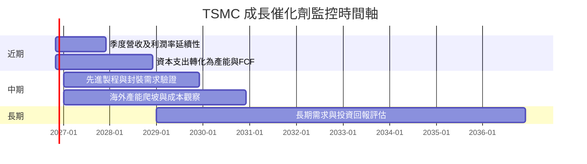

### 9.2 TAM 市場規模分析

N/A（TAM 數據未提供）。TSMC TTM 營收 TWD 4.94T，最新一季年增 50.9%，顯示當前業務規模與短期增長動能；但缺少可引用的市場規模及滲透率資料，不能從營收自行反推出 TAM。

### 9.3 成長驅動力結構圖

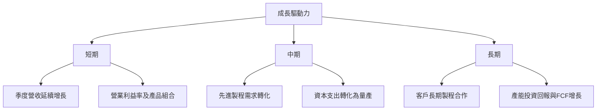

短期驗證點是最新一季營收年增 50.9% 能否延續，且營業利益率能否維持接近 58.0%。中長期重點不是單純增加設備投資，而是新增產能能否提升營業現金流與 FCF。

## 10. 風險矩陣

### 10.1 風險評分矩陣

以下為分析師的定性風險評估，不是財務資料庫提供的量化機率；圖中座標僅表達相對排序。

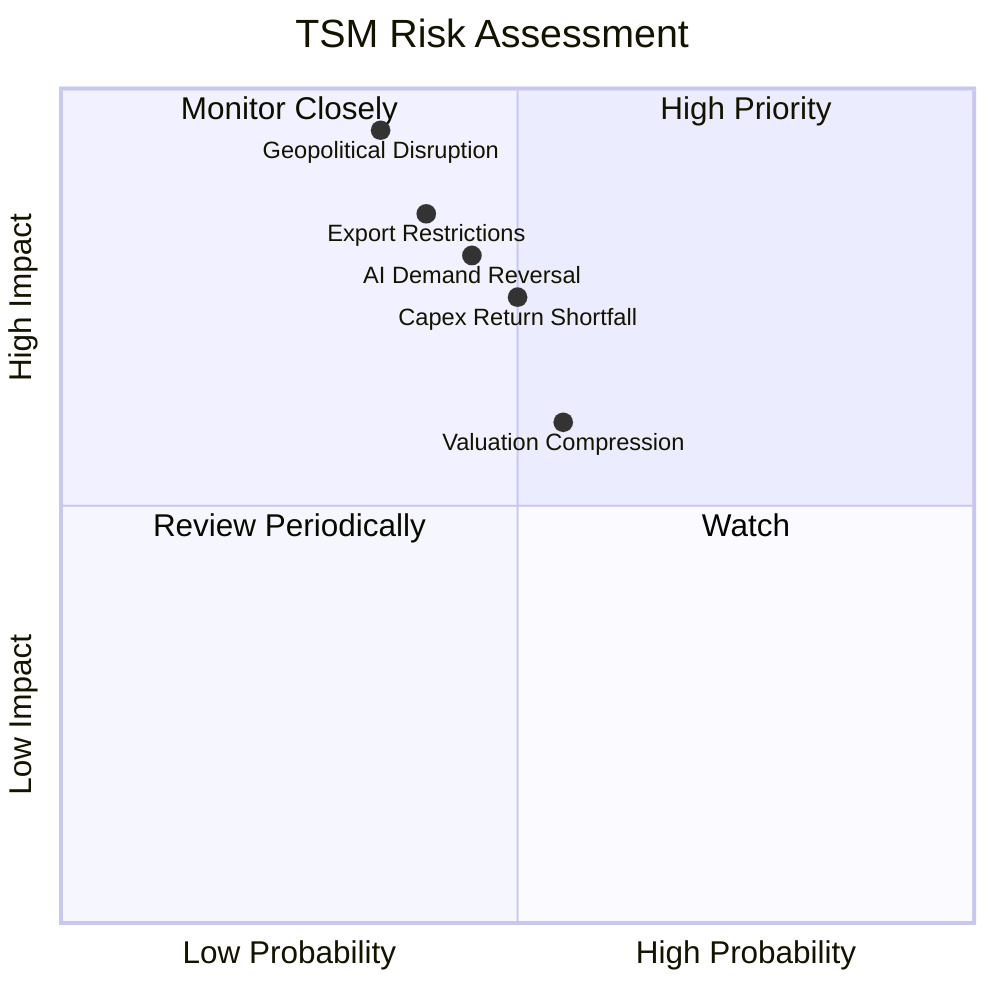

### 10.2 風險清單詳細分析

| # | 風險項目 | 發生機率 | 財務衝擊 | 風險評分 | 緩解措施 |
|---|----------|----------|----------|----------|----------|
| 1 | 🔴 地緣政治與台海供應風險 | 中；無可靠精確概率 | 高，可能影響生產、交付與資本成本 | 🔴 高衝擊 | 追蹤產能地理分布、客戶庫存、交期及供應鏈備援；財務數據未提供量化損失 |
| 2 | 🔴 出口限制與客戶准入 | 中 | 高，可能限制特定市場出貨與產品組合 | 🔴 高衝擊 | 觀察政策變化及受限制產品的銷售曝險；最新新聞指出對中先進晶片出貨受到限制 |
| 3 | 🟡 AI／高階晶片需求反轉 | 中 | 高，模型第一年營收成長基準 30.0%；低於此值會壓低 DCF | 🔴 高 |
| 4 | 🟡 資本支出回報低於預期 | 中 | 高；TTM Capex TWD 1.67T，約 TTM 營收 33.8% | 🔴 高 | 追蹤 Capex、營業現金流、FCF、產能利用及利潤率 |
| 5 | 🟡 估值與利率風險 | 中 | 中高；WACC 上升 1pp 時模型價值由 $443.03 降至 $384.00 | 🟡 中高 | 用加權合理價值與 MOS 控制買入價格，不以單一 DCF 點估值決策 |

## 11. 投資建議

### 11.1 最終評級與評分

依 8.8 加權合理價值 $384.70 與現價 $318.71 計算，MOS 為 **17.2%**，依評級門檻為 **買入**，沒有進行質化升降級。公司綜合評分引用 1.1 的 **8.2/10**；六項分數為成長性 9.0、獲利能力 9.0、財務健康 9.0、估值 6.0、護城河 9.0、管理層與資本配置 7.0。

### 11.2 合理價值與隱含報酬率

| 價值參考 | 每股價值 | 相對現價 | 機率／權重 |
|----------|---------:|---------:|-----------:|
| 加權合理價值 | $384.70 | +20.7% | 固定估值權重 |
| 🔴 悲觀 DCF 情境 | $188.00 | -41.0% | 25% |
| 🟡 基準 DCF 情境 | $443.03 | +39.0% | 50% |
| 🟢 樂觀 DCF 情境 | $988.52 | +210.2% | 25% |
| DCF 情境機率加權參考 | $515.64 | +61.8% | 100% |

情境的上行／下行幅度均相對 2026-11-20 收盤價 $318.71。加權合理價值採用 8.8，不以 DCF 機率加權值替代。

### 11.3 買入時機與觸發因素

╔══════════════════════════════════════════════════════════════════╗  
║                  ✅ 買入觸發因素 Checklist                      ║  
╠══════════════════════════════════════════════════════════════════╣  
║  立即買入觸發條件（多數符合）：                                  ║  
║  ✅ 股價不高於加權合理價值 MOS 10% 對應價格 $346.23              ║  
║  ✅ 最新一季營收年增保持正成長，營業利益率維持高於 50%           ║  
║  ✅ TTM FCF 維持正值，且 Capex 未持續快於營業現金流成長          ║  
║                                                                  ║  
║  加碼觸發條件（出現以下任一）：                                  ║  
║  ☐ 股價低於 $318.71 且基本面未出現營收或利潤率惡化              ║  
║  ☐ FCF 增長、資本支出轉化及產品組合改善獲連續季度驗證            ║  
║                                                                  ║  
║  減碼／重新評估觸發條件（出現以下任一）：                        ║  
║  ☐ 連續兩季營收年增低於 15%                                     ║  
║  ☐ 營業利益率低於 45% 並持續兩季                                ║  
║  ☐ TTM FCF 轉負或 ROIC 低於 WACC（須取得可比口徑 ROIC）          ║  
║  ☐ 台海／出口管制事件造成可驗證的產能或出貨重大中斷              ║  
╚══════════════════════════════════════════════════════════════════╝

上述監控門檻為分析框架而非公司財測；若踩線，應重新檢視需求、產能利用率和估值，而不是只按單一季度數據自動交易。

### 11.4 投資人適配度分析

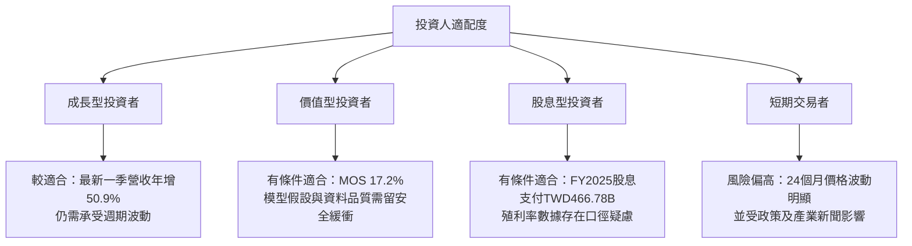

資料中的 Dividend Yield **118.0%** 與常見股息殖利率口徑顯著不協調，不能據此判斷股息型投資適配度；此處以現金股息支付金額作歷史參考，不把錯誤風險數值當作可靠收益率。

### 11.5 每季財報監控清單（Quarterly Watch List）

| 監控指標 | 目前參考 | 加碼觀察條件 | 減碼／重新估值條件 |
|----------|---------:|--------------|--------------------|
| 營收年增 | 2026 Q3：50.9% | 維持正成長，且季度營收持續擴大 | 連續兩季年增低於 15% |
| 營業利益率 | 最新季度 58.0% | 維持高於 50% | 連續兩季低於 45% |
| 資本支出 | TTM TWD 1.67T | 資本支出增加伴隨 OCF／FCF 增長 | Capex 持續上升而 FCF 下滑或轉負 |
| FCF | TTM TWD 1.46T | 保持正值並提高 FCF／淨利轉換 | TTM FCF 轉負 |
| 存貨天數 | DIO 92 天 | 隨營收增長維持穩定 | 存貨天數上升且營收年增轉弱 |
| 現金及短期投資 | TWD 4.02T | 維持淨現金 | 淨現金快速下降且伴隨投資回報惡化 |
| EPS | 最新季度 EPS 年增 68.73% | EPS 成長與營收、現金流一致 | 盈利成長與現金流長期背離 |
| EPS 盈餘驚喜 | 最新四季估值與實際值缺失 | 取得可靠分析師預估與實際值後追蹤 | 若連續低於預期，查明需求或利潤率原因 |
| AI／先進製程需求 | 分部資料未提供 | 財報或管理層披露可驗證的訂單、出貨或利用率 | 成長投資未帶動利用率、毛利率或現金流 |

### 11.6 反面論證：什麼會證明論點錯誤（What Would Change My Mind）

╔══════════════════════════════════════════════════════════════════╗  
║              ⚠️ 論點失效條件（Disconfirming Evidence）           ║  
╠══════════════════════════════════════════════════════════════════╣  
║  本投資論點在下列情況成立時應重新檢視或退出：                    ║  
║  ☐ 營收年增連續兩季低於 15%，顯示近期需求增長無法延續            ║  
║  ☐ 營業利益率連續兩季低於 45%，顯示組合或成本結構轉弱            ║  
║  ☐ TTM FCF 轉負，或 FCF／淨利持續低於 30%                        ║  
║  ☐ 以一致口徑重算的 ROIC 低於 WACC 10.50%                        ║  
║  ☐ Capex／營收長期維持約 33.8% 高位，而 FCF 未同步增長           ║  
║  ☐ 出口管制或地緣政治事件造成可量化、持續性的量產／出貨中斷      ║  
╚══════════════════════════════════════════════════════════════════╝

> **免責聲明**：本報告為 AI 自動生成，僅供研究參考，不構成投資建議。投資有風險，入市需謹慎。

---

## 資料與來源

| 項目 | 內容 |
|------|------|
| 價格 | 318.71 USD，2026-11-20 收盤（Yahoo Finance 日線） |
| 財務報表 | Yahoo quarterly statements (no SEC filing data)，最新季度 2026-09-30（TTM = four quarters to this date） |
| 有回應的資料來源 | Yahoo Finance、Finviz、StockAnalysis、Roic.ai |
| 未回應的資料來源 | SEC 申報資料 (XBRL) |
| 由程式計算 | TTM 數字、WACC、DCF 模型、估值方法與權重、加權合理價值、MOS、評級門檻、F-Score、杜邦分解、營運資金天數、綜合評分 |
| 撰寫模型 | openai / gpt-6-luna |

> 本區塊由產生報告的程式依實際取得的資料填寫，非模型撰寫。「由程式計算」的數字不是模型的估計；其餘判斷（評分、情境、策略）是模型的分析。
