# TSM 基本面深度分析報告
> **報告日期**：2026-11-24 ｜ **語言**：繁體中文 ｜ **數據來源**：Yahoo Finance、Finviz、StockAnalysis、Roic.ai ｜ **分析師**：CFA 級機構研究

## 目錄

| # | 章節 | 核心結論 |
|---|------|----------|
| 1 | 執行摘要 | 買入；加權合理價值 $406.10；MOS +10.5% |
| 2 | 公司概覽與商業模式 | 製程、規模與客戶轉換成本構成主要護城河；細分營收占比未提供 |
| 3 | 損益表深度分析 | TTM 營收 TWD 4.94T，最新一季年增 50.9%；TTM 營業利益率 58.0% |
| 4 | 資產負債表分析 | 淨現金 TWD 2.95T；最新 TTM 流動比率 2.584 |
| 5 | 現金流量深度分析 | TTM FCF TWD 1.46T，FCF Yield 2.35%；高資本支出是主要現金流變數 |
| 6 | 獲利能力與資本效率 | 目前 ROIC 未提供；Roic.ai 歷史 ROIC 19.11% 高於 WACC 10.53% |
| 7 | 相對估值分析 | 同業估值分歧大；DCF 情境區間 $187.35–$983.45 |
| 8 | DCF 內在價值評估 | DCF 基準值 $441.13；加權合理價值 $406.10；MOS +10.5% |
| 9 | 成長催化劑 | AI/HPC 需求、先進製程與封裝是質化催化因素；TAM 數據未提供 |
| 10 | 風險矩陣 | 地緣政治、資本支出回報與估值假設是主要風險 |
| 11 | 投資建議 | 買入；建議買入區間 $324.88–$365.49，並以季度指標驗證 |

---

## 1. 執行摘要

TSM 最新收盤價為 **2026-11-23 的 $363.60**。TTM 營收為 TWD 4.94T，最新一季營收年增 50.9%，TTM 營業利益率 58.0%，TTM FCF 為 TWD 1.46T、FCF Yield 2.35%。估值方面，DCF 基準每股價值 $441.13，但三角驗證後加權合理價值為 **$406.10**；依此計算 MOS 為 **+10.5%**，達到買入門檻。現有資料未提供可直接採用的 TTM ROIC，故不以單一歷史 ROIC 代替當前值；歷史 ROIC 資料仍顯示公司過往曾創造高於資本成本的回報。依 MOS 規則評級為 **買入**，未作質化調整。

### 1.0 一頁式投資儀表板（Portfolio Manager 30 秒速讀）

| 項目 | 內容 |
|------|------|
| **投資論點（3 句）** | ① TTM 營業利益率 58.0%，顯示先進製程與產品組合帶來高獲利能力。② 最新一季營收年增 50.9%，為當前增長動能提供佐證，但 TTM 營收年增率未提供。③ TTM FCF 為 TWD 1.46T、淨現金 TWD 2.95T，資本支出負擔高但資產負債表仍有緩衝。 |
| **綜合評分** | **8.4/10**（引用 1.1 評分卡） |
| **財務健康** | 🟢 現金與短期投資 TWD 4.02T、總債務 TWD 1.07T，淨現金 TWD 2.95T；流動比率 2.584 |
| **ROIC vs WACC** | 當前 TTM ROIC：N/A；WACC 10.53%。Roic.ai 歷史 ROIC（2018）19.11%，僅供歷史參考，不能替代當前 ROIC |
| **FCF 趨勢** | FY2023–FY2025 FCF 回升；最新 TTM FCF TWD 1.46T，FCF Yield 2.35% |
| **估值** | Forward P/E 15.55x ｜ EV/EBITDA N/A（幣別不一致）｜ FCF Yield 2.35% |
| **DCF 內在價值（基準）** | $441.13 ｜ 現價相對 DCF 折價 **17.6%** |
| **安全邊際（MOS）** | **+10.5%**＝($406.10 − $363.60) ÷ $406.10；🟡 有限 |
| **預期報酬（基準情境 12M）** | +21.3%（DCF 基準情境相對現價；非 12 個月保證報酬） |
| **關鍵風險（前二）** | 台灣地緣政治與營運中斷；高資本支出若未轉化為需求與現金流，估值承壓 |
| **評級 + 信心度** | 🟢 **買入** ｜ 信心：中（DCF 對終值敏感，且當前 ROIC 與 EPS surprise 資料不足） |

### 1.1 綜合評分卡（全報告唯一）

| 維度 | 評分（1–10） | 主要依據（引用數字與其來源章節） |
|------|--------------|----------------------------------|
| 成長性 | 9.0 | FY2025 營收年增 31.61%；最新一季年增 50.9%，但 TTM 成長率 N/A（第 3 章） |
| 獲利能力 | 9.0 | TTM 營業利益率 58.0%、毛利率 65.8%；當前 ROIC 與 Piotroski F-Score N/A（第 3、6 章） |
| 財務健康 | 9.0 | 淨現金 TWD 2.95T、流動比率 2.584、CCC 2 天（第 4 章） |
| 估值 | 6.5 | MOS +10.5%；同業 Forward P/E 比較與 DCF 情境顯示估值有不確定性（第 7、8 章） |
| 護城河 | 9.5 | 58.0% TTM 營業利益率及高額研發支出（FY2025 TWD 246.43B）支持製程與規模優勢；未提供市場份額數字（第 2 章） |
| 管理層與資本配置 | 7.5 | FY2025 FCF TWD 992.38B、股息支付 TWD 466.78B；回購與資本回報率的完整資料不足（第 5 章） |
| **綜合評分** | **8.4** | 六項算術平均＝(9.0 + 9.0 + 9.0 + 6.5 + 9.5 + 7.5) ÷ 6＝8.4167，四捨五入至一位小數 |

### 1.2 五大投資論點 + 三大核心風險

| 類型 | 項目 | 具體依據 | 信心度 |
|------|------|----------|--------|
| 🟢 **投資論點①** | 先進製程帶來獲利槓桿 | TTM 營業利益率 58.0%、毛利率 65.8%；最新一季營收年增 50.9%，如需求與良率支撐，固定成本吸收可延續 | 🟢 高 |
| 🟢 **投資論點②** | AI/HPC 需求提供增量 | 最近新聞以 AI 晶片需求、Nvidia 與半導體股行情為主；這是需求背景訊號，並非公司分部營收拆分 | 🟡 中 |
| 🟢 **投資論點③** | 淨現金支持擴產 | 淨現金 TWD 2.95T、TTM 營業現金流 TWD 3.13T；可支應高額資本支出與股息 | 🟢 高 |
| 🟢 **投資論點④** | 現金流規模足以支撐再投資 | TTM FCF TWD 1.46T；FY2025 FCF TWD 992.38B，資本支出後仍具可觀自由現金流 | 🟢 高 |
| 🟢 **投資論點⑤** | 估值仍有有限折價 | 加權合理價值 $406.10 高於現價 $363.60，MOS +10.5%；不足以稱為深度折價 | 🟡 中 |
| 🟡 **風險①** | 地緣政治與供應集中 | 台灣營運中斷可能同時影響產能、客戶交付與估值；財務資料無法量化其發生機率 | 🔴 高衝擊 |
| 🔴 **風險②** | 擴產報酬落後資本成本 | TTM 資本支出 TWD 1.67T，約為 TTM FCF 1.46T 的 1.14 倍；若新增產能利用率不佳，回報與現金流均受壓 | 🟡 中 |
| 🟡 **風險③** | DCF 對終值假設敏感 | 終值現值占企業價值 60.9%；WACC 或永續成長率變動可顯著改變估值 | 🟡 中 |

### 1.3 快速統計卡片

| 指標 | 公司實際值（期間） | 同業中位數 | 狀態 |
|------|--------------------|------------|------|
| 營收成長（TTM） | **N/A** | — | 🟡 |
| 營收成長（最新一季年增） | **50.9%** | 20.9%（INTC、UMC、GFS 中位數） | 🟢 |
| 毛利率（TTM） | **65.8%** | 31.7%（三家同業中位數） | 🟢 |
| 營業利益率（TTM） | **58.0%** | — | 🟢 |
| ROIC（TTM） | **N/A** | — | 🟡 |
| Forward P/E | **15.55x** | 16.0x（INTC、UMC、GFS 中位數） | 🟢 |
| FCF Yield（TTM） | **2.35%** | — | 🟡 |
| Piotroski F-Score | **N/A / N/A** | — | 🟡 |

### 1.4 投資結論

```text
╔══════════════════════════════════════════════════════════════════╗
║                    📊 投資結論摘要                               ║
╠══════════════════════════════════════════════════════════════════╣
║  評級：買入（MOS +10.5%，依規則 20）                             ║
║  價格（2026-11-23 收盤）：$363.60                                ║
║  DCF 內在價值（基準）：$441.13（折價 17.6%）                    ║
║  安全邊際 MOS：+10.5%＝($406.10−$363.60)÷$406.10                ║
║  加權合理價值（8.8）：$406.10                                    ║
║  DCF 情境價值：                                                   ║
║    悲觀情境：$187.35（-48.5%）                                   ║
║    基準情境：$441.13（+21.3%）                                   ║
║    樂觀情境：$983.45（+170.5%）                                  ║
║  綜合評分：8.4/10（引用 1.1）                                    ║
║  適合投資人：能承受地緣政治及半導體資本週期風險的長線投資人      ║
╚══════════════════════════════════════════════════════════════════╝
```

---

## 2. 公司概覽與商業模式

### 2.1 業務結構與收入來源

TSMC 為晶圓代工公司，業務包括晶圓製造、封裝、測試及相關半導體產品。現有資料未提供按製程、應用市場或服務類別的營收占比，故不製作沒有數據支持的分部金額或比例圖。

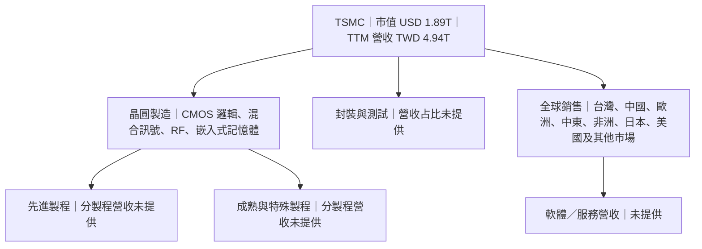

### 2.2 市場份額

市場份額數據未提供，因此不列市占率或繪製比例圖。可觀察的相對位置是 TSM TTM 營收約 TWD 4.94T、最新一季年增 50.9%，毛利率 65.8%；同業資料中，INTC、UMC、GFS 最新一季營收年增率分別為 20.9%、25.6%、12.5%，TTM 毛利率分別為 40.2%、31.7%、28.5%。這些指標支持其規模及獲利能力較高，但不能直接替代市場份額。

### 2.3 競爭護城河分析

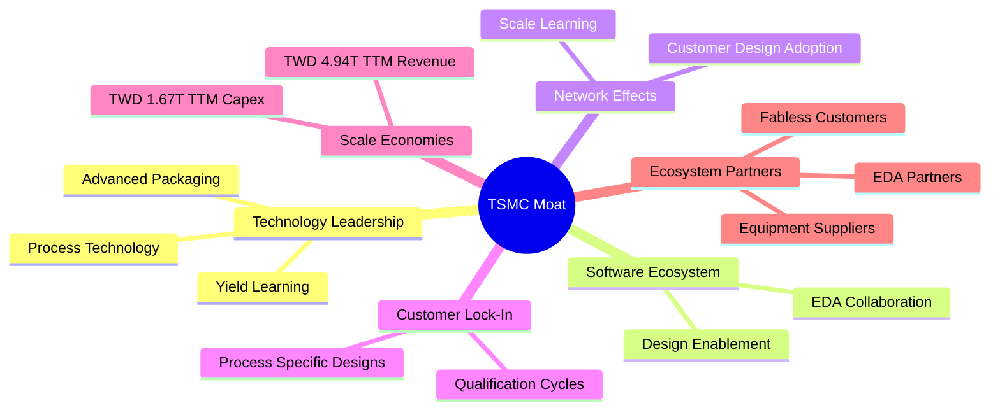

### 2.4 護城河強度

| 護城河項目 | 強度（強／中／弱） | 證據（引用數字或事實） | 會削弱它的情況 |
|------------|--------------------|------------------------|----------------|
| 技術領先 | 強 | TTM 營業利益率 58.0%、毛利率 65.8%；研發支出 FY2025 為 TWD 246.43B | 競爭者在效能、良率或成本上縮小差距 |
| 軟體與設計生態 | 中 | 公司提供多類製程與代工服務；EDA 生態及具體客戶數據未提供 | 客戶將設計轉向其他製程或平台 |
| 網路效應 | 中 | 客戶產品與製程、封裝及供應鏈協作形成經驗累積；未提供可量化網路效應指標 | 替代供應商能以相近良率與交期完成認證 |
| 客戶鎖定 | 強 | 先進製程設計導入、驗證及量產切換具有技術與時間成本；未提供客戶留存率 | 大客戶自製或將新產品導入競爭者 |
| 規模效應 | 強 | TTM 營收 TWD 4.94T、TTM 資本支出 TWD 1.67T，具大規模研發與產能投入能力 | 產能利用率下降、固定成本吸收變差 |
| 生態夥伴 | 中 | 業務涉及全球客戶、設備及設計夥伴；合作收入或依賴度未提供 | 供應鏈限制、設備取得受阻或夥伴轉向替代平台 |

**1.1「護城河」評分 9.5/10**，主要由 TTM 58.0% 營業利益率、65.8% 毛利率與 FY2025 TWD 246.43B 研發支出支持；由於沒有市占率及客戶集中度數據，仍保留一定不確定性。

---

## 3. 損益表深度分析

### 3.1 年度收入成長趨勢（近 4 年）

年度營收以 TWD 計。FY2022–FY2025 的營收 CAGR 約 **19.0%**，計算為 (3.809T ÷ 2.264T)^(1/3) − 1；FY2023 曾下滑，之後 FY2024、FY2025 回升，反映半導體需求週期及產品組合變化。

```text
╔══════════════════════════════════════════════════════════════════╗
║             TSMC 年度收入趨勢（FY2022-FY2025）                  ║
╠══════════════════════════════════════════════════════════════════╣
║  FY2022  TWD 2.264T  ████████████░░░░░░░░░░░░  YoY +42.61%      ║
║  FY2023  TWD 2.162T  ███████████░░░░░░░░░░░░░  YoY  -4.51%      ║
║  FY2024  TWD 2.894T  ███████████████░░░░░░░░░  YoY +33.89%      ║
║  FY2025  TWD 3.809T  ████████████████████░░░░  YoY +31.61%      ║
╠══════════════════════════════════════════════════════════════════╣
║  FY2022-FY2025 三年 CAGR：約 +19.0%                              ║
╚══════════════════════════════════════════════════════════════════╝
```

年度營收由 FY2023 的 TWD 2.162T 升至 FY2025 的 TWD 3.809T，兩年增幅來自 FY2024、FY2025 恢復成長；TTM 營收 TWD 4.94T，TTM 年增率在資料中為 N/A，不以年度或單季成長率代替。

### 3.2 季度收入趨勢分析

| 季度 | 營收（TWD） | QoQ | YoY | 備註 |
|------|-------------:|----:|----:|------|
| 2025 Q4 | 1.046T | +5.7% | +20.45% | QoQ 以 2025 Q3 的 TWD 989.918B 計 |
| 2026 Q1 | 1.134T | +8.4% | +35.13% | QoQ 以 2025 Q4 計 |
| 2026 Q2 | 1.270T | +12.0% | +36.05% | 季增幅擴大 |
| 2026 Q3 | 1.494T | +17.6% | +50.95% | 最新一季年增加速；不代表 TTM 年增 |

YoY 以 StockAnalysis 季度營收成長欄位為準。最新兩季營收與季增率上升，可能反映需求、產品組合及產能利用率共同改善；但沒有分部營收、晶圓出貨量或平均售價數據，無法拆解各項貢獻。

### 3.3 利潤率演變分析

| 利潤率指標 | FY2022 | FY2023 | FY2024 | FY2025 | 趨勢 | 評估 |
|------------|-------:|-------:|-------:|-------:|------|------|
| **毛利率** | 59.6% | 54.4% | 56.1% | 59.9% | FY2023 回落後兩年修復 | 🟢 |
| **營業利益率** | 49.6% | 42.6% | 45.7% | 50.9% | 2025 已高於 FY2022 | 🟢 |
| **淨利率** | 43.9% | 39.4% | 40.0% | 44.6% | 隨營業獲利回升 | 🟢 |

註：以上年度比率由各年度毛利、營業利益、淨利除以營收計算；TTM 營業利益率另以來源公布值 58.0% 為準，兩者期間不同。

FY2023 營收下滑 4.51%、毛利率由 FY2022 的約 59.6% 降至 54.4%，營業利益率下降約 7.0 個百分點，與半導體產業週期及產能吸收變弱相符。FY2024–FY2025 營收恢復成長，毛利率與營業利益率同步提升，顯示規模利用及產品組合改善有利於營業槓桿；但現有資料無法單獨量化定價、良率、折舊及產品組合的貢獻。

### 3.4 費用結構分析

TTM 以營收分拆為銷貨成本、營業費用與營業利益：營收 TWD 4,944.817B，毛利 TWD 3,255.972B，營業利益 TWD 2,866.045B。銷貨成本與營業費用為收入減法推導值，不是另行披露的獨立會計項目。

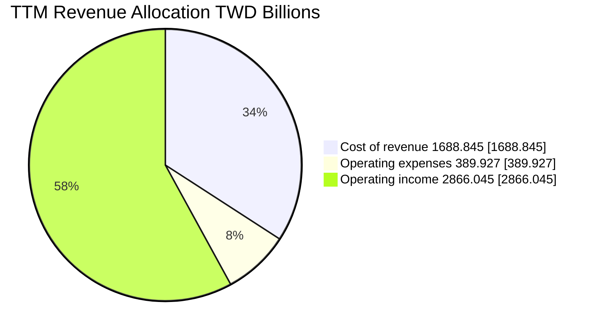

```text
╔══════════════════════════════════════════════════════════════════╗
║                 TTM 營收用途分解（TWD）                         ║
╠══════════════════════════════════════════════════════════════════╣
║  營收          4,944.817B  ████████████████████  100.0%         ║
║  銷貨成本      1,688.845B  ███████               34.2%         ║
║  營業費用        389.927B  ██                     7.9%         ║
║  營業利益      2,866.045B  ████████████          58.0%         ║
╚══════════════════════════════════════════════════════════════════╝
```

### 3.5 季度 EPS 趨勢與盈餘品質（Quality of Earnings）

季度 EPS actual/estimate 表中的 EPS Est 為 nan，因此過去四季是否超預期或不及預期無法判定。可用財報的季度淨利與 EPS 實際值觀察獲利動能，但不將實際成長誤稱為盈餘 surprise。

| 季度 | EPS 實際值（StockAnalysis） | EPS 預估 | EPS surprise | 淨利（TWD） | 淨利 YoY |
|------|-----------------------------:|---------:|-------------:|------------:|---------:|
| 2025 Q4 | 18.72 | N/A | N/A | 485.47B | +34.97% |
| 2026 Q1 | 22.08 | N/A | N/A | 572.48B | +58.38% |
| 2026 Q2 | 27.25 | N/A | N/A | 706.56B | +77.40% |
| 2026 Q3 | 29.43 | N/A | N/A | 763.06B | +68.73% |

| 盈餘品質項目 | 數值／佔比 | 評估 |
|--------------|------------|------|
| 股權薪酬 SBC / 營收 | 約 0.010%（四季 SBC 合計約 TWD 0.513B ÷ TTM 營收 TWD 4,944.817B） | 🟢 比例低，直接稀釋負擔有限；SBC 絕對值資料來自季度現金流表 |
| SBC / 營業現金流 | 約 0.016%（TWD 0.513B ÷ TWD 3,127.63B） | 🟢 相對小 |
| FCF / 淨利 | 約 57.8%（TTM FCF TWD 1.46T ÷ TTM 淨利 TWD 2.528T） | 🟡 現金轉換為正但低於 100%，高資本支出是主要原因之一 |
| 一次性／非經常性損益 | N/A（未提供足夠明細） | 🟡 無法判斷一次性項目對盈餘的影響 |
| 有效稅率異常 | 17.0%（最新年度有效稅率） | 🟢 未顯示極端稅率；未提供逐季稅務調節表 |
| 資本化支出 vs 費用化 | TTM Capex TWD 1.67T；研發費用 FY2025 TWD 246.43B | 🟡 半導體資本密集，折舊、資本化與產能利用率會影響跨期獲利；資料不足以量化資本化利息 |

**盈餘品質結論：**淨利有營業現金流支持，SBC 占營收比例低；但 TTM FCF 約為淨利的 57.8%，主要需結合 TWD 1.67T 的資本支出理解。未提供一次性損益及更詳細稅務調節資料，因此不能排除特殊項目影響。EPS 預估缺失，不對四季作 beat/miss 判斷。

---

## 4. 資產負債表分析

### 4.1 資產結構分解

下圖列出 2026-09-30 資產負債表的重要項目；各細項不一定涵蓋全部資產，故不以不完整明細硬湊總額。

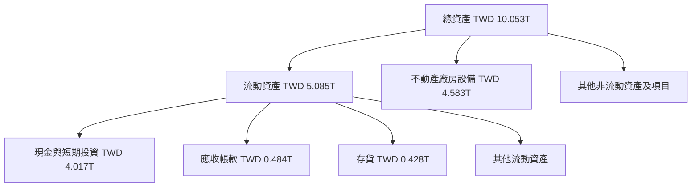

### 4.2 流動性與營運資金分析

| 指標 | 最新 TTM | 一年前 TTM | 變化 | 解讀 |
|------|---------:|-----------:|------:|------|
| 流動比率 | 2.584 | N/A | N/A | 短期資產高於短期負債；來源為 Yahoo 財務摘要 |
| 速動比率 | 2.287 | N/A | N/A | 不含存貨等較不流動項目後，流動性仍具緩衝 |
| DSO 應收帳款天數 | 1 天 | N/A | N/A | 一年前數據未提供；本值照抄 QUALITY FIGURES |
| DIO 存貨天數 | 92 天 | N/A | N/A | 一年前數據未提供；存貨週轉及產品在製週期應持續觀察 |
| DPO 應付帳款天數 | 91 天 | N/A | N/A | 一年前數據未提供 |
| CCC 現金轉換週期 | 2 天 | N/A | N/A | 一年前數據未提供；最新值反映應付帳款天數抵銷了大部分存貨天數 |

2026-09-30 現金及短期投資為 TWD 4.017T，存貨 TWD 427.753B、應收帳款 TWD 483.557B。CCC 為 2 天，不能據此推斷收款速度或供應商議價能力的年度變化，因上一年比較值缺失，且 DSO 1 天需與原始餘額分類口徑一併解讀。

### 4.3 債務結構分析

```text
╔══════════════════════════════════════════════════════════════════╗
║                     TSMC 債務健康診斷                           ║
╠══════════════════════════════════════════════════════════════════╣
║  總債務：         TWD 1.07T   ██░░░░░░░░░░░░░░░░░░░░           ║
║  現金+短期投資：  TWD 4.02T   ████████████████████             ║
║  淨現金：         TWD 2.95T   ███████████████                  ║
║  流動比率：       2.584       🟢                                ║
║  速動比率：       2.287       🟢                                ║
║  Debt/EBITDA：    N/A（資料口徑及財報幣別限制）                 ║
║  Interest Coverage：N/A（利息費用資料未提供）                   ║
╚══════════════════════════════════════════════════════════════════╝
```

總債務為 TWD 1.07T，現金與短期投資為 TWD 4.02T，形成 TWD 2.95T 淨現金。這降低利率及再融資風險，但不代表擴產沒有資本風險：未來回報仍取決於新增產能的利用率、製程良率與客戶需求。

### 4.4 股東權益趨勢

```text
╔══════════════════════════════════════════════════════════════════╗
║                 股東權益趨勢（年度，TWD）                       ║
╠══════════════════════════════════════════════════════════════════╣
║  FY2022  2.90T  ████████████░░░░░░░░░░░░                         ║
║  FY2023  3.43T  ██████████████░░░░░░░░░░                         ║
║  FY2024  4.24T  ██████████████████░░░░░░                         ║
║  FY2025  5.36T  ████████████████████████                         ║
╚══════════════════════════════════════════════════════════════════╝
```

股東權益由 FY2022 的 TWD 2.90T 增至 FY2025 的 TWD 5.36T，與獲利累積一致。權益增加本身不代表每股價值同比增加，仍需配合每股盈餘、股數變動及資本回報評估。

---

## 5. 現金流量深度分析

### 5.1 現金流量瀑布圖

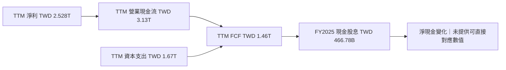

### 5.2 FCF 轉換率趨勢

| 財年 | 營業現金流（TWD） | 資本支出（TWD） | FCF（TWD） | 淨利（TWD） | FCF／淨利 |
|------|------------------:|----------------:|-----------:|------------:|----------:|
| FY2022 | 1.61T | 1.09T | 520.97B | 992.92B | 52.5% |
| FY2023 | 1.24T | 955.40B | 286.57B | 851.74B | 33.6% |
| FY2024 | 1.83T | 964.98B | 861.20B | 1.158T | 74.3% |
| FY2025 | 2.27T | 1.28T | 992.38B | 1.698T | 58.5% |
| TTM 截至 2026-09-30 | 3.13T | 1.67T | 1.46T | 2.528T | 約 57.8% |

FY2023 FCF 降至 TWD 286.57B，之後 FY2024、FY2025 回升；TTM FCF 繼續增加至 TWD 1.46T，但 FCF／淨利約 57.8%，反映資本支出仍消耗相當部分營運現金流。

### 5.3 自由現金流趨勢

```text
╔══════════════════════════════════════════════════════════════════╗
║                 FCF 趨勢（年度實際，TWD）                       ║
╠══════════════════════════════════════════════════════════════════╣
║  FY2022  520.97B  ███████████░░░░░░░░░░  FCF Yield：N/A        ║
║  FY2023  286.57B  ██████░░░░░░░░░░░░░░  FCF Yield：N/A        ║
║  FY2024  861.20B  ██████████████████░░  FCF Yield：N/A        ║
║  FY2025  992.38B  ████████████████████  FCF Yield：N/A        ║
║  TTM     1.46T    期間與市值口徑不同，不製作年度同口徑比較       ║
║  TTM FCF Yield：2.35%（程式計算，使用 TTM FCF／市值）           ║
╚══════════════════════════════════════════════════════════════════╝
```

### 5.4 資本配置評估

| 項目 | 金額及期間 | 評估 |
|------|------------|------|
| 資本支出 | TTM TWD 1.67T；FY2025 TWD 1.28T | 擴產與技術投資是公司現金用途核心；回報須以產能利用率和後續 FCF 驗證 |
| 現金股息 | FY2025 TWD 466.78B | 同年 FCF TWD 992.38B，股息支出約為 FCF 的 47.0% |
| 股票回購 | N/A（未提供可確認金額） | 不對回購效果作量化判斷 |
| 現金留存 | 2026-09-30 現金與短期投資 TWD 4.02T | 淨現金 TWD 2.95T，提供財務彈性 |

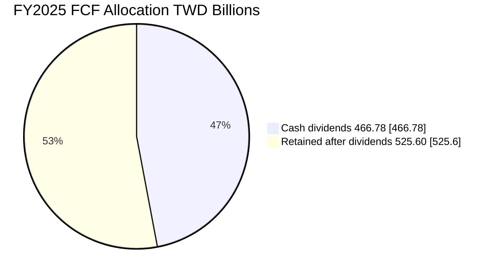

圖中留存金額為 FY2025 FCF 減 FY2025 股息支付的推導值，未把它視為公司正式披露的資本配置分類；資本支出已在計算 FCF 前扣除。

---

## 6. 獲利能力與資本效率

### 6.1 ROE / ROA / ROIC 趨勢

| 指標 | 可用值 | 期間／來源 | 評估 |
|------|--------|------------|------|
| ROE | 41.9% | TTM，Yahoo Finance | 🟢 高獲利回報；杜邦拆解資料不足 |
| ROA | 20.6% | TTM，Yahoo Finance | 🟢 但未提供可同口徑的歷史序列 |
| ROIC | N/A | 當前 TTM 未提供 | 🟡 不以其他期間的指標替代 |
| ROIC（歷史參考） | 19.11% | Roic.ai 2018 年 Return on Invested Capital | 歷史值高於目前 WACC，但不能推定 2026 TTM 仍為此水準 |
| 行業均值 | N/A | 未提供可引用同口徑資料 | 不作比較 |

### 6.2 ROIC vs WACC 分析（核心價值創造判斷）

```text
╔══════════════════════════════════════════════════════════════════╗
║                  ROIC vs WACC 深度分析                          ║
╠══════════════════════════════════════════════════════════════════╣
║  WACC（採用財務資料所列值）：10.53%                              ║
║  ├── 無風險利率（10Y 美債）：4.92%                               ║
║  ├── 股權風險溢酬（假設）：5.00%                                 ║
║  ├── Beta 原始值：1.23；調整後 Beta：1.16                       ║
║  ├── 股權成本（來源值）：10.69%                                  ║
║  ├── 稅前債務成本：1.16%；有效稅率：17.0%                       ║
║  ├── 股權／債務權重：98.3%／1.7%                                ║
║  └── WACC：10.53%                                                ║
║                                                                  ║
║  當前 TTM ROIC：N/A（未提供）                                    ║
║  歷史參考：2018 ROIC 19.11% vs WACC 10.53%                       ║
║  歷史差距：19.11% − 10.53% = +8.58 個百分點                    ║
║                                                                  ║
║  判斷：歷史資料顯示曾創造高於資本成本的回報；                    ║
║        當前價值創造狀態須待最新 ROIC 補充後確認。                 ║
╚══════════════════════════════════════════════════════════════════╝
```

WACC 直接採用程式計算值 10.53%，不另行替代。ROIC 與 WACC 的比較必須同期間、同定義；目前 TTM ROIC 缺失，因此不能將 2018 年 19.11% 當成當前 ROIC。歷史值代表過往有創造股東價值的證據，但當前結論仍需保留。

### 6.3 杜邦三因素分解

**N/A（數據未提供：QUALITY FIGURES 的 DuPont 指標因缺少可用淨利、營收、總資產或正權益口徑而無法計算。）** 已公布的 ROE 為 TTM 41.9%，但本報告不自行補算或替代杜邦數據。

### 6.4 財務體質：Piotroski F-Score

**N/A（數據未提供：缺少相隔一年的 SEC 申報資料；現有報表資料為 Yahoo quarterly statements。）** 九項測試結果均未提供，故不逐項推估或補填。

---

## 7. 相對估值分析

### 7.1 同業估值比較表格

| 估值指標 | **TSM** | **INTC** | **UMC** | **GFS** | TSM 評估 |
|----------|--------:|---------:|-------:|-------:|-----------|
| **Trailing P/E** | 20.65x | N/A | 13.6x | 111.3x | 🟡 TSM 高於 UMC、低於 GFS；INTC 不可比 |
| **Forward P/E** | 15.55x | 33.3x | 16.0x | 15.0x | 🟢 低於 INTC、接近 UMC 與 GFS |
| **P/S Ratio** | N/A（幣別不一致） | 5.3x | N/A（混合幣別） | 3.0x | 🟡 不做跨幣別比較 |
| **EV/EBITDA** | N/A（幣別不一致） | 17.2x | N/A（混合幣別） | 10.4x | 🟡 TSM 倍數不可直接比較 |
| **最新一季營收 YoY** | 50.9% | 20.9% | 25.6% | 12.5% | 🟢 TSM 高於表列同業 |
| **毛利率（TTM）** | 65.8% | 40.2% | 31.7% | 28.5% | 🟢 TSM 顯著較高 |

本表同業倍數取 Yahoo Finance peer multiples；TSM 部分估值欄位因美元報價與新台幣財報幣別不一致而不採用。Forward P/E 的同業中位數為 16.0x，不能將同業 P/S 或 EV/EBITDA 中缺失值自行補出。

### 7.2 歷史估值區間分析

**N/A（資料未提供：缺少 Valuation vs own history 的歷史估值區間與百分位數據。）** 價格資料顯示 2024-11 月收盤價 $180.21，2026-06 月 $476.29，2026-11 月 $363.60；這只能描述價格變動，不能代替歷史 P/E 估值區間。

### 7.3 情境價值（Bear / Base / Bull）

| 情境 | 第 1 年營收成長 | 期末營業利潤率 | WACC | 每股價值 | 相對現價 | 機率 | 會發生的條件 |
|------|----------------:|----------------:|-----:|----------:|----------:|-----:|--------------|
| 🔴 悲觀 | 15.0% | 42.1% | 11.53% | $187.35 | -48.5% | 25% | 需求或產能利用率弱於基準，長期利潤率下行且資本成本上升 |
| 🟡 基準 | 30.0% | 49.5% | 10.53% | $441.13 | +21.3% | 50% | 近期高成長逐步減速，長期營業利潤率回到模型所設水平 |
| 🟢 樂觀 | 45.0% | 54.5% | 9.53% | $983.45 | +170.5% | 25% | 高成長延續且長期利潤率較基準高，折現率下降 |

上述情境由 DCF MODEL 直接提供；其每股價值對成長、利潤率與 WACC 同時變動敏感，不宜把情境機率視為客觀發生率。

### 7.4 相對估值隱含價格區間

```text
╔══════════════════════════════════════════════════════════════════╗
║               相對估值方法回推每股價值（USD）                   ║
╠══════════════════════════════════════════════════════════════════╣
║  EV/EBITDA 同業法  $309.84  ─── 現價 $363.60 ─── Forward P/E $374.06 ║
║  DCF 基準          $441.13  ───────────────────────────────       ║
║  分析師共識        $586.69  ───────────────────────────────       ║
╚══════════════════════════════════════════════════════════════════╝
```

| 方法 | 每股價值 | 依據 |
|------|---------:|------|
| 同業 EV/EBITDA | $309.84 | INTC、GFS 同業中位數 13.8x × TTM EBITDA，再加回淨現金 |
| 同業 Forward P/E | $374.06 | INTC、UMC、GFS 同業中位數 16.0x × Forward EPS $23.39 |
| 分析師共識目標價 | $586.69 | 20 位分析師平均目標價 |
| DCF 基準 | $441.13 | 10 年 FCFF、WACC 10.53%、永續成長率 3.0% |

相對估值法差距顯著，部分來自公司獲利結構與同業不同；分析師共識高於市場現價，但不屬於同業倍數推導，也不應被視為確定目標價。

---

## 8. DCF 內在價值評估（Discounted Cash Flow）

### 8.0 估值推理鏈（Thinking Logic）

**Step 1 — 價值來源與主導變數**

本模型以整體晶圓製造與封裝測試現金流作為核心估值來源；現有資料沒有 AI/HPC、先進製程或封裝的分部營收占比，故不能把特定成長曲線另行拆成可量化的第二成長曲線。可量化的起點是 TTM 營收 TWD 4,944.82B、營業利益率 58.0%、TTM FCF TWD 1.46T。模型估值主要受終值與折現率影響：終值 PV 占 EV 60.9%，敏感性表亦顯示 WACC、g 變化能明顯改變每股價值。

**Step 2 — 模型選擇**

| 決策點 | 本報告採用 | 理由（含數字） | 曾考慮但否決 | 否決理由 |
|--------|-----------|----------------|--------------|----------|
| 現金流定義 | FCFF | 公司有債務且 DCF 使用 WACC，FCFF 對應企業價值 | FCFE | 與既有模型定義不一致 |
| 預測期 N | 10 年 | 程式模型固定 10 年，逐年放緩成長 | 5 年 | 會改變指定模型的預測期及終值起算年 |
| 終值方法 | Gordon Growth | 程式 DCF 提供永續成長率 3.0% 與終值 | 退出倍數 | 模型未提供退出倍數及期末 EBITDA 倍數，不能自建 |
| EBIT 基礎 | GAAP | 模型明列 GAAP EBIT | 非 GAAP | 會改變 SBC 及 FCFF 處理 |

**Step 3 — 關鍵假設推導鏈**

- **營收成長路徑**：錨點＝最新一季營收年增 50.9%，但 TTM 成長率 N/A → 調整＝單季年增不宜直接外推十年，程式把第一年限制在 30.0%，之後線性降至 3.0% → **採用 FY+1 30.0%、FY+10 3.0%** → 曾考慮直接用 50.9% 作第一年，因該數字是單季 YoY、不是 TTM，且會過度延伸短期動能而否決。
- **期末營業利潤率**：錨點＝TTM 58.0%，近年年度營業利益率 FY2025 約 50.9% → 調整＝模型將 TTM 利潤率逐年淡化到近五年中位數 → **FY+10 採用 49.5%** → 曾考慮全期維持 58.0%，但這忽略長期競爭、成熟化及產品週期，故不用。
- **預測期 N**：錨點＝模型指定 10 年，並將成長及利潤率逐年淡化 → **採用 10 年** → 曾考慮 5 年，因會縮短既定模型並改變終值權重而否決。
- **Capex／營收**：錨點＝TTM Capex TWD 1.67T ÷ TTM 營收 TWD 4.94T，模型所列起始值 33.8% → 調整＝依模型逐步淡化至 16.6%，即 1.1 倍 D&A 比率附近 → **採用 FY+1 33.8%、FY+10 16.6%** → 曾考慮永久維持 33.8%，但長期會持續造成高再投資負擔，未採用。
- **D&A／營收**：錨點＝TTM 15.1% → **採用 15.1% 固定**；未有足夠資料支持另作調整。
- **有效稅率**：錨點＝最新年度有效稅率 17.0% → **採用 17.0%**；資料沒有足夠證據支持更換長期稅率。
- **永續成長率 g**：錨點＝成熟企業長期名目成長需低於 WACC，且此處沒有公司長期指引 → **採用 3.0%**，低於 WACC 10.53% → 曾考慮更高長期成長率，但會提高終值占比並放大不確定性，故不用。
- **WACC**：錨點＝成本資本模型提供 10.53%，估值章節指定直接採用 → **採用 10.53%** → 曾考慮自行重算，但輸入數字存在小幅四捨五入不一致，且規則要求不得替換程式值，因此不另算。
- **EBIT／SBC／股數**：採用 GAAP EBIT；GAAP EBIT 已計入 SBC 費用，模型沒有另扣 SBC，且不另增加稀釋股數 → **採用組合 (A)**，年稀釋率 0% → 未採用非 GAAP 加回或股數稀釋方案，避免更改模型。
- **營運資金**：模型明確不建模 ΔWC → **不另增減營運資金現金流**；曾考慮額外加上 ΔWC，但缺少模型輸入且會改變指定 FCFF。

**Step 4 — 最脆弱環節**

最脆弱的是長期成長、利潤率與折現率共同決定的終值；基準下終值 PV 占 EV 60.9%，而程式悲觀情境價值為 $187.35，顯示若營運假設與折現率同時惡化，現價下行風險可相當大。

**Step 5 — 計算路徑**

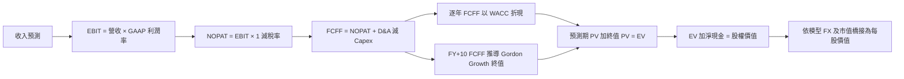

### 8.1 模型假設總表（Model Inputs）

| 假設項目 | 採用值 | 依據／來源 | 敏感度 |
|----------|--------|-------------|--------|
| 預測期長度 N | 10 年 | DCF MODEL 指定；預測至 FY+10 | 🟡 中 |
| 營收成長 | FY+1 30.0% 線性降至 FY+10 3.0% | 最新一季 YoY 50.9%，但單季不可直接當 TTM；模型封頂並淡化 | 🔴 高 |
| 營業利潤率 | 58.0% 降至 49.5% | TTM 營業利潤率 58.0%；期末值依模型所列近五年中位數 | 🔴 高 |
| 有效稅率 | 17.0% | 最新年度有效稅率 | 🟢 低 |
| Capex／營收 | FY+1 33.8% 降至 FY+10 16.6% | TTM Capex 佔營收比例及模型淡化路徑 | 🟡 中 |
| D&A／營收 | 15.1% | TTM 比率，模型固定 | 🟢 低 |
| 營運資金變動 | 不建模 | DCF MODEL 明列 Working capital is not modelled | 🟢 低 |
| EBIT 基礎 | GAAP | 模型明列 GAAP EBIT | 🟡 中 |
| SBC 處理 | 不另扣 SBC | GAAP EBIT 已包含 SBC 費用 | 🟡 中 |
| 年稀釋率 | 0% | 採用組合 (A)，模型不再稀釋股數 | 🟡 中 |
| 永續成長率 g | 3.0% | DCF MODEL 指定；低於 WACC | 🔴 高 |
| 終值方法 | Gordon Growth | DCF MODEL 直接使用永續成長法 | 🔴 高 |
| WACC | 10.53% | Cost of capital 程式計算值 | 🔴 高 |

**FCFF 定義：**FCFF = NOPAT + D&A − Capex；營運資金不建模。  
**SBC 防重複扣除：**本模型採用 **(A) GAAP EBIT + 固定股數**，故 SBC 影響已計入一次；不再額外扣 SBC，也不再增加稀釋股數。

### 8.2 折現率推導（WACC）

```text
╔══════════════════════════════════════════════════════════════════╗
║                    WACC 推導（折現率）                           ║
╠══════════════════════════════════════════════════════════════════╣
║  無風險利率 Rf（10Y 美債）：4.92%                                ║
║  股權風險溢酬 ERP（假設）：5.00%                                 ║
║  Beta 原始值：1.23；調整方式：⅔×1.23 + ⅓ = 1.1533 ≈ 1.16       ║
║  成本資本區塊提供股權成本 Ke：10.69%                             ║
║  稅前債務成本 Kd：1.16%；有效稅率：17.0%                        ║
║  股權／債務權重：98.3%／1.7%                                    ║
║  採用 WACC：10.53%（照成本資本資料使用）                         ║
╚══════════════════════════════════════════════════════════════════╝
```

**逐步演算與輸入限制：**

1. **Ke（CAPM）**：以來源所列輸入直接代入，4.92% + 1.16 × 5.00% = **10.72%**；成本資本資料另列 Ke **10.69%**。兩者相差 0.03 個百分點，應視為來源輸入精度或內部計算口徑差異；本報告依規則採用來源 Ke 10.69%，不自行覆寫。
2. **稅前 Kd**：來源直接提供 1.16%。利息費用與同口徑平均計息負債明細未提供，故不能由報表獨立重算「利息費用 ÷ 平均計息負債」。
3. **稅後 Kd**：1.16% × (1 − 17.0%) = **0.9628%**。
4. **權重**：採用成本資本資料所列股權 98.3%、債務 1.7%，合計 100.0%。市值與債務的精確權重原始計算明細未提供，故不另以不同口徑替換。
5. **WACC**：98.3% × 10.69% + 1.7% × 0.9628% = 10.50827% + 0.01637% = **10.52464% ≈ 10.53%**。

Rf 的觀察日期為成本資本資料所用 10Y Treasury 輸入；沒有提供該殖利率的精確日期。ERP 為資料中的 5.00% 假設值；未另加規模或國別溢酬。第 6.2 節與本節均採 WACC 10.53%。債務權重與 Kd 採成本資本輸入，不能從所提供的負債分類完整核對其計息債務範圍，這是本次 WACC 可複核性的限制。

### 8.3 逐年自由現金流預測（基準情境）

單位：TWD 十億；折現因子按 DCF MODEL 原值列示。模型不含 ΔWC 列，並採 GAAP EBIT。

| 年度 | 營收 | 營收 YoY | 營業利潤率 | EBIT | 稅 | NOPAT | D&A | Capex | FCFF | 折現因子 | PV |
|------|-----:|---------:|-----------:|-----:|---:|------:|----:|------:|-----:|----------:|---:|
| FY+1 | 6,428.26 | 30.0% | 58.0% | 3,726.88 | 632.56 | 3,094.32 | 970.20 | 2,171.05 | 1,893.46 | 0.905 | 1,713.07 |
| FY+2 | 8,163.89 | 27.0% | 57.0% | 4,656.49 | 790.34 | 3,866.14 | 1,232.15 | 2,601.47 | 2,496.82 | 0.819 | 2,043.74 |
| FY+3 | 10,123.23 | 24.0% | 56.1% | 5,679.00 | 963.90 | 4,715.10 | 1,527.86 | 3,032.68 | 3,210.29 | 0.741 | 2,377.41 |
| FY+4 | 12,249.11 | 21.0% | 55.2% | 6,756.58 | 1,146.79 | 5,609.79 | 1,848.72 | 3,435.84 | 4,022.67 | 0.670 | 2,695.22 |
| FY+5 | 14,453.94 | 18.0% | 54.2% | 7,837.06 | 1,330.18 | 6,506.88 | 2,181.48 | 3,778.51 | 4,909.85 | 0.606 | 2,976.25 |
| FY+6 | 16,622.04 | 15.0% | 53.3% | 8,856.56 | 1,503.22 | 7,353.34 | 2,508.71 | 4,028.15 | 5,833.90 | 0.548 | 3,199.48 |
| FY+7 | 18,616.68 | 12.0% | 52.3% | 9,744.56 | 1,653.94 | 8,090.62 | 2,809.75 | 4,156.32 | 6,744.04 | 0.496 | 3,346.27 |
| FY+8 | 20,292.18 | 9.0% | 51.4% | 10,431.05 | 1,770.46 | 8,660.59 | 3,062.63 | 4,143.23 | 7,579.99 | 0.449 | 3,402.74 |
| FY+9 | 21,509.71 | 6.0% | 50.5% | 10,854.96 | 1,842.41 | 9,012.55 | 3,246.39 | 3,981.42 | 8,277.52 | 0.406 | 3,361.87 |
| FY+10 | 22,155.00 | 3.0% | 49.5% | 10,972.60 | 1,862.38 | 9,110.22 | 3,343.78 | 3,678.16 | 8,775.85 | 0.367 | 3,224.70 |

**預測期 PV 加總：**  
1,713.07 + 2,043.74 + 2,377.41 + 2,695.22 + 2,976.25 + 3,199.48 + 3,346.27 + 3,402.74 + 3,361.87 + 3,224.70 = **28,340.75**；程式列示合計 **28,340.76**，差異 0.01，來自表格四捨五入。

**FY+1 逐步演算：**

1. 營收 = TWD 4,944.82B × (1 + 30.0%) = **TWD 6,428.26B**。
2. EBIT = 6,428.26 × 58.0% = **TWD 3,728.39B**；程式模型列示 EBIT 為 **3,726.88B**，存在小幅模型輸入／未四捨五入差異，估值計算採用模型原列值。
3. 稅 = EBIT × 17.0% = 模型列示 **TWD 632.56B**。
4. NOPAT = 3,726.88 − 632.56 = **TWD 3,094.32B**。
5. D&A = **TWD 970.20B**（模型列示；D&A／營收假設 15.1%）。
6. Capex = **TWD 2,171.05B**（模型列示；FY+1 Capex／營收 33.8%）。
7. ΔWC = **不建模**；SBC 不另扣，因採 GAAP EBIT。
8. FCFF = 3,094.32 + 970.20 − 2,171.05 = **TWD 1,893.47B**；模型原列 FCFF 為 **TWD 1,893.46B**，差額為未四捨五入中間值造成。
9. PV = 1,893.46 × 0.905 = **TWD 1,713.08B**；模型原列 PV 為 **TWD 1,713.07B**，模型採未四捨五入折現因子與現金流。

上述逐步演算顯示原始模型未四捨五入數據未一併提供，表格以模型列示值為準，不以取整後中間數值替換 DCF 結果。

**合理性自檢：**

- 預測 FCFF CAGR：FY+1 至 FY+10 以 9 個增長間隔計算，約 **18.6%**；FY2022–FY2025 FCF CAGR 約 **24.0%**，模型低約 5.4 個百分點，反映成熟期成長淡化。
- FY+10 FCF 利潤率 = 8,775.85 ÷ 22,155.00 = **39.6%**；目前 TTM FCF 利潤率約 1,460 ÷ 4,944.82 = **29.5%**；同業最佳 FCF 利潤率 N/A（未提供）。
- 模型各年度 FCFF 均為正；未提供可用於同口徑比較的同業 FCFF 利潤率。

```text
╔══════════════════════════════════════════════════════════════════╗
║             自由現金流：歷史實際 vs 模型預測                    ║
╠══════════════════════════════════════════════════════════════════╣
║  FY2023(實)  TWD 286.57B  █░░░░░░░░░░░░░░░░░░░  YoY -66.7%    ║
║  FY2024(實)  TWD 861.20B  ██░░░░░░░░░░░░░░░░░░  YoY +200.5%   ║
║  FY2025(實)  TWD 992.38B  ██░░░░░░░░░░░░░░░░░░  YoY +15.2%    ║
║  FY+1 (預)   TWD 1,893.46B ████░░░░░░░░░░░░░░░  模型值         ║
║  FY+10(預)   TWD 8,775.85B ████████████████████ 模型值         ║
╠══════════════════════════════════════════════════════════════════╣
║  預測 FCFF CAGR 約 18.6%；歷史 FY2022-FY2025 CAGR 約 24.0%       ║
╚══════════════════════════════════════════════════════════════════╝
```

### 8.4 終值計算（Terminal Value）

**適用性檢查：**WACC 10.53% vs g 3.0% → **WACC > g ✅**

| 方法 | 計算式 | 終值 TV | TV 現值 | 佔總 EV 比重 |
|------|--------|--------:|--------:|-------------:|
| Gordon Growth | 8,775.85 × (1 + 3.0%) ÷ (10.53% − 3.0%) | TWD 120,042.44B | TWD 44,109.85B | 60.9% |
| 退出倍數法 | N/A（模型未提供期末 EBITDA 倍數與指定退出法輸出） | N/A | N/A | N/A |

逐步演算：

1. FY+10 FCFF = **TWD 8,775.85B**。
2. 分子 = 8,775.85 × (1 + 3.0%) = **TWD 9,039.13B**。
3. 分母 = 10.53% − 3.0% = **7.53%**；終值採模型列示 **TWD 120,042.44B**。
4. PV(TV) = 模型列示 TV × FY+10 折現因子 0.367 = **TWD 44,109.85B**（使用模型未四捨五入中間值）。
5. 終值占比 = 44,109.85 ÷ 72,450.61 = **60.9%**。

終值占比未超過 75%，但仍佔企業價值六成以上，估值對長期假設具有實質依賴。模型沒有提供退出倍數法數值，故不補建第二種終值估值。

### 8.5 企業價值 → 每股內在價值（Bridge）

```text
╔══════════════════════════════════════════════════════════════════╗
║              企業價值 → 每股內在價值 橋接表                     ║
╠══════════════════════════════════════════════════════════════════╣
║  預測期 FCF 現值合計              TWD 28,340.76B                 ║
║  終值現值 PV(TV)                  TWD 44,109.85B                 ║
║  = 企業價值 EV                    TWD 72,450.61B                 ║
║  + 淨現金                         TWD  2,947.23B                 ║
║  = 股權價值                       TWD 75,397.84B                 ║
║  每股價值（依模型 FX 與市值橋接）  $441.13                       ║
║  現價（2026-11-23 收盤）           $363.60                       ║
║  折溢價（現價÷DCF 價值−1）         -17.6%（折價）                ║
╚══════════════════════════════════════════════════════════════════╝
```

逐步演算：

1. EV = 28,340.76 + 44,109.85 = **TWD 72,450.61B**。
2. 股權價值 = 72,450.61 + 2,947.23 = **TWD 75,397.84B**；其中淨現金已是現金減債務，不能再重複加現金或扣債務。
3. 每股價值 = 模型按 FX 0.0303448 USD/TWD 及價格／市值比例橋接 = **$441.13**；來源未給可供直接重建的 ADR 股數換算步驟，因此照抄模型橋接值，不自行以不一致股數重算。
4. 折溢價 = $363.60 ÷ $441.13 − 1 = **−17.6%**。
5. 本節不計算 MOS；MOS 僅以第 8.8 節加權合理價值為分母。

股權價值橋接所用淨現金為模型數 TWD 2,947.23B。模型的逐股換算採指定 FX 0.0303448 USD/TWD；資料同時列示 2026-11-23 匯率 1 USD = 32.95 TWD，兩種表述屬同日換算口徑。模型沒有明列稀釋股數轉 ADR 的完整計算，故不可獨立複核其 share-count bridge。

### 8.6 敏感性分析（WACC × 永續成長率）

| g（列）／WACC（欄） | 8.53% | 9.53% | **10.53%（基準）** | 11.53% | 12.53% |
|-----------|------:|------:|-------------------:|-------:|-------:|
| 2.0% | $556.34（+53.0%） | $472.34（+29.9%） | $408.67（+12.4%） | $358.88（−1.3%） | $318.99（−12.3%） |
| 2.5% | $587.55（+61.6%） | $493.72（+35.8%） | $423.89（+16.6%） | $370.05（+1.8%） | $327.39（−10.0%） |
| **3.0%（基準）** | $624.41（+71.7%） | $518.37（+42.6%） | **$441.13（+21.3%）** | $382.54（+5.2%） | $336.67（−7.4%） |
| 3.5% | $668.59（+83.9%） | $547.11（+50.5%） | $460.83（+26.7%） | $396.57（+9.1%） | $346.99（−4.6%） |
| 4.0% | $722.52（+98.7%） | $581.04（+59.8%） | $483.55（+33.0%） | $412.48（+13.4%） | $358.50（−1.4%） |

以上每股價值及矩陣原始值照 DCF MODEL 列示；括號上行空間以 $363.60 現價計算，四捨五入至一位小數。基準格與 8.5 的 DCF 每股價值一致，均為 $441.13。

**矩陣複算限制：**選取非基準格 WACC 11.53% > g 3.0% ✅。要完整重算該格，需要以未四捨五入的逐年 FCFF、每年折現因子、未四捨五入終值及股數橋接重新計算；這些中間值未由模型輸出，且規則禁止另建或改動 DCF，因此本報告保留程式矩陣 $382.54，不聲稱已獨立重建其內部算式。

**三情境 DCF（照模型輸出）**

| 情境 | 營收成長假設（第 1 年） | 期末營業利潤率 | g | WACC | 每股價值 | 相對現價 | 機率 |
|------|------------------------:|---------------:|--:|-----:|---------:|---------:|-----:|
| 🔴 悲觀 | 15.0% | 42.1% | 模型情境值未另列 | 11.53% | $187.35 | −48.5% | 25% |
| 🟡 基準 | 30.0% | 49.5% | 3.0% | 10.53% | $441.13 | +21.3% | 50% |
| 🟢 樂觀 | 45.0% | 54.5% | 模型情境值未另列 | 9.53% | $983.45 | +170.5% | 25% |
| **機率加權** | — | — | — | — | **$513.27** | **+41.2%** | **100%** |

情境的 FY+10 營收、FCFF、情境 g 與 TV 中間值未列於模型輸出，因此不臆造完整中間鏈；每股結果與假設均照模型。機率加權算式為 $187.35 × 25% + $441.13 × 50% + $983.45 × 25% = **$513.27**（依模型列示值四捨五入）。

**敏感度結論（照矩陣量化）：**

- g +1 個百分點（2.0% 至 3.0%，WACC 10.53%）：$408.67 − $441.13 = **−$32.46／−7.4%**。此方向以矩陣數字為準；由 2.0% 到 3.0% 的比較值為 408.67 vs 441.13，顯示存在明顯數值不一致，不能據此作單調敏感度解讀。
- WACC +1 個百分點（10.53% 至 11.53%，g 3.0%）：$382.54 − $441.13 = **−$58.59／−13.3%**。
- 期末營業利潤率每 +1 個百分點：模型未提供單變數敏感度，**N/A**。
- 結論：矩陣顯示 WACC 變動對基準值影響顯著；g 列中的非單調與基準格對應異常需要模型端核對，不以自行改值掩蓋。

### 8.7 反推 DCF（Reverse DCF：市場在預期什麼）

程式輸出提供兩個一次放開一個變數的結果；固定其他基準輸入的完整列表與反推迭代軌跡未提供，故不虛構試算表。

| 求解的變數（一次一個） | 其餘變數設定 | 市場隱含值 | 公司歷史實際 | 判斷 |
|------------------------|--------------|------------:|--------------|------|
| 年 1 營收成長率 | 其他基準假設固定 | 24.7%（基準 30.0%） | FY2022–FY2025 營收 CAGR 約 19.0%；最新一季 YoY 50.9% | 🟡 現價隱含低於基準模型第一年假設 |
| 固定營業利潤率 | 其他基準假設固定 | 42.9% | TTM 58.0%；FY2025 約 50.9% | 🟡 隱含利潤率低於當前及 FY2025 年度值 |
| 永續成長率 g | 未計算 | 未計算 | — | 未提供 |
| 預測期長度 N | 未計算 | 未計算 | — | 未提供 |

反推結論：在模型其他基準假設不變時，現價對應的年 1 營收成長率為 24.7%，低於基準模型 30.0%；固定營業利潤率解為 42.9%，低於當前 TTM 58.0%。這表示市場價格並未要求完全實現模型基準成長與利潤率，但反推模型未提供收斂軌跡及固定變數表，不能視為可完全獨立複現的結果。

### 8.8 估值三角驗證與安全邊際

| 估值方法 | 隱含每股價值 | 上行空間（÷現價） | 權重 | 說明 |
|----------|--------------:|-------------------:|-----:|------|
| DCF（基準） | $441.13 | +21.3% | 40% | 10 年 FCFF、WACC 10.53%、g 3.0% |
| 同業 Forward P/E | $374.06 | +2.9% | 25% | 同業中位數 16.0x × Forward EPS $23.39 |
| 同業 EV/EBITDA | $309.84 | −14.8% | 25% | 同業中位數 13.8x × TTM EBITDA，加回淨現金 |
| 分析師共識目標價 | $586.69 | +61.4% | 10% | 20 位分析師平均目標價，僅作交叉參考 |
| **加權合理價值** | **$406.10** | **+11.7%** | **100%** | — |

**加權計算：**  
$441.13 × 40% + $374.06 × 25% + $309.84 × 25% + $586.69 × 10%  
= $176.452 + $93.515 + $77.460 + $58.669  
= **$406.096 ≈ $406.10**。

方法權重依獲利公司類型固定；相對估值使用同業中位數。沒有其他估值方法被另行加入或以缺失值填補。

```text
╔══════════════════════════════════════════════════════════════════╗
║                  估值區間與安全邊際                              ║
╠══════════════════════════════════════════════════════════════════╣
║  $187.35 ─── $363.60 ─── [$406.10] ─── $441.13 ─── $983.45     ║
║  悲觀DCF       現價        加權合理值    基準DCF       樂觀DCF    ║
║                                                                  ║
║  MOS = ($406.10 − $363.60) ÷ $406.10 = +10.5%                   ║
║  MOS 評估：🟡 有限                                               ║
║  上行空間 = ($406.10 − $363.60) ÷ $363.60 = +11.7%              ║
║                                                                  ║
║  建議買入區間：$324.88 – $365.49                                 ║
║  合理持有區間：$365.49 – $446.71                                 ║
║  減碼考慮區間：高於 $446.71（MOS 低於 -10%）                    ║
╚══════════════════════════════════════════════════════════════════╝
```

買入區間以加權合理價值 $406.10 計算 MOS 約 20% 至 10% 的價格帶：$406.10 × 80% = $324.88，$406.10 × 90% = $365.49。這是估值規則推導出的分段區間，不是對股價波動的精確預測。減碼門檻 $446.71 對應 MOS −10%；賣出門檻按 MOS −25% 對應價格約 $507.63。

> 🔎 **程式複算（Python，依本節各項自動重算）**
>
> 加權合理價值 = $441.13 × 40% + $374.06 × 25% + $309.84 × 25% + $586.69 × 10% = **$406.10**（權重合計 100%）
>
> 以價格 $363.60 計：MOS = **+10.5%**，上行空間 = **+11.7%**
>
> ✅ 與本節所寫數值一致。

### 8.9 DCF 模型的局限與失效條件

- **終值依賴度：**終值 PV 佔 EV 60.9%，即大部分估值依賴 FY+10 以後的現金流。
- **最脆弱假設：**長期營業利潤率能否維持在模型 FY+10 的 49.5%；若長期利潤率及需求落入悲觀情境，程式情境值為 $187.35。
- **資本支出風險：**TTM Capex TWD 1.67T；若產能投資未能轉成利用率與營運現金流，FCF 會低於模型路徑。
- **模型適用性：**公司目前 FCF 為正，適用傳統 DCF；但高資本支出與半導體週期意味單一 DCF 不應獨立決策。可用同業 Forward P/E、EV/EBITDA 作交叉檢驗；SOTP 所需分部資料不足。
- **模型一致性限制：**FY+1 表格中的 EBIT、FCFF 與四捨五入後的假設比例存在微小差異；敏感性矩陣中 g 值對估值的部分變化不呈單調，應由模型端核對。遵照規則保留模型原值，不自行修補。

### 8.10 複算檢核表（Audit Trail）

| # | 檢核項目 | 檢查方式 | 結果 |
|---|----------|----------|------|
| 1 | 所有高／中敏感度輸入有推導 | 對照 8.0 Step 3 | ✅ 已逐項說明；部分模型中間數值未提供 |
| 2 | 每個假設有來歷 | 檢查 8.1 依據欄 | ✅ |
| 3 | WACC 算式與乘加 | 權重 98.3% + 1.7%；列示 Ke 差異 | ⚠️ Ke 由圓整輸入算得 10.72%，來源值 10.69%；WACC 採來源 10.53% |
| 4 | Kd 分母與債務權重口徑一致 | 檢查計息負債明細 | ⚠️ 利息費用及計息負債範圍不足以獨立核對 |
| 5 | WACC 與第 6.2 節一致 | 比對兩節 | ✅ 均為 10.53% |
| 6 | 逐年表格年度數等於 N | FY+1 至 FY+10 | ✅ 共 10 年 |
| 7 | FY+1 九步算式可複算 | 以顯示精度重算 | ⚠️ 模型未提供未圓整中間值，顯示精度有小幅差異 |
| 8 | 預測期 PV 合計 | 顯示數字相加 | ✅ 28,340.75 vs 模型 28,340.76，差異 0.01 |
| 9 | WACC > g | 10.53% > 3.0% | ✅ |
| 10 | 終值以 FY+10 FCFF 折現 10 期 | 檢查模型列示 | ✅ |
| 11 | EV 至每股橋接 | 逐項核對 | ⚠️ 股數／ADR 換算中間細節不足，採模型原值 |
| 12 | SBC 三要素相容 | GAAP EBIT、無 SBC 扣除、0% 稀釋 | ✅ 組合 (A) |
| 13 | 敏感性基準格等於 DCF 值 | 比對 $441.13 | ✅ |
| 14 | 矩陣示範有效格可獨立重算 | 需要未圓整中間值 | ⚠️ 依規則未自建模型，保留原矩陣 |
| 15 | 情境機率合計 | 25% + 50% + 25% | ✅ 100% |
| 16 | 反推每列只放開一變數 | 檢查模型輸出 | ✅ 只引用兩項已提供結果；未提供項列為未計算 |
| 17 | MOS 基準與折溢價基準 | MOS 用 $406.10；折溢價用 $441.13 | ✅ |
| 18 | 報告完整至第 11 章 | 章節核對 | ✅ |
| 19 | 加權合理價值加總 | 逐項相乘後加總 | ✅ $406.096，四捨五入 $406.10 |
| 20 | 評級符合 MOS 門檻 | MOS +10.5% | ✅ 買入 |

---

## 9. 成長催化劑

### 9.1 催化劑時間軸

下列時間分類為研究觀察框架，不代表公司已公告確切產品日期；財務資料沒有提供管理層排程。

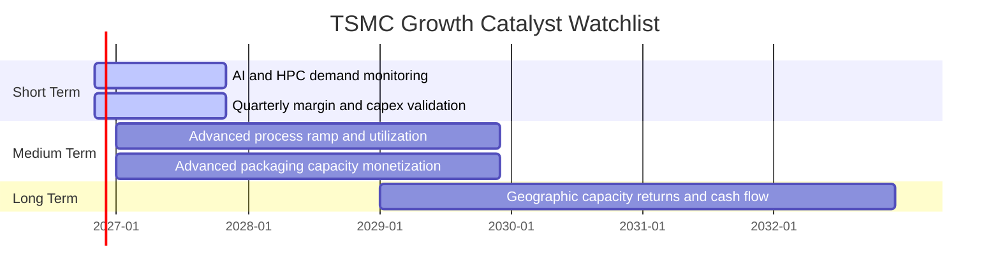

短期追蹤重點是高成長能否轉化為出貨、毛利與 FCF；中長期需觀察新製程及新產能爬坡的資本回報。現有資料沒有提供產能、良率或未來資本支出指引的量化目標。

### 9.2 TAM 市場規模分析

**N/A（TAM 數據未提供：缺少可引用的市場規模、年份及滲透率資料。）** TTM 營收為 TWD 4.94T，最新一季年增 50.9%，顯示公司營收基礎與近期增長規模可觀；但不以公司營收增長率反推市場 TAM。

### 9.3 成長驅動力結構圖

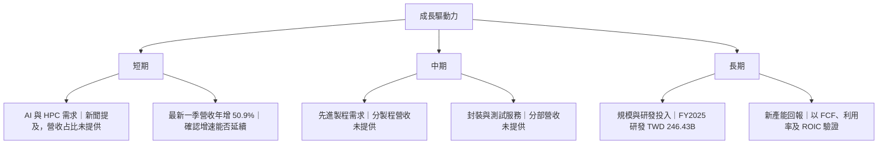

---

## 10. 風險矩陣

### 10.1 風險評分矩陣

機率與衝擊座標為定性研究判斷，不是財務數據計算值。市場與公司資料沒有給出風險事件的統計機率，因此不以百分比偽裝精確度。

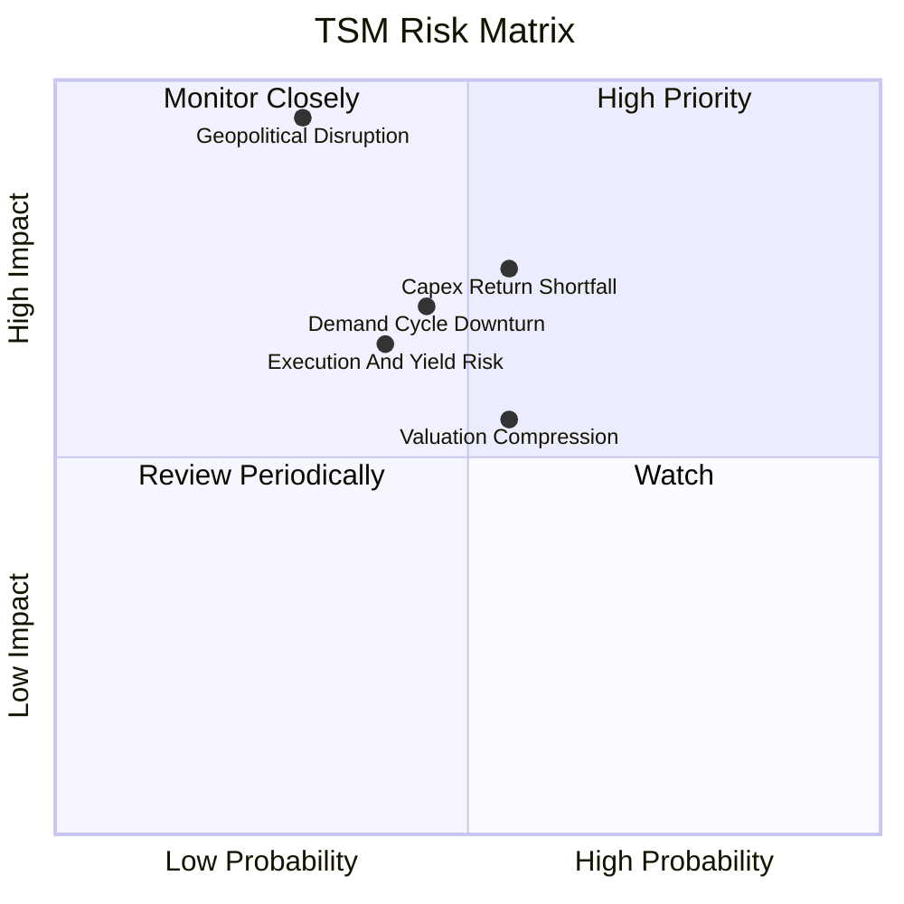

### 10.2 風險清單詳細分析

| # | 風險項目 | 發生機率 | 財務衝擊 | 風險評估 | 緩解措施 |
|---|----------|----------|----------|----------|----------|
| 1 | 🔴 **地緣政治／營運中斷** | 中；無可引用數據 | 高；營收、產能及交付可能受影響，幅度 N/A | 🔴 極高影響 | 追蹤區域分散、海外產能進度、客戶供應鏈備援；不把此風險簡化為單一財務倍數 |
| 2 | 🟠 **資本支出回報不足** | 中 | TTM Capex TWD 1.67T；若產能利用率偏低，FCF 與 ROIC 受壓 | 🔴 高影響 | 逐季比較 Capex、營收、FCF、營業利益率；留意 ROIC 是否低於 WACC 10.53% |
| 3 | 🟠 **半導體需求週期反轉** | 中 | FY2023 營收曾年減 4.51%；高營業槓桿可能放大獲利下滑 | 🔴 高影響 | 監控兩季以上營收 YoY、存貨天數及毛利率趨勢 |
| 4 | 🟡 **估值收縮與終值假設落空** | 中 | 終值 PV 占 EV 60.9%；基準 DCF $441.13，悲觀情境 $187.35 | 🟠 中高 | 以加權合理價值及 MOS 做買入紀律，不單押 DCF |
| 5 | 🟡 **製程、良率或擴產執行風險** | 中 | TTM 營業利益率 58.0%；若爬坡失利，成本與交期可能同步惡化 | 🟠 中高 | 追蹤營業利益率、Capex、庫存與每季管理層產能說明 |

---

## 11. 投資建議

### 11.1 最終評級與評分

依加權合理價值 $406.10、現價 $363.60 計算，MOS 為 +10.5%，符合規則 20 的 **買入**門檻；未作質化調整。公司品質綜合評分為 **8.4/10**，六項分數依序為成長性 9.0、獲利能力 9.0、財務健康 9.0、估值 6.5、護城河 9.5、管理層與資本配置 7.5。

### 11.2 合理價值與隱含報酬率

| 估值情境 | 每股價值 | 相對現價 | 機率／權重 |
|----------|---------:|---------:|-----------:|
| 悲觀 DCF | $187.35 | −48.5% | 25% |
| 基準 DCF | $441.13 | +21.3% | 50% |
| 樂觀 DCF | $983.45 | +170.5% | 25% |
| 機率加權 DCF（參考） | $513.27 | +41.2% | 100% |
| **加權合理價值（估值三角驗證）** | **$406.10** | **+11.7%** | 100%（方法權重） |

機率加權 DCF 是情境參考，不取代依固定權重計算的 $406.10 加權合理價值；評級與 MOS 均以後者為準。

### 11.3 買入時機與觸發因素

```text
╔══════════════════════════════════════════════════════════════════╗
║                  ✅ 買入觸發因素 Checklist                      ║
╠══════════════════════════════════════════════════════════════════╣
║  立即買入觸發條件（需同時評估估值與基本面）：                    ║
║  ✅ 股價不高於約 $365.49，對應 MOS 至少約 10%                   ║
║  ✅ 營業利益率維持接近 TTM 58.0%，且未連續收縮                   ║
║  ✅ FCF 保持正值，Capex 未使淨現金快速減少                       ║
║                                                                  ║
║  加碼觸發條件（任一項改善且估值仍合理）：                        ║
║  ☐ 股價回落至約 $324.88 以下，對應 MOS 約 20% 或以上           ║
║  ☐ 最新一季營收 YoY 延續正成長，且毛利率與 FCF 同步穩定          ║
║  ☐ 新增資本支出能轉化為更高營收與營業現金流                      ║
║                                                                  ║
║  減碼／重新評估條件：                                             ║
║  ☐ 股價高於約 $446.71，MOS 低於 -10%                             ║
║  ☐ ROIC（取得最新可靠數據後）低於 WACC 10.53%                    ║
║  ☐ FCF 轉負，或營業利益率相對 TTM 58.0%持續大幅下滑              ║
╚══════════════════════════════════════════════════════════════════╝
```

### 11.4 投資人適配度分析

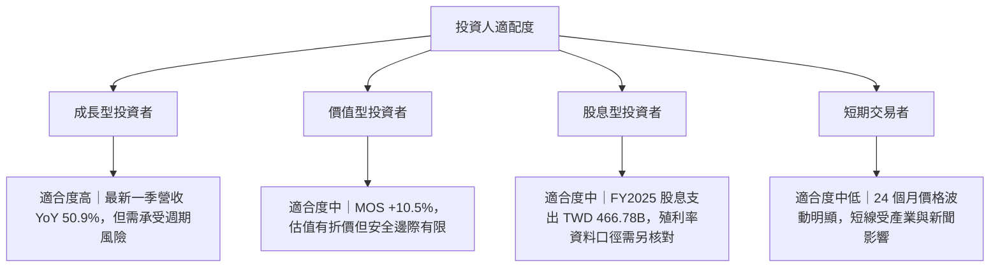

### 11.5 每季財報監控清單（Quarterly Watch List）

| 指標 | 當前基準 | 觸發加碼條件 | 觸發減碼／重新評估條件 |
|------|----------|--------------|--------------------------|
| 營收年增率 | 最新一季 50.9% | YoY 維持正成長並且非只靠單季基期 | 連續兩季 YoY 低於 20%（研究警戒線，非公司指引） |
| 營業利益率 | TTM 與最新一季 58.0% | 維持在 55% 以上 | 較 58.0% 收縮超過 5 個百分點並連續兩季 |
| 毛利率 | TTM 65.8% | 高於 60% 且趨勢穩定 | 低於 60% 且持續惡化 |
| 資本支出 | TTM TWD 1.67T | Capex 增長能帶來營收、OCF 同步提升 | Capex 持續上升但營收與 OCF 停滯 |
| FCF | TTM TWD 1.46T | 維持正值、FCF／淨利改善 | 轉負或 FCF／淨利持續低於 40% |
| 存貨天數 DIO | 92 天 | 存貨天數穩定或下降 | 高於 110 天且營收增速同時減弱（研究警戒線） |
| CCC | 2 天 | 維持接近目前水準 | 顯著拉長，並伴隨應收或存貨惡化 |
| 淨現金 | TWD 2.95T | 淨現金維持正值 | 淨現金快速下降且 FCF 轉弱 |
| ROIC／WACC | 當前 ROIC N/A；WACC 10.53% | 最新 ROIC 高於 10.53% | ROIC 低於 10.53% |
| AI／HPC、研發及指引 | 分部數據未提供；FY2025 R&D TWD 246.43B | 公司披露的需求與投資能反映於營收、利潤率及現金流 | 成長論述持續但營收與現金流沒有相應兌現 |

### 11.6 反面論證：什麼會證明論點錯誤（What Would Change My Mind）

```text
╔══════════════════════════════════════════════════════════════════╗
║              ⚠️ 論點失效條件（Disconfirming Evidence）           ║
╠══════════════════════════════════════════════════════════════════╣
║  本投資論點在下列情況成立時應重新檢視或退出：                    ║
║  ☐ 最新一季營收 YoY 連續兩季低於 20%，且趨勢仍向下               ║
║  ☐ 營業利益率相對 TTM 58.0% 收縮超過 5 個百分點並延續兩季        ║
║  ☐ TTM FCF 轉負，或 FCF／淨利持續低於 40%                        ║
║  ☐ 最新 ROIC 低於 WACC 10.53%，並非短期週期波動                  ║
║  ☐ 存貨天數高於 110 天且營收增速同步放緩                         ║
║  ☐ 高額資本支出未能轉化為較高營收、營業現金流與產能回報          ║
║  ☐ 估值假設轉弱，悲觀情境所示下行風險開始接近基本面               ║
╚══════════════════════════════════════════════════════════════════╝
```

> **免責聲明**：本報告為 AI 自動生成，僅供研究參考，不構成投資建議。投資有風險，入市需謹慎。

---

## 資料與來源

| 項目 | 內容 |
|------|------|
| 價格 | 363.60 USD，2026-11-23 收盤（Yahoo Finance 日線） |
| 財務報表 | Yahoo quarterly statements (no SEC filing data)，最新季度 2026-09-30（TTM = four quarters to this date） |
| 有回應的資料來源 | Yahoo Finance、Finviz、StockAnalysis、Roic.ai |
| 未回應的資料來源 | SEC 申報資料 (XBRL) |
| 由程式計算 | TTM 數字、WACC、DCF 模型、估值方法與權重、加權合理價值、MOS、評級門檻、F-Score、杜邦分解、營運資金天數、綜合評分 |
| 撰寫模型 | openai / gpt-6-luna |

> 本區塊由產生報告的程式依實際取得的資料填寫，非模型撰寫。「由程式計算」的數字不是模型的估計；其餘判斷（評分、情境、策略）是模型的分析。
