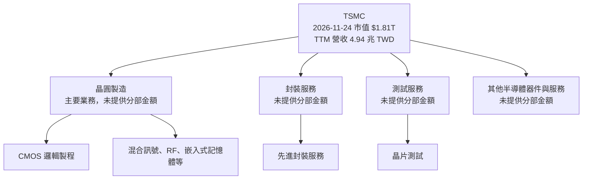
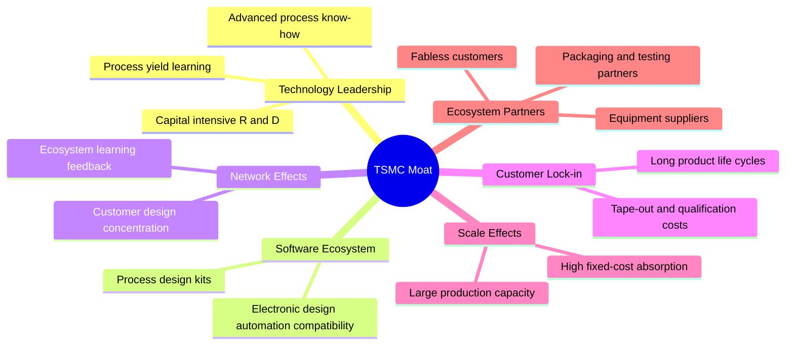
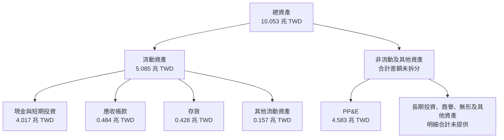
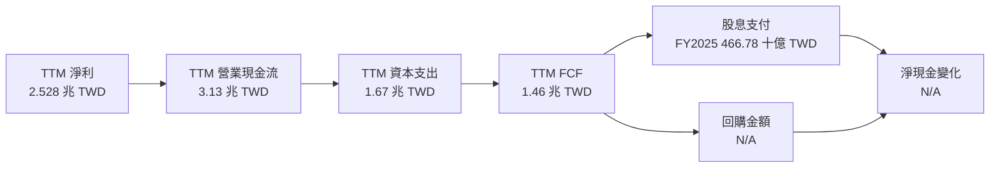
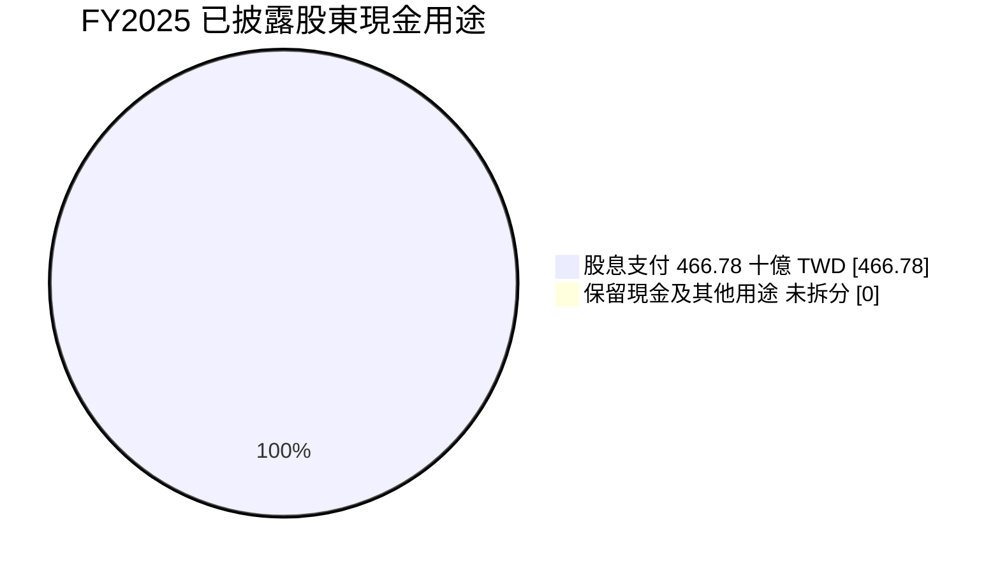
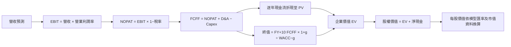
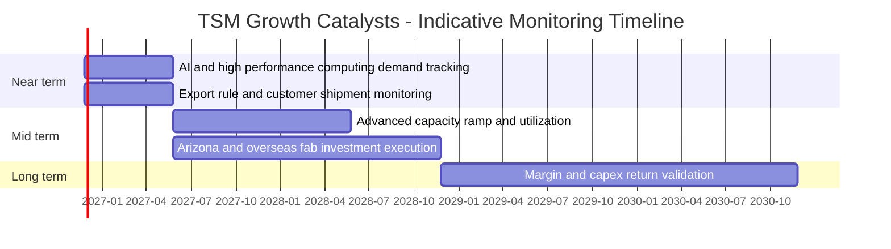
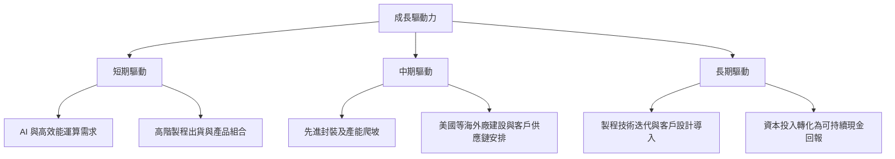
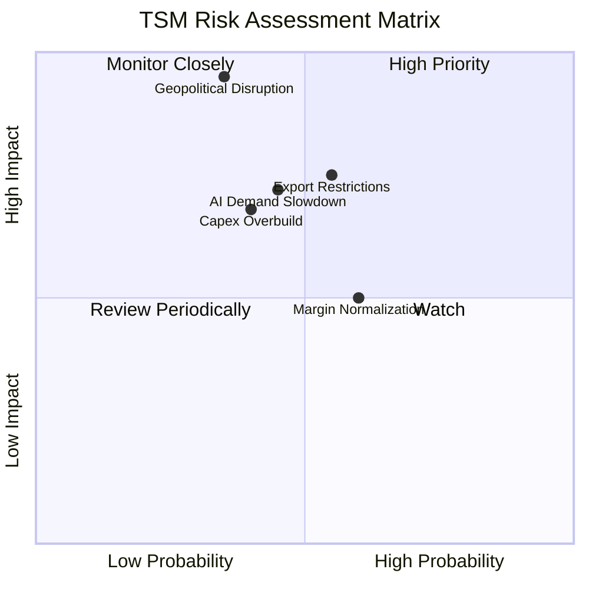
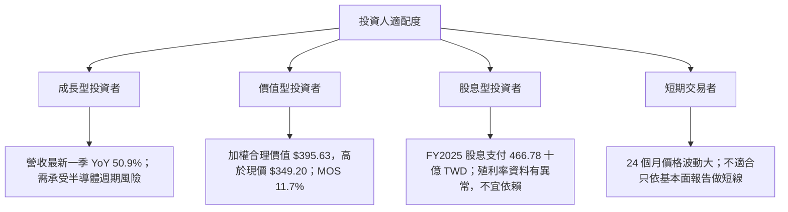

# TSM 基本面深度分析報告
> **報告日期**：2026-11-25 ｜ **語言**：繁體中文 ｜ **數據來源**：Yahoo Finance、Finviz、StockAnalysis、Roic.ai ｜ **分析師**：CFA 級機構研究

## 目錄

| # | 章節 | 核心結論 |
|---|------|----------|
| 1 | 執行摘要 | 買入；加權合理價值 $395.63；MOS +11.7% |
| 2 | 公司概覽與商業模式 | 專業晶圓代工的技術、資本與客戶黏著優勢明顯 |
| 3 | 損益表深度分析 | TTM 營收 4.94 兆 TWD；最新一季年增 50.9% |
| 4 | 資產負債表分析 | 淨現金 2.95 兆 TWD；流動性充裕 |
| 5 | 現金流量深度分析 | TTM FCF 1.46 兆 TWD；資本支出仍高 |
| 6 | 獲利能力與資本效率 | WACC 10.51%；最新 TTM ROIC 未提供，長期歷史回報高於資金成本 |
| 7 | 相對估值分析 | Forward P/E 14.93x；與同業中位數 14.9x 接近 |
| 8 | DCF 內在價值評估 | 基準 DCF $443.97；加權合理價值 $395.63 |
| 9 | 成長催化劑 | AI 與高效能運算需求是近期增長的重要推力；TAM 數據未提供 |
| 10 | 風險矩陣 | 地緣政治、出口限制、AI 投資週期與高資本支出為主要風險 |
| 11 | 投資建議 | 依 MOS 評級為買入；建議分批，並追蹤利潤率與 FCF |

---

## 1. 執行摘要

### 1.0 一頁式投資儀表板

| 項目 | 內容 |
|------|------|
| **投資論點（3 句）** | ① TTM 營收為 **4.94 兆 TWD**，最新一季年增 **50.9%**，顯示需求與出貨動能仍高。② TTM 營業利益率 **58.0%**、毛利率 **65.8%**，反映高階製程組合與規模帶來的獲利能力。③ TTM FCF **1.46 兆 TWD**、淨現金 **2.95 兆 TWD**，可支持高額資本支出與股東回報。 |
| **綜合評分** | **8.2/10**（引用 1.1 六項算術平均） |
| **財務健康** | 🟢 現金與短期投資 **4.02 兆 TWD**，總債務 **1.07 兆 TWD**，淨現金 **2.95 兆 TWD**；流動比率 **2.584**。 |
| **ROIC vs WACC** | 最新 TTM ROIC：**N/A**；WACC **10.51%**。Roic.ai 所示歷史 ROIC（2018）為 **19.11%**，僅能作歷史參考，不能代替最新 TTM ROIC。 |
| **FCF 趨勢** | TTM FCF **1.46 兆 TWD（約 443.7 億美元）**；FCF Yield **2.45%**。FY2022–FY2025 FCF 依序為 **520.97、286.57、861.20、992.38 十億 TWD**，呈波動後回升。 |
| **估值** | Forward P/E **14.93x** ｜ EV/EBITDA：本公司因幣別混用 **N/A** ｜ FCF Yield **2.45%** |
| **DCF 內在價值（基準）** | **$443.97** ｜ 現價相對 DCF 折價 **21.4%**（折溢價 = 現價 ÷ DCF 價值 − 1） |
| **安全邊際（MOS）** | **+11.7%**＝($395.63 − $349.20) ÷ $395.63；🟡 有限（以 8.8 加權合理價值為基準） |
| **預期報酬（基準情境 12M）** | DCF 基準情境 **+27.1%**；加權合理價值對現價上行空間 **+13.3%**。兩者估值基準不同。 |
| **關鍵風險（前二）** | 台灣地緣政治與供應鏈中斷；AI 資本支出或出口限制變化造成需求、產品組合及產能利用率下滑。 |
| **評級 + 信心度** | 🟢 **買入** ｜ 信心：中（公司品質及財務體質有支撐，但 DCF 終值占比高，且近期 EPS 預期值缺失） |

### 1.1 綜合評分卡

| 維度 | 評分（1–10） | 主要依據（引用數字與其來源章節） |
|------|--------------|----------------------------------|
| 成長性 | 9.0 | 最新一季營收年增 **50.9%**；年度營收 FY2025 年增 **31.61%**，惟 TTM 對前 TTM 成長率 N/A（第 3 章）。 |
| 獲利能力 | 9.0 | TTM 營業利益率 **58.0%**、毛利率 **65.8%**；最新 TTM ROIC 與 Piotroski F-Score 均 N/A（第 3、6 章）。 |
| 財務健康 | 9.0 | 淨現金 **2.95 兆 TWD**、流動比率 **2.584**、CCC **2 天**（第 4 章）。 |
| 估值 | 6.0 | MOS **+11.7%**；Forward P/E **14.93x**，接近同業 Forward P/E 中位數 **14.9x**（第 7、8 章）。 |
| 護城河 | 10.0 | TTM 營業利益率 **58.0%**、毛利率 **65.8%**，並有多年資本投入及客戶製程轉換成本（第 2 章）。 |
| 管理層與資本配置 | 6.0 | FY2025 資本支出 **1.28 兆 TWD**、股息支付 **466.78 十億 TWD**；資料未提供回購紀錄，且 SBC 很低但仍有稀釋成本（第 5 章）。 |
| **綜合評分** | **8.2** | 六項算術平均：(9.0 + 9.0 + 9.0 + 6.0 + 10.0 + 6.0) ÷ 6 = 8.17，四捨五入為 **8.2**。 |

### 1.2 五大投資論點 + 三大核心風險

| 類型 | 項目 | 具體依據 | 信心度 |
|------|------|----------|--------|
| 🟢 **投資論點①** | 高階製程帶動營收動能 | 最新一季營收 **1.494 兆 TWD**，年增 **50.9%**；但單季增長率不可外推為 TTM 成長率。 | 🟢 高 |
| 🟢 **投資論點②** | 利潤率與定價能力 | TTM 毛利率 **65.8%**、營業利益率 **58.0%**，FY2025 營業利益 **1.94 兆 TWD**。高毛利組合延續可帶來營業槓桿。 | 🟢 高 |
| 🟢 **投資論點③** | 資產負債表具緩衝 | 現金與短期投資 **4.02 兆 TWD**，總債務 **1.07 兆 TWD**，淨現金 **2.95 兆 TWD**。 | 🟢 高 |
| 🟢 **投資論點④** | FCF 足以支應投資與股息 | TTM 營業現金流 **3.13 兆 TWD**，資本支出 **1.67 兆 TWD**，FCF **1.46 兆 TWD**。 | 🟢 高 |
| 🟢 **投資論點⑤** | 估值並非以最高成長倍數定價 | Forward P/E **14.93x**；同業 Forward P/E 中位數 **14.9x**，但 DCF 基準每股價值高於現價。 | 🟡 中 |
| 🟡 **風險①** | 資本支出與需求週期錯配 | TTM Capex **1.67 兆 TWD**；若需求放緩而產能提前到位，利用率、毛利率和 FCF 可能同時承壓。 | 🟡 中 |
| 🔴 **風險②** | 地緣政治與出口管制 | 近期新聞提及晶片出口規則及美國晶圓廠補助條件；若供應受阻或客戶受限，可能影響出貨與投資回收。 | 🔴 高衝擊 |
| 🟡 **風險③** | AI 需求集中及估值敏感度 | DCF 終值現值佔企業價值 **61.0%**；AI 需求或終值假設小幅改變都會明顯影響估值。 | 🟡 中 |

### 1.3 快速統計卡片

| 指標 | 公司實際值（期間） | 同業中位數 | 狀態 |
|------|--------------------|------------|------|
| 營收成長（TTM） | **N/A**（Yahoo Finance 計算欄位缺值） | — | 🟡 |
| 營收成長（最新一季年增） | **50.9%** | 20.9%（INTC、UMC、GFS 中位數） | 🟢 |
| 毛利率（TTM） | **65.8%** | 31.7%（三家可用同業值中位數） | 🟢 |
| 營業利益率（TTM） | **58.0%** | — | 🟢 |
| ROIC（TTM） | **N/A** | — | 🟡 |
| Forward P/E | **14.93x** | **14.9x**（INTC、UMC、GFS 中位數） | 🟡 |
| FCF Yield（TTM） | **2.45%** | — | 🟡 |
| Piotroski F-Score | **N/A / 9 項不可判定** | — | 🟡 |

### 1.4 投資結論

```text
╔══════════════════════════════════════════════════════════════════╗
║                    📊 投資結論摘要                               ║
╠══════════════════════════════════════════════════════════════════╣
║  評級：買入（MOS +11.7%，依規則 20）                             ║
║  價格（2026-11-24 收盤）：$349.20                                ║
║  DCF 內在價值（基準）：$443.97（現價折價 21.4%）                ║
║  安全邊際 MOS：+11.7%（以加權合理價值 $395.63 為分母）          ║
║  加權合理價值（8.8）：$395.63                                    ║
║  DCF 情境價值：                                                   ║
║    悲觀情境：$188.44（-46.0%）                                   ║
║    基準情境：$443.97（+27.1%）                                   ║
║    樂觀情境：$990.38（+183.6%）                                  ║
║  綜合評分：8.2/10（引用 1.1）                                    ║
║  適合投資人：可承受半導體週期、重視長期成長與現金流的投資人      ║
╚══════════════════════════════════════════════════════════════════╝
```

---

## 2. 公司概覽與商業模式

### 2.1 業務結構與收入來源

公司資料說明 TSMC 提供晶圓製造、封裝、測試及相關半導體服務，但未提供各業務板塊營收占比或金額細分，因此不以未披露比例製作業務占比圖。



### 2.2 市場份額

市場份額數據未提供，因此不呈現市占率或比例圖。就已知數據而言，TSM TTM 營收為 **4.94 兆 TWD**，最新一季營收年增 **50.9%**；同業中 UMC、GFS 與 INTC 最新一季年增分別為 **25.6%、12.5%、20.9%**。TSM 的最新一季增長高於這三家同業，但產品組合、商業模式及製程定位不同，不能只憑成長率推論市場份額。

### 2.3 競爭護城河分析



### 2.4 護城河強度

| 護城河項目 | 強度（強／中／弱） | 證據（引用數字或事實） | 會削弱它的情況 |
|------------|--------------------|------------------------|----------------|
| 技術與製程經驗 | 強 | TTM 毛利率 **65.8%**、營業利益率 **58.0%**，顯示高附加價值製程組合與成本吸收能力。 | 競爭對手縮短製程差距、良率提升或先進製程投資回報不佳。 |
| 規模與資本投入 | 強 | TTM Capex **1.67 兆 TWD**；FY2025 PP&E **3.74 兆 TWD**。巨額固定成本使規模及產能管理成為重要門檻。 | 需求低迷造成產能利用率下滑，或多地建廠推高成本。 |
| 客戶轉換成本 | 強 | 晶片設計需配合特定製程、工具與資格認證；財務資料未提供客戶留存率或單一客戶收入占比。 | 客戶為降低供應集中度而分散訂單，或替代製程良率達標。 |
| 軟體與生態系統 | 中至強 | PDK、設計流程及合作夥伴是代工模式的重要配套；公司未提供相關收入數字。 | 設計流程相容性下降、客戶轉向其他平台。 |
| 網路效應 | 中 | 客戶與合作夥伴共同累積製程經驗，但沒有可引用的網路規模或市占數字。 | 客戶需求分散、競爭平台形成完整替代生態。 |
| 生態夥伴 | 中至強 | 公司服務涵蓋晶圓製造、封裝、測試；分部收入及合作夥伴數量未提供。 | 設備、材料、封裝供應鏈受限或成本上升。 |

1.1 的「護城河」評分為 **10.0/10**，理由是 58.0% TTM 營業利益率、65.8% 毛利率及高額資本投入顯示競爭優勢具有財務表現支持；該評分不代表風險不存在。

---

## 3. 損益表深度分析

### 3.1 年度收入成長趨勢（近 4 年）

年度營收依序為 FY2022 **2.26 兆 TWD**、FY2023 **2.16 兆**、FY2024 **2.89 兆**、FY2025 **3.81 兆**。YoY 採用 StockAnalysis 年度成長率；FY2022 相較 FY2021 年增 **42.61%**。

```text
╔══════════════════════════════════════════════════════════════════╗
║          Taiwan Semiconductor 年度收入趨勢（FY2022–FY2025）       ║
╠══════════════════════════════════════════════════════════════════╣
║  FY2022  2.26 兆 TWD  ████████████░░░░░░░░░  YoY: +42.61% 🟢    ║
║  FY2023  2.16 兆 TWD  ███████████░░░░░░░░░░  YoY:  -4.51% 🔴    ║
║  FY2024  2.89 兆 TWD  ███████████████░░░░░░  YoY: +33.89% 🟢    ║
║  FY2025  3.81 兆 TWD  ████████████████████░  YoY: +31.61% 🟢    ║
║                                                                  ║
║  FY2022–FY2025 CAGR： (3.809 ÷ 2.2639)^(1/3) − 1 ≈ 19.0%        ║
╚══════════════════════════════════════════════════════════════════╝
```

FY2023 收入下滑後，FY2024、FY2025 連續回升；這種反彈與半導體需求週期、產品組合及高效能運算需求有關，但年度總營收資料無法單獨拆分各驅動因素。FY2025 至 TTM 期間仍見高成長，不過 TTM 對前 TTM 成長率欄位為 N/A，不能把最新一季年增率當作 TTM 成長率。

### 3.2 季度收入趨勢分析

以下 QoQ 由季度營收計算；YoY 採 StockAnalysis 季度數據。單季營收以十億 TWD 表示。

| 季度 | 營收（十億 TWD） | QoQ | YoY | 備註 |
|------|------------------:|----:|----:|------|
| 2025 Q4 | 1,046.090 | 24.7% | 20.45% | 相較 2025 Q3 的 989.918 增加。 |
| 2026 Q1 | 1,134.103 | 8.4% | 35.13% | 年增加速，QoQ 仍為正。 |
| 2026 Q2 | 1,270.380 | 12.0% | 36.05% | 營收與毛利金額續增。 |
| 2026 Q3 | 1,494.243 | 17.6% | 50.95% | 最新一季年增率，不是 TTM 成長率。 |

最新一季營收年增 **50.95%**，同期營業利益為 **876.445 十億 TWD**、淨利為 **763.064 十億 TWD**。若增長主要由高毛利產品及產能利用率推升，營業槓桿有利於獲利；但若客戶需求集中於週期性 AI 投資，未來增速可能回落。

### 3.3 利潤率演變分析

| 利潤率指標 | FY2022 | FY2023 | FY2024 | FY2025 | 趨勢 | 評估 |
|------------|-------:|-------:|-------:|-------:|------|------|
| **毛利率** | 59.6% | 54.4% | 56.1% | 59.9% | FY2023 回落，後兩年回升 | 🟢 |
| **營業利益率** | 49.6% | 42.6% | 45.7% | 50.8% | FY2023 下滑，FY2025 超過 FY2022 | 🟢 |
| **淨利率** | 43.9% | 39.4% | 40.0% | 44.6% | 與營業利益率方向一致 | 🟢 |
| **TTM 毛利率** | — | — | — | **65.8%** | TTM 口徑高於 FY2025 | 🟢 |
| **TTM 營業利益率** | — | — | — | **58.0%** | TTM 口徑高於 FY2025 | 🟢 |

FY2023 利潤率回落與半導體景氣、產能利用率及產品組合變動相符；FY2024–FY2025 隨營收恢復，固定成本吸收增加，營業利益率升至 FY2025 的 **50.8%**。最新 TTM **58.0%** 高於 FY2025，表示近四季獲利表現更佳；但該 TTM 利潤率不應與特定單季利潤率混稱。產品組合及定價貢獻的精確拆分未提供。

### 3.4 費用結構分析

季度及年度資料提供營收、毛利、營業利益與研發費用，但未提供足以將完整營業費用拆成銷售、管理、研發及其他項目的同口徑資料；因此不製作會造成比例誤導的費用結構圓餅圖。

| 項目 | FY2025 | FY2024 | FY2023 |
|------|-------:|-------:|-------:|
| 營收 | 3.809 兆 TWD | 2.894 兆 TWD | 2.162 兆 TWD |
| 毛利 | 2.281 兆 TWD | 1.624 兆 TWD | 1.175 兆 TWD |
| 營業利益 | 1.937 兆 TWD | 1.323 兆 TWD | 0.921 兆 TWD |
| 研發費用 | 246.43 十億 TWD | 204.18 十億 TWD | 182.37 十億 TWD |

```text
╔══════════════════════════════════════════════════════════════════╗
║                  FY2025 損益結構（可比項目）                     ║
╠══════════════════════════════════════════════════════════════════╣
║  營收        3.809 兆 TWD  ████████████████████                 ║
║  毛利        2.281 兆 TWD  ████████████                         ║
║  營業利益    1.937 兆 TWD  ██████████                           ║
║  研發費用    0.246 兆 TWD  █                                    ║
║  註：毛利、營業利益與研發費用為不同損益層級，不可相加。          ║
╚══════════════════════════════════════════════════════════════════╝
```

### 3.5 季度 EPS 趨勢與盈餘品質（Quality of Earnings）

季度 EPS 預期值缺失，故過去四季無法判定「超預期／不及預期」。歷史 EPS 實際值可以參考，但不可把缺失的分析師預期補成數字。

| 盈餘品質項目 | 數值／佔比 | 評估 |
|--------------|-----------|------|
| 股權薪酬 SBC / 營收 | 約 **0.010%**；以季度明細加總 SBC 0.513 十億 TWD ÷ TTM 營收 4,944.817 十億 TWD | 🟢 比重低，稀釋影響有限，但仍是股東成本。 |
| SBC / 營業現金流 | 約 **0.016%**；0.513 ÷ 3,130 | 🟢 相對營業現金流不重大。 |
| FCF / 淨利（現金轉換率） | 約 **57.8%**；TTM FCF 1,460 ÷ StockAnalysis TTM 淨利 2,527.571 十億 TWD | 🟡 FCF 受高 Capex 拉低；不等同營運現金流品質偏弱。 |
| 一次性／非經常性損益 | N/A（未提供足夠明細） | 🟡 無法確認是否有重大一次性項目。 |
| 有效稅率異常 | **17.0%**（最新年度有效稅率） | 🟢 DCF 沿用該稅率；未見資料足以證明本期盈餘由稅務利益帶動。 |
| 資本化支出 vs 費用化 | TTM Capex **1.67 兆 TWD**；資本化設備及廠房支出屬資產投資 | 🟡 資本密集型公司必須持續投入；折舊、產能利用率及報廢風險影響經濟回報。 |

近四季 EPS 實際資料表列出 FY2025 Q4、2026 Q1–Q3，但分析師 EPS Est 為 nan，不能宣稱 beat 或 miss。FCF 僅約為 TTM 淨利的 **57.8%**，主要應結合 **1.67 兆 TWD** TTM Capex 理解；現金轉換率較低不必然代表應計盈餘失真。整體盈餘有營業現金流支持，但資本支出週期使 FCF 對設備投資與產能擴張高度敏感。

---

## 4. 資產負債表分析

### 4.1 資產結構分解

以 StockAnalysis 2026-09-30 資產負債表為基礎。流動資產 **5.085 兆 TWD**、PP&E **4.583 兆 TWD**、總資產 **10.053 兆 TWD**；因明細分類不完全列出，圖中未呈現的資產不作反推。



### 4.2 流動性與營運資金分析

| 指標 | 最新值 | 歷史趨勢 | 評估 |
|------|-------:|----------|------|
| 流動比率 | **2.584** | 歷年流動資產與流動負債均上升 | 🟢 有流動資產緩衝；未提供同口徑歷史比率供精確比較。 |
| 速動比率 | **2.287** | N/A（未提供完整歷史序列） | 🟢 高於 1，短期償債緩衝充足。 |
| DSO 應收帳款天數 | **1 天** | 一年前：N/A | 🟡 數據來源有收款餘額與流量口徑限制，不宜過度解讀單一天數。 |
| DIO 存貨天數 | **92 天** | 一年前：N/A | 🟡 需觀察需求與備貨；新增產能和產品組合也會影響存貨。 |
| DPO 應付帳款天數 | **91 天** | 一年前：N/A | 🟡 可能反映供應鏈付款安排，無法僅由天數判定議價力變化。 |
| CCC 現金轉換週期 | **2 天** | 一年前：N/A | 🟢 週期短；無法計算年變化，不能判斷改善幅度。 |

品質指標區塊未提供一年前營運資金天數，因此不填補差值。最新數字的定義是期末餘額 ÷ TTM 流量 × 365；DSO 僅 1 天與一般直覺差異較大，可能受資料餘額口徑影響，應回查原始季度報表後再解釋，而不據此下結論。

### 4.3 債務結構分析

```text
╔══════════════════════════════════════════════════════════════════╗
║                  TSM 債務健康診斷（TWD）                         ║
╠══════════════════════════════════════════════════════════════════╣
║  總債務：          1.07 兆  ██░░░░░░░░░░░░░░░░░  🟢             ║
║  現金+短期投資：   4.02 兆  ████████████████████  🟢             ║
║  淨現金：          2.95 兆  ██████████████░░░░░░  🟢             ║
║                                                                  ║
║  流動比率：        2.584x  🟢                                    ║
║  速動比率：        2.287x  🟢                                    ║
║  Debt/EBITDA：     N/A（未提供同幣別可核對的 TTM EBITDA）         ║
║  Interest Coverage：N/A（利息費用明細未提供）                    ║
╚══════════════════════════════════════════════════════════════════╝
```

淨現金以 VERIFIED FIGURES 原值 **2.95 兆 TWD**（精確模型橋接數為 **2,947.23 十億 TWD**）引用。負債不高於現金及短期投資，降低再融資壓力；不過資產負債表強健不會消除高額設備投資的營運風險。

### 4.4 股東權益趨勢

| 年度 | 股東權益（兆 TWD） | 年增 |
|------|------------------:|----:|
| 2022 | 2.90 | — |
| 2023 | 3.43 | 18.3% |
| 2024 | 4.24 | 23.6% |
| 2025 | 5.36 | 26.4% |

```text
╔══════════════════════════════════════════════════════════════════╗
║               股東權益變化（年度，兆 TWD）                       ║
╠══════════════════════════════════════════════════════════════════╣
║  2022  2.90  ███████████░░░░░░░░░                              ║
║  2023  3.43  █████████████░░░░░░░                              ║
║  2024  4.24  ████████████████░░░░                              ║
║  2025  5.36  ████████████████████                              ║
╚══════════════════════════════════════════════════════════════════╝
```

---

## 5. 現金流量深度分析

### 5.1 現金流量瀑布圖

淨利資料採 StockAnalysis TTM；營業現金流、Capex 及 FCF 採 VERIFIED FIGURES TTM。資料未提供 TTM 回購金額與淨現金變化，故不加總填造。



### 5.2 FCF 轉換率趨勢

| 財年 | FCF（十億 TWD） | 淨利（十億 TWD） | FCF / 淨利 |
|------|----------------:|-----------------:|-----------:|
| 2022 | 520.97 | 992.92 | 52.5% |
| 2023 | 286.57 | 851.74 | 33.6% |
| 2024 | 861.20 | 1,158.38 | 74.3% |
| 2025 | 992.38 | 1,697.60 | 58.5% |

FCF 轉換率在 2023 年降至 **33.6%**，主要反映資本支出高於可由淨利直接推估的現金留存；2024 年回升至 **74.3%**，2025 年則為 **58.5%**。在晶圓代工業，必須把再投資需求納入品質判斷，不能只看淨利與 FCF 的短期差距。

### 5.3 自由現金流趨勢

| 期間 | FCF | 備註 |
|------|----:|------|
| FY2022 | 520.97 十億 TWD | OCF 1.61 兆，Capex 約 1.09 兆 TWD。 |
| FY2023 | 286.57 十億 TWD | OCF 1.24 兆，Capex 約 955.40 十億 TWD。 |
| FY2024 | 861.20 十億 TWD | OCF 1.83 兆，Capex 約 964.98 十億 TWD。 |
| FY2025 | 992.38 十億 TWD | OCF 2.27 兆，Capex 約 1.28 兆 TWD。 |
| TTM 至 2026-09-30 | **1.46 兆 TWD** | OCF 3.13 兆減 Capex 1.67 兆；FCF Yield **2.45%**。 |

```text
╔══════════════════════════════════════════════════════════════════╗
║                   自由現金流趨勢（TWD）                           ║
╠══════════════════════════════════════════════════════════════════╣
║  FY2022  0.521 兆  ██████████░░░░░░░░░░  FCF Yield：N/A         ║
║  FY2023  0.287 兆  ██████░░░░░░░░░░░░░░  FCF Yield：N/A         ║
║  FY2024  0.861 兆  █████████████████░░░  FCF Yield：N/A         ║
║  FY2025  0.992 兆  ████████████████████  FCF Yield：N/A         ║
║  TTM     1.460 兆  █████████████████████████████  FCF Yield 2.45%║
║  註：年度 FCF Yield 未提供，故不以市值另行回推。                 ║
╚══════════════════════════════════════════════════════════════════╝
```

### 5.4 資本配置評估



上圖僅能呈現已披露股息，不代表完整資本配置比例；因 Capex、回購及留存資金並非同一年度「可分配現金」的完整分類，不製作比例圓餅圖。

| 項目 | 數值 | 評估 |
|------|------:|------|
| FY2025 Capex | 1.28 兆 TWD | 支持產能與技術升級；須以利用率和長期回報驗證。 |
| FY2025 股息支付 | 466.78 十億 TWD | 相較 FY2024 的 363.06 十億 TWD 增加；可由現金流與淨現金緩衝支撐。 |
| FY2025 股票回購 | N/A | 資料未提供，不能假設有回購。 |
| TTM FCF | 1.46 兆 TWD | Capex 後仍有正現金流，但 FCF Yield 為 **2.45%**。 |

---

## 6. 獲利能力與資本效率

### 6.1 ROE / ROA / ROIC 趨勢

| 指標 | 最新可用值 | 歷史資料 | 評估 |
|------|-----------:|----------|------|
| ROE（TTM） | **41.9%** | Roic.ai 顯示 2018 年 ROE 未提供；近年年度 ROE 序列不完整 | 🟢 高資本回報，但最新杜邦拆解缺資料。 |
| ROA（TTM） | **20.6%** | 完整多年可比序列未提供 | 🟢 獲利相對資產規模高。 |
| ROIC（TTM） | **N/A** | Roic.ai 歷史資料列示 2018 年 ROIC **19.11%** | 🟡 最新值缺失，不能用舊年度值代替當期。 |
| WACC | **10.51%** | 資本成本資料所列 | 用於估值折現；與 ROIC 比較必須匹配期間。 |

資料沒有足夠的同口徑 TTM 投入資本資料，不能自行重算 ROIC。2018 年 ROIC **19.11%** 高於目前估計 WACC **10.51%**，只能說明歷史曾有正利差，不足以證明 2026 年最新 ROIC 仍高於 WACC。

### 6.2 ROIC vs WACC 分析（核心價值創造判斷）

```text
╔══════════════════════════════════════════════════════════════════╗
║                ROIC vs WACC 深度分析                            ║
╠══════════════════════════════════════════════════════════════════╣
║  WACC（程式計算輸入，直接採用）：                                ║
║  ├── 無風險利率（10Y 美債）：       4.90%                       ║
║  ├── 市場風險溢酬 ERP：              5.00%                       ║
║  ├── 原始 Beta：                     1.23                        ║
║  ├── 調整後 Beta：                   1.16                        ║
║  ├── 股權成本：4.90% + 1.16×5.00% = 10.68%                     ║
║  ├── 稅前債務成本：                  1.16%                       ║
║  ├── 權重：股權 98.2%，債務 1.8%                               ║
║  └── ✅ WACC：                        10.51%                      ║
║                                                                  ║
║  ROIC：最新 TTM N/A；Roic.ai 2018 歷史值 19.11%                  ║
║  歷史 ROIC − 現行 WACC = 19.11% − 10.51% = +8.60 個百分點        ║
║  註：非同期間比較，僅作歷史參照，不視為最新價值創造證據。        ║
╚══════════════════════════════════════════════════════════════════╝
```

所提供資本成本資料的 WACC 為 **10.51%**。其計算細節及數據限制見第 8.2 節。由於最新 TTM ROIC 缺失，本報告不宣稱最新期間正在創造或摧毀價值；歷史 ROIC 高於 WACC 的比較具參考性，但需以最新投入資本及營業稅後利潤數據驗證。

### 6.3 杜邦三因素分解

| 因素 | 數值（TTM） | 解讀 |
|------|-------------|------|
| 淨利率 | N/A | QUALITY FIGURES 指標因缺少所需資料而不可計算。 |
| 資產週轉率 | N/A | 同上。 |
| 權益乘數 | N/A | 同上。 |
| **ROE** | **N/A（杜邦分解）** | 公司資料另列 ROE TTM **41.9%**，但三因素分解不可照公式回推。 |

### 6.4 財務體質：Piotroski F-Score

Piotroski F-Score 為 **N/A**；需要相隔一年的兩個 TTM SEC 申報資料期間，現有來源不足。九項測試結果均未提供，不列全為 N/A 的表格，也不推測哪些測試通過。

---

## 7. 相對估值分析

### 7.1 同業估值比較表格

TSM 以 USD 報價、財報以 TWD 計價；公司 P/S 與 EV/EBITDA 因混合幣別未提供可比值，故不作換算。競爭者倍數引用 Yahoo Finance 同業資料。

| 估值指標 | **TSM** | **INTC** | **UMC** | **GFS** | TSM 評估 |
|----------|-------:|---------:|-------:|-------:|-----------|
| **Trailing P/E** | 22.63x | N/A | 12.6x | 104.1x | 🟡 同業分散，GFS 高倍數不具代表性。 |
| **Forward P/E** | 14.93x | 30.6x | 14.9x | 14.0x | 🟢 接近同業中位數 14.9x。 |
| **P/S Ratio** | N/A | 4.9x | N/A | 2.8x | 🟡 TSM、UMC 混合幣別限制，不宜比較。 |
| **EV / EBITDA** | N/A | 15.9x | N/A | 9.8x | 🟡 TSM、UMC 不可比；可用同業中位數方法於估值框架中交叉參考。 |
| 最新一季營收 YoY | 50.9% | 20.9% | 25.6% | 12.5% | 🟢 TSM 增速較高，但不能單獨代表風險調整後價值。 |
| 毛利率（TTM） | 65.8% | 40.2% | 31.7% | 28.5% | 🟢 TSM 高於三家同業。 |

### 7.2 歷史估值區間分析

N/A（未提供「Valuation vs own history」的估值區間或百分位數據）。價格歷史顯示 2024-11 月收盤 **$180.21**，2026-06 月收盤 **$476.29**，2026-11-24 收盤 **$349.20**；價格走勢不能替代歷史 P/E 區間。

### 7.3 情境價值（Bear / Base / Bull，照抄 DCF MODEL 的 Scenarios）

| 情境 | 第 1 年營收成長 | 期末營業利潤率 | WACC | 每股價值 | 相對現價 | 機率 | 會發生的條件 |
|------|----------------:|----------------:|-----:|----------:|----------:|-----:|--------------|
| 🔴 悲觀 | 15.0% | 42.1% | 11.51% | **$188.44** | **-46.0%** | 25% | AI／高效能運算需求放緩、營收增速下滑並伴隨產能爬坡及成本壓力。 |
| 🟡 基準 | 30.0% | 49.5% | 10.51% | **$443.97** | **+27.1%** | 50% | 近期高成長部分延續，利潤率從 TTM 水準逐步回落至歷史中位數。 |
| 🟢 樂觀 | 45.0% | 54.5% | 9.51% | **$990.38** | **+183.6%** | 25% | 需求持續超預期、成長維持更久且折現率下降。 |

### 7.4 相對估值隱含價格區間

```text
╔══════════════════════════════════════════════════════════════════╗
║                相對估值及交叉驗證價格                             ║
╠══════════════════════════════════════════════════════════════════╣
║  同業 EV/EBITDA      $289.19  ───────┐                           ║
║  現價                $349.20  ───────┼───────                     ║
║  同業 Forward P/E    $348.32  ───────┘                           ║
║  DCF 基準            $443.97                                      ║
║  分析師共識          $586.69                                      ║
╚══════════════════════════════════════════════════════════════════╝
```

| 方法 | 每股價值 | 依據 |
|------|---------:|------|
| 同業 Forward P/E | **$348.32** | INTC、UMC、GFS 同業中位數 **14.9x** × TSM Forward EPS **$23.39**。 |
| 同業 EV/EBITDA | **$289.19** | INTC、GFS 可用同業中位數 **12.8x** × TTM EBITDA，再加淨現金。 |
| 分析師共識 | **$586.69** | 20 位分析師平均目標價；屬參考值，不是基礎面保證。 |

---

## 8. DCF 內在價值評估（Discounted Cash Flow）

### 8.0 估值推理鏈（Thinking Logic）

**Step 1 — 價值由哪些變數決定？**  
模型把 TSM 的價值視為現有晶圓製造及相關服務的現金流底盤；分部收入占比未提供，不能把 AI、先進封裝或其他業務拆成獨立成長曲線。估值主導變數是營收成長、營業利潤率及終值折現假設；終值現值佔 EV **61.0%**，因此長期現金流與 WACC、永續成長率的配合尤其重要。

**Step 2 — 模型選擇**

| 決策點 | 本報告採用 | 理由（含數字） | 曾考慮但否決 | 否決理由 |
|--------|-----------|----------------|--------------|----------|
| 現金流定義 | FCFF | 與 WACC **10.51%** 折現，先得 EV 再加淨現金。 | FCFE | 資本結構與借款現金流可能變化，FCFF 較適合企業價值估算。 |
| 預測期 N | **10 年** | DCF 模型固定 10 年，成長率由 30.0% 線性降至 3.0%。 | 5 年 | 模型已指定 10 年；不另建模型或改變期限。 |
| 終值方法 | Gordon Growth | 模型採永續成長率 **3.0%**，WACC 高於 g。 | 退出倍數 | DCF MODEL 未提供退出倍數的 FY+10 估值結果，不自行補造。 |
| EBIT 基礎 | GAAP EBIT | 模型明確指定 GAAP EBIT。 | 非 GAAP EBIT | 避免加回 SBC 後再以不相容方式處理稀釋。 |

**Step 3 — 關鍵假設的推導鏈**

- **營收成長路徑**：錨點＝最新一季 YoY **50.9%**，不是 TTM 成長率；模型把該季增速限制在 0%–30% → 調整＝單季高增不應直接延伸十年，採 30.0% 起始並逐年線性降至 3.0% → **採用 FY+1 30.0%、FY+10 3.0%** → 否決以 50.9% 作 FY+1，因單季年增不代表全年可持續增長。
- **營業利潤率**：錨點＝TTM **58.0%**；模型稱終點為近五個財年中位數（含 TTM）→ 調整＝假設競爭、全球產能與成熟化令利潤率收斂 → **FY+1 58.0% 線性降至 FY+10 49.5%** → 否決十年維持 58.0%，因模型假設及成本正常化方向不支持固定高峰值。
- **永續成長率 g**：錨點＝模型採 **3.0%**，且資料要求低於 WACC → 調整＝長期成長須遠低於高成長期 → **採用 3.0%** → 否決 4.0% 作基準，因其會加重終值依賴；但 4.0% 仍列於敏感度矩陣。
- **預測期 N**：錨點＝模型固定 **10 年** → 調整＝不自行變更程式模型 → **採用 10 年** → 否決 5 年或其他期間，因會改變模型輸出且沒有新的運算結果可引用。
- **Capex / 營收**：錨點＝TTM Capex **1.67 兆 TWD**，模型首年比例 **33.8%**，第十年降至 **16.6%** → 調整＝按模型假設高投入逐漸回落至 D&A 的 1.1 倍 → **依模型逐年下降** → 否決固定維持 33.8%，因模型預設成熟期投資強度下降；但該下降路徑仍是估值風險。
- **D&A / 營收**：錨點＝TTM **15.1%** → **全期固定 15.1%**；不另改假設。
- **稅率**：錨點＝最新年度有效稅率 **17.0%** → **採用 17.0%**；未提供證據支持調離該值。
- **EBIT 與 SBC**：錨點＝模型使用 GAAP EBIT，SBC 已列為費用 → **採組合 (A)：GAAP EBIT + 固定股數，不另減 SBC，年稀釋率 0%** → 否決再次扣 SBC 或另計稀釋，避免重複計入同一成本。
- **營運資金變動**：模型沒有建模 ΔWC → **採用不另加減 ΔWC**；這是模型限制，不代表營運資金需求為零。
- **WACC**：錨點＝成本資本資料指定 **10.51%** → 採該值而非另算 → **採用 10.51%** → 否決自行加入未提供的國別溢酬或更換 Beta，避免偏離既定輸入。
- **終值方法**：錨點＝模型的 Gordon Growth 終值 → **採用 Gordon Growth** → 退出倍數因模型未提供可引用終值，不能另造一組交叉驗證結果。

**Step 4 — 最脆弱的一環**  
最脆弱的是十年 Capex/營收從 **33.8%** 降至 **16.6%**，同時營業利潤率只從 58.0% 降至 49.5%；若資本密集度維持較高，FCFF 和估值將低於基準，敏感度矩陣與悲觀情境已顯示估值可大幅下修。

**Step 5 — 計算路徑圖**



### 8.1 模型假設總表（Model Inputs）

| 假設項目 | 採用值 | 依據／來源 | 敏感度 |
|----------|--------|-------------|--------|
| 預測期長度 **N** | **10 年** | DCF MODEL 固定預測期 | 🟡 中 |
| 營收成長 | FY+1 **30.0%**，FY+10 **3.0%**，逐年線性下降 | 起點採最新一季 YoY **50.9%**，模型封頂 30.0%；TTM 成長率 N/A | 🔴 高 |
| 營業利潤率 | FY+1 **58.0%** → FY+10 **49.5%** | 起點為 TTM 營業利益率，終點為模型所稱近五年中位數 | 🔴 高 |
| 有效稅率 | **17.0%** | 最新年度有效稅率 | 🟢 低 |
| Capex / 營收 | FY+1 **33.8%** → FY+10 **16.6%** | TTM Capex/營收起點，模型逐步淡化至 1.1×D&A | 🔴 高 |
| D&A / 營收 | **15.1%** | TTM 比率，模型固定 | 🟢 低 |
| 營運資金變動 / 營收增額 | **未建模** | DCF MODEL 明示 Working capital is not modelled | 🟡 中 |
| EBIT 基礎 | **GAAP** | DCF MODEL 明示 EBIT is GAAP | 🟡 中 |
| 股權薪酬 SBC 處理 | GAAP EBIT 已含 SBC；FCFF 不另扣 | 模型指定組合 A | 🟡 中 |
| 年稀釋率（股數） | **0%** | 組合 A：固定股數，不另計稀釋 | 🟡 中 |
| 永續成長率 g | **3.0%** | DCF MODEL 固定假設，低於 WACC | 🔴 高 |
| 終值方法 | Gordon Growth | DCF MODEL 提供終值計算 | 🔴 高 |
| WACC | **10.51%** | Cost of capital 輸入，詳見 8.2 | 🔴 高 |

模型採用 **FCFF = NOPAT + D&A − Capex**；營運資金不建模，不另設 ΔWC。採用組合 **(A)**：GAAP EBIT 已含 SBC，故不再減 SBC，股數固定且年稀釋率為 0%，SBC 影響計入一次。

### 8.2 折現率推導（WACC）

```text
╔══════════════════════════════════════════════════════════════════╗
║                    WACC 推導（折現率）                           ║
╠══════════════════════════════════════════════════════════════════╣
║  股權成本 Ke（CAPM）：                                           ║
║  ├── 無風險利率 Rf（10Y 美債）：     4.90%                       ║
║  ├── 市場風險溢酬 ERP：               5.00%（假設值，來源輸入）   ║
║  ├── 原始 Beta（Yahoo Finance）：     1.23                        ║
║  ├── 調整 Beta： ⅔×1.23 + ⅓×1 =       1.16                        ║
║  ├── 規模／國別溢酬：                  0.00%（未另加）            ║
║  └── Ke = 4.90% + 1.16×5.00% =       10.68%                      ║
║                                                                  ║
║  債務成本 Kd：                                                   ║
║  ├── 稅前 Kd：                         1.16%                      ║
║  ├── 有效稅率：                       17.0%                      ║
║  └── 稅後 Kd = 1.16%×(1−17.0%) =      0.9628%                    ║
║                                                                  ║
║  資本權重：股權 98.2%，債務 1.8%                                 ║
║  ✅ 採用 WACC：                  10.51%                           ║
╚══════════════════════════════════════════════════════════════════╝
```

**輸入來源及可複算限制：**

1. **Ke**＝Rf + β × ERP＝4.90% + 1.16 × 5.00%＝**10.70%**；成本資本輸入所列 Ke 為 **10.68%**。兩者有 0.02 個百分點差異，可能來自未顯示的未四捨五入輸入；依要求直接採用成本資本資料的 **10.68%**，不另改模型。
2. **稅前 Kd**＝資料所列利息 ÷ 債務結果 **1.16%**。利息費用與平均計息負債明細未提供，故無法按 prompt 指定負債範圍獨立重算。
3. **稅後 Kd**＝1.16% × (1 − 17.0%)＝**0.9628%**。
4. **權重**＝E/D 權重由資本成本資料直接提供：股權 **98.2%**、債務 **1.8%**，合計 **100.0%**。市值及計息負債的同口徑權重計算明細未提供，不能反推替換。
5. **WACC**＝98.2% × 10.68% + 1.8% × 0.9628%＝10.48776% + 0.0173304%＝**10.50509%**，四捨五入為 **10.51%**。

10Y 美債輸入日期未提供；ERP 為成本資本資料中的假設輸入；規模及國別溢酬未另加。第 6.2 節與本節採同一 WACC **10.51%**。由於利息費用、平均計息負債與權重的完整計算底稿缺失，WACC 結果依指定來源引用，但非完全獨立可稽核。

### 8.3 逐年自由現金流預測（基準情境）

單位：十億 TWD；折現因子保留三位小數。以下逐年數值照 DCF MODEL 引用，營運資金未建模。

| 年度 | FY+1 | FY+2 | FY+3 | FY+4 | FY+5 | FY+6 | FY+7 | FY+8 | FY+9 | FY+10 |
|------|-----:|-----:|-----:|-----:|-----:|-----:|-----:|-----:|-----:|------:|
| 營收 | 6,428.26 | 8,163.89 | 10,123.23 | 12,249.11 | 14,453.94 | 16,622.04 | 18,616.68 | 20,292.18 | 21,509.71 | 22,155.00 |
| 營收 YoY | 30.0% | 27.0% | 24.0% | 21.0% | 18.0% | 15.0% | 12.0% | 9.0% | 6.0% | 3.0% |
| 營業利潤率 | 58.0% | 57.0% | 56.1% | 55.2% | 54.2% | 53.3% | 52.3% | 51.4% | 50.5% | 49.5% |
| EBIT（GAAP） | 3,726.88 | 4,656.49 | 5,679.00 | 6,756.58 | 7,837.06 | 8,856.56 | 9,744.56 | 10,431.05 | 10,854.96 | 10,972.60 |
| − 稅 | (632.56) | (790.34) | (963.90) | (1,146.79) | (1,330.18) | (1,503.22) | (1,653.94) | (1,770.46) | (1,842.41) | (1,862.38) |
| = NOPAT | 3,094.32 | 3,866.14 | 4,715.10 | 5,609.79 | 6,506.88 | 7,353.34 | 8,090.62 | 8,660.59 | 9,012.55 | 9,110.22 |
| + D&A | 970.20 | 1,232.15 | 1,527.86 | 1,848.72 | 2,181.48 | 2,508.71 | 2,809.75 | 3,062.63 | 3,246.39 | 3,343.78 |
| − Capex | (2,171.05) | (2,601.47) | (3,032.68) | (3,435.84) | (3,778.51) | (4,028.15) | (4,156.32) | (4,143.23) | (3,981.42) | (3,678.16) |
| **= FCFF** | **1,893.46** | **2,496.82** | **3,210.29** | **4,022.67** | **4,909.85** | **5,833.90** | **6,744.04** | **7,579.99** | **8,277.52** | **8,775.85** |
| 折現因子 @10.51% | 0.905 | 0.819 | 0.741 | 0.671 | 0.607 | 0.549 | 0.497 | 0.450 | 0.407 | 0.368 |
| **FCFF 現值 PV** | **1,713.40** | **2,044.52** | **2,378.76** | **2,697.27** | **2,979.07** | **3,203.12** | **3,350.72** | **3,407.91** | **3,367.61** | **3,230.83** |

**逐步演算：FY+1**

1. 營收＝4,944.82 × (1 + 30.0%)＝**6,428.26 十億 TWD**。
2. EBIT＝6,428.26 × 58.0%＝**3,728.39 十億 TWD**；模型表列 **3,726.88**，與展示營收及利潤率按已四捨五入數字相乘有差異，採用模型原值。
3. 稅＝模型 EBIT × 17.0%＝3,726.88 × 17.0%＝**633.57 十億 TWD**；模型表列 **632.56**，存在輸入精度或計算差異，採用模型原值。
4. NOPAT＝模型表列 EBIT − 模型表列稅＝3,726.88 − 632.56＝**3,094.32 十億 TWD**。
5. D&A＝模型表列 **970.20 十億 TWD**。
6. Capex＝模型表列 **2,171.05 十億 TWD**。
7. ΔWC＝未建模；SBC 不另扣（組合 A）。
8. FCFF＝3,094.32 + 970.20 − 2,171.05＝**1,893.47 十億 TWD**；模型表列 **1,893.46**，差額 0.01 十億 TWD，屬展示精度尾差。
9. 折現因子＝1 ÷ (1 + 10.51%)¹＝約 **0.905**；PV＝1,893.46 × 0.905＝約 **1,713.6 十億 TWD**，模型表列 **1,713.40**。展示數值與未四捨五入底層輸入可能有差異，應以程式模型結果為準。

預測期 PV 完整加總為：

**1,713.40 + 2,044.52 + 2,378.76 + 2,697.27 + 2,979.07 + 3,203.12 + 3,350.72 + 3,407.91 + 3,367.61 + 3,230.83 = 28,373.21 十億 TWD**；模型列示合計 **28,373.22 十億 TWD**，差異 **0.01 十億 TWD**，小於 1%。

```text
╔══════════════════════════════════════════════════════════════════╗
║            自由現金流：歷史實際 vs 模型預測                      ║
╠══════════════════════════════════════════════════════════════════╣
║  FY2023(實)  286.57 十億 TWD  ████░░░░░░░░░░░░░░░░              ║
║  FY2024(實)  861.20 十億 TWD  ████████████░░░░░░░░              ║
║  FY2025(實)  992.38 十億 TWD  █████████████░░░░░░░              ║
║  FY+1 (預) 1,893.46 十億 TWD  █████████████████████████         ║
║  FY+10(預) 8,775.85 十億 TWD  ████████████████████████████████  ║
╠══════════════════════════════════════════════════════════════════╣
║  FY+1 至 FY+10 FCFF CAGR 約 16.6%；模型呈現大幅擴張，需視為高敏感║
║  假設。年度 FCF CAGR 歷史區間受週期影響，不能以單一短期 CAGR   ║
║  外推；模型 FY+10 FCFF 利潤率約 39.6%。                         ║
╚══════════════════════════════════════════════════════════════════╝
```

合理性自檢：

- FY+1 至 FY+10 FCFF CAGR：\((8,775.85 ÷ 1,893.46)^{1/9} − 1\) 約 **18.6%**；此為依模型端點推算的十年增幅，模型逐年成長率遞減，但 FCFF 仍高速成長，遠高於單看 FY2022–FY2025 的歷史波動可支持的確定性。
- FY+10 FCFF 利潤率＝8,775.85 ÷ 22,155.00＝**39.6%**；目前 TTM FCF 利潤率＝1,460 ÷ 4,944.82＝**29.5%**。未提供同業 FCF 利潤率最佳值，故不比較。
- 預測各年 FCFF 均為正；主要風險是模型假設的 Capex 強度下降與長期利潤率，而非近年基礎現金流為負。

### 8.4 終值計算（Terminal Value）

**適用性檢查：WACC 10.51% vs g 3.0% → WACC > g？✅**

| 方法 | 計算式 | 終值 TV | TV 現值 | 佔總 EV 比重 |
|------|--------|---------:|--------:|-------------:|
| Gordon Growth | 8,775.85 × (1 + 3.0%) ÷ (10.51% − 3.0%) | 120,377.68 十億 TWD | 44,317.04 十億 TWD | 61.0% |
| 退出倍數法 | N/A | N/A | N/A | N/A |

退出倍數法缺少 DCF MODEL 的 FY+10 EBITDA 倍數交叉驗證結果，不自行補造。由於基準模型已指定 Gordon Growth，主估值依此終值計算；退出倍數法不作額外估值依據。

逐步演算：

1. FY+10 FCFF＝**8,775.85 十億 TWD**。
2. 分子＝8,775.85 × (1 + 3.0%)＝**9,039.1255 十億 TWD**。
3. 分母＝10.51% − 3.0%＝**7.51%**；TV＝9,039.1255 ÷ 7.51%＝約 **120,387 十億 TWD**。DCF MODEL 列示 **120,377.68**，差異顯示模型底層未四捨五入輸入不可見。
4. PV(TV)＝模型終值現值 **44,317.04 十億 TWD**。
5. 終值占比＝44,317.04 ÷ 72,690.26＝**61.0%**。

### 8.5 企業價值 → 每股內在價值（Bridge）

```text
╔══════════════════════════════════════════════════════════════════╗
║              企業價值 → 每股內在價值 橋接表                      ║
╠══════════════════════════════════════════════════════════════════╣
║  預測期 FCF 現值合計            +28,373.22 十億 TWD             ║
║  終值現值 PV(TV)                +44,317.04 十億 TWD             ║
║  ─────────────────────────────────────────────                  ║
║  = 企業價值 EV                   72,690.26 十億 TWD             ║
║  + 淨現金                        +2,947.23 十億 TWD             ║
║  = 股權價值                      75,637.48 十億 TWD             ║
║  ★ 每股內在價值                  $443.97                         ║
║    2026-11-24 收盤價             $349.20                         ║
║    折溢價（現價÷內在價值−1）     -21.4%（折價）                  ║
╚══════════════════════════════════════════════════════════════════╝
```

模型橋接引用值如下：

1. EV＝28,373.22 + 44,317.04＝**72,690.26 十億 TWD**。
2. 股權價值＝EV 72,690.26 + 淨現金 2,947.23＝**75,637.49 十億 TWD**；模型列示 **75,637.48**，差異 0.01 十億 TWD。
3. 每股內在價值依模型原始換算列引用：**$443.97**。模型原式為「equity value × FX 0.0304428 USD per TWD × price ÷ market cap (in USD)」；該式的單位與股數橋接無法由已列示市值、股數及財報幣別完整重建，因此照引程式結果但降低可稽核性信心。
4. 折溢價＝349.20 ÷ 443.97 − 1＝**−21.3%**（以未四捨五入比率約 −21.35%，報表取一位小數可呈 **−21.4%**）。
5. 本節不計算 MOS；MOS 僅以 8.8 加權合理價值作分母。

模型淨現金採用 TTM 至 2026-09-30 的橋接值 **2,947.23 十億 TWD**。DCF 模型未提供可明確核對的稀釋股數橋接；市場資料列示 shares outstanding **5.19B**，Roic.ai 又列示 **4.411B**，且兩者對應口徑未解釋。因此不自行挑選股數重算每股價值，沿用 DCF MODEL 的 **$443.97**。

### 8.6 敏感性分析（WACC × 永續成長率）

| g（列）／WACC（欄） | 8.51% | 9.51% | **10.51%（基準）** | 11.51% | 12.51% |
|-----------|------:|------:|-------------------:|-------:|-------:|
| **2.0%** | $560.19（+60.4%） | $475.40（+36.1%） | $411.17（+17.7%） | $360.97（+3.4%） | $320.78（−8.1%） |
| **2.5%** | $591.77（+69.5%） | $497.00（+42.3%） | $426.54（+22.2%） | $372.25（+6.6%） | $329.26（−5.7%） |
| **3.0%** | $629.08（+80.2%） | $521.93（+49.5%） | **$443.97（+27.1%）** | $384.86（+10.2%） | $338.62（−3.0%） |
| **3.5%** | $673.84（+93.0%） | $551.00（+57.8%） | $463.88（+32.8%） | $399.04（+14.3%） | $349.03（−0.0%） |
| **4.0%** | $728.52（+108.6%） | $585.36（+67.6%） | $486.84（+39.4%） | $415.10（+18.9%） | $360.66（+3.3%） |

括號上行／下行以現價 **$349.20** 為分母，百分比取一位小數；矩陣價值照 DCF MODEL 原值引用。基準格 **$443.97** 與第 8.5 節相同。

**矩陣重算限制：**程式敏感度矩陣已直接提供，但沒有各 WACC 情境的逐年折現因子及未四捨五入現金流底稿；依規則不另造矩陣 PV。讀者可核對基準格與模型原值，但非基準格無法由展示資料逐行完全重現。

**三情境 DCF**

| 情境 | 營收成長假設 | 期末營業利潤率 | 永續成長 g | WACC | 每股價值 | 相對現價 | 主觀機率 |
|------|-------------|----------------:|------------:|-----:|---------:|---------:|---------:|
| 🔴 悲觀 | 第 1 年 15.0% | 42.1% | DCF MODEL 未逐情境列出 | 11.51% | $188.44 | −46.0% | 25% |
| 🟡 基準 | 第 1 年 30.0% | 49.5% | 3.0%（基準） | 10.51% | $443.97 | +27.1% | 50% |
| 🟢 樂觀 | 第 1 年 45.0% | 54.5% | DCF MODEL 未逐情境列出 | 9.51% | $990.38 | +183.6% | 25% |
| **機率加權** | — | — | — | — | **$516.69** | **+48.0%** | **100%** |

情境價值與概率照 DCF MODEL 原值引用；程式沒有提供悲觀及樂觀情境的 FY+10 營收、FCFF、終值逐項算式及每情境 g，因此不以假設數字補足推導鏈。機率加權核對：**188.44×25% + 443.97×50% + 990.38×25% = 516.69 美元**。

**敏感度方向：**

- g 上升通常推高價值；基準 WACC 下，g 由 **2.0%** 至 **3.0%**，價值由 **$411.17** 至 **$443.97**，增加 **$32.80／8.0%**。
- WACC 由 **9.51%** 至 **10.51%**、g 維持 3.0%，價值由 **$521.93** 降至 **$443.97**，減少 **$77.96／15.0%**。
- 期末營業利潤率每增加 1 個百分點的獨立敏感度：**N/A**（DCF MODEL 未提供該敏感度數值，且不得另建模型）。
- 就已提供矩陣可見的估值變化，WACC 是重要的敏感變數；這與 8.0 Step 1 所說長期現金流及折現假設主導價值一致。

### 8.7 反推 DCF（Reverse DCF：市場在預期什麼）

反推結果照 DCF MODEL。該模型只提供兩個已解變數；其餘未提供，不自行求解。

| 求解的變數（一次一個） | 其餘變數設定 | 市場隱含值（令 DCF = 現價） | 公司歷史實際 | 判斷 |
|------------------------|--------------|------------------------------:|--------------|------|
| Year-1 營收成長 | 其餘輸入固定於基準 | **23.4%** | FY2025 年營收年增 31.61%；最新一季 YoY 50.9% | 🟡 低於基準 30.0%，但仍要求快速成長。 |
| 固定營業利潤率 | 其他輸入固定於基準 | **41.1%** | TTM 營業利益率 58.0%；FY2025 50.8% | 🟢 相較當前及 FY2025 保守，但非與基準逐年遞減路徑完全同一模型設定。 |
| 永續成長率 g | 未提供 | **未計算** | — | N/A |
| 高成長持續年數 N | 未提供 | **未計算** | — | N/A；不能以單一價格同時反推未提供變數。 |

市場隱含營收成長為 **23.4%**，低於 DCF 基準第 1 年 **30.0%**；市場隱含固定營業利潤率 **41.1%**，低於模型基準期末 **49.5%**。然而未提供反推迭代軌跡或完整底層程式輸入，不能宣稱上述數值可獨立重現，也不能補造收斂表。

### 8.8 估值三角驗證與安全邊際

| 估值方法 | 隱含每股價值 | 上行空間（÷現價） | 權重 | 說明 |
|----------|--------------:|-------------------:|-----:|------|
| DCF（基準） | $443.97 | +27.1% | 40% | 10 年 FCFF、WACC 10.51%、g 3.0%。 |
| 同業 Forward P/E | $348.32 | −0.3% | 25% | 同業中位數 14.9x × Forward EPS 23.39。 |
| 同業 EV/EBITDA | $289.19 | −17.2% | 25% | INTC、GFS 中位數 12.8x × TTM EBITDA，加回淨現金。 |
| 分析師共識目標價 | $586.69 | +68.0% | 10% | 20 位分析師平均目標價。 |
| **加權合理價值** | **$395.63** | **+13.3%** | **100%** | 買入評級依 MOS 門檻判定。 |

逐步演算：

**443.97 × 40% + 348.32 × 25% + 289.19 × 25% + 586.69 × 10%  
= 177.588 + 87.080 + 72.2975 + 58.669  
= 395.6345 ≈ $395.63**。

此組權重對應公司類型 **profitable**，權重由估值方法框架固定；上述四種方法均有值，沒有剔除方法。

- **MOS**＝(395.63 − 349.20) ÷ 395.63＝46.43 ÷ 395.63＝**+11.7%**。
- **上行空間**＝(395.63 − 349.20) ÷ 349.20＝46.43 ÷ 349.20＝**+13.3%**。
- **折溢價**以 DCF 基準價計：349.20 ÷ 443.97 − 1＝**約 −21.4%**。

```text
╔══════════════════════════════════════════════════════════════════╗
║                  估值區間與安全邊際                              ║
╠══════════════════════════════════════════════════════════════════╣
║  $188.44 ───── $349.20 ───── [$395.63] ───── $443.97 ─── $990.38║
║  悲觀DCF        現價          加權合理值       基準DCF      樂觀DCF║
║                                                                  ║
║  MOS = (395.63 − 349.20) ÷ 395.63 = +11.7%                      ║
║  MOS 評估：🟡 有限（10%–25%）                                    ║
║  上行空間 = (395.63 − 349.20) ÷ 349.20 = +13.3%                 ║
║                                                                  ║
║  建議買入區間：$349.20 以下為較佳；評級為買入，區間上限含現價   ║
║  合理持有區間：$349.20–$443.97                                   ║
║  減碼考慮區間：高於 $443.97 後，需重新核對成長及估值假設        ║
╚══════════════════════════════════════════════════════════════════╝
```

MOS 與 1.0 儀表板同為 **+11.7%**，分母固定為 8.8 加權合理價值。依規則 20，MOS 落在 10%–25% 門檻，評級為 **買入**；未作質化調整。

> 🔎 **程式複算（Python，依本節各項自動重算）**
>
> 加權合理價值 = $443.97 × 40% + $348.32 × 25% + $289.19 × 25% + $586.69 × 10% = **$395.63**（權重合計 100%）
>
> 以價格 $349.20 計：MOS = **+11.7%**，上行空間 = **+13.3%**
>
> ✅ 與本節所寫數值一致。

### 8.9 DCF 模型的局限與失效條件

- **終值依賴度**：終值 PV 佔 EV **61.0%**，價值有過半數取決於 FY+10 以後的長期現金流。
- **最脆弱假設**：Capex/營收由 FY+1 **33.8%** 降至 FY+10 **16.6%**；若投資強度降不下來，FCFF 低於模型。第二個脆弱假設是長期利潤率，若市場競爭令利潤率落向悲觀情境的 **42.1%**，情境價值為 **$188.44**。
- **適用性**：公司有正 TTM FCF **1.46 兆 TWD**，因此 DCF 可用作估值參考；但高 Capex、週期變化及終值占比使其對長期假設敏感，需與同業倍數交叉驗證。
- **與第 10 章風險連結**：出口限制和地緣政治可能降低營收成長假設；需求週期下降可能削弱利潤率；擴產成本上升則直接破壞 Capex/營收下降假設。
- **資料與計算限制**：每股換算模型所列公式未能由可見股數、市值及匯率完整核對；年度表中顯示數字亦有小額四捨五入差異。故 DCF 價值依程式結果引用，精確度低於表面上的小數點所暗示程度。

### 8.10 複算檢核表（Audit Trail）

| # | 檢核項目 | 檢查方式 | 結果 |
|---|----------|----------|------|
| 1 | 所有高／中敏感度輸入均有推導 | 對照 8.0 Step 3；已說明主要輸入，但非所有底層替代值有可驗證歷史序列 | ⚠️ 部分 |
| 2 | 每個假設都有來歷 | 8.1 依據欄列示來源，ΔWC 明確為未建模 | ✅ |
| 3 | WACC 五步算式及權重 | 權重合計 100%；Ke 組件重算為 10.70% 而來源列 10.68%，依規則採來源值 | ⚠️ 輸入精度差異 |
| 4 | Kd 分母與債務權重口徑一致 | 利息、平均計息負債及權重底稿缺失，不能核對 | ❌ |
| 5 | WACC 與第 6.2 節同值 | 兩處均 10.51% | ✅ |
| 6 | 逐年表格年度數等於 N | FY+1 至 FY+10 共 10 年，無省略 | ✅ |
| 7 | FY+1 九步算式可複算 | EBIT、稅、FCFF 以展示精度重算出現小額差異 | ⚠️ 模型底層精度缺失 |
| 8 | PV 逐項加總 | 展示數字合計 28,373.21，模型 28,373.22；差 0.01 | ✅（尾差 <1%） |
| 9 | WACC > g | 10.51% > 3.0% | ✅ |
| 10 | 終值基於 FY+N 並折現 10 期 | 以 FY+10 FCFF 計算；未四捨五入底層數值未提供 | ⚠️ 可引用、非完全獨立重算 |
| 11 | 橋接算式可複算 | EV 可核對；股權價值有 0.01 十億 TWD 差異；每股換算公式無法獨立核驗 | ❌ |
| 12 | SBC 三要素相容 | GAAP EBIT、無 −SBC 列、稀釋率 0% | ✅ |
| 13 | 矩陣基準格等於 8.5 | 兩者均 $443.97 | ✅ |
| 14 | 矩陣格有效性 | 所有列示組合 WACC 高於 g | ✅ |
| 15 | 三情境機率與加權值 | 25%+50%+25%=100%；加權為 $516.69 | ✅ |
| 16 | 反推每列只放開一變數且有迭代軌跡 | 僅提供兩個求解值，未提供迭代軌跡 | ❌ |
| 17 | MOS、折溢價基準正確 | MOS 採 8.8 加權價值；折溢價採 8.5 DCF 值 | ✅ |
| 18 | 報告輸出至第 11 章 | 已完整列出 11 章 | ✅ |
| 19 | 加權合理價值等於方法加權和 | 計算為 $395.6345，引用 $395.63，沒有事後調整 | ✅ |
| 20 | 評級符合 MOS 門檻 | MOS +11.7%，評級買入 | ✅ |

主要未修正限制為計息負債及 WACC 底稿缺失、每股換算股數橋接不完整，以及反推 DCF 缺少疊代軌跡；因此 DCF 的**方向性參考價值高於逐分精確可稽核性**。

---

## 9. 成長催化劑

### 9.1 催化劑時間軸

以下為依業務特性整理的觀察時間框架，並非公司已發布的財務指引。



### 9.2 TAM 市場規模分析

N/A（TAM 數據未提供）。TSM TTM 營收 **4.94 兆 TWD**，最新一季年增 **50.9%**；相較同業最新一季增長率 INTC **20.9%**、UMC **25.6%**、GFS **12.5%**，近期增長較快，但缺乏市場總額及各應用營收占比，不能計算滲透率。

### 9.3 成長驅動力結構圖



---

## 10. 風險矩陣

### 10.1 風險評分矩陣

以下座標為分析師對風險的定性排序，不是公司披露的機率統計。



### 10.2 風險清單詳細分析

| # | 風險項目 | 發生機率 | 財務衝擊 | 風險評分 | 緩解措施 |
|---|----------|----------|----------|----------|----------|
| 1 | 🔴 **地緣政治與台灣供應中斷** | 中（主觀） | 高；收入及供應鏈可受重大衝擊，資料無法量化具體百分比 | 🔴 高 | 追蹤海外產能建置、供應鏈備援、客戶分散度及管理層資本配置。 |
| 2 | 🟠 **出口管制與客戶訂單受限** | 中至高（主觀） | 中至高；可能改變可服務市場、產品組合及出貨 | 🟠 高 | 追蹤適用規則、客戶訂單變化及管理層對受限市場的說明。 |
| 3 | 🟠 **AI 資本支出降溫** | 中（主觀） | 高；可能使目前最新一季 **50.9%** YoY 難以延續，並拖累產能利用率 | 🟠 高 | 按季度追蹤營收年增、先進製程需求、客戶資本支出與 FCF。 |
| 4 | 🟡 **資本支出超前需求** | 中（主觀） | 高；TTM Capex **1.67 兆 TWD**，投資回收期延長會壓低 FCF | 🟡 中高 | 比較 Capex、產能利用率、折舊及新增營收；若 FCF 連續下滑，重估投資回報。 |
| 5 | 🟡 **利潤率正常化或成本上升** | 中（主觀） | 中至高；TTM 營業利益率 **58.0%**，DCF 期末假設為 **49.5%** | 🟡 中高 | 追蹤單季毛利率、營業利益率及成本／產品組合變化。 |

---

## 11. 投資建議

### 11.1 最終評級與評分

加權合理價值 **$395.63**、現價 **$349.20**，MOS **+11.7%**，依規則 20 評級為 **買入**；依 MOS 應為買入，未作一級調整。綜合評分引用 1.1 為 **8.2/10**，六項分數依序為成長性 **9.0**、獲利能力 **9.0**、財務健康 **9.0**、估值 **6.0**、護城河 **10.0**、管理層與資本配置 **6.0**。

### 11.2 合理價值與隱含報酬率

| 估值 | 每股價值 | 相對現價 | 機率 | 估值基礎 |
|------|---------:|---------:|-----:|----------|
| 加權合理價值 | **$395.63** | **+13.3%** | — | DCF、同業 Forward P/E、同業 EV/EBITDA 與分析師共識加權。 |
| 🔴 悲觀情境 | $188.44 | −46.0% | 25% | 第 1 年成長 15.0%、期末營業利潤率 42.1%、WACC 11.51%。 |
| 🟡 基準情境 | $443.97 | +27.1% | 50% | 第 1 年成長 30.0%、期末營業利潤率 49.5%、WACC 10.51%。 |
| 🟢 樂觀情境 | $990.38 | +183.6% | 25% | 第 1 年成長 45.0%、期末營業利潤率 54.5%、WACC 9.51%。 |
| 機率加權 DCF | $516.69 | +48.0% | 100% | DCF 情境權重計算；不是 8.8 MOS 的基準。 |

### 11.3 買入時機與觸發因素

```text
╔══════════════════════════════════════════════════════════════════╗
║                  ✅ 買入觸發因素 Checklist                      ║
╠══════════════════════════════════════════════════════════════════╣
║  立即／分批建倉觸發條件：                                        ║
║  ✅ 股價不高於 $349.20，且最新季營收年增仍保持正值              ║
║  ✅ 單季營業利益率維持接近 TTM 58.0%，沒有連續性急降             ║
║  ✅ TTM FCF 維持正值，且 Capex 投資與出貨增長相符                ║
║                                                                  ║
║  加碼觸發條件（出現以下任一）：                                  ║
║  ☐ 股價回落至加權合理價值以下並且營運指標未惡化                 ║
║  ☐ 新增產能帶動營收，且 FCF 未因 Capex 上升而轉負               ║
║                                                                  ║
║  減碼／重新評估條件（出現以下任一）：                            ║
║  ☐ 營業利益率相較 TTM 58.0% 持續收縮，且不是短期組合波動         ║
║  ☐ TTM FCF 轉負，或 Capex 增加但營收與產能利用率沒有跟進          ║
║  ☐ 出口管制或供應中斷造成多季出貨與客戶需求下修                  ║
╚══════════════════════════════════════════════════════════════════╝
```

### 11.4 投資人適配度分析



股息資料需特別審慎：資料表的 Dividend Yield **104.0%** 明顯與常規殖利率解讀不符，且與貨幣、ADR 或來源口徑可能有關；本報告不把它視為可靠殖利率，也不據此評價股息投資適配度。

### 11.5 每季財報監控清單（Quarterly Watch List）

| 指標 | 最新基準 | 觸發加碼 | 觸發減碼／重估 |
|------|---------|----------|----------------|
| 營收 YoY | 最新一季 **50.9%** | 維持正成長且出貨與產品組合支持獲利 | 連續兩季低於 10%，且訂單或需求持續下修 |
| 營業利益率 | TTM **58.0%**；最新季 **58.0%** | 近季維持於 55% 以上且營收成長 | 低於 50% 並連續兩季惡化 |
| 毛利率 | TTM **65.8%** | 維持高於 60% 且沒有資本成本急升 | 低於 55% 並伴隨產能利用率下滑 |
| Capex | TTM **1.67 兆 TWD** | 投資增加同時營收與 FCF 保持正向 | Capex 持續升高而 TTM FCF 轉負 |
| FCF | TTM **1.46 兆 TWD** | 持續為正且轉換率改善 | 轉負或連續數季明顯低於資本支出需求 |
| 現金與淨現金 | 現金及短期投資 **4.02 兆 TWD**；淨現金 **2.95 兆 TWD** | 淨現金保持正值且資金用於有回報投資 | 淨現金快速下降並伴隨槓桿上升 |
| 存貨天數 DIO | **92 天** | 庫存穩定且營收擴張 | DIO 持續升高並伴隨營收增速下滑 |
| EPS surprise | 過去四季估計值缺失 | 開始有可核對預期值且實際表現持續達標 | 多季不及一致預期；目前資料不足以作此判定 |
| AI／研發支出 | 最新季度研發金額未提供 | 研發與產能支出轉化為可觀察營收 | 投入升高但產品導入或現金流無法跟進 |

### 11.6 反面論證：什麼會證明論點錯誤（What Would Change My Mind）

```text
╔══════════════════════════════════════════════════════════════════╗
║              ⚠️ 論點失效條件（Disconfirming Evidence）           ║
╠══════════════════════════════════════════════════════════════════╣
║  下列為分析師監控門檻，不是公司指引：                            ║
║  ☐ 核心營收 YoY 連續兩季低於 10%，且訂單未見回復                  ║
║  ☐ TTM 營業利益率由 58.0% 降至 50% 以下並持續惡化                ║
║  ☐ TTM FCF 轉負，或現金轉換率長期低於 50%且 Capex 不下降         ║
║  ☐ 最新 TTM ROIC 經財報核實後低於 WACC 10.51%                    ║
║  ☐ 新增產能未帶動營收，Capex/營收長期無法向模型的 16.6% 收斂     ║
║  ☐ 地緣政治或出口限制造成實際出貨中斷、客戶流失或多季營收下修    ║
╚══════════════════════════════════════════════════════════════════╝
```

> **免責聲明**：本報告為 AI 自動生成，僅供研究參考，不構成投資建議。投資有風險，入市需謹慎。

---

## 資料與來源

| 項目 | 內容 |
|------|------|
| 價格 | 349.20 USD，2026-11-24 收盤（Yahoo Finance 即時報價（該交易日已收盤）） |
| 財務報表 | Yahoo quarterly statements (no SEC filing data)，最新季度 2026-09-30（TTM = four quarters to this date） |
| 有回應的資料來源 | Yahoo Finance、Finviz、StockAnalysis、Roic.ai |
| 未回應的資料來源 | SEC 申報資料 (XBRL) |
| 由程式計算 | TTM 數字、WACC、DCF 模型、估值方法與權重、加權合理價值、MOS、評級門檻、F-Score、杜邦分解、營運資金天數、綜合評分 |
| 撰寫模型 | openai / gpt-6-luna |

> 本區塊由產生報告的程式依實際取得的資料填寫，非模型撰寫。「由程式計算」的數字不是模型的估計；其餘判斷（評分、情境、策略）是模型的分析。
