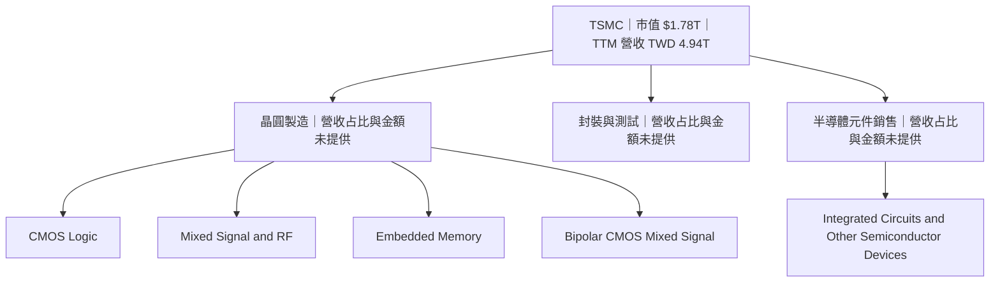
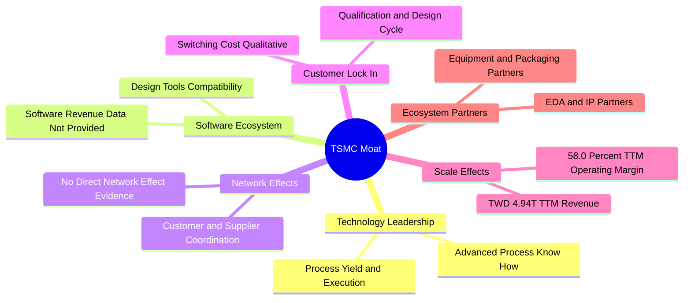
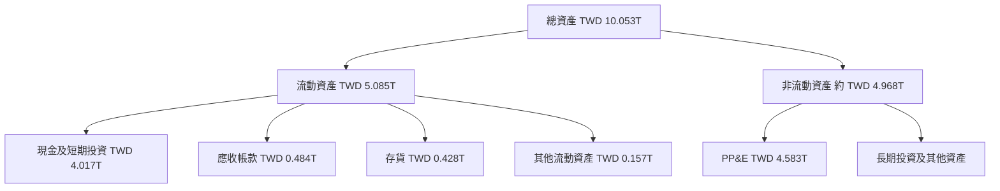
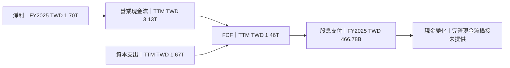
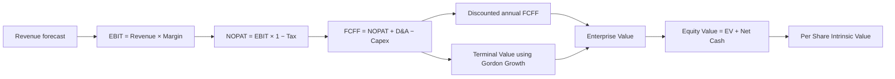
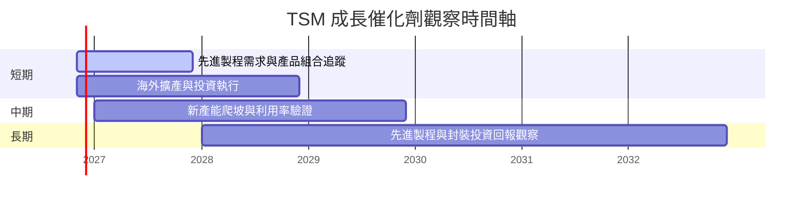
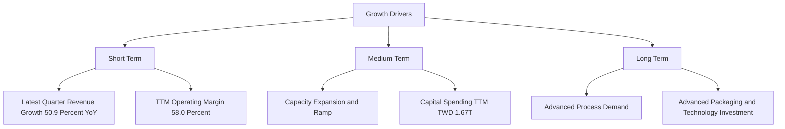
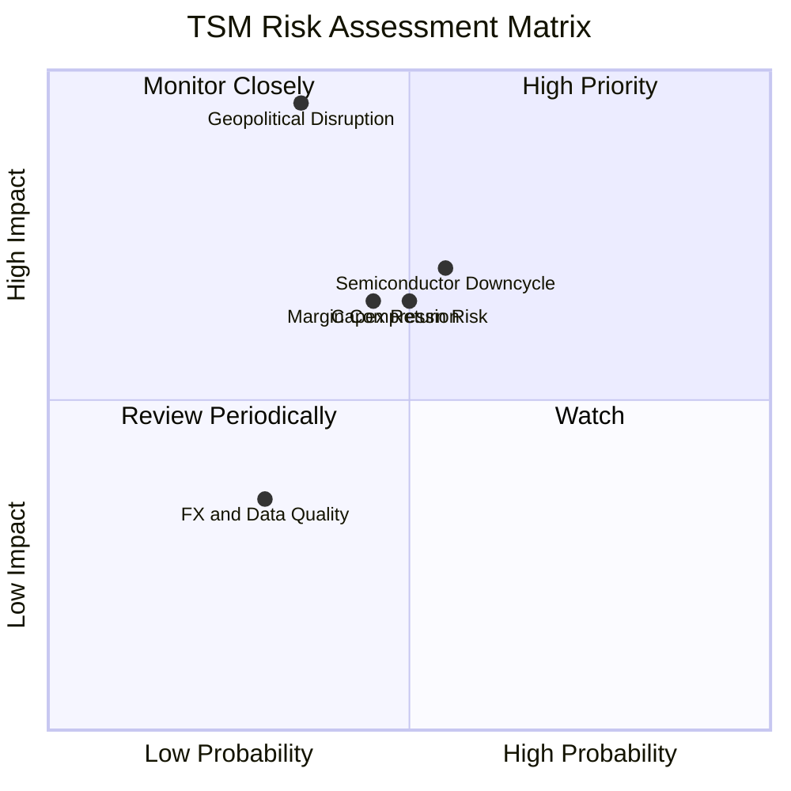
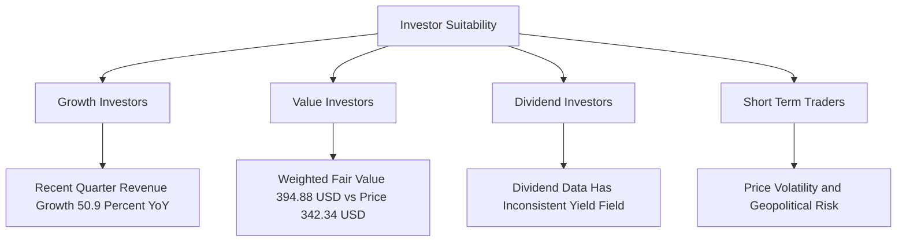

# TSM 基本面深度分析報告
> **報告日期**：2026-11-26 ｜ **語言**：繁體中文 ｜ **數據來源**：Yahoo Finance、Finviz、StockAnalysis、Roic.ai ｜ **分析師**：CFA 級機構研究

## 目錄

| # | 章節 | 核心結論 |
|---|------|----------|
| 1 | 執行摘要 | 買入；加權合理價值 $394.88，MOS +13.3% |
| 2 | 公司概覽與商業模式 | 晶圓代工及先進製程為核心；市場份額數據未提供 |
| 3 | 損益表深度分析 | TTM 營收 TWD 4.94T；最新一季年增 50.9% |
| 4 | 資產負債表分析 | 淨現金 TWD 2.95T；流動性充足 |
| 5 | 現金流量深度分析 | TTM FCF TWD 1.46T；高資本支出限制自由現金轉換 |
| 6 | 獲利能力與資本效率 | 現行 TTM ROIC 未提供；無法直接確認 ROIC 是否高於 WACC |
| 7 | 相對估值分析 | 同業估值方法分歧；相對估值低於 DCF 基準值 |
| 8 | DCF 內在價值評估 | 基準 DCF $446.91；加權合理價值 $394.88 |
| 9 | 成長催化劑 | AI、先進製程與海外擴產是主要質化催化劑；TAM 數據未提供 |
| 10 | 風險矩陣 | 地緣政治、資本密集與景氣循環為主要風險 |
| 11 | 投資建議 | 買入；以 $355.39 作為符合 MOS 10% 的價格上限 |

## 1. 執行摘要

截至 2026-11-25 收盤，TSM 股價為 **$342.34**。以程式計算的四種估值方法加權後，合理價值為 **$394.88**，安全邊際 MOS 為 **+13.3%**，依評級門檻屬於「買入」；這不是單靠高成長敘事所得的結論：公司 TTM 營業利益率為 58.0%、TTM FCF 為 TWD 1.46T、淨現金為 TWD 2.95T。不過，TTM ROIC 未提供，無法以最新期間數據直接判斷是否高於 10.45% WACC；而基準 DCF 的 61.2% 企業價值來自終值，估值仍高度受長期假設影響。

### 1.0 一頁式投資儀表板

| 項目 | 內容 |
|------|------|
| **投資論點（3 句）** | ① TTM 營業利益率 58.0%，反映目前高獲利的製程與產品組合。② 最新一季營收年增 50.9%，但 TTM 營收年增率為 N/A，不能把單季動能直接外推為全年成長。③ TTM FCF 為 TWD 1.46T、淨現金 TWD 2.95T，能支持高額資本支出與股東回報。 |
| **綜合評分** | **8.2/10**（引用 1.1 評分卡） |
| **財務健康** | 🟢 淨現金 TWD 2.95T；流動比率 2.584、速動比率 2.287 |
| **ROIC vs WACC** | 最新 TTM ROIC：N/A；WACC：10.45%。目前資料不足以判定最新期間是否創造超額報酬 |
| **FCF 趨勢** | FY2022–FY2025 FCF 均為正，FY2025 為 TWD 992.38B；TTM FCF 為 TWD 1.46T，TTM FCF Yield 2.49% |
| **估值** | Forward P/E 14.639117x ｜ EV/EBITDA：N/A（混合幣別）｜ FCF Yield 2.49% |
| **DCF 內在價值（基準）** | $446.91 ｜現價相對 DCF 折價 **23.4%**（折溢價定義：現價 ÷ DCF 價值 − 1） |
| **安全邊際（MOS）** | **+13.3%**＝($394.88 − $342.34) ÷ $394.88｜🟡 10%–25%，有限 |
| **預期報酬（基準情境 12M）** | DCF 基準情境相對現價 **+30.5%**；此為模型情境結果，不是保證報酬 |
| **關鍵風險（前二）** | 台海及供應鏈地緣風險；擴產與 Capex 對現金流及資產回報的壓力 |
| **評級 + 信心度** | 🟢 **買入** ｜信心：中（TTM ROIC、EPS 預期差與部分估值資料缺漏） |

### 1.1 綜合評分卡

| 維度 | 評分（1–10） | 主要依據（引用數字與其來源章節） |
|------|--------------|----------------------------------|
| 成長性 | 9 | 最新一季營收年增 50.9%；TTM 營收成長率 N/A（第 3 章） |
| 獲利能力 | 9 | TTM 營業利益率 58.0%、淨利率 51.1%；TTM ROIC 未提供（第 3、6 章） |
| 財務健康 | 9 | 淨現金 TWD 2.95T；流動比率 2.584；CCC 2 天（第 4 章） |
| 估值 | 6 | MOS +13.3%；同業 Forward P/E 方法估值 $342.87，EV/EBITDA 方法 $286.92（第 7、8 章） |
| 護城河 | 9 | TTM 營收約 TWD 4.94T、營業利益率 58.0%；具先進製程與規模優勢，但無市場份額數字可核實（第 2 章） |
| 管理層與資本配置 | 7 | FY2025 Capex TWD 1.28T、股息支付 TWD 466.78B；回購資料未提供（第 5 章） |
| **綜合評分** | **8.2** | 六項算術平均：$(9+9+9+6+9+7)÷6=8.1667$，四捨五入至一位小數 |

### 1.2 五大投資論點 + 三大核心風險

| 類型 | 項目 | 具體依據 | 信心度 |
|------|------|----------|--------|
| 🟢 **投資論點①** | 高營業獲利能力 | TTM 營業利益率 58.0%、毛利率 65.8%；顯示高階晶圓需求與產品組合能支撐定價及營業槓桿 | 🟢 高 |
| 🟢 **投資論點②** | 最新季度成長加速 | 2026 Q3 營收 TWD 1.494T，年增 50.9%；需留意這是單季成長，不是 TTM 成長率 | 🟢 高 |
| 🟢 **投資論點③** | 現金流規模可觀 | TTM 營業現金流 TWD 3.13T，Capex TWD 1.67T，FCF TWD 1.46T | 🟢 高 |
| 🟢 **投資論點④** | 淨現金提供韌性 | 現金及短期投資 TWD 4.02T，總債務 TWD 1.07T，淨現金 TWD 2.95T | 🟢 高 |
| 🟢 **投資論點⑤** | 加權估值仍有折價空間 | 加權合理價值 $394.88；相對 $342.34 的 MOS 為 13.3% | 🟡 中 |
| 🟡 **風險①** | 地緣政治及供應中斷 | 生產基地集中於亞洲，任何物流、能源或營運中斷都可能衝擊交貨與營收 | 🔴 高衝擊 |
| 🔴 **風險②** | 高資本支出及終值假設 | TTM Capex TWD 1.67T；DCF 終值現值佔 EV 61.2%，長期利潤率或再投資假設下修會壓低估值 | 🟡 中 |
| 🟡 **風險③** | 半導體循環與客戶需求波動 | 2023 年營收曾年減 4.51%；若高階需求放緩，產能利用率與利潤率可能回落 | 🟡 中 |

### 1.3 快速統計卡片

| 指標 | 公司實際值（期間） | 同業中位數 | 狀態 |
|------|--------------------|------------|------|
| 營收成長（TTM） | **N/A** | — | 🟡 |
| 營收成長（最新一季年增） | **50.9%** | **20.9%**（INTC、UMC、GFS 中位數） | 🟢 |
| 毛利率（TTM） | **65.8%** | **31.7%**（INTC、UMC、GFS 中位數） | 🟢 |
| 營業利益率（TTM） | **58.0%** | — | 🟢 |
| ROIC（TTM） | **N/A** | — | 🟡 |
| Forward P/E | **14.639117x** | **14.7x**（INTC、UMC、GFS 中位數） | 🟡 |
| FCF Yield（TTM） | **2.49%** | — | 🟡 |
| Piotroski F-Score | **N/A** | — | 🟡 |

### 1.4 投資結論

```text
╔══════════════════════════════════════════════════════════════════╗
║                    📊 投資結論摘要                               ║
╠══════════════════════════════════════════════════════════════════╣
║  評級：買入（MOS 門檻直接判定；未作質化上／下調）                 ║
║  價格（2026-11-25 收盤）：$342.34                                ║
║  DCF 內在價值（基準）：$446.91（現價折價 23.4%）                 ║
║  安全邊際 MOS：+13.3%（以加權合理價值為分母）                    ║
║  加權合理價值（8.8）：$394.88                                    ║
║  DCF 情境價值：                                                   ║
║    悲觀情境：$189.37（-44.7%）                                   ║
║    基準情境：$446.91（+30.5%）                                   ║
║    樂觀情境：$998.66（+191.7%）                                  ║
║  綜合評分：8.2/10（引用 1.1）                                    ║
║  適合投資人：能承受地緣風險及半導體循環的成長型、長線投資人      ║
╚══════════════════════════════════════════════════════════════════╝
```

## 2. 公司概覽與商業模式

### 2.1 業務結構與收入來源

公司資料指出 TSM 從事積體電路及其他半導體元件的製造、封裝、測試與銷售，服務範圍涵蓋亞洲、美洲及其他地區。各製程、封裝及客戶類別的收入金額與占比未提供，因此不以假設比例繪圖。



### 2.2 市場份額

市場份額數據未提供，無法量化市占率或繪製市占圖。可觀察到 TTM 營收約 TWD 4.94T、最新一季營收年增 50.9%，並且 TTM 營業利益率 58.0%；但這些數據反映的是公司規模及經營表現，不能替代市場份額。

### 2.3 競爭護城河分析



### 2.4 護城河強度

| 護城河項目 | 強度（強／中／弱） | 證據（引用數字或事實） | 會削弱它的情況 |
|------------|--------------------|------------------------|----------------|
| 技術與製程 | 強 | TTM 營業利益率 58.0%，反映目前產品組合與營運能力；但未提供製程節點營收拆分 | 競爭者縮小技術差距、良率不佳或節點轉換延誤 |
| 規模效應 | 強 | TTM 營收 TWD 4.94T；TTM Capex TWD 1.67T，具大型資本投入能力 | 產能利用率下降、擴產投資報酬不佳 |
| 客戶鎖定 | 中至強 | 半導體製造涉及設計導入與驗證；公司具多地區服務能力，但客戶留存率及轉換成本數據未提供 | 大客戶增加自製或分散委外比例 |
| 軟體生態系統 | 弱／未能驗證 | 軟體收入數據未提供；不把客戶工具鏈相容性誤當作自有軟體營收 | 客戶設計流程或平台依賴減弱 |
| 網路效應 | 弱／未能驗證 | 無直接網路效應量化資料 | 供應商、客戶不再因加入生態系而取得增量價值 |
| 生態夥伴 | 中 | 製造需與設備、設計及封裝夥伴合作；具體夥伴貢獻金額未提供 | 供應瓶頸、出口限制或合作方替代 |

1.1 護城河評分為 **9/10**，理由是 TTM 營收規模與 58.0% 營業利益率支持規模及製程優勢，但部分護城河尚缺少市場份額、客戶黏著及軟體收入的量化證據。

## 3. 損益表深度分析

### 3.1 年度收入成長趨勢（近4年）

年度收入來自 StockAnalysis／Yahoo 財務資料；YoY 由相鄰年度收入計算。

```text
╔══════════════════════════════════════════════════════════════════╗
║              TSM 年度收入趨勢（FY2022–FY2025）                   ║
╠══════════════════════════════════════════════════════════════════╣
║  FY2022  TWD 2.26T  ████████████████░░░░  YoY: +4.7%   🟡       ║
║  FY2023  TWD 2.16T  ███████████████░░░░░  YoY: -4.5%   🔴       ║
║  FY2024  TWD 2.89T  ████████████████████  YoY: +33.9%  🟢       ║
║  FY2025  TWD 3.81T  ██████████████████████████  YoY: +31.6% 🟢  ║
║                                                                  ║
║  FY2022–FY2025 CAGR = (3.809 ÷ 2.264)^(1/3) − 1 = 約 18.9%       ║
╚══════════════════════════════════════════════════════════════════╝
```

FY2023 下滑反映半導體需求週期轉弱；2024–2025 回升則與需求復甦及高階產品組合改善相符。FY2022–FY2025 CAGR 約 18.9%，但這段期間包含明顯週期低谷與反彈，不能直接當作未來穩定增速。

### 3.2 季度收入趨勢分析

| 季度 | 營收（TWD B） | QoQ | YoY | 備註 |
|------|--------------:|----:|----:|------|
| 2025 Q4 | 1,046.09 | +6.8% | +20.5% | 相較 2025 Q3 成長 |
| 2026 Q1 | 1,134.10 | +8.4% | +35.1% | YoY 由同季 2025 Q1 比較 |
| 2026 Q2 | 1,270.38 | +12.0% | +36.1% | 季增速度進一步提高 |
| 2026 Q3 | 1,494.24 | +17.6% | +50.9% | 最新一季增速加快；不是 TTM 成長率 |

季度數字顯示營收連續上升且 Q3 年增加速，可能反映產品需求及產品組合改善。由於資料未提供各應用別營收拆分，不能把加速完全歸因於單一終端市場。

### 3.3 利潤率演變分析

| 利潤率指標 | FY2022 | FY2023 | FY2024 | FY2025 | 趨勢 | 評估 |
|------------|-------:|-------:|-------:|-------:|------|------|
| 毛利率 | 59.6% | 54.4% | 56.1% | 59.9% | 2023 下滑後回升 | 🟢 |
| 營業利益率 | 49.6% | 42.6% | 45.7% | 50.8% | 2023 下滑，2025 高於 2022 | 🟢 |
| 淨利率 | 43.9% | 39.4% | 40.0% | 44.6% | 隨營運回升 | 🟢 |

**利潤率演變深度解析：**年度利潤率由 2023 低點回升至 2025，與營收復甦、產品組合及產能利用率改善一致；但各因素的獨立貢獻資料未提供，故不將改善全數歸因於定價。最新 TTM 營業利益率為 58.0%，高於 FY2025 的約 50.8%，顯示最近四季的營業槓桿仍然強，但若高階需求或利用率回落，固定成本可能使利潤率反向放大波動。

### 3.4 費用結構分析

費用明細的 TTM 絕對金額未完整提供，無法製作具可靠比例的費用 pie chart。可確認 FY2025 研發費用為 TWD 246.43B，約占 FY2025 營收 6.5%；這是年度費用與年度收入的比率，不代表 TTM 費用結構。

### 3.5 季度 EPS 趨勢與盈餘品質（Quality of Earnings）

資料列出的最近四季 EPS surprise 估計值皆為 NaN，因此無法判定超預期或不及預期；下表列實際季度 EPS，並以營收、淨利和 EPS 同比成長作背景。EPS 為來源資料列示數值，未把不同上市單位或幣別自行換算。

| 季度 | EPS 實際值 | EPS 年增 | Surprise | 收入／盈餘背景 |
|------|-----------:|---------:|---------|--------------|
| 2025 Q4 | 18.72 | 35.0% | N/A（估計值缺漏） | 營收 TWD 1.046T，淨利 TWD 485.47B |
| 2026 Q1 | 22.08 | 58.4% | N/A（估計值缺漏） | 營收 TWD 1.134T，淨利 TWD 572.48B |
| 2026 Q2 | 27.25 | 77.4% | N/A（估計值缺漏） | 營收 TWD 1.270T，淨利 TWD 706.56B |
| 2026 Q3 | 29.43 | 68.7% | N/A（估計值缺漏） | 營收 TWD 1.494T，淨利 TWD 763.06B |

| 盈餘品質項目 | 數值／佔比 | 評估 |
|--------------|------------|------|
| 股權薪酬 SBC / 營收 | TTM SBC 約 TWD 0.513B ÷ TWD 4,944.817B = 約 **0.010%** | 🟢 目前佔比低；仍須關注長期稀釋 |
| SBC / 營業現金流 | TWD 0.513B ÷ TWD 3,130B = 約 **0.016%** | 🟢 對現金流量級影響低 |
| FCF / 淨利（現金轉換率） | TWD 1.46T ÷ TWD 2.528T = 約 **57.8%** | 🟡 Capex 高，營運獲利尚未等比例轉為 FCF |
| 一次性／非經常性損益 | N/A（明細未提供） | 無法判斷一次性項目對淨利的影響 |
| 有效稅率異常 | 17.0%（最新年度有效稅率） | 未見足夠資料確認異常；不同年度稅率細目未提供 |
| 資本化支出 vs 費用化 | TTM Capex TWD 1.67T；資本化政策與費用明細未提供 | 不推定資本化支出造成盈餘高估；晶圓製造本身具高資本密集特徵 |

**盈餘品質結論：**SBC 占營收比重低，報表淨利的 SBC 稀釋影響看來有限；但 TTM FCF 僅約為淨利的 57.8%，主要需要以高額資本支出背景理解。缺乏一次性損益及資本化明細，不能進一步斷言 GAAP 淨利高估或低估經濟盈餘。

## 4. 資產負債表分析

### 4.1 資產結構分解

以 2026-09-30 資產負債表為基準，總資產為 TWD 10.053T；流動資產 TWD 5.085T，非流動資產約 TWD 4.968T（總資產減流動資產）。



### 4.2 流動性與營運資金分析

| 指標 | 最新 TTM | 一年前 TTM | 變化 | 解讀 |
|------|---------:|-----------:|------:|------|
| 流動比率 | 2.584 | N/A | N/A | 流動資產高於流動負債，短期償付緩衝良好 |
| 速動比率 | 2.287 | N/A | N/A | 不計存貨仍有流動性緩衝 |
| DSO 應收帳款天數 | 1 天 | N/A | N/A | 一年前比較值未提供；照列品質指標 |
| DIO 存貨天數 | 92 天 | N/A | N/A | 需要持續監控存貨與需求匹配 |
| DPO 應付帳款天數 | 91 天 | N/A | N/A | 可觀察到與供應商付款週期接近 DIO |
| CCC 現金轉換週期 | 2 天 | N/A | N/A | 應收快、應付與存貨天數大致抵銷；無法推論趨勢 |

DSO／DIO／DPO／CCC 的品質指標採用 2026-09-30 的期末餘額與 TTM 流量計算；因未提供一年前的同口徑結果，不能宣稱週轉效率正在改善或惡化。

### 4.3 債務結構分析

```text
╔══════════════════════════════════════════════════════════════════╗
║                   TSM 債務健康診斷                              ║
╠══════════════════════════════════════════════════════════════════╣
║  總債務：          TWD 1.07T   ██░░░░░░░░░░░░░░░░░░  🟢         ║
║  現金及短期投資：  TWD 4.02T   ████████████████████  🟢         ║
║  淨現金：          TWD 2.95T   ██████████████░░░░░░  🟢         ║
║  流動比率：        2.584x      🟢                                  ║
║  速動比率：        2.287x      🟢                                  ║
║  Debt/EBITDA：     N/A（跨幣別比率資料未提供）                    ║
║  利息保障倍數：    N/A（利息費用明細未提供）                      ║
╚══════════════════════════════════════════════════════════════════╝
```

現金及短期投資 TWD 4.02T 約為總債務 TWD 1.07T 的 3.8 倍；淨現金提供抵禦資本支出波動的緩衝。公司債務成本資料顯示稅前成本 1.16%，但缺少利息費用與期限結構，不能據此自行推算利息保障倍數。

### 4.4 股東權益趨勢

```text
╔══════════════════════════════════════════════════════════════════╗
║                 TSM 年末股東權益趨勢（TWD）                      ║
╠══════════════════════════════════════════════════════════════════╣
║  FY2022  TWD 2.90T  ████████████░░░░░░░░                         ║
║  FY2023  TWD 3.43T  ██████████████░░░░░░                         ║
║  FY2024  TWD 4.24T  █████████████████░░░                         ║
║  FY2025  TWD 5.36T  █████████████████████                         ║
╚══════════════════════════════════════════════════════════════════╝
```

FY2022 至 FY2025 股東權益逐年增加，與公司獲利及留存累積相符；但分紅、匯兌及其他權益變動的完整橋接未提供，因此不將權益增幅直接等同於留存盈餘。

## 5. 現金流量深度分析

### 5.1 現金流量瀑布圖

年度淨利與 TTM FCF 期間不完全相同，以下只呈現流向關係，不將不同期間金額混接。



### 5.2 FCF 轉換率趨勢

| 財年 | FCF（TWD B） | 淨利（TWD B） | FCF／淨利 |
|------|-------------:|--------------:|----------:|
| FY2022 | 520.97 | 992.92 | 52.5% |
| FY2023 | 286.57 | 851.74 | 33.6% |
| FY2024 | 861.20 | 1,158.38 | 74.3% |
| FY2025 | 992.38 | 1,697.60 | 58.5% |

FCF 轉換率在 FY2023 降至 33.6%，之後回升；FY2025 淨利增長使轉換率較 FY2024 下滑，反映資本支出與獲利未必同步。TTM FCF／TTM 淨利約 57.8%，亦顯示應把現金流與淨利分開檢視。

### 5.3 自由現金流趨勢

```text
╔══════════════════════════════════════════════════════════════════╗
║               TSM FCF：歷史年度與最新 TTM（TWD）                 ║
╠══════════════════════════════════════════════════════════════════╣
║  FY2022  520.97B  ██████████░░░░░░░░░░  FCF Yield：N/A          ║
║  FY2023  286.57B  ██████░░░░░░░░░░░░░░  FCF Yield：N/A          ║
║  FY2024  861.20B  █████████████████░░░  FCF Yield：N/A          ║
║  FY2025  992.38B  ████████████████████  FCF Yield：N/A          ║
║  TTM     1.46T    █████████████████████████████  Yield：2.49%   ║
╚══════════════════════════════════════════════════════════════════╝
```

年度 FCF Yield 不提供，避免使用不同幣別的股價、市值直接計算；TTM FCF Yield 2.49% 為資料庫計算值，照原值引用。

### 5.4 資本配置評估

Capex、股息及營運留存有可引用金額；回購支出資料未提供，故不製作含假設比例的資本配置圓餅圖。

| 配置項目 | 已知金額 | 評估 |
|----------|----------|------|
| FY2025 Capex | TWD 1.28T | 維持產能與技術競爭力的必要投入，但回報需以未來利用率與 FCF 驗證 |
| FY2025 股息支付 | TWD 466.78B | 約占 FY2025 FCF 47.0%（466.78 ÷ 992.38） |
| FY2025 回購 | N/A | 資料未提供 |
| 留存／其他投資 | N/A | 無法由已提供數字反推 |

## 6. 獲利能力與資本效率

### 6.1 ROE／ROA／ROIC 趨勢

| 指標 | FY2022／歷史值 | FY2023／歷史值 | FY2024／歷史值 | FY2025／TTM | 評估 |
|------|----------------:|----------------:|----------------:|-------------:|------|
| ROE | N/A | N/A | N/A | 41.9% TTM | 獲利相對權益具規模；杜邦拆解未提供 |
| ROA | N/A | N/A | N/A | 20.6% TTM | 反映高獲利，但未提供同業同口徑基準 |
| ROIC | 歷史資料列示 2018 年 19.11% | N/A | N/A | N/A | 當前 TTM ROIC 未提供，不能與當前 WACC 作同期間比較 |
| 行業均值 | N/A | N/A | N/A | N/A | 未提供，不列作比較基準 |

### 6.2 ROIC vs WACC 分析（核心價值創造判斷）

```text
╔══════════════════════════════════════════════════════════════════╗
║                ROIC vs WACC 深度分析                            ║
╠══════════════════════════════════════════════════════════════════╣
║  資本成本（照採資料庫輸入）：                                    ║
║  ├── 無風險利率（10Y 美債）：4.85%                               ║
║  ├── 股權風險溢酬 ERP：5.00%                                     ║
║  ├── Beta 原始值 1.23；調整後 Beta 1.16                         ║
║  ├── 股權成本輸入值：10.62%                                      ║
║  ├── 稅前債務成本：1.16%；有效稅率：17.0%                        ║
║  ├── 股權／債務權重：98.2%／1.8%                                ║
║  └── WACC：10.45%                                                ║
║                                                                  ║
║  最新 TTM ROIC：N/A（未提供）                                    ║
║  EVA（ROIC − WACC）：N/A，無法以最新同期間數據計算               ║
║  歷史參考：Roic.ai 列示 2018 年 Return on Invested Capital 19.11%║
║  但不能以 2018 年 ROIC 直接判定 2026 TTM 價值創造狀態             ║
╚══════════════════════════════════════════════════════════════════╝
```

資料庫所列調整後 Beta 為 **⅔ × 1.23 + ⅓ = 1.16**。其 CAPM 股權成本輸入值 10.62% 與按顯示值直接計算的 4.85% + 1.16 × 5.00% = 10.65% 相差 0.03 個百分點；WACC 本報告遵循資料庫指定值 10.45%，不另行替換。此差異可能來自未顯示的未四捨五入輸入。最新 ROIC 缺漏，所以結論是「無法判定」，而非宣稱公司正在創造或摧毀超額股東價值。

### 6.3 杜邦三因素分解

| 因素 | 數值（TTM） | 解讀 |
|------|-------------|------|
| 淨利率 | N/A（QUALITY FIGURES 未提供 DuPont；輸入缺漏） | 不自行重算替代指標 |
| 資產週轉率 | N/A（同上） | 不補算 |
| 權益乘數 | N/A（同上） | 不補算 |
| **ROE** | **N/A（QUALITY FIGURES 標示 N/A）** | 雖另有來源列示 TTM ROE 41.9%，但本節依品質指標規則不重建杜邦拆解 |

### 6.4 財務體質：Piotroski F-Score

Piotroski F-Score 為 **N/A**：計算需要相隔一年的兩組 TTM SEC 申報資料；目前資料來源為 Yahoo 季度報表，九項測試結果均未提供，不能逐項推定或補分。

| 測試 | 結果 | 解讀 |
|------|------|------|
| 九項 Piotroski 測試 | N/A | 缺少可供比較的 SEC 申報期間資料 |
| F-Score | N/A／9 | 不代表公司未通過測試，而是無法計算 |

## 7. 相對估值分析

### 7.1 同業估值比較表格

表內同業數據均取自 Yahoo Finance Peer multiples；公司估值數據來自市場及估值資料。P/S 及 EV/EBITDA 因幣別混合或資料缺漏不以公司值填入。

| 估值指標 | **TSM** | **INTC** | **UMC** | **GFS** | TSM 評估 |
|----------|--------:|--------:|--------:|-------:|-----------|
| **Trailing P/E** | 22.18665x | N/A | 12.4x | 103.4x | 🟡 與同業差異大，且 INTC 缺值 |
| **Forward P/E** | 14.639117x | 30.4x | 14.7x | 14.0x | 🟢 接近同業中位數 14.7x |
| **P/S Ratio** | N/A | 4.8x | N/A | 2.8x | 🟡 TSM 因幣別不一致不提供 |
| **EV/EBITDA** | N/A | 15.8x | N/A | 9.7x | 🟡 TSM／UMC 不可比；同業可用中位數 12.7x |
| **最新一季營收年增** | 50.9% | 20.9% | 25.6% | 12.5% | 🟢 TSM 高於三家比較公司 |
| **TTM 毛利率** | 65.8% | 40.2% | 31.7% | 28.5% | 🟢 明顯高於比較公司 |

同業 Forward P/E 中位數為 14.7x；EV/EBITDA 中位數按 INTC 與 GFS 的 15.8x、9.7x 取中位數為 12.7x。TSM 的盈利能力高於所列同業，但不同公司的製程、資本強度和財報幣別差異使倍數比較只能作為交叉參考。

### 7.2 歷史估值區間分析

N/A（未提供「Valuation vs own history」歷史 P/E 區間與當前百分位，故不自行估算）。

### 7.3 情境價值（Bear / Base / Bull）

情境數字依 DCF MODEL 原值列示。下表採模型提供的第 1 年成長率、期末營業利潤率、WACC、每股價值與機率；永續成長率等未列在情境摘要中的欄位不自行補設。

| 情境 | 第 1 年營收成長 | 期末營業利潤率 | WACC | 每股價值 | 相對現價 | 機率 | 可能條件 |
|------|----------------:|----------------:|-----:|---------:|---------:|-----:|----------|
| 🔴 悲觀 | 15.0% | 42.1% | 11.45% | $189.37 | -44.7% | 25% | 需求降溫、擴產回報不佳或競爭壓低長期利潤率 |
| 🟡 基準 | 30.0% | 49.5% | 10.45% | $446.91 | +30.5% | 50% | 成長由高點逐年收斂，長期利潤率回落但維持高位 |
| 🟢 樂觀 | 45.0% | 54.5% | 9.45% | $998.66 | +191.7% | 25% | 需求持續超出基準、利潤率韌性高且折現率降低 |

機率加權值為 $520.47（+52.0%），僅作情境參考；估值方法權重採基準 DCF $446.91，而非機率加權值。

### 7.4 相對估值隱含價格區間

```text
╔══════════════════════════════════════════════════════════════════╗
║           相對估值與共識目標價（USD／每股）                      ║
╠══════════════════════════════════════════════════════════════════╣
║  $286.92 ─────── $342.34 ─── $342.87 ─────────── $586.69         ║
║  EV/EBITDA        現價       Forward P/E        分析師共識       ║
║                                                                  ║
║  DCF 基準：$446.91（高於現價；不是相對估值法）                   ║
╚══════════════════════════════════════════════════════════════════╝
```

| 方法 | 每股價值 | 依據 |
|------|---------:|------|
| 同業 Forward P/E | $342.87 | 同業中位數 14.7x × 公司 Forward EPS 23.39 |
| 同業 EV/EBITDA | $286.92 | INTC、GFS 中位數 12.7x × TTM EBITDA，並加回淨現金 |
| 分析師共識目標價 | $586.69 | 20 位分析師平均目標價；為市場參考，不是相對估值倍數 |
| DCF 基準 | $446.91 | 10 年 FCFF、WACC 10.45%、永續成長率 3.0% |

## 8. DCF 內在價值評估（Discounted Cash Flow）

### 8.0 估值推理鏈（Thinking Logic）

**Step 1 — 價值來源及主導變數**

模型以公司整體 FCFF 估值，沒有依業務板塊拆分營收，因此無法可靠地分別量化「主業」與「第二成長曲線」的營收占比。可由資料確認的是 TTM 營收 TWD 4,944.82B、最新一季營收年增 50.9%、TTM 營業利益率 58.0%。模型價值主要受長期營收、營業利潤率及終值影響；敏感度表顯示 WACC／永續成長率也能顯著改變每股估值。

**Step 2 — 模型選擇**

| 決策點 | 本報告採用 | 理由 | 曾考慮但否決 | 否決理由 |
|--------|-----------|------|--------------|----------|
| 現金流定義 | FCFF | 模型以 NOPAT + D&A − Capex 計算，並以 WACC 折現至 EV | FCFE | 現有模型指定 FCFF，不重建替代模型 |
| 預測期 N | 10 年 | 依程式模型設定；營收增速由 30.0% 線性降至 3.0% | 5 年 | 不符合既定模型輸入 |
| 終值方法 | Gordon Growth | 模型提供終值與折現值 | 退出倍數 | DCF MODEL 未提供退出倍數結果，不自建 |
| EBIT 基礎 | GAAP EBIT | 模型明列 GAAP EBIT | 非 GAAP EBIT | 避免將 SBC 另行加回或重複處理 |

**Step 3 — 關鍵假設推導鏈**

- **營收成長**：錨點＝最新一季營收年增 50.9%，但 TTM 對前期 TTM 成長率為 N/A → 調整＝單季增速較可能高於可持續長期增速，模型把最高成長限制在 30.0%，並逐年線性降至 3.0% → **採用 FY+1 30.0%、FY+10 3.0%** → 曾考慮直接採用 50.9%，因該數字是單季 YoY、不能冒充 TTM 或長期 CAGR，故不採用。
- **期末營業利潤率**：錨點＝TTM 58.0%；FY2025 年度營業利益率約 50.8% → 調整＝以近年歷史利潤率中位數方向收斂，模型由 58.0% 緩降 → **採用 FY+10 49.5%** → 曾考慮固定 58.0%，因長期不變假設未反映產業成熟與競爭，未採用。
- **永續成長率 g**：錨點＝模型設定 3.0%，且低於 10.45% WACC → 調整＝成熟期以低於折現率的長期成長假設估值 → **採用 3.0%** → 未採用更高 g，以避免終值分母過度縮小。
- **預測期 N**：錨點＝模型設定 10 年；歷史收入具循環性，FY2023 曾年減 4.51% → 調整＝十年足以呈現成長收斂，但遠期預測可信度下降 → **採用 10 年** → 未採用更長期間，避免把低可見度假設累積至過長預測期。
- **Capex／營收**：錨點＝TTM Capex／Revenue 約 TWD 1.67T ÷ 4.94482T = 約 33.8% → 調整＝成熟階段投資強度逐步收斂，模型逐年降至 16.6% → **採用 FY+1 33.8%、FY+10 16.6%** → 未固定在 33.8%，因長期維持目前投資強度會忽略模型假設的成熟化。
- **WACC**：錨點＝資本成本資料庫採用 WACC 10.45% → 調整＝本報告不自行改動資料庫指定折現率 → **採用 10.45%** → 不另建 WACC，以避免和 ROIC 比較及估值方法口徑不一致。
- **GAAP EBIT 與 SBC／稀釋**：錨點＝模型指定 GAAP EBIT、SBC 已列入費用，並固定股數 → **採用組合 (A)：GAAP EBIT + 不另扣 SBC + 股數不再稀釋** → 不採用非 GAAP 加回，避免漏計或重複計入 SBC 成本。
- **有效稅率**：錨點＝最新年度有效稅率 17.0% → 採用 17.0%。
- **D&A／營收**：錨點＝TTM 15.1% → 採用 15.1%，模型保持固定。
- **ΔWC／營收增額**：模型未建模營運資金變動；不是假設為某個正負百分比，而是依指定模型設定排除。

**Step 4 — 最脆弱的一環**

最脆弱的是營收與利潤率能否在高資本投入下維持模型路徑；基準估值中終值 PV 佔 EV 61.2%，若長期現金流或折現率假設走弱，價值會明顯下修，應以敏感度矩陣與悲觀情境檢視。

**Step 5 — 計算路徑圖**



### 8.1 模型假設總表（Model Inputs）

金額單位為 TWD billion；模型不含 ΔWC 列。DCF 的輸入與年度輸出照模型原值列示，未另行重建。

| 假設項目 | 採用值 | 依據／來源 | 敏感度 |
|----------|--------|-------------|--------|
| 預測期長度 **N** | 10 年 | DCF MODEL 固定預測期 | 🟡 中 |
| 營收成長路徑 | FY+1 30.0% 線性降至 FY+10 3.0% | FY+1 參照最新一季 YoY 50.9%，受 0%–30% 上限限制；TTM 成長率 N/A | 🔴 高 |
| 營業利潤率 | FY+1 58.0% 至 FY+10 49.5% | 起點為 TTM 58.0%，向近五年中位數收斂 | 🔴 高 |
| 有效稅率 | 17.0% | 最新年度有效稅率 | 🟢 低 |
| Capex／營收 | FY+1 33.8% 至 FY+10 16.6% | TTM 起點；逐步下降至模型成熟期設定 | 🔴 高 |
| D&A／營收 | 15.1% | TTM 比率，模型固定 | 🟢 低 |
| ΔWC／營收增額 | 未建模 | DCF MODEL 明列 working capital is not modelled | 🟢 低／模型限制 |
| EBIT 基礎 | GAAP EBIT | DCF MODEL 指定 GAAP | 🟡 中 |
| SBC 處理 | GAAP 已費用化，不另扣 SBC | 依模型設定，與固定股數相容 | 🟡 中 |
| 年稀釋率 | 0%／股數固定 | SBC 成本已反映在 GAAP EBIT，模型不再放大股數 | 🟡 中 |
| 永續成長率 g | 3.0% | DCF MODEL 指定，低於 WACC 10.45% | 🔴 高 |
| 終值方法 | Gordon Growth | 模型提供該方法的終值；退出倍數未提供 | 🔴 高 |
| WACC | 10.45% | 資本成本資料庫指定值 | 🔴 高 |

FCFF 定義為 **FCFF = NOPAT + D&A − Capex**；營運資金變動未納入。模型採用 **(A) GAAP EBIT + 固定股數**，所以 SBC 影響已計入一次：不另減 SBC，也不另計年稀釋。

### 8.2 折現率推導（WACC）

```text
╔══════════════════════════════════════════════════════════════════╗
║                    WACC 推導（折現率）                           ║
╠══════════════════════════════════════════════════════════════════╣
║  股權成本 Ke（CAPM；照引用成本資本輸入）：                       ║
║  ├── 無風險利率 Rf（10Y 美債）：             4.85%               ║
║  ├── 市場風險溢酬 ERP：                      5.00%               ║
║  ├── Beta 原始值：1.23；調整後 Beta：1.16                        ║
║  ├── 調整方式：⅔ × 1.23 + ⅓ = 1.1533，顯示為 1.16               ║
║  ├── 國別／規模溢酬：未另加（資料庫未列額外溢酬）                 ║
║  └── 採用股權成本輸入：10.62%                                    ║
║                                                                  ║
║  債務成本 Kd：                                                   ║
║  ├── 稅前債務成本：1.16%                                         ║
║  ├── 有效稅率：17.0%                                             ║
║  └── 稅後 Kd：1.16% × (1 − 17.0%) = 0.9628%                     ║
║                                                                  ║
║  資本結構（資料庫提供權重）：股權 98.2%，債務 1.8%               ║
║  └── 採用 WACC：10.45%                                           ║
╚══════════════════════════════════════════════════════════════════╝
```

**逐步演算與資料一致性：**

1. **Ke**：照用資本成本區塊的 Ke 輸入 **10.62%**。按顯示的 Rf、調整後 Beta 與 ERP 直接代入，$4.85\%+1.16\times5.00\%=10.65\%$；與指定 Ke 有 0.03 個百分點差異，可能來自未四捨五入輸入。本報告不以重算結果取代指定值。
2. **稅前 Kd**：指定值 **1.16%**；利息費用與平均計息負債明細未提供，不能另行複算。
3. **稅後 Kd**：$1.16\%\times(1-17.0\%)=0.9628\%$。
4. **權重**：指定股權／債務權重 **98.2%／1.8%**，合計 100.0%；市值與計息負債的精確未四捨五入分子未提供。
5. **WACC**：以指定 Ke、Kd 與權重計算約為 $98.2\%\times10.62\%+1.8\%\times0.9628\%=10.446\%$，四捨五入為 **10.45%**。

Beta 來源為 Yahoo，採調整後 Beta 1.16；無風險利率數值為 4.85%，但該利率的觀測日期未提供。WACC 與第 6.2 節一致。由於利息費用、平均計息負債及精確市值／債務權重來源未提供，WACC 的底層分子不能獨立完整重建；採用值遵守資本成本資料庫的指定結果。

### 8.3 逐年自由現金流預測（基準情境）

下表採 DCF MODEL 原值，金額單位 TWD billion；折現因子保留三位小數。模型未列 ΔWC，故不加入該列。

| 年度 | FY+1 | FY+2 | FY+3 | FY+4 | FY+5 | FY+6 | FY+7 | FY+8 | FY+9 | FY+10 |
|------|-----:|-----:|-----:|-----:|-----:|-----:|-----:|-----:|-----:|------:|
| 營收 | 6,428.26 | 8,163.89 | 10,123.23 | 12,249.11 | 14,453.94 | 16,622.04 | 18,616.68 | 20,292.18 | 21,509.71 | 22,155.00 |
| 營收 YoY | 30.0% | 27.0% | 24.0% | 21.0% | 18.0% | 15.0% | 12.0% | 9.0% | 6.0% | 3.0% |
| 營業利潤率 | 58.0% | 57.0% | 56.1% | 55.2% | 54.2% | 53.3% | 52.3% | 51.4% | 50.5% | 49.5% |
| 營業利益 EBIT | 3,726.88 | 4,656.49 | 5,679.00 | 6,756.58 | 7,837.06 | 8,856.56 | 9,744.56 | 10,431.05 | 10,854.96 | 10,972.60 |
| − 稅（17.0%） | (632.56) | (790.34) | (963.90) | (1,146.79) | (1,330.18) | (1,503.22) | (1,653.94) | (1,770.46) | (1,842.41) | (1,862.38) |
| = NOPAT | 3,094.32 | 3,866.14 | 4,715.10 | 5,609.79 | 6,506.88 | 7,353.34 | 8,090.62 | 8,660.59 | 9,012.55 | 9,110.22 |
| + D&A | 970.20 | 1,232.15 | 1,527.86 | 1,848.72 | 2,181.48 | 2,508.71 | 2,809.75 | 3,062.63 | 3,246.39 | 3,343.78 |
| − Capex | (2,171.05) | (2,601.47) | (3,032.68) | (3,435.84) | (3,778.51) | (4,028.15) | (4,156.32) | (4,143.23) | (3,981.42) | (3,678.16) |
| **= FCFF** | **1,893.46** | **2,496.82** | **3,210.29** | **4,022.67** | **4,909.85** | **5,833.90** | **6,744.04** | **7,579.99** | **8,277.52** | **8,775.85** |
| 折現因子 | 0.905 | 0.820 | 0.742 | 0.672 | 0.608 | 0.551 | 0.499 | 0.451 | 0.409 | 0.370 |
| **FCFF 現值 PV** | **1,714.30** | **2,046.67** | **2,382.51** | **2,702.94** | **2,986.90** | **3,213.23** | **3,363.05** | **3,422.26** | **3,383.56** | **3,247.83** |

預測期現值合計（依模型列示）：  
**1,714.30 + 2,046.67 + 2,382.51 + 2,702.94 + 2,986.90 + 3,213.23 + 3,363.05 + 3,422.26 + 3,383.56 + 3,247.83 = 28,463.25**。  
DCF MODEL 列示合計為 **28,463.24**；差異為 **0.01 TWD B**，來自各年度現值顯示至小數點後兩位的四捨五入，落在 1% 尾差範圍內，總和沿用模型值。

**FY+1 逐步演算（示範）：**

1. 營收：$4,944.82\times(1+30.0\%)=6,428.27$；模型列示 **6,428.26**，為未顯示精度差異。
2. EBIT：模型列示營收 × 58.0% = **3,726.88**。
3. 稅：$3,726.88\times17.0\%=633.57$；模型列示稅 **632.56**，兩者差異顯示模型底層 EBIT／稅率使用未展示的輸入或四捨五入口徑，故不改寫模型列值。
4. NOPAT：模型列示 EBIT − 稅 = $3,726.88-632.56=\mathbf{3,094.32}$。
5. D&A：模型列示 **970.20**。
6. Capex：模型列示 **2,171.05**。
7. ΔWC：**未建模**。
8. FCFF：依模型定義，$3,094.32+970.20-2,171.05=1,893.47$；模型列示 **1,893.46**，差異為 0.01。
9. PV：模型列示折現因子 **0.905**；$1,893.46\times0.905=1,713.08$，與模型列示 PV 1,714.30 不一致，顯示折現因子僅列三位小數，PV 使用未四捨五入折現因子及底層 FCFF。模型規定逐年現值與合計照錄，因此保留原表並將此列為可複算限制。

**合理性自檢：**
- FY+1 至 FY+10 FCFF 由 TWD 1,893.46B 增至 TWD 8,775.85B；模型隱含增幅高，但歷史可比期間的 FCF CAGR 受 FY2023 低點影響，無法在未統一年度口徑下做可靠單一 CAGR 比較。
- FY+10 FCFF 利潤率＝8,775.85 ÷ 22,155.00＝約 **39.6%**；目前 TTM FCFF 利潤率＝1,460 ÷ 4,944.82＝約 **29.5%**。同業最佳 FCF 利潤率資料未提供。
- 模型每一年 FCFF 均為正；但 FY+1 細項存在約 0.01 的顯示尾差，應使用原模型的底層未四捨五入數據理解。

```text
╔══════════════════════════════════════════════════════════════════╗
║            自由現金流：歷史實際 vs 模型預測（TWD B）             ║
╠══════════════════════════════════════════════════════════════════╣
║  FY2023(實)  286.57  █░░░░░░░░░░░░░░░░░░░░░░░░░░░░             ║
║  FY2024(實)  861.20  ███░░░░░░░░░░░░░░░░░░░░░░░               ║
║  FY2025(實)  992.38  ███░░░░░░░░░░░░░░░░░░░░░               ║
║  FY+1 (預) 1,893.46  ██████░░░░░░░░░░░░░░░░░░                 ║
║  FY+10(預) 8,775.85  ██████████████████████████████             ║
╠══════════════════════════════════════════════════════════════════╣
║  模型由 FY+1 30.0% 成長逐步降至 FY+10 3.0%；預測遠期依賴假設。  ║
╚══════════════════════════════════════════════════════════════════╝
```

### 8.4 終值計算（Terminal Value）

適用性檢查：**WACC 10.45% vs g 3.0% → WACC > g ✅**

DCF MODEL 未提供退出倍數法的終值、現值或企業價值，依規則不另建退出倍數估值。

| 方法 | 計算式 | 終值 TV（TWD B） | TV 現值（TWD B） | 佔總 EV |
|------|--------|----------------:|-----------------:|--------:|
| Gordon Growth | 8,775.85 × (1 + 3.0%) ÷ (10.45% − 3.0%) | 121,314.63 | 44,897.04 | 61.2% |
| 退出倍數法 | N/A（模型未提供，未自行建模） | N/A | N/A | N/A |

**逐步演算：**

1. FY+N 的 FCFF：**8,775.85 TWD B**。
2. 分子：$8,775.85\times(1+3.0\%)=9,039.13$ TWD B（按顯示值計算；模型底層使用未四捨五入值）。
3. 分母：$10.45\%-3.0\%=7.45\%$；模型列示 TV：**121,314.63 TWD B**。
4. PV(TV)：模型列示 **44,897.04 TWD B**，折現至第 10 年。
5. 終值佔比：**61.2%**。未超過 75% 警示門檻，但仍為 EV 的主要部分，估值對長期假設敏感。

### 8.5 企業價值 → 每股內在價值（Bridge）

```text
╔══════════════════════════════════════════════════════════════════╗
║              企業價值 → 每股內在價值 橋接表                      ║
╠══════════════════════════════════════════════════════════════════╣
║  預測期 FCF 現值合計              +TWD 28,463.24B                ║
║  終值現值 PV(TV)                  +TWD 44,897.04B                ║
║  = 企業價值 EV                     TWD 73,360.28B                ║
║  + 淨現金                          +TWD 2,947.23B                ║
║  = 股權價值                        TWD 76,307.51B                ║
║  每股價值（模型原值）              $446.91                        ║
║  當前股價（2026-11-25 收盤）       $342.34                        ║
║  折溢價（現價÷DCF價值−1）          -23.4%（折價）                ║
║  本節不計算 MOS；MOS 僅由 8.8 加權合理價值計算                   ║
╚══════════════════════════════════════════════════════════════════╝
```

**逐步橋接：**

1. EV：$28,463.24+44,897.04=73,360.28$ TWD B。
2. 股權價值：$73,360.28+2,947.23=76,307.51$ TWD B。
3. 每股內在價值：模型依匯率 **0.0303757 USD/TWD** 與其市場價格／股數橋接列示 **$446.91**。模型所列未四捨五入市值或實際稀釋股數未提供，無法只用已四捨五入的市場資料獨立複算至一美分。
4. 折溢價：$(342.34÷446.91)-1=-23.4\%$。
5. 本節不計算 MOS；MOS 固定以第 8.8 節的加權合理價值為分母。

淨現金取 2026-09-30 TTM 財務資料；DCF 模型橋接列示 TWD 2,947.23B。模型採固定股數的組合 (A)，未對股數再作稀釋調整。

### 8.6 敏感性分析（WACC × 永續成長率）

以下直接列示 DCF MODEL 敏感度矩陣原值；括號內為相對 $342.34 現價的上行空間。

| g／WACC | 8.45% | 9.45% | **10.45%（基準）** | 11.45% | 12.45% |
|-----------|------:|------:|-------------------:|-------:|-------:|
| 2.0% | $564.70（+64.9%） | $478.62（+39.8%） | $413.55（+20.8%） | $362.78（+6.0%） | $322.18（-5.9%） |
| 2.5% | $596.95（+74.4%） | $500.63（+46.2%） | $429.18（+25.4%） | $374.23（+9.3%） | $330.77（-3.4%） |
| **3.0%（基準）** | $635.13（+85.5%） | $526.05（+53.7%） | **$446.91（+30.5%）** | $387.04（+13.1%） | $340.27（-0.6%） |
| 3.5% | $681.01（+99.0%） | $555.75（+62.3%） | $467.19（+36.5%） | $401.45（+17.3%） | $350.84（+2.5%） |
| 4.0% | $737.20（+115.4%） | $590.90（+72.6%） | $490.62（+43.3%） | $417.80（+22.0%） | $362.66（+5.9%） |

基準以外示範格：**WACC 11.45% > g 3.0% ✅**。模型原表該格每股價值為 **$387.04**；由於矩陣只提供結果、未提供該敏感度格的逐年重折現現值與終值中間值，本報告照抄模型格值，不自行疊代重建。

**三情境 DCF：**模型只提供情境摘要的成長、期末利潤率、WACC、每股價值與機率；情境專屬 FY+10 營收、FCFF、TV 中間值未提供，故不偽造逐項推導值。

| 情境 | 模型提供假設 | 每股內在價值 | 相對現價 | 機率 |
|------|-------------|-------------:|---------:|-----:|
| 🔴 悲觀 | 第 1 年成長 15.0%；期末營業利潤率 42.1%；WACC 11.45% | $189.37 | -44.7% | 25% |
| 🟡 基準 | 第 1 年成長 30.0%；期末營業利潤率 49.5%；WACC 10.45% | $446.91 | +30.5% | 50% |
| 🟢 樂觀 | 第 1 年成長 45.0%；期末營業利潤率 54.5%；WACC 9.45% | $998.66 | +191.7% | 25% |
| **機率加權** | — | **$520.47** | **+52.0%** | **100%** |

機率加權算式：$189.37\times25\%+446.91\times50\%+998.66\times25\%=520.47$（依模型原值四捨五入）。

**敏感度結論：**永續成長率由 2.0% 升至 3.0%、WACC 固定 10.45% 時，價值由 $413.55 升至 $446.91，增加 $33.36、約 8.1%；WACC 由 9.45% 升至 10.45%、g 固定 3.0% 時，價值由 $526.05 降至 $446.91，減少 $79.14、約 15.0%。期末營業利潤率每 +1 個百分點的價格敏感度未提供，無法量化。現有資料顯示 WACC 對估值有較大影響，與 8.0 Step 1 的「長期現金流假設共同主導」方向一致，但不代表可拆出單一主導變數的完整彈性。

### 8.7 反推 DCF（Reverse DCF）

模型提供兩個反推結果，其餘變數或反推試算軌跡未提供，因此不自行補算。這兩項顯示在其他基準輸入不變時，現價可由低於基準的第一年營收成長，或較低的固定營業利潤率解釋。

| 求解變數 | 固定／比較基準 | 市場隱含值 | 公司歷史實際 | 判斷 |
|----------|----------------|-----------:|--------------:|------|
| 第 1 年營收成長 | 其他基準輸入固定 | 22.7%（基準模型 30.0%） | 2026 Q3 單季 YoY 50.9%；不能當作歷史 CAGR | 🟡 現價沒有要求基準模型的最高增長假設全數實現 |
| 固定營業利潤率 | 其餘基準輸入固定 | 40.2% | TTM 營業利益率 58.0% | 🟢 低於現行 TTM 水準 |
| 永續成長率 | 未提供求解值 | 未計算 | — | N/A |
| 預測期 N | 未提供求解值 | 未計算 | — | N/A |

模型未提供營收 CAGR 的反推試算表或每一步的 FY+10 營收、FCFF、每股價值，因此不虛構收斂軌跡。反推結果的可檢驗含義是：按模型其他基準假設，市場價格並不要求 30.0% 的第一年成長率或維持 58.0% 的長期營業利潤率；但模型並未提供反推誤差或完整求解過程，應降低對反推結果的信心。

### 8.8 估值三角驗證與安全邊際

| 估值方法 | 隱含每股價值 | 上行空間（÷現價） | 權重 | 說明 |
|----------|--------------:|-------------------:|-----:|------|
| DCF（基準） | $446.91 | +30.5% | 40% | 10 年 FCFF；WACC 10.45%、g 3.0% |
| 同業 Forward P/E | $342.87 | +0.2% | 25% | 同業 Forward P/E 中位數 14.7x × 公司 Forward EPS 23.39 |
| 同業 EV/EBITDA | $286.92 | -16.2% | 25% | INTC、GFS 中位數 12.7x × TTM EBITDA，再加回淨現金 |
| 分析師共識目標價 | $586.69 | +71.4% | 10% | 20 位分析師平均目標價 |
| **加權合理價值** | **$394.88** | **+15.3%** | **100%** | — |

加權計算（公司類型：獲利公司，權重依類型固定）：  
$446.91\times40\%+342.87\times25\%+286.92\times25\%+586.69\times10\%$  
$=178.764+85.7175+71.73+58.669=394.8805$，四捨五入 **$394.88**。四種方法均已計算，沒有剔除方法。

MOS 算式：$(394.88-342.34)÷394.88=+13.3\%$。  
上行空間算式：$(394.88-342.34)÷342.34=+15.3\%$。

```text
╔══════════════════════════════════════════════════════════════════╗
║                  估值區間與安全邊際                              ║
╠══════════════════════════════════════════════════════════════════╣
║  $189.37 ─── $342.34 ─── [$394.88] ─── $446.91 ─── $998.66      ║
║  悲觀 DCF       現價      加權合理值       基準 DCF      樂觀 DCF║
║                                                                  ║
║  MOS = (394.88 − 342.34) ÷ 394.88 = +13.3%                      ║
║  MOS 評估：🟡 10%–25%，有限                                      ║
║  上行空間 = (394.88 − 342.34) ÷ 342.34 = +15.3%                 ║
║                                                                  ║
║  符合 MOS ≥10% 的價格上限：394.88 × 90% = $355.39               ║
║  建議買入區間：現價附近至 $355.39；更低價格可增加下檔緩衝        ║
║  合理持有區間：$355.39 至 $446.91                                ║
║  減碼考慮：高於基準 DCF $446.91 後重新評估成長與估值             ║
╚══════════════════════════════════════════════════════════════════╝
```

> 🔎 **程式複算（Python，依本節各項自動重算）**
>
> 加權合理價值 = $446.91 × 40% + $342.87 × 25% + $286.92 × 25% + $586.69 × 10% = **$394.88**（權重合計 100%）
>
> 以價格 $342.34 計：MOS = **+13.3%**，上行空間 = **+15.3%**
>
> ✅ 與本節所寫數值一致。

### 8.9 DCF 模型的局限與失效條件

- **終值依賴度：**終值現值佔 EV 61.2%；估值超過半數由 FY+10 之後現金流假設決定。
- **最脆弱假設：**基準 WACC 10.45% 與 g 3.0% 下，DCF 為 $446.91；WACC 升至 12.45%、g 維持 3.0% 時，矩陣價值降至 $340.27。悲觀營運情境下模型價值為 $189.37。
- **模型限制：**FCFF 為正，且公司處於高再投資階段，DCF 可用作估值框架，但工作資本沒有建模；Capex 路徑逐年下降，也可能對遠期現金流偏樂觀。
- **SBC 與股數：**模型以 GAAP EBIT 計入 SBC、採固定股數。這避免重複扣除，但仍仰賴模型對未來股數的簡化。
- **風險連結：**地緣風險會衝擊營收、產能利用率及 WACC；需求下滑會壓低成長與利潤率；擴產回報不佳會使 Capex／營收長期高於模型假設。

### 8.10 複算檢核表（Audit Trail）

| # | 檢核項目 | 檢查方式 | 結果 |
|---|----------|----------|------|
| 1 | 高／中敏感度輸入有推導依據 | 逐項核對 8.0 Step 3、8.1 | ✅ |
| 2 | 假設有來歷 | 依模型輸入與已知歷史值標示；未提供者明確說明 | ✅ |
| 3 | WACC 算式及權重 | 權重合計 100%；Ke 顯示值有 0.03pp 差異，採指定 WACC 10.45% | ⚠️ |
| 4 | Kd 分母與債務權重範圍一致且可回推 | 平均計息負債與精確資本權重分子未提供 | ⚠️ |
| 5 | WACC 與第 6.2 節一致 | 兩處均為 10.45% | ✅ |
| 6 | 逐年表格年度數等於 N | 列出 FY+1 至 FY+10 共十年，無省略年度 | ✅ |
| 7 | FY+1 算式可複算 | 模型顯示值存在 0.01 及稅額差異；原值不改 | ⚠️ |
| 8 | 預測期 PV 加總 | 顯示值相加 28,463.25；模型合計 28,463.24，差 0.01 | ✅ 尾差 |
| 9 | WACC > g | 10.45% > 3.0% | ✅ |
| 10 | 終值基於 FY+N FCFF 並折現 N 期 | 取 FY+10；模型 PV 終值列示 44,897.04 | ✅ |
| 11 | 橋接可回推至每股價值 | EV、淨現金、股權價值一致；精確股數／市值橋接輸入未展示 | ⚠️ |
| 12 | SBC 三要素組合相容 | GAAP EBIT、不另扣 SBC、固定股數 | ✅ |
| 13 | 敏感度基準格等於基準 DCF | 10.45%／3.0% 格為 $446.91 | ✅ |
| 14 | 矩陣有效格 | 所列 WACC 均高於 g；無 WACC ≤ g 格 | ✅ |
| 15 | 三情境機率相加及加權 | 25%+50%+25%=100%；加權值 $520.47 | ✅ |
| 16 | Reverse DCF 每列只解一個變數 | 僅列模型提供的兩個解；無試算軌跡 | ⚠️ |
| 17 | MOS 分母與 DCF 折溢價基準 | MOS 用 $394.88；折溢價用 $446.91 | ✅ |
| 18 | 報告完整至第 11 章 | 11 章俱全 | ✅ |
| 19 | 加權價值等於方法加權和 | 未微調，精確加總 $394.8805 | ✅ |
| 20 | 評級符合 MOS 門檻 | MOS +13.3% 對應買入；未作級距調整 | ✅ |

⚠️ 項目主要受模型列示精度與底層未四捨五入股數、利息及資本結構資料未公開影響；本報告保留指定模型值，不自行替換。FY+1 的模型列示值存在超過單純小數尾差的 EBIT 稅額及 PV 反算差異，故 DCF 價值應視為「程式模型輸出」，不是能僅靠表面四捨五入數字逐項完全還原的手工模型。

## 9. 成長催化劑

### 9.1 催化劑時間軸



時間軸為研究觀察窗口，不代表公司正式承諾的投產日期；特定產能、客戶與節點時程未提供。

### 9.2 TAM 市場規模分析

N/A（TAM 數據未提供）。可觀察的公司營收基礎為 TTM TWD 4.94T、最新一季營收年增 50.9%；這說明近期業務動能，但不能替代外部市場規模或公司可服務市場的估計。

### 9.3 成長驅動力結構圖



## 10. 風險矩陣

### 10.1 風險評分矩陣

下圖位置為研究判斷，不是由公司財務資料直接計算的發生機率；機率與衝擊評估詳見 10.2。



### 10.2 風險清單詳細分析

以下機率是分析師主觀情境評估，並非統計預測；財務衝擊以可能的方向描述，不假裝有精確公司指引。

| # | 風險項目 | 發生機率 | 財務衝擊 | 風險評分 | 緩解措施 |
|---|----------|----------|----------|----------|----------|
| 1 | 🔴 **地緣政治、供應鏈或營運中斷** | 中（估計 20%–35%） | 高；可能影響產能、出貨及資產利用率，無可靠營收跌幅資料 | 🔴 高 | 監控跨區產能、供應鏈韌性與海外擴產進度；將單一地區集中度視為估值折價因素 |
| 2 | 🟡 **半導體需求循環反轉** | 中（估計 35%–55%） | 中至高；FY2023 年營收曾年減 4.51%，獲利可能受固定成本放大 | 🟡 高 | 追蹤季度營收、毛利率、營業利益率、庫存與客戶需求變化 |
| 3 | 🟡 **Capex 高、投資回收不足** | 中（估計 30%–50%） | 高；TTM Capex TWD 1.67T，TTM FCF Yield 僅 2.49% | 🟡 高 | 比較資本支出與新增產能、利用率及 FCF；若投資強度不降而回報不升，重估 DCF |
| 4 | 🟡 **利潤率回落** | 中（估計 30%–45%） | 中至高；TTM 營業利益率 58.0%，基準 DCF 假設逐步降至 49.5% | 🟡 中高 | 每季追蹤毛利率、營業費用、產品組合及產能利用率 |
| 5 | 🟡 **財務資料口徑／估值模型誤差** | 中（估計 20%–40%） | 中；TTM 成長率、ROIC、EPS surprise 等資料缺漏，DCF 表格存在顯示精度差異 | 🟡 中 | 後續以正式申報文件核對營收、資本支出、股數、ROIC 與估值輸入 |

## 11. 投資建議

### 11.1 最終評級與評分

按加權合理價值 $394.88 與 2026-11-25 收盤 $342.34 計算，MOS 為 +13.3%，依規則 20 判定為**買入**；未作質化上調或下調。綜合評分為 **8.2/10**，六項分數為成長性 9、獲利能力 9、財務健康 9、估值 6、護城河 9、管理層與資本配置 7，均引用第 1.1 節。

### 11.2 合理價值與隱含報酬率

| 估值參考 | 每股價值 | 相對現價 | 機率／權重 |
|----------|---------:|---------:|-----------|
| 加權合理價值 | $394.88 | +15.3% | 方法權重合計 100% |
| 悲觀 DCF | $189.37 | -44.7% | 25% |
| 基準 DCF | $446.91 | +30.5% | 50% |
| 樂觀 DCF | $998.66 | +191.7% | 25% |
| 機率加權 DCF（參考） | $520.47 | +52.0% | 100% 情境權重 |

加權合理價值及其 MOS 為估值判斷基準；情境值範圍寬，主要反映成長、期末利潤率及 WACC 同時變化的不確定性。

### 11.3 買入時機與觸發因素

```text
╔══════════════════════════════════════════════════════════════════╗
║                  ✅ 買入觸發因素 Checklist                      ║
╠══════════════════════════════════════════════════════════════════╣
║  立即買入／分批建倉條件：                                        ║
║  ✅ 現價 $342.34 低於加權合理價值 $394.88                        ║
║  ✅ 現價低於 MOS 10% 對應上限：$394.88 × 90% = $355.39           ║
║  ✅ TTM FCF 為正：TWD 1.46T；淨現金 TWD 2.95T                    ║
║                                                                  ║
║  加碼觸發條件：                                                  ║
║  ☐ 股價回落但季度營收年增仍維持正成長，且營業利潤率守住 50%      ║
║  ☐ Capex 增長未使 TTM FCF 轉負，且淨現金仍為正                   ║
║  ☐ 股價低於 $355.39，且基本面沒有觸發論點失效條件                ║
║                                                                  ║
║  減碼／重新評估條件：                                            ║
║  ☐ 股價高於基準 DCF $446.91，而營收或利潤率未相應上修            ║
║  ☐ TTM FCF 轉負，或營業利益率連續兩季明顯下滑                    ║
║  ☐ 地緣風險造成實際停產、交付受阻或資本支出回報失衡              ║
╚══════════════════════════════════════════════════════════════════╝
```

### 11.4 投資人適配度分析



| 投資人類型 | 適配度 | 原因 |
|------------|--------|------|
| 成長型 | 高 | 最新一季營收年增 50.9%，但 TTM 成長率 N/A，需防止以單季速度外推 |
| 價值型 | 中 | 加權合理價值高於現價 15.3%，但 DCF 終值占 EV 61.2%，估值非低波動 |
| 股息型 | 中低 | FY2025 股息支付 TWD 466.78B；資料中的股息殖利率 108.0% 明顯不宜直接採用，需以正式報價與股利資料核對 |
| 短期交易者 | 中低 | 24 個月價格曾由 $163.15 升至 $476.29，波動與地緣風險高 |

### 11.5 每季財報監控清單（Quarterly Watch List）

| 指標 | 最新基準 | 觸發加碼 | 觸發減碼／重估 |
|------|---------|----------|----------------|
| 營收年增 | 2026 Q3：50.9% | 成長維持正值且後續季度不呈連續急降 | 連續兩季年增低於 10% |
| 營業利益率 | TTM／最新季 58.0% | 維持 55% 以上且 FCF 不惡化 | 連續兩季低於 50%，或較 58.0% 下滑逾 8 個百分點 |
| 毛利率 | TTM 65.8% | 維持高位且沒有需求惡化訊號 | 連續兩季低於 60% |
| Capex | TTM TWD 1.67T | 投資增長伴隨營收及 FCF 成長 | Capex 上升、但 FCF 轉負或淨現金快速下降 |
| FCF | TTM TWD 1.46T | 持續為正且現金轉換率改善 | TTM FCF 轉負 |
| 庫存 | DIO 92 天 | DIO 穩定或下降且營收持續成長 | DIO 明顯上升並伴隨營收放緩 |
| ROIC／資本成本 | TTM ROIC N/A；WACC 10.45% | 後續正式資料確認 ROIC 高於 WACC | ROIC 低於 10.45% 且持續下降 |
| 財測與 EPS surprise | 過去四季 EPS 預估值缺漏 | 正式財測上修、EPS 實際優於可核驗預期 | 財測下修或多季盈餘不及預期 |

### 11.6 反面論證：什麼會證明論點錯誤（What Would Change My Mind）

```text
╔══════════════════════════════════════════════════════════════════╗
║              ⚠️ 論點失效條件（Disconfirming Evidence）           ║
╠══════════════════════════════════════════════════════════════════╣
║  本投資論點在下列情況成立時應重新檢視或退出：                    ║
║  ☐ 營收年增連續兩季低於 10%，且不是單純季度移轉                  ║
║  ☐ 營業利益率連續兩季低於 50%，或較 TTM 58.0% 下滑逾 8pp        ║
║  ☐ TTM FCF 轉負，或 Capex 上升但營收與營運現金流不跟進           ║
║  ☐ 正式申報資料顯示 ROIC 低於 10.45% WACC 並持續惡化             ║
║  ☐ 淨現金轉為淨負債，或流動比率降至 1.0x 以下                    ║
║  ☐ 地緣風險造成實際停產、長期出貨受阻或關鍵設施無法正常營運      ║
╚══════════════════════════════════════════════════════════════════╝
```

> **免責聲明**：本報告為 AI 自動生成，僅供研究參考，不構成投資建議。投資有風險，入市需謹慎。

---

## 資料與來源

| 項目 | 內容 |
|------|------|
| 價格 | 342.34 USD，2026-11-25 收盤（Yahoo Finance 即時報價（該交易日已收盤）） |
| 財務報表 | Yahoo quarterly statements (no SEC filing data)，最新季度 2026-09-30（TTM = four quarters to this date） |
| 有回應的資料來源 | Yahoo Finance、Finviz、StockAnalysis、Roic.ai |
| 未回應的資料來源 | SEC 申報資料 (XBRL) |
| 由程式計算 | TTM 數字、WACC、DCF 模型、估值方法與權重、加權合理價值、MOS、評級門檻、F-Score、杜邦分解、營運資金天數、綜合評分 |
| 撰寫模型 | openai / gpt-6-luna |

> 本區塊由產生報告的程式依實際取得的資料填寫，非模型撰寫。「由程式計算」的數字不是模型的估計；其餘判斷（評分、情境、策略）是模型的分析。
