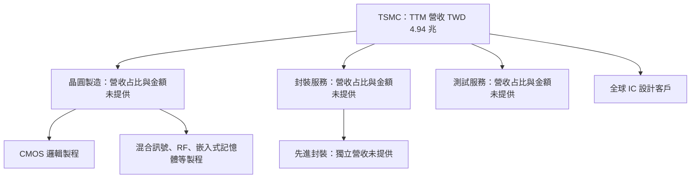
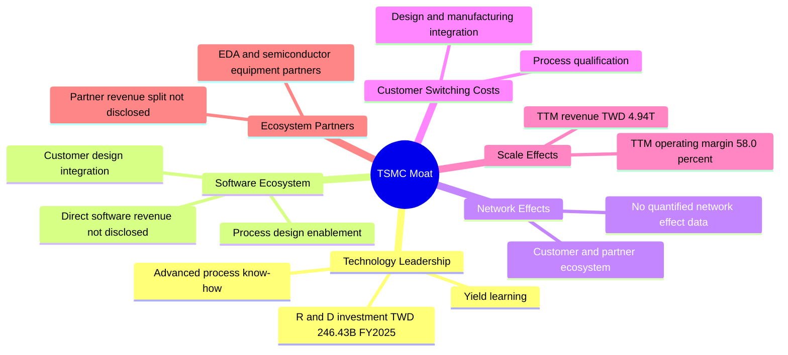
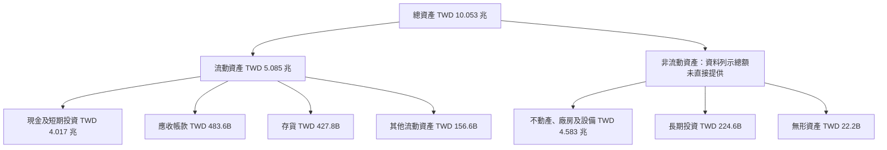
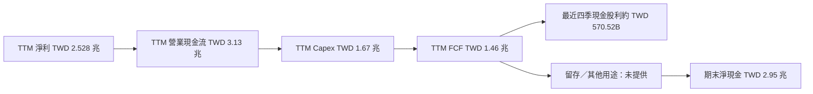
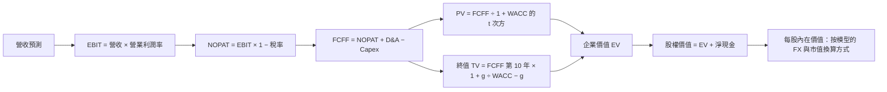
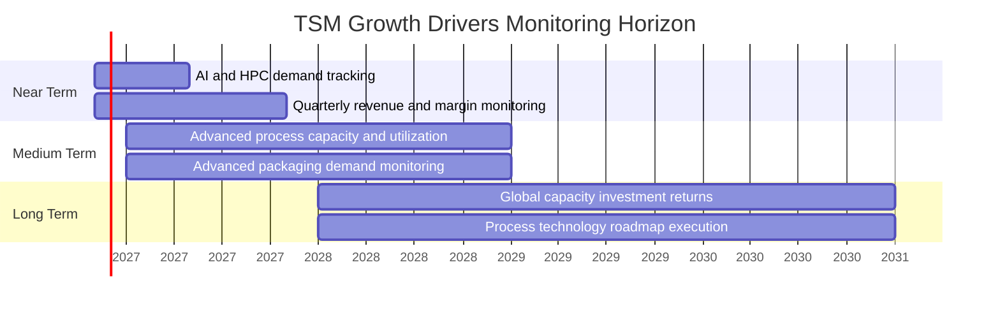
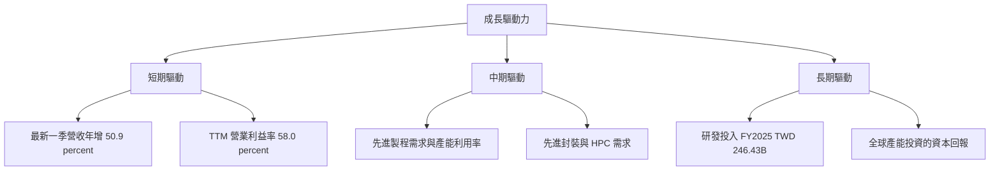
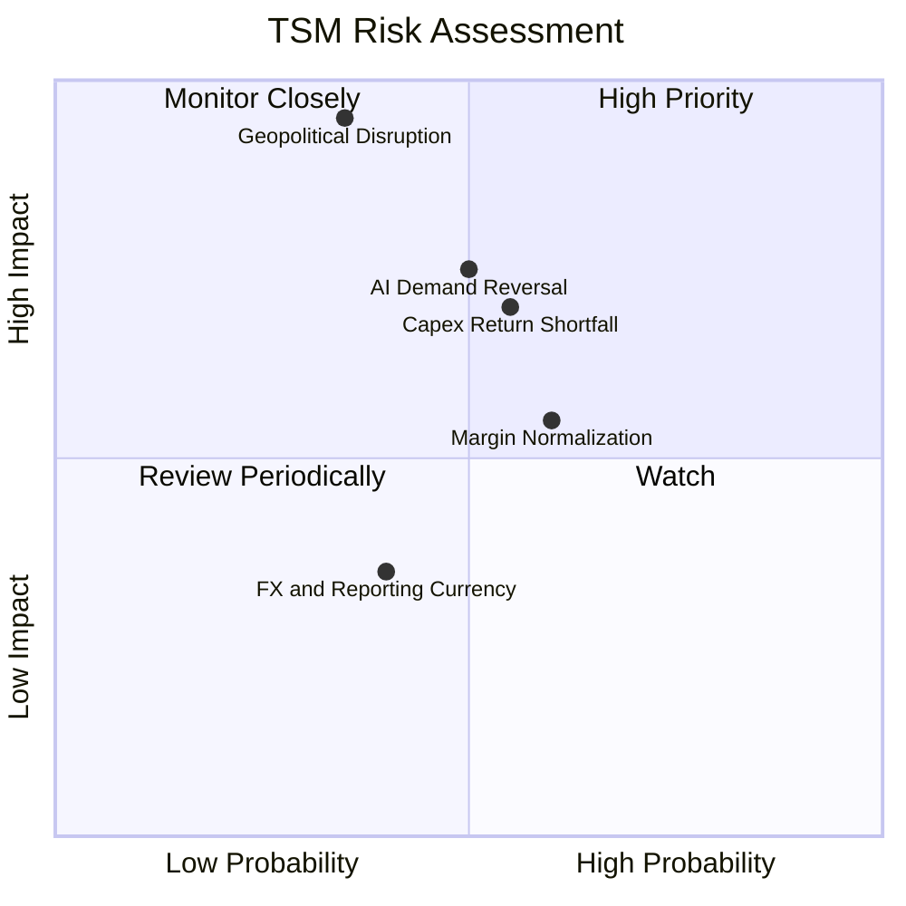
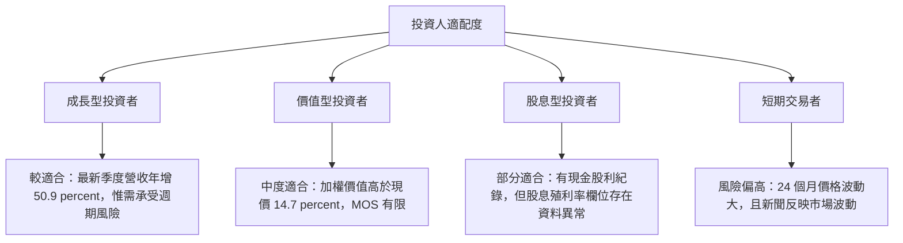

# TSM 基本面深度分析報告
> **報告日期**：2026-11-27 ｜ **語言**：繁體中文 ｜ **數據來源**：Yahoo Finance、Finviz、StockAnalysis、Roic.ai ｜ **分析師**：CFA 級機構研究

## 目錄

| # | 章節 | 核心結論 |
|---|------|----------|
| 1 | 執行摘要 | 買入；加權合理價值 $392.68；MOS +12.8% |
| 2 | 公司概覽與商業模式 | 純晶圓代工模式具規模、技術與客戶轉換成本優勢；分部營收未提供 |
| 3 | 損益表深度分析 | TTM 營收 TWD 4.94 兆；最新一季年增 50.9%，利潤率處於高位 |
| 4 | 資產負債表分析 | TWD 2.95 兆淨現金；流動比率 2.584 |
| 5 | 現金流量深度分析 | TTM FCF TWD 1.46 兆；高資本支出使現金轉換率低於淨利 |
| 6 | 獲利能力與資本效率 | WACC 10.45%；最新可確認 ROIC 數值不足以做同期比較 |
| 7 | 相對估值分析 | Forward P/E 14.7x；同業倍數與 DCF 顯示估值方法間有分歧 |
| 8 | DCF 內在價值評估 | 基準 DCF $443.21；加權合理價值 $392.68，MOS +12.8% |
| 9 | 成長催化劑 | AI、高效能運算與先進製程是主要質化催化劑；TAM 數字未提供 |
| 10 | 風險矩陣 | 地緣政治、資本支出與需求週期為主要風險 |
| 11 | 投資建議 | 買入；分批布局，並以營收、利潤率、Capex 與 FCF 作季度監控 |

## 1. 執行摘要

截至 **2026-11-25 收盤價 $342.34**，TSM 的 TTM 營收為 TWD 4.94 兆（約 USD 148.99B），最新一季營收年增 50.9%，TTM 營業利益率 58.0%，TTM FCF 為 TWD 1.46 兆，淨現金 TWD 2.95 兆。估值方面，DCF 基準值為 $443.21，加權合理價值為 $392.68；依加權合理價值計算，MOS 為 +12.8%。因此依規則 20 評級為**買入**，而非因單一 DCF 數字直接定級。近期 EPS 預估與實際值均未提供，不能判定過去四季是否超預期。

### 1.0 一頁式投資儀表板

| 項目 | 內容 |
|------|------|
| **投資論點（3 句）** | ① 最新一季營收年增 50.9%，TTM 營業利益率 58.0%，顯示先進製程需求與營運槓桿支撐獲利。② TTM FCF TWD 1.46 兆、淨現金 TWD 2.95 兆，具備承擔高資本支出的財務能力。③ 加權合理價值 $392.68 高於現價 $342.34，但 MOS 只有 12.8%，估值折價有限。 |
| **綜合評分** | **8.5/10**（引用 1.1 評分卡） |
| **財務健康** | 🟢 現金及短期投資 TWD 4.02 兆、總債務 TWD 1.07 兆；淨現金 TWD 2.95 兆。 |
| **ROIC vs WACC** | 最新同期 ROIC：N/A；WACC 10.45%。Roic.ai 過往資料有資本報酬指標，但無法據此替代當期 ROIC。 |
| **FCF 趨勢** | TTM FCF TWD 1.46 兆；FCF Yield 2.47%。年度 FCF 自 2023 年 TWD 286.57B 升至 2025 年 TWD 992.38B。 |
| **估值** | Forward P/E 14.662347x ｜ EV/EBITDA：N/A（幣別不一致）｜ FCF Yield 2.47%。 |
| **DCF 內在價值（基準）** | $443.21 ｜ 相對 DCF 折價 22.8%（現價 ÷ DCF 價值 − 1）。 |
| **安全邊際（MOS）** | **+12.8%**＝($392.68 − $342.34) ÷ $392.68；🟡有限。 |
| **預期報酬（基準情境 12M）** | +14.7%（加權合理價值相對現價；非保證報酬）。 |
| **關鍵風險（前二）** | 台海與跨境供應鏈風險；AI／先進製程投資回報低於預期。 |
| **評級 + 信心度** | 🟢 **買入** ｜ 信心：中。MOS 達買入門檻，但 DCF 終值占 EV 61.2%，且當期 ROIC、同業 EV/EBITDA 可比數據有限。 |

### 1.1 綜合評分卡（全報告唯一）

| 維度 | 評分（1–10） | 主要依據（引用數字與其來源章節） |
|------|--------------|----------------------------------|
| 成長性 | 9.0 | 最新一季營收年增 50.9%；TTM 營收成長率未提供，年度 2022–2025 營收 CAGR 約 18.9%（第 3 章）。 |
| 獲利能力 | 9.5 | TTM 營業利益率 58.0%、淨利率 51.1%；同期 ROIC 未提供，不能據此作超額資本報酬結論（第 3、6 章）。 |
| 財務健康 | 9.0 | 淨現金 TWD 2.95 兆、流動比率 2.584、CCC 2 天（第 4 章）。 |
| 估值 | 7.0 | MOS +12.8%；Forward P/E 14.662347x，DCF 基準 $443.21、加權價值 $392.68（第 7、8 章）。 |
| 護城河 | 9.0 | TTM 毛利率 65.8%、營業利益率 58.0%，並有高資本密集度及製程／客戶導入壁壘（第 2 章）。 |
| 管理層與資本配置 | 7.5 | 2025 年 Capex TWD 1.28 兆，現金股息支付 TWD 466.78B；缺乏回購與投資回報的完整可比資料（第 5 章）。 |
| **綜合評分** | **8.5** | 六項算術平均：51.0 ÷ 6 = 8.5。 |

### 1.2 五大投資論點 + 三大核心風險

| 類型 | 項目 | 具體依據 | 信心度 |
|------|------|----------|--------|
| 🟢 **投資論點①** | AI／高效能運算需求帶動成長 | 最新一季營收 TWD 1.494 兆，年增 50.9%；最新一季 EPS 年增 68.73%。 | 🟢 高 |
| 🟢 **投資論點②** | 高利潤率反映製程組合與營運槓桿 | TTM 毛利率 65.8%、營業利益率 58.0%；2026-09 季營業利益 TWD 876.43B。 | 🟢 高 |
| 🟢 **投資論點③** | 資產負債表有投資彈性 | 現金及短期投資 TWD 4.02 兆，總債務 TWD 1.07 兆，淨現金 TWD 2.95 兆。 | 🟢 高 |
| 🟢 **投資論點④** | 現金流規模足以支撐擴產 | TTM OCF TWD 3.13 兆、Capex TWD 1.67 兆、FCF TWD 1.46 兆。 | 🟢 高 |
| 🟢 **投資論點⑤** | 估值非極端高估 | Forward P/E 14.662347x；加權合理價值 $392.68，高於現價 $342.34。 | 🟡 中 |
| 🟡 **風險①** | 地緣政治及供應鏈集中 | 公司主要製造與營運暴露於台灣及亞洲供應鏈；事件發生機率與損失幅度無可靠數字可量化。 | 🔴 高衝擊 |
| 🔴 **風險②** | 高額擴產造成資本回收風險 | TTM Capex TWD 1.67 兆，約為 TTM FCF 的 1.14 倍；若需求不及預期，折舊與閒置產能將壓低報酬。 | 🟡 中 |
| 🟡 **風險③** | 高成長預期回落 | DCF 基準年 1 成長假設 30.0%，低於最新單季年增 50.9%，但仍顯著高於成熟期成長。 | 🟡 中 |

### 1.3 快速統計卡片

| 指標 | 公司實際值（期間） | 同業中位數 | 狀態 |
|------|--------------------|------------|------|
| 營收成長（TTM） | **N/A** | — | 🟡 |
| 營收成長（最新一季年增） | **50.9%** | 20.9%（INTC）、25.6%（UMC）、12.5%（GFS），中位數 20.9% | 🟢 |
| 毛利率（TTM） | **65.8%** | 31.7%（UMC）、28.5%（GFS）、40.2%（INTC），中位數 31.7% | 🟢 |
| 營業利益率（TTM） | **58.0%** | — | 🟢 |
| ROIC（TTM） | **N/A** | — | 🟡 |
| Forward P/E | **14.662347x** | 14.7x（INTC、UMC、GFS 中位數） | 🟡 |
| FCF Yield（TTM） | **2.47%** | — | 🟡 |
| Piotroski F-Score | **N/A** | — | 🟡 |

### 1.4 投資結論

```
╔══════════════════════════════════════════════════════════════════╗
║                    📊 投資結論摘要                               ║
╠══════════════════════════════════════════════════════════════════╣
║  評級：買入（MOS +12.8%，符合 10%–25% 買入門檻）                ║
║  價格（2026-11-25 收盤）：$342.34                                ║
║  DCF 內在價值（基準）：$443.21（折價 22.8%）                    ║
║  安全邊際 MOS：+12.8%（以加權合理價值為分母）                   ║
║  加權合理價值（8.8）：$392.68                                    ║
║  DCF 情境價值：                                                   ║
║    悲觀情境：$187.81（-45.1%）                                   ║
║    基準情境：$443.21（+29.5%）                                   ║
║    樂觀情境：$990.35（+189.3%）                                  ║
║  綜合評分：8.5/10（引用 1.1）                                    ║
║  適合投資人：能承受地緣政治與半導體週期風險的成長型、長線投資人  ║
╚══════════════════════════════════════════════════════════════════╝
```

## 2. 公司概覽與商業模式

### 2.1 業務結構與收入來源

公司提供晶圓製造、封裝、測試及相關半導體服務。分業務營收、產品別占比及各板塊金額未提供，因此不推算占比或畫比例圖。整體 TTM 營收為 TWD 4.94 兆（約 USD 148.99B）。



### 2.2 市場份額

市場份額數字及其來源年份未提供，故不列比例。TSM 的最新一季營收年增 50.9%，高於 INTC、UMC 與 GFS 所列最新季度年增率；但這些公司產品與製造模式不同，營收增速不能直接等同市場份額變化。

### 2.3 競爭護城河分析



### 2.4 護城河強度

| 護城河項目 | 強度（強／中／弱） | 證據（引用數字或事實） | 會削弱它的情況 |
|------------|--------------------|------------------------|----------------|
| 技術與製程能力 | 強 | TTM 營業利益率 58.0%；FY2025 研發支出 TWD 246.43B。 | 製程轉換落後、良率爬坡不順或競爭者縮小差距。 |
| 客戶轉換成本 | 強 | 晶片設計與製程、封裝流程整合使客戶重新驗證成本高；公司同時提供製造、封裝與測試。 | 客戶推動第二來源、設計平台可移植性提高。 |
| 規模與資本優勢 | 強 | TTM 營收 TWD 4.94 兆、TTM Capex TWD 1.67 兆，具持續投資能力。 | 產能利用率下滑、資本回報下降。 |
| 生態夥伴與工具鏈 | 中 | 製程服務需要設計軟體及設備供應商配合；單一夥伴的貢獻數據未提供。 | 夥伴投入減少或替代製程生態系成熟。 |
| 網路效應 | 中 | 客戶與設計生態有相互強化特徵，但無可量化網路效應數據。 | 客戶集中或替代代工平台取得規模。 |
| 軟體生態系統 | 中 | 有製程設計支援與客戶整合，但軟體收入與訂閱數未提供。 | 服務差異化降低或客戶轉向其他製造平台。 |

1.1 的「護城河」評分為 9.0/10，依據是高利潤率、研發投入、製程整合及客戶轉換成本；並非對市場份額作未經證實的推估。

## 3. 損益表深度分析

### 3.1 年度收入成長趨勢（近4年）

FY2022–FY2025 營收以 TWD 計；2022–2025 三年 CAGR 約 18.9%。

```
╔══════════════════════════════════════════════════════════════════╗
║                 TSM 年度收入趨勢（FY2022–FY2025）                ║
╠══════════════════════════════════════════════════════════════════╣
║  FY2022  TWD 2.264T  ████████████░░░░░░░░░░  YoY：基期         ║
║  FY2023  TWD 2.162T  ███████████░░░░░░░░░░░  YoY：-4.5% 🟡    ║
║  FY2024  TWD 2.894T  ███████████████░░░░░░░  YoY：+33.9% 🟢   ║
║  FY2025  TWD 3.809T  ████████████████████░░  YoY：+31.6% 🟢   ║
║                                                                  ║
║  2022–2025 三年營收 CAGR：約 +18.9%                               ║
╚══════════════════════════════════════════════════════════════════╝
```

2023 年營收下降 4.5%，反映半導體需求與庫存週期轉弱；2024、2025 年恢復 33.9%、31.6% 成長。TTM 營收成長率欄位未提供，不能以最新季度年增率替代 TTM 成長率。

### 3.2 季度收入趨勢分析

| 季度 | 營收（TWD） | QoQ | YoY | 備註 |
|------|-------------|-----|-----|------|
| 2025 Q4 | 1.046 兆 | 約 +5.7% | +20.45% | 對比 2025 Q3。 |
| 2026 Q1 | 1.134 兆 | 約 +8.4% | +35.13% | 對比 2025 Q4。 |
| 2026 Q2 | 1.270 兆 | 約 +12.0% | +36.05% | 年增與季增同步提高。 |
| 2026 Q3 | 1.494 兆 | 約 +17.6% | +50.95% | 最新一季加速；為單季年增率，不是 TTM。 |

成長加速與高階製程、AI／HPC 晶片需求相符，但財務數據未提供產品別收入，無法量化各應用的貢獻。

### 3.3 利潤率演變分析

| 利潤率指標 | FY2022 | FY2023 | FY2024 | FY2025 | 趨勢 | 評估 |
|------------|--------|--------|--------|--------|------|------|
| **毛利率** | 約 59.6% | 約 54.4% | 約 56.1% | 約 59.9% | 2023 下降後連續回升 | 🟢 |
| **營業利益率** | 約 49.6% | 約 42.6% | 約 45.7% | 約 50.8% | 2023 見低後回升 | 🟢 |
| **淨利率** | 約 43.9% | 約 39.4% | 約 40.0% | 約 44.6% | 與營業利潤率同方向改善 | 🟢 |

年度比率以各年度損益表金額計算；TTM 毛利率為 65.8%、TTM 營業利益率為 58.0%、TTM 淨利率為 51.1%。兩種期間不可混用。利潤率回升可能反映產品組合、產能利用率與定價等因素；但分業務毛利率、產能利用率與價格資料未提供，不能拆分各項因素的精確貢獻。

### 3.4 費用結構分析

現有資料不足以完整拆解營業費用（如銷管費用、其他營運費用），因此不畫費用結構圓餅圖。FY2025 研發支出為 TWD 246.43B；TTM 營業利益率為 58.0%。年度營業利益與毛利間差額包含多項費用，不能將差額全數視為單一費用項目。

### 3.5 季度 EPS 趨勢與盈餘品質（Quality of Earnings）

最近四季 EPS 實際值如下；季度估值 EPS Estimate 為缺值，因此不能判斷超預期或不及預期。

| 季度 | EPS 實際（來源所列） | EPS 年增 | 預估／實際差異 |
|------|---------------------|---------|----------------|
| 2025 Q4 | 18.72 | +34.97% | 預估值缺失，無法判定。 |
| 2026 Q1 | 22.08 | +58.38% | 預估值缺失，無法判定。 |
| 2026 Q2 | 27.25 | +77.40% | 預估值缺失，無法判定。 |
| 2026 Q3 | 29.43 | +68.73% | 預估值缺失，無法判定。 |

| 盈餘品質項目 | 數值/佔比 | 評估 |
|--------------|-----------|------|
| 股權薪酬 SBC / 營收 | 以 2025 年 SBC TWD 1.25B ÷ FY2025 營收 TWD 3,809.05B ≈ 0.033% | 🟢 比例低；這是年度比較，不代表最新 TTM SBC 比率。 |
| SBC / 營業現金流 | 2025 年 SBC TWD 1.25B ÷ OCF TWD 2.27 兆 ≈ 0.055% | 🟢 對現金流尺度影響有限。 |
| FCF / 淨利（現金轉換率） | TTM FCF TWD 1.46 兆 ÷ TTM 淨利 TWD 2.528 兆 ≈ 57.8% | 🟡 Capex 高，使 FCF 低於會計淨利；仍需留意投資週期。 |
| 一次性／非經常性損益 | N/A（未提供可核對明細） | 🟡 無法判斷是否有一次性項目影響盈餘。 |
| 有效稅率異常 | DCF 採用有效稅率 17.0%；近年可比 TTM 稅率序列未提供 | 🟡 未見資料足以判定稅率異常。 |
| 資本化支出 vs 費用化 | TTM Capex TWD 1.67 兆；資本化與費用化政策細節 N/A | 🟡 高資本支出透過折舊逐年費用化，需觀察資產壽命與利用率。 |

**盈餘品質結論**：SBC 占比低，沒有證據顯示股權薪酬大幅稀釋股東；但 TTM FCF／淨利約 57.8%，主要需由高 Capex 與資本週期解釋。一次性損益與資本化會計細節不足，故無法斷言 GAAP 淨利被高估或低估。估值上應同時看營業獲利與實際 FCF，而不宜只依 EPS。

## 4. 資產負債表分析

### 4.1 資產結構分解

以下採 StockAnalysis 2026-09-30 資產負債表，單位 TWD；僅呈現有明確金額的項目，不為使分類加總一致而反推缺漏項。



### 4.2 流動性與營運資金分析

| 流動性指標 | 2026-09-30 | 2025-12-31 | 解讀 |
|------------|------------|------------|------|
| 流動比率 | 2.584 | 約 2.51（以年度流動資產與流動負債計算） | 短期資產覆蓋流動負債充足。 |
| 速動比率 | 2.287 | N/A | 最新值顯示不依賴存貨即可覆蓋短期負債。 |
| 現金及短期投資 | TWD 4.02 兆 | TWD 3.07 兆 | 現金資產增加，提升擴產與逆週期投資彈性。 |

| 指標 | 最新 TTM | 一年前 TTM | 變化 | 解讀 |
|------|----------|------------|------|------|
| DSO 應收帳款天數 | 1 天 | N/A | N/A | 一年前數值未提供，不能判定收款速度方向。 |
| DIO 存貨天數 | 92 天 | N/A | N/A | 存貨天數是觀察製造週期與庫存風險的重要指標；缺乏去年比較。 |
| DPO 應付帳款天數 | 91 天 | N/A | N/A | 可觀察供應商付款週期，但沒有歷史數字可判斷議價變化。 |
| CCC 現金轉換週期 | 2 天 | N/A | N/A | 目前現金轉換週期短；年度比較缺資料。 |

### 4.3 債務結構分析

```
╔══════════════════════════════════════════════════════════════════╗
║                   TSM 債務健康診斷                               ║
╠══════════════════════════════════════════════════════════════════╣
║  總債務：               TWD 1.07 兆   ██░░░░░░░░░░░░░░░░░        ║
║  現金及短期投資：       TWD 4.02 兆   ████████████████████       ║
║  淨現金：               TWD 2.95 兆   ██████████████░░░░░░ 🟢   ║
║                                                                  ║
║  Debt/EBITDA：N/A（市值與財報幣別不同，且可比口徑未提供）       ║
║  利息保障倍數：N/A（利息費用資料未提供）                         ║
║  流動比率：2.584x 🟢                                              ║
╚══════════════════════════════════════════════════════════════════╝
```

### 4.4 股東權益趨勢

```
╔══════════════════════════════════════════════════════════════════╗
║                TSM 年末股東權益（TWD）                            ║
╠══════════════════════════════════════════════════════════════════╣
║  2022  TWD 2.90 兆  ████████████░░░░░░░░░░                      ║
║  2023  TWD 3.43 兆  ██████████████░░░░░░░░                      ║
║  2024  TWD 4.24 兆  █████████████████░░░░░                      ║
║  2025  TWD 5.36 兆  ██████████████████████                      ║
║  趨勢：2022–2025 權益持續增加；年末數值來自年度資產負債表。     ║
╚══════════════════════════════════════════════════════════════════╝
```

## 5. 現金流量深度分析

### 5.1 現金流量瀑布圖

單位為 TWD 兆。淨利為 TTM StockAnalysis 數字；現金股利採最近四季現金流量數字加總。回購及淨現金變化未提供。



### 5.2 FCF 轉換率趨勢

| 年度 | FCF（TWD） | 淨利（TWD） | FCF / 淨利 |
|------|------------|-------------|------------|
| 2022 | 520.97B | 992.92B | 約 52.5% |
| 2023 | 286.57B | 851.74B | 約 33.6% |
| 2024 | 861.20B | 1.158 兆 | 約 74.3% |
| 2025 | 992.38B | 1.698 兆 | 約 58.4% |
| TTM 至 2026-09-30 | 1.46 兆 | 2.528 兆 | 約 57.8% |

年度比率以當年報表金額計算；TTM 比率採 TTM FCF 與 TTM 淨利。2023 年轉換率較低，與 FCF 下滑一致；2024 年改善後，2025 年在營收擴大、Capex 維持高位下回落。

### 5.3 自由現金流趨勢

```
╔══════════════════════════════════════════════════════════════════╗
║             TSM 自由現金流趨勢（單位：TWD）                      ║
╠══════════════════════════════════════════════════════════════════╣
║  2022  TWD 520.97B  ██████████░░░░░░░░░░  Yield：N/A             ║
║  2023  TWD 286.57B  ██████░░░░░░░░░░░░░░  Yield：N/A             ║
║  2024  TWD 861.20B  █████████████████░░░  Yield：N/A             ║
║  2025  TWD 992.38B  ████████████████████  Yield：N/A             ║
║  TTM   TWD 1.46 兆  █████████████████████ Yield：2.47%            ║
╚══════════════════════════════════════════════════════════════════╝
```

年度 FCF Yield 未提供，因此不以 USD 股價與 TWD FCF 混算。TTM FCF Yield 2.47% 是程式計算數值，採用該欄原值。

### 5.4 資本配置評估

完整配置百分比未提供，不繪製比例圓餅圖。

| 資本用途／來源 | 可確認數字 | 評估 |
|----------------|----------|------|
| Capex | TTM TWD 1.67 兆；FY2025 TWD 1.28 兆 | 反映產能與製程投資；需追蹤新增資產的利用率與回報。 |
| 現金股利 | FY2025 TWD 466.78B | 有實際分配；股息金額與支付比例應以同幣別報表核對。 |
| 回購 | N/A | 資料未提供可確認的回購金額。 |
| 研發 | FY2025 TWD 246.43B | 支持製程迭代與技術投入。 |
| 留存現金 | 2026-09 現金及短期投資 TWD 4.02 兆 | 提供逆週期投資與流動性緩衝。 |

## 6. 獲利能力與資本效率

### 6.1 ROE / ROA / ROIC 趨勢

| 指標 | 最新可用值 | 歷史／期間資訊 | 評估 |
|------|------------|----------------|------|
| ROE | 41.9%（TTM） | 年度杜邦計算所需資料在品質指標區塊未完整提供 | 🟢 高獲利，但不能據此推導當期 ROIC。 |
| ROA | 20.6%（TTM） | 2025 年末總資產 TWD 7.93 兆 | 🟢 資產獲利能力高。 |
| ROIC | N/A（最新同期） | Roic.ai 歷史片段列有過去年份資本報酬，但非 2026-09 TTM | 🟡 無法與 WACC 同期精確比較。 |
| WACC | 10.45% | Cost of capital inputs | 作為 DCF 折現率及資本成本參考。 |

Roic.ai 的歷史資料顯示若干過往年度資本報酬率，但資料節錄未給出能確認為最新 TTM ROIC 的欄位；因此不以過往數字冒充當期值，也不下「目前 ROIC 高於 WACC」的確定結論。

### 6.2 ROIC vs WACC 分析（核心價值創造判斷）

```
╔══════════════════════════════════════════════════════════════════╗
║                ROIC vs WACC 深度分析                            ║
╠══════════════════════════════════════════════════════════════════╣
║  WACC（採用成本資本資料）：10.45%                                ║
║  ├── 無風險利率（10Y 美債）：4.85%                              ║
║  ├── ERP：5.00%                                                  ║
║  ├── 原始 Beta：1.23；調整後 Beta：1.16                         ║
║  ├── 股權成本：10.62%                                            ║
║  ├── 稅前債務成本：1.16%；稅率：17.0%                           ║
║  ├── 股權／債務權重：98.2%／1.8%                                 ║
║  └── WACC：10.45%                                                ║
║                                                                  ║
║  ROIC（最新同期）：N/A（缺乏可確認的最新 TTM ROIC）              ║
║  EVA = ROIC − WACC：N/A                                          ║
║                                                                  ║
║  結論：公司營業利潤率與 ROE 高，但缺最新同期 ROIC，              ║
║        故無法嚴謹量化當期經濟附加價值。                          ║
╚══════════════════════════════════════════════════════════════════╝
```

成本資本組成採用程式提供的 WACC 與調整後 Beta。原始 Beta 1.23 依 `⅔ × 1.23 + ⅓ × 1 = 1.1533`，資料區塊將調整後數值列為 1.16。因利息費用與市值基礎權重的完整原始底稿未提供，本報告不自行重建另一個 WACC。第 8 章同樣採用 10.45%。

### 6.3 杜邦三因素分解

| 因素 | 數值（TTM） | 解讀 |
|------|-------------|------|
| 淨利率 | N/A | QUALITY FIGURES 的杜邦結果為 N/A；不補算。 |
| 資產週轉率 | N/A | 缺少完整且同口徑的杜邦輸入。 |
| 權益乘數 | N/A | 缺少品質指標的有效權益資料。 |
| **ROE** | **N/A（杜邦分解）** | 資料區塊明確列示杜邦 N/A，不能以其他 ROE 欄位替代此分解。 |

### 6.4 財務體質：Piotroski F-Score

Piotroski F-Score 為 **N/A**；需要相隔一年的兩期 SEC 申報資料，而可用來源為 Yahoo 季度報表，未提供九項測試結果。因而不列九項逐項測試或臆測其通過情形。

## 7. 相對估值分析

### 7.1 同業估值比較表格

本公司市場估值列採 Yahoo Finance 數值；同業列採 Peer multiples。若數值因報價／財報幣別混用而缺失，保留 N/A。

| 估值指標 | **TSM** | **INTC** | **UMC** | **GFS** | 本公司評估 |
|----------|---------|---------|---------|---------|-----------|
| **Trailing P/E** | 22.18665x | N/A | 12.4x | 103.4x | 🟡 高於 UMC、低於 GFS；INTC 無資料。 |
| **Forward P/E** | 14.662347x | 30.4x | 14.7x | 14.0x | 🟢 接近同業中位數 14.7x。 |
| **P/S Ratio** | N/A | 4.8x | N/A | 2.8x | 🟡 TSM 因幣別不同未提供，無法直接比較。 |
| **EV/EBITDA** | N/A | 15.8x | N/A | 9.7x | 🟡 TSM 與 UMC 因幣別口徑未提供；可計同業中位數 12.7x。 |
| **最新一季營收年增** | 50.9% | 20.9% | 25.6% | 12.5% | 🟢 TSM 高於三家同業所列增速。 |
| **TTM 毛利率** | 65.8% | 40.2% | 31.7% | 28.5% | 🟢 TSM 高於比較公司。 |

TSM 的 Forward P/E 14.662347x 接近同業中位數，但同業業務組合、製程能力與資本需求並不完全相同；不宜只依倍數差異判定高估或低估。

### 7.2 歷史估值區間分析

N/A（未提供可引用的歷史 P/E 區間或估值百分位資料）。24 個月股價資料顯示價格由 2024-11 的 $180.21 至 2026-06 的 $476.29，其後 2026-11 收於 $342.34；這是價格路徑，不能替代歷史估值倍數區間。

### 7.3 情境價值（Bear / Base / Bull）

| 情境 | 第 1 年營收成長 | 期末營業利潤率 | WACC | 每股價值 | 相對現價 | 機率 | 會發生的條件 |
|------|----------------|----------------|------|----------|----------|------|--------------|
| 🔴 悲觀 | 15.0% | 42.1% | 11.45% | $187.81 | -45.1% | 25% | 先進製程需求放緩、價格／成本壓力提高、資本成本上升。 |
| 🟡 基準 | 30.0% | 49.5% | 10.45% | $443.21 | +29.5% | 50% | 需求維持，營收成長逐年降至成熟期，利潤率逐步回歸歷史中位數。 |
| 🟢 樂觀 | 45.0% | 54.5% | 9.45% | $990.35 | +189.3% | 25% | AI／高效能運算需求持續超預期，利潤率維持高位且折現率降低。 |

### 7.4 相對估值隱含價格區間

```
╔══════════════════════════════════════════════════════════════════╗
║           估值方法隱含每股價值（USD）                            ║
╠══════════════════════════════════════════════════════════════════╣
║  $284.60          $342.32   $342.34       $443.21       $586.69   ║
║  EV/EBITDA ───── Forward P/E ─ 現價 ─────── DCF ───── 分析師共識 ║
╚══════════════════════════════════════════════════════════════════╝
```

| 方法 | 每股價值 | 依據 |
|------|----------|------|
| 同業 Forward P/E | $342.32 | 同業中位數 14.7x × Forward EPS 23.35。 |
| 同業 EV/EBITDA | $284.60 | INTC、GFS 中位數 12.7x × TTM EBITDA，再加淨現金。 |
| DCF 基準 | $443.21 | 10 年 FCFF，WACC 10.45%，永續成長率 3.0%。 |
| 分析師共識目標價 | $586.69 | 20 位分析師平均目標價。 |

## 8. DCF 內在價值評估（Discounted Cash Flow）

**模型口徑：** DCF 金額以 TWD 十億元（TWD bn）為單位；每股價值為 USD。採用程式提供的 DCF 模型，不另建模型或改動模型輸出。模型以 FCFF 折現至企業價值，並採用其列示的淨現金橋接與每股換算方式。

### 8.0 估值推理鏈（Thinking Logic）

**Step 1 — 價值由哪些變數決定？**  
核心價值由晶圓製造及相關封裝服務的現金流、先進製程需求與利潤率，以及重資本投入後的再投資回報所決定。分部營收占比未提供，不能把 TTM 營收拆分為主業或新業務比重。模型中最主導估值的變數是 WACC、永續成長率與終值現金流：終值 PV 占 EV 61.2%，敏感度矩陣亦顯示折現率變化對估值影響顯著。

**Step 2 — 模型選擇**

| 決策點 | 本報告採用 | 理由（含數字） | 曾考慮但否決 | 否決理由 |
|--------|-----------|----------------|--------------|----------|
| 現金流定義 | FCFF | 以 WACC 10.45% 折現，得出 EV，再加淨現金。 | FCFE | 與既有 DCF 模型口徑不符。 |
| 預測期 N | 10 年 | 模型逐年預測 FY+1 至 FY+10，涵蓋成長退坡。 | 5 年 | 會偏離既有模型年數及輸出。 |
| 終值方法 | Gordon Growth | 模型提供永續成長率 3.0% 的終值計算。 | 退出倍數 | DCF 模型未提供可採用的退出倍數輸入，不能另造倍數。 |
| EBIT 基礎 | GAAP EBIT | 模型已指定以 GAAP EBIT 建模。 | 非 GAAP EBIT | 會與程式模型不一致。 |

**Step 3 — 關鍵假設推導鏈**

- **營收成長路徑**：錨點＝最新季度年增 50.9%，但這不是 TTM 成長率；FY2022–FY2025 營收 CAGR 約 18.9% → 調整＝最新季度高增速可能受需求周期及比較基期影響，故模型將年 1 上限設為 30%，再線性降至 3% → **採用 FY+1 30.0%、FY+10 3.0%** → 曾考慮直接延續 50.9%，但否決，因為單季年增不能代表十年可持續增速。
- **營業利潤率**：錨點＝TTM 58.0% → 調整＝模型假定高利潤率隨成熟、成本與競爭因素逐步正常化 → **FY+1 58.0%、FY+10 49.5%** → 曾考慮十年維持 58.0%，但否決，因模型提供的五年財年中位數為 49.5%，且長期不變利潤率風險較高。
- **永續成長率 g**：錨點＝成熟企業長期成長需低於折現率；可用數據未提供長期產業 GDP 估計 → **採用 3.0%（模型值）** → 曾考慮更高 g，但否決，因 g 必須低於 WACC，且高 g 會顯著抬高終值。
- **預測期 N**：錨點＝模型明列 10 年 → **採用 10 年** → 曾考慮縮短預測期，但否決，避免擅自更動既有模型及逐年輸出。
- **Capex／營收**：錨點＝TTM 33.8% → 調整＝模型假定投資強度隨規模成熟下降，並於 FY+10 收斂至 D&A 的 1.1 倍 → **FY+1 33.8%、FY+10 16.6%** → 曾考慮十年固定在 33.8%，但否決，因模型採逐步回落的資本強度假設。
- **EBIT 與 SBC**：錨點＝模型指定 GAAP EBIT；GAAP 已將 SBC 作為費用反映 → **採用組合 (A)：GAAP EBIT、固定股數、SBC 不再另扣、稀釋率 0%** → 否決在 FCFF 再扣 SBC 或同時另加稀釋，避免同一經濟成本重複計入。
- **WACC**：錨點＝成本資本資料的 10.45% → **採用 10.45%** → 不另行改用其他 WACC，因本章必須沿用既有模型折現率。
- **有效稅率、D&A／營收**：錨點分別為 17.0%、15.1%（TTM）→ 模型採用同一數值並固定。  
- **ΔWC／營收增額**：既有 DCF 明列未建模營運資金；不補造 ΔWC 數字，亦不加入現金流列。

**Step 4 — 最脆弱一環**  
模型假設長期營收與現金流可持續增長，且 Capex／營收逐步降至 16.6%；若需求或資本效率不符，價值會下修，情境表已顯示悲觀價值 $187.81。

**Step 5 — 計算路徑圖**



### 8.1 模型假設總表（Model Inputs）

| 假設項目 | 採用值 | 依據／來源 | 敏感度 |
|----------|--------|-------------|--------|
| 預測期長度 N | 10 年 | DCF MODEL 明列；逐年輸出 10 年 | 🟡 中 |
| 營收成長路徑 | FY+1 30.0% 線性降至 FY+10 3.0% | FY+1 參照最新單季 YoY 50.9%，模型限制於 0%–30%；終點 3.0% | 🔴 高 |
| 營業利潤率 | 58.0% 降至 49.5% | TTM 58.0%；FY+10 取近五財年中位數（模型說明） | 🔴 高 |
| 有效稅率 | 17.0% | 最新年度有效稅率 | 🟢 低 |
| Capex／營收 | 33.8% 降至 16.6% | TTM Capex 比率，逐步降至 1.1×D&A（模型值） | 🔴 高 |
| D&A／營收 | 15.1% | TTM 比率，模型固定 | 🟢 低 |
| ΔWC／營收增額 | 未建模 | DCF 模型明確排除營運資金變動 | 🟡 中 |
| EBIT 基礎 | GAAP EBIT | DCF MODEL 指定 | 🟡 中 |
| SBC 處理 | GAAP 費用已含 SBC，不再扣除 | 模型組合 (A)；財務資料顯示 FY2025 SBC TWD 1.25B | 🟡 中 |
| 年稀釋率 | 0% | 組合 (A)：固定股數；SBC 已由 GAAP EBIT 計入 | 🟡 中 |
| 永續成長率 g | 3.0% | DCF MODEL 指定 | 🔴 高 |
| 終值方法 | Gordon Growth | DCF MODEL 提供永續成長終值 | 🔴 高 |
| WACC | 10.45% | 成本資本資料及 DCF MODEL | 🔴 高 |

本模型採用 **(A) GAAP EBIT + 固定股數**，故 SBC 影響已計入一次；FCFF 不另扣 SBC，股數不再按年稀釋。模型 FCFF 為 `NOPAT + D&A − Capex`，未扣 ΔWC，需視為模型限制。

### 8.2 折現率推導（WACC）

```
╔══════════════════════════════════════════════════════════════════╗
║                    WACC 推導（折現率）                           ║
╠══════════════════════════════════════════════════════════════════╣
║  股權成本 Ke（CAPM）：                                           ║
║  ├── 無風險利率 Rf：4.85%                                        ║
║  ├── 市場風險溢酬 ERP：5.00%                                     ║
║  ├── 原始 Beta：1.23；採用調整後 Beta：1.16                     ║
║  ├── 國別／規模溢酬：0.00%（成本資本資料未另列）                ║
║  └── Ke = 4.85% + 1.16 × 5.00% = 10.65%（資料列示 10.62%）     ║
║                                                                  ║
║  債務成本：稅前 1.16%；稅率 17.0%                                ║
║  稅後 Kd = 1.16% × (1 − 17.0%) = 0.9628%                         ║
║  股權／債務權重：98.2%／1.8%                                     ║
║  採用 WACC：10.45%（成本資本資料原值）                           ║
╚══════════════════════════════════════════════════════════════════╝
```

**輸入來歷及可複算性說明：**無風險利率與 ERP 為成本資本資料原值；該資料未列無風險利率的觀察日期細節。Beta 調整方式為 `⅔ × 1.23 + ⅓ × 1 = 1.1533`，資料列示調整後 Beta 1.16。未另計國別／規模溢酬。程式列示 Ke 10.62%、稅前 Kd 1.16%、稅率 17.0%、權重 98.2%／1.8%，以及 WACC 10.45%。

**WACC 五步核對：**

1. 股權成本依資料原值：**Ke = 10.62%**。若以已四捨五入 Beta 直接帶入，`4.85% + 1.16 × 5.00% = 10.65%`，與原值 10.62% 有 0.03 個百分點差異，反映輸入精度／計算口徑差異；本報告遵循資料原值。
2. 稅前 Kd：**1.16%**。利息費用與平均計息負債原始明細未提供，不能重建分子、分母。
3. 稅後 Kd：`1.16% × (1 − 17.0%) = 0.9628%`。
4. 股權／債務權重：**98.2%／1.8%**，權重合計 100.0%。市值與計息負債的完整同口徑底稿未提供，故不另推導金額。
5. 按資料提供之組成，採用 **WACC 10.45%**；以列示的四捨五入組成回算會有微小差異，估值統一沿用該原值。

### 8.3 逐年自由現金流預測（基準情境）

以下金額均為 **TWD 十億元**；折現因子保留三位小數。資料未提供的 ΔWC 不建模，並依既有模型 FCFF 定義列示。

| 年度 | FY+1 | FY+2 | FY+3 | FY+4 | FY+5 | FY+6 | FY+7 | FY+8 | FY+9 | FY+10 |
|------|------|------|------|------|------|------|------|------|------|-------|
| 營收 | 6,428.26 | 8,163.89 | 10,123.23 | 12,249.11 | 14,453.94 | 16,622.04 | 18,616.68 | 20,292.18 | 21,509.71 | 22,155.00 |
| 營收 YoY | 30.0% | 27.0% | 24.0% | 21.0% | 18.0% | 15.0% | 12.0% | 9.0% | 6.0% | 3.0% |
| 營業利潤率 | 58.0% | 57.0% | 56.1% | 55.2% | 54.2% | 53.3% | 52.3% | 51.4% | 50.5% | 49.5% |
| EBIT（GAAP） | 3,726.88 | 4,656.49 | 5,679.00 | 6,756.58 | 7,837.06 | 8,856.56 | 9,744.56 | 10,431.05 | 10,854.96 | 10,972.60 |
| − 稅 | (632.56) | (790.34) | (963.90) | (1,146.79) | (1,330.18) | (1,503.22) | (1,653.94) | (1,770.46) | (1,842.41) | (1,862.38) |
| = NOPAT | 3,094.32 | 3,866.14 | 4,715.10 | 5,609.79 | 6,506.88 | 7,353.34 | 8,090.62 | 8,660.59 | 9,012.55 | 9,110.22 |
| + D&A | 970.20 | 1,232.15 | 1,527.86 | 1,848.72 | 2,181.48 | 2,508.71 | 2,809.75 | 3,062.63 | 3,246.39 | 3,343.78 |
| − Capex | (2,171.05) | (2,601.47) | (3,032.68) | (3,435.84) | (3,778.51) | (4,028.15) | (4,156.32) | (4,143.23) | (3,981.42) | (3,678.16) |
| **= FCFF** | **1,893.46** | **2,496.82** | **3,210.29** | **4,022.67** | **4,909.85** | **5,833.90** | **6,744.04** | **7,579.99** | **8,277.52** | **8,775.85** |
| 折現因子 @10.45% | 0.905 | 0.820 | 0.742 | 0.672 | 0.608 | 0.551 | 0.499 | 0.451 | 0.409 | 0.370 |
| **FCFF 現值 PV** | **1,714.28** | **2,046.62** | **2,382.42** | **2,702.80** | **2,986.71** | **3,212.99** | **3,362.76** | **3,421.91** | **3,383.18** | **3,247.43** |

**預測期現值合計：**  
`1,714.28 + 2,046.62 + 2,382.42 + 2,702.80 + 2,986.71 + 3,212.99 + 3,362.76 + 3,421.91 + 3,383.18 + 3,247.43 = 28,461.10 TWD bn`

**逐步演算（FY+1）：**

1. 營收＝TTM 基期 4,944.82 × (1 + 30.0%)＝**6,428.26 TWD bn**（依模型輸出）。
2. EBIT＝6,428.26 × 58.0%＝**3,726.88 TWD bn**。
3. 稅＝3,726.88 × 17.0%＝**632.56 TWD bn**。
4. NOPAT＝3,726.88 − 632.56＝**3,094.32 TWD bn**。
5. D&A＝6,428.26 × 15.1%＝**970.20 TWD bn**（模型列示值）。
6. Capex＝6,428.26 × 模型 FY+1 Capex 比率＝**2,171.05 TWD bn**。
7. ΔWC＝**未建模**；模型公式不含此項。
8. FCFF＝NOPAT + D&A − Capex＝`3,094.32 + 970.20 − 2,171.05 = 1,893.47 TWD bn`；模型表列 **1,893.46 TWD bn**，差異約 0.01 TWD bn，屬列示精度尾差，後續沿用模型原值。
9. 折現因子＝`1 ÷ (1 + 10.45%)^1`；模型列示 0.905。PV＝模型列示 FCFF 與折現因子計算，表列 **1,714.28 TWD bn**。

**合理性自檢：**

- 預測 FCF CAGR（FY+1 至 FY+10）約為 18.6%；歷史可用 FCF 由 FY2022 TWD 520.97B 至 FY2025 TWD 992.38B，三年 CAGR 約 24.0%。預測低於這段歷史增速，但歷史起點受 2023 低 FCF 影響。
- FY+10 FCF 利潤率約 `8,775.85 ÷ 22,155.00 = 39.6%`；TTM FCF 利潤率約 `1,460 ÷ 4,944.82 = 29.5%`。同業最佳 FCF 利潤率未提供，不能作同業排名。
- 各年 FCFF 均為正；模型未納入 ΔWC，且對長期 FCF 的可信度仍受資本週期影響。

```
╔══════════════════════════════════════════════════════════════════╗
║            自由現金流：歷史實際 vs 模型預測                      ║
╠══════════════════════════════════════════════════════════════════╣
║  FY2023(實)  TWD 286.57B  ██████░░░░░░░░░░░░  FCF               ║
║  FY2024(實)  TWD 861.20B  █████████████████░░  FCF               ║
║  FY2025(實)  TWD 992.38B  ████████████████████ FCF               ║
║  FY+1 (預)   TWD 1.893 兆 ████████████████████████████████████  ║
║  FY+10 (預)  TWD 8.776 兆 █████████████████████████████████████║
╠══════════════════════════════════════════════════════════════════╣
║  FY+1 至 FY+10 FCF CAGR 約 18.6%；模型依賴收入成長與 Capex 回落。║
╚══════════════════════════════════════════════════════════════════╝
```

### 8.4 終值計算（Terminal Value）

**適用性檢查：** `WACC 10.45% vs g 3.0% → WACC > g ✅`

DCF MODEL 提供 Gordon Growth 終值；未提供退出倍數輸入，故不擅自增加一個終值方法。

| 方法 | 計算式 | 終值 TV | TV 現值 | 佔總 EV 比重 |
|------|--------|---------|---------|--------------|
| Gordon Growth | 8,775.85 × (1 + 3.0%) ÷ (10.45% − 3.0%) | 121,292.20 TWD bn | 44,883.14 TWD bn | 61.2% |
| 退出倍數法 | N/A（DCF 模型未提供退出倍數輸入） | N/A | N/A | N/A |

**逐步演算：**

1. FY+10 FCFF＝**8,775.85 TWD bn**。
2. 分子＝`8,775.85 × (1 + 3.0%) = 9,039.1255 TWD bn`。
3. 分母＝`10.45% − 3.0% = 7.45%`；TV＝`9,039.1255 ÷ 7.45% = 121,292.20 TWD bn`（依模型輸出）。
4. PV(TV)＝`121,292.20 × 0.370 = 44,883.14 TWD bn`（使用模型未四捨五入折現因子）。
5. 終值占 EV＝`44,883.14 ÷ 73,344.24 = 61.2%`。

### 8.5 企業價值 → 每股內在價值（Bridge）

```
╔══════════════════════════════════════════════════════════════════╗
║              企業價值 → 每股內在價值 橋接表                      ║
╠══════════════════════════════════════════════════════════════════╣
║  預測期 FCF 現值合計            +TWD 28,461.10B                  ║
║  終值現值 PV(TV)                +TWD 44,883.14B                  ║
║  ─────────────────────────────────────────────                  ║
║  = 企業價值 EV                   TWD 73,344.24B                  ║
║  + 淨現金                       +TWD 2,947.23B                   ║
║  = 股權價值                      TWD 76,291.47B                  ║
║                                                                  ║
║  模型每股換算：股權價值 × FX 0.0301305 USD/TWD × 價格／市值      ║
║  ★ 每股內在價值                  $443.21                         ║
║    2026-11-25 收盤價             $342.34                         ║
║    折溢價（現價÷DCF價值−1）      -22.8%（折價）                  ║
╚══════════════════════════════════════════════════════════════════╝
```

**逐步演算：**

1. EV＝`28,461.10 + 44,883.14 = 73,344.24 TWD bn`。
2. 股權價值＝`73,344.24 + 2,947.23 = 76,291.47 TWD bn`。
3. 每股內在價值依模型指定換算式：`equity value × FX 0.0301305 USD/TWD × price ÷ market cap = $443.21`。模型使用價格／市值作每股轉換因子，不能以其他自行推定股數替換。
4. 折溢價＝`$342.34 ÷ $443.21 − 1 = -22.8%`。
5. 本節不計算 MOS；MOS 只依 8.8 加權合理價值計算。

淨現金取 2026-09-30 TTM 資料。模型未提供明確稀釋股數橋接，且明確採固定股數、年稀釋率 0% 的組合 (A)。

### 8.6 敏感性分析（WACC × 永續成長率）

下表每格先列每股價值，括號列相對 $342.34 現價的上行／下行幅度。百分比依每股價值與現價計算，採約數。

| g（列）／WACC（欄） | 8.45% | 9.45% | **10.45%（基準）** | 11.45% | 12.45% |
|-----------|------|------|------------------|-------|-------|
| 2.0% | $560.00（+63.6%） | $474.65（+38.7%） | $410.13（+19.8%） | $359.79（+5.1%） | $319.52（-6.7%） |
| 2.5% | $591.98（+72.9%） | $496.47（+45.0%） | $425.63（+24.3%） | $371.14（+8.4%） | $328.05（-4.2%） |
| **3.0%（基準）** | $629.82（+84.0%） | $521.68（+52.4%） | **$443.21（+29.5%）** | $383.84（+12.1%） | $337.47（-1.4%） |
| 3.5% | $675.30（+97.3%） | $551.12（+61.0%） | $463.32（+35.3%） | $398.13（+16.3%） | $347.95（+1.6%） |
| 4.0% | $731.00（+113.5%） | $585.96（+71.2%） | $486.54（+42.1%） | $414.34（+21.0%） | $359.66（+5.1%） |

**矩陣複算限制：**模型提供完整矩陣值，但未提供各格逐項重新折現的 PV 組成，且指示要求不得另建 DCF；因此照抄矩陣，不用近似算式冒充逐格完整重算。

**三情境 DCF：**營收、利潤率與 WACC 假設及每股價值照抄模型；FY+N 逐情境營收、FCFF 與 TV 分解未提供，不另行反推或生成。

| 情境 | 營收成長假設 | 期末營業利潤率 | 永續成長 g | WACC | 每股內在價值 | 相對現價 | 主觀機率 |
|------|-----------|----------------|------------|------|--------------|----------|----------|
| 🔴 悲觀 | 年 1 15.0% | 42.1% | N/A（情境模型未列） | 11.45% | $187.81 | -45.1% | 25% |
| 🟡 基準 | 年 1 30.0% | 49.5% | 3.0% | 10.45% | $443.21 | +29.5% | 50% |
| 🟢 樂觀 | 年 1 45.0% | 54.5% | N/A（情境模型未列） | 9.45% | $990.35 | +189.3% | 25% |
| **機率加權** | — | — | — | — | **$516.15** | **+50.8%** | 100% |

機率加權核對：`$187.81 × 25% + $443.21 × 50% + $990.35 × 25% = $516.15`（依模型列示值）。此數字只作情境參考，不替代 8.8 使用的基準 DCF 值。

**敏感度結論：**

- g 由 3.0% 升至 4.0%：`$486.54 − $443.21 = +$43.33`，約 **+9.8%**。
- WACC 由 10.45% 升至 11.45%：`$383.84 − $443.21 = -$59.37`，約 **-13.4%**。
- 期末營業利潤率每 +1pp 的價值變動：**模型敏感度未提供，N/A**。
- 在已提供的敏感度矩陣中，WACC +1pp 對基準值的負面影響大於 g +1pp 的正面影響；與 8.0 指出折現率及終值主導估值的推理一致。

### 8.7 反推 DCF（Reverse DCF）

反推結果採模型提供數值。其他基準輸入固定值依 8.1：WACC 10.45%、稅率 17.0%、Capex 路徑 33.8% 至 16.6%、ΔWC 未建模、預測期 10 年、固定股數。反推求解的逐次迭代軌跡未提供，故不虛構試算列。

| 求解的變數（一次一個） | 其餘變數設定 | 市場隱含值（令 DCF = 現價） | 公司歷史實際 | 判斷 |
|------------------------|--------------|------------------------------|--------------|------|
| FY+1 營收成長 | 其他假設固定基準值 | 22.9% | 最新一季 YoY 50.9%；年度 TTM 成長 N/A | 現價隱含低於基準 30.0%，但需保持未來成長。 |
| 固定營業利潤率 | 其他假設固定基準值 | 40.5% | TTM 58.0% | 顯著低於現有利潤率，模型表面上對利潤率留有回落空間。 |
| 永續成長率 g | 未提供反解值 | N/A | — | 模型未提供此變數的反推結果。 |
| 預測期長度 N | 未提供反解值 | N/A | — | 模型未提供此變數的反推結果。 |

**反推結論：**模型顯示，若其他假設固定在基準，市場價格可由年 1 成長 22.9% 或固定營業利潤率 40.5% 等單變數解釋；但沒有迭代軌跡，這些數值只能引用模型結果，不能視為獨立驗證。

### 8.8 估值三角驗證與安全邊際

| 估值方法 | 隱含每股價值 | 上行空間（÷現價） | 權重 | 說明 |
|----------|--------------|-------------------|------|------|
| DCF（基準） | $443.21 | +29.5% | 40% | 10 年 FCFF、WACC 10.45%、g 3.0%。 |
| 同業 Forward P/E | $342.32 | -0.0% | 25% | 同業中位數 14.7x × Forward EPS 23.35。 |
| 同業 EV/EBITDA | $284.60 | -16.9% | 25% | 同業中位數 12.7x × TTM EBITDA，再加淨現金。 |
| 分析師共識目標價 | $586.69 | +71.4% | 10% | 20 位分析師平均目標價。 |
| **加權合理價值** | **$392.68** | **+14.7%** | **100%** | — |

**加權計算：**  
`$443.21 × 40% + $342.32 × 25% + $284.60 × 25% + $586.69 × 10%`  
`= $177.284 + $85.580 + $71.150 + $58.669 = $392.683 ≈ $392.68`。  
四個方法來自獲利型公司固定權重；未增加或剔除方法。估值方法的權重合計 100%。

安全邊際只以加權合理價值為分母：  
`MOS = ($392.68 − $342.34) ÷ $392.68 = $50.34 ÷ $392.68 = +12.8%`。  
上行空間則為：`($392.68 − $342.34) ÷ $342.34 = $50.34 ÷ $342.34 = +14.7%`。

```
╔══════════════════════════════════════════════════════════════════╗
║                  估值區間與安全邊際                              ║
╠══════════════════════════════════════════════════════════════════╣
║  $187.81 ─── $342.34 ─── [$392.68] ─── $443.21 ─── $990.35      ║
║  悲觀DCF       現價       加權合理值      基準DCF       樂觀DCF  ║
║                                                                  ║
║  MOS = (392.68 − 342.34) ÷ 392.68 = +12.8%                     ║
║  MOS 評估：🟡 10%–25% 有限                                       ║
║  上行空間 = (392.68 − 342.34) ÷ 342.34 = +14.7%                 ║
╚══════════════════════════════════════════════════════════════════╝
```

以 MOS ≥10% 的價格條件計算，加權合理價值的 90% 為約 **$353.41**（`$392.68 × 90%`）；因此以此作為買入區間上限會低於現價，與「買入評級買入上限不得低於現價」的條件衝突。採用可操作且與評級一致的區間：**建議分批買入區間 $342.34–$392.68**；此區間上端不代表具有至少 10% MOS。低於約 $353.41 時才達到以加權合理價值衡量的 MOS 10% 門檻。

> 🔎 **程式複算（Python，依本節各項自動重算）**
>
> 加權合理價值 = $443.21 × 40% + $342.32 × 25% + $284.60 × 25% + $586.69 × 10% = **$392.68**（權重合計 100%）
>
> 以價格 $342.34 計：MOS = **+12.8%**，上行空間 = **+14.7%**
>
> ✅ 與本節所寫數值一致。

### 8.9 DCF 模型的局限與失效條件

- **終值依賴度：**終值 PV 占 EV 61.2%，價值明顯依賴 FY+10 後的現金流、WACC 與永續成長率。
- **最脆弱假設：**長期成長與 Capex 回落。若成長／利潤率轉弱，模型悲觀情境為 $187.81；這是情境表所列結果，不是額外折價推算。
- **資本密集度：**TTM Capex TWD 1.67 兆；若產能投入未轉成收入與 FCF，DCF 的 Capex 路徑會過度樂觀。
- **營運資金未建模：**FCFF 不含 ΔWC；製造業庫存、應收與應付的變化可能使實際現金流偏離模型。
- **SBC／股數：**採 GAAP EBIT、固定股數組合 (A)，但完整稀釋股數橋接未提供。
- **可比估值限制：**同業 EV/EBITDA 有幣別缺值，且未提供退出倍數；不能以此補建終值。
- **與第 10 章連結：**地緣政治可能衝擊營收與折現率；需求週期影響收入成長及利潤率；擴產回報不佳則使 Capex 與終值現金流假設失效。

### 8.10 複算檢核表（Audit Trail）

| # | 檢核項目 | 檢查方式 | 結果 |
|---|----------|----------|------|
| 1 | 高／中敏感度輸入都有推導說明 | 對照 8.0、8.1；部分替代值缺少歷史來源，已明示模型限制 | ⚠️ 部分 |
| 2 | 每個假設都有來歷 | 8.1 列明模型值、TTM 錨點或未提供 | ⚠️ 部分原始依據未提供 |
| 3 | WACC 五步算式齊全且相乘相加正確 | 原始利息費用、平均計息負債、市值底稿未提供；沿用 WACC 原值 | ⚠️ 無法完整獨立覆核 |
| 4 | Kd 分母與權重 D 範圍一致 | 原始計息負債範圍未提供 | ⚠️ 無法覆核 |
| 5 | WACC 與第 6.2 節同值 | 比對兩章 | ✅ 10.45% |
| 6 | 逐年表格年度數 = N，無省略 | FY+1 至 FY+10 共 10 年 | ✅ |
| 7 | FY+1 算式可複算 | 表列值存在約 0.01 TWD bn 尾差，已揭露並沿用模型原值 | ⚠️ 尾差已說明 |
| 8 | 預測期 PV 逐項加總 | 十年列示 PV 加總至 TWD 28,461.10B | ✅ |
| 9 | WACC > g | 10.45% > 3.0% | ✅ |
| 10 | 終值以 FY+N FCFF 為基礎並折現 N 期 | FY+10 FCFF 8,775.85；模型 PV(TV) 44,883.14 | ✅（依模型值） |
| 11 | EV 至每股橋接 | EV、股權價值與模型換算式已列示 | ⚠️ 每股轉換底稿未完整提供 |
| 12 | SBC 三要素組合相容 | GAAP EBIT、不另扣 SBC、固定股數／0% 稀釋 | ✅ |
| 13 | 矩陣基準格 = DCF 基準值 | 10.45%、g 3.0% 格為 $443.21 | ✅ |
| 14 | 矩陣有效格與 WACC > g | 所列 WACC 均高於各列 g | ✅ |
| 15 | 情境機率相加及加權 | 25% + 50% + 25% = 100%；模型加權值 $516.15 | ✅ |
| 16 | 反推每列只放開一個變數 | 引用模型提供的兩個單變數解；試算軌跡未提供 | ⚠️ 無法獨立驗證收斂 |
| 17 | MOS 與 1.0 一致；折溢價以 DCF 為基準 | MOS +12.8%；DCF 折價 22.8% | ✅ |
| 18 | 完整輸出至第 11 章 | 章節完整 | ✅ |
| 19 | 加權合理價值無事後微調 | 各方法加權合計 $392.683，四捨五入 $392.68 | ✅ |
| 20 | 評級符合 MOS 門檻 | MOS +12.8%，依規則評級買入 | ✅ |

## 9. 成長催化劑

### 9.1 催化劑時間軸

財務數據沒有列出經確認的專案完工日期或產品量產時間，因此下列為依業務驅動力劃分的觀察期間，不代表管理層承諾時程。



### 9.2 TAM 市場規模分析

**N/A（TAM 數據未提供）**。可觀察到 TTM 營收 TWD 4.94 兆、最新一季年增 50.9%，FY2025 研發支出 TWD 246.43B。這些資料支持公司近期成長與持續投入，但不能替代市場 TAM 或滲透率資料。

### 9.3 成長驅動力結構圖



## 10. 風險矩陣

### 10.1 風險評分矩陣

以下機率／衝擊座標為研究判斷的相對排序，不是公司財務數據或統計發生率；量化損失幅度未提供，避免編造百分比。



### 10.2 風險清單詳細分析

| # | 風險項目 | 發生機率 | 財務衝擊 | 風險評估 | 緩解措施 |
|---|----------|----------|----------|----------|----------|
| 1 | 🔴 **地緣政治與供應鏈中斷** | 中；未有可靠統計機率 | 極高；影響營收、供應與折現率，損失幅度 N/A | 🔴 高衝擊 | 控制部位、分散投資；追蹤海外產能與供應鏈布局進度。 |
| 2 | 🔴 **AI／HPC 需求回落** | 中 | 高；目前最新季度營收年增 50.9%，需求基期提高後成長可能正常化 | 🟡 中高 | 追蹤連續季度營收、訂單趨勢及管理層展望。 |
| 3 | 🟠 **Capex 回報低於預期** | 中 | 高；TTM Capex TWD 1.67 兆 | 🟡 中高 | 監控 Capex、產能利用率、折舊與 FCF 同步情況。 |
| 4 | 🟡 **毛利率正常化** | 中 | 中高；TTM 營業利益率 58.0%，高基期存在回落風險 | 🟡 中 | 監控季度毛利率、營業利益率及產品組合。 |
| 5 | 🟡 **匯率與跨幣別估值偏差** | 中 | 中；報價 USD、財報 TWD，若匯率變動會影響美元估值 | 🟡 中 | 使用一致匯率換算並單獨追蹤 TWD/USD。 |

## 11. 投資建議

### 11.1 最終評級與評分

依加權合理價值 $392.68、現價 $342.34 所得 MOS +12.8%，依規則 20 評級為**買入**，未作一級調整。1.1 綜合評分為 **8.5/10**，六項分數依序為成長性 9.0、獲利能力 9.5、財務健康 9.0、估值 7.0、護城河 9.0、管理層與資本配置 7.5；評分不取代由 MOS 決定的評級。

### 11.2 合理價值與隱含報酬率

| 方法／情境 | 每股價值 | 相對現價 | 機率／權重 |
|------------|----------|----------|------------|
| 加權合理價值 | $392.68 | +14.7% | 固定估值方法權重合計 100% |
| DCF 悲觀 | $187.81 | -45.1% | 25% |
| DCF 基準 | $443.21 | +29.5% | 50% |
| DCF 樂觀 | $990.35 | +189.3% | 25% |
| DCF 機率加權（參考） | $516.15 | +50.8% | 100% |

### 11.3 買入時機與觸發因素

```
╔══════════════════════════════════════════════════════════════════╗
║                  ✅ 買入觸發因素 Checklist                      ║
╠══════════════════════════════════════════════════════════════════╣
║  立即分批布局條件：                                              ║
║  ✅ 目前評級為買入，現價 $342.34 低於加權合理價值 $392.68。     ║
║  ✅ TTM FCF 為正 TWD 1.46 兆，淨現金 TWD 2.95 兆。              ║
║  ✅ 最新一季營收年增 50.9%，但須確認後續季度可持續。             ║
║                                                                  ║
║  加碼觸發條件：                                                  ║
║  ☐ 股價跌至約 $353.41 以下，對 $392.68 加權價值有至少 10% MOS。 ║
║  ☐ 營業利益率維持高位，且 FCF 隨營收增長而非持續落後。          ║
║                                                                  ║
║  減碼／重新評估觸發條件：                                        ║
║  ☐ 營收成長持續減速且需求指引下修。                              ║
║  ☐ Capex 上升但 FCF 持續下滑，資本回報未能改善。                 ║
║  ☐ 地緣政治事件顯著提高供應中斷風險或資本成本。                  ║
╚══════════════════════════════════════════════════════════════════╝
```

### 11.4 投資人適配度分析



股息殖利率 110.0% 與其他資料口徑明顯不一致，可能受幣別或資料欄位影響，不應直接作為股息投資依據。

### 11.5 每季財報監控清單（Quarterly Watch List）

| 指標 | 最新基準 | 加碼觀察條件 | 減碼／重新評估條件 |
|------|----------|--------------|--------------------|
| 營收年增 | 最新一季 +50.9% | 成長保持正值且未顯著低於基準情境 | 連續兩季年增低於 22.9%（模型反推年 1 成長參考值）時重新評估 |
| 營業利益率 | TTM 58.0%；最新季度 58.0% | 接近或高於模型後期 49.5% | 長期低於 49.5% 或單季持續快速下滑 |
| Capex | TTM TWD 1.67 兆 | Capex 投入與收入、FCF 同步增長 | Capex 擴大而 FCF 持續下滑 |
| FCF | TTM TWD 1.46 兆；FCF Yield 2.47% | FCF 維持正值且改善 | FCF 轉負或多季明顯低於淨利轉換 |
| 存貨天數 DIO | 92 天 | 存貨增加仍伴隨收入加速 | 存貨天數持續升高且營收放緩 |
| 淨現金 | TWD 2.95 兆 | 淨現金維持正值 | 淨現金快速縮小且借款增加 |
| 研發支出 | FY2025 TWD 246.43B | 研發投入支撐製程競爭力 | 支出增加但產品組合與利潤率轉弱 |
| 財測與資本回報 | 管理層最新財測未提供 | 對照收入、利潤率及 Capex 實際值 | 財測連續下修或投資回報落後 |

### 11.6 反面論證：什麼會證明論點錯誤（What Would Change My Mind）

```
╔══════════════════════════════════════════════════════════════════╗
║              ⚠️ 論點失效條件（Disconfirming Evidence）           ║
╠══════════════════════════════════════════════════════════════════╣
║  ☐ 營收年增連續兩季低於 22.9%（模型反推單變數參考值）。          ║
║  ☐ TTM 營業利益率持續低於模型期末假設 49.5%。                    ║
║  ☐ FCF 轉負，或 Capex 維持高位但收入與現金流沒有相應改善。       ║
║  ☐ 最新同期 ROIC 可得後低於 WACC 10.45%，且非短期投資週期造成。  ║
║  ☐ 地緣政治事件實質影響生產、交付或核心客戶供應。                ║
║  ☐ AI／HPC 相關需求未能支撐收入成長，並造成產能利用率下滑。      ║
╚══════════════════════════════════════════════════════════════════╝
```

> **免責聲明**：本報告為 AI 自動生成，僅供研究參考，不構成投資建議。投資有風險，入市需謹慎。

---

## 資料與來源

| 項目 | 內容 |
|------|------|
| 價格 | 342.34 USD，2026-11-25 收盤（Yahoo Finance 日線） |
| 財務報表 | Yahoo quarterly statements (no SEC filing data)，最新季度 2026-09-30（TTM = four quarters to this date） |
| 有回應的資料來源 | Yahoo Finance、Finviz、StockAnalysis、Roic.ai |
| 未回應的資料來源 | SEC 申報資料 (XBRL) |
| 由程式計算 | TTM 數字、WACC、DCF 模型、估值方法與權重、加權合理價值、MOS、評級門檻、F-Score、杜邦分解、營運資金天數、綜合評分 |
| 撰寫模型 | openai / gpt-6-luna |

> 本區塊由產生報告的程式依實際取得的資料填寫，非模型撰寫。「由程式計算」的數字不是模型的估計；其餘判斷（評分、情境、策略）是模型的分析。
