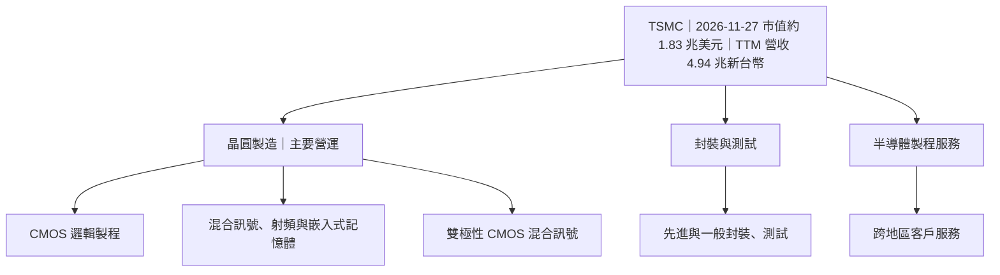
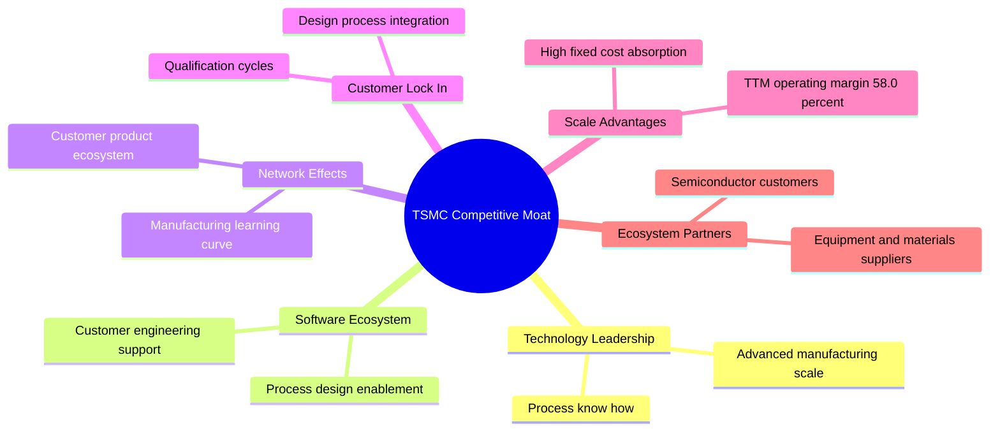
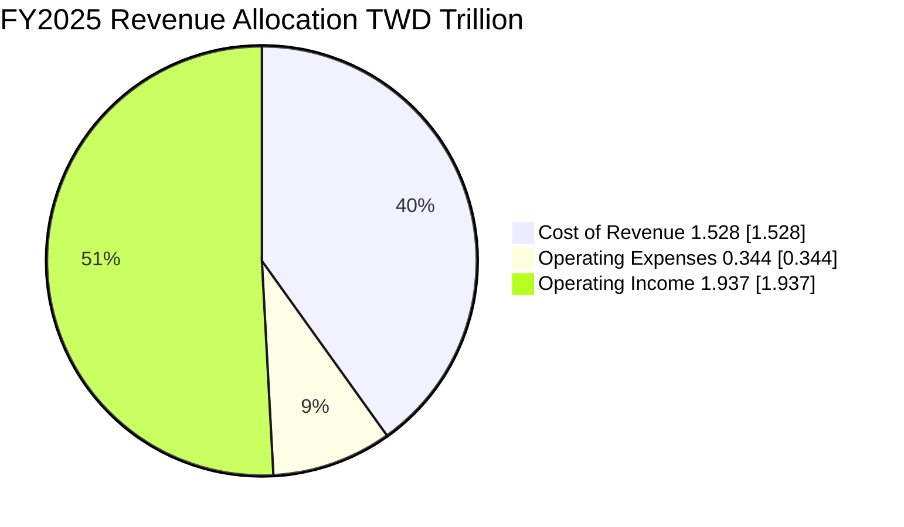
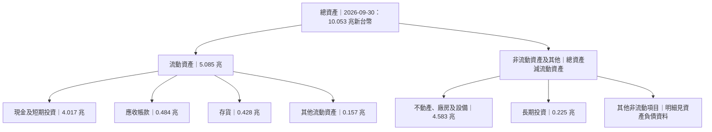
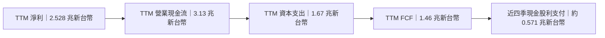
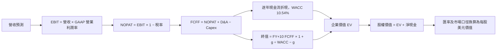
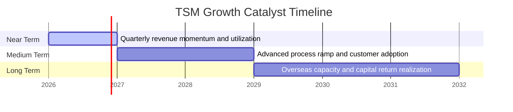
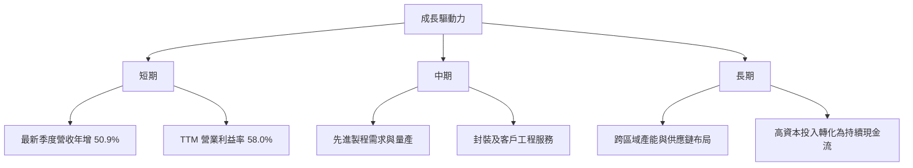
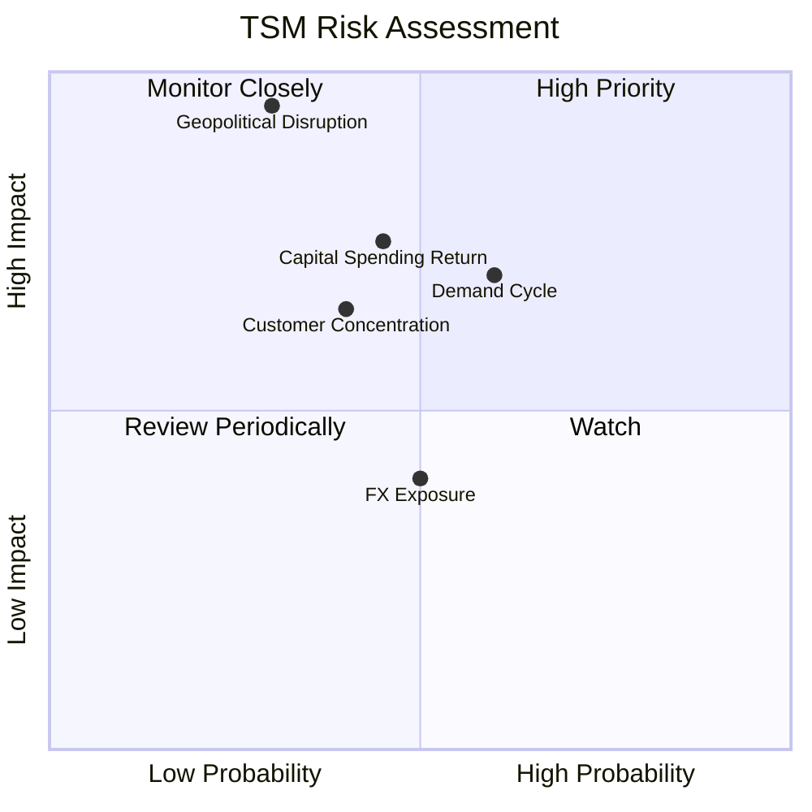
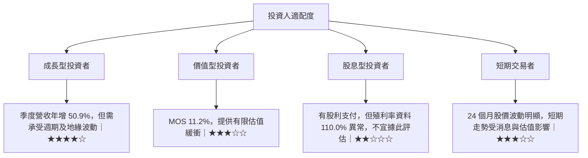

# TSM 基本面深度分析報告
> **報告日期**：2026-11-28 ｜ **語言**：繁體中文 ｜ **數據來源**：Yahoo Finance、Finviz、StockAnalysis、Roic.ai ｜ **分析師**：CFA 級機構研究

> **口徑與限制**：TSM 為台灣半導體製造公司；股價以美元報價、財報以新台幣呈列。換算使用 2026-11-27 匯率 **1 美元 = 32.92 新台幣**。財務資料來自 Yahoo Finance 等彙整來源，非 SEC 申報資料；同業估值、DCF 與品質指標依程式計算結果引用。若不同來源口徑不一致，以下明確標註，不以推算取代已提供數字。

## 目錄

| # | 章節 | 核心結論 |
|---|------|----------|
| 1 | 執行摘要 | 買入；加權合理價值 $397.74；MOS +11.2% |
| 2 | 公司概覽與商業模式 | 晶圓代工、先進製程與規模優勢形成護城河 |
| 3 | 損益表深度分析 | TTM 營收 4.94 兆新台幣；最新一季年增 50.9% |
| 4 | 資產負債表分析 | 淨現金 2.95 兆新台幣；流動性充裕 |
| 5 | 現金流量深度分析 | TTM FCF 1.46 兆新台幣，資本支出高但現金流仍正 |
| 6 | 獲利能力與資本效率 | WACC 10.54%；歷史 ROIC 顯著高於 WACC，最新 ROIC N/A |
| 7 | 相對估值分析 | 同業倍數顯示估值不便宜；公司自身歷史估值區間未提供 |
| 8 | DCF 內在價值評估 | 基準 DCF $440.77；加權合理價值 $397.74 |
| 9 | 成長催化劑 | 先進製程需求與營收動能為核心催化劑；TAM 數據未提供 |
| 10 | 風險矩陣 | 地緣政治、資本密集度與需求循環為主要風險 |
| 11 | 投資建議 | 買入；以估值區間、利潤率與 FCF 作季度監控 |

---

## 1. 執行摘要

TSM 最新一季營收年增 **50.9%**、營業利益率 **58.0%**，TTM 營業現金流 **3.13 兆新台幣**、資本支出 **1.67 兆新台幣**，據此計算的 TTM FCF 為 **1.46 兆新台幣**、FCF Yield 為 **2.42%**。估值方面，程式提供的 DCF 基準值為 **$440.77**，但四種方法加權後合理價值為 **$397.74**；以 2026-11-27 收盤價 **$353.34** 計算，MOS 為 **+11.2%**。因此依規則 20 評級為 **買入**，而非強烈買入；主要保留因素是 DCF 終值佔企業價值 60.8%、最新 ROIC 與 EPS 超預期資料缺漏，以及地緣政治風險。

### 1.0 一頁式投資儀表板（Portfolio Manager 30 秒速讀）

| 項目 | 內容 |
|------|------|
| **投資論點（3 句）** | ① 最新一季營收年增 **50.9%**，反映需求與出貨動能加快。② TTM 營業利益率 **58.0%**、毛利率 **65.8%**，顯示目前產品組合與營運槓桿有利。③ TTM FCF **1.46 兆新台幣**，但 FCF Yield **2.42%**，意味著股價已反映相當部分成長。 |
| **綜合評分** | **8.3/10**（引用 1.1 評分卡） |
| **財務健康** | 🟢 現金及短期投資 **4.02 兆新台幣**，總債務 **1.07 兆新台幣**，淨現金 **2.95 兆新台幣**；流動比率 **2.584**。 |
| **ROIC vs WACC** | 最新 TTM ROIC：**N/A**；歷史 Roic.ai 2018 ROIC **19.11%** vs WACC **10.54%**，歷史上創造價值，但不能直接當作當前 ROIC。 |
| **FCF 趨勢** | FY2023 **2,865.7 億**、FY2024 **8,612.0 億**、FY2025 **9,923.8 億新台幣**；TTM FCF Yield **2.42%**。 |
| **估值** | Forward P/E **15.09x** ｜ EV/EBITDA：N/A（幣別不一致）｜ FCF Yield **2.42%** |
| **DCF 內在價值（基準）** | **$440.77** ｜現價相對 DCF 折價 **19.8%**（折溢價定義：現價 ÷ DCF 價值 − 1） |
| **安全邊際（MOS）** | **+11.2%**＝($397.74 − $353.34) ÷ $397.74；🟡 有限（基準為 8.8 加權合理價值） |
| **預期報酬（基準情境 12M）** | DCF 基準情境 **+24.7%**；加權合理價值相對現價上行空間 **+12.6%**。 |
| **關鍵風險（前二）** | 台海及地緣政治導致供應中斷；高資本支出與先進製程投資回收不及預期。 |
| **評級 + 信心度** | 🟢 **買入** ｜信心：中（主要模型數字可用，但 DCF 逐項算式與股數橋接有資料口徑限制） |

### 1.1 綜合評分卡（全報告唯一）

| 維度 | 評分（1–10） | 主要依據（引用數字與其來源章節） |
|------|--------------|----------------------------------|
| 成長性 | 9.0 | 最新一季營收年增 50.9%；TTM 成長率按指定口徑為 N/A；見第 3 章。 |
| 獲利能力 | 9.5 | TTM 營業利益率 58.0%、毛利率 65.8%；歷史 2018 ROIC 19.11% 高於 WACC 10.54%；見第 3、6 章。 |
| 財務健康 | 9.0 | 淨現金 2.95 兆新台幣、流動比率 2.584、CCC 2 天；見第 4 章。 |
| 估值 | 6.0 | MOS +11.2%；同業 Forward P/E 中位數 14.9x，而 TSM Forward P/E 15.09x；見第 7、8 章。 |
| 護城河 | 9.5 | TTM 營業利益率 58.0%、毛利率 65.8%，且規模與製程能力支持客戶黏著；見第 2 章。 |
| 管理層與資本配置 | 7.0 | FY2025 FCF 9,923.8 億新台幣、現金股利支付 4,667.8 億；SBC 低，但可用回購、資本回報與稀釋歷史資料有限；見第 5 章。 |
| **綜合評分** | **8.3** | 六項算術平均：(9.0 + 9.5 + 9.0 + 6.0 + 9.5 + 7.0) ÷ 6 = 8.3。 |

### 1.2 五大投資論點 + 三大核心風險

| 類型 | 項目 | 具體依據 | 信心度 |
|------|------|----------|--------|
| 🟢 **投資論點①** | 最新季度需求加速 | 2026 Q3 營收 1.494 兆新台幣，年增 50.9%、季增約 17.6%；若延續，固定成本吸收效率有利於利潤。 | 🟢 高 |
| 🟢 **投資論點②** | 高獲利能力 | TTM 毛利率 65.8%、營業利益率 58.0%、淨利率 51.1%；反映高附加價值產品組合與規模效益。 | 🟢 高 |
| 🟢 **投資論點③** | 現金流可支應投資 | TTM OCF 3.13 兆、Capex 1.67 兆、FCF 1.46 兆新台幣，仍能在高資本支出下保持正 FCF。 | 🟢 高 |
| 🟢 **投資論點④** | 資產負債表有緩衝 | 淨現金 2.95 兆新台幣；現金及短期投資為總債務約 3.8 倍。 | 🟢 高 |
| 🟢 **投資論點⑤** | 估值仍有中度折價 | 加權合理價值 $397.74，高於現價 $353.34；MOS +11.2%，但不足以達到強烈買入門檻。 | 🟡 中 |
| 🟡 **風險①** | 地緣政治與供應集中 | 財務數據未提供可量化損失估計；若生產受阻，對營收、出貨與終值假設均可能造成重大影響。 | 🔴 高衝擊 |
| 🟡 **風險②** | 資本支出回報風險 | TTM Capex 1.67 兆新台幣，約為 TTM FCF 的 1.14 倍；若需求放緩，折舊與產能利用率可能壓低利潤。 | 🟡 中 |
| 🔴 **風險③** | 高成長預期回落 | 最新一季營收年增 50.9%，但 TTM 成長率為 N/A；單季增速不能直接外推為長期成長。 | 🟡 中 |

### 1.3 快速統計卡片

| 指標 | 公司實際值（期間） | 同業中位數 | 狀態 |
|------|--------------------|------------|------|
| 營收成長（TTM） | **N/A** | — | 🟡 指定口徑未提供 |
| 營收成長（最新一季年增） | **50.9%** | **20.9%**（三家中位數） | 🟢 |
| 毛利率（TTM） | **65.8%** | **31.7%**（三家中位數） | 🟢 |
| 營業利益率（TTM） | **58.0%** | — | 🟢 |
| ROIC（TTM） | **N/A** | — | 🟡 |
| Forward P/E | **15.09x** | **14.9x** | 🟡 |
| FCF Yield（TTM） | **2.42%** | — | 🟡 |
| Piotroski F-Score | **N/A / 9** | — | 🟡 |

### 1.4 投資結論

```text
╔══════════════════════════════════════════════════════════════════╗
║                    📊 投資結論摘要                               ║
╠══════════════════════════════════════════════════════════════════╣
║  評級：買入（MOS +11.2%，依規則 20）                             ║
║  價格（2026-11-27 收盤）：$353.34                                ║
║  DCF 內在價值（基準）：$440.77（現價折價 19.8%）                ║
║  安全邊際 MOS：+11.2%（＝(加權合理價值−現價)÷加權合理價值）     ║
║  加權合理價值（8.8）：$397.74                                    ║
║  DCF 情境價值：                                                  ║
║    悲觀情境：$187.26（-47.0%）                                   ║
║    基準情境：$440.77（+24.7%）                                   ║
║    樂觀情境：$982.28（+178.0%）                                  ║
║  綜合評分：8.3/10（引用 1.1）                                    ║
║  適合投資人：能承受地緣政治與半導體週期波動的成長型、長線投資人  ║
╚══════════════════════════════════════════════════════════════════╝
```

---

## 2. 公司概覽與商業模式

### 2.1 業務結構與收入來源

TSM 提供晶圓製造、封裝、測試及相關半導體服務。財務數據未提供先進製程、成熟製程、封裝或終端應用的營收拆分與比重，因此不以推測比例繪製分部收入圖。



### 2.2 市場份額

市場份額數據未提供，不能據此填寫代工市占率。相對規模方面，TSM TTM 營收為 **4.94 兆新台幣**，最新一季營收年增 **50.9%**；所列同業最新一季營收年增率為 INTC 20.9%、UMC 25.6%、GFS 12.5%。這些數字顯示 TSM 當前成長速度高於所列同業，但不能直接等同市場份額變化。

### 2.3 競爭護城河分析



### 2.4 護城河強度

| 護城河項目 | 強度（強／中／弱） | 證據（引用數字或事實） | 會削弱它的情況 |
|------------|--------------------|------------------------|----------------|
| 技術與製程能力 | 強 | TTM 營業利益率 58.0%、毛利率 65.8%；可反映目前產品組合及製造經濟性。 | 製程良率、成本或量產時程落後競爭者。 |
| 客戶鎖定 | 強 | 客戶晶片設計與製程、封裝、測試流程相互配合，轉換需重新驗證；具體客戶留存率未提供。 | 客戶增加第二來源、內製或轉向替代製程。 |
| 規模效應 | 強 | TTM 營收 4.94 兆新台幣，固定成本高的產業中規模有助於成本吸收。 | 產能利用率下降或大額新廠折舊壓縮利潤。 |
| 軟體／設計生態 | 中 | 公司提供製程與客戶工程支援；可量化生態收入及留存資料未提供。 | 競爭者提供兼容性更佳或成本更低的設計平台。 |
| 網路效應 | 中 | 客戶與製造經驗可累積學習效果，但非典型消費網路效應。 | 競爭者累積同等量產經驗、縮小良率差距。 |
| 生態夥伴 | 中 | 需與設備、材料及客戶供應鏈協作；合作方集中度資料未提供。 | 出口管制、設備供應限制或供應商議價力上升。 |

1.1「護城河」評分為 **9.5/10**，依據是 TTM 毛利率 **65.8%**、營業利益率 **58.0%** 及晶圓製造的客戶驗證與規模特性；風險在於這些利潤率可能受產品組合與產能利用率影響。

---

## 3. 損益表深度分析

### 3.1 年度收入成長趨勢（近4年）

```text
╔══════════════════════════════════════════════════════════════════╗
║       TSM 年度收入趨勢（FY2022-FY2025，新台幣）                 ║
╠══════════════════════════════════════════════════════════════════╣
║  FY2022  2.264 兆  ████████████████░░░░░░░░  YoY +42.61% 🟢     ║
║  FY2023  2.162 兆  ███████████████░░░░░░░░░  YoY  -4.51% 🔴     ║
║  FY2024  2.894 兆  ████████████████████░░░░  YoY +33.89% 🟢     ║
║  FY2025  3.809 兆  ████████████████████████  YoY +31.61% 🟢     ║
║                                                                  ║
║  FY2022-FY2025 收入 CAGR：[(3.809 ÷ 2.264)^(1/3) − 1] ≈ 18.9%   ║
║  單年趨勢有循環性；FY2023 收縮後，FY2024-25 恢復成長。           ║
╚══════════════════════════════════════════════════════════════════╝
```

FY2025 營收 **3.809 兆新台幣**，年增 **31.61%**；FY2024 為 **2.894 兆**，年增 **33.89%**。兩年恢復成長與最新季度動能一致，但 FY2023 曾年減 4.51%，說明半導體需求並非線性增長。TTM 營收成長率按指定指標為 **N/A**；StockAnalysis 顯示的其他 TTM 成長口徑不取代該指定欄位。

### 3.2 季度收入趨勢分析

| 季度 | 營收（十億新台幣） | QoQ | YoY | 備註 |
|------|------------------:|----:|----:|------|
| 2025 Q4 | 1,046.090 | 約 +5.7% | +20.45% | QoQ 以 2025 Q3 營收計算。 |
| 2026 Q1 | 1,134.103 | 約 +8.4% | +35.13% | 年增速度高於 2025 Q1。 |
| 2026 Q2 | 1,270.380 | 約 +12.0% | +36.05% | 季增加快。 |
| 2026 Q3 | 1,494.243 | 約 +17.6% | +50.95% | 最新一季增長加速；年增率是單季，不是 TTM。 |

QoQ 為依相鄰季度營收計算；營收從 2025 Q4 的 1,046.090 十億增至 2026 Q3 的 1,494.243 十億新台幣，四季間連續走高。此走勢與最新季度年增加速互相印證，但單季增長不宜機械式外推至未來十年。

### 3.3 利潤率演變分析

| 利潤率指標 | FY2022 | FY2023 | FY2024 | FY2025 | 趨勢 | 評估 |
|------------|-------:|-------:|-------:|-------:|------|------|
| **毛利率** | 約 59.5% | 約 54.4% | 約 56.1% | 約 59.9% | FY2023 下滑後回升 | 🟢 |
| **營業利益率** | 約 49.6% | 約 42.6% | 約 45.7% | 約 50.9% | FY2023 下滑、FY2025 回到高位 | 🟢 |
| **淨利率** | 約 43.9% | 約 39.4% | 約 40.0% | 約 44.6% | 隨營業利益率回升 | 🟢 |

年度利潤率由年報營收、毛利、營業利益及淨利計算，與官方 TTM 指標口徑不同。FY2023 利潤率回落，符合營收年減的週期性表現；FY2024-25 利潤率逐步恢復，可能反映出貨與產品組合回升、固定成本吸收改善。最新 TTM 毛利率 **65.8%**、營業利益率 **58.0%** 高於上述 FY2025 年度比率，反映不同期間及近期盈利提升，不應混為同一期間比較。

### 3.4 費用結構分析

FY2025 可由營收、毛利及營業利益拆出營收用途；下圖是會計數字的算術分解，不代表現金流分類。數值由 FY2025 營收 3.809 兆、毛利 2.281 兆、營業利益 1.937 兆新台幣推得。



```text
╔══════════════════════════════════════════════════════════════════╗
║                FY2025 營收與營業利潤分解                        ║
╠══════════════════════════════════════════════════════════════════╣
║  營收             3.809 兆新台幣                                ║
║  ├─ 銷貨成本      1.528 兆（營收 − 毛利）                        ║
║  ├─ 營業費用      0.344 兆（毛利 − 營業利益）                    ║
║  └─ 營業利益      1.937 兆                                      ║
╚══════════════════════════════════════════════════════════════════╝
```

### 3.5 季度 EPS 趨勢與盈餘品質（Quality of Earnings）

| 盈餘品質項目 | 數值／佔比 | 評估 |
|--------------|-----------|------|
| 股權薪酬 SBC / 營收 | 估算約 **0.010%**；近四季 SBC 合計約 0.513 兆新台幣？**更正單位：0.513 十億新台幣** | 🟢 SBC 規模相對營收低；但四季資料為不同報表列示，僅作該期間加總估算。 |
| SBC / 營業現金流 | 估算約 **0.016%** | 🟢 對現金流與股東稀釋影響有限。 |
| FCF / 淨利（現金轉換率） | 約 **57.8%**＝1.46 兆 ÷ 2.528 兆 | 🟡 高資本支出壓低 FCF 對淨利轉換；仍為正且具規模。 |
| 一次性／非經常性損益 | N/A（未提供足以辨認的一次性損益明細） | 🟡 不能斷言一次性項目不存在。 |
| 有效稅率異常 | **17.0%**（最近年度有效稅率） | 🟢 資料未顯示本期獲利主要由低稅率帶動。 |
| 資本化支出 vs 費用化 | TTM Capex 1.67 兆新台幣；資本支出透過折舊逐期進入損益 | 🟡 半導體製造本質資本密集；資本化可能使當期現金成本高於當期費用，但不代表會計處理不當。 |

> **SBC 單位說明**：季度 SBC 分別為 103.30、123.05、113.98、173.04 百萬新台幣，合計 513.37 百萬新台幣；相對 TTM 營收 4.94 兆新台幣約 0.010%，相對 OCF 約 0.016%。

最近四季 EPS 預估值均為 `nan`，無法判定季度盈餘「超預期」或「不及預期」。StockAnalysis 列示 EPS 由 2025 Q4 的 18.72、2026 Q1 的 22.08、Q2 的 27.25 至 Q3 的 29.43 新台幣，呈連續上升；但由於 EPS Est 缺漏，不以未提供的市場預期推斷 surprise。綜合來看，低 SBC、正 FCF 與營業現金流支持盈餘含金量；需留意 FCF 轉換率低於淨利，核心原因是資本支出規模大。

---

## 4. 資產負債表分析

### 4.1 資產結構分解



### 4.2 流動性與營運資金分析

| 指標 | 最新 TTM | 一年前 TTM | 變化 | 解讀 |
|------|---------:|------------:|------:|------|
| DSO 應收帳款天數 | 1 天 | N/A | N/A | 一年前數值未提供；最新數字按期末應收及 TTM 流量計算。 |
| DIO 存貨天數 | 92 天 | N/A | N/A | 缺少一年前對照，不推定庫存效率變化。 |
| DPO 應付帳款天數 | 91 天 | N/A | N/A | 缺少一年前對照，無法判斷供應商付款條件變化。 |
| CCC 現金轉換週期 | 2 天 | N/A | N/A | 最新 CCC 短，顯示按該計算口徑營運資金佔用有限。 |

流動性指標方面，流動比率 **2.584**、速動比率 **2.287**；現金及短期投資 **4.02 兆新台幣**。三者共同顯示短期償債緩衝充足。CCC 的 DSO、DIO、DPO 均採指定品質指標，對一年前比較不作補估。

### 4.3 債務結構分析

```text
╔══════════════════════════════════════════════════════════════════╗
║                   TSM 債務健康診斷                              ║
╠══════════════════════════════════════════════════════════════════╣
║  總債務：        1.07 兆新台幣       🟢                          ║
║  現金及短期投資：4.02 兆新台幣       🟢                          ║
║  淨現金：        2.95 兆新台幣       🟢                          ║
║                                                                  ║
║  流動比率：      2.584x              🟢                          ║
║  速動比率：      2.287x              🟢                          ║
║  Debt/EBITDA：   N/A（跨幣別限制）                               ║
║  利息保障倍數： N/A（利息費用資料未提供）                        ║
║                                                                  ║
║  結論：現金與短期投資高於債務；但不代表投資週期與地緣風險消失。  ║
╚══════════════════════════════════════════════════════════════════╝
```

### 4.4 股東權益趨勢

```text
╔══════════════════════════════════════════════════════════════════╗
║            TSM 股東權益趨勢（年度，新台幣兆元）                  ║
╠══════════════════════════════════════════════════════════════════╣
║  FY2022  2.90  ██████████████░░░░░░░░░░                          ║
║  FY2023  3.43  █████████████████░░░░░░░                          ║
║  FY2024  4.24  █████████████████████░░░                          ║
║  FY2025  5.36  ██████████████████████████                        ║
╚══════════════════════════════════════════════════════════════════╝
```

FY2022 至 FY2025 股東權益由 **2.90 兆**增至 **5.36 兆新台幣**，與同期獲利累積相符；但權益增加不等同每股價值同比例上升，仍須考慮股數、資本支出與資本回報。

---

## 5. 現金流量深度分析

### 5.1 現金流量瀑布圖



圖中淨利至 OCF 的連線代表現金流轉換關係，並非淨利直接加總成 OCF。TTM FCF 的定義嚴格採 **OCF − Capex**；現金股利為季度現金流表列示加總，不能據此推定全部剩餘 FCF 的用途。

### 5.2 FCF 轉換率趨勢

| 年度 | FCF（十億新台幣） | 淨利（十億新台幣） | FCF／淨利 |
|------|------------------:|------------------:|---------:|
| FY2022 | 520.97 | 992.92 | 約 52.5% |
| FY2023 | 286.57 | 851.74 | 約 33.6% |
| FY2024 | 861.20 | 1,158.38 | 約 74.3% |
| FY2025 | 992.38 | 1,697.60 | 約 58.5% |
| TTM 至 2026-09-30 | 1,460.00 | 2,527.57 | 約 57.8% |

FCF 轉換率逐年波動，主因資本支出與營運現金流並不同步。FY2023 FCF 低至 2,865.7 億新台幣，FY2024 回升至 8,612.0 億；FY2025 淨利增長快於 FCF，故轉換率回落至約 58.5%。不應將單年比率視為固定常態。

### 5.3 自由現金流趨勢

```text
╔══════════════════════════════════════════════════════════════════╗
║             TSM 自由現金流趨勢（新台幣十億元）                  ║
╠══════════════════════════════════════════════════════════════════╣
║  FY2022  520.97  █████████████░░░░░░░░░░░                        ║
║  FY2023  286.57  ███████░░░░░░░░░░░░░░░░░                        ║
║  FY2024  861.20  █████████████████████░░░                        ║
║  FY2025  992.38  ████████████████████████                        ║
║  TTM    1,460.00 ███████████████████████████████                 ║
║                                                                  ║
║  TTM FCF Yield：2.42%（程式計算）                                ║
╚══════════════════════════════════════════════════════════════════╝
```

TTM FCF **1.46 兆新台幣**高於 FY2025 全年 FCF，但二者期間不同；最新四季 Capex 與 OCF 均高，支持目前投資可由營運現金流部分自我支應。FCF Yield 2.42% 則顯示相對市值的現金收益率不高。

### 5.4 資本配置評估

財務資料未提供完整的回購支出、投資支出拆分及留存現金用途，因此不繪製比例式資本配置圓餅圖。

| 項目 | 已知數據 | 評估 |
|------|---------|------|
| 資本支出 | TTM 1.67 兆新台幣 | 高額投入支持產能與製程，但投資回報取決於利用率與需求。 |
| 現金股利 | FY2025 支付 4,667.8 億新台幣；季度資料顯示股利支付 | 提供現金回饋；資料中的股息殖利率 110.0% 明顯存在資料口徑或欄位異常，不採用為正常殖利率。 |
| 股票回購 | N/A（數據未提供完整回購金額） | 不評估回購規模或效果。 |
| 留存與現金 | 2026-09-30 現金及短期投資 4.02 兆新台幣 | 提供投資與財務韌性，但也代表資本配置效率需持續觀察。 |

---

## 6. 獲利能力與資本效率

### 6.1 ROE / ROA / ROIC 趨勢

| 指標 | 最新可用數據 | 歷史參照 | 評估 |
|------|-------------:|---------|------|
| ROE | TTM 41.9% | FY2025 權益 5.36 兆、淨利 1.70 兆 | 🟢 高；杜邦分解指標未提供，不能拆解驅動比例。 |
| ROA | TTM 20.6% | FY2025 資產 7.93 兆 | 🟢 高；需留意期間口徑差異。 |
| ROIC | TTM N/A | Roic.ai 2018 年 19.11%；2013–2018 約 18.31%–20.61% | 🟢 歷史高於資本成本，但缺少當期同口徑 ROIC。 |

行業均值與同業 ROIC 未提供，故不填入比較欄。歷史 ROIC 資料只能用作長期參考，不能冒充 2026 TTM 指標。

### 6.2 ROIC vs WACC 分析（核心價值創造判斷）

```text
╔══════════════════════════════════════════════════════════════════╗
║                ROIC vs WACC 深度分析                            ║
╠══════════════════════════════════════════════════════════════════╣
║  WACC（財務數據指定值）：10.54%                                  ║
║  ├── 無風險利率：4.94%                                           ║
║  ├── ERP：5.00%                                                   ║
║  ├── 原始 Beta：1.23；調整後 Beta：1.16                          ║
║  ├── 股權成本：10.71%（指定值）                                  ║
║  ├── 稅前債務成本：1.16%；有效稅率：17.0%                        ║
║  ├── 股權／債務權重：98.3%／1.7%                                 ║
║  └── WACC：10.54%（指定值，與第 8 章一致）                        ║
║                                                                  ║
║  最新 TTM ROIC：N/A（缺少當期投入資本及相應計算口徑）             ║
║  歷史參照：2018 ROIC 19.11% − WACC 10.54% = +8.57 個百分點       ║
║  判斷：歷史資料支持曾創造價值；不能據此認定最新 TTM ROIC。        ║
╚══════════════════════════════════════════════════════════════════╝
```

成本資本資料將調整後 Beta 定為 **1.16**，並給定 WACC **10.54%**。由已提供的四捨五入組成項重新計算可能出現小幅差異，本文不另建 WACC，以免違反指定口徑。另，資料包給出的 WACC 權重、債務成本及股權成本未同時提供完整的市值與計息負債口徑橋接，故不將其改寫成一條假裝可完全複算的精確等式。

### 6.3 杜邦三因素分解

| 因素 | 數值（TTM） | 解讀 |
|------|-------------|------|
| 淨利率 | N/A | QUALITY FIGURES 指出淨利、營收、資產或正權益條件不足，杜邦資料為 N/A。 |
| 資產週轉率 | N/A | 同上，不補算。 |
| 權益乘數 | N/A | 同上，不補算。 |
| **ROE** | **N/A（品質指標區塊）** | 單獨財務摘要另列 ROE 41.9%，但不以不一致來源重組杜邦等式。 |

### 6.4 財務體質：Piotroski F-Score

Piotroski F-Score **N/A**，原因是計算需要相隔一年的兩個 TTM 期間及 SEC 申報資料，而本次資料缺少該口徑。九項測試的個別結果未提供，因此不虛構逐項通過／未通過結果。

---

## 7. 相對估值分析

### 7.1 同業估值比較表格

| 估值指標 | **TSM** | **INTC** | **UMC** | **GFS** | TSM 評估 |
|----------|-------:|--------:|-------:|-------:|----------|
| **Trailing P/E** | 22.90x | N/A | 12.7x | 107.7x | 🟡 INTC 缺值、GFS 極高，樣本差異大。 |
| **Forward P/E** | 15.09x | 32.1x | 14.9x | 14.6x | 🟢 低於 INTC，略高於 UMC、GFS；接近同業中位數 14.9x。 |
| **P/S Ratio** | N/A | 5.1x | N/A（混合幣別） | 2.9x | 🟡 TSM、UMC 不作跨幣別比較。 |
| **EV/EBITDA** | N/A（混合幣別） | 16.7x | N/A（混合幣別） | 10.1x | 🟡 TSM 口徑不可比；可計算同業中位數 13.4x。 |
| **最新一季營收年增** | 50.9% | 20.9% | 25.6% | 12.5% | 🟢 TSM 高於三家同業。 |
| **毛利率（TTM）** | 65.8% | 40.2% | 31.7% | 28.5% | 🟢 高於所列同業。 |

相對估值方法使用程式提供的同業中位數，不以 TSM 自身倍數反推價值。TSM Forward P/E **15.09x**與同業中位數 **14.9x**接近；估值吸引力主要需由較高的當前成長與利潤率支持。

### 7.2 歷史估值區間分析

```text
╔══════════════════════════════════════════════════════════════════╗
║               TSM 歷史估值區間分析                              ║
╠══════════════════════════════════════════════════════════════════╣
║  N/A（未提供 Valuation vs own history 的歷史區間與百分位資料）   ║
║  不以 24 個月股價波動推算 P/E 歷史百分位。                        ║
╚══════════════════════════════════════════════════════════════════╝
```

### 7.3 情境價值（Bear / Base / Bull，照抄 DCF MODEL）

| 情境 | 第 1 年營收成長 | 期末營業利潤率 | WACC | 每股價值 | 相對現價 | 機率 | 會發生的條件 |
|------|----------------:|----------------:|-----:|---------:|---------:|-----:|--------------|
| 🔴 悲觀 | 15.0% | 42.1% | 11.54% | $187.26 | -47.0% | 25% | 需求增長回落、利潤率因成本與利用率壓力下滑，且折現率上升。 |
| 🟡 基準 | 30.0% | 49.5% | 10.54% | $440.77 | +24.7% | 50% | 短期成長延續後逐步降速，長期利潤率回落至模型假設。 |
| 🟢 樂觀 | 45.0% | 54.5% | 9.54% | $982.28 | +178.0% | 25% | 成長高於基準、長期利潤率維持較高水準且資本成本下降。 |

### 7.4 相對估值隱含價格區間

```text
╔══════════════════════════════════════════════════════════════════╗
║               估值方法隱含每股價值（美元）                      ║
╠══════════════════════════════════════════════════════════════════╣
║  $301.25 ───── $349.81 ──── $353.34 ───── $440.77 ─── $586.69  ║
║  EV/EBITDA     Forward P/E    現價          DCF       共識目標價  ║
╚══════════════════════════════════════════════════════════════════╝
```

- **同業 Forward P/E：$349.81**＝同業中位數 **14.9x** × Forward EPS **$23.42**。
- **同業 EV/EBITDA：$301.25**＝同業中位數 **13.4x** × TTM EBITDA，再加回淨現金；依程式估值方法原值引用。
- **DCF 基準：$440.77**＝10 年 FCFF、WACC 10.54%、永續成長率 3.0%。
- **分析師共識：$586.69**＝20 位分析師平均目標價，屬參考而非獨立經營預測。

---

## 8. DCF 內在價值評估（Discounted Cash Flow）

> 本章使用程式提供的 DCF MODEL，不另建模型。財務報表以新台幣呈列、股價以美元報價。模型原列金額為新台幣十億元，逐年現金流及估值數字均照列。

### 8.0 估值推理鏈（Thinking Logic）

**Step 1 — 價值來源與主導變數**

TSM 價值由現有晶圓代工現金流、先進製程成長，以及長期利潤率與再投資效率構成；但可用資料沒有分部營收比重，因此不把任何製程或應用的營收占比自創為第二成長曲線。模型採 TTM 營收 **4,944.82 十億新台幣**為起點。敏感度矩陣顯示 WACC 與永續成長率會大幅改變估值；營收成長、長期利潤率也會影響情境價值。終值 PV 佔企業價值 **60.8%**，因此估值最依賴長期現金流與折現率假設。

**Step 2 — 模型選擇**

| 決策點 | 本報告採用 | 理由（含數字） | 曾考慮但否決 | 否決理由 |
|--------|-----------|----------------|--------------|----------|
| 現金流定義 | FCFF | 模型以 EBIT、稅、D&A、Capex 推算，再以 WACC 折現至 EV。 | FCFE | 未提供完整融資現金流與未來淨借款假設。 |
| 預測期 N | 10 年 | DCF MODEL 指定 10 年，涵蓋成長逐年降至 3.0% 的模型期間。 | 5 年 | 不符合程式模型，不自行改期。 |
| 終值方法 | Gordon Growth | 模型提供永續成長率 3.0%與 Gordon 終值。 | 退出倍數 | DCF MODEL 未提供退出倍數終值，不能另造。 |
| EBIT 基礎 | GAAP EBIT | 程式模型明列 GAAP EBIT。 | 非 GAAP EBIT | 可能把 SBC 加回而與股數處理不一致。 |

**Step 3 — 關鍵假設推導鏈**

- **營收成長**：錨點＝最新一季營收年增 50.9%，但它是單季而非 TTM；模型把其限制在 0%–30%後採 **第 1 年 30.0%**，再線性降至第 10 年 **3.0%**。曾考慮直接採 50.9%，但否決，因單季成長不能直接外推十年。
- **期末營業利潤率**：錨點＝TTM 營業利益率 58.0%；模型第 1 年採 58.0%，第 10 年降至 **49.5%**，依據為最近五個財政年度中位數（含 TTM）。曾考慮永久維持 58.0%，但否決，因模型本身預期利潤率均值回歸。
- **永續成長率 g**：模型採 **3.0%**；該值低於 WACC 10.54%，保持 Gordon Growth 公式有效。財務資料未提供長期 GDP／通膨數據；不另改採 3.5% 或更高值。
- **預測期 N**：程式模型採 **10 年**；未另縮短或延長，替代期數沒有模型來源。
- **Capex／營收**：TTM 錨點為 **33.8%**，第 1 年採 33.8%，逐步降至第 10 年 **16.6%**；模型邏輯是向 1.1 倍 D&A 收斂。未採固定 33.8%，因這會忽略成熟後投資強度下降；也不另採更低比例，因缺少可核對的管理層財測。
- **D&A／營收**：TTM 錨點 **15.1%**，模型固定 15.1%。未採下降假設，以忠實沿用程式模型。
- **有效稅率**：最近年度有效稅率 **17.0%**，模型維持 17.0%；未採其他稅率，因缺少有來源的未來稅率預測。
- **營運資金**：模型明確不建模 ΔWC；因此不得自行加入營運資金變動現金流。
- **EBIT 與 SBC**：採 GAAP EBIT；程式說明 SBC 已計入費用，股數不再額外稀釋。年稀釋率採 0%（模型組合 A），不另扣 SBC。
- **WACC**：採程式指定 **10.54%**；組成依據及限制見 8.2，不另算新 WACC。
- **終值方法**：採 Gordon Growth，因程式提供此結果；退出倍數法缺少模型輸入，否決自建，以免與規則相衝突。

**Step 4 — 最脆弱環節**

最脆弱環節是 10 年後現金流的延續性：終值現值佔 EV **60.8%**；若長期成長或資本成本假設不利，估值會顯著下降，矩陣在 WACC 12.54%、g 3.0%時每股價值為 **$336.53**，低於現價。

**Step 5 — 計算路徑圖**



### 8.1 模型假設總表（Model Inputs）

| 假設項目 | 採用值 | 依據／來源 | 敏感度 |
|----------|--------|-------------|--------|
| 預測期長度 N | 10 年 | DCF MODEL 指定。 | 🟡 中 |
| 營收成長 | 第 1 年 30.0% → 第 10 年 3.0% | 第 1 年參考最新單季年增 50.9%，限制於 0%–30%；之後線性衰減。 | 🔴 高 |
| 營業利潤率 | 第 1 年 58.0% → 第 10 年 49.5% | TTM 58.0%；末年回落至近五財年中位數。 | 🔴 高 |
| 有效稅率 | 17.0% | 最近年度有效稅率。 | 🟢 低 |
| Capex／營收 | 第 1 年 33.8% → 第 10 年 16.6% | TTM 33.8%，逐步降至模型規則的 1.1 × D&A 附近。 | 🔴 高 |
| D&A／營收 | 15.1% | TTM 比率固定。 | 🟢 低 |
| 營運資金變動 | 不建模 | DCF MODEL 明列 working capital is not modelled。 | 🟢 低 |
| EBIT 基礎 | GAAP | 模型採 GAAP EBIT。 | 🟡 中 |
| SBC 處理 | GAAP 已含 SBC，不另扣 | 模型組合 A；SBC 影響已計入一次。 | 🟡 中 |
| 年稀釋率 | 0%／股數固定 | 與 GAAP EBIT 組合 A 相容；模型不再擴大股數。 | 🟡 中 |
| 永續成長率 g | 3.0% | DCF MODEL 指定；小於 WACC。 | 🔴 高 |
| 終值方法 | Gordon Growth | 程式提供的基準模型方法。 | 🔴 高 |
| WACC | 10.54% | 成本資本區塊指定值。 | 🔴 高 |

**FCFF 定義**：FCFF = NOPAT + D&A − Capex；營運資金不建模。**本模型採用 (A)：GAAP EBIT + 固定股數，SBC 影響已計入一次**，故不另減 SBC、不再增加年稀釋率。

### 8.2 折現率推導（WACC）

```text
╔══════════════════════════════════════════════════════════════════╗
║                    WACC 推導（折現率）                           ║
╠══════════════════════════════════════════════════════════════════╣
║  股權成本 Ke：程式指定 10.71%                                    ║
║  ├── 無風險利率 Rf：4.94%                                        ║
║  ├── ERP：5.00%                                                   ║
║  ├── 原始 Beta：1.23；調整後 Beta：1.16                          ║
║  ├── Beta 調整：⅔ × 1.23 + ⅓ × 1 = 1.16（四捨五入）             ║
║  └── 額外規模／國別溢酬：未列示，未另加                           ║
║                                                                  ║
║  債務成本：稅前 1.16%；稅率 17.0%                                 ║
║  稅後 Kd 算式：1.16% × (1 − 17.0%) ≈ 0.96%                      ║
║  股權／債務權重：98.3%／1.7%                                     ║
║  WACC：採程式指定 10.54%，不自行重算或替換                         ║
╚══════════════════════════════════════════════════════════════════╝
```

逐步核對限制如下：Rf 日期為成本資本資料使用的 10 年期美債輸入，未另提供觀察日期；ERP 5.00% 為假設值，原始 Beta 1.23 來自 Yahoo，調整後 Beta 1.16。稅前債務成本 1.16% 來自利息／債務的指定計算結果。WACC 區塊未提供完整利息費用、平均計息負債、與模型權重對應的市值及同一期計息負債明細，因此無法依要求把「Ke、Kd、E、D」逐項重建為一組同口徑、完全可複算的原始金額。基於規則，不以總負債或無息負債自行補值；WACC 全文統一採指定 **10.54%**。

### 8.3 逐年自由現金流預測（基準情境）

單位：新台幣十億元；折現因子照模型列示，金額取一位小數閱讀、模型原值保留兩位。FCFF 不含 ΔWC 列，因模型明確不建模。

| 年度 | FY+1 | FY+2 | FY+3 | FY+4 | FY+5 | FY+6 | FY+7 | FY+8 | FY+9 | FY+10 |
|------|------:|------:|------:|------:|------:|------:|------:|------:|------:|-------:|
| 營收 | 6,428.26 | 8,163.89 | 10,123.23 | 12,249.11 | 14,453.94 | 16,622.04 | 18,616.68 | 20,292.18 | 21,509.71 | 22,155.00 |
| 營收 YoY | 30.0% | 27.0% | 24.0% | 21.0% | 18.0% | 15.0% | 12.0% | 9.0% | 6.0% | 3.0% |
| 營業利潤率 | 58.0% | 57.0% | 56.1% | 55.2% | 54.2% | 53.3% | 52.3% | 51.4% | 50.5% | 49.5% |
| EBIT（GAAP） | 3,726.88 | 4,656.49 | 5,679.00 | 6,756.58 | 7,837.06 | 8,856.56 | 9,744.56 | 10,431.05 | 10,854.96 | 10,972.60 |
| − 稅 | (632.56) | (790.34) | (963.90) | (1,146.79) | (1,330.18) | (1,503.22) | (1,653.94) | (1,770.46) | (1,842.41) | (1,862.38) |
| NOPAT | 3,094.32 | 3,866.14 | 4,715.10 | 5,609.79 | 6,506.88 | 7,353.34 | 8,090.62 | 8,660.59 | 9,012.55 | 9,110.22 |
| + D&A | 970.20 | 1,232.15 | 1,527.86 | 1,848.72 | 2,181.48 | 2,508.71 | 2,809.75 | 3,062.63 | 3,246.39 | 3,343.78 |
| − Capex | (2,171.05) | (2,601.47) | (3,032.68) | (3,435.84) | (3,778.51) | (4,028.15) | (4,156.32) | (4,143.23) | (3,981.42) | (3,678.16) |
| **FCFF** | **1,893.46** | **2,496.82** | **3,210.29** | **4,022.67** | **4,909.85** | **5,833.90** | **6,744.04** | **7,579.99** | **8,277.52** | **8,775.85** |
| 折現因子 @10.54% | 0.905 | 0.818 | 0.740 | 0.670 | 0.606 | 0.548 | 0.496 | 0.448 | 0.406 | 0.367 |
| **FCFF 現值 PV** | **1,712.87** | **2,043.27** | **2,376.58** | **2,693.97** | **2,974.52** | **3,197.26** | **3,343.56** | **3,399.59** | **3,358.37** | **3,220.97** |

**逐步演算：FY+1**

1. 營收 = 4,944.82 × (1 + 30.0%) = **6,428.26**。
2. EBIT = 模型列示 GAAP EBIT **3,726.88**。模型行列為 58.0% 利潤率；按表面已四捨五入數相乘，6,428.26 × 58.0% = 3,728.39，與模型列示相差 1.51，屬模型輸入／呈現精度不一致，以下保留程式原值。
3. 稅 = 3,726.88 × 17.0% = **633.57**，與模型列示 **632.56** 有差異；依規則不改寫模型數字，列為算術稽核限制。
4. NOPAT = 模型列示 **3,094.32**；模型中 EBIT − 稅 = 3,726.88 − 632.56 = **3,094.32**。
5. D&A = 模型列示 **970.20**。
6. Capex = 模型列示 **2,171.05**。
7. ΔWC = 模型不建模，故未列。
8. FCFF = 3,094.32 + 970.20 − 2,171.05 = **1,893.47**，模型列示 **1,893.46**，差 0.01，視為四捨五入尾差。
9. PV = 模型列示 1,893.46 × 0.905 = **1,713.08**；模型列示 **1,712.87**，因折現因子僅顯示三位小數，精確因子未提供，不能以顯示值完全重現模型 PV。

預測期 PV 合計照模型為 **28,320.97 十億新台幣**；逐列加總表中已顯示 PV 為：

`1,712.87 + 2,043.27 + 2,376.58 + 2,693.97 + 2,974.52 + 3,197.26 + 3,343.56 + 3,399.59 + 3,358.37 + 3,220.97 = 28,321.96`

此逐列合計與模型提供的 **28,320.97** 相差 **0.99 十億新台幣**，約 0.0035%，在總額 1% 的允許尾差內；為遵守「模型數字原值引用」，估值橋接仍沿用模型合計 **28,320.97**，不改表格任一年度數字。

合理性自檢：
- 預測期 FCF CAGR：由 FY+1 1,893.46 至 FY+10 8,775.85，端點九年間 CAGR 約 **18.6%**；歷史 FY2022–FY2025 FCF 由 520.97 至 992.38，三年間 CAGR 約 **24.0%**。預測低於該歷史端點 CAGR，符合成長衰減，但歷史期間波動很大。
- FY+10 FCF 利潤率 = 8,775.85 ÷ 22,155.00 = **39.6%**；現時 TTM FCF 利潤率 = 1,460 ÷ 4,944.82 = **29.5%**。同業 FCF 利潤率未提供，無法比較同業最佳值。
- 模型預測年度 FCFF 均為正；但高資本支出與終值假設仍是主要估值風險。

```text
╔══════════════════════════════════════════════════════════════════╗
║            自由現金流：歷史實際 vs 模型預測                      ║
╠══════════════════════════════════════════════════════════════════╣
║  FY2023 實際  286.57  █████░░░░░░░░░░░░░░░░░░░░░░░░░░          ║
║  FY2024 實際  861.20  ███████████████░░░░░░░░░░░░░░░░░          ║
║  FY2025 實際  992.38  █████████████████░░░░░░░░░░░░░░░          ║
║  FY+1 預測  1,893.46  ████████████████████████████████          ║
║  FY+10預測  8,775.85  ████████████████████████████████████████  ║
╠══════════════════════════════════════════════════════════════════╣
║  模型預測端點 CAGR 約18.6%；歷史端點 CAGR 約24.0%，歷史波動較大。║
╚══════════════════════════════════════════════════════════════════╝
```

### 8.4 終值計算（Terminal Value）

適用性檢查：**WACC 10.54% vs g 3.0% → WACC > g？✅**

| 方法 | 計算式 | 終值 TV | TV 現值 | 佔總 EV 比重 |
|------|--------|---------:|--------:|-------------:|
| Gordon Growth | 8,775.85 × (1 + 3.0%) ÷ (10.54% − 3.0%) | 119,838.73 | 43,984.03 | 60.8% |
| 退出倍數法 | N/A（DCF MODEL 未提供退出倍數終值） | N/A | N/A | N/A |

逐步演算：
1. FY+10 FCFF = **8,775.85 十億新台幣**。
2. 分子 = 8,775.85 × 1.03 = **9,039.13 十億新台幣**。
3. 分母 = 10.54% − 3.0% = **7.54%**；TV = 9,039.13 ÷ 7.54% = **119,881.3 十億新台幣**。程式原列 TV **119,838.73**；以表內已四捨五入輸入重算有小幅差異，故後續沿用程式原值。
4. PV(TV) = 程式原列 **43,984.03 十億新台幣**；模型折現因子列 0.367，乘積與原值有顯示精度差異。
5. 終值佔比 = **60.8%**，即模型所列 PV(TV) 佔 EV 比重。

由於退出倍數終值未提供，不自設同業倍數。終值佔比低於 75%，但仍超過企業價值一半，估值對長期假設有明顯依賴。

### 8.5 企業價值 → 每股內在價值（Bridge）

```text
╔══════════════════════════════════════════════════════════════════╗
║              企業價值 → 每股內在價值 橋接表                      ║
╠══════════════════════════════════════════════════════════════════╣
║  預測期 FCF 現值合計            +28,320.97 十億新台幣            ║
║  終值現值 PV(TV)                +43,984.03 十億新台幣            ║
║  = 企業價值 EV                    72,305.00 十億新台幣            ║
║  + 淨現金                          2,947.23 十億新台幣            ║
║  = 股權價值                        75,252.23 十億新台幣            ║
║                                                                  ║
║  每股價值：依模型匯率、市值及價格口徑換算                         ║
║  ★ DCF 基準每股內在價值：$440.77                                 ║
║    當前股價：$353.34                                              ║
║    折溢價：353.34 ÷ 440.77 − 1 = -19.8%（折價）                  ║
║    本節不計算 MOS；MOS 一律採 8.8 加權合理價值為分母。             ║
╚══════════════════════════════════════════════════════════════════╝
```

逐步演算：
1. EV = 28,320.97 + 43,984.03 = **72,305.00 十億新台幣**。
2. 股權價值 = 72,305.00 + 2,947.23 = **75,252.23 十億新台幣**。
3. 每股價值：程式提供換算式為「股權價值 × FX 0.0303786 USD/TWD × price ÷ market cap（USD）」，結果 **$440.77**。此式中的 Market Cap 換算明細未完整提供，因此不能改寫成單純股權價值除稀釋股數。
4. 折溢價 = 353.34 ÷ 440.77 − 1 = **−19.8%**。
5. 本節不計算 MOS；MOS 只在 8.8 使用加權合理價值計算。

現金及債務使用程式 DCF 橋接中的淨現金 **2,947.23 十億新台幣**。最新股數、ADR／普通股換算與模型「價格 ÷ 市值」換算基礎未完整拆列；故每股結果原值引用，不以不相容的報表股數重新推導。

### 8.6 敏感性分析（WACC × 永續成長率）

下表為程式提供的每股估值矩陣；基準格以粗體標示。括號上行／下行以每股價值相對 **$353.34** 計算，數字四捨五入至一位小數。

| g／WACC | 8.54% | 9.54% | **10.54% 基準** | 11.54% | 12.54% |
|-----------|------:|------:|----------------:|-------:|-------:|
| 2.0% | $555.72（+57.3%） | $471.94（+33.6%） | $408.41（+15.6%） | $358.71（+1.5%） | $318.89（-9.8%） |
| 2.5% | $586.80（+66.1%） | $493.24（+39.6%） | $423.58（+19.9%） | $369.86（+4.7%） | $327.27（-7.4%） |
| 3.0% | $623.50（+76.5%） | $517.80（+46.5%） | **$440.77（+24.7%）** | $382.30（+8.2%） | $336.53（-4.8%） |
| 3.5% | $667.47（+88.9%） | $546.42（+54.7%） | $460.40（+30.3%） | $396.30（+12.2%） | $346.81（-1.8%） |
| 4.0% | $721.12（+104.1%） | $580.21（+64.2%） | $483.03（+36.7%） | $412.15（+16.6%） | $358.30（+1.4%） |

所選非基準格 **WACC 11.54% > g 3.0% ✅**。矩陣原值為 **$382.30**；由於該格的逐年折現現值、終值與股權橋接未在模型區塊逐格列出，本報告不另行反推中間值以免違反「不得自行另建模型」規定。

**三情境 DCF（程式原值）**

| 情境 | 營收假設 | 期末營業利潤率 | WACC | 每股內在價值 | 相對現價 | 主觀機率 |
|------|----------|----------------|------|--------------:|---------:|---------:|
| 🔴 悲觀 | 第 1 年成長 15.0% | 42.1% | 11.54% | $187.26 | -47.0% | 25% |
| 🟡 基準 | 第 1 年成長 30.0% | 49.5% | 10.54% | $440.77 | +24.7% | 50% |
| 🟢 樂觀 | 第 1 年成長 45.0% | 54.5% | 9.54% | $982.28 | +178.0% | 25% |
| **機率加權** | — | — | — | **$512.77** | **+45.1%** | 100% |

情境區塊未提供各情境 FY+10 營收、FCFF 與終值中間數字；依資料規則，不自行編造完整推導鏈。機率加權數值是 DCF 模型的情境背景參考，**不取代 8.8 使用的基準 DCF 價值或加權合理價值**。

敏感度方向：g 上升會提高終值；WACC 上升會降低現金流與終值現值。程式矩陣顯示，在 WACC 10.54% 下，g 從 2.0% 升至 3.0%，價值由 **$408.41** 升至 **$440.77**；WACC 從 10.54% 升至 11.54%、g 固定 3.0%，價值由 **$440.77** 降至 **$382.30**。營業利潤率敏感度的單一百分點影響數值未提供，不另造。這與 8.0 指出「長期假設與終值主導估值」一致。

### 8.7 反推 DCF（Reverse DCF：市場在預期什麼）

| 求解的變數（一次一個） | 其餘變數設定 | 市場隱含值 | 公司歷史實際 | 判斷 |
|------------------------|--------------|------------:|--------------|------|
| 第 1 年營收成長 | 其餘基準假設固定 | 23.9% | 最新一季單季 YoY 50.9%；非可比 TTM CAGR | 🟡 低於基準模型 30.0%，但仍屬高成長要求。 |
| 固定營業利潤率 | 其餘基準假設固定 | 41.8% | TTM 營業利益率 58.0% | 🟢 低於目前 TTM；但不是該基準路徑的期末利潤率。 |
| 永續成長率 g | 未計算 | 未計算 | — | N/A（程式未提供此反推解）。 |
| 預測期 N | 未計算 | 未計算 | — | N/A（程式未提供此反推解）。 |

反推 DCF 程式提供第 1 年成長率 **23.9%**及固定營業利潤率 **41.8%**兩項結果；未提供試算迭代軌跡或誤差收斂過程，故不虛構逐步試算表。其含義是，按模型其餘假設固定，市場價格可由低於基準第 1 年成長的營收假設，或低於當前 TTM 的固定營業利潤率解釋；但這些解各自單變數求解，不能同時成立為一組市場預期。

### 8.8 估值三角驗證與安全邊際

| 估值方法 | 隱含每股價值 | 上行空間（÷現價） | 權重 | 說明 |
|----------|--------------:|-------------------:|-----:|------|
| DCF（基準） | $440.77 | +24.7% | 40% | 10 年 FCFF、WACC 10.54%、g 3.0%。 |
| 同業 Forward P/E | $349.81 | -1.0% | 25% | 同業中位數 14.9x × Forward EPS 23.42。 |
| 同業 EV/EBITDA | $301.25 | -14.7% | 25% | 同業中位數 13.4x × TTM EBITDA，再加回淨現金。 |
| 分析師共識目標價 | $586.69 | +66.0% | 10% | 20 位分析師平均目標價。 |
| **加權合理價值** | **$397.74** | **+12.6%** | **100%** | 公司類型為 profitable；依固定權重加權。 |

**逐步演算**：

- 加權值 = `$440.77 × 40% + $349.81 × 25% + $301.25 × 25% + $586.69 × 10%`
- = `$176.308 + $87.4525 + $75.3125 + $58.669`
- = **$397.742 ≈ $397.74**。
- MOS = `($397.74 − $353.34) ÷ $397.74 = $44.40 ÷ $397.74 = +11.2%`。
- 上行空間 = `($397.74 − $353.34) ÷ $353.34 = $44.40 ÷ $353.34 = +12.6%`。

```text
╔══════════════════════════════════════════════════════════════════╗
║                  估值區間與安全邊際                              ║
╠══════════════════════════════════════════════════════════════════╣
║  $187.26 ───── $353.34 ───── [$397.74] ───── $440.77 ─── $982.28║
║  悲觀DCF        現價          加權合理值        基準DCF    樂觀DCF║
║                                                                  ║
║  MOS = (397.74 − 353.34) ÷ 397.74 = +11.2%                      ║
║  上行空間 = (397.74 − 353.34) ÷ 353.34 = +12.6%                 ║
║  MOS 評估：🟡 有限（10%–25%）                                   ║
║                                                                  ║
║  建議買入區間：$318.19 – $397.74（合理值的 80% 至 100%）         ║
║  合理持有區間：$397.74 – $440.77                                 ║
║  減碼考慮：高於 $440.77 後重新檢視風險報酬；不以樂觀情境作常態價 ║
╚══════════════════════════════════════════════════════════════════╝
```

評級依 MOS +11.2% 為 **買入**，不作質化調級；權重方法均有可用數值，故沒有剔除估值方法。

> 🔎 **程式複算（Python，依本節各項自動重算）**
>
> 加權合理價值 = $440.77 × 40% + $349.81 × 25% + $301.25 × 25% + $586.69 × 10% = **$397.74**（權重合計 100%）
>
> 以價格 $353.34 計：MOS = **+11.2%**，上行空間 = **+12.6%**
>
> ✅ 與本節所寫數值一致。

### 8.9 DCF 模型的局限與失效條件

- **終值依賴度**：終值現值佔 EV **60.8%**，表示估值逾半取決於 FY+10 後現金流延續。
- **最脆弱假設**：營收成長與長期利潤率；悲觀情境每股價值 **$187.26**，較現價低 **47.0%**。
- **資本密集度**：TTM Capex **1.67 兆新台幣**，模型預期 Capex／營收由 33.8%降至 16.6%；若資本支出不能如期下降，FCFF 會低於模型。
- **模型完整性**：程序提供結果，但 FY+1 算術表面值有小額不一致，且每股換算公式與股數橋接細節不足。這降低精確到美分的可信度，不改動程式基準估值。
- **與第 10 章風險連結**：地緣風險可能打擊營收增長；需求循環可能令營業利潤率低於 49.5%；擴廠與成本超支可能令 Capex／營收高於模型路徑。

### 8.10 複算檢核表（Audit Trail）

| # | 檢核項目 | 檢查方式 | 結果 |
|---|----------|----------|------|
| 1 | 高／中敏感度輸入均有推導 | 逐項對照 8.0、8.1；輸入有列理由，但部分數據缺少可複算原始錨點。 | ⚠️ 部分 |
| 2 | 每個假設都有來歷 | 8.1 依據欄已列；管理層長期財測未提供。 | ✅ |
| 3 | WACC 五步原始算式 | 成本資本輸入與完整 E、D、利息及平均債務金額不齊，不能完全重建；採指定 10.54%。 | ⚠️ |
| 4 | Kd 分母與債務權重同範圍 | 原始計息負債拆分未提供，不能核對。 | ⚠️ |
| 5 | WACC 與第 6.2 同值 | 兩處均為 10.54%。 | ✅ |
| 6 | 逐年表格年度數等於 N | 10 年完整列出，無省略。 | ✅ |
| 7 | FY+1 九步算式可複算 | 模型 EBIT、稅及折現因子顯示精度存在不一致。 | ⚠️ |
| 8 | 預測期 PV 加總 | 表內加總 28,321.96，模型合計 28,320.97，差 0.99，低於 1%。 | ✅（容許尾差） |
| 9 | WACC > g | 10.54% > 3.0%。 | ✅ |
| 10 | 終值以 FY+10 FCFF 折現 10 期 | 模型指定 FY+10 FCFF 與終值；精確折現因子未完整列出。 | ✅（依模型原值） |
| 11 | EV 至每股橋接 | EV 與股權價值可核對；每股換算及股數橋接未提供完整底稿。 | ⚠️ |
| 12 | SBC 三要素相容 | GAAP EBIT、不另扣 SBC、固定股數，符合組合 A。 | ✅ |
| 13 | 矩陣基準格等於 DCF | 10.54%、g 3.0%為 $440.77，等於基準 DCF。 | ✅ |
| 14 | 矩陣有效格條件 | 所列矩陣格均 WACC 高於 g。 | ✅ |
| 15 | 情境機率相加 | 25% + 50% + 25% = 100%。 | ✅ |
| 16 | Reverse DCF 一次只放開一個變數 | 提供兩個單變數解；迭代軌跡未提供，其他變數未計算。 | ⚠️ |
| 17 | MOS 與折溢價基準一致 | MOS 以 $397.74；折溢價以 DCF $440.77。 | ✅ |
| 18 | 完整輸出至第 11 章 | 本報告含 11 章。 | ✅ |
| 19 | 加權合理價值等於加權總和 | 逐項乘權重合計 $397.742，四捨五入 $397.74。 | ✅ |
| 20 | 評級符合 MOS 門檻 | MOS +11.2%，評級買入；未調級。 | ✅ |

未能完全重建的項目是 WACC 原始負債口徑、DCF 每股匯率／股數換算，以及 FY+1 模型各行四捨五入一致性；因此 DCF 值可用於情境比較，但精確度信心低於財報實際數據。

---

## 9. 成長催化劑

### 9.1 催化劑時間軸

下列時間軸採質化描述；財務數據未提供可驗證的專案完成日期或產能投產月，因此不虛構 gantt 日期。



### 9.2 TAM 市場規模分析

**N/A（TAM 數據未提供）**。營收規模方面，TTM 營收 **4.94 兆新台幣**，最新一季營收年增 **50.9%**；但沒有市場總額與份額資料，不能計算滲透率或剩餘市場規模。

### 9.3 成長驅動力結構圖



中期及長期項目為產業與業務質化驅動因素，未提供各項目收入占比或投產預測；量化監控應回到總營收、營業利益率、Capex 與 FCF。

---

## 10. 風險矩陣

### 10.1 風險評分矩陣

下列機率與衝擊座標為分析者的**定性評估**，不是公司財務數據或統計預測；量化財務損失未提供。



### 10.2 風險清單詳細分析

| # | 風險項目 | 發生機率 | 財務衝擊 | 風險評分 | 緩解措施 |
|---|----------|----------|----------|----------|----------|
| 1 | 🔴 **地緣政治與生產集中** | 中；非統計估計 | 潛在極高；損失幅度 N/A | 🔴 高 | 監控跨區域產能布局、客戶備援、出口管制與供應鏈中斷訊號；不把海外產能視為完全替代。 |
| 2 | 🔴 **半導體需求週期下行** | 中高；非統計估計 | 營收與毛利率可能同步下滑；歷史 FY2023 營收年減 4.51% | 🔴 高 | 監控季度營收 YoY、利用率、毛利率、庫存天數與客戶訂單。 |
| 3 | 🟡 **高資本支出回收不足** | 中 | TTM Capex 1.67 兆新台幣；若產能利用率不足，折舊壓力會侵蝕利潤 | 🟠 中高 | 比較 Capex／營收、FCF、產能利用與長期毛利率。 |
| 4 | 🟡 **競爭與客戶第二來源** | 中 | 同業倍數與成長數據不等於產品競爭力；實際客戶分布未提供 | 🟠 中 | 追蹤客戶驗證、製程量產進度與主要客戶集中度。 |
| 5 | 🟡 **匯率與財報幣別差異** | 中 | 股價以美元、財報以新台幣；指定匯率為 32.92 TWD/USD | 🟡 中 | 以固定日期匯率換算，對財報與股價倍數避免混幣計算。 |

---

## 11. 投資建議

### 11.1 最終評級與評分

依加權合理價值 **$397.74**、現價 **$353.34** 計算，MOS 為 **+11.2%**，符合規則 20 的 **買入**門檻，未作一級質化調整。綜合評分引用 1.1 的 **8.3/10**，其六項分數為成長性 9.0、獲利能力 9.5、財務健康 9.0、估值 6.0、護城河 9.5、管理層與資本配置 7.0。

### 11.2 合理價值與隱含報酬率

| 估值項目 | 每股價值 | 相對現價 | 機率／權重 | 投資含義 |
|----------|---------:|---------:|-----------:|----------|
| 加權合理價值 | $397.74 | +12.6% | 方法權重合計 100% | MOS +11.2%，構成買入評級依據。 |
| 悲觀 DCF | $187.26 | -47.0% | 25% | 需求降速、利潤率下行及折現率上升的下檔情境。 |
| 基準 DCF | $440.77 | +24.7% | 50% | 程式基準假設下的每股價值。 |
| 樂觀 DCF | $982.28 | +178.0% | 25% | 高成長、高利潤率與較低 WACC 的上檔情境。 |
| 機率加權 DCF | $512.77 | +45.1% | 100% | 只作情境參考，不取代 8.8 加權合理價值。 |

### 11.3 買入時機與觸發因素

```text
╔══════════════════════════════════════════════════════════════════╗
║                  ✅ 買入觸發因素 Checklist                      ║
╠══════════════════════════════════════════════════════════════════╣
║  目前可考慮分批布局的條件：                                      ║
║  ✅ 現價 $353.34 低於加權合理價值 $397.74                         ║
║  ✅ TTM FCF 為 1.46 兆新台幣且淨現金為 2.95 兆新台幣             ║
║  ✅ 最新一季營收年增 50.9%，但須驗證後續季度是否延續              ║
║                                                                  ║
║  加碼觸發條件：                                                  ║
║  ☐ 股價進入 $318.19–$353.34 且營業利益率仍高於 50%               ║
║  ☐ FCF 維持正值，Capex／營收按模型方向下降                       ║
║                                                                  ║
║  減碼／重新評估條件：                                            ║
║  ☐ 股價高於 $440.77，但營收與利潤率未同步上修                    ║
║  ☐ FCF 轉負、淨現金顯著下降，或資本支出回收不如預期              ║
║  ☐ 地緣風險實際影響生產、交付或主要客戶供應                      ║
╚══════════════════════════════════════════════════════════════════╝
```

買入區間上限 **$397.74** 高於現價，與買入評級一致。區間下限 **$318.19** 為加權合理價值的 80%；此為估值框架下的分批布局參考，不代表股價必然觸及該價格。

### 11.4 投資人適配度分析



### 11.5 每季財報監控清單（Quarterly Watch List）

| 監控指標 | 最新基準 | 加碼觸發 | 減碼／重新檢視觸發 |
|----------|---------|----------|-------------------|
| 營收年增 | 2026 Q3 **50.9%** | 維持正成長且高於 30% | 連續兩季低於 20% |
| 營業利益率 | TTM／最新季 **58.0%** | 維持 50% 以上 | 連續兩季低於 45% |
| 毛利率 | TTM **65.8%** | 不低於 60% | 連續兩季低於 55% |
| OCF | TTM **3.13 兆新台幣** | 維持正向並支應大部分 Capex | OCF 轉負或明顯低於資本支出 |
| Capex | TTM **1.67 兆新台幣** | 投資後 FCF 仍為正 | Capex 上升但營收與 FCF 未同步增長 |
| FCF | TTM **1.46 兆新台幣** | 持續為正、FCF Yield 回升 | 轉負或連續兩季低於零 |
| 存貨天數 DIO | **92 天** | 持平或下降 | 持續上升且營收增速下滑 |
| 淨現金 | **2.95 兆新台幣** | 維持正值 | 淨現金大幅下降或轉為淨負債 |
| EPS surprise | 最新四季預估值缺失 | 取得可比實際／預估資料後追蹤 | 在資料補齊前不以 surprise 作交易依據 |

### 11.6 反面論證：什麼會證明論點錯誤（What Would Change My Mind）

```text
╔══════════════════════════════════════════════════════════════════╗
║              ⚠️ 論點失效條件（Disconfirming Evidence）           ║
╠══════════════════════════════════════════════════════════════════╣
║  本投資論點在下列情況成立時應重新檢視或退出：                    ║
║  ☐ 營收年增連續兩季低於 20%，且管理層／資料未顯示短期回升        ║
║  ☐ 營業利益率連續兩季低於 45%，相較目前 58.0% 明顯收縮           ║
║  ☐ TTM FCF 轉負，或 Capex 長期高於 OCF 且現金餘額快速下降        ║
║  ☐ 可比口徑 ROIC 跌破 WACC 10.54%，並持續超過兩季或一年          ║
║  ☐ 淨現金 2.95 兆新台幣轉為淨負債，且並非短期策略性融資          ║
║  ☐ 地緣政治事件實際造成產能、交付或客戶供應中斷                  ║
║  ☐ 先進製程投資無法轉化為營收與現金流，Capex／營收不降反升        ║
╚══════════════════════════════════════════════════════════════════╝
```

> **免責聲明**：本報告為 AI 自動生成，僅供研究參考，不構成投資建議。投資有風險，入市需謹慎。

---

## 資料與來源

| 項目 | 內容 |
|------|------|
| 價格 | 353.34 USD，2026-11-27 收盤（Yahoo Finance 日線） |
| 財務報表 | Yahoo quarterly statements (no SEC filing data)，最新季度 2026-09-30（TTM = four quarters to this date） |
| 有回應的資料來源 | Yahoo Finance、Finviz、StockAnalysis、Roic.ai |
| 未回應的資料來源 | SEC 申報資料 (XBRL) |
| 由程式計算 | TTM 數字、WACC、DCF 模型、估值方法與權重、加權合理價值、MOS、評級門檻、F-Score、杜邦分解、營運資金天數、綜合評分 |
| 撰寫模型 | openai / gpt-6-luna |

> 本區塊由產生報告的程式依實際取得的資料填寫，非模型撰寫。「由程式計算」的數字不是模型的估計；其餘判斷（評分、情境、策略）是模型的分析。
