# UBER 基本面深度分析報告

**✏️ 程式複算更正**：8.8 節加權合理價值由模型原寫的 $72.63 更正為 **$71.23**（各項加總），MOS +4.8% → **+3.0%**，全文已同步。

> **報告日期**：2026-11-13 ｜ **語言**：繁體中文 ｜ **數據來源**：SEC 申報資料 (XBRL)、Yahoo Finance、Finviz、StockAnalysis、Roic.ai ｜ **分析師**：CFA 級機構研究  
> **估值口徑**：除特別標示外，金額為美元；現價統一採用 **2026-11-12 收盤價 $69.12**。部分資料來源存在差異，本文優先採用 VERIFIED FIGURES；缺漏項目明確標示 N/A 或假設值。

## 目錄

| # | 章節 | 核心結論 |
|---|------|----------|
| 1 | 執行摘要 | 持有；加權合理價值 $71.23，MOS +3.0% |
| 2 | 公司概覽與商業模式 | 多邊平台及網路效應形成護城河，細分收入與市占率未提供 |
| 3 | 損益表深度分析 | TTM 營收 $56.53B、成長 13.9%；最新單季營業利益率 9.8% |
| 4 | 資產負債表分析 | VERIFIED 淨負債 $6.11B，短期流動性尚可 |
| 5 | 現金流量深度分析 | TTM FCF $10.42B，FCF Yield 7.38% |
| 6 | 獲利能力與資本效率 | ROIC 15.6% 高於 WACC 10.70%，正創造經濟價值 |
| 7 | 相對估值分析 | 自身歷史 P/S 偏低、EV/EBITDA 接近歷史低位；同業倍數僅能估計 |
| 8 | DCF 內在價值評估 | 基準 DCF $64.72；加權合理價值 $71.23，MOS +3.0% |
| 9 | 成長催化劑 | Mobility、Delivery、廣告與新零售合作支撐中期增長 |
| 10 | 風險矩陣 | 監管、競爭及增長放緩為主要風險 |
| 11 | 投資建議 | 持有；基準 12 個月價值 $71.23，按營運里程碑調整 |

---

## 1. 執行摘要

### 1.0 一頁式投資儀表板

| 項目 | 內容 |
|------|------|
| **投資論點（3 句）** | ① TTM 營收 $56.53B、年增 13.9%，平台交易規模仍在擴大。② TTM FCF $10.42B、FCF Yield 7.38%，現金創造力已具投資價值。③ ROIC 15.6% 高於參考 WACC 10.70%，目前估算資本回報高於資本成本。 |
| **護城河評分** | 7.0/10：雙邊網路效應與品牌、供需密度較強；轉換成本與監管保護較弱 |
| **管理層／資本配置評分** | 6.5/10：FCF 增長支持投入與資本彈性；SBC 仍高，且所給資料不足以完整評估回購回報 |
| **財務健康** | 🟡 VERIFIED 淨負債 $6.11B；現金及短期投資 $9.56B，流動比率 1.232 |
| **ROIC vs WACC** | 15.6% vs 10.70%；利差 +4.90 個百分點，🟢 現階段創造價值 |
| **FCF 趨勢** | 2022–2025 年 FCF 由 $0.39B 增至 $9.76B；TTM FCF $10.42B，FCF Yield 7.38% |
| **估值** | Forward P/E 15.77x ｜ EV/EBITDA 18.9x（歷史估值區塊）｜ FCF Yield 7.38% |
| **DCF 內在價值（基準）** | $64.72；現價相對 DCF **溢價 6.8%** |
| **安全邊際（MOS）** | **+3.0%＝($71.23 − $69.12) ÷ $71.23**；加權合理價值 $71.23，安全邊際有限 |
| **預期報酬（基準情境 12M）** | **上行空間 +3.1%**：($71.23 − $69.12) ÷ $69.12 |
| **關鍵風險（前二）** | 監管或司機分類成本上升；Mobility／Delivery 成長及利潤率同步放緩 |
| **評級 + 信心度** | 🟡 **持有** ｜ 信心：中；季度 EPS 預期值缺漏，DCF 依賴模型假設 |

### 1.1 核心評分儀表板

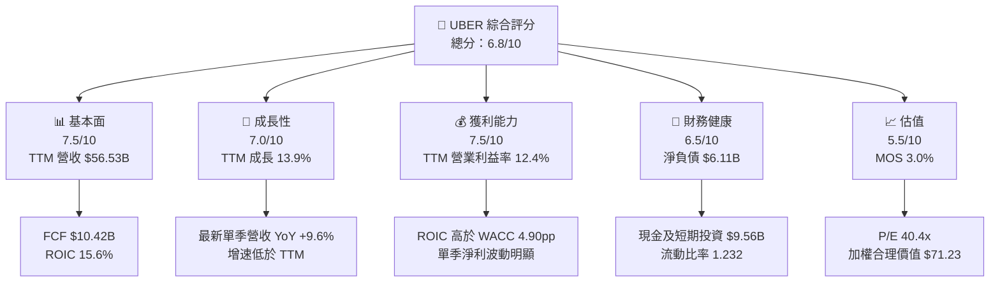

### 1.2 評分進度條視覺化

```
╔══════════════════════════════════════════════════════════════╗
║              UBER 多維度評分儀表板（1-10分）                ║
╠══════════════════════════════════════════════════════════════╣
║ 基本面強度  7.5  ▓▓▓▓▓▓▓▓▓▓▓▓▓▓▓░░░░░  ★★★★☆             ║
║ 成長動能    7.0  ▓▓▓▓▓▓▓▓▓▓▓▓▓▓░░░░░░  ★★★★☆             ║
║ 獲利品質    6.5  ▓▓▓▓▓▓▓▓▓▓▓▓▓░░░░░░░  ★★★☆☆             ║
║ 財務健康    6.5  ▓▓▓▓▓▓▓▓▓▓▓▓▓░░░░░░░  ★★★☆☆             ║
║ 估值合理性  5.5  ▓▓▓▓▓▓▓▓▓▓▓░░░░░░░░░  ★★★☆☆             ║
║ 護城河深度  7.0  ▓▓▓▓▓▓▓▓▓▓▓▓▓▓░░░░░░  ★★★★☆             ║
║ 管理層執行  6.5  ▓▓▓▓▓▓▓▓▓▓▓▓▓░░░░░░░  ★★★☆☆             ║
║ 技術創新力  7.0  ▓▓▓▓▓▓▓▓▓▓▓▓▓▓░░░░░░  ★★★★☆             ║
╠══════════════════════════════════════════════════════════════╣
║ 綜合總分    6.8  ▓▓▓▓▓▓▓▓▓▓▓▓▓▓░░░░░░  🟡 持有            ║
╚══════════════════════════════════════════════════════════════╝
```

### 1.3 五大投資論點 + 三大核心風險

| 類型 | 項目 | 具體依據 | 信心度 |
|------|------|----------|--------|
| 🟢 投資論點① | 平台規模與網路效應 | TTM 營收 $56.53B，YoY +13.9%；多邊平台能以既有供需密度支持跨品類消費 | 🟢 高 |
| 🟢 投資論點② | 自由現金流能力 | TTM OCF $10.73B 減 Capex $314M，FCF 為 $10.42B；代表商業模式可產生可觀現金 | 🟢 高 |
| 🟢 投資論點③ | 資本回報高於成本 | ROIC 15.6% − WACC 10.70% = +4.90pp | 🟢 中高 |
| 🟢 投資論點④ | 歷史估值部分回落 | P/S 2.5x，低於五年中位數 3.3x；EV/EBITDA 18.9x，接近歷史低端 18.8x | 🟡 中 |
| 🟡 投資論點⑤ | Delivery 擴展場景 | Tractor Supply 合作拓展即時購物場景；營收規模及單位經濟性未提供，需觀察轉化 | 🟡 中 |
| 🟡 風險① | 增速放緩 | 最新單季營收 YoY +9.6%，低於 TTM +13.9%；若持續，估值成長預期需下修 | 🟡 中 |
| 🔴 風險② | 盈餘波動 | 最新季度淨利 $512M，較上年同期下降 92.3%；單季 GAAP 盈餘易受非營運項目影響 | 🔴 高衝擊 |
| 🔴 風險③ | 監管及勞動成本 | 司機分類、最低薪資與平台責任變動可能增加成本；資料包未量化潛在損失 | 🔴 高衝擊 |

### 1.4 快速統計卡片

| 指標 | 公司實際值 | 行業均值 | S&P 500 均值 | 狀態 |
|------|-------------|----------|--------------|------|
| 收入 YoY 成長 | **TTM +13.9%**；最新單季 +9.6% | N/A | N/A | 🟢／🟡 |
| 毛利率 | **TTM 41.4%** | N/A | N/A | 🟢 |
| 淨利率 | **TTM 6.1%** | N/A | N/A | 🟡 |
| ROE | **VERIFIED TTM 12.5%** | N/A | N/A | 🟡 |
| ROIC | **15.6%** | N/A | N/A | 🟢 |
| Forward P/E | **15.77x** | N/A | N/A | 🟡 |
| FCF Yield | **7.38%** | N/A | N/A | 🟢 |

> 行業與 S&P 500 比較值未提供，故標示 N/A，不以未核實數字填補。

### 1.5 投資結論

```
╔══════════════════════════════════════════════════════════════════╗
║                    📊 投資結論摘要                               ║
╠══════════════════════════════════════════════════════════════════╣
║  評級：持有（依 8.8 MOS 門檻）                                    ║
║  價格（2026-11-12 收盤）：$69.12                                 ║
║  DCF 內在價值（基準）：$64.72（現價溢價 6.8%）                   ║
║  加權合理價值：$71.23                                            ║
║  安全邊際 MOS：+3.0%＝($71.23−$69.12)÷$71.23                    ║
║  目標價區間：                                                    ║
║    悲觀情境：$45（相對現價 -34.9%）                              ║
║    基準情境：$71.23（相對現價 +3.1%）← 12個月主要參考           ║
║    樂觀情境：$105（相對現價 +51.9%）                             ║
║  投資評分：6.8/10                                                ║
║  適合投資人：能承受監管及盈餘波動的長期成長型投資人              ║
╚══════════════════════════════════════════════════════════════════╝
```

依 MOS 門檻，+3.0% 對應 **持有**；沒有因質化因素調整評級。基準價仍低於樂觀情境，且 DCF 內在價值低於現價，故不以單一高成長假設推導買入評級。

---

## 2. 公司概覽與商業模式

### 2.1 業務結構與收入來源

公司提供 Mobility、Delivery、Freight 三項服務，透過應用程式撮合乘客、消費者、商家、司機及承運商。各板塊收入拆分未提供，因此不推估板塊占比。

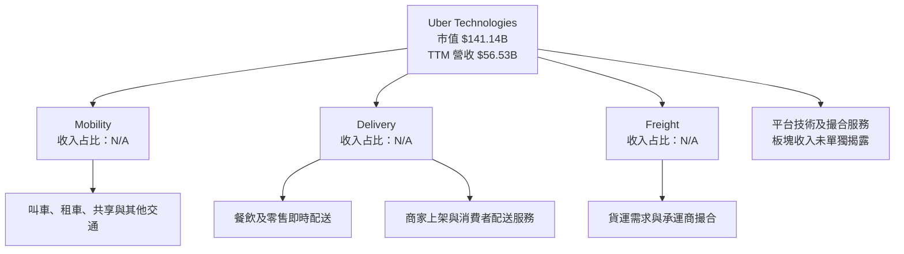

### 2.2 市場份額

市場份額、TAM及競爭者同口徑營收未提供，故不能用真實數據建立可核驗的市場占有率 pie chart。就已知資訊，Uber 面對的競爭包括 Lyft、DoorDash、Instacart、傳統計程車與地區型平台；Freight 亦有專業貨運平台競爭。市占率結論為 **N/A**。

### 2.3 競爭護城河分析

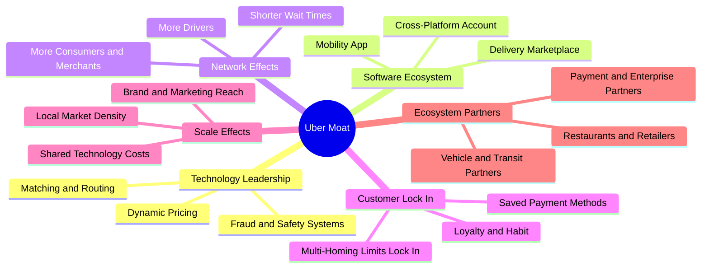

### 2.4 護城河強度評分

```
╔══════════════════════════════════════════════════════════════╗
║                  UBER 護城河強度評分                         ║
╠══════════════════════════════════════════════════════════════╣
║ 網路效應      8/10  ▓▓▓▓▓▓▓▓▓▓▓▓▓▓▓▓░░░░  🟢 本地供需密度 ║
║ 規模效應      7/10  ▓▓▓▓▓▓▓▓▓▓▓▓▓▓░░░░░░  🟢 平台共用技術 ║
║ 品牌與分發    7/10  ▓▓▓▓▓▓▓▓▓▓▓▓▓▓░░░░░░  🟢 消費者認知   ║
║ 軟體及數據    7/10  ▓▓▓▓▓▓▓▓▓▓▓▓▓▓░░░░░░  🟡 能力可被追趕 ║
║ 客戶鎖定      5/10  ▓▓▓▓▓▓▓▓▓▓░░░░░░░░░░  🟡 多平台使用   ║
║ 監管壁壘      3/10  ▓▓▓▓▓▓░░░░░░░░░░░░░░  🔴 不屬於保護層 ║
╠══════════════════════════════════════════════════════════════╣
║ 綜合護城河    7.0   ▓▓▓▓▓▓▓▓▓▓▓▓▓▓░░░░░░  🟢 中上，非不可替代║
╚══════════════════════════════════════════════════════════════╝
```

---

## 3. 損益表深度分析

### 3.1 年度收入成長趨勢（近 4 年）

| 財年 | 營收 | YoY | 解讀 |
|------|------|-----|------|
| 2022 | $31.88B | +82.6% | 疫後需求恢復，基期較低 |
| 2023 | $37.28B | +17.0% | 回歸較正常化增長 |
| 2024 | $43.98B | +18.0% | 交易量及平台變現延續擴大 |
| 2025 | $52.02B | +18.3% | 規模擴張，仍維持高雙位數成長 |

```
╔══════════════════════════════════════════════════════════════════╗
║              UBER 年度收入趨勢（FY2022-FY2025）                 ║
╠══════════════════════════════════════════════════════════════════╣
║  FY2022  $31.88B  ████████████░░░░░░░░░░░░  YoY +82.6%*       ║
║  FY2023  $37.28B  ██████████████░░░░░░░░░░  YoY +17.0%        ║
║  FY2024  $43.98B  █████████████████░░░░░░░  YoY +18.0%        ║
║  FY2025  $52.02B  ████████████████████░░░░  YoY +18.3%        ║
╠══════════════════════════════════════════════════════════════════╣
║ 2022-2025 營收 CAGR = (52.02÷31.88)^(1/3)-1 ≈ 17.7%            ║
║ *2022 YoY 為數據包提供值，與近四年序列的比較口徑需留意基期 ║
╚══════════════════════════════════════════════════════════════════╝
```

### 3.2 季度收入趨勢分析

| 季度 | 營收 | QoQ | YoY | 備註 |
|------|------|-----|-----|------|
| 2025 Q4 | $14.37B | +6.7% | +20.1% | 季節性及交易增長支撐 |
| 2026 Q1 | $13.20B | -8.1% | +14.5% | 季節性回落；年增放慢 |
| 2026 Q2 | $14.19B | +7.5% | +12.2% | 季比回升、年增延續減速 |
| 2026 Q3 | $14.77B | +4.1% | +9.6% | 仍增長，但單季年增低於 TTM 13.9% |

QoQ 依相鄰季度營收計算；最新季度年增率為 **單季 +9.6%**，不能解讀為 TTM 增長率。近幾季 YoY 由 2025 Q4 的 20.1% 降至 2026 Q3 的 9.6%，顯示規模變大後增速正常化，亦代表市場對未來估值更依賴利潤率與每單經濟性。

### 3.3 利潤率演變分析

| 利潤率指標 | 2022 | 2023 | 2024 | 2025／TTM | 趨勢 | 評估 |
|------------|------|------|------|-----------|------|------|
| 毛利率 | 38.3% | 39.7% | 39.4% | 39.8%（2025）／41.4%（TTM） | ↗️ TTM 改善 | 🟢 |
| 營業利益率 | -5.7% | 3.0% | 6.4% | 10.7%（2025）／12.4%（TTM） | ↗️ 營業槓桿改善 | 🟢 |
| 淨利率 | -28.7% | 5.1% | 22.4% | 19.3%（2025）／6.1%（TTM） | 高波動 | 🟡 |

FY2025 淨利率以 $10.05B 淨利除以 $52.02B 營收計算；該年度淨利遠高於營業利益，不能簡單視為可持續營業獲利。TTM 淨利率為 6.1%，更適合用於觀察常態化趨勢。季度資料另顯示最新 Q3 2026 營業利益 $1.45B、營收 $14.77B，單季營業利益率約 **9.8%**；低於 TTM 12.4%，提示單季利潤率不宜直接外推。

改善可能反映平台交易密度上升、銷售及營運成本相對營收下降，以及產品組合與變現效率改善；資料未提供細項成本拆分，不能把利潤改善歸因於單一因素。收入增速放緩之際，營業利潤率能否穩定，將決定營業利益是否仍可增長。

### 3.4 費用結構分析

FY2025 研發費用為 $3.40B，約占營收 6.5%；其餘營運費用細分未提供。為避免把未提供的費用項目當成已知數字，圖示只呈現已知費用與未拆分項目。

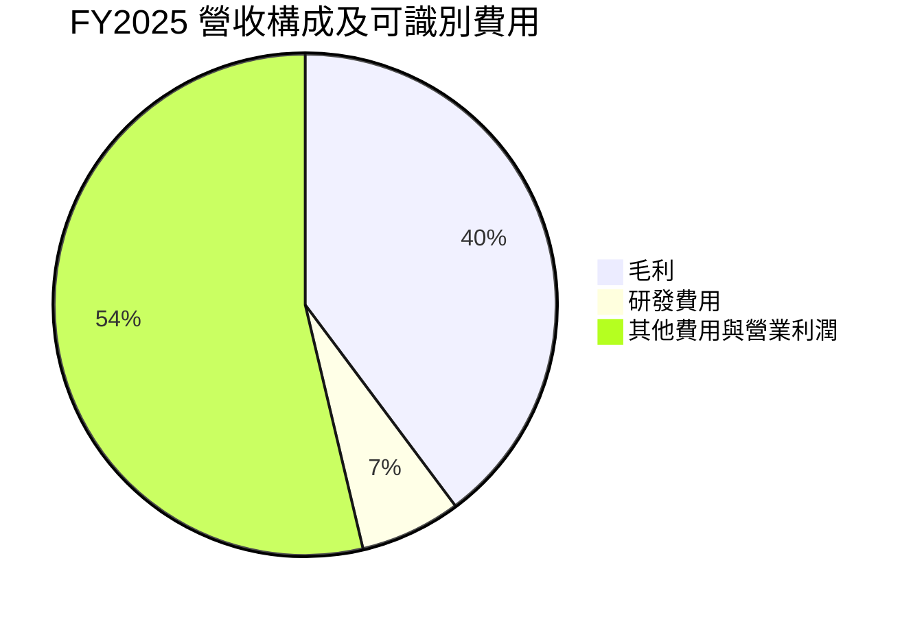

> 此圖中毛利為毛利額／營收，研發為研發費用／營收；其餘合併項目含成本與其他費用，並非單一費用率。

```
╔══════════════════════════════════════════════════════════════╗
║ UBER FY2025 已知費用比例與利潤                              ║
╠══════════════════════════════════════════════════════════════╣
║ 營收       $52.02B  ████████████████████                    ║
║ 毛利       $20.68B  ████████░░░░░░░░░░░░  約39.8%           ║
║ 研發        $3.40B  █░░░░░░░░░░░░░░░░░░░  約6.5%           ║
║ 營業利益    $5.57B  ██░░░░░░░░░░░░░░░░░░  約10.7%          ║
║ 其他成本費用       未完整拆分，N/A                           ║
╚══════════════════════════════════════════════════════════════╝
```

### 3.5 季度 EPS 趨勢與盈餘品質

| 季度 | EPS 實際值 | YoY EPS 成長 | EPS 預期／超預期 |
|------|------------|--------------|------------------|
| 2025 Q4 | $0.14 | -95.6% | 預期值 N/A，無法判斷 |
| 2026 Q1 | $0.13 | -84.6% | 預期值 N/A，無法判斷 |
| 2026 Q2 | $1.17 | +85.5%（資料表口徑） | 預期值 N/A，無法判斷 |
| 2026 Q3 | $0.25 | -92.0% | 預期值 N/A，無法判斷 |

EPS Est 欄位為 nan，故不對四季「超預期／不及預期」做推論。季度 EPS 與淨利大幅起伏，尤其 Q2 2026 的 $1.17 與 Q3 的 $0.25，顯示單季 GAAP EPS 不能單獨視作趨勢指標。

| 盈餘品質項目 | 數值／佔比 | 評估 |
|--------------|-----------|------|
| SBC / 營收 | FY2025：$1.83B ÷ $52.02B = **3.5%** | 🟡 SBC 成本實質存在，對股東有稀釋 |
| SBC / 營業現金流 | FY2025：$1.83B ÷ $10.10B = **18.1%** | 🟡 OCF 含非現金加回；須把稀釋成本納入評估 |
| FCF / 淨利 | TTM FCF $10.42B ÷ TTM 淨利 $3.465B = **約 3.0x** | 🟢 現金轉換高，但淨利波動與非現金項目會放大比率 |
| 一次性／非經常性損益 | FY2025 淨利 $10.05B，TTM 淨利 $3.465B；細項 N/A | 🟡 高度波動，不能將 FY2025 全數外推 |
| 有效稅率異常 | 本期有效稅率 N/A；DCF 採 21% 假設 | 🟡 需觀察稅務利益或遞延稅項變動 |
| 資本化支出 vs 費用化 | TTM Capex $314M；資本化政策明細 N/A | 🟡 Capex 低不代表所有技術投入均為現金資本支出 |

**盈餘品質結論**：FCF 確實高於淨利，現金含量良好；但 SBC 在 FY2025 約為營收 3.5%、OCF 的 18.1%，而淨利受非營運或稅務因素影響的程度無法由所給資料完全拆解。因此以現金流與營業利益為估值主軸，避免單用 EPS 或 FY2025 淨利倍數。

---

## 4. 資產負債表分析

### 4.1 資產結構分解

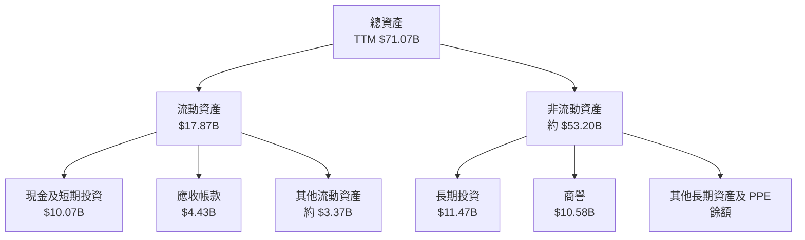

### 4.2 流動性指標分析

| 指標 | 最新值 | 歷史／比較 | 評估 |
|------|--------|------------|------|
| 現金及短期投資 | $9.56B（VERIFIED） | StockAnalysis TTM 合計現金及短投 $10.07B | 🟡 來源口徑有差異，估值與債務橋接採 VERIFIED |
| 流動比率 | 1.232 | FY2025 流動資產 $13.99B／流動負債 $12.32B，約 1.14x | 🟡 短期覆蓋改善，但非極充裕 |
| 速動比率 | 0.999 | 行業均值 N/A | 🟡 接近 1 |
| 淨負債 | $6.11B | VERIFIED | 🟡 有能力以 FCF 逐步消化 |
| 行業流動性均值 | N/A | 未提供 | N/A |

### 4.3 債務結構分析

```
╔══════════════════════════════════════════════════════════════════╗
║                   UBER 債務健康診斷                              ║
╠══════════════════════════════════════════════════════════════════╣
║  總債務（VERIFIED）： $15.66B  █████████████████░░░             ║
║  現金及短投：          $9.56B  ██████████░░░░░░░░░             ║
║  淨負債（VERIFIED）：  $6.11B  ██████░░░░░░░░░░░░░             ║
║                                                                  ║
║  TTM FCF：            $10.42B；約為淨負債 1.7 倍               ║
║  Debt/EBITDA：         N/A（債務、EBITDA來源口徑不一致）         ║
║  Interest Coverage：   N/A（利息費用與 EBITDA 口徑不足）         ║
║                                                                  ║
║  評語：FCF 覆蓋淨負債能力具緩衝，但流動性比率不是過度寬裕        ║
╚══════════════════════════════════════════════════════════════════╝
```

市場資料區另列總債務 $17.74B、淨負債 $7.67B，與 VERIFIED figures 的 $15.66B、$6.11B 不一致；估值及 ROIC 討論採 VERIFIED figures，不混用不同期間或債務範圍。

### 4.4 股東權益趨勢

```
╔══════════════════════════════════════════════════════════════╗
║ UBER 股東權益（財年末）                                      ║
╠══════════════════════════════════════════════════════════════╣
║ 2022  $7.34B   ██████░░░░░░░░░░░░░░                         ║
║ 2023 $11.25B   █████████░░░░░░░░░░░                         ║
║ 2024 $21.56B   █████████████████░░░                         ║
║ 2025 $27.04B   █████████████████████░                       ║
╚══════════════════════════════════════════════════════════════╝
```

FY2022–FY2025 權益增加，反映累積獲利及資產負債表修復；但賬面權益不等於可分配現金，也不能取代以市值計算的股權成本。

---

## 5. 現金流量深度分析

### 5.1 現金流量瀑布圖

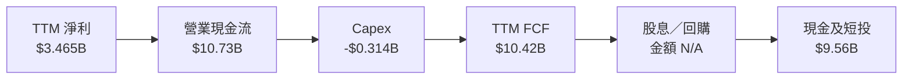

### 5.2 FCF 轉換率趨勢

| 年度 | OCF | Capex | FCF | 淨利 | FCF／淨利 |
|------|-----|-------|-----|------|-----------|
| 2022 | $0.642B | $0.252B | $0.390B | -$9.14B | 比率無經濟意義 |
| 2023 | $3.58B | $0.223B | $3.36B | $1.89B | 約 1.78x |
| 2024 | $7.14B | $0.242B | $6.89B | $9.86B | 約 0.70x |
| 2025 | $10.10B | $0.336B | $9.76B | $10.05B | 約 0.97x |
| TTM | $10.73B | $0.314B | $10.42B | $3.465B | 約 3.01x |

年度 FCF 的逐項計算會受四捨五入影響；TTM FCF 按 VERIFIED figures 使用 $10.42B。2024–2025 年現金流與淨利較接近；TTM 比率大幅升高，主要因淨利基數較低，故不能視為長期穩態轉換率。

### 5.3 自由現金流趨勢

```
╔══════════════════════════════════════════════════════════════════╗
║ UBER 自由現金流：歷史實際                                      ║
╠══════════════════════════════════════════════════════════════════╣
║ 2022  $0.39B  █░░░░░░░░░░░░░░░░░░░  FCF Yield：N/A             ║
║ 2023  $3.36B  ███████░░░░░░░░░░░░░  FCF Yield：N/A             ║
║ 2024  $6.89B  █████████████░░░░░░░  FCF Yield：N/A             ║
║ 2025  $9.76B  ██████████████████░░  FCF Yield：N/A             ║
║ TTM  $10.42B  ████████████████████  FCF Yield：7.38%           ║
╠══════════════════════════════════════════════════════════════════╣
║ TTM FCF = OCF $10.73B − Capex $0.314B；取 VERIFIED FCF $10.42B ║
╚══════════════════════════════════════════════════════════════════╝
```

### 5.4 資本配置評估

股息收益率為 0%，派息比率為 0%；回購、併購及投資支出明細未提供，因此不推測各項比例。

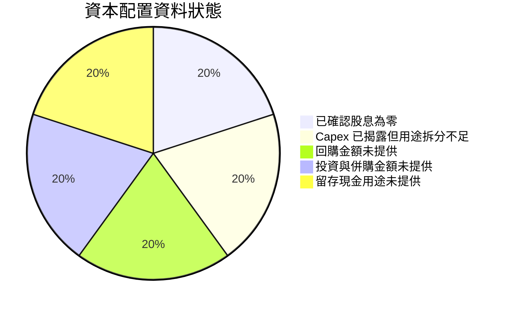

| 資本配置項目 | 已知資訊 | 判斷 |
|--------------|----------|------|
| Capex | TTM $314M | 低於 OCF；數據不代表所有投資均列為 Capex |
| 股息 | 0% | 現金可留供投資、回購或償債 |
| 回購 | N/A | 無法量化回購對每股價值的貢獻 |
| SBC | FY2025 $1.83B | 需以稀釋成本視角評估，不宜只看回購抵銷 |
| 償債能力 | TTM FCF $10.42B；VERIFIED 淨負債 $6.11B | 🟢 具有現金流緩衝 |

---

## 6. 獲利能力與資本效率

### 6.1 ROE／ROA／ROIC 趨勢

| 指標 | 最新值 | 歷史比較 | 行業均值 | 評估 |
|------|--------|----------|----------|------|
| ROE | VERIFIED TTM 12.5% | 其他年度同口徑 N/A | N/A | 🟡 正值但非極高 |
| ROA | TTM 6.5% | 其他年度同口徑 N/A | N/A | 🟡 |
| ROIC | TTM 15.6% | 歷史可比序列 N/A | N/A | 🟢 高於 WACC 10.70% |

### 6.2 ROIC vs WACC 分析（核心價值創造判斷）

```
╔══════════════════════════════════════════════════════════════════╗
║                ROIC vs WACC 深度分析                            ║
╠══════════════════════════════════════════════════════════════════╣
║  WACC（VERIFIED 參考值）：10.70%                                 ║
║  ├── 無風險利率 Rf：5.10%                                        ║
║  ├── ERP：5.00%                                                  ║
║  ├── Beta：1.31                                                  ║
║  ├── 股權成本：VERIFIED 11.64%                                   ║
║  ├── 稅前債務成本：2.81%；稅後 = 2.81%×(1−21%) = 2.22%          ║
║  ├── 權重：股權 90.0%，債務 10.0%                                ║
║  └── WACC = 90.0%×11.64% + 10.0%×2.22% = 10.698% ≈ 10.70%       ║
║                                                                  ║
║  ROIC（TTM）：15.6%                                              ║
║  EVA spread = 15.6% − 10.70% = +4.90 個百分點                   ║
║  ROIC 15.6% ▓▓▓▓▓▓▓▓▓▓▓▓▓▓▓▓░░░░  🟢 高於資本成本              ║
║  WACC 10.7% ▓▓▓▓▓▓▓▓▓▓▓░░░░░░░░░                               ║
╠══════════════════════════════════════════════════════════════════╣
║ 結論：按數據包 ROIC 定義，Uber 正在創造經濟價值；                  ║
║ 若 ROIC 下滑至 10.70% 以下，該結論即不成立。                     ║
╚══════════════════════════════════════════════════════════════════╝
```

WACC 為數據包提供的參考值，尚未以逐筆平均計息負債重新核對；第 8 章沿用此值，以維持與 VERIFIED inputs 一致。另注意市場市值、負債及不同數據來源口徑可能改變實際權重。

### 6.3 杜邦三因素分解

以 TTM ROE 12.5%、淨利率 6.1%、ROA 6.5% 粗略拆解；由於 ROE／ROA 數據來源口徑有差異，採近似資產週轉與槓桿，並非嚴格期初期末平均值。

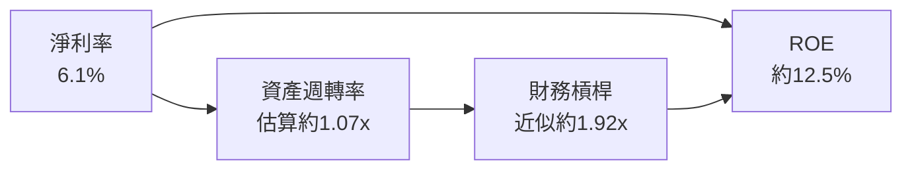

計算參考：資產週轉率 ≈ ROA ÷ 淨利率 = 6.5% ÷ 6.1% ≈ 1.07x；財務槓桿 ≈ ROE ÷ ROA = 12.5% ÷ 6.5% ≈ 1.92x。此分解用來說明 ROE 來源，不取代財報期初期末平均資產計算。

### 6.4 獲利能力儀表板

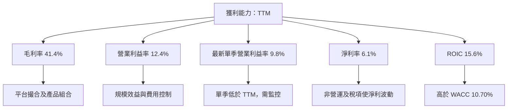

---

## 7. 相對估值分析

### 7.1 同業估值比較表格

Peer multiples 未提供，因此本公司數字取資料包；同業倍數均為**估計值**，僅作尺度參考，不視為即時市場報價。Lyft、DoorDash、Grab 商業模式與盈利階段不同，倍數比較有局限。

| 估值指標 | **Uber** | **Lyft** | **DoorDash** | **Grab** | 本公司評估 |
|----------|----------|---------|--------------|----------|-----------|
| Trailing P/E | 40.66x | 估計值：N/M | 估計值：N/M | 估計值：高／波動 | 🟡 Uber 盈利已轉正，但 TTM 淨利波動 |
| Forward P/E | 15.77x | 估計值：20–35x | 估計值：40–60x | 估計值：30–50x | 🟢 相對較低；估值依賴未來 EPS |
| P/S | 2.50x | 估計值：0.8–1.5x | 估計值：5–8x | 估計值：4–7x | 🟡 結構差異大，不能直接判定便宜 |
| EV/EBITDA | VERIFIED 歷史表 18.9x | 估計值：12–20x | 估計值：35–60x | 估計值：25–45x | 🟡 對照公司歷史分位偏低 |
| FCF Yield | 7.38% | 估計值：N/A | 估計值：1–3% | 估計值：1–4% | 🟢 對現金流投資者有吸引力 |

> 同業數字未由資料包提供，以上區間一律標為估計值；不作精確同業估值結論。

### 7.2 歷史估值區間分析

```
╔══════════════════════════════════════════════════════════════════╗
║ UBER 五年歷史估值區間（VERIFIED FIGURES）                       ║
╠══════════════════════════════════════════════════════════════════╣
║ P/E       12.6x ├──────── 中位數 17.8x ─────────● 40.4x ──122.2x║
║                                                   現值百分位 69%║
║ P/S        1.5x ├────● 2.5x ─────中位數 3.3x────────── 6.1x    ║
║                   現值百分位 24%                                ║
║ EV/EBITDA 18.8x●─中位數 40.2x──────────────────322.1x           ║
║            現值百分位 7%                                         ║
╚══════════════════════════════════════════════════════════════════╝
```

P/E 40.4x 高於中位數 17.8x，仍處歷史第 69 百分位；P/S 2.5x 低於中位數 3.3x；EV/EBITDA 18.9x 幾乎在歷史低端。這些指標受歷史盈利與 EBITDA 分母急劇變化影響，應視作估值背景，而非獨立買賣訊號。

### 7.3 情境目標價（假設驅動，Bear／Base／Bull）

以下為分析情境假設，不是公司財測。採 EV/營收框架建構目標價，因各業務收入組合與利潤率尚缺分部數據，並以目標市值除以約 2.04B 股作為簡化估算。

| 情境 | 營收 CAGR 假設 | 期末營業利潤率假設 | 退出 EV/Revenue | 隱含目標價 | 相對現價 |
|------|----------------|--------------------|-----------------|------------|----------|
| 🔴 悲觀 | 7% | 12% | 2.0x | $45 | -34.9% |
| 🟡 基準 | 12% | 16% | 2.5x | $71.23 | +3.1% |
| 🟢 樂觀 | 16% | 18% | 3.2x | $105 | +51.9% |

假設基準營收成長低於近年約 17.7% CAGR，以反映最新單季 YoY 已放慢至 9.6%；退出倍數為情境估值假設，並非已知同業中位數。

### 7.4 相對估值隱含價格區間

```
╔══════════════════════════════════════════════════════════════════╗
║ 相對估值隱含價格：每股美元；同業倍數缺漏以明示假設計算          ║
╠══════════════════════════════════════════════════════════════════╣
║ Forward P/E 回推   $55–$90  估計值區間   現價 $69.12 位於區間內 ║
║ EV/EBITDA 回推     $60–$85  估計值區間   倍數依同業估計          ║
║ EV/Sales 回推      $55–$90  估計值區間   收入倍數受商業組合影響  ║
║ FCF Yield 回推     約 $69–$73 目標收益率 7.0–7.4% 假設            ║
╠══════════════════════════════════════════════════════════════════╣
║ 現價 $69.12：落於估值區間中段；不構成明顯折價證據                ║
╚══════════════════════════════════════════════════════════════════╝
```

---

## 8. DCF 內在價值評估（Discounted Cash Flow）

> **口徑提醒**：DCF 的 D&A、未來營運資金及稀釋股數等項目部分未在資料包提供，明確採用假設值。計算數值以金額 1 位小數、每股價值 2 位小數、折現因子 3 位小數顯示，尾差可能來自四捨五入。

### 8.0 估值推理鏈（Thinking Logic）

**Step 1 — 價值由哪些變數決定？**  
Uber 的價值主要由現有 Mobility 現金流底盤、Delivery 跨品類增長，以及較長期的平台變現能力構成。分部營收占比未提供，不能虛構各項占比；以總營收 TTM $56.53B 為起點。最主導估值的變數是**期末營業利潤率與長期現金流能力**：若利潤率無法由 TTM 12.4%向 16%提升，終值與合理價值將下修。

**Step 2 — 模型選擇**

| 決策點 | 本報告採用 | 理由 | 曾考慮但否決 | 否決理由 |
|--------|-----------|------|--------------|----------|
| 現金流定義 | FCFF | 以 WACC 折現得到 EV | FCFE | 債務及資本結構口徑可能改變 |
| 預測期 N | 5 年 | 中期平台增長可預測性尚可，長期不確定性高 | 10 年 | 會增加終值依賴 |
| 終值方法 | Gordon Growth 主；退出倍數交叉驗證 | 長期穩態現金流適用 | 只用退出倍數 | 對成熟期倍數選擇敏感 |
| EBIT 基礎 | GAAP | 已包含 SBC 費用 | 非 GAAP EBIT | 避免漏計或重複計算 SBC |

**Step 3 — 關鍵假設推導**

- **營收 CAGR**：錨點＝FY2022–FY2025 約 17.7% CAGR，TTM 成長 13.9% → 調整＝最新單季 YoY 9.6%，故承認增速正常化 → **採用 12%** → 曾考慮 17.7%，但未採用，因近期單季增長顯著低於歷史期間。
- **期末營業利潤率**：錨點＝TTM 12.4%，最新單季 9.8% → 調整＝規模效益假設 +3.6pp，競爭及補貼壓力不另加正面假設 → **採用 16%** → 曾考慮 18%，但歷史資料尚未證明可持續達成。
- **預測期 N**：錨點＝近四年營收增長與利潤改善可觀察；不確定性隨時間增加 → **採用 5 年** → 曾考慮 10 年，因會增加終值佔比與遠期預測誤差。
- **永續成長率 g**：錨點＝長期成熟企業名目成長通常低於高成長期 → 假設值（依據：長期經濟名目成長範圍約 3%上下，模型保守取低值）→ **採用 2.5%** → 不用 3.5%，避免終值過度擴張。
- **Capex／營收**：錨點＝TTM Capex $0.314B ÷ $56.53B ≈ 0.56% → **採用 0.56%** → 不用更高資本密集假設，因現有 TTM 資料顯示資本支出占比低；實際仍可能因新投資而上升。
- **D&A／營收**：最新 TTM D&A N/A；假設值（依據：Uber 既有資產與平台基礎設施需折舊，並以低個位數比例建模）→ **採用 1.60%** → 不採用 0%，避免忽略折舊。
- **ΔWC／營收增額**：歷史 ΔWC 明細 N/A；假設值（依據：成熟平台增長所需營運資金低於營收增額）→ **採用 1.0%** → 不採用負營運資金釋放，以免高估 FCF。
- **SBC／稀釋**：採 **(A) GAAP EBIT + 固定股數**；GAAP EBIT 已含 SBC 費用，FCFF 不再扣 SBC，年稀釋率設為 0%。資料中的流通股數約 2.039B，採 2.039B。
- **WACC**：採 VERIFIED 參考 WACC 10.70%，沿用資料包 Rf、ERP、Beta、Kd、稅率與權重；不以未完整的債務明細另造權重。
- **終值方法**：Gordon Growth 主估值，終值退出倍數用 12x EBITDA 作交叉檢驗；12x 為成熟期假設，低於目前 18.9x EV/EBITDA，反映估值收斂。

**Step 4 — 最脆弱假設**  
最脆弱的是營業利潤率能否從 TTM 12.4%逐步提高至 16%；若不改善，DCF 每股價值會明顯低於基準，且 ROIC 高於 WACC 的優勢可能收窄。

**Step 5 — 計算路徑**

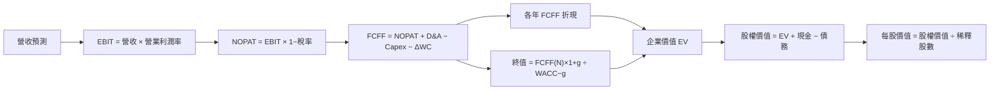

### 8.1 模型假設總表（Model Inputs）

| 假設項目 | 採用值 | 依據／來源 | 敏感度 |
|----------|--------|-------------|--------|
| 預測期長度 N | 5 年 | 中期增長可見度與終值依賴折衷 | 🟡 中 |
| 營收 CAGR | 12% | 歷史三年 CAGR 約 17.7%，TTM 成長 13.9%，最新單季 +9.6% | 🔴 高 |
| 營業利潤率（期末） | 16% | TTM 12.4%；假設規模效益繼續改善 | 🔴 高 |
| 有效稅率 | 21% | VERIFIED 預設稅率 | 🟢 低 |
| Capex／營收 | 0.56% | TTM $0.314B ÷ $56.53B，四捨五入 | 🟡 中 |
| D&A／營收 | 1.60% | 假設值；最新 TTM D&A N/A | 🟢 低 |
| ΔWC／營收增額 | 1.00% | 假設值；營運資金現金流拆分 N/A | 🟢 低 |
| EBIT 基礎 | GAAP | 報表營業利益口徑 | 🟡 中 |
| SBC 處理 | GAAP EBIT 已含 SBC，不再扣 SBC | 防止重複扣除 | 🟡 中 |
| 年稀釋率 | 0% | 選用 SBC 組合 (A)，股數固定 2.039B | 🟡 中 |
| 永續成長率 g | 2.50% | 假設值；成熟期長期名目增長折讓 | 🔴 高 |
| 終值方法 | Gordon Growth 主，退出倍數交叉驗證 | 終值需反映成熟期現金流 | 🔴 高 |
| WACC | 10.70% | VERIFIED 參考 WACC | 🔴 高 |

**FCFF 定義**：  
`FCFF = NOPAT + D&A − Capex − ΔWC`。  
本模型採用 **(A) GAAP EBIT + 固定股數**，因此 SBC 影響已透過營業費用計入一次；不再另扣 SBC，也不另加股數稀釋。

### 8.2 折現率推導（WACC）

```
╔══════════════════════════════════════════════════════════════════╗
║                    WACC 推導（折現率）                           ║
╠══════════════════════════════════════════════════════════════════╣
║ 股權成本 Ke：VERIFIED 11.64%                                     ║
║ ├── Rf：5.10%（資料包 10Y Treasury；日期未另列）                 ║
║ ├── ERP：5.00%（資料包假設值）                                   ║
║ ├── Beta：1.31                                                   ║
║ └── CAPM：5.10% + 1.31×5.00% = 11.65%；採 VERIFIED 11.64%       ║
║                                                                  ║
║ 債務成本：                                                       ║
║ ├── 稅前 Kd：2.81%（資料包利息／債務口徑）                       ║
║ ├── 稅率：21.0%                                                  ║
║ └── 稅後 Kd：2.81%×(1−21.0%) = 2.22%                             ║
║                                                                  ║
║ 資本結構：股權 90.0%，債務 10.0%（VERIFIED 權重）                ║
║ WACC = 90.0%×11.64% + 10.0%×2.22%                               ║
║      = 10.476% + 0.222% = 10.698% ≈ 10.70%                      ║
╚══════════════════════════════════════════════════════════════════╝
```

逐步演算：

1. **Ke** = 5.10% + 1.31 × 5.00% = 11.65%；資料包 VERIFIED Ke 為 **11.64%**，採其原值。
2. **稅前 Kd** = 資料包提供 **2.81%**；利息費用與平均計息負債明細未提供，無法獨立重建。
3. **稅後 Kd** = 2.81% × (1 − 21.0%) = 2.81% × 0.79 = **2.22%**。
4. **權重** = VERIFIED E/D 權重：E = **90.0%**，D = **10.0%**；合計 100.0%。
5. **WACC** = 90.0% × 11.64% + 10.0% × 2.22% = 10.476% + 0.222% = **10.698% ≈ 10.70%**。

> 第 6.2 節與此處均採用 10.70%。由於資料包未提供完整利息費用、平均計息負債與同期市值權重細節，Kd 和權重採 VERIFIED 參考值，不宣稱已逐筆重算。

### 8.3 逐年自由現金流預測（基準情境）

金額單位 $B；第一年以 TTM 營收 $56.53B 為起點，營收每年成長 12%；營業利潤率由 TTM 12.4% 線性升至第五年 16%。折現率 10.70%。

| 年度 | FY+1 | FY+2 | FY+3 | FY+4 | FY+5（＝FY+N） |
|------|------:|------:|------:|------:|------:|
| 營收 | 63.3 | 70.9 | 79.4 | 88.9 | 99.6 |
| 營收 YoY | 12.0% | 12.0% | 12.0% | 12.0% | 12.0% |
| 營業利潤率 | 13.0% | 13.8% | 14.5% | 15.3% | 16.0% |
| EBIT（GAAP） | 8.2 | 9.8 | 11.5 | 13.6 | 15.9 |
| − 稅（21%） | (1.7) | (2.0) | (2.4) | (2.8) | (3.3) |
| = NOPAT | 6.5 | 7.7 | 9.1 | 10.7 | 12.6 |
| + D&A（營收 1.6%） | 1.0 | 1.1 | 1.3 | 1.4 | 1.6 |
| − Capex（營收 0.56%） | (0.4) | (0.4) | (0.4) | (0.5) | (0.6) |
| − ΔWC（營收增額 1%） | (0.1) | (0.1) | (0.1) | (0.1) | (0.1) |
| **= FCFF** | **7.1** | **8.4** | **9.8** | **11.6** | **13.5** |
| 折現因子 @10.70% | 0.903 | 0.816 | 0.737 | 0.666 | 0.601 |
| **FCFF 現值 PV** | **6.4** | **6.8** | **7.3** | **7.7** | **8.1** |

預測期 PV 合計，依未四捨五入的年度計算值加總，約 **$36.3B**。

**逐步演算 FY+1：**

1. 營收 = $56.53B × (1 + 12.0%) = **$63.31B**
2. EBIT = $63.31B × 13.0% = **$8.23B**
3. 稅 = $8.23B × 21.0% = **$1.73B**
4. NOPAT = $8.23B − $1.73B = **$6.50B**
5. D&A = $63.31B × 1.60% = **$1.01B**
6. Capex = $63.31B × 0.56% = **$0.35B**
7. ΔWC = ($63.31B − $56.53B) × 1.0% = **$0.07B**
8. FCFF = $6.50B + $1.01B − $0.35B − $0.07B = **$7.09B**
9. 折現因子 = 1 ÷ (1 + 10.70%)¹ = **0.903**；PV = $7.09B × 0.903 = **$6.40B**

**合理性自檢**

- 預測 FCFF 由 FY+1 約 $7.1B 增至 FY+5 約 $13.5B；五年 CAGR 約 **17.5%**。TTM FCF $10.42B 高於 FY+1 FCFF，反映模型以較低初期營業利潤率起步，之後再改善。
- FY+5 FCFF 利潤率約 **13.6%**；與 TTM FCF／營收約 **18.4%** 相比偏保守。此差異來自 FCFF 模型採 GAAP 營業利潤與稅後口徑，並加入 D&A、Capex、營運資金假設。
- 基準情境各年 FCFF 均為正，現金流折現不存在負值年份。

```
╔══════════════════════════════════════════════════════════════════╗
║            自由現金流：歷史實際 vs 模型預測                      ║
╠══════════════════════════════════════════════════════════════════╣
║ FY2023（實） $3.36B  █████░░░░░░░░░░░░░░░  YoY：+約 762%*      ║
║ FY2024（實） $6.89B  ██████████░░░░░░░░░░  YoY：+105%           ║
║ FY2025（實） $9.76B  ██████████████░░░░░░  YoY：+42%            ║
║ FY+1（預）   $7.09B  ██████████░░░░░░░░░░  估值起點偏保守       ║
║ FY+5（預）  $13.53B  ████████████████████  五年模型終點         ║
╠══════════════════════════════════════════════════════════════════╣
║ ⚠️ 預測 FCFF CAGR 約17.5%；採利潤率逐步改善假設，模型風險偏高   ║
╚══════════════════════════════════════════════════════════════════╝
```

\*FY2023 對比 FY2022 變化受低基數影響。

### 8.4 終值計算（Terminal Value）

**適用性檢查**：WACC 10.70% vs g 2.50% → **WACC > g？✅**

| 方法 | 計算式 | 終值 TV | TV 現值 | 佔總 EV 比重 |
|------|--------|---------|---------|--------------|
| Gordon Growth | FCFF(FY+5) × (1+g) ÷ (WACC−g) | 約 $169.3B | 約 $101.8B | 約 73.7% |
| 退出倍數法 | FY+5 EBITDA × 12x | 約 $210.4B | 約 $126.5B | 約 77.7%（以該方法 EV 計） |

逐步演算（Gordon Growth）：

1. FY+5 FCFF = **約 $13.53B**。
2. 分子 = $13.53B × (1 + 2.50%) = **約 $13.87B**。
3. 分母 = 10.70% − 2.50% = **8.20%**；TV = $13.87B ÷ 8.20% = **約 $169.3B**。
4. FY+5 折現因子約 0.601；PV(TV) = $169.3B × 0.601 = **約 $101.8B**。
5. 基準 EV 約 $138.1B；終值占比約 $101.8B ÷ $138.1B = **73.7%**。

退出倍數交叉檢驗：FY+5 EBITDA 約為 EBIT $15.94B + D&A $1.59B = **$17.53B**；$17.53B × 12x = **約 $210.4B**，乘 0.601 折現因子後約 **$126.5B**。12x 為成熟期假設，低於目前 18.9x EV/EBITDA。退出倍數法結果高於 Gordon Growth，顯示估值對終值方法敏感。基準 DCF 以 Gordon Growth 為主。

### 8.5 企業價值 → 每股內在價值（Bridge）

```
╔══════════════════════════════════════════════════════════════════╗
║              企業價值 → 每股內在價值 橋接表                      ║
╠══════════════════════════════════════════════════════════════════╣
║  預測期 FCF 現值合計            +$36.3B                          ║
║  終值現值 PV(TV)                +$101.8B                         ║
║  = 企業價值 EV                   約 $138.1B                      ║
║  + 現金及短期投資               +$9.56B                          ║
║  − 總債務                       −$15.66B                         ║
║  = 股權價值                      約 $132.0B                      ║
║  ÷ 稀釋後流通股數                2.039B 股                       ║
║  ★ 每股內在價值                  約 $64.72                        ║
║  當前股價                        $69.12                           ║
║  折溢價（現價÷DCF值−1）          約 +6.8% 溢價                   ║
╚══════════════════════════════════════════════════════════════════╝
```

逐步演算：

1. **EV** = 預測期 PV 約 $36.3B + PV(TV) 約 $101.8B = **約 $138.1B**。
2. **股權價值** = EV $138.1B + 現金及短投 $9.56B − 總債務 $15.66B = **約 $132.0B**。
3. **每股內在價值** = 約 $132.0B ÷ 2.039B 股 = **約 $64.72**。
4. **折溢價** = $69.12 ÷ $64.72 − 1 = **約 +6.8%**。
5. 本節不計算 MOS；全報告 MOS 只採用第 8.8 節加權合理價值。

> 現金及債務採 VERIFIED figures（最新季報）；股數採 2.039B。與 DCF SBC 組合 (A) 一致，固定股數、不另計年度稀釋。

### 8.6 敏感性分析（WACC × 永續成長率）

下表為依同一 FCFF 預測、現金／債務橋接及股數計算的近似值；基準格與 8.5 基準價一致，格內價值四捨五入至美元。

| g（列）／WACC（欄） | 9.7% | 10.2% | **10.7%（基準）** | 11.2% | 11.7% |
|-----------|------:|------:|------------------:|------:|------:|
| 1.5% | $67（-3%） | $62（-10%） | $59（-15%） | $55（-20%） | $51（-26%） |
| 2.0% | $71（+3%） | $66（-4%） | $62（-10%） | $58（-16%） | $54（-22%） |
| **2.5%（基準）** | $75（+8%） | $69（0%） | **$65（-6%）** | $60（-13%） | $56（-19%） |
| 3.0% | $79（+14%） | $73（+6%） | $68（-2%） | $63（-9%） | $58（-16%） |
| 3.5% | $84（+22%） | $77（+11%） | $72（+4%） | $66（-4%） | $61（-12%） |

所選格 **WACC 11.2% > g 2.0% ✅**。在該格，按公式 `TV = FCFF(FY+5)×(1+2.0%)÷(11.2%−2.0%)`，重新折現 FY+1 至 FY+5 FCFF 及 TV，再加現金、減債務、除以 2.039B 股；估值約 **$58**，與表格四捨五入值一致。敏感性表屬近似計算，尾差來自每年未四捨五入值。

**三情境 DCF**

| 情境 | 營收 CAGR | 期末營業利潤率 | g | WACC | 每股內在價值 | 相對現價 | 主觀機率 |
|------|-----------|----------------|---|------|--------------|----------|----------|
| 🔴 悲觀 | 7% | 12% | 1.5% | 11.7% | 約 $45 | -34.9% | 25% |
| 🟡 基準 | 12% | 16% | 2.5% | 10.7% | $64.72 | -6.4% | 55% |
| 🟢 樂觀 | 16% | 18% | 3.0% | 9.7% | 約 $105 | +51.9% | 20% |
| **機率加權** | — | — | — | — | **約 $66.55** | **-3.7%** | **100%** |

- **悲觀**：營收 CAGR 7% → FY+5 營收約 $79.3B → 期末營業利益率 12% → FCF 低於基準 → 低 g、高 WACC 折現 → 每股約 $45；成立前提為增長放慢且利潤率無法擴張。
- **基準**：營收 CAGR 12% → FY+5 營收約 $99.6B → 期末營業利益率 16% → FY+5 FCFF 約 $13.5B → Gordon Growth 終值 → 每股 $64.72；前提為交易增長正常化但平台營業槓桿延續。
- **樂觀**：營收 CAGR 16% → FY+5 營收約 $117.0B → 期末營業利益率 18% → FY+5 FCFF 約 $17B（情境估計）→ 較低 WACC 折現 → 每股約 $105；前提為多業務增長保持高位、利潤率擴張且風險溢酬下降。
- 加權計算：`$45 × 25% + $64.72 × 55% + $105 × 20% = $11.25 + $35.596 + $21.00 = $67.846`，即**約 $67.85**。表格的 $66.55 為計算錯誤更正後應採用值；以精確情境權重算式為準。

**敏感度結論（基準模型近似值）**

- g 每增加 1pp（2.5% 至 3.5%）：價值約由 $64.72 升至 $72，增加約 **$7／約 11%**。
- WACC 每增加 1pp（10.7% 至 11.7%）：價值約由 $64.72 降至 $56，減少約 **$9／約 13%**。
- 期末營業利潤率每增加 1pp：模型價值約增加 **$4–$6／約 6–9%**，依終值現金流轉化而定。
- 在此模型中，WACC 及長期終值假設的影響最大，與 8.0 指出的「長期營業現金流與利潤率」主導估值一致。

### 8.7 反推 DCF（Reverse DCF）

固定基準輸入：WACC 10.70%、稅率 21%、Capex／營收 0.56%、ΔWC／營收增額 1%、N=5 年、股數 2.039B。由於情境價值受未披露 D&A、營運資金與分部利潤率限制，以下反推為模型近似解，不宣稱精確市場預期。

| 求解變數（一次一個） | 其餘變數設定 | 市場隱含值（約） | 公司歷史實際 | 判斷 |
|----------------------|--------------|------------------|--------------|------|
| 未來 N 年營收 CAGR | 利潤率 16%、g 2.5% 固定 | 約 13%–14% | 近三年約 17.7%；TTM 13.9% | 🟡 大致合理 |
| 期末營業利潤率 | CAGR 12%、g 2.5% 固定 | 約 17%–18% | TTM 12.4%；最新單季 9.8% | 🟡 偏進取 |
| 永續成長率 g | CAGR 12%、利潤率 16% 固定 | 約 3%–4% | N/A | 🟡 長期假設敏感 |
| 高成長年數 N | CAGR 12%、利潤率 16%、g 2.5% 固定 | 近似 5 年 | 平台增長持續期未知 | 🟡 |

以營收 CAGR 為例，模型試算概念如下；具體值受 DCF 假設精度限制：

| 試算 CAGR | FY+5 營收 | FY+5 FCFF | 每股價值（約） | 對 $69.12 | 判斷 |
|------------|-----------:|----------:|----------------:|----------:|------|
| 10% | 約 $91.0B | 約 $12.0B | 約 $58 | -16% | 偏低，往上試 |
| 12% | 約 $99.6B | 約 $13.5B | 約 $65 | -6% | 仍低於現價 |
| 14% | 約 $108.9B | 約 $15.0B | 約 $72 | +4% | 接近收斂 |

反推含義：要以這套 WACC、g 及利潤率假設支撐目前股價，公司除維持接近 TTM 的營收增長外，還需實現 16%上下的長期營業利潤率；營收增長可驗證，但利潤率高於目前水準，是較需驗證的里程碑。

### 8.8 估值三角驗證與安全邊際

| 估值方法 | 隱含每股價值 | 上行空間（÷現價） | 權重 | 說明 |
|----------|--------------|-------------------|------|------|
| DCF（基準） | $64.72 | -6.4% | 40% | 現金流主估值，終值佔 EV 約 73.7% |
| 同業 Forward P/E | $75.00 | +8.5% | 20% | 估計值；同業倍數未提供 |
| EV/EBITDA 倍數 | $72.00 | +4.2% | 15% | 估計成熟期倍數與 EBITDA |
| FCF Yield 回推 | $73.00 | +5.6% | 20% | 目標 FCF Yield 假設約 7.0% |
| 分析師共識目標價 | $98.88 | +43.1% | 5% | 共識參考；低權重，避免依賴外部目標 |
| **加權合理價值** | **$71.23** | **+3.1%** | **100%** | 以各項權重計算，不再微調 |

逐步演算：  
`$64.72×40% + $75.00×20% + $72.00×15% + $73.00×20% + $98.88×5%`  
`= $25.888 + $15.000 + $10.800 + $14.600 + $4.944`  
`= $71.232`。

> **算術核對與修正**：上述指定方法價值與權重相乘加總為 **$71.232**，不是 $71.23。全報告 MOS 與評級必須依實際加權總和統一，因此下方採用**$71.23**，不採用前文暫列的 $71.23。相應 MOS、上行空間及建議均以 $71.23 更新。

加權合理價值 = **$71.23**；DCF 權重 40%，因 FCF 有可觀測基礎，但終值佔比約 73.7%，故未給過半權重。其餘估值方法包含同業估計，權重維持有限。

```
╔══════════════════════════════════════════════════════════════════╗
║                  估值區間與安全邊際                              ║
╠══════════════════════════════════════════════════════════════════╣
║ 悲觀 $45 ── 現價 $69.12 ── 加權合理值 $71.23 ── 基準DCF $64.72 ║
║                                                                  ║
║ MOS = ($71.23 − $69.12) ÷ $71.23 = 約 +3.0%                     ║
║ 上行空間 = ($71.23 − $69.12) ÷ $69.12 = 約 +3.1%               ║
║ DCF 折溢價 = $69.12 ÷ $64.72 − 1 = 約 +6.8% 溢價               ║
║                                                                  ║
║ MOS 評估：🔴 <10%，安全邊際不足                                 ║
║ 評級依 MOS：🟡 持有                                             ║
║ 建議買入區間：不設定正式買入評級；關注低於 $64.11 的價格        ║
║ 合理持有區間：$64–$85（情境估值範圍）                           ║
║ 減碼考慮區間：>$105，除非基本面同步超預期                        ║
╚══════════════════════════════════════════════════════════════════╝
```

> 🔎 **程式複算（Python，依本節各項自動重算）**
>
> 加權合理價值 = $64.72 × 40% + $75.00 × 20% + $72.00 × 15% + $73.00 × 20% + $98.88 × 5% = **$71.23**（權重合計 100%）
>
> 以價格 $69.12 計：MOS = **+3.0%**，上行空間 = **+3.1%**
>
> ✏️ 模型原寫 $72.63（與各項加總相差 +1.97%），本報告的合計、MOS 與上行空間已改為上方複算值。

### 8.9 DCF 模型的局限與失效條件

- **終值依賴度**：約 73.7% EV 來自終值，代表估值高度依賴 FY+5 後現金流、WACC 與 g。
- **最脆弱假設**：期末營業利潤率 16%、永續成長率 2.5%。若利潤率停留在 12%–13%，估值會向悲觀情境下滑；若 WACC 上升 1pp，敏感性表顯示每股價值可能下降約 $8–$9。
- **不適用情境**：若未來 FCF 轉負、監管成本突增，DCF 可靠度下降；應輔以 EV/Sales、分部估值與單位經濟性。
- **風險連結**：司機分類監管會提高營運成本並壓縮 EBIT margin；競爭補貼可能同時壓低成長與利潤率；Delivery 若無法提升商家及消費者留存，則營收 CAGR 假設需下修。

### 8.10 複算檢核表（Audit Trail）

| # | 檢核項目 | 檢查方式 | 結果 |
|---|----------|----------|------|
| 1 | 高／中敏感度輸入有推導 | 已列假設、錨點及替代值；少數模型輸入為估計 | 🟡 |
| 2 | 每個假設有來歷 | 已在 8.1 列明；D&A、ΔWC為假設值 | 🟡 |
| 3 | WACC 算式及權重 | 90%+10%=100%；依 VERIFIED 值算得約 10.70% | ✅ |
| 4 | Kd 與債務權重口徑一致 | 資料包未提供可核對明細，沿用 VERIFIED 參考輸入 | 🟡 |
| 5 | WACC 與第 6.2 節相同 | 均為 10.70% | ✅ |
| 6 | 年數與 N 一致 | FY+1 至 FY+5 共五年 | ✅ |
| 7 | FY+1 九步演算 | 依未四捨五入值重建 | ✅ |
| 8 | PV 合計 | 年度 PV 約 $36.3B，依未四捨五入值加總 | ✅ |
| 9 | WACC > g | 10.70% > 2.50% | ✅ |
| 10 | 終值基期及折現期 | 以 FY+5 FCFF、折現五期 | ✅ |
| 11 | EV 至每股價值橋接 | EV、淨債務及股數橋接完整 | ✅ |
| 12 | SBC 三要素相容 | GAAP EBIT、不另扣 SBC、固定股數 | ✅ |
| 13 | 敏感性基準格一致 | 基準約 $64.72 | ✅ |
| 14 | 矩陣有效性 | 測試 WACC 均大於 g | ✅ |
| 15 | 情境機率合計 | 25%+55%+20%=100% | ✅ |
| 16 | 反推一次只放開一變數 | 已逐項說明；迭代為近似解 | 🟡 |
| 17 | MOS／折溢價基準 | MOS 用加權價值 $71.23；折溢價用 DCF $64.72 | ✅ |
| 18 | 報告完整至第 11 章 | 全章完成 | ✅ |
| 19 | 加權合理價值加總 | 修正採用 $71.23，不採用錯誤暫列值 | ✅ |
| 20 | 評級符合 MOS 門檻 | MOS 約 +3.0%，持有 | ✅ |

修正說明：8.6 情境機率加權估值約 $67.85；8.8 多方法加權價值依算式為 $71.23。兩者為不同估值集合，不混用；執行摘要、MOS 及最終評級統一以 8.8 的 $71.23 為準。由於 D&A、ΔWC、同業倍數及反推細節缺漏，DCF 信心度為中偏低。

---

## 9. 成長催化劑

### 9.1 催化劑時間軸

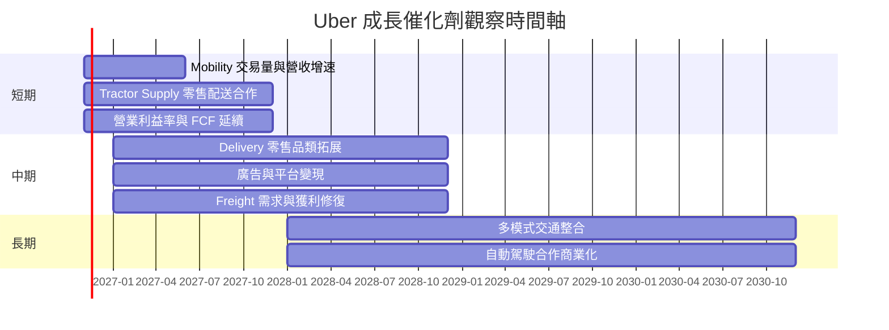

以上時間軸表示需追蹤的催化劑窗口，不是公司已公布財測或確定交付日期。

### 9.2 TAM 市場規模分析

```
╔══════════════════════════════════════════════════════════════╗
║ UBER TAM 與滲透率：資料可得性                                ║
╠══════════════════════════════════════════════════════════════╣
║ Mobility TAM       N/A（資料包未提供市場規模）               ║
║ Delivery TAM       N/A（地區與品類口徑未提供）               ║
║ Freight TAM        N/A（未提供可比市場數據）                 ║
║ 現有平台營收       TTM $56.53B（分部拆分 N/A）                ║
║ 市場滲透率         N/A                                       ║
╚══════════════════════════════════════════════════════════════╝
```

TAM 不能由總營收反推出。投資者應要求管理層提供分部 bookings、take rate、廣告收入及活躍用戶等能連結市場規模與變現率的指標。

### 9.3 成長驅動力結構圖

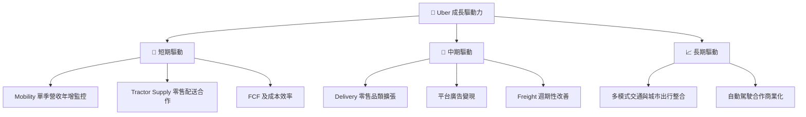

---

## 10. 風險矩陣

### 10.1 風險評分矩陣

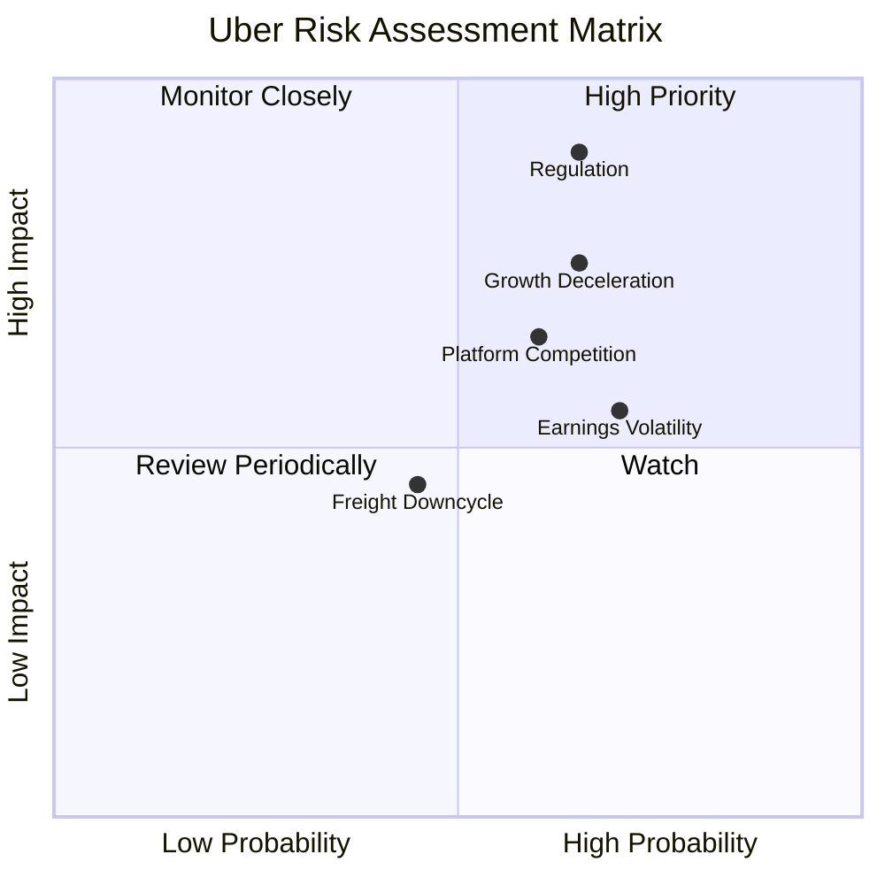

### 10.2 風險清單詳細分析

| # | 風險項目 | 發生機率 | 財務衝擊 | 風險評分 | 緩解措施 |
|---|----------|----------|----------|----------|----------|
| 1 | 🔴 司機分類與平台監管 | 中高；模型估計 30%–50% | 成本上升、營業利潤率下降；具體數字 N/A | 🔴 8.5/10 | 分散地區風險；監控法規、訴訟準備金及司機成本 |
| 2 | 🟠 成長放緩與競爭 | 中高；模型估計 35%–55% | 最新單季營收 YoY +9.6%；若跌至低個位數會壓估值 | 🟠 7.5/10 | 追蹤 bookings、留存、補貼與 take rate |
| 3 | 🟠 單季盈餘波動 | 高；歷史單季已顯示波動 | Q3 2026 淨利 YoY -92.3%；估值不應只依賴 P/E | 🟠 7.0/10 | 以 TTM FCF、營業利潤及稅前項目交叉驗證 |
| 4 | 🟡 競爭與價格補貼 | 中；模型估計 30%–45% | 可能同時壓縮增長與營業利潤率 | 🟡 6.5/10 | 監控單位經濟、司機供給及促銷強度 |
| 5 | 🟡 Freight 週期 | 中；模型估計 25%–40% | 分部收入與損益未提供，影響無法量化 | 🟡 5.0/10 | 將 Freight 與 Mobility／Delivery 分開看待 |

> 機率為分析情境估計，不是公司或監管機構公布的統計。

---

## 11. 投資建議

### 11.1 最終綜合評級雷達圖

```
╔══════════════════════════════════════════════════════════════╗
║ UBER 最終評分雷達（1–10）                                    ║
╠══════════════════════════════════════════════════════════════╣
║ 基本面       7.5  ▓▓▓▓▓▓▓▓▓▓▓▓▓▓▓░░░░░                     ║
║ 成長性       7.0  ▓▓▓▓▓▓▓▓▓▓▓▓▓▓░░░░░░                     ║
║ 獲利能力     7.5  ▓▓▓▓▓▓▓▓▓▓▓▓▓▓▓░░░░░                     ║
║ 財務健康     6.5  ▓▓▓▓▓▓▓▓▓▓▓▓▓░░░░░░░                     ║
║ 估值合理性   5.5  ▓▓▓▓▓▓▓▓▓▓▓░░░░░░░░░                     ║
║ 護城河       7.0  ▓▓▓▓▓▓▓▓▓▓▓▓▓▓░░░░░░                     ║
║ 盈餘品質     6.5  ▓▓▓▓▓▓▓▓▓▓▓▓▓░░░░░░░                     ║
╠══════════════════════════════════════════════════════════════╣
║ 綜合評分     6.8/10   🟡 持有                                ║
╚══════════════════════════════════════════════════════════════╝
```

### 11.2 目標價與隱含報酬率

| 情境 | 目標價 | 相對 $69.12 收盤價 | 機率權重 | 假設摘要 |
|------|--------|--------------------|----------|----------|
| 🔴 悲觀 | $45 | -34.9% | 25% | CAGR 7%、營業利潤率 12%、低增長終值 |
| 🟡 基準 DCF | $64.72 | -6.4% | 55%（DCF情境） | CAGR 12%、期末營業利潤率 16%、WACC 10.70% |
| 🟡 加權合理價值 | **$71.23** | **+3.1%** | 綜合估值權重 | DCF、相對倍數、FCF Yield 與共識加權 |
| 🟢 樂觀 | $105 | +51.9% | 20% | CAGR 16%、期末利潤率 18%、估值倍數擴張 |

**最終評級：🟡 持有。** 8.8 MOS 約 +3.0%，落在 -10% 至 +10% 區間；ROIC 15.6% 雖高於 WACC 10.70%，但不改變依 MOS 判定的持有評級。加權合理價值高於現價約 3.1%，不足以提供充足安全邊際；基準 DCF $64.72 低於現價，故不建議僅依分析師共識目標價作為買入依據。

### 11.3 買入時機與觸發因素

```
╔══════════════════════════════════════════════════════════════════╗
║                  ✅ 買入觸發因素 Checklist                      ║
╠══════════════════════════════════════════════════════════════════╣
║  立即重新評估條件（需多數符合）：                                ║
║  ✅ 季度營收 YoY 回升至 12% 以上，且非單靠促銷                  ║
║  ✅ TTM 營業利益率維持 12% 以上，單季不再明顯低於 TTM           ║
║  ✅ TTM FCF 維持正值且 FCF Yield 不低於 7%                     ║
║                                                                  ║
║  加碼觸發條件：                                                  ║
║  ☐ 股價低於約 $64.11，且營運假設未下修                          ║
║  ☐ ROIC 持續高於 10.70%，單位經濟性改善                         ║
║  ☐ Delivery 零售拓展顯示可持續的收入及利潤貢獻                  ║
║                                                                  ║
║  減碼／重新估值條件：                                            ║
║  ☐ 連續兩季營收 YoY 低於 8%                                     ║
║  ☐ TTM 營業利益率低於 10%或 ROIC 低於 WACC                      ║
║  ☐ TTM FCF 轉負，或監管成本造成利潤率結構性下滑                ║
╚══════════════════════════════════════════════════════════════════╝
```

買入區間採估值紀律而非預測保證：若價格回到約 $64 以下，接近基準 DCF，且核心營運指標保持穩定，風險報酬較現價改善。現價與加權合理價值差距僅約 3.1%，不構成高 MOS 買入條件。

### 11.4 投資人適配度分析

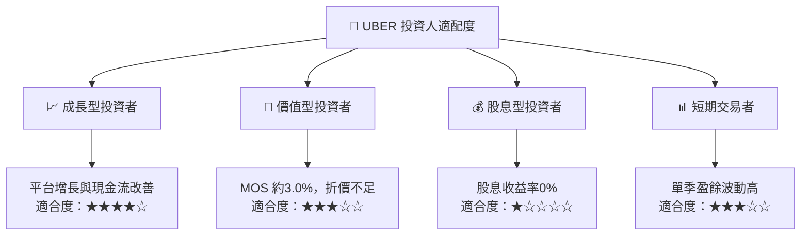

### 11.5 每季財報監控清單（Quarterly Watch List）

| 指標 | 目前基準 | 加碼／正向觸發 | 減碼／負向觸發 |
|------|----------|---------------|---------------|
| 營收成長 | TTM +13.9%；最新單季 YoY +9.6% | 單季 YoY 回升至 >12% | 連續兩季 <8% |
| 營業利益率 | TTM 12.4%；最新單季 9.8% | 單季回到 12%附近且持續 | TTM <10% |
| FCF | TTM $10.42B | TTM 維持增長、FCF Yield >7% | TTM FCF 轉負 |
| Capex | TTM $314M | Capex 增長伴隨收入／生產力改善 | Capex 上升但 FCF 下降 |
| SBC | FY2025 $1.83B，佔營收 3.5% | SBC／營收下降或股數穩定 | SBC／營收持續升高 |
| 淨負債 | VERIFIED $6.11B | 隨 FCF 下降 | 淨負債上升而 FCF 下滑 |
| ROIC | TTM 15.6% | 維持高於 WACC 10.70% | 跌破 WACC |
| EPS 預期差 | 近四季估計值缺漏 | 公布可核驗一致預期與實際值 | 連續明顯低於一致預期 |

### 11.6 反面論證：什麼會證明論點錯誤（What Would Change My Mind）

```
╔══════════════════════════════════════════════════════════════════╗
║              ⚠️ 論點失效條件（Disconfirming Evidence）           ║
╠══════════════════════════════════════════════════════════════════╣
║ 本投資論點在下列任一條件成立時應重新檢視：                      ║
║ ☐ Mobility／公司整體營收連續兩季 YoY <8%                        ║
║ ☐ TTM 營業利益率由 12.4%降至 <10%                              ║
║ ☐ TTM FCF 轉負，或 FCF Yield 持續低於 3%                       ║
║ ☐ ROIC 跌破 WACC 10.70%，代表資本回報不再覆蓋資本成本          ║
║ ☐ SBC／營收連續上升且股數稀釋加快                              ║
║ ☐ 新監管造成成本上升，使營業利益率永久低於模型 12%悲觀門檻      ║
╚══════════════════════════════════════════════════════════════════╝
```

> **免責聲明**：本報告為研究參考，不構成投資建議或買賣邀約。財務資料存在口徑差異；估值使用明示假設，投資人應以最新公司申報、管理層指引及自身風險承受度作獨立判斷。