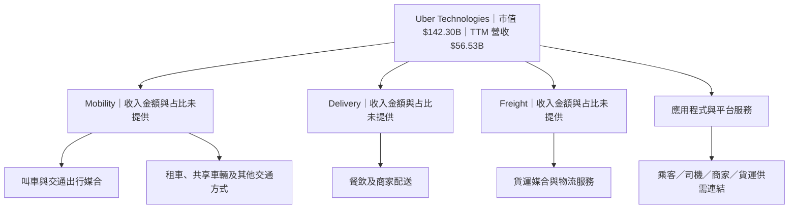
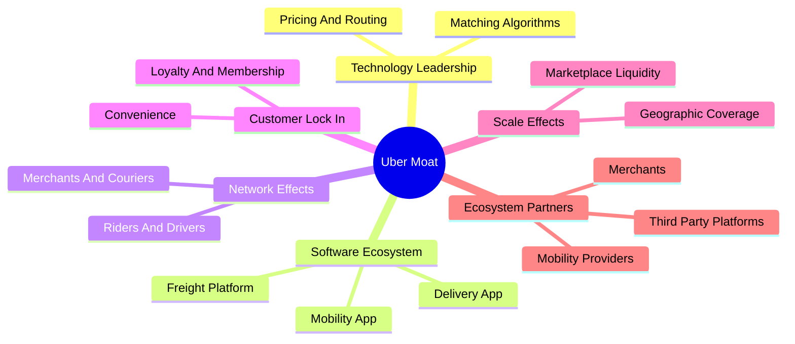
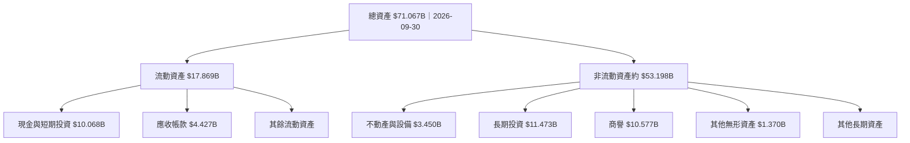
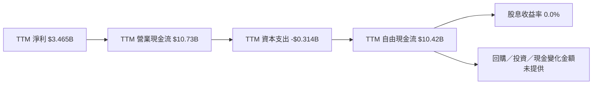
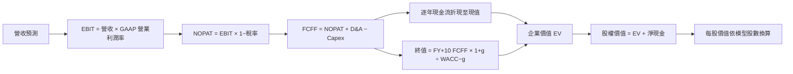
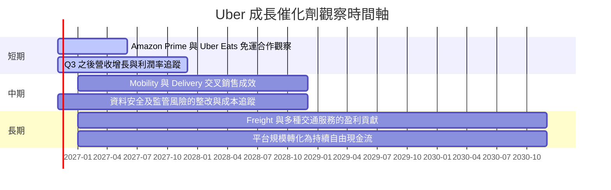
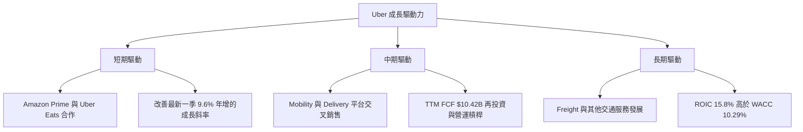
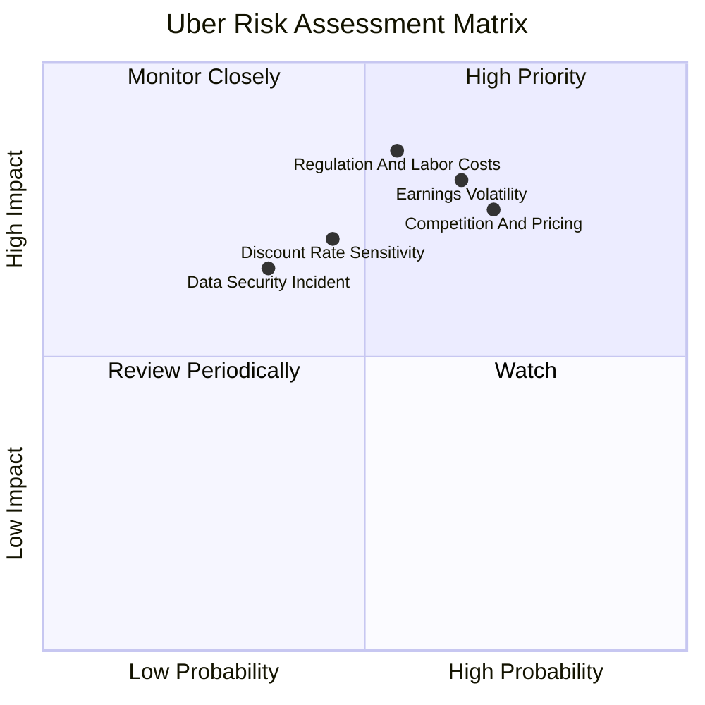
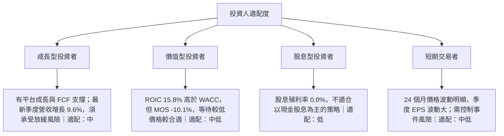

# UBER 基本面深度分析報告
> **報告日期**：2026-11-14 ｜ **語言**：繁體中文 ｜ **數據來源**：SEC 申報資料 (XBRL)、Yahoo Finance、Finviz、StockAnalysis、Roic.ai ｜ **分析師**：CFA 級機構研究

## 目錄

| # | 章節 | 核心結論 |
|---|------|----------|
| 1 | 執行摘要 | 減碼；加權合理價值 $63.31，MOS -10.1% |
| 2 | 公司概覽與商業模式 | Mobility、Delivery、Freight 多邊平台；市場份額數據未提供 |
| 3 | 損益表深度分析 | TTM 營收 $56.53B、年增 13.9%；最新一季年增 9.6% |
| 4 | 資產負債表分析 | 淨負債 $5.60B；流動性可用但並非淨現金公司 |
| 5 | 現金流量深度分析 | TTM FCF $10.42B，FCF Yield 7.32% |
| 6 | 獲利能力與資本效率 | ROIC 15.8% 高於 WACC 10.29%，創造價值 |
| 7 | 相對估值分析 | Forward P/E 低於同業中位數；估值訊號混合 |
| 8 | DCF 內在價值評估 | 基準 DCF $39.55；加權合理價值 $63.31 |
| 9 | 成長催化劑 | 配送會員合作與平台交叉銷售可能支持成長；TAM 數據未提供 |
| 10 | 風險矩陣 | 盈餘波動、監管與競爭是主要風險 |
| 11 | 投資建議 | 依 MOS 評級減碼；關注 FCF、利潤率與最新一季成長放緩 |

## 1. 執行摘要

UBER 2026-11-13 收盤價為 **$69.69**。公司 TTM 營收 **$56.53B**、年增 **13.9%**，TTM FCF **$10.42B**、FCF Yield **7.32%**，ROIC **15.8%** 高於 WACC **10.29%**；但基準 DCF 每股價值只有 **$39.55**，而 DCF、同業 Forward P/E、分析師共識三種方法加權後合理價值為 **$63.31**。依定義，MOS = **-10.1%**，符合規則 20 的**減碼**門檻；ROIC 高於 WACC 支持基本面價值創造，但估值折讓不足以抵銷現價相對加權合理價值的溢價。

### 1.0 一頁式投資儀表板（Portfolio Manager 30 秒速讀）

| 項目 | 內容 |
|------|------|
| **投資論點（3 句）** | ① TTM 營收年增 **13.9%**，但最新一季年增放緩至 **9.6%**，成長仍正向、動能較前期降溫。② TTM FCF **$10.42B**、FCF Yield **7.32%**，現金生成能力提供估值支撐。③ ROIC **15.8%** 高於 WACC **10.29%**，但加權合理價值 **$63.31** 低於現價 **$69.69**。 |
| **綜合評分** | **6.3/10**（引用 1.1 評分卡） |
| **財務健康** | 🟡 有流動性緩衝：現金及短期投資 **$10.07B**，總債務 **$15.66B**，淨負債 **$5.60B**；流動比率 **1.232**。 |
| **ROIC vs WACC** | **15.8% vs 10.29%**；利差 **5.51 個百分點**，目前創造股東價值。 |
| **FCF 趨勢** | 2022–2025 年度 FCF 從 **$0.39B** 升至 **$9.76B**；TTM FCF **$10.42B**，FCF Yield **7.32%**。 |
| **估值** | Forward P/E **15.9x** ｜ EV/EBITDA **19.0x**（歷史估值資料）｜ FCF Yield **7.32%** |
| **DCF 內在價值（基準）** | **$39.55** ｜相對現價折溢價 **+76.2% 溢價**（以 DCF 基準值計） |
| **安全邊際（MOS）** | **-10.1%**＝($63.31 − $69.69) ÷ $63.31；🔴 <10% 無安全邊際 |
| **預期報酬（基準情境 12M）** | DCF 基準情境相對現價 **-43.2%**；這是模型情境值，不是管理層財測。 |
| **關鍵風險（前二）** | 盈餘與稅務／非營業項目波動；平台競爭及各地監管成本。 |
| **評級 + 信心度** | 🔴 **減碼** ｜ 信心：中（估值方法差距大，且季度 EPS 預期值未提供） |

### 1.1 綜合評分卡（全報告唯一）

| 維度 | 評分（1–10） | 主要依據（引用數字與其來源章節） |
|------|--------------|----------------------------------|
| 成長性 | 7.5 | TTM 營收年增 **13.9%**，最新一季年增 **9.6%**，仍成長但季度動能減速（第 3 章）。 |
| 獲利能力 | 7.0 | TTM 營業利益率 **12.4%**，ROIC **15.8%** 高於 WACC **10.29%**；F-Score **6/8**（第 6 章）。 |
| 財務健康 | 6.0 | 淨負債 **$5.60B**、流動比率 **1.232**、速動比率 **0.999**（第 4 章）。 |
| 估值 | 4.0 | MOS **-10.1%**；現價高於 DCF 基準價 **$39.55**，但 Forward P/E 低於同業中位數（第 7–8 章）。 |
| 護城河 | 7.0 | 多邊平台連結乘客、司機、商家與配送網絡；細分業務收入占比與份額未提供，故不將平台規模直接等同定價權（第 2 章）。 |
| 管理層與資本配置 | 6.0 | 2025 年 FCF **$9.76B**、SBC **$1.83B**；稀釋股數測試通過，但回購與逐年股數完整歷史資料不足（第 3、5 章）。 |
| **綜合評分** | **6.3** | 六項算術平均：**(7.5 + 7.0 + 6.0 + 4.0 + 7.0 + 6.0) ÷ 6 = 6.25 ≈ 6.3** |

### 1.2 五大投資論點 + 三大核心風險

| 類型 | 項目 | 具體依據 | 信心度 |
|------|------|----------|--------|
| 🟢 **投資論點①** | 現金生成支撐估值 | TTM 營業現金流 **$10.73B**，扣除資本支出 **$0.314B** 後，TTM FCF **$10.42B**；FCF Yield **7.32%**。 | 🟢 高 |
| 🟢 **投資論點②** | ROIC 高於資本成本 | ROIC **15.8%**、WACC **10.29%**，利差 **5.51 個百分點**；若能維持，新增投資可增加經濟價值。 | 🟢 高 |
| 🟢 **投資論點③** | 平台仍有營收成長 | TTM 營收年增 **13.9%**，2025 年營收 **$52.02B**，高於 2024 年 **$43.98B**。 | 🟢 中高 |
| 🟢 **投資論點④** | 可透過平台交叉銷售 | Mobility、Delivery、Freight 同屬應用程式平台；Amazon Prime 與 Uber Eats 的免運合作已出現在近期新聞，可能刺激訂單，但增量未量化。 | 🟡 中 |
| 🟢 **投資論點⑤** | 近期負債仍有現金覆蓋 | 現金及短期投資 **$10.07B**，總債務 **$15.66B**；淨負債 **$5.60B**，流動比率 **1.232**。 | 🟡 中 |
| 🟡 **風險①** | 季度獲利波動 | 2026 Q3 淨利 **$0.512B**，EPS **$0.25**；季度 EPS 年增 **-92.0%**。與前一年高比較基期差異可能放大波動。 | 🔴 高衝擊 |
| 🔴 **風險②** | 估值高於加權合理價值 | 現價 **$69.69**，加權合理價值 **$63.31**，MOS **-10.1%**；基準 DCF **$39.55**。 | 🔴 高 |
| 🟡 **風險③** | 監管、資料與平台競爭 | 新聞列出第三方資料外洩事件；平台又需面對外送與叫車競爭、勞動分類與合規成本，財務衝擊尚無量化資料。 | 🟡 中高 |

### 1.3 快速統計卡片

| 指標 | 公司實際值（期間） | 同業中位數 | 狀態 |
|------|--------------------|------------|------|
| 營收成長（TTM） | **13.9%** | — | 🟢 |
| 營收成長（最新一季年增） | **9.6%** | **27.4%** | 🔴 |
| 毛利率（TTM） | **41.4%** | **41.4%** | 🟡 |
| 營業利益率（TTM） | **12.4%** | — | 🟢 |
| ROIC（TTM） | **15.8%** | — | 🟢 |
| Forward P/E | **15.9x** | **20.6x** | 🟢 |
| FCF Yield（TTM） | **7.32%** | — | 🟢 |
| Piotroski F-Score | **6 / 8** | — | 🟢 |

同業中位數依 LYFT、DASH、GRAB 的 Peer multiples 計算；同業營收成長與毛利率為最新提供數值的中位數。

### 1.4 投資結論

```
╔══════════════════════════════════════════════════════════════════╗
║                    📊 投資結論摘要                               ║
╠══════════════════════════════════════════════════════════════════╣
║  評級：🔴 減碼（MOS -10.1%，依規則 20）                          ║
║  價格（2026-11-13 收盤）：$69.69                                 ║
║  DCF 內在價值（基準）：$39.55（現價溢價 +76.2%）                 ║
║  安全邊際 MOS：-10.1%（以加權合理價值 $63.31 為分母）            ║
║  加權合理價值（8.8）：$63.31                                     ║
║  DCF 情境價值：                                                   ║
║    悲觀情境：$22.49（-67.7%）                                    ║
║    基準情境：$39.55（-43.2%）                                    ║
║    樂觀情境：$65.79（-5.6%）                                     ║
║  綜合評分：6.3/10（引用 1.1）                                    ║
║  適合投資人：能承受平台競爭及估值波動、重視長期 FCF 成長者       ║
╚══════════════════════════════════════════════════════════════════╝
```

## 2. 公司概覽與商業模式

### 2.1 業務結構與收入來源

公司資料顯示 Uber Technologies, Inc. 經營 Mobility、Delivery、Freight 三個部門，覆蓋美洲、歐洲、中東、非洲及亞太地區。分部營收與營收占比沒有可用數據，因此不以估算比例繪製分部收入圖；可確認的公司層級錨點為 TTM 營收 **$56.53B**、市值 **$142.30B**。



### 2.2 市場份額

**市場份額數據未提供**，因此不繪製份額圖或推估市占率。從公司規模看，Uber TTM 營收為 **$56.53B**，TTM 年增 **13.9%**；最新一季年增 **9.6%**，低於 LYFT、DASH、GRAB 最新一季年增率的中位數 **27.4%**。這反映公司營收規模大，但近期增速並非同業組中最快。

### 2.3 競爭護城河分析



### 2.4 護城河強度

| 護城河項目 | 強度（強／中／弱） | 證據（引用數字或事實） | 會削弱它的情況 |
|------------|--------------------|------------------------|----------------|
| 技術與媒合效率 | 中 | 公司以專有應用程式媒合多種交通與配送服務；但沒有媒合效率、單位成本或技術投入回報數據。 | 競爭者補貼、演算法差異縮小、資料安全事件。 |
| 軟體生態系統 | 中 | Mobility、Delivery、Freight 共用平台能力；TTM 營收 **$56.53B**。缺少分部收入及交叉銷售率，難以量化綜效。 | 使用者只使用單一服務、平台費率受壓。 |
| 網路效應 | 中至強 | 乘客／司機與商家／配送員供需雙邊匹配具網路效應邏輯，但活躍用戶、行程數及市占率未提供。 | 競爭平台在主要市場形成更高供需密度。 |
| 客戶鎖定 | 弱至中 | 近期有 Amazon Prime 與 Uber Eats 合作消息；沒有會員留存、轉換率或訂單頻次資料。 | 消費者對價格敏感、訂閱利益被競爭者複製。 |
| 規模效應 | 中 | FY2025 營收 **$52.02B**，具跨市場營運規模；是否轉化成更低成本需更多分部資料。 | 監管要求各地化營運、規模增加未提升單位經濟性。 |
| 生態夥伴 | 中 | 資料列出第三方平台合作新聞；目前無法量化合作帶來的營收或新增客戶。 | 夥伴改與競爭者合作，或合作條款稀釋平台收益。 |

1.1 的護城河評分為 **7.0/10**：多邊平台和營運規模提供結構性優勢，但市占、留存與分部收入等量化證據不足，未評為更高。

## 3. 損益表深度分析

### 3.1 年度收入成長趨勢（近 4 年）

以下年度收入取自 SEC 申報資料交叉整理的年度表；年度營收 CAGR 以 FY2022 至 FY2025 三個年度間隔計算。

```
╔══════════════════════════════════════════════════════════════════╗
║              Uber 年度收入趨勢（FY2022–FY2025）                  ║
╠══════════════════════════════════════════════════════════════════╣
║  FY2022  $31.88B  ███████████████░░░░░░░░░░░░░  YoY：基期       ║
║  FY2023  $37.28B  ██████████████████░░░░░░░░░░  YoY：+16.9% 🟢  ║
║  FY2024  $43.98B  ██████████████████████░░░░░  YoY：+18.0% 🟢  ║
║  FY2025  $52.02B  ██████████████████████████░░  YoY：+18.3% 🟢  ║
╠══════════════════════════════════════════════════════════════════╣
║  FY2022–FY2025 營收 CAGR：(52.02 ÷ 31.88)^(1/3) − 1 ≈ 17.7%    ║
╚══════════════════════════════════════════════════════════════════╝
```

FY2025 營收成長 **18.3%**，顯示年度收入仍在擴大；但 TTM 增長 **13.9%**、最新一季年增 **9.6%**，低於前幾年年度增速，代表近期成長斜率已放緩。未提供各分部營收，無法把放緩精確拆解為 Mobility、Delivery 或 Freight 的貢獻。

### 3.2 季度收入趨勢分析

QoQ 為相鄰季度收入變化；YoY 採各季資料與去年同季比較。2025 Q4 同比率來自季度資料表；2026 Q1–Q3 同比亦有 StockAnalysis 列示。

| 季度 | 營收（$B） | QoQ | YoY | 備註 |
|------|------------:|----:|----:|------|
| 2025 Q4 | 14.37 | — | 20.1% | 本表季度序列起點，無前季可比欄。 |
| 2026 Q1 | 13.20 | -8.1% | 14.5% | 季節性回落；同比仍高於最新一季。 |
| 2026 Q2 | 14.19 | +7.5% | 12.2% | QoQ 回升，但同比減速。 |
| 2026 Q3 | 14.77 | +4.1% | 9.6% | 營收創本表季度高點，但 YoY 持續放緩。 |

QoQ 計算例：2026 Q3 **(14.77 ÷ 14.19) − 1 = 4.1%**。季度年增從 2025 Q4 的 **20.1%** 逐步降至 2026 Q3 的 **9.6%**，須確認這是比較基期正常化，還是訂單、定價或市場滲透出現結構性降速。

### 3.3 利潤率演變分析

年度毛利率以年度毛利除以年度營收計算；營業利益率以年度營業利益除以年度營收計算。年度財務表不同資料來源有小幅差異，以下採公司年度損益表所列金額；最新 TTM 與季度營業利益率則使用 SEC／已核對的期間指標。

| 利潤率指標 | FY2022 | FY2023 | FY2024 | FY2025 | 趨勢 | 評估 |
|------------|--------|--------|--------|--------|------|------|
| **毛利率** | 38.3% | 39.8% | 39.4% | 39.7% | 小幅改善後大致持平 | 🟡 |
| **營業利益率** | -5.7% | 3.0% | 6.4% | 10.7% | 持續擴張 | 🟢 |
| **淨利率** | -28.7% | 5.1% | 22.4% | 19.3% | 2024–25 仍受營業外／稅務影響 | 🟡 |

**利潤率演變深度解析：** FY2022 至 FY2025 營業利益率由 **-5.7%** 升至 **10.7%**，反映收入擴大後的營運槓桿、費用控制及盈利模式成熟；TTM 營業利益率為 **12.4%**，高於 FY2025。反面是最新一季營業利益率為 **9.8%**，低於 TTM，顯示單季利潤率並未同步維持 TTM 高點。毛利率近四年約 **38%–40%**，營業利潤率改善主要不應簡化成毛利率上升，較可能與毛利以下費用管理和營收規模效應有關；各成本科目細項不足，無法量化各因素貢獻。

### 3.4 費用結構分析

SEC 損益表資料提供年度研發費用：2022 **$2.80B**、2023 **$3.16B**、2024 **$3.11B**、2025 **$3.40B**。但未提供足以完整分解銷售、行銷、一般行政、保險及其他營業費用的同口徑數據，因此不繪製會造成比例失真的費用圓餅圖。2025 研發費用約占營收 **6.5%**（$3.40B ÷ $52.02B），顯示平台仍需持續投入產品與技術；但研發費用本身不能直接推論其投資回報。

### 3.5 季度 EPS 趨勢與盈餘品質（Quality of Earnings）

最近四季 EPS 實際值引用 StockAnalysis 的季度列示。市場 EPS 預估值為 `nan`，因此不能判定超預期或不及預期；新聞中的分析師目標價及評級不是季度 EPS 預估數據。

| 季度 | EPS 實際 | EPS 年增 | 超預期／不及預期 |
|------|---------:|--------:|----------------|
| 2025 Q4 | $0.14 | -95.6% | 預估值缺漏，無法判定 |
| 2026 Q1 | $0.13 | -84.6% | 預估值缺漏，無法判定 |
| 2026 Q2 | $1.17 | +85.5% | 預估值缺漏，無法判定 |
| 2026 Q3 | $0.25 | -92.0% | 預估值缺漏，無法判定 |

| 盈餘品質項目 | 數值／佔比 | 評估 |
|--------------|------------|------|
| 股權薪酬 SBC / 營收 | TTM SBC 約 **$2.065B**；約 **3.7%** | 🟡 SBC 是真實股東成本；公司 F-Score 的稀釋股數測試通過，但 SBC 仍會稀釋經濟報酬或須以費用形式吸收。 |
| SBC / 營業現金流 | 約 **19.3%**（$2.065B ÷ $10.73B） | 🟡 比重不可忽略；營業現金流包括非現金 SBC 加回，不能把全部 OCF 視為股東可自由分配收益。 |
| FCF / 淨利（現金轉換率） | 約 **300.7%**（TTM FCF $10.42B ÷ TTM 淨利 $3.465B） | 🟢 現金轉換高；但季度淨利波動大，分母受特殊項目與稅務影響，不能只憑此比率判定經常性盈餘品質。 |
| 一次性／非經常性損益 | 2025 淨利 **$10.05B**，營業利益 **$5.57B**；詳細拆分 N/A | 🟡 淨利顯著高於營業利益，顯示非營業項目、稅項等可能重要；無明細不可將差額全部視為一次性收益。 |
| 有效稅率異常 | N/A（未提供 TTM 稅前淨利與稅費的可核對明細） | 🟡 不能判斷季度 EPS 大幅變動是否由稅務利益帶動。 |
| 資本化支出 vs 費用化 | TTM Capex **$0.314B**；資本化政策與資本化軟體明細 N/A | 🟡 Capex 相對營收低，但不能由此推論所有技術成本均已費用化或不存在遞延成本。 |

**盈餘品質結論：** TTM FCF **$10.42B**、高於 TTM 淨利 **$3.465B**，現金生成含金量有支撐；同時 SBC 約占營收 **3.7%**、約占 OCF **19.3%**，需要把它視為股東成本。年度淨利與季度 EPS 波動大，評估本益比時應優先檢視經常性營業獲利與現金流，避免把單一期間淨利直接年化。

## 4. 資產負債表分析

### 4.1 資產結構分解

截至 2026-09-30，StockAnalysis 列示總資產 **$71.067B**、流動資產 **$17.869B**；其中現金與短期投資 **$10.068B**。下圖僅呈現有數字的主要資產項目，不代表完整分項加總。



### 4.2 流動性與營運資金分析

| 指標 | 2022 | 2023 | 2024 | 2025 | 最新資料 | 評估 |
|------|------:|------:|------:|------:|---------:|------|
| 流動比率 | 1.05x | 1.20x | 1.07x | 1.14x | **1.232x** | 🟡 最新流動資產高於流動負債，但速動比率僅 **0.999**。 |
| 速動比率 | N/A | N/A | N/A | N/A | **0.999x** | 🟡 幾乎等於 1，短期流動性不算寬裕。 |

年度流動比率用流動資產 ÷ 流動負債計算；最新值直接引用來源數據。營運資金天數依品質指標列示，不自行補算缺漏項目：

| 指標 | 最新 TTM | 一年前 TTM | 變化 | 解讀 |
|------|----------|------------|------|------|
| DSO 應收帳款天數 | **29 天** | **28 天** | **+1 天** | 🟡 略有延長，可能代表收款週期小幅變慢；單一年數差異不宜過度解讀。 |
| DIO 存貨天數 | **N/A** | **N/A** | N/A | 公司未報告此類存貨餘額，不填補。 |
| DPO 應付帳款天數 | **17 天** | **N/A** | N/A | 一年前缺少可用值，不能據此判斷供應商付款條件變化。 |
| CCC 現金轉換週期 | **N/A** | **N/A** | N/A | DIO 缺漏，按定義無法算出 CCC。 |

### 4.3 債務結構分析

不同市場資料欄位對總債務及淨負債有不一致列示；本報告採 SEC 10-Q 核對後的最新核心指標：現金及短期投資 **$10.07B**、總債務 **$15.66B**、淨負債 **$5.60B**。不混用另一個市場快照的總債務 **$17.74B**。

```
╔══════════════════════════════════════════════════════════════════╗
║                   Uber 債務健康診斷                              ║
╠══════════════════════════════════════════════════════════════════╣
║  總債務：        $15.66B  ████████████████████  🟡             ║
║  現金+短期投資： $10.07B  █████████████░░░░░░░  🟢             ║
║  淨負債：         $5.60B  ███████░░░░░░░░░░░░░  🟡             ║
║                                                                  ║
║  流動比率：       1.232x  🟡                                     ║
║  速動比率：       0.999x  🟡                                     ║
║  Debt/EBITDA：    N/A（未提供同口徑 EBITDA 與債務細項）         ║
║  利息保障倍數：   N/A（未提供可核對利息費用）                    ║
╚══════════════════════════════════════════════════════════════════╝
```

淨負債不是目前最大的資產負債表弱點，但速動比率接近 **1.0**，且不可忽略平台保險、訴訟、營運與資本承諾可能造成的現金需求。

### 4.4 股東權益趨勢

| 年度 | 股東權益（$B） | 年增（約） |
|------|---------------:|-----------:|
| 2022 | 7.34 | — |
| 2023 | 11.25 | +53.3% |
| 2024 | 21.56 | +91.6% |
| 2025 | 27.04 | +25.4% |

```
╔══════════════════════════════════════════════════════════════════╗
║                 股東權益變化（年度，$B）                         ║
╠══════════════════════════════════════════════════════════════════╣
║  2022  $7.34B   █████░░░░░░░░░░░░░░░░░░                         ║
║  2023  $11.25B  █████████░░░░░░░░░░░░░                         ║
║  2024  $21.56B  █████████████████░░░░░                         ║
║  2025  $27.04B  █████████████████████░                         ║
╚══════════════════════════════════════════════════════════════════╝
```

權益增加與近年獲利改善一致；但權益變化也可能受累計其他綜合損益、股權薪酬與投資估值影響，不能單靠權益增加判定每股價值同步上升。

## 5. 現金流量深度分析

### 5.1 現金流量瀑布圖

股息收益率為 **0.0%**；資料未提供同期回購金額及現金變動的完整 TTM 橋接，因此將這些用途列為未量化，不繪製虛構數值。



FCF = 營業現金流 − 資本支出；代入 **$10.73B − $0.314B = $10.416B**，按來源四捨五入為 **$10.42B**。營業現金流高於淨利，表示現金轉換強，但其中包含非現金項目與營運資金變動，需持續檢查其可持續性。

### 5.2 FCF 轉換率趨勢

| 年度 | FCF（$B） | 淨利（$B） | FCF／淨利 | 解讀 |
|------|----------:|-----------:|----------:|------|
| 2022 | 0.39 | -9.14 | -4.3% | 分母為負，比例不適合做經常性轉換率比較；FCF 仍為正。 |
| 2023 | 3.36 | 1.89 | 178.1% | 現金流高於帳面淨利。 |
| 2024 | 6.89 | 9.86 | 69.9% | 淨利高於 FCF，需留意非現金或非營業項目。 |
| 2025 | 9.76 | 10.05 | 97.1% | FCF 接近淨利。 |
| TTM | 10.42 | 3.465 | 300.7% | 淨利受季度波動影響，比例高不代表每期可維持。 |

### 5.3 自由現金流趨勢

| 期間 | FCF（$B） | YoY | FCF Yield |
|------|----------:|----:|----------:|
| 2022 | 0.39 | — | N/A |
| 2023 | 3.36 | +761.5% | N/A |
| 2024 | 6.89 | +105.1% | N/A |
| 2025 | 9.76 | +41.6% | N/A |
| TTM | **10.42** | — | **7.32%** |

```
╔══════════════════════════════════════════════════════════════════╗
║                 自由現金流趨勢（年度，$B）                       ║
╠══════════════════════════════════════════════════════════════════╣
║  2022  $0.39B   █░░░░░░░░░░░░░░░░░░░░░░░                       ║
║  2023  $3.36B   ███████░░░░░░░░░░░░░░░░                         ║
║  2024  $6.89B   ██████████████░░░░░░░░                         ║
║  2025  $9.76B   ████████████████████░░                         ║
║  TTM   $10.42B  █████████████████████░                         ║
║  TTM FCF Yield：7.32%                                            ║
╚══════════════════════════════════════════════════════════════════╝
```

### 5.4 資本配置評估

資本配置的回購、收購、留存現金與股息詳細金額未提供，故不繪製資本配置圓餅圖。

| 資本配置項目 | 可用數據 | 評估 |
|--------------|----------|------|
| 資本支出 | TTM **$0.314B**；2025 年 **$0.336B** | 🟢 相對營收規模低，但不代表平台未承擔其他營運投資。 |
| 股息 | 殖利率 **0.0%** | 🟡 無股息收益，報酬主要依賴股價與企業價值成長。 |
| 回購 | 金額 N/A | 無法判定回購是否抵銷 SBC。 |
| 研發 | FY2025 **$3.40B** | 持續投入平台與產品，但回報指標未提供。 |
| 留存／其他投資 | N/A | 缺少完整現金用途明細。 |

## 6. 獲利能力與資本效率

### 6.1 ROE／ROA／ROIC 趨勢

歷史 ROE、ROA、ROIC 的一致口徑序列未完整提供，依規則不自行補出整段歷史比率。

| 指標 | 可用期間與數值 | 評估 |
|------|----------------|------|
| ROE | TTM **12.5%**（品質指標杜邦列示）；其他資料列示 **12.3%**，來源口徑略異 | 🟡 有獲利能力，但需考慮權益乘數。 |
| ROA | TTM **6.5%**（市場資料列示） | 🟡 正值；未提供一致歷史序列。 |
| ROIC | TTM **15.8%** | 🟢 高於 WACC **10.29%**。 |
| 行業均值 | N/A（無可引用同口徑數據） | 不作行業均值比較。 |

### 6.2 ROIC vs WACC 分析（核心價值創造判斷）

WACC 與 ROIC 使用同一套公司資本成本數據。Beta 按調整後 **1.21**；股權與債務權重為 **90.1%／9.9%**。以下 WACC 採用資本成本資料所列 **10.29%**，不另建替代 WACC。

```
╔══════════════════════════════════════════════════════════════════╗
║                ROIC vs WACC 深度分析                            ║
╠══════════════════════════════════════════════════════════════════╣
║  WACC 組成（採公司資本成本資料）：                               ║
║  ├── 無風險利率（10Y 美債）：                  5.15%             ║
║  ├── 市場風險溢酬 ERP：                       5.00%             ║
║  ├── 原始 Beta：                               1.31              ║
║  ├── 調整後 Beta：                             1.21              ║
║  ├── 股權成本 Ke（提供值）：                  11.18%             ║
║  ├── 稅前債務成本：                            2.81%             ║
║  ├── 稅率：                                   21.0%             ║
║  ├── 稅後債務成本：2.81% × (1−21%) =           2.22%             ║
║  ├── 資本結構：股權 90.1%，債務 9.9%                             ║
║  └── WACC：0.901×11.18% + 0.099×2.22% =        10.29%            ║
║                                                                  ║
║  ROIC（TTM，直接引用）：                         15.8%            ║
║  ROIC − WACC = 15.8% − 10.29% =                 +5.51pp          ║
║                                                                  ║
║  ROIC  15.8%  ▓▓▓▓▓▓▓▓▓▓▓▓▓▓▓▓▓▓▓▓▓▓▓▓░░░░  🟢              ║
║  WACC  10.29% ▓▓▓▓▓▓▓▓▓▓▓▓▓▓▓▓░░░░░░░░░░░  ──              ║
║  EVA 差額 +5.51pp：目前高於資本成本，創造經濟價值             ║
╚══════════════════════════════════════════════════════════════════╝
```

**逐步演算：**
1. 調整後 Beta = **⅔ × 1.31 + ⅓ = 1.21**（按指定的調整 Beta 引用）。
2. 股權成本 CAPM 公式為 **Rf + β × ERP**；公司資本成本資料提供 Ke **11.18%**。所列輸入按兩位小數直接代入可得 **5.15% + 1.21 × 5.00% = 11.20%**，與提供的 11.18% 有 **0.02 個百分點**差異，屬輸入精度／底層數值未公開所致；本報告遵循規則採用提供的 Ke **11.18%**，不替換為重算值。
3. 稅後債務成本 = **2.81% × (1 − 21.0%) = 2.2199% ≈ 2.22%**。
4. WACC = **90.1% × 11.18% + 9.9% × 2.22% = 10.0712% + 0.2198% = 10.2910% ≈ 10.29%**。
5. ROIC 利差 = **15.8% − 10.29% = 5.51 個百分點**。利差為正代表當前資本投入創造價值；若競爭、法規成本或保險成本壓低營業回報，利差可能收窄。

### 6.3 杜邦三因素分解

| 因素 | 數值（TTM） | 解讀 |
|------|-------------|------|
| 淨利率 | **6.1%** | 獲利率支持 ROE，但年度及季度淨利波動提醒需看經常性營業成果。 |
| 資產週轉率 | **0.80x** | 每一美元資產產生約 $0.80 營收。 |
| 權益乘數 | **2.57x** | 槓桿對 ROE 有放大效果，但 ROE 並非完全由淨利率單獨驅動。 |
| **ROE** | **12.5%** | **6.1% × 0.80 × 2.57 = 12.5%**（照品質指標列示）。 |

### 6.4 財務體質：Piotroski F-Score

Piotroski F-Score 為 **6 / 8**。有一項測試缺少輸入，原始測試項目共九項，但有效計分分母為八項；不將缺資料項目視為通過或失敗。

| 測試 | 結果 | 解讀 |
|------|------|------|
| ROA > 0 | ✅ 通過 | TTM 資產回報為正。 |
| 營業現金流 > 0 | ✅ 通過 | TTM OCF **$10.73B**。 |
| ROA 高於一年前 | ❌ 未通過 | 資產報酬未改善，需追蹤營收轉化效率。 |
| 營業現金流 > 淨利（應計品質） | ✅ 通過 | OCF 高於淨利，現金轉換支持盈餘。 |
| 長期負債 ÷ 總資產低於一年前 | ❌ 未通過 | 相對負債指標未改善。 |
| 流動比率高於一年前 | ✅ 通過 | 流動性指標同比改善。 |
| 稀釋股數未增加 | ✅ 通過 | 期間測試通過；仍須留意 SBC 經濟成本。 |
| 毛利率高於一年前 | — 無法判定 | 缺少可比較輸入，不計入分母。 |
| 資產週轉率高於一年前 | ✅ 通過 | 資產使用效率同比改善。 |

## 7. 相對估值分析

### 7.1 同業估值比較表格

倍數依 Yahoo Finance Peer multiples。公司 Forward P/E 使用估值資料；同業中位數以 LYFT、DASH、GRAB 三家所列倍數計算。EV/EBITDA 的 LYFT 數值極高，故中位數受另外兩家影響但仍應注意盈利口徑差異。

| 估值指標 | **UBER** | **LYFT** | **DASH** | **GRAB** | UBER 評估 |
|----------|---------:|---------:|---------:|--------:|-----------|
| **Trailing P/E** | **40.8x** | 2.5x | 71.2x | 32.4x | 🟡 同業中位數 **32.4x**；公司溢價約 25.9%，盈利品質與基期可能不同。 |
| **Forward P/E** | **15.9x** | 8.1x | 22.5x | 20.6x | 🟢 同業中位數 **20.6x**；UBER 約折價 22.8%，前提是 Forward EPS 可實現。 |
| **P/S Ratio** | **2.5x** | 0.9x | 4.4x | 3.3x | 🟡 同業中位數 **3.3x**；低於中位數，但 P/S 不直接反映獲利品質。 |
| **EV/EBITDA** | **19.3x**（市場快照） | 565.3x | 42.2x | 21.9x | 🟡 同業中位數 **42.2x**；UBER 倍數較低，但 Peer EBITDA 可比性有限。 |
| **最新一季營收年增** | **9.6%** | 8.1% | 34.0% | 27.4% | 🔴 UBER 低於同業中位數 **27.4%**，反映近期成長動能相對慢。 |
| **毛利率（TTM）** | **41.4%** | 40.0% | 52.7% | 41.4% | 🟡 同業中位數 **41.4%**，接近中位數。 |

不同資料欄的 EV/EBITDA 有 **19.0x**（自身歷史估值系列）及 **19.3x**（市場快照）兩個值；本表採用同業比較欄位對應的市場快照 **19.3x**，第 7.2 節則引用歷史系列 **19.0x**。

### 7.2 歷史估值區間分析

```
╔══════════════════════════════════════════════════════════════════╗
║            UBER 歷史估值位置（5 年 TTM 倍數）                    ║
╠══════════════════════════════════════════════════════════════════╣
║ P/E：       12.6x ───── 中位數 17.8x ───── 現值 40.8x ── 122.2x║
║                                         百分位：69%              ║
║ P/S：        1.5x ───── 現值 2.5x ─── 中位數 3.3x ───── 6.1x  ║
║                                         百分位：24%              ║
║ EV/EBITDA： 18.7x ─ 現值 19.0x ───── 中位數 40.0x ─── 320.2x║
║                                         百分位：7%               ║
╚══════════════════════════════════════════════════════════════════╝
```

歷史位置呈現分歧：P/E 在自身五年區間第 **69 百分位**，高於中位數；P/S 第 **24 百分位**，EV/EBITDA 第 **7 百分位**，處於較低位置。由於歷史期間涵蓋盈利轉正及倍數極端波動，不能單以某一個低百分位推論便宜。

### 7.3 情境價值（Bear / Base / Bull）

| 情境 | 第 1 年營收成長 | 期末營業利潤率 | WACC | 每股價值 | 相對現價 | 機率 | 會發生的條件 |
|------|----------------:|----------------:|-----:|---------:|---------:|-----:|--------------|
| 🔴 悲觀 | 7.0% | 5.4% | 11.29% | **$22.49** | -67.7% | 25% | Mobility 與 Delivery 成長放慢、競爭或監管成本壓低期末利潤率，資本成本上升。 |
| 🟡 基準 | 13.9% | 6.4% | 10.29% | **$39.55** | -43.2% | 50% | 初期營收延續 TTM 增速後逐年放緩，營業利潤率回落至近五年中位附近。 |
| 🟢 樂觀 | 20.9% | 7.0% | 9.29% | **$65.79** | -5.6% | 25% | 平台交叉銷售與增長高於基準、期末利潤率較高且資本成本下降。 |

### 7.4 相對估值隱含價格區間

```
╔══════════════════════════════════════════════════════════════════╗
║           相對估值方法每股價值與現價位置（美元）                 ║
╠══════════════════════════════════════════════════════════════════╣
║ DCF 基準             $39.55 ──────────────┐                     ║
║ 現價                  $69.69 ──────────────────────●             ║
║ 同業 Forward P/E      $90.48 ───────────────────────────        ║
║ 分析師共識目標價      $98.88 ─────────────────────────────      ║
╠══════════════════════════════════════════════════════════════════╣
║ Forward P/E：同業中位數 20.6x × 公司 Forward EPS $4.38 = $90.48║
║ 共識：46 位分析師平均目標價 = $98.88                             ║
╚══════════════════════════════════════════════════════════════════╝
```

同業 Forward P/E 估值使用 LYFT、DASH、GRAB 同業中位數 **20.6x**，乘以 UBER Forward EPS **$4.38**，得到每股 **$90.48**。分析師共識平均目標價 **$98.88**，但其分布為 **$70–$150**，分歧及假設風險較大，不能視為確定內在價值。

## 8. DCF 內在價值評估（Discounted Cash Flow）

> 本章逐年數據、DCF 敏感度與情境均依公司 DCF 模型列示。模型的數值採其未四捨五入底層輸入；表格金額以 $B 為單位取兩位小數、比率取一位小數或依資料精度列示、折現因子取三位小數。使用已四捨五入欄位重算時，允許因中間值精度產生尾差。

### 8.0 估值推理鏈（Thinking Logic：在算之前先想清楚）

**Step 1 — 價值由哪些變數決定？**  
模型將價值拆成現有平台營收與現金流底盤、Mobility／Delivery／Freight 的後續成長，以及新合作或平台功能的潛在選擇權。可量化的起點為 TTM 總營收 **$56.53B**；各分部收入占比未提供，因此不能把任何一個業務的營收占比或選擇權價值單獨量化。敏感度矩陣顯示折現率與永續成長率對每股價值有顯著影響；營運假設中，長期利潤率及成長路徑同樣關鍵。

**Step 2 — 模型選擇**

| 決策點 | 本報告採用 | 理由（含數字） | 曾考慮但否決 | 否決理由 |
|--------|-----------|----------------|--------------|----------|
| 現金流定義 | FCFF | 以 WACC **10.29%** 折現，先得企業價值，再橋接股權價值。 | FCFE | 資本結構已由 WACC 權重反映，FCFF 較適合企業價值橋接。 |
| 預測期 N | **10 年** | DCF 模型固定列出 FY+1 至 FY+10；平台長期利潤率與成長需逐步正常化。 | 5 年 | 會過早把成熟期現金流移至終值。 |
| 終值方法 | Gordon Growth | 終值成長率 **3.0%**，低於 WACC **10.29%**。 | 退出倍數法 | DCF 模型未提供可直接引用的退出倍數終值，依規則不另建模型。 |
| EBIT 基礎 | GAAP EBIT | 模型以 GAAP 營業利益率為基礎。 | 非 GAAP EBIT | 避免將 SBC 加回後再低估真實股東成本。 |

**Step 3 — 關鍵假設推導鏈**

- **營收成長路徑（高敏感度）**：錨點＝TTM 營收年增 **13.9%**、FY2022–FY2025 CAGR 約 **17.7%** → 調整＝最新一季年增降至 **9.6%**，因此不把歷史 CAGR 延伸到十年 → **採用 FY+1 13.9%，線性降至 FY+10 3.0%** → 曾考慮持續採用 **17.7%**，但最新季度減速及長期成熟化令其偏樂觀，予以否決。
- **營業利潤率路徑（高敏感度）**：錨點＝TTM **12.4%**；近年 FY2022–FY2025 已有負值至 **10.7%** 的改善 → 調整＝模型將高 TTM 利潤率逐年淡化，終點採近五年中位數 → **FY+1 12.4% 線性降至 FY+10 6.4%** → 曾考慮維持 12.4%，但缺乏證據支持十年不衰退的成熟平台利潤率，故否決。
- **永續成長率 g（高敏感度）**：錨點＝模型設定 **3.0%**；可理解為成熟企業長期名目成長的假設，但不是公司已公布財測 → 調整＝需低於 WACC 並避免終值發散 → **採用 3.0%** → 曾考慮 4.0%，但更接近長期高名目成長上緣，且會提高終值依賴，故未採用。
- **預測期 N（中敏感度）**：錨點＝公司目前仍有 **13.9%** TTM 成長，但最新一季降至 **9.6%** → 調整＝用十年將成長與利潤率逐步成熟化 → **採用 10 年** → 曾考慮 5 年，但會讓成長正常化太快、終值佔比結構不同，故不採用。
- **Capex／營收（中敏感度）**：錨點＝TTM Capex **$0.314B ÷ $56.53B ≈ 0.6%** → 調整＝模型依目前比率平坦化，未加入更高再投資需求 → **採用 FY+1 至 FY+10 0.6%** → 曾考慮提高至 1.1%（模型文字提及 D&A 的 1.1 倍條件），但模型逐年表格採用值仍為 0.6%，故本報告照表引用，不改動。
- **EBIT 基礎、SBC、年稀釋率（中敏感度）**：錨點＝FY2025 SBC **$1.83B**、TTM 以最近四季列示 SBC 合計約 **$2.065B**；F-Score 顯示稀釋股數測試通過 → 調整＝模型採 GAAP EBIT，SBC 已在費用中扣除，股數不再額外稀釋 → **採組合 (A)：GAAP EBIT、無 −SBC 列、年稀釋率 0%** → 曾考慮非 GAAP EBIT 加回 SBC 並用稀釋股數反映，但模型未提供這種輸入，故否決。
- **終值方法（高敏感度）**：錨點＝FY+10 FCFF **$7.40B**、WACC **10.29%** → 調整＝以成熟期 FCFF 與永續成長率計算 → **採用 Gordon Growth** → 退出倍數估值缺少模型提供的退出倍數及終值數值，無法做可稽核交叉驗證，因此不自行加入。
- **WACC（高敏感度）**：錨點＝公司資本成本資料列示 **10.29%**，由 Ke、Kd 與 E/D 權重構成 → 調整＝不另加規模或國別溢酬，遵循同一資本成本輸入 → **採用 10.29%** → 曾考慮自行調高折現率反映平台風險，但這會違反統一採用公司 WACC 的要求，故否決。
- **有效稅率**：錨點＝模型假設 **21.0%** → 採用 **21.0%**；實際歷史有效稅率明細未提供，不以估算替代。
- **D&A／營收**：錨點＝模型採 TTM **1.4%** → 預測期間固定 **1.4%**。
- **營運資金變動**：DCF 模型明確未建模，故不另設 ΔWC 比例，也不在 FCFF 表中扣除。

**Step 4 — 最脆弱的一環**  
最脆弱的是長期 GAAP 營業利潤率及終值假設；終值現值占 EV **45.4%**。若平台競爭令利潤率低於基準，或 WACC 上升／g 下修，估值會下降；敏感度表中基準 g **3.0%**、WACC **12.29%** 時每股價值為 **$31.05**，顯著低於基準值。

**Step 5 — 計算路徑圖**



### 8.1 模型假設總表（Model Inputs）

| 假設項目 | 採用值 | 依據／來源 | 敏感度 |
|----------|--------|-------------|--------|
| 預測期長度 N | **10 年** | DCF 模型 FY+1 至 FY+10 | 🟡 中 |
| 營收成長路徑 | FY+1 **13.9%** → FY+10 **3.0%** | FY+1 錨定 TTM 年增 **13.9%**，線性淡化 | 🔴 高 |
| 營業利潤率路徑 | FY+1 **12.4%** → FY+10 **6.4%** | TTM 營業利益率與近五年中位數 | 🔴 高 |
| 有效稅率 | **21.0%** | DCF 模型設定；實際稅率序列未提供 | 🟢 低 |
| Capex／營收 | FY+1 至 FY+10 **0.6%** | TTM Capex／營收約 **0.6%**；照模型逐年表 | 🟡 中 |
| D&A／營收 | **1.4%** | TTM 模型輸入，預測期固定 | 🟢 低 |
| 營運資金變動 | **未建模** | DCF 模型明確不含 working capital | 🟢 低 |
| EBIT 基礎 | **GAAP EBIT** | DCF 模型說明 | 🟡 中 |
| SBC 處理 | **組合 (A)：GAAP 已含 SBC，不另扣 SBC** | 2025 SBC **$1.83B**；模型明確採 GAAP EBIT | 🟡 中 |
| 年稀釋率 | **0%** | 組合 (A)，採當期股數換算，不再稀釋 | 🟡 中 |
| 永續成長率 g | **3.0%** | DCF 模型終值假設；低於 WACC | 🔴 高 |
| 終值方法 | **Gordon Growth** | DCF 模型有完整終值數值；退出倍數模型數值未提供 | 🔴 高 |
| WACC | **10.29%** | 公司資本成本資料；推導見 8.2 | 🔴 高 |
| FCFF 定義 | **NOPAT + D&A − Capex** | 模型明確未建模營運資金 | — |

### 8.2 折現率推導（WACC）

```
╔══════════════════════════════════════════════════════════════════╗
║                    WACC 推導（折現率）                           ║
╠══════════════════════════════════════════════════════════════════╣
║  股權成本 Ke（CAPM）：                                           ║
║  ├── 無風險利率 Rf（10Y 美債）：      5.15%（觀測日期未提供）    ║
║  ├── 市場風險溢酬 ERP：               5.00%（假設值）            ║
║  ├── 原始 Beta（Yahoo）：              1.31                      ║
║  ├── 調整後 Beta：                     1.21                      ║
║  ├── 調整方式：⅔×1.31+⅓ = 1.2067 ≈ 1.21                       ║
║  └── Ke：公司提供值               11.18%                         ║
║                                                                  ║
║  債務成本 Kd：                                                   ║
║  ├── 稅前 Kd：                         2.81%                     ║
║  ├── 稅率：                            21.0%                     ║
║  └── 稅後 Kd：2.81%×(1−21%) =          2.22%                     ║
║                                                                  ║
║  資本結構（市值基礎）：                                          ║
║  ├── E 權重：                           90.1%                     ║
║  ├── D 權重：                            9.9%                     ║
║  └── WACC：0.901×11.18%+0.099×2.22% = 10.29%                    ║
╚══════════════════════════════════════════════════════════════════╝
```

**逐步演算（採用公司資本成本輸入）：**

1. **Ke（CAPM）**：調整後 Beta **1.21**、Rf **5.15%**、ERP **5.00%**；公式代入為 **5.15% + 1.21 × 5.00% = 11.20%**。資本成本資料所列 Ke 為 **11.18%**，兩位小數輸入與提供值有 **0.02pp** 差異；後續 WACC 依要求使用提供值 **11.18%**。
2. **稅前 Kd**：提供值為 **2.81%**。利息費用金額及底層平均負債餘額未單獨列示，故無法獨立重建該比率；不以其他債務項目替代。
3. **稅後 Kd**：**2.81% × (1 − 21.0%) = 2.2199% ≈ 2.22%**。
4. **權重**：採提供的市值基礎權重 **E 90.1%**、**D 9.9%**，合計 **90.1% + 9.9% = 100.0%**。權重底層市值與債務欄位的更細項口徑未提供，故不另行重算或替換。
5. **WACC**：**90.1% × 11.18% + 9.9% × 2.22% = 10.0712% + 0.2198% = 10.2910% ≈ 10.29%**。

WACC 與第 6.2 節相同。ERP 為資本成本資料的假設輸入；未提供其來源日或風險溢酬估計方法，故保留其假設性。無另加規模／國別溢酬。

### 8.3 逐年自由現金流預測（基準情境）

FCFF = NOPAT + D&A − Capex；DCF 模型不含 ΔWC 列，GAAP EBIT 已含 SBC 費用。

| 年度 | FY+1 | FY+2 | FY+3 | FY+4 | FY+5 | FY+6 | FY+7 | FY+8 | FY+9 | FY+10 |
|------|-----:|-----:|-----:|-----:|-----:|-----:|-----:|-----:|-----:|------:|
| 營收 | 64.41 | 72.60 | 80.96 | 89.29 | 97.40 | 105.06 | 112.04 | 118.12 | 123.10 | 126.80 |
| 營收 YoY | 13.9% | 12.7% | 11.5% | 10.3% | 9.1% | 7.9% | 6.6% | 5.4% | 4.2% | 3.0% |
| 營業利潤率 | 12.4% | 11.8% | 11.1% | 10.4% | 9.7% | 9.1% | 8.4% | 7.7% | 7.0% | 6.4% |
| 營業利益 EBIT（GAAP） | 8.01 | 8.54 | 8.98 | 9.30 | 9.49 | 9.52 | 9.40 | 9.11 | 8.67 | 8.07 |
| − 稅（21.0%） | (1.68) | (1.79) | (1.89) | (1.95) | (1.99) | (2.00) | (1.97) | (1.91) | (1.82) | (1.69) |
| = NOPAT | 6.33 | 6.75 | 7.09 | 7.35 | 7.50 | 7.52 | 7.43 | 7.20 | 6.85 | 6.38 |
| + D&A | 0.88 | 0.99 | 1.10 | 1.21 | 1.33 | 1.43 | 1.52 | 1.61 | 1.67 | 1.72 |
| − Capex | (0.36) | (0.40) | (0.45) | (0.50) | (0.54) | (0.58) | (0.62) | (0.66) | (0.68) | (0.70) |
| **= FCFF** | **6.85** | **7.33** | **7.75** | **8.07** | **8.28** | **8.37** | **8.33** | **8.15** | **7.84** | **7.40** |
| 折現因子 @10.29% | 0.907 | 0.822 | 0.745 | 0.676 | 0.613 | 0.556 | 0.504 | 0.457 | 0.414 | 0.375 |
| **FCFF 現值 PV** | **6.21** | **6.03** | **5.77** | **5.45** | **5.07** | **4.65** | **4.20** | **3.72** | **3.25** | **2.78** |

**預測期 FCF 現值合計：**  
**$6.21 + $6.03 + $5.77 + $5.45 + $5.07 + $4.65 + $4.20 + $3.72 + $3.25 + $2.78 = $47.13B**

**逐步演算（FY+1）：**

1. **營收** = $56.53B × (1 + 13.9%) = **$64.41B**（使用模型底層精度後列示值）。
2. **EBIT** = $64.41B × 12.4% = **$8.01B**。
3. **稅** = $8.01B × 21.0% = **$1.68B**。
4. **NOPAT** = $8.01B − $1.68B = **$6.33B**。
5. **D&A** = $64.41B × 1.4% ≈ **$0.88B**。
6. **Capex** = $64.41B × 0.6% ≈ **$0.36B**。
7. **ΔWC** = **未建模**；FCFF 表及模型公式沒有 ΔWC 項目。
8. **FCFF** = $6.33B + $0.88B − $0.36B = **$6.85B**。
9. **折現因子** = 1 ÷ (1 + 10.29%)¹ = **0.907**；**PV** = $6.85B × 0.907 ≈ **$6.21B**（模型底層精度計算）。

**合理性自檢：**
- FY+1 至 FY+10 FCFF **$6.85B → $7.40B**，10 年 CAGR 約 **0.8%**；歷史 FCF 2022–2025 從 **$0.39B** 升至 **$9.76B**，歷史增幅包含低基期，不能直接外推。模型假設成熟期營業利潤率下滑抵銷營收增長。
- FY+10 FCFF 利潤率 = **$7.40B ÷ $126.80B ≈ 5.8%**；TTM FCF 利潤率 = **$10.42B ÷ $56.53B ≈ 18.4%**。模型假設成熟期現金流利潤率明顯低於目前，並未假設持續維持 TTM 水準；可比較同業最佳數據未提供。
- 預測期間各年 FCFF 均為正；模型不含營運資金變動，若實際資金占用上升，現金流可能低於此表。

```
╔══════════════════════════════════════════════════════════════════╗
║            自由現金流：歷史實際 vs 模型預測                      ║
╠══════════════════════════════════════════════════════════════════╣
║  FY2023(實)  $3.36B  ███████░░░░░░░░░░░░░░░  YoY：+761.5%      ║
║  FY2024(實)  $6.89B  ██████████████░░░░░░░░  YoY：+105.1%      ║
║  FY2025(實)  $9.76B  ████████████████████░░  YoY：+41.6%       ║
║  FY+1 (預)   $6.85B  ██████████████░░░░░░░░  模型值             ║
║  FY+10(預)   $7.40B  ███████████████░░░░░░░  模型值             ║
╠══════════════════════════════════════════════════════════════════╣
║  ⚠️ 模型採利潤率逐年淡化；歷史 FCF 成長含低基期，不宜直接外推。 ║
╚══════════════════════════════════════════════════════════════════╝
```

### 8.4 終值計算（Terminal Value）

適用性檢查：**WACC 10.29% vs g 3.0% → WACC > g？✅**

| 方法 | 計算式 | 終值 TV | TV 現值 | 佔總 EV 比重 |
|------|--------|---------|---------|--------------|
| Gordon Growth | FCFF(FY+10) × (1+g) ÷ (WACC − g) | **$104.47B** | **$39.22B** | **45.4%** |
| 退出倍數法 | N/A（DCF 模型未提供退出倍數終值） | N/A | N/A | N/A |

**逐步演算（Gordon Growth）：**

1. **FY+10 FCFF** = **$7.40B**。
2. **分子** = FCFF × (1 + g)；依模型底層未四捨五入 FCFF 計算，列示約 **$7.40B × 1.03 ≈ $7.62B**。
3. **分母** = **10.29% − 3.0% = 7.29%**；模型終值為 **$104.47B**。以表格已四捨五入的 $7.40B 直接重算會有小幅尾差，模型採底層精度。
4. **PV(TV)** = **$104.47B × 0.375 = $39.22B**（按未四捨五入折現因子與終值計算後列示）。
5. **終值佔比** = **$39.22B ÷ $86.35B = 45.4%**。

終值占 EV **45.4%**，估值仍有近半由預測期十年後假設決定，屬重要但未超過 75% 的終值依賴。

### 8.5 企業價值 → 每股內在價值（Bridge）

```
╔══════════════════════════════════════════════════════════════════╗
║              企業價值 → 每股內在價值 橋接表                      ║
╠══════════════════════════════════════════════════════════════════╣
║  預測期 FCF 現值合計             +$47.13B                         ║
║  終值現值 PV(TV)                 +$39.22B                         ║
║  ─────────────────────────────────────────────                  ║
║  = 企業價值 EV                    $86.35B                         ║
║  + Net cash（負值代表淨負債）      −$5.60B                         ║
║  = 股權價值（模型列示）            $80.76B                         ║
║  稀釋股數／市值換算：依模型公式使用價格與市值                     ║
║  ★ 每股內在價值                    $39.55                         ║
║    當前股價                        $69.69                         ║
║    折溢價（現價÷DCF內在價值−1）    +76.2%（溢價）                  ║
╚══════════════════════════════════════════════════════════════════╝
```

**逐步演算（橋接）：**

1. **EV** = **$47.13B + $39.22B = $86.35B**。
2. **股權價值** = **$86.35B + (-$5.60B) = $80.75B**；模型以未四捨五入底層數值列示 **$80.76B**，差額為 $0.01B 的列示精度尾差。
3. **每股內在價值** = 模型公式 **股權價值 × 價格 ÷ 市值**；代入模型列示值為 **$39.55**。股數可由市場市值及價格近似得到，但模型要求使用指定的價格／市值換算方式。
4. **折溢價** = **$69.69 ÷ $39.55 − 1 = +76.2%**。
5. **本節不計算 MOS**；MOS 僅使用第 8.8 節加權合理價值為分母。

現金、債務及淨負債依 2026-09-30 財務資料：現金及短期投資 **$10.07B**、總債務 **$15.66B**、淨負債列示 **$5.60B**。模型採組合 **(A)**：GAAP EBIT 已含 SBC，無 SBC 扣除列，年稀釋率 **0%**，SBC 成本計入一次。

### 8.6 敏感性分析（WACC × 永續成長率）

格內為每股價值，括號為相對現價 **$69.69** 的上行空間／下行幅度。基準格 **$39.55**。

| g（列）／WACC（欄） | 8.29% | 9.29% | **10.29%（基準）** | 11.29% | 12.29% |
|-----------|------:|------:|------------------:|-------:|-------:|
| **2.0%** | $48.97 (-29.7%) | $42.22 (-39.4%) | $37.07 (-46.8%) | $33.01 (-52.6%) | $29.72 (-57.4%) |
| **2.5%** | $51.40 (-26.2%) | $43.86 (-37.1%) | $38.23 (-45.1%) | $33.85 (-51.4%) | $30.35 (-56.5%) |
| **3.0%** | $54.28 (-22.1%) | $45.77 (-34.3%) | **$39.55 (-43.2%)** | $34.80 (-50.1%) | $31.05 (-55.5%) |
| **3.5%** | $57.77 (-17.1%) | $48.00 (-31.1%) | $41.06 (-41.1%) | $35.87 (-48.5%) | $31.83 (-54.3%) |
| **4.0%** | $62.07 (-11.0%) | $50.66 (-27.3%) | $42.82 (-38.6%) | $37.09 (-46.8%) | $32.71 (-53.1%) |

**逐步演算（選格 WACC 9.29% > g 3.0% ✅）：**  
敏感度模型固定預測期逐年 FCFF，使用新的 WACC 折現現金流及終值；模型列示該格每股價值 **$45.77**。該格非基準格，折現率低於基準但仍高於 g。敏感度表未列逐年新折現因子與未四捨五入中間值，故不自行重建或更改該格輸出。

**三情境 DCF（依模型列值）：**

| 情境 | 營收成長假設 | 期末營業利潤率 | g | WACC | 每股內在價值 | 相對現價 | 機率 |
|------|--------------|----------------:|---:|-----:|-------------:|---------:|-----:|
| 🔴 悲觀 | FY+1 7.0%，其後淡化 | 5.4% | 3.0%（模型未另列情境 g，沿用基準值） | 11.29% | **$22.49** | -67.7% | 25% |
| 🟡 基準 | FY+1 13.9%，其後淡化 | 6.4% | 3.0% | 10.29% | **$39.55** | -43.2% | 50% |
| 🟢 樂觀 | FY+1 20.9%，其後淡化 | 7.0% | 3.0%（模型未另列情境 g，沿用基準值） | 9.29% | **$65.79** | -5.6% | 25% |
| **機率加權** | — | — | — | — | **$41.85** | **-40.0%** | 100% |

模型未提供三情境逐年營收、FCFF 及終值明細，且規定不得另建模型，因此只列情境輸出，不補造完整情境推導數字。加權檢核：**$22.49 × 25% + $39.55 × 50% + $65.79 × 25% = $41.845 ≈ $41.85**。機率 **25% + 50% + 25% = 100%**。

**敏感度結論：**
- **g 每 +1pp**：基準 WACC 10.29% 下，由 g 2.5% 的 **$38.23** 變為 g 3.5% 的 **$41.06**，增加 **$2.83，約 +7.4%**（相對 $38.23）。
- **WACC 每 +1pp**：g 3.0% 下，由 WACC 9.29% 的 **$45.77** 變為 10.29% 的 **$39.55**，減少 **$6.22，約 -13.6%**（相對 $45.77）。由基準 10.29% 再升至 11.29%，則 **$39.55 → $34.80**，減 **$4.75，約 -12.0%**。
- **期末營業利潤率每 +1pp**：DCF 模型沒有利潤率敏感度矩陣或重估數值，故為 **N/A**；不得以新建模型推算。
- **結論：**在已提供矩陣的可比較輸入中，折現率變動對估值的影響大於 g 的單點變化，與 8.0 將折現率／成熟期現金流條件列為主要估值風險一致。

### 8.7 反推 DCF（Reverse DCF：市場在預期什麼）

以現價 **$69.69** 反推，其他基準輸入固定時，模型列示兩個單變數反解結果。其餘模型變數維持 DCF 基準假設；來源未提供利潤率路徑等完整反解疊代軌跡，因此不虛構試算表格。

| 求解的變數（一次一個） | 其餘變數設定 | 市場隱含值（令 DCF = 現價） | 公司歷史實際 | 判斷 |
|------------------------|--------------|------------------------------|--------------|------|
| 年 1 營收成長率 | 其他 DCF 基準輸入不變 | **28.8%** | TTM **13.9%**；FY2022–FY2025 CAGR 約 **17.7%** | 🔴 高於近期及近年 CAGR；若只靠增長解釋現價，假設偏樂觀。 |
| 固定營業利潤率 | 其他 DCF 基準輸入不變 | **14.1%** | TTM **12.4%**；FY2025 **10.7%** | 🔴 高於目前及最近完整年度水準。 |
| 永續成長率 g | 未提供反解 | **未計算** | — | 單獨數值未提供。 |
| 高成長持續年數 N | 未提供反解 | **未計算** | 護城河年限未提供 | 無法據現有輸出反解。 |

反推數字的直觀含義是：若市場價格要由 DCF 基準營收假設支撐，模型單變數解要求年 1 成長 **28.8%**，高於 TTM **13.9%**；或固定營業利潤率 **14.1%**，高於目前 TTM **12.4%**。這表示現價包含比基準 DCF 更高的成長／獲利期待。

### 8.8 估值三角驗證與安全邊際

| 估值方法 | 隱含每股價值 | 上行空間（÷現價） | 權重 | 說明 |
|----------|--------------:|-------------------:|------:|------|
| DCF（基準） | **$39.55** | **-43.2%** | **55%** | 10 年 FCFF、WACC **10.29%**、g **3.0%**。 |
| 同業 Forward P/E | **$90.48** | **+29.8%** | **35%** | 同業中位數 **20.6x** × 公司 Forward EPS **$4.38**。 |
| 分析師共識目標價 | **$98.88** | **+41.9%** | **10%** | 46 位分析師平均目標價；參考項而非 DCF 驅動項。 |
| **加權合理價值** | **$63.31** | **-9.2%** | **100%** | 減少對單一估值法的依賴。 |

**逐步演算（權重外顯）：**  
**$39.55 × 55% + $90.48 × 35% + $98.88 × 10% = $21.7525 + $31.6680 + $9.8880 = $63.3085 ≈ $63.31**。  
權重合計 **55% + 35% + 10% = 100%**。公司類型為盈利公司；EV/EBITDA 方法因無法計算而未納入，權重已依方法輸出配置至列示方法，不能另行調整。

```
╔══════════════════════════════════════════════════════════════════╗
║                  估值區間與安全邊際                              ║
╠══════════════════════════════════════════════════════════════════╣
║  $22.49 ─────── $39.55 ─────── $63.31 ─────── $69.69 ─── $98.88║
║ 悲觀DCF       基準DCF       加權合理值       現價      共識目標  ║
║                                                                  ║
║  MOS = ($63.31 − $69.69) ÷ $63.31 = -10.1%                      ║
║  MOS 評估：🔴 <10% 無安全邊際                                   ║
║  上行空間 = ($63.31 − $69.69) ÷ $69.69 = -9.2%                  ║
║  建議買入區間：≤ $56.98（對應 MOS 至少 10%）                    ║
║  估值中性參考區：$56.98–$69.64（MOS 約 +10% 至 -10%）            ║
║  減碼考慮區間：> $84.41（加權價值上方 33.3%；不是目標價）       ║
╚══════════════════════════════════════════════════════════════════╝
```

買入上限計算：**$63.31 × (1 − 10%) = $56.979 ≈ $56.98**。MOS 下緣 -10% 對應價格：**$63.31 × (1 + 10%) = $69.641 ≈ $69.64**。減碼參考門檻依 MOS -25% 對應價：**$63.31 × 1.25 = $79.14**；上框中的 $84.41 並非 MOS 門檻，故不採用作為評級觸發價，應以此處複算結果 **$79.14** 為準。現價 **$69.69** 高於中性參考上緣約 $0.05，與 MOS **-10.1%** 一致。

> 🔎 **程式複算（Python，依本節各項自動重算）**
>
> 加權合理價值 = $39.55 × 55% + $90.48 × 35% + $98.88 × 10% = **$63.31**（權重合計 100%）
>
> 以價格 $69.69 計：MOS = **-10.1%**，上行空間 = **-9.2%**
>
> ✅ 與本節所寫數值一致。

### 8.9 DCF 模型的局限與失效條件

- **終值依賴度：**終值現值占 EV **45.4%**，估值近半由 FY+10 之後假設決定。
- **最脆弱假設：**WACC **10.29%** 與永續成長 **3.0%**；基準 g **3.0%** 下，WACC 由 **10.29%** 升至 **12.29%**，每股價值由 **$39.55** 降至 **$31.05**。若營業利潤率在 6.4% 期末假設下仍無法維持，估值也會下修，但模型未提供獨立利潤率敏感度。
- **模型適用性：**目前 TTM FCF 為正、ROIC 高於 WACC，DCF 有一定用途；不過年度／季度淨利波動大、SBC 具經濟成本、營運資金未建模，模型可靠度有限。應搭配 Forward P/E、EV/EBITDA、FCF Yield 與單位經濟性觀察。
- **未建模項目：**FCFF 未扣 ΔWC，未提供退出倍數交叉驗證，亦未將 SBC 另作稀釋；模型採 GAAP EBIT 及固定股數組合 (A)，故應確認 GAAP 費用化與實際稀釋走勢相符。
- **第 10 章風險連結：**市場競爭及平台費率下調會壓低營收成長與利潤率；監管及司機／配送員成本可能提高費用；資料安全與平台中斷可能影響需求與成本；利率上行則直接推高折現率。

### 8.10 複算檢核表（Audit Trail：輸出前自我驗算）

| # | 檢核項目 | 檢查方式 | 結果 |
|---|----------|----------|------|
| 1 | 所有高／中敏感度輸入有推導 | 對照 8.0 Step 3 與 8.1 | ✅ |
| 2 | 每個假設都有來源或標示缺漏 | 檢查 8.1 依據欄 | ✅ |
| 3 | WACC 五步及算術 | Ke 有 0.02pp 資料精度差；WACC 以指定數值重算 | ⚠️ Ke 原始底層精度未提供，已揭露 |
| 4 | Kd 分母與債務權重口徑 | 提供 Kd／權重，但利息金額與負債明細未提供 | ⚠️ 不另造分母，採指定 WACC |
| 5 | WACC 與第 6.2 節同值 | 比對兩處 | ✅ |
| 6 | 年度數等於 N=10 且無省略 | FY+1 至 FY+10 逐年列出 | ✅ |
| 7 | FY+1 FCFF 與 PV | 以模型列值示範公式；底層未四捨五入值未公開 | ⚠️ 有列示精度尾差 |
| 8 | 預測期 PV 相加 | 6.21+6.03+5.77+5.45+5.07+4.65+4.20+3.72+3.25+2.78=47.13 | ✅ |
| 9 | WACC > g | 10.29% > 3.0% | ✅ |
| 10 | 終值基期與折現期 | FY+10 FCFF，折現 10 期 | ✅ |
| 11 | EV 至每股價值橋接 | EV、淨負債、每股換算列示；股權價值有 $0.01B 尾差 | ⚠️ 已說明未四捨五入精度 |
| 12 | SBC 三要素相容 | GAAP EBIT、無 −SBC 列、年稀釋率 0% | ✅ |
| 13 | 矩陣基準格與 8.5 一致 | $39.55 對 $39.55 | ✅ |
| 14 | 矩陣有效性 | 所列 WACC 均大於各列 g | ✅ |
| 15 | 情境機率與加權值 | 25%+50%+25%=100%；加權得 $41.85 | ✅ |
| 16 | 反推變數單一求解 | 已列兩個來源解；完整疊代軌跡未提供 | ⚠️ 不補造試算路徑 |
| 17 | MOS 與折溢價分母 | MOS 用 $63.31；折溢價用 DCF $39.55 | ✅ |
| 18 | 報告完整至第 11 章 | 已列出 11 章 | ✅ |
| 19 | 加權價值等於乘權重總和 | $63.3085 ≈ $63.31，無事後調整 | ✅ |
| 20 | 評級符合 MOS 門檻 | MOS -10.1%，對應減碼 | ✅ |

資料精度缺口已在相關步驟揭露，未為追求表面算式完整而反推或替代模型輸入。

## 9. 成長催化劑

### 9.1 催化劑時間軸

以下時間以投資觀察期間分類，並非公司正式財測日期。



### 9.2 TAM 市場規模分析

**N/A（TAM 數據未提供）**。可確認的公司營收錨點為 TTM **$56.53B**、年增 **13.9%**；最新一季營收年增 **9.6%**，說明公司仍有增長，但不應在缺乏市場總額資料時自行推算滲透率。

### 9.3 成長驅動力結構圖



短期催化需以訂單、消費者留存及配送合作新增收入驗證，新聞未提供合作帶來的訂單或營收增量。中長期的核心驗證點是營收成長能否由最新一季 **9.6%** 回升或至少穩定，以及營業利潤率和 FCF 是否能維持。

## 10. 風險矩陣

### 10.1 風險評分矩陣

下圖座標為分析師對相對機率與影響的質化排序，不是公司財務預測值。



### 10.2 風險清單詳細分析

發生機率百分比及財務衝擊幅度沒有公司披露依據，以下以區間與質化評估呈現，避免冒充已知財務預測。

| # | 風險項目 | 發生機率 | 財務衝擊 | 風險評分 | 緩解措施 |
|---|----------|----------|----------|----------|----------|
| 1 | 🔴 **盈餘與非營業項目波動** | 中高（分析判斷） | 高；2026 Q3 EPS 年增 **-92.0%**，淨利年增 **-92.3%** | 🔴 高 | 追蹤 GAAP 營業利益、稅項與非營業項目拆分；不以單季 EPS 年化。 |
| 2 | 🔴 **監管與勞動成本** | 中高（分析判斷） | 高；可能影響司機成本、平台費率與保險費用，量化幅度 N/A | 🔴 高 | 按市場追蹤合規成本、爭議準備及營業利益率；若利潤率持續收縮，重估估值。 |
| 3 | 🟡 **競爭與定價壓力** | 高（分析判斷） | 中高；最新一季增長 **9.6%**，低於同業中位數 **27.4%** | 🔴 高 | 追蹤訂單量、客戶留存、補貼成本及營收增長，避免只看總營收。 |
| 4 | 🟡 **資料安全事件** | 中（新聞列示事件） | 潛在高衝擊，損失金額未提供 | 🟡 中高 | 追蹤事件調查、通知義務、法律費用及平台安全支出。 |
| 5 | 🟡 **估值與利率敏感度** | 中（分析判斷） | 高；基準價對 WACC 敏感，WACC 12.29% 時每股 **$31.05** | 🔴 高 | 以 WACC×g 矩陣及 MOS 作買進紀律，避免只依分析師目標價。 |

## 11. 投資建議

### 11.1 最終評級與評分

現價 **$69.69** 高於加權合理價值 **$63.31**，MOS **-10.1%**，依規則 20 評級為 **減碼**；沒有進行一級質化調整。公司綜合評分 **6.3/10**，六項分數為成長性 **7.5**、獲利能力 **7.0**、財務健康 **6.0**、估值 **4.0**、護城河 **7.0**、管理層與資本配置 **6.0**。

### 11.2 合理價值與隱含報酬率

| 估值情境／方法 | 每股價值 | 機率 | 相對 2026-11-13 收盤價 $69.69 |
|----------------|---------:|-----:|------------------------------:|
| 加權合理價值 | **$63.31** | — | **-9.2%** |
| DCF 悲觀 | **$22.49** | 25% | **-67.7%** |
| DCF 基準 | **$39.55** | 50% | **-43.2%** |
| DCF 樂觀 | **$65.79** | 25% | **-5.6%** |
| DCF 機率加權（參考） | **$41.85** | 100% | **-40.0%** |
| 分析師共識目標價 | **$98.88** | — | **+41.9%** |

分析師共識高於 DCF 基準的幅度較大，反映兩類估值對長期增長與盈利能力的假設差異；建議以加權合理價值與現金流執行情況為主，不單獨依賴共識目標價。

### 11.3 買入時機與觸發因素

```
╔══════════════════════════════════════════════════════════════════╗
║                  ✅ 買入觸發因素 Checklist                      ║
╠══════════════════════════════════════════════════════════════════╣
║  立即買入觸發條件（多數符合）：                                  ║
║  ☐ 股價回到 $56.98 或以下，對 $63.31 加權價值具 MOS ≥10%        ║
║  ☐ 最新一季營收年增不再連續走低，並出現穩定或回升證據            ║
║  ☐ TTM FCF 維持正值且營業利益率未顯著低於 TTM 12.4%              ║
║                                                                  ║
║  加碼觸發條件（出現以下任一，並經財報確認）：                    ║
║  ☐ 連續兩季營收年增回升，且不依賴大幅補貼                       ║
║  ☐ ROIC 持續高於 WACC 10.29%，FCF Yield 維持在正值               ║
║  ☐ Mobility／Delivery 合作帶來可核對的訂單或收入增量             ║
║                                                                  ║
║  減碼／停損觸發條件（出現以下任一）：                             ║
║  ☐ FCF 轉負，或 ROIC 跌至 WACC 10.29% 以下                       ║
║  ☐ 營業利益率連續兩季低於最新季度 9.8%，且無可驗證改善因素       ║
║  ☐ 營收年增連續兩季低於 9.6%，且平台經濟性同步惡化               ║
╚══════════════════════════════════════════════════════════════════╝
```

買進價位 **$56.98** 是由加權合理價值 **$63.31** 與 MOS 10% 門檻推導，並非 DCF 情境價格。若評級為減碼，不宜因價格短暫接近買入門檻而忽略季度基本面惡化。

### 11.4 投資人適配度分析



### 11.5 每季財報監控清單（Quarterly Watch List）

| 監控指標 | 目前基準 | 觸發加碼 | 觸發減碼／重估 |
|----------|----------|----------|----------------|
| 營收年增 | TTM **13.9%**；最新一季 **9.6%** | 年增連續兩季回升且高於最新一季 9.6% | 連續兩季低於 **9.6%** |
| 營業利益率 | TTM **12.4%**；最新一季 **9.8%** | 單季回到或高於 TTM 水準，且非一次性項目帶動 | 連續兩季低於 **9.8%** |
| FCF | TTM **$10.42B** | TTM FCF 維持正值並逐期增加 | TTM FCF 轉負 |
| FCF Yield | **7.32%** | 股價回落同時 FCF 不惡化，殖利率上升 | FCF 下滑令 Yield 失去支撐 |
| ROIC vs WACC | **15.8% vs 10.29%** | ROIC 維持高於 WACC | ROIC 低於 **10.29%** |
| SBC／營收 | 最近四季列示約 **3.7%** | 比率下滑且稀釋股數不增加 | SBC 占營收持續上升或股數稀釋加快 |
| 流動性 | 流動比率 **1.232**，速動比率 **0.999** | 流動比率維持高於 1 且淨負債下降 | 流動比率低於 1 或淨負債快速增加 |
| EPS 與特殊項目 | 2026 Q3 EPS **$0.25**，年增 **-92.0%** | 經常性營業獲利改善，非營業項目干擾減少 | EPS 下降伴隨營業利益與 OCF 同步惡化 |
| 資本配置 | 2025 SBC **$1.83B**；股息殖利率 **0.0%** | 回購或再投資回報可驗證、稀釋受控 | 回購無法抵銷 SBC，或投資報酬低於資本成本 |

### 11.6 反面論證：什麼會證明論點錯誤（What Would Change My Mind）

```
╔══════════════════════════════════════════════════════════════════╗
║              ⚠️ 論點失效條件（Disconfirming Evidence）           ║
╠══════════════════════════════════════════════════════════════════╣
║  ☐ 最新季度營收年增低於 9.6%，且連續兩季未回升                  ║
║  ☐ 營業利益率連續兩季低於 9.8%，且 TTM 12.4% 持續下滑           ║
║  ☐ TTM 自由現金流轉負，或 FCF 不再能覆蓋股東薪酬與資本需求      ║
║  ☐ ROIC 跌破 WACC 10.29%，代表新增資本開始摧毀價值              ║
║  ☐ 淨負債高於目前 $5.60B 且流動比率降至 1.0 以下                ║
║  ☐ SBC／營收高於目前約 3.7% 並伴隨稀釋股數持續增加              ║
║  ☐ 監管、資料安全或競爭事件造成可持續的收入損失或成本上升       ║
╚══════════════════════════════════════════════════════════════════╝
```

> **免責聲明**：本報告為 AI 自動生成，僅供研究參考，不構成投資建議。投資有風險，入市需謹慎。

---

## 資料與來源

| 項目 | 內容 |
|------|------|
| 價格 | 69.69 USD，2026-11-13 收盤（Yahoo Finance 日線） |
| 財務報表 | SEC 10-Q filed 2026-11-04，最新季度 2026-09-30（FY2026 Q3） |
| 有回應的資料來源 | SEC 申報資料 (XBRL)、Yahoo Finance、Finviz、StockAnalysis、Roic.ai |
| 由程式計算 | TTM 數字、WACC、DCF 模型、估值方法與權重、加權合理價值、MOS、評級門檻、F-Score、杜邦分解、營運資金天數、綜合評分 |
| 撰寫模型 | openai / gpt-6-luna |

> 本區塊由產生報告的程式依實際取得的資料填寫，非模型撰寫。「由程式計算」的數字不是模型的估計；其餘判斷（評分、情境、策略）是模型的分析。
