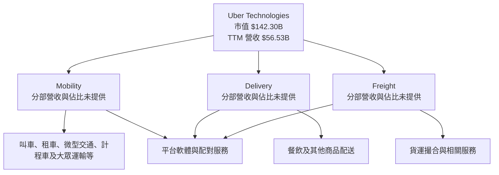
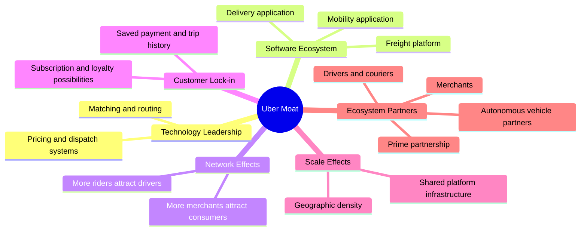
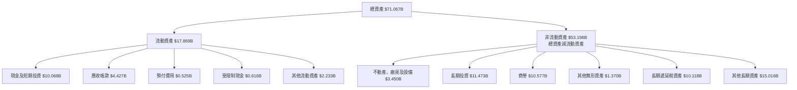
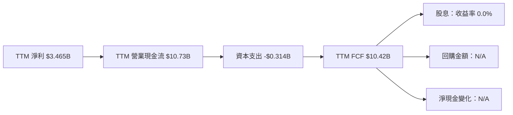
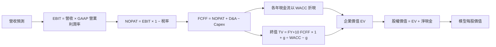
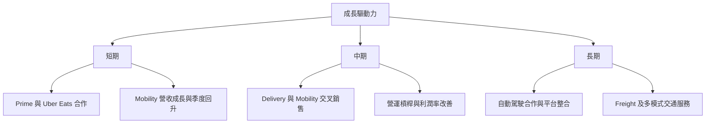
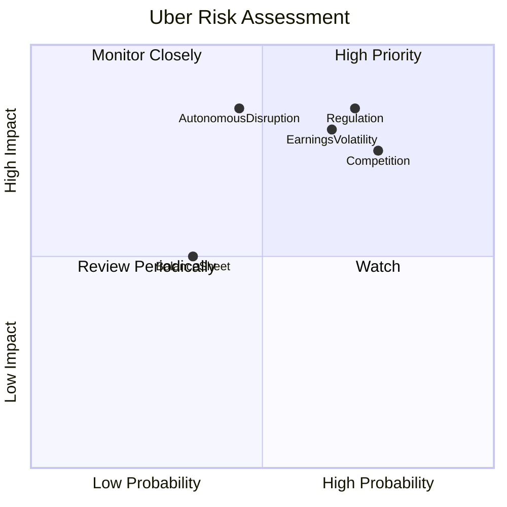
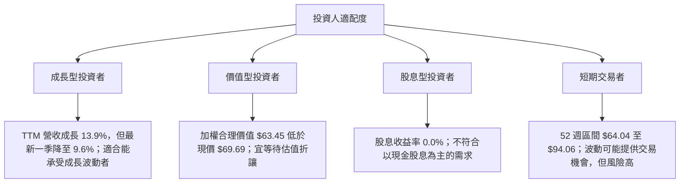

# UBER 基本面深度分析報告
> **報告日期**：2026-11-15 ｜ **語言**：繁體中文 ｜ **數據來源**：SEC 申報資料 (XBRL)、Yahoo Finance、Finviz、StockAnalysis、Roic.ai ｜ **分析師**：CFA 級機構研究

## 目錄

| # | 章節 | 核心結論 |
|---|------|----------|
| 1 | 執行摘要 | 持有；加權合理價值 $63.45，MOS -9.8% |
| 2 | 公司概覽與商業模式 | 多邊平台具網路效應，但分部營收與市場份額數據未提供 |
| 3 | 損益表深度分析 | TTM 營收 $56.53B、成長 13.9%；單季年增減速至 9.6% |
| 4 | 資產負債表分析 | 淨負債 $5.60B；流動比率 1.232，流動性尚可 |
| 5 | 現金流量深度分析 | TTM FCF $10.42B、FCF Yield 7.32% |
| 6 | 獲利能力與資本效率 | ROIC 15.8% 高於 WACC 10.29%，目前創造價值 |
| 7 | 相對估值分析 | Forward P/E 低於同業中位數，但估值方法分歧大 |
| 8 | DCF 內在價值評估 | 基準 DCF $39.55；加權合理價值 $63.45 |
| 9 | 成長催化劑 | 平台交叉銷售、Prime 合作與自動駕駛選擇權值得追蹤 |
| 10 | 風險矩陣 | 監管、競爭與獲利波動是主要風險 |
| 11 | 投資建議 | 持有；現價處合理價值附近，建議等待估值或基本面改善 |

---

## 1. 執行摘要

### 1.0 一頁式投資儀表板（Portfolio Manager 30 秒速讀）

| 項目 | 內容 |
|------|------|
| **投資論點（3 句）** | ① TTM 營收 $56.53B、年增 13.9%，但最新一季年增率已降至 9.6%，成長仍在但有放緩跡象。② TTM FCF 為 $10.42B、FCF Yield 7.32%，ROIC 15.8% 高於 WACC 10.29%，營運現金創造力支持價值創造。③ 加權合理價值 $63.45 低於 2026-11-13 收盤價 $69.69，MOS 為 -9.8%，因此估值未提供足夠下檔保護。 |
| **綜合評分** | **6.6/10**（引用 1.1 評分卡） |
| **財務健康** | 🟡 現金及短期投資 $10.07B、淨負債 $5.60B，流動比率 1.232；有償債能力，但並非淨現金資產負債表。 |
| **ROIC vs WACC** | **15.8% vs 10.29%**；利差 +5.51 個百分點，顯示目前投入資本回報高於資金成本。 |
| **FCF 趨勢** | 近年 FCF 擴大；TTM FCF Yield **7.32%**。 |
| **估值** | Forward P/E **15.8x** ｜ EV/EBITDA **19.0x** ｜ FCF Yield **7.32%** |
| **DCF 內在價值（基準）** | **$39.55** ｜ 現價相對 DCF 折溢價 **+76.2% 溢價**（8.5） |
| **安全邊際（MOS）** | **-9.8%**＝($63.45 − $69.69) ÷ $63.45（基準為 8.8 加權合理價值）｜ 🔴 <10% 無 |
| **預期報酬（基準情境 12M）** | **-43.2%**（基準 DCF 情境 $39.55 相對現價；非加權合理價值報酬） |
| **關鍵風險（前二）** | 最新一季營收年增降至 9.6%；季度 EPS 波動大且與一次性項目、稅務及投資損益的關係未能由現有明細完全拆解。 |
| **評級 + 信心度** | 🟡 **持有** ｜ 信心：中 |

### 1.1 綜合評分卡（全報告唯一）

| 維度 | 評分（1–10） | 主要依據（引用數字與其來源章節） |
|------|--------------|----------------------------------|
| 成長性 | 7.5 | TTM 營收年增 13.9%，但最新一季年增降至 9.6%（第 3 章）。 |
| 獲利能力 | 7.5 | TTM 營業利益率 12.4%、ROIC 15.8% 高於 WACC 10.29%；Piotroski F-Score 6/8（第 3、6 章）。 |
| 財務健康 | 6.5 | 淨負債 $5.60B、流動比率 1.232、快速比率 0.999；DSO 29 天（第 4 章）。 |
| 估值 | 4.0 | MOS -9.8%；基準 DCF $39.55 低於現價，但 Forward P/E 15.8x 低於可計算同業中位數 20.6x（第 7、8 章）。 |
| 護城河 | 7.5 | 多邊平台、跨產品服務與合作生態提供網路效應；但缺少市場份額與分部營收量化資料（第 2 章）。 |
| 管理層與資本配置 | 6.5 | TTM FCF $10.42B，2025 年 SBC $1.83B；股數測試未增加，但資本配置細節、回購金額及回購價格資料不足（第 3、5 章）。 |
| **綜合評分** | **6.6** | 六項算術平均： (7.5 + 7.5 + 6.5 + 4.0 + 7.5 + 6.5) ÷ 6 = **6.6**。 |

### 1.2 五大投資論點 + 三大核心風險

| 類型 | 項目 | 具體依據 | 信心度 |
|------|------|----------|--------|
| 🟢 **投資論點①** | 現金流能力提升 | 年度 FCF 由 2023 年 $3.36B 增至 2025 年 $9.76B；TTM FCF 為 $10.42B。現金流增長為平台擴大投資及承受週期波動提供資源。 | 🟢 高 |
| 🟢 **投資論點②** | ROIC 高於資金成本 | TTM ROIC 15.8%，WACC 10.29%，利差 +5.51pp；若維持，增量資本投資有望繼續創造價值。 | 🟢 高 |
| 🟢 **投資論點③** | 平台跨產品變現 | 公司經營 Mobility、Delivery、Freight 三個板塊，並有 Amazon Prime/Uber Eats 合作消息；交叉銷售具潛力，但分部數字未提供。 | 🟡 中 |
| 🟢 **投資論點④** | 同業估值不算高 | Forward P/E 15.8x，低於 LYFT、DASH、GRAB 的中位數 20.6x；但不同公司的成長率及盈利結構差異很大。 | 🟡 中 |
| 🟢 **投資論點⑤** | 近期股價較高點回落 | 2026-11 收盤 $69.69，低於 52 週高點 $94.06；現價較高點低約 25.9%，但仍高於加權合理價值 $63.45。 | 🟡 中 |
| 🟡 **風險①** | 成長減速 | 最新一季營收年增 9.6%，低於前幾季 14.5% 與 12.2%；若連續放緩，估值倍數可能承壓。 | 🟡 中 |
| 🔴 **風險②** | 利潤與 EPS 波動 | 最新一季 EPS 年增 -92.0%、淨利年增 -92.3%；非營業損益及稅項對 GAAP 淨利的影響需進一步追蹤。 | 🔴 高衝擊 |
| 🔴 **風險③** | 監管、勞工及自動駕駛競爭 | 平台須面對多地監管與司機供給議題；若無人駕駛改變成本結構，既可能是機會，也可能削弱平台與車隊合作地位。 | 🟡 中 |

### 1.3 快速統計卡片

| 指標 | 公司實際值（期間） | 同業中位數 | 狀態 |
|------|--------------------|------------|------|
| 營收成長（TTM） | **13.9%** | — | 🟢 |
| 營收成長（最新一季年增） | **9.6%** | 27.4% | 🟡 |
| 毛利率（TTM） | **41.4%** | 41.4% | 🟢 |
| 營業利益率（TTM） | **12.4%** | — | 🟢 |
| ROIC（TTM） | **15.8%** | — | 🟢 |
| Forward P/E | **15.8x** | 20.6x | 🟢 |
| FCF Yield（TTM） | **7.32%** | — | 🟢 |
| Piotroski F-Score | **6 / 8** | — | 🟢 |

> 同業中位數為三家同業 LYFT、DASH、GRAB 數據的中位數；三家最新一季營收成長中位數為 27.4%，毛利率中位數為 41.4%，Forward P/E 中位數為 20.6x。

### 1.4 投資結論

╔══════════════════════════════════════════════════════════════════╗  
║                    📊 投資結論摘要                               ║  
╠══════════════════════════════════════════════════════════════════╣  
║  評級：持有（依規則 20）                                         ║  
║  價格（2026-11-13 收盤）：$69.69                                 ║  
║  DCF 內在價值（基準）：$39.55（現價溢價 +76.2%）                ║  
║  安全邊際 MOS：-9.8%（以加權合理價值為分母）                     ║  
║  加權合理價值（8.8）：$63.45                                     ║  
║  DCF 情境價值：悲觀 $22.49（-67.7%）                             ║  
║    基準情境：$39.55（-43.2%）                                    ║  
║    樂觀情境：$65.79（-5.6%）                                     ║  
║  綜合評分：6.6/10（引用 1.1）                                    ║  
║  適合投資人：可承受平台、監管與估值波動的中長期投資人            ║  
╚══════════════════════════════════════════════════════════════════╝

---

## 2. 公司概覽與商業模式

### 2.1 業務結構與收入來源

分部營收及分部佔比未提供，因此不以估算比例拆分。公司總市值為 $142.30B、TTM 營收為 $56.53B；業務由 Mobility、Delivery、Freight 三個板塊構成。

營運模式的核心是利用雙邊平台撮合消費者、司機／配送夥伴與商家，從交易中取得收入。分部淨營收、總預訂額及抽成率未提供，無法在此判斷各板塊對合併營收及利潤的精確貢獻。

### 2.2 市場份額

**市場份額數據未提供。** Uber 的 TTM 營收為 $56.53B，規模高於 LYFT 的單一叫車業務平台；但 DASH 與 GRAB 在其主要市場的最新一季營收增長分別為 34.0% 與 27.4%，高於 Uber 最新一季的 9.6%。因各公司地區、業務組合及營收認列方式不同，營收規模不能直接等同市場份額。

### 2.3 競爭護城河分析

### 2.4 護城河強度

| 護城河項目 | 強度（強／中／弱） | 證據（引用數字或事實） | 會削弱它的情況 |
|------------|--------------------|------------------------|----------------|
| 網路效應 | 中至強 | 同一平台連接乘客、司機、配送夥伴與商家；公司 TTM 營收 $56.53B，顯示具相當營運規模。 | 當地平台競爭者以補貼取得密度，或司機及消費者多平台使用削弱忠誠度。 |
| 軟體與資料 | 中 | 公司跨 Mobility、Delivery、Freight 經營平台，有機會共用支付、身分、調度與客服系統。 | 服務品質或演算法優勢無法轉化為更高留存與較低單位成本。 |
| 規模效應 | 中 | 37,300 名員工、TTM FCF $10.42B，具備投資平台與跨市場運營的資源。 | 監管、保險及司機激勵成本隨市場擴張同步上升。 |
| 客戶鎖定 | 弱至中 | 應用程式、付款資料及使用習慣可增加便利性；但轉換成本有限。 | 消費者容易下載競品，司機亦可能同時在多個平台接單。 |
| 技術領先 | 中 | 公司運用自有平台進行配對、定價與路徑安排；具體技術效能指標未提供。 | 自動駕駛或第三方調度技術改變平台分工，或競品提供更低價格。 |
| 生態夥伴 | 中 | 司機、配送夥伴、商家及 Amazon Prime/Uber Eats 合作消息提供網絡擴展可能。 | 合作的交易量、留存率或增量利潤未達預期。 |

1.1 的「護城河」評分為 **7.5/10**，主要基於多邊平台及跨業務生態的結構優勢；市場份額、留存率與分部盈利資料缺失，限制了更高評分的證據強度。

---

## 3. 損益表深度分析

### 3.1 年度收入成長趨勢（近4年）

╔══════════════════════════════════════════════════════════════════╗  
║              Uber 年度收入趨勢（FY2022–FY2025）                 ║  
╠══════════════════════════════════════════════════════════════════╣  
║ FY2022  $31.88B  ████████████░░░░░░░░░░░░░░  YoY：—             ║  
║ FY2023  $37.28B  ██████████████░░░░░░░░░░░░  YoY：+17.0% 🟢     ║  
║ FY2024  $43.98B  █████████████████░░░░░░░░░  YoY：+18.0% 🟢     ║  
║ FY2025  $52.02B  ████████████████████░░░░░░  YoY：+18.3% 🟢     ║  
╠══════════════════════════════════════════════════════════════════╣  
║ FY2022–FY2025 三年營收 CAGR：約 17.7%                            ║  
╚══════════════════════════════════════════════════════════════════╝

計算：($52.02B ÷ $31.88B)^(1/3) − 1 ≈ **17.7%**。FY2023 至 FY2025 年營收增長率維持在約 17%–18%，反映平台交易活動與業務規模擴張；但最新 TTM 增長降至 13.9%，最新一季年增 9.6%，顯示歷史增長速度未必能延續。

### 3.2 季度收入趨勢分析

| 季度 | 營收 | QoQ | YoY | 備註 |
|------|------|-----|-----|------|
| 2025 Q4 | $14.37B | +6.7% | +20.1% | 同季營收增長仍高；與 2025 Q3 $13.47B 比較。 |
| 2026 Q1 | $13.20B | -8.1% | +14.5% | 季節性回落；年增仍為雙位數。 |
| 2026 Q2 | $14.19B | +7.5% | +12.2% | 季增反彈，年增率低於前兩季。 |
| 2026 Q3 | $14.77B | +4.1% | +9.6% | 營收創近四季高點，但年增率繼續放緩。 |

QoQ 由同一季報資料計算；YoY 採用 StockAnalysis 季度成長率，最新一季 9.6% 同時符合 SEC 申報資料計算值。營收逐季提高，但同比增速自 2025 Q4 的 20.1% 降至 2026 Q3 的 9.6%，若主要來自交易量或價格增長放慢，可能使營運槓桿延後。

### 3.3 利潤率演變分析

| 利潤率指標 | FY2022 | FY2023 | FY2024 | FY2025 | 趨勢 | 評估 |
|------------|--------|--------|--------|--------|------|------|
| **毛利率** | 38.3% | 39.8% | 39.4% | 39.8% | 長期略升，年度間窄幅波動 | 🟢 |
| **營業利益率** | -5.7% | 3.0% | 6.4% | 10.7% | 由虧轉盈並擴大 | 🟢 |
| **淨利率** | -28.7% | 5.1% | 22.4% | 19.3% | 受非營業與稅項影響明顯 | 🟡 |

年度利潤率以年度損益表的毛利、營業利益及淨利除以營收計算。FY2025 淨利 $10.05B，高於營業利益 $5.57B；差額顯示非營業、投資或稅務項目可能有重大影響，但可用資料未提供足以逐項核對的調節表，因此不宜把 19.3% 淨利率當作可持續經營利潤率。另一方面，TTM GAAP 營業利益率 12.4% 顯示營運層面的盈利能力比早年改善；最新一季 verified operating margin 為 9.8%，低於 TTM，須觀察是否只是季度波動。

### 3.4 費用結構分析

資料未提供完整的 TTM 營業費用明細及分類百分比，因此不畫費用結構圓餅圖。已知 2025 年研發費用為 $3.40B，約為當年營收 $52.02B 的 6.5%；這代表公司仍需投入技術、產品與平台建設，但研發支出本身不足以代表全部營業費用結構。

### 3.5 季度 EPS 趨勢與盈餘品質（Quality of Earnings）

季度 EPS 實際值可取得，但 EPS Est 欄為 nan，故無法可靠判定近四季是否超出或低於分析師預期。

| 季度 | EPS 實際值 | EPS 年增 | 超預期／不及預期 |
|------|------------|---------|------------------|
| 2025 Q4 | $0.14 | -95.6% | N/A（估值資料缺失） |
| 2026 Q1 | $0.13 | -84.6% | N/A（估值資料缺失） |
| 2026 Q2 | $1.17 | +85.5% | N/A（估值資料缺失） |
| 2026 Q3 | $0.25 | -92.0% | N/A（估值資料缺失） |

| 盈餘品質項目 | 數值／佔比 | 評估 |
|--------------|------------|------|
| 股權薪酬 SBC / 營收 | 約 **3.65%**；四季 SBC 合計 $2.065B ÷ TTM 營收 $56.53B | 🟡 SBC 是實質股東成本；但 Piotroski 股數測試顯示稀釋股數未增加，可能有回購等抵銷，回購金額未提供。 |
| SBC / 營業現金流 | 約 **19.3%**；$2.065B ÷ $10.73B | 🟡 雖然現金流高於 SBC，但 SBC 加回營業現金流後，FCF 不應被理解為完全無稀釋成本。 |
| FCF / 淨利（現金轉換率） | 約 **300.7%**；TTM FCF $10.42B ÷ StockAnalysis TTM 淨利 $3.465B | 🟢 現金流高於 GAAP 淨利；比率偏高部分來自淨利低基期及非現金／非營業損益波動。 |
| 一次性／非經常性損益 | FY2025 淨利 $10.05B、營業利益 $5.57B；具體一次性項目拆分 N/A | 🟡 淨利顯著高於營業利益，經營盈餘與 GAAP 淨利須分開解讀。 |
| 有效稅率異常 | N/A（未提供 TTM 稅前利潤與所得稅費用明細） | 🟡 無法判斷不同年度稅項是否推高或壓低 EPS。 |
| 資本化支出 vs 費用化 | TTM 資本支出 $314M；資本化政策及資本化軟體支出明細 N/A | 🟡 資本支出較低，但不能據此推斷所有技術投資均已費用化。 |

**盈餘品質結論**：TTM FCF $10.42B、現金轉換率約 300.7%，顯示現金流含金量不弱；但 SBC 約佔營收 3.65%、約佔營業現金流 19.3%，仍是股東經濟成本。FY2025 淨利與營業利益差距大，且季度 EPS 變動劇烈，故估值應優先參考 GAAP 營業獲利、FCF 及跨期趨勢，不宜直接年化單季 EPS。

---

## 4. 資產負債表分析

### 4.1 資產結構分解

截至 2026-09-30，總資產 $71.067B，流動資產 $17.869B；非流動資產為兩者差額 $53.198B。以下細項以 StockAnalysis 資產負債表為依據。

流動資產各細項相加與總額可能有四捨五入差異。長期遞延稅資產與長期投資佔非流動資產一定比重，評估資產質量時應留意其變現性與會計估值，不可全視為可供償債的現金資產。

### 4.2 流動性與營運資金分析

| 指標 | 最新 TTM | 一年前 TTM | 變化 | 解讀 |
|------|----------|------------|------|------|
| 流動比率 | 1.232 | N/A | N/A | 當期流動資產高於流動負債，但比較基期未提供。 |
| 快速比率 | 0.999 | N/A | N/A | 接近 1，須配合現金流及應收帳款回收狀況判讀。 |
| DSO 應收帳款天數 | 29 天 | 28 天 | +1 天 | 收款時間略增，變化幅度有限；應追蹤是否持續。 |
| DIO 存貨天數 | N/A | N/A | N/A | 公司未報告此項存貨餘額；不得補估。 |
| DPO 應付帳款天數 | 17 天 | N/A | N/A | 一年前資料缺失，無法判斷供應商付款週期變化。 |
| CCC 現金轉換週期 | N/A | N/A | N/A | DIO 缺失，因此無法計算完整週期。 |

### 4.3 債務結構分析

╔══════════════════════════════════════════════════════════════════╗  
║                   Uber 債務健康診斷                              ║  
╠══════════════════════════════════════════════════════════════════╣  
║  總債務（採 verified figures）：$15.66B                          ║  
║  現金及短期投資：              $10.07B                          ║  
║  淨負債：                       $5.60B  🟡                      ║  
║  流動比率：                     1.232   🟡                      ║  
║  快速比率：                     0.999   🟡                      ║  
║  Debt/EBITDA：                  N/A（資料口徑不一致）             ║  
║  利息保障倍數：                 N/A（利息費用未提供）             ║  
╚══════════════════════════════════════════════════════════════════╝

財務數據不同欄位另列總債務 $17.74B、淨負債 $7.67B，與 verified figures 的總債務 $15.66B、淨負債 $5.60B 不一致。本報告依規則以 verified figures 為主要引用口徑；兩組數字差異可能涉及債務範圍或資料來源時點，應以 10-Q 附註核實，不混用計算比率。

### 4.4 股東權益趨勢

╔══════════════════════════════════════════════════════════════════╗  
║                   Uber 股東權益趨勢                               ║  
╠══════════════════════════════════════════════════════════════════╣  
║ FY2022  $7.34B   ██████░░░░░░░░░░░░░░░░░░░░                     ║  
║ FY2023  $11.25B  █████████░░░░░░░░░░░░░░░░░                     ║  
║ FY2024  $21.56B  ██████████████████░░░░░░░░                     ║  
║ FY2025  $27.04B  ███████████████████████░░░                     ║  
╚══════════════════════════════════════════════════════════════════╝

2022 至 2025 年股東權益增加，反映累積盈利與資本結構變化；但權益成長不等同每股價值同比增長，仍須同時追蹤股數、SBC、回購及非現金會計項目。

---

## 5. 現金流量深度分析

### 5.1 現金流量瀑布圖

淨利至營業現金流的橋接受到非現金項目、營運資金與其他現金流調節影響，詳細調節項未列出，故圖中表示現金流序列而非逐項會計加總。股息收益率為 0.0%；回購金額及現金流的實際用途未提供。

### 5.2 FCF 轉換率趨勢

| 年度 | FCF | 淨利 | FCF / 淨利 | 解讀 |
|------|-----|------|------------|------|
| FY2022 | $0.39B | -$9.14B | N/M | 淨利為負，比例失去一般經濟意義。 |
| FY2023 | $3.36B | $1.89B | 177.8% | 現金流高於會計淨利。 |
| FY2024 | $6.89B | $9.86B | 69.9% | 淨利高於 FCF，須考慮非現金或非經常項目。 |
| FY2025 | $9.76B | $10.05B | 97.1% | FCF 接近淨利，現金轉換尚可。 |
| TTM 至 2026-09-30 | $10.42B | $3.465B | 約 300.7% | 淨利基期及損益波動使比例偏高，非正常長期目標值。 |

### 5.3 自由現金流趨勢

╔══════════════════════════════════════════════════════════════════╗  
║                   Uber 自由現金流趨勢                             ║  
╠══════════════════════════════════════════════════════════════════╣  
║ FY2022  $0.39B   █░░░░░░░░░░░░░░░░░░░░░░░░░░  🟡                ║  
║ FY2023  $3.36B   █████████░░░░░░░░░░░░░░░░░░░  🟢                ║  
║ FY2024  $6.89B   ██████████████████░░░░░░░░░░  🟢                ║  
║ FY2025  $9.76B   ██████████████████████████░░  🟢                ║  
║ TTM      $10.42B ████████████████████████████  FCF Yield 7.32%   ║  
╚══════════════════════════════════════════════════════════════════╝

FCF 由 2022 年 $0.39B 增至 2025 年 $9.76B，顯示經營現金流改善。TTM 營業現金流 $10.73B 減資本支出 $0.314B，得 TTM FCF $10.42B（採用 verified figures 的 FCF 定義）。現金流是否可長期維持，仍取決於司機激勵、保險、法規與營運資金變化。

### 5.4 資本配置評估

| 項目 | 已知數據 | 評估 |
|------|----------|------|
| 資本支出 | TTM $0.314B | 相較營業現金流占比低；但平台軟體及其他投資可能以費用形式列示，不能只以 Capex 判斷總投資。 |
| 股息 | 股息收益率 0.0% | 未以現金股息作為主要股東回報方式。 |
| SBC | FY2025 $1.83B；TTM 四季合計約 $2.065B | 會稀釋股東經濟權益，須與回購一併評估。 |
| 回購 | 金額 N/A | 無法判定回購是否足以抵銷 SBC。 |
| 留存與其他投資 | 明細 N/A | 不繪製沒有可靠比例的資本配置圓餅圖。 |

---

## 6. 獲利能力與資本效率

### 6.1 ROE / ROA / ROIC 趨勢

| 指標 | FY2022 | FY2023 | FY2024 | FY2025／TTM | 評估 |
|------|--------|--------|--------|-------------|------|
| ROE | N/A | N/A | N/A | TTM 12.5% | 最新 ROE 中等；杜邦分解顯示權益乘數 2.57 倍。 |
| ROA | N/A | N/A | N/A | TTM 6.5% | Piotroski 測試中 ROA 未高於一年前，尚未顯示持續改善。 |
| ROIC | N/A | N/A | N/A | TTM 15.8% | 高於 WACC 10.29%，代表目前投入資本創造正經濟利差。 |

歷史年度 ROE、ROA 與 ROIC 序列未完整提供，不以缺失數據補算。行業均值未提供，故不列行業均值對比。

### 6.2 ROIC vs WACC 分析（核心價值創造判斷）

╔══════════════════════════════════════════════════════════════════╗  
║                ROIC vs WACC 深度分析                             ║  
╠══════════════════════════════════════════════════════════════════╣  
║ WACC 輸入（採用成本資本資料）：                                  ║  
║ ├── 無風險利率（10Y 美債）： 5.15%                               ║  
║ ├── 市場風險溢酬 ERP：       5.00%                               ║  
║ ├── 原始 Beta：              1.31                                ║  
║ ├── 調整後 Beta：            1.21                                ║  
║ ├── 股權成本 Ke：            11.18%                              ║  
║ ├── 稅前債務成本 Kd：        2.81%                               ║  
║ ├── 股權／債務權重：         90.1%／9.9%                         ║  
║ └── WACC：                   10.29%                              ║  
║                                                                  ║  
║ ROIC（TTM）：                15.8%                               ║  
║ EVA 利差：                   15.8% − 10.29% = +5.51pp           ║  
║ ROIC / WACC：                15.8% ÷ 10.29% = 1.54x             ║  
║                                                                  ║  
║ 判斷：ROIC 高於 WACC，現階段創造經濟價值；若 ROIC 跌破 10.29%，   ║  
║       或新增投資回報持續下降，價值創造論點將失效。               ║  
╚══════════════════════════════════════════════════════════════════╝

WACC 直接採用成本資本資料中的 10.29%，不自行重算替換；CAPM 採調整後 Beta 1.21，報告列示的 Ke 為 11.18%。公司提供的債務成本為稅前 2.81%、預設稅率 21.0%，債務及股權權重為 9.9% 與 90.1%。個別利息費用金額及平均計息負債餘額未提供，因此無法獨立重建稅前 Kd 的分子與分母；WACC 的一致性採用報告值。

### 6.3 杜邦三因素分解

| 因素 | 數值（TTM） | 解讀 |
|------|-------------|------|
| 淨利率 | 6.1% | 淨利受到非營業損益等項目影響，與營業利益率並不相同。 |
| 資產週轉率 | 0.80 | 每單位資產支撐約 0.80 單位營收。 |
| 權益乘數 | 2.57 | 槓桿提供部分 ROE 放大，但不是 ROE 的唯一來源。 |
| **ROE** | **12.5%** | 6.1% × 0.80 × 2.57 = **12.5%**（四捨五入）。 |

依提供的杜邦數值，ROE 由淨利率、資產週轉率及權益乘數共同形成；權益乘數 2.57 倍代表有一定財務槓桿，但目前 ROIC 高於 WACC，價值創造判斷不單靠槓桿支撐。

### 6.4 財務體質：Piotroski F-Score

**Piotroski F-Score：6 / 8**。共九項測試，其中毛利率測試缺少資料而不計入分母，分母為 8。

| 測試 | 結果 | 解讀 |
|------|------|------|
| ROA > 0 | ✅ 通過 | TTM 資產報酬為正。 |
| 營業現金流 > 0 | ✅ 通過 | TTM 營業現金流 $10.73B。 |
| ROA 高於一年前 | ❌ 未通過 | 資產盈利能力未高於比較基期。 |
| 營業現金流 > 淨利（應計品質） | ✅ 通過 | 現金流高於淨利，應計品質測試通過。 |
| 長期負債 ÷ 總資產低於一年前 | ❌ 未通過 | 負債比例未改善，須追蹤債務變化。 |
| 流動比率高於一年前 | ✅ 通過 | 流動性指標較一年前改善。 |
| 稀釋股數未增加 | ✅ 通過 | 但 SBC 仍是股東經濟成本，須檢視回購抵銷效果。 |
| 毛利率高於一年前 | — 無法判定 | 缺少所需比較資料，不列入分母。 |
| 資產週轉率高於一年前 | ✅ 通過 | 資產利用效率測試通過。 |

---

## 7. 相對估值分析

### 7.1 同業估值比較表格

公司當前 P/E、P/S、EV/EBITDA 採自身歷史估值資料中的最新值；Forward P/E 採市場資料。不同公司盈利品質與地區組合不同，倍數比較只作參考。

| 估值指標 | **UBER** | **LYFT** | **DASH** | **GRAB** | UBER 評估 |
|----------|----------|---------|---------|---------|-----------|
| **Trailing P/E** | 40.8x | 2.5x | 71.2x | 32.4x | 🟡 介於同業之間；LYFT 低倍數可能反映盈利基數差異。 |
| **Forward P/E** | 15.8x | 8.1x | 22.5x | 20.6x | 🟢 低於同業中位數 20.6x，但須確認預期 EPS 能否實現。 |
| **P/S Ratio** | 2.5x | 0.9x | 4.4x | 3.3x | 🟢 低於 DASH、GRAB，較 LYFT 有溢價。 |
| **EV/EBITDA** | 19.0x | 565.3x | 42.2x | 21.9x | 🟢 低於 DASH、GRAB；LYFT 的倍數因 EBITDA 很低而失去可比性。 |
| **最新一季營收年增** | 9.6% | 8.1% | 34.0% | 27.4% | 🟡 UBER 增速低於 DASH、GRAB。 |
| **毛利率（TTM）** | 41.4% | 40.0% | 52.7% | 41.4% | 🟡 與 GRAB 相同，高於 LYFT，低於 DASH。 |

三家同業 Forward P/E 中位數為 **20.6x**；最新一季營收增長中位數為 **27.4%**；TTM 毛利率中位數為 **41.4%**。UBER 的估值折讓伴隨較低的近期增速，不能只以 Forward P/E 較低就判斷低估。

### 7.2 歷史估值區間分析

╔══════════════════════════════════════════════════════════════════╗  
║                   UBER 五年估值位置                               ║  
╠══════════════════════════════════════════════════════════════════╣  
║ P/E：      12.6x ───── 中位數 17.8x ───────── 現值 40.8x ── 122.2x ║  
║            現值歷史百分位：69%                                   ║  
║ P/S：       1.5x ───── 現值 2.5x ── 中位數 3.3x ──────── 6.1x ║  
║            現值歷史百分位：24%                                   ║  
║ EV/EBITDA：18.7x ─ 現值 19.0x ───────── 中位數 40.0x ─── 320.2x ║  
║            現值歷史百分位：7%                                    ║  
╚══════════════════════════════════════════════════════════════════╝

相對自身歷史，P/E 現值 40.8x 高於中位數 17.8x，P/S 2.5x 低於中位數 3.3x，EV/EBITDA 19.0x 接近五年區間低端且低於中位數 40.0x。三種倍數呈現不同訊號，反映歷史期間盈利分母曾大幅波動；不宜單獨依 P/E 判斷估值。

### 7.3 情境價值（Bear / Base / Bull，依 DCF MODEL）

| 情境 | 第 1 年營收成長 | 期末營業利潤率 | WACC | 每股價值 | 相對現價 | 機率 | 會發生的條件 |
|------|----------------|----------------|------|----------|----------|------|--------------|
| 🔴 悲觀 | 7.0% | 5.4% | 11.29% | $22.49 | -67.7% | 25% | 交易成長明顯放慢、競爭與監管成本壓縮長期利潤率，且風險溢價上升。 |
| 🟡 基準 | 13.9% | 6.4% | 10.29% | $39.55 | -43.2% | 50% | 初期營收延續 TTM 增長，之後逐步放緩，成熟期利潤率回落至模型採用的歷史中位數。 |
| 🟢 樂觀 | 20.9% | 7.0% | 9.29% | $65.79 | -5.6% | 25% | 交易成長高於基準、長期利潤率較高，且資金成本下降。 |

模型列示的機率加權價值為 **$41.85**（相對現價 -40.0%）；8.8 的規定估值權重仍使用基準 DCF $39.55，而不是機率加權數值。情境模型未提供逐年中間計算表，故不補造各情境的中間營收、FCFF 與終值。

### 7.4 相對估值隱含價格區間

╔══════════════════════════════════════════════════════════════════╗  
║                   估值方法每股價值                               ║  
╠══════════════════════════════════════════════════════════════════╣  
║ $39.55 DCF ─────── 現價 $69.69 ─────── $90.95 Forward P/E ───── ║  
║                              分析師共識：$98.66                 ║  
╚══════════════════════════════════════════════════════════════════╝

| 方法 | 每股價值 | 依據 |
|------|----------|------|
| DCF（基準） | $39.55 | 10 年 FCFF、WACC 10.29%、永續成長率 3.0%。 |
| 同業 Forward P/E | $90.95 | 同業中位數 Forward P/E 20.6x × 公司 Forward EPS $4.41。 |
| 分析師共識目標價 | $98.66 | 46 位分析師平均目標價。 |
| 同業 EV/EBITDA | N/A | 該估值方法不可計算，依規定不補估。 |

相對估值法的 $90.95 由同業 Forward P/E 中位數 20.6x 乘以公司 Forward EPS $4.41 得出。此法隱含較高價值，但對未來 EPS 預測較敏感；DCF 對長期利潤率及折現率更敏感，兩者分歧是本案估值信心的重要限制。

---

## 8. DCF 內在價值評估（Discounted Cash Flow）

> 本章依程式計算的 DCF 模型逐項引用。計算表金額單位為 USD billions；模型原始表格以兩位小數呈現，折現因子三位小數。部分公式以未四捨五入的底層數值計算，因此用表面四捨五入數字重算時可能有小幅尾差。

### 8.0 估值推理鏈（Thinking Logic）

**Step 1 — 價值由哪些變數決定？**  
模型將 Uber 的整體營收作為現金流底盤；Mobility、Delivery、Freight 的分部收入佔比未提供，不能分別量化。DCF 價值主要受未來營收成長、GAAP 營業利潤率及 WACC／終值成長率影響。敏感度矩陣顯示折現率與永續成長率變動對每股價值有明顯影響；同時，長期營業利潤率由基準模型逐步下降，故利潤率路徑也是關鍵風險。

**Step 2 — 模型選擇**

| 決策點 | 本報告採用 | 理由（含數字） | 曾考慮但否決 | 否決理由 |
|--------|-----------|----------------|--------------|----------|
| 現金流定義 | FCFF | 以 NOPAT + D&A − Capex 計算，與 WACC 折現後求 EV 相配。 | FCFE | 模型已提供 FCFF 及 WACC。 |
| 預測期 N | 10 年 | 模型以 TTM 營收 $56.53B 為起點，逐年將營收成長從 13.9% 降至 3.0%。 | 5 年 | 既定模型預測期為 10 年；自行縮短會改變模型輸出。 |
| 終值方法 | Gordon Growth | 模型提供永續成長率 3.0%，且 WACC 10.29% 高於 g。 | 退出倍數 | 模型未提供退出倍數與成熟期 EBITDA 倍數，不能自行設定。 |
| EBIT 基礎 | GAAP EBIT | DCF 模型明確採 GAAP 營業利益。 | 非 GAAP EBIT | 會加回已費用化 SBC，與模型設定不同。 |

**Step 3 — 關鍵假設推導鏈**

- **營收成長**：錨點＝TTM 年增 13.9%；模型採第一年 13.9%，之後線性降至第 10 年 3.0%。調整理由是公司營收規模擴大後，增長通常較難長期維持起始速度；模型採用此漸降路徑。替代值曾可能是全期維持 13.9%，但未採用，因為會忽略成熟化。
- **期末營業利潤率**：錨點＝TTM 營業利益率 12.4%；模型由第一年 12.4% 線性降至第 10 年 6.4%，依據為近五個財政年度中位數（含 TTM）。未採用長期維持 12.4%，因模型選擇以歷史中位數作成熟期錨點，而非外推最高值。
- **永續成長率 g**：採用 3.0%；這是 DCF 模型指定值，低於 WACC 10.29%，使 Gordon Growth 分母為正。沒有另以較高成長率取代，因永續成長若逼近 WACC，終值會不成比例擴大。
- **預測期 N**：採用 10 年，與模型設定一致；未自行改為較短期，避免改變模型既定現金流與終值基期。
- **Capex／營收**：採用模型逐年值，FY+1 為 0.6%，FY+10 為 0.6%。錨點是 TTM Capex $0.314B 對 TTM 營收 $56.53B 約 0.6%；模型未提高投入強度。未自行採用更高 Capex 比例，因規則要求原值引用；低 Capex 假設可能使模型偏樂觀。
- **有效稅率**：模型採 21.0%，為成本資本資料所列預設稅率；歷史有效稅率明細未提供。
- **D&A／營收**：採用 TTM 錨點 1.4%，預測期固定；這是一項模型設定，未假定規模化後折舊率下降。
- **ΔWC／營收增額**：營運資金不納入模型；實際營運資金需求可能為正或負，不能把未建模誤解為現實中一定為零。
- **EBIT、SBC 與股數**：採 GAAP EBIT，SBC 已包含在費用中，不另扣 SBC；年稀釋率設為 0%，股數不再放大。本模型採用 **(A) GAAP EBIT + 固定股數**，故 SBC 影響已計入一次。
- **WACC**：採用 10.29%，依成本資本資料的股權成本、債務成本及資本權重；8.2 詳列輸入。未以自行推導的新 WACC 替代。
- **終值方法**：採 Gordon Growth；退出倍數交叉檢驗因缺少模型輸入而不計算。

**Step 4 — 最脆弱一環**  
基準模型 Capex／營收僅 0.6%，且未建模營運資金變動；若未來資本投入或營運資金需求高於模型設定，FCFF 與估值會下修。敏感度矩陣量化了折現率與 g 的影響，但沒有提供 Capex 改變的矩陣，故無法精確量化該項的價值幅度。

**Step 5 — 計算路徑圖**

### 8.1 模型假設總表（Model Inputs）

| 假設項目 | 採用值 | 依據／來源 | 敏感度 |
|----------|--------|-------------|--------|
| 預測期長度 N | 10 年 | DCF 模型指定；預測 FY+1 至 FY+10。 | 🟡 中 |
| 營收成長 | FY+1 13.9% 線性降至 FY+10 3.0% | TTM 年增 13.9%；成熟期降至 3.0%。 | 🔴 高 |
| 營業利潤率 | FY+1 12.4% 線性降至 FY+10 6.4% | TTM 12.4%；成熟期取近五年中位數，含 TTM。 | 🔴 高 |
| 有效稅率 | 21.0% | 成本資本資料預設稅率。 | 🟢 低 |
| Capex／營收 | FY+1 至 FY+10 約 0.6% | TTM Capex $0.314B ÷ TTM 營收 $56.53B 約 0.6%；採模型逐年值。 | 🟡 中 |
| D&A／營收 | 1.4% | DCF 模型提供的 TTM 比率，預測期固定。 | 🟢 低 |
| 營運資金變動 | 未建模 | 模型明示 Working capital is not modelled；不是對現實 ΔWC 的預測。 | 🟢 低 |
| EBIT 基礎 | GAAP EBIT | DCF 模型設定。 | 🟡 中 |
| SBC 處理 | 不另扣 SBC | SBC 已在 GAAP EBIT 作為費用；模型採組合 A。 | 🟡 中 |
| 年稀釋率 | 0% | 組合 A：股數固定，不再額外稀釋。 | 🟡 中 |
| 永續成長率 g | 3.0% | DCF 模型指定，且低於 WACC 10.29%。 | 🔴 高 |
| 終值方法 | Gordon Growth | 模型已提供終值；退出倍數法缺必要輸入。 | 🔴 高 |
| WACC | 10.29% | 成本資本資料指定值，見 8.2。 | 🔴 高 |

**FCFF 定義**：`FCFF = NOPAT + D&A − Capex`；模型不納入 ΔWC，亦不額外扣 SBC。

### 8.2 折現率推導（WACC）

╔══════════════════════════════════════════════════════════════════╗  
║                    WACC 推導（折現率）                           ║  
╠══════════════════════════════════════════════════════════════════╣  
║ 股權成本 Ke（CAPM，採成本資本資料值）：                          ║  
║ ├── 無風險利率 Rf：                 5.15%                        ║  
║ ├── 市場風險溢酬 ERP：              5.00%                        ║  
║ ├── 原始 Beta：                     1.31                         ║  
║ ├── 調整後 Beta：                   1.21                         ║  
║ ├── Beta 調整方式：                 ⅔ × 1.31 + ⅓ × 1             ║  
║ ├── 額外規模／國別溢酬：            0.00%（未另列）               ║  
║ └── Ke（資料列示）：                11.18%                       ║  
║                                                                  ║  
║ 債務成本：                                                       ║  
║ ├── 稅前 Kd（資料列示）：           2.81%                        ║  
║ ├── 稅率：                          21.0%                        ║  
║ └── 稅後 Kd = 2.81% × (1−21.0%) = 2.22%                         ║  
║                                                                  ║  
║ 資本結構權重：                                                    ║  
║ ├── 股權權重：                      90.1%                        ║  
║ ├── 債務權重：                      9.9%                         ║  
║ └── WACC（指定值）：                10.29%                       ║  
╚══════════════════════════════════════════════════════════════════╝

**逐步演算與可稽核限制**

1. **Ke（CAPM）**：`Rf + β × ERP`；以列示數值代入為 `5.15% + 1.21 × 5.00%`，按顯示值計算為 11.20%；成本資本資料列示 **11.18%**，兩者 0.02 個百分點差異可能來自未四捨五入的原始 Beta／輸入值，本報告依規則採用列示 Ke 11.18%。
2. **稅前 Kd**：資料列示為 **2.81%**，但利息費用及平均計息負債的獨立金額未提供，不能以總負債自行反推分子。  
3. **稅後 Kd**：`2.81% × (1 − 21.0%) = 2.2199% ≈ 2.22%`。
4. **權重**：股權 90.1%、債務 9.9%，相加為 100.0%；獨立市場市值與計息負債權重計算無法由已列示資料完整復算，採用成本資本資料的權重。
5. **WACC**：`90.1% × 11.18% + 9.9% × 2.2199% = 10.07318% + 0.21977% = 10.29295% ≈ 10.29%`。

WACC 與第 6.2 節一致，均採 **10.29%**。Rf 的觀察日期、利息費用金額、平均計息負債及市場市值權重所用的精確股數未提供；此處保留資料列示值，不用自行估算補足。

### 8.3 逐年自由現金流預測（基準情境）

金額單位：$B。表中各年度數值依 DCF 模型照列；折現因子保留三位小數。

| 年度 | FY+1 | FY+2 | FY+3 | FY+4 | FY+5 | FY+6 | FY+7 | FY+8 | FY+9 | FY+10 |
|------|------|------|------|------|------|------|------|------|------|-------|
| 營收 | 64.41 | 72.60 | 80.96 | 89.29 | 97.40 | 105.06 | 112.04 | 118.12 | 123.10 | 126.80 |
| 營收 YoY | 13.9% | 12.7% | 11.5% | 10.3% | 9.1% | 7.9% | 6.6% | 5.4% | 4.2% | 3.0% |
| 營業利潤率 | 12.4% | 11.8% | 11.1% | 10.4% | 9.7% | 9.1% | 8.4% | 7.7% | 7.0% | 6.4% |
| 營業利益 EBIT（GAAP） | 8.01 | 8.54 | 8.98 | 9.30 | 9.49 | 9.52 | 9.40 | 9.11 | 8.67 | 8.07 |
| − 稅（21.0%） | (1.68) | (1.79) | (1.89) | (1.95) | (1.99) | (2.00) | (1.97) | (1.91) | (1.82) | (1.69) |
| = NOPAT | 6.33 | 6.75 | 7.09 | 7.35 | 7.50 | 7.52 | 7.43 | 7.20 | 6.85 | 6.38 |
| + D&A | 0.88 | 0.99 | 1.10 | 1.21 | 1.33 | 1.43 | 1.52 | 1.61 | 1.67 | 1.72 |
| − Capex | (0.36) | (0.40) | (0.45) | (0.50) | (0.54) | (0.58) | (0.62) | (0.66) | (0.68) | (0.70) |
| − ΔWC | 未建模 | 未建模 | 未建模 | 未建模 | 未建模 | 未建模 | 未建模 | 未建模 | 未建模 | 未建模 |
| = FCFF | 6.85 | 7.33 | 7.75 | 8.07 | 8.28 | 8.37 | 8.33 | 8.15 | 7.84 | 7.40 |
| 折現因子 @10.29% | 0.907 | 0.822 | 0.745 | 0.676 | 0.613 | 0.556 | 0.504 | 0.457 | 0.414 | 0.375 |
| **FCFF 現值 PV** | **6.21** | **6.03** | **5.77** | **5.45** | **5.07** | **4.65** | **4.20** | **3.72** | **3.25** | **2.78** |

**預測期現值加總**：  
`$6.21 + $6.03 + $5.77 + $5.45 + $5.07 + $4.65 + $4.20 + $3.72 + $3.25 + $2.78 = $47.13B`

**FY+1 逐步演算**

1. 營收：`$56.53B × (1 + 13.9%) = $64.39B`（模型列示 $64.41B；差異來自模型底層未四捨五入的基期／增長輸入，以下計算沿用模型欄位值）。
2. EBIT：`$64.41B × 12.4% = $7.987B ≈ $8.01B`（模型按未四捨五入利潤率計算）。
3. 稅：`$8.01B × 21.0% = $1.6821B ≈ $1.68B`。
4. NOPAT：`$8.01B − $1.68B = $6.33B`。
5. D&A：模型列示 **$0.88B**；D&A／營收假設為 1.4%，底層未四捨五入計算。
6. Capex：模型列示 **$0.36B**；Capex／營收假設約 0.6%。
7. ΔWC：**未建模**，模型 FCFF 公式不包含營運資金變動項。
8. FCFF：`$6.33B + $0.88B − $0.36B = $6.85B`。
9. 折現因子與 PV：`1 ÷ (1 + 10.29%)^1 ≈ 0.907`；`$6.85B × 0.907 ≈ $6.21B`。

**合理性自檢**

- 預測 FCF CAGR：`($7.40B ÷ $6.85B)^(1/9) − 1 ≈ 0.9%`；模型起始與終值 FCFF 均為正，但先升至 FY+6 $8.37B，再逐步下降，不能視為單調高增長路徑。歷史年度 FCF CAGR 受 2022 低基數影響極大，不宜直接外推。
- FY+10 FCFF 利潤率：`$7.40B ÷ $126.80B ≈ 5.8%`；目前 TTM FCFF 利潤率約 `$10.42B ÷ $56.53B = 18.4%`。同業最佳 FCFF 利潤率未提供，不能比較；模型隱含成熟期現金流率明顯低於目前 TTM。
- 預測年度 FCFF 均為正；模型未反映營運資金變動，若未來工作資本占用上升，實際 FCFF 會低於表列。

╔══════════════════════════════════════════════════════════════════╗  
║            自由現金流：歷史實際 vs 模型預測                      ║  
╠══════════════════════════════════════════════════════════════════╣  
║ FY2023（實） $3.36B  ████████░░░░░░░░░░░░░░░░░░░░               ║  
║ FY2024（實） $6.89B  █████████████████░░░░░░░░░░░               ║  
║ FY2025（實） $9.76B  ████████████████████████░░░               ║  
║ FY+1（預）   $6.85B  █████████████████░░░░░░░░░░               ║  
║ FY+10（預）  $7.40B  ██████████████████░░░░░░░░               ║  
╠══════════════════════════════════════════════════════════════════╣  
║ 模型 FCFF 在 FY+1 至 FY+6 上升，之後回落；歷史與模型口徑不完全相同║  
╚══════════════════════════════════════════════════════════════════╝

### 8.4 終值計算（Terminal Value）

**適用性檢查**：`WACC 10.29% vs g 3.0% → WACC > g？✅`

| 方法 | 計算式 | 終值 TV | TV 現值 | 佔總 EV 比重 |
|------|--------|---------|---------|--------------|
| Gordon Growth | $7.40 × (1 + 3.0%) ÷ (10.29% − 3.0%) | $104.47B | $39.22B | 45.4% |
| 退出倍數法 | N/A | N/A | N/A | N/A |

模型未提供退出倍數、FY+10 EBITDA 與相應同業成熟期倍數，故不自行補算。

**逐步演算**

1. FY+10 FCFF：**$7.40B**。
2. 分子：`$7.40B × (1 + 3.0%) = $7.622B`。
3. 分母：`10.29% − 3.0% = 7.29%`；以顯示值計算 `7.622 ÷ 7.29% ≈ $104.55B`，DCF 模型依未四捨五入輸入列示 **$104.47B**。
4. TV 現值：模型列示 `PV(TV) = $104.47B × 0.375 = $39.22B`；用已四捨五入數值相乘會產生小幅尾差，模型使用底層未四捨五入折現因子。
5. 終值佔比：`$39.22B ÷ $86.35B = 45.4%`（採模型列示 EV 與 PV(TV)）。

終值現值佔 EV 45.4%，低於 75% 警示線，但仍接近企業價值一半，長期假設對 DCF 有重大影響。

### 8.5 企業價值 → 每股內在價值（Bridge）

╔══════════════════════════════════════════════════════════════════╗  
║              企業價值 → 每股內在價值 橋接表                      ║  
╠══════════════════════════════════════════════════════════════════╣  
║ 預測期 FCF 現值合計             +$47.13B                         ║  
║ 終值現值 PV(TV)                 +$39.22B                         ║  
║ = 企業價值 EV                    $86.35B                         ║  
║ + Net cash（負值代表淨負債）      -$5.60B                         ║  
║ = 股權價值（模型列示）            $80.76B                         ║  
║ 每股內在價值（模型列示）          $39.55                          ║  
║ 當前股價（2026-11-13 收盤）       $69.69                          ║  
║ 折溢價：$69.69 ÷ $39.55 − 1       +76.2% 溢價                     ║  
║ 本節不計算 MOS；MOS 依第 8.8 節計算                               ║  
╚══════════════════════════════════════════════════════════════════╝

**逐步演算**

1. `EV = $47.13B + $39.22B = $86.35B`。
2. `股權價值 = $86.35B + (-$5.60B) = $80.75B`；模型以未四捨五入底層值列示 **$80.76B**，差異 $0.01B。
3. 模型每股價值計算式照列：`股權價值 × 股價 ÷ 市值 = $80.76B × $69.69 ÷ $142.30B = $39.55`。模型採用的比例式與簡單以 2.04B 股直接相除略有差異，故此處不自行改寫模型值。
4. `折溢價 = $69.69 ÷ $39.55 − 1 = +76.2%`。
5. **本節不計算 MOS**；全報告 MOS 只以 8.8 加權合理價值作分母。

現金及短期投資 $10.07B、總債務 $15.66B，淨負債按 verified figures 為 $5.60B。模型每股值依其指定的「股權價值 × 股價 ÷ 市值」公式，並非另以財報稀釋股數重新建立模型。

### 8.6 敏感性分析（WACC × 永續成長率）

表中每股價值取 DCF 模型矩陣；括號為相對 $69.69 現價的上行／下行幅度，依模型指定的數值計算並四捨五入至一位小數。

| g（列）／WACC（欄） | 8.29% | 9.29% | **10.29%（基準）** | 11.29% | 12.29% |
|-----------|------|------|---------------------|-------|-------|
| **2.0%** | $48.97 (-29.7%) | $42.22 (-39.4%) | $37.07 (-46.8%) | $33.01 (-52.6%) | $29.72 (-57.4%) |
| **2.5%** | $51.40 (-26.2%) | $43.86 (-37.1%) | $38.23 (-45.1%) | $33.85 (-51.4%) | $30.35 (-56.5%) |
| **3.0%** | $54.28 (-22.1%) | $45.77 (-34.3%) | **$39.55 (-43.2%)** | $34.80 (-50.1%) | $31.05 (-55.4%) |
| **3.5%** | $57.77 (-17.1%) | $48.00 (-31.1%) | $41.06 (-41.1%) | $35.87 (-48.5%) | $31.83 (-54.3%) |
| **4.0%** | $62.07 (-10.9%) | $50.66 (-27.3%) | $42.82 (-38.5%) | $37.09 (-46.8%) | $32.71 (-53.1%) |

**非基準格示範：WACC 9.29% > g 2.5% ✅**

敏感度矩陣的各格是模型以重新折現預測期現金流及終值計算所得。DCF MODEL 未提供所選格的獨立 PV 預測期合計與 TV 中間值，為避免自建或改寫模型，不虛構中間橋接數字；可直接核對該格模型值為 **$43.86／股**。

**三情境 DCF（改變營運假設）**

| 情境 | 年 1 成長 | 期末營業利潤率 | WACC | 每股內在價值 | 相對現價 | 機率 |
|------|----------|----------------|------|--------------|----------|------|
| 🔴 悲觀 | 7.0% | 5.4% | 11.29% | $22.49 | -67.7% | 25% |
| 🟡 基準 | 13.9% | 6.4% | 10.29% | $39.55 | -43.2% | 50% |
| 🟢 樂觀 | 20.9% | 7.0% | 9.29% | $65.79 | -5.6% | 25% |
| **機率加權** | — | — | — | **$41.85** | **-40.0%** | **100%** |

各情境需以營收成長、期末利潤率及 WACC 假設共同成立；模型未提供逐情境 FY+N 營收、FCFF、TV 等中間數據，故僅列模型已輸出的每股值，不另行反推。加權算式：`$22.49 × 25% + $39.55 × 50% + $65.79 × 25% = $41.845 ≈ $41.85`。

**敏感度結論（依模型矩陣）**

- g 每提高 1pp（2.0% 至 3.0%、WACC 10.29%）：`$39.55 − $37.07 = +$2.48`，約 `+$2.48 ÷ $37.07 = +6.7%`。
- WACC 每提高 1pp（10.29% 至 11.29%、g 3.0%）：`$34.80 − $39.55 = -$4.75`，約 `-$4.75 ÷ $39.55 = -12.0%`。
- 期末營業利潤率每提高 1pp：敏感度矩陣沒有此項，模型亦未提供單變數重算結果，**N/A（不能據此自造價值變化）**。
- 在已提供的矩陣範圍內，WACC 變動的影響大於 g 從 2.0% 至 3.0% 的影響；這與 8.0 對折現率／終值假設高度敏感的判斷一致。長期利潤率仍是模型的重要經營風險，但沒有對應敏感度表可量化。

### 8.7 反推 DCF（Reverse DCF：市場在預期什麼）

固定基準模型其餘輸入，包括 WACC 10.29%、稅率 21.0%、預測期 10 年、Capex／營收約 0.6%、D&A／營收 1.4%、永續成長率 3.0%；營運資金不建模，股數按模型固定處理。

| 求解的變數（一次一個） | 其餘變數設定 | 市場隱含值 | 歷史／基準參考 | 判斷 |
|------------------------|--------------|------------|----------------|------|
| 年 1 營收成長率 | 利潤率、g 及其他基準輸入固定 | 28.8% | 基準 13.9%；近三年年度營收 CAGR 約 17.7% | 🔴 顯著高於近年 CAGR |
| 固定營業利潤率 | 其他基準輸入固定 | 14.1% | TTM 12.4%；基準路徑 12.4% 降至 6.4% | 🔴 高於 TTM |
| 永續成長率 g | N/A（模型未提供此反推解） | 未計算 | — | N/A |
| 高成長持續年數 N | N/A（模型未提供此反推解） | 未計算 | 基準 N=10 年 | N/A |

模型輸出只提供年 1 成長率 28.8% 及固定營業利潤率 14.1% 的反推值，未提供試算軌跡或其他兩項解，故不補造迭代表。**反推含義**：若只靠營收成長解釋現價，第一年需達 28.8%，高於 TTM 13.9% 及近三年約 17.7% CAGR；若只靠利潤率解釋，則需固定 14.1%，高於目前 TTM 12.4%。此結果顯示相對於基準 DCF，現價要求較樂觀的經營結果。

### 8.8 估值三角驗證與安全邊際

| 估值方法 | 隱含每股價值 | 上行空間（÷現價） | 權重 | 說明 |
|----------|--------------|-------------------|------|------|
| DCF（基準） | $39.55 | -43.2% | 55% | 10 年 FCFF、WACC 10.29%、g 3.0%。 |
| 同業 Forward P/E | $90.95 | +30.5% | 35% | 同業中位數 20.6x × 公司 Forward EPS $4.41。 |
| 分析師共識目標價 | $98.66 | +41.6% | 10% | 46 位分析師平均目標價，僅作參考。 |
| **加權合理價值** | **$63.45** | **-9.0%** | **100%** | 基準 DCF 與相對估值交叉加權。 |

**加權計算**：  
`$39.55 × 55% + $90.95 × 35% + $98.66 × 10%`  
`= $21.7525 + $31.8325 + $9.866 = $63.451 ≈ $63.45`。  
公司類型為獲利公司，權重採模型固定權重；同業 EV/EBITDA 因不可計算而剔除，權重按模型規則分配至其餘方法。

╔══════════════════════════════════════════════════════════════════╗  
║                  估值區間與安全邊際                              ║  
╠══════════════════════════════════════════════════════════════════╣  
║ $22.49 ─── $39.55 ─── $63.45 ─── $69.69 ─── $98.66              ║  
║ 悲觀DCF    基準DCF    加權合理值   現價       分析師共識          ║  
║                                                                  ║  
║ MOS = ($63.45 − $69.69) ÷ $63.45 = -9.8%                        ║  
║ MOS 評估：🔴 <10% 無                                             ║  
║ 上行空間 = ($63.45 − $69.69) ÷ $69.69 = -9.0%                  ║  
║                                                                  ║  
║ 建議買入區間：≤ $57.11（MOS 至少 10%）                           ║  
║ 合理持有區間：約 $57.11–$69.80（MOS -10% 至 +10%）               ║  
║ 減碼考慮區間：高於 $69.80（現價已接近持有區間上緣）              ║  
╚══════════════════════════════════════════════════════════════════╝

買入上限按 `加權合理價值 × (1 − 10%) = $63.45 × 0.90 = $57.105 ≈ $57.11`。MOS 依規則 20 為 -9.8%，故評級為持有；未作質化調整。

> 🔎 **程式複算（Python，依本節各項自動重算）**
>
> 加權合理價值 = $39.55 × 55% + $90.95 × 35% + $98.66 × 10% = **$63.45**（權重合計 100%）
>
> 以價格 $69.69 計：MOS = **-9.8%**，上行空間 = **-9.0%**
>
> ✅ 與本節所寫數值一致。

### 8.9 DCF 模型的局限與失效條件

- **終值依賴度**：PV(TV) 佔 EV **45.4%**，代表近半企業價值依賴 FY+10 之後的長期假設。
- **最脆弱假設**：一是 Capex／營收約 0.6% 且未建模 ΔWC；二是營收、利潤率及折現率的長期路徑。模型悲觀情境價值為 **$22.49**，若成長減速、利潤率收縮及 WACC 上升同時發生，價值會顯著下行。
- **不適用情境說明**：公司目前 TTM FCF 為正，DCF 可作參考；但季度 EPS 與淨利波動大，且 GAAP 淨利含有未拆分的非營業或稅務影響。應同時參考 FCFF、Forward P/E、EV/EBITDA 及分部單位經濟性；後者資料目前不足。
- **與第 10 章風險矩陣的連結**：監管及司機成本可能壓低營業利潤率；同業競爭可能降低營收成長及定價能力；自動駕駛競爭可能改變長期平台利潤率。利率與市場風險溢酬上升則會推高 WACC。

### 8.10 複算檢核表（Audit Trail）

| # | 檢核項目 | 檢查方式 | 結果 |
|---|----------|----------|------|
| 1 | 高／中敏感度輸入均有推導 | 對照 8.1 與 8.0；模型部分假設僅能依其設定解釋，缺少逐項歷史來源時已註明。 | ⚠️ |
| 2 | 每個假設都有來歷 | 8.1 依據欄已列來源或缺漏。 | ✅ |
| 3 | WACC 算式及權重 | 權重 90.1% + 9.9% = 100%；採用 WACC 10.29%，Ke 存在列示精度差。 | ⚠️ |
| 4 | Kd 分母與債務權重範圍一致 | 利息費用、平均計息負債與精確權重基礎未提供，不能獨立重算。 | ⚠️ |
| 5 | WACC 與第 6.2 節一致 | 兩處均為 10.29%。 | ✅ |
| 6 | 逐年表格年度數等於 N | FY+1 至 FY+10 共 10 年，無年度省略。 | ✅ |
| 7 | FY+1 算式可複算 | 表列數值因底層未四捨五入與展示值有小幅差異，採模型列值並說明。 | ⚠️ |
| 8 | 預測期 PV 加總 | 6.21 + 6.03 + 5.77 + 5.45 + 5.07 + 4.65 + 4.20 + 3.72 + 3.25 + 2.78 = 47.13。 | ✅ |
| 9 | WACC > g | 10.29% > 3.0%。 | ✅ |
| 10 | 終值以 FY+N FCFF、折現 N 期 | 以 FY+10 FCFF $7.40B、折現因子 0.375；原始模型值已照列。 | ✅ |
| 11 | EV、股權價值、每股價值橋接 | EV 算術可核對；股權價值因四捨五入有 $0.01B 尾差；每股值依模型公式。 | ⚠️ |
| 12 | SBC 組合一致 | GAAP EBIT、無 −SBC 列、年稀釋率 0%，符合組合 A。 | ✅ |
| 13 | 敏感度基準格與 DCF | 矩陣基準格 $39.55，與 8.5 一致。 | ✅ |
| 14 | 矩陣格有效性 | 所有列示 WACC 均大於 g，沒有無效格。 | ✅ |
| 15 | 三情境機率加總 | 25% + 50% + 25% = 100%；加權值為 $41.85。 | ✅ |
| 16 | Reverse DCF 每列只放開一個變數 | 僅引用模型提供的兩個反推解；未提供迭代軌跡，未另造數值。 | ⚠️ |
| 17 | MOS 與折溢價基準 | MOS 以 8.8 $63.45 計；DCF 折溢價以 8.5 $39.55 計。 | ✅ |
| 18 | 報告完整至第 11 章 | 全 11 章均列出。 | ✅ |
| 19 | 加權合理價值 | 加權總和 $63.451，四捨五入為 $63.45，未作事後調整。 | ✅ |
| 20 | 評級符合 MOS 門檻 | MOS -9.8%，符合持有門檻；未作質化調整。 | ✅ |

尚未完全獨立複算的項目主要是底層未四捨五入 DCF 輸入、債務成本分母、模型股數比例及 Reverse DCF 迭代軌跡；已按程式列示輸出引用，並降低對 DCF 精確值的信心，不以自行推算替代。

---

## 9. 成長催化劑

### 9.1 催化劑時間軸

財務數據及新聞未提供可驗證的催化劑落地日期，故不以估計日期製作甘特圖。可追蹤的事件包括 Amazon Prime 與 Uber Eats 合作、交易成長與利潤率變化，以及自動駕駛合作進展；其時間與收入貢獻尚未量化。

| 時間範圍 | 追蹤項目 | 可驗證指標 |
|----------|----------|------------|
| 短期 | Prime 與 Uber Eats 合作 | Delivery 交易量、使用者留存、促銷成本及單位經濟性；目前數據未提供。 |
| 中期 | Mobility 與 Delivery 交叉銷售 | 每位使用者交易頻率、分部營收及利潤率；分部數據未提供。 |
| 長期 | 自動駕駛及合作車隊模式 | 每趟服務成本、可用車輛供應、平台抽成與責任分配；目前未量化。 |

### 9.2 TAM 市場規模分析

**N/A（TAM 數據未提供）。** Uber TTM 營收 $56.53B、年增 13.9%，表示公司仍具有擴大平台營收的空間，但不能在缺少可靠 TAM 數值時推算市場滲透率。最新一季營收年增放緩至 9.6%，未來成長需以交易量、客戶留存和各分部收入驗證。

### 9.3 成長驅動力結構圖

成長驅動力目前主要是定性推論。模型提供的基準營收由 TTM $56.53B 增至 FY+10 $126.80B，但該路徑並非公司財測，必須以後續季度營收與利潤率逐年驗證。

---

## 10. 風險矩陣

### 10.1 風險評分矩陣

以下座標為分析師定性風險定位，並非公司披露的實際機率統計；圖中只反映相對優先順序。

### 10.2 風險清單詳細分析

| # | 風險項目 | 發生機率 | 財務衝擊 | 風險評分 | 緩解措施 |
|---|----------|----------|----------|----------|----------|
| 1 | 🔴 監管與勞工成本 | 中高；定性估計 | 高；若成本增加會壓低 12.4% TTM 營業利益率 | 🔴 高 | 監測主要市場分類法規、司機待遇、保險與訴訟成本；檢視管理層對成本的季度解釋。 |
| 2 | 🔴 競爭與補貼 | 高；同業增速差距可見 | 中高；Uber 最新一季營收年增 9.6%，低於 DASH 34.0%、GRAB 27.4% | 🔴 高 | 按季度追蹤營收、毛利率、促銷費用及產品留存，避免以單純交易量增長掩蓋單位經濟性惡化。 |
| 3 | 🔴 EPS 與非營業損益波動 | 中高 | 高；最新一季 EPS 年減 92.0%，TTM 淨利 $3.465B 與 FCF $10.42B 差距大 | 🔴 高 | 分拆營業利益、投資損益、所得稅與其他非經常項目，避免單季 EPS 年化。 |
| 4 | 🟡 自動駕駛替代／重構平台角色 | 中；定性估計 | 高；若平台議價權或抽成模式改變，長期利潤率可能偏離 DCF | 🟡 中高 | 觀察合作模式、車隊成本、平台抽成及責任分攤，不將新聞討論直接視為已實現營收。 |
| 5 | 🟡 淨負債與融資條件 | 中 | 中；verified 淨負債 $5.60B，WACC 10.29% | 🟡 中 | 維持 FCF、追蹤債務到期及利息支出；核對不同資料來源所列總債務差異。 |

---

## 11. 投資建議

### 11.1 最終評級與評分

依 8.8 加權合理價值 $63.45 及現價 $69.69 計算，MOS 為 **-9.8%**，落在規則 20 的持有區間，因此評級為 **持有**，沒有作一級質化調整。公司綜合評分為 **6.6/10**，六項分數依序為成長性 7.5、獲利能力 7.5、財務健康 6.5、估值 4.0、護城河 7.5、管理層與資本配置 6.5。

### 11.2 合理價值與隱含報酬率

| 估值參考 | 每股價值 | 相對現價 | 機率／權重 | 解讀 |
|----------|----------|----------|------------|------|
| 加權合理價值 | $63.45 | -9.0% 上行空間 | 權重 100% | MOS 為 -9.8%，支持持有而非追價。 |
| DCF 悲觀情境 | $22.49 | -67.7% | 25% | 低成長、較低期末利潤率及較高 WACC。 |
| DCF 基準情境 | $39.55 | -43.2% | 50% | 模型基準成長與利潤率漸降路徑。 |
| DCF 樂觀情境 | $65.79 | -5.6% | 25% | 高於基準的成長與期末利潤率、較低 WACC。 |
| DCF 機率加權情境值 | $41.85 | -40.0% | 情境權重合計 100% | 只作情境參考；8.8 加權合理價值仍按固定方法加權。 |

### 11.3 買入時機與觸發因素

╔══════════════════════════════════════════════════════════════════╗  
║                  ✅ 買入觸發因素 Checklist                       ║  
╠══════════════════════════════════════════════════════════════════╣  
║  觀察後分批買入條件：                                            ║  
║  ☐ 股價回落至 $57.11 或以下，對應 MOS 至少 10%                  ║  
║  ☐ 最新一季營收年增率停止下滑，並回升至 10% 以上                ║  
║  ☐ TTM 營業利益率維持在 12.4% 附近，且單季利潤率回升            ║  
║  ☐ TTM FCF 維持正值，並確認 SBC／營收比率沒有持續擴大            ║  
║                                                                  ║  
║  加碼觸發條件（出現以下任一並經財報驗證）：                       ║  
║  ☐ 加權合理價值上修且買入價仍能提供至少 10% MOS                  ║  
║  ☐ ROIC 維持高於 WACC 10.29%，且營收成長重新加速                 ║  
║                                                                  ║  
║  減碼／停損觸發條件：                                            ║  
║  ☐ 連續兩季營收年增低於 8%                                       ║  
║  ☐ TTM 營業利益率較 12.4% 下滑超過 2 個百分點                    ║  
║  ☐ TTM FCF 轉負，或 SBC 持續高於營業現金流的 25%                 ║  
║  ☐ ROIC 跌破 WACC 10.29% 且未見短期改善                           ║  
╚══════════════════════════════════════════════════════════════════╝

### 11.4 投資人適配度分析

### 11.5 每季財報監控清單（Quarterly Watch List）

| 指標 | 現有基準 | 加碼觸發 | 減碼／再評估觸發 |
|------|----------|----------|------------------|
| 營收成長 | TTM +13.9%；最新一季 YoY +9.6% | 最新一季回升至 ≥12%，並連續兩季改善 | 連續兩季 <8% |
| 營業利益率 | TTM 12.4%；最新一季 verified 9.8% | 單季回升並維持接近 TTM 水準 | TTM 低於 10.4%（較 12.4% 下滑 2pp） |
| 營業現金流 | TTM $10.73B | 維持正值且高於淨利 | 連續季度下降並伴隨 FCF 轉負 |
| FCF | TTM $10.42B；FCF Yield 7.32% | FCF 維持增長、資本配置透明 | TTM FCF 轉負 |
| Capex | TTM $0.314B | Capex 增長伴隨營收與產能回報提升 | Capex 顯著上升但營收／利潤率無改善 |
| SBC | FY2025 $1.83B；最近四季約 $2.065B | SBC／營收下降且股數不增加 | SBC／營收持續高於約 3.65% |
| 淨負債 | $5.60B | 淨負債下降且保留充足現金 | 淨負債持續增加而 FCF 減少 |
| 業務分部資料 | Mobility、Delivery、Freight 分部金額未提供 | 分部收入與利潤披露改善、增長來源清晰 | 高增長分部以補貼換量但利潤惡化 |
| EPS 與稅項 | 最新一季 EPS $0.25、YoY -92.0% | 核心營業利益與 EPS 同步改善 | EPS 下滑主要來自核心營業利益惡化，而非單次項目 |
| 管理層展望 | 本資料未提供完整財測 | 財測上修且與實際數據吻合 | 財測下修或連續未達指引 |

### 11.6 反面論證：什麼會證明論點錯誤（What Would Change My Mind）

╔══════════════════════════════════════════════════════════════════╗  
║              ⚠️ 論點失效條件（Disconfirming Evidence）            ║  
╠══════════════════════════════════════════════════════════════════╣  
║ 本投資論點在下列情況成立時應重新檢視或退出：                     ║  
║ ☐ 最新一季營收年增連續兩季低於 8%                                ║  
║ ☐ TTM 營業利益率低於 10.4%，相對目前 12.4% 收縮超過 2pp          ║  
║ ☐ TTM FCF 轉負，或營業現金流連續下降且 FCF Yield 低於 3%         ║  
║ ☐ ROIC 跌破 WACC 10.29%，並連續兩季未回升                        ║  
║ ☐ SBC／營收高於 4.5% 且稀釋股數開始增加                          ║  
║ ☐ Mobility 或 Delivery 的成長靠補貼維持，毛利率與營業利益率同步下滑║  
║ ☐ 監管或勞工成本使單季營業利益率持續低於 9.8%                    ║  
║ ☐ DCF 關鍵假設惡化，基準價值進一步低於悲觀與基準情境區間          ║  
╚══════════════════════════════════════════════════════════════════╝

> **免責聲明**：本報告為 AI 自動生成，僅供研究參考，不構成投資建議。投資有風險，入市需謹慎。

---

## 資料與來源

| 項目 | 內容 |
|------|------|
| 價格 | 69.69 USD，2026-11-13 收盤（Yahoo Finance 日線） |
| 財務報表 | SEC 10-Q filed 2026-11-04，最新季度 2026-09-30（FY2026 Q3） |
| 有回應的資料來源 | SEC 申報資料 (XBRL)、Yahoo Finance、Finviz、StockAnalysis、Roic.ai |
| 由程式計算 | TTM 數字、WACC、DCF 模型、估值方法與權重、加權合理價值、MOS、評級門檻、F-Score、杜邦分解、營運資金天數、綜合評分 |
| 撰寫模型 | openai / gpt-6-luna |

> 本區塊由產生報告的程式依實際取得的資料填寫，非模型撰寫。「由程式計算」的數字不是模型的估計；其餘判斷（評分、情境、策略）是模型的分析。
